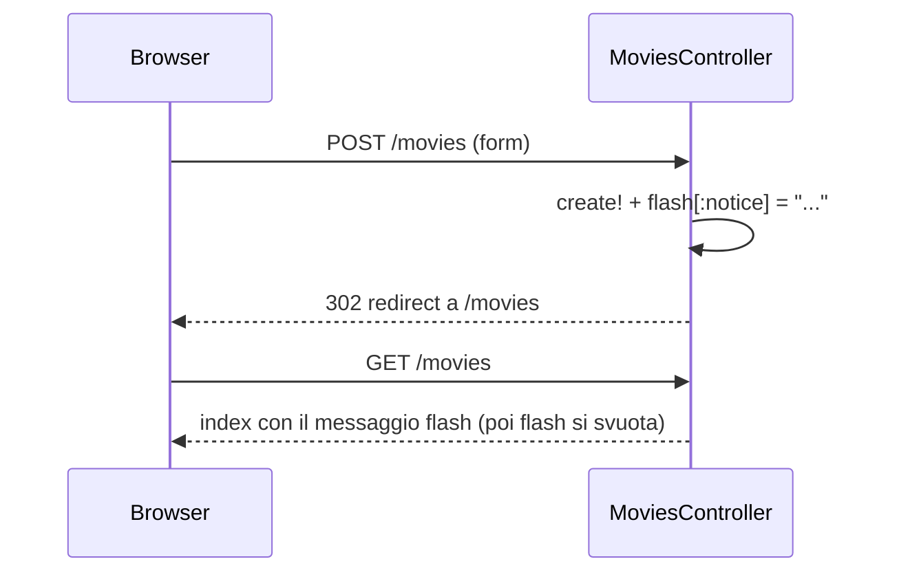

# Rails Parte 2

> [!abstract]
> Seconda lezione su Rails, dedicata a **controller e view**: come le route e i loro *helper* si collegano alle azioni del controller, come un'azione sceglie e popola una view **ERB**, come si raccolgono dati dall'utente con i **form helper** e come il controller li usa, il **redirect** con `flash[]`. Poi tre meccanismi **DRY** per scrivere meno codice MVC: **view partial**, **model validation** (con le *lifecycle callback* di Active Record) e **controller filter**. Chiude con le tecniche di **debugging**: leggere il backtrace e strumentare il codice.
>
> Continua [[05 - LASS - Rails Parte 1]] (model, migration, route di default) e prepara [[07 - LASS - Rails Parte 3]] (associazioni tra model). Il controller filter per l'utente corrente anticipa i temi di [[14 - LASS - Autenticazione]]; i form e i parametri sono la porta d'ingresso degli attacchi di [[17 - LASS - Sicurezza delle Web Application]].
>
> Indice dei concetti: [[MOC - Lab Architetture Software e Sicurezza]]. Materiale basato sulle slide del prof. Armando Fox.

---

## More on Routes

Nella lezione precedente si è visto che il sottosistema di **routing** di Rails prepara un hash **`params[]`** e lo mette a disposizione del controller.

- Il comando **`rake routes`** (oggi `bin/rails routes`) mostra tutte le route definite implicitamente dal file `routes.rb`.
- Ad esempio la route di `show` compare come `GET movies/:id`, e `params[:id]` conterrà il valore dell'ID estratto dall'URI.
- Rails offre anche un modo semplice per generare **form HTML** i cui campi hanno nomi tali che un altro valore di `params[]` renda facile creare l'oggetto (vedi [[#Acting on Collected Data|più avanti]]).
- Gli URI delle route di default corrispondono al nome della risorsa, ma si può cambiare questo comportamento usando i **route helper**: separano **cosa fa** la route dal suo **URI effettivo**.

## Routes and Controllers

Vedi [[Routing in Rails]].

Anche i metodi dei controller (in Rails si chiamano **azioni**) gestiscono le operazioni RESTful seguendo delle **convenzioni**. Se `routes.rb` contiene la sola riga `resources :movies`, si ottengono queste route REST:

![[LASS-L06-p03.png]]

| Helper | URI restituito | Route RESTful | Azione |
|---|---|---|---|
| `movies_path` | `/movies` | `GET /movies` | index |
| `movies_path` | `/movies` | `POST /movies` | create |
| `new_movie_path` | `/movies/new` | `GET /movies/new` | new |
| `edit_movie_path(m)` | `/movies/1/edit` | `GET /movies/:id/edit` | edit |
| `movie_path(m)` | `/movies/1` | `GET /movies/:id` | show |
| `movie_path(m)` | `/movies/1` | `PUT /movies/:id` | update |
| `movie_path(m)` | `/movies/1` | `DELETE /movies/:id` | destroy |

Gli **helper** (`movie_path(m)`) sono metodi generati automaticamente che restituiscono l'URI: nelle view si scrive `movie_path(m)` e non `"/movies/#{m.id}"`, così se un giorno l'URI cambia basta modificare `routes.rb` (principio [[Don't Repeat Yourself|DRY]]). Lo stesso helper vale per più route: è il **metodo HTTP** a distinguere show, update e destroy.

Le route di default si aspettano un file **`controllers/movies_controller.rb`** che definisce una classe **`MoviesController`** (che, come i model ereditano da `ActiveRecord::Base`, eredita da **`ApplicationController`**) con **7 metodi d'istanza** (`index`, …) corrispondenti alle azioni RESTful della tabella.

Le azioni seguono tipicamente questo schema:
1. **raccogliere le informazioni** della richiesta RESTful (parametri, ID della risorsa, ecc.);
2. **decidere quali operazioni ActiveRecord** servono (es. `index` deve leggere tutti i film della tabella `movies`);
3. **impostare variabili d'istanza** con ciò che va mostrato nella view;
4. **renderizzare una view** da restituire come risultato.

```ruby
class MoviesController < ApplicationController
  def index
    @movies = Movie.all          # 2 e 3: legge i film e li mette in @movies
  end                            # 4: render implicito di views/movies/index.html.erb
  def show
    @movie = Movie.find(params[:id])   # 1, 2, 3
  end
end
```

## Controllers and Views

Vedi [[Embedded Ruby ERB]].

Come fa un'azione a **scegliere una view** e a **passarle informazioni**?

- Quando un'azione termina, Rails **cerca e renderizza** la view chiamata `app/views/<model-name>/<action>.html.erb` (convenzione: per `MoviesController#index` → `app/views/movies/index.html.erb`).
- Le view sono gestite da **`ActionView::Base`**. Una view è **HTML inframmezzato da tag Embedded Ruby (ERB)**, che permettono di **interpolare nell'HTML il risultato di codice Ruby**. Ad esempio si possono usare le **variabili d'istanza** del controller.

```erb
<h1>All movies</h1>
<% @movies.each do |movie| %>
  <p><%= movie.title %></p>
<% end %>
```

`<% ... %>` esegue codice Ruby senza stampare nulla (qui il ciclo), `<%= ... %>` lo esegue e inserisce il risultato nell'HTML (qui il titolo). Rails applica automaticamente l'*escaping* HTML a ciò che esce da `<%= %>`, una difesa contro il [[17 - LASS - Sicurezza delle Web Application#A3 – Cross-Site Scripting (XSS)|Cross-Site Scripting]].

Ma come fanno le variabili d'istanza di un oggetto (`MoviesController`) a diventare disponibili in un oggetto di un'altra classe (`ActionView::Base`)? Normalmente in Ruby le variabili d'istanza sono private. Rails usa la **metaprogrammazione** di Ruby per **copiare le variabili d'istanza del controller** dentro l'oggetto view :-)

## HTML

L'**HTML** è il linguaggio di markup standard per i documenti da visualizzare nel browser; descrive la **struttura** della pagina. Il **CSS** descrive **come presentarla** (layout, colori, font), separando presentazione e contenuto. Vedi [[04 - LASS - SaaS Essentials#View: la pagina HTML|lezione 4]].

![[LASS-L06-p07.png]]

Lo stesso documento HTML minimo della lezione 4 (`<!DOCTYPE html>`, `<html>`, `<head>` con `<title>`, `<body>` con un `<div>` e un paragrafo `Hello world!`). In più la slide ricorda la **forma generale di un elemento HTML**:

```html
<tag attribute1="value1" attribute2="value2">content</tag>
```

Le view viste finora **non sono HTML valido**: mancano `DOCTYPE`, `<html>`, `<head>` e `<body>`. Questi tag si trovano invece in un file speciale che **avvolge tutte le view** per default: il **layout** dell'applicazione. La view di ogni azione viene inserita al posto di `<%= yield %>` nel layout.

> [!warning] Correzione
> La slide indica il file come `views/application.html.erb`. Il percorso corretto in Rails è **`app/views/layouts/application.html.erb`** (è lo stesso file citato poco dopo per i messaggi `flash`).

## Collecting Data from Users

Come si mostra un **form da compilare**? In Rails si usa un'**azione** (con la sua route). Creazione di un film in RottenPotatoes:
- la route **`GET /movies/new`** identifica l'azione, e l'helper **`new_movie_path`** genera la parte di URI della route;
- l'azione è gestita dal metodo **`MoviesController#new`**;
- l'azione renderizza la view **`app/views/movies/new.html.erb`**.

Intuitivamente la view deve contenere un **form HTML**. L'azione del controller che riceverà i dati deve **sapere come si chiamano i campi** del form, per estrarre i dati e popolare un oggetto `Movie`. Per questo Rails usa i **form tag helper**.

### Form Tag Helper

Vedi [[Form Tag Helper]].

![[LASS-L06-p09.png]]

```erb
<h2>Create New Movie</h2>
<%= form_tag movies_path, :method => :post, :class => 'form' do %>
  <%= label :movie, :title, 'Title', :class => 'form-control' %>
  <%= text_field :movie, :title, :class => 'form-control' %>
  <%= label :movie, :rating, 'Rating', :class => 'form-control' %>
  <%= select :movie, :rating, ['G','PG','PG-13','R','NC-17'], :class => 'form-control' %>
  <%= label :movie, :release_date, 'Released On' %>
  <%= date_select :movie, :release_date, :class => 'form-control' %>
  <%= submit_tag 'Save Changes' %>
<% end %>
```

**Argomenti** di `form_tag`: l'**URI a cui inviare** il form (qui `movies_path`, cioè `/movies`) e un **hash di opzioni**, come il **metodo HTTP** con cui inviarlo (`:post`). Inviare in `POST` a `/movies` significa, per le route RESTful, chiamare l'azione **`create`**.

Dentro il form:
- `label` genera l'etichetta di un campo;
- `text_field :movie, :title` genera un campo di testo con nome **`movie[title]`**;
- `select :movie, :rating, [...]` genera un menu a tendina con le cinque valutazioni americane (G, PG, PG-13, R, NC-17), con nome `movie[rating]`;
- `date_select` genera i menu per giorno, mese e anno;
- `submit_tag` genera il pulsante di invio;
- `:class => 'form-control'` aggiunge la classe CSS di Bootstrap.

### HTML Forms

L'elemento HTML **`<form>`** rappresenta una sezione del documento con **controlli interattivi per inviare informazioni**. Riferimenti: guides.rubyonrails.org/form_helpers.html e le pagine MDN su `<form>` e `<input>`.

![[LASS-L06-p10.png]]

Un form HTML elementare: due campi di testo, *First name* (John) e *Last name* (Doe), e un pulsante *Submit*. È ciò che il browser mostra a partire dai tag `<form>` e `<input>`.

**I dati inviati con il form finiscono nell'hash `params`.**

## Acting on Collected Data

Come vengono resi disponibili all'azione del controller i dati inseriti dall'utente? Sempre con la creazione di un film:
- il form viene inviato all'azione **`create`** del controller, che deve **analizzare le informazioni** del form e usarle per **creare un nuovo film** nel database (allo stesso modo `update` aggiornerà un film esistente);
- i campi creati dal form tag helper hanno nomi della forma **`movie[title]`**, `movie[rating]`, ecc.: Rails li raccoglie in un **hash annidato**, disponibile come `params[:movie]`;
- si può quindi passarlo direttamente: **`Movie.create!(params['movie'])`**.

```ruby
# params dopo l'invio del form:
# { "movie" => { "title" => "Inception", "rating" => "PG-13", ... } }
def create
  @movie = Movie.create!(params['movie'])
  # ...notificare l'utente
end
```

A questo punto basta **avvisare l'utente** che l'azione è stata completata.

> [!warning] Correzione (versione di Rails)
> Da **Rails 4** in poi, `Movie.create!(params['movie'])` solleva `ActiveModel::ForbiddenAttributesError`: Rails rifiuta di creare un oggetto da un hash di parametri non filtrato. È una protezione contro il **mass assignment**: un utente malintenzionato potrebbe aggiungere al form un campo `movie[admin]=true` o `movie[user_id]=…` e modificare attributi che non dovrebbe toccare. Bisogna usare le **strong parameters**, dichiarando esplicitamente quali campi sono ammessi:
> ```ruby
> def create
>   @movie = Movie.create!(movie_params)
> end
> private
> def movie_params
>   params.require(:movie).permit(:title, :rating, :description, :release_date)
> end
> ```
> La forma della slide è quella del libro (scritto per Rails 3). Il problema del mass assignment è un esempio di ciò che la [[17 - LASS - Sicurezza delle Web Application|lezione 17]] chiama *white list input validation*.

## DRY Redirection and flash[]

Vedi [[Flash e Redirect Rails]].

Per notificare il successo o il fallimento, una **view separata** sarebbe scomoda. Il modo DRY è fare un **redirect HTTP verso una view già esistente** (es. l'elenco dei film), che può essere configurata per mostrare un messaggio in alto quando serve.

- **`flash[]`** è un oggetto speciale disponibile nel controller, usato spesso insieme al metodo **`redirect_to`**.
- Se ci si mette qualcosa durante l'azione corrente, lo si può leggere durante **l'azione immediatamente successiva** (e **solo in quella**).
- Per convenzione `flash[:notice]` è per i messaggi informativi, `flash[:alert]` per gli errori.
- Dove mostrarli? Il layout `app/views/layouts/application.html.erb` è un buon candidato, perché avvolge tutte le pagine.

```ruby
def create
  @movie = Movie.create!(movie_params)
  flash[:notice] = "#{@movie.title} was successfully created."
  redirect_to movies_path
end
```

Perché serve `flash` e non basta una variabile d'istanza? Perché il redirect provoca una **nuova richiesta HTTP**, e HTTP è [[04 - LASS - SaaS Essentials#HTTP è stateless: i cookie|stateless]]: le variabili dell'azione `create` non esistono più quando arriva la richiesta `GET /movies`. `flash` sopravvive esattamente per una richiesta (Rails lo memorizza nella sessione).



## DRY Ways to Write MVC Code

Tre meccanismi che Rails fornisce per ridurre il codice MVC da scrivere:
1. **view partial**: per esprimere **pezzi riutilizzabili** di una view;
2. **model validation**: per **controllare la validità dei dati** quando si manipolano i model;
3. **controller filter**: per **controllare o preparare condizioni comuni** a più azioni.

## View Partials

Vedi [[View Partial]].

In Rails un **partial** è un **pezzo di contenuto che può comparire in più view**.
- Il nome del file **deve iniziare con un underscore** (`_movie.html.erb`); nel codice che lo richiama, invece, l'underscore **non si scrive** (`render partial: 'movie'`).
- Un partial ha accesso anche alle **variabili d'istanza** della view che lo include.

![[LASS-L06-p14-1.png]]

Il partial `_movie.html.erb`: una riga (`<div class="row">`) con tre colonne Bootstrap, il **titolo** come link alla pagina del film (`link_to movie.title, movie_path(movie)`), la **valutazione** e la **data di uscita** formattata con `strftime('%F')` (formato `AAAA-MM-GG`). Usa la variabile locale `movie`, non `@movie`: gliela passa `render`.

![[LASS-L06-p14-2.png]]

Nella view `index.html.erb`: un'intestazione di tabella con le tre colonne (*Title and More Info*, *Rating*, *Release Date*) e poi una sola riga

```erb
<%= render partial: 'movie', collection: @movies %>
```

che **renderizza il partial una volta per ogni film** di `@movies`, assegnando ogni volta il film alla variabile locale `movie`. Nella slide una freccia indica che il partial viene "espanso" sotto l'intestazione. Al posto di un ciclo `each` con l'HTML della riga dentro, l'HTML della riga sta in un solo posto e si può riusare (ad esempio in una pagina di ricerca).

> [!note]
> La slide dice che il nome deve iniziare con un underscore *"to not be used in code that references it"*: va inteso come "l'underscore non si usa nel codice che lo richiama", come spiegato sopra.

## Model Validation

Vedi [[Model Validation]].

- I controlli di validazione sono attivati dal metodo **`valid?`**, chiamato **esplicitamente** nel codice oppure **implicitamente** quando si prova a **salvare** il model nel database (`save`, `create`, `update`).
- Riferimento: guides.rubyonrails.org/v6.1/active_record_validations.html.
- Gli **errori di validazione** vengono registrati in un oggetto **`ActiveModel::Errors`** associato a ogni model, restituito dal metodo d'istanza **`errors`**.
- Una validazione può essere **condizionale** (applicata solo in certe condizioni specificate dall'utente).
- Le validazioni sono un **caso particolare delle lifecycle callback di Active Record**, che permettono di **intercettare un oggetto model in vari momenti significativi del suo ciclo di vita**.

Il vantaggio rispetto a controllare i dati nel controller: la regola sta **nel model**, quindi vale **ovunque** il model venga salvato (da un form, dalla console, da uno script, da un test). È di nuovo DRY.

![[LASS-L06-p16.png]]

```ruby
class Movie < ActiveRecord::Base
  def self.all_ratings ; %w[G PG PG-13 R NC-17] ; end #  shortcut: array of strings
  validates :title, :presence => true
  validates :release_date, :presence => true
  validate :released_1930_or_later # uses custom validator below
  validates :rating, :inclusion => {:in => Movie.all_ratings},
    :unless => :grandfathered?
  def released_1930_or_later
    errors.add(:release_date, 'must be 1930 or later') if
      release_date && release_date < Date.parse('1 Jan 1930')
  end
  @@grandfathered_date = Date.parse('1 Nov 1968')
  def grandfathered?
    release_date && release_date < @@grandfathered_date
  end
end
```

Riga per riga:
- `self.all_ratings` è un **metodo di classe** che restituisce l'elenco delle valutazioni; `%w[G PG ...]` è una scorciatoia per un array di stringhe;
- `validates :title, :presence => true`: il titolo è **obbligatorio**; lo stesso per la data di uscita;
- `validate :released_1930_or_later` (singolare, senza `s`): usa un **validatore personalizzato**, cioè il metodo definito sotto, che aggiunge un errore su `release_date` se il film è uscito prima del 1930;
- `validates :rating, :inclusion => {...}, :unless => :grandfathered?`: la valutazione deve essere **una di quelle ammesse**, **a meno che** il film sia "grandfathered", cioè uscito prima del 1° novembre 1968 (data di introduzione del sistema di rating MPAA: i film più vecchi possono non avere una valutazione standard). È una **validazione condizionale**;
- `@@grandfathered_date` è una **variabile di classe**;
- nota il controllo `release_date && ...`: se la data manca, il confronto non viene fatto (sarebbe un errore su `nil`); ci pensa già la validazione `presence`.

Per provare la validazione nella console c'è un esempio interattivo (gist di Armando Fox): ad esempio `m = Movie.new(title: '', rating: 'XYZ'); m.valid?` restituisce `false` e `m.errors.full_messages` elenca i problemi.

### Le lifecycle callback

![[LASS-L06-p17.png]]

Il diagramma mostra **in quale ordine** Rails chiama le callback quando un oggetto viene salvato:

| Passo | Nuovo record (`movie.create` / `save`) | Record esistente (`movie.update_attributes` / `save`) |
|---|---|---|
| 1 | `before_validation`, `before_validation_on_create` | `before_validation`, `before_validation_on_update` |
| 2 | **esecuzione delle validazioni** (definite in `movie.rb`) | **esecuzione delle validazioni** |
| 3 | `after_validation`, `after_validation_on_create` | `after_validation`, `after_validation_on_update` |
| 4 | `before_save`, `before_create` | `before_save`, `before_update` |
| 5 | `INSERT INTO movies...` | `UPDATE movies...` |
| 6 | `after_create`, `after_save` | `after_update`, `after_save` |

Le callback in grassetto nella figura (`before_validation`, `after_validation`, `before_save`, `after_save`) valgono per entrambi i casi; le altre solo per la creazione o solo per l'aggiornamento. Se una validazione fallisce, ci si ferma al passo 2: il database non viene toccato.

> [!note] Nomi aggiornati
> Il diagramma viene da una versione vecchia di Rails. Oggi `before_validation_on_create` si scrive `before_validation :metodo, on: :create` (idem per `update`), e `update_attributes` è stato rimosso in Rails 6.1: si usa `update`.

![[LASS-L06-p18.png]]

```ruby
class Movie < ActiveRecord::Base
  before_save :capitalize_title
  def capitalize_title
    self.title = self.title.split(/\s+/).map(&:downcase).
      map(&:capitalize).join(' ')
  end
end
```

Questa callback **`before_save`** mette in **maiuscolo l'iniziale di ogni parola** del titolo, rende minuscolo il resto e **comprime gli spazi multipli** in uno solo:
- `split(/\s+/)` divide il titolo su una o più spaziature (ecco come spariscono gli spazi multipli);
- `map(&:downcase)` rende ogni parola minuscola (`&:downcase` è la scorciatoia per il blocco `{ |w| w.downcase }`);
- `map(&:capitalize)` mette la maiuscola iniziale;
- `join(' ')` ricompone con un solo spazio.

Esempio: `"the   GODFATHER part ii"` diventa `"The Godfather Part Ii"`. Il dato viene **normalizzato** prima di finire nel database, qualunque sia la sua provenienza.

## Controller Filters

Vedi [[Controller Filter]].

- Un **controller filter** è un metodo che **controlla se certe condizioni sono vere prima che un'azione venga eseguita**, oppure **prepara condizioni comuni** su cui molte azioni si basano.
- Se le condizioni non sono soddisfatte, il filtro può **"fermare lo spettacolo"** renderizzando una view o facendo un **redirect** verso un'altra azione; in quel caso l'azione richiesta non viene eseguita.
- Riferimento: guides.rubyonrails.org/v6.1/action_controller_overview.html#filters.
- I filtri si applicano normalmente a **tutte le azioni** del controller, ma si possono limitare con **`:only`** o **`:except`**.
- I filtri vengono eseguiti **nell'ordine in cui sono dichiarati**.

Caso d'uso tipico: **ricordare un utente dopo l'autenticazione**. Come si vedrà più avanti nel corso, i controller Rails hanno una **`session[]`** per ogni utente, in cui si possono memorizzare piccole quantità di dati che **persistono tra le richieste** (tramite un cookie). Qui si identifica l'utente tramite `user_id`.

![[LASS-L06-p20.png]]

```ruby
class ApplicationController < ActionController::Base
  before_filter :set_current_user
  protected # prevents method from being invoked by a route
  def set_current_user
    # we exploit the fact that the below query may return nil
    @current_user ||= Moviegoer.where(:id => session[:user_id])
    redirect_to login_path and return unless @current_user
  end
end
```

- il filtro è dichiarato in `ApplicationController`, da cui ereditano **tutti** i controller: vale per tutta l'app;
- `protected` impedisce che `set_current_user` sia invocabile come azione da una route;
- `@current_user ||= ...` assegna solo se `@current_user` è ancora `nil` (operatore *or-assign*);
- se non c'è un utente loggato, si fa il redirect alla pagina di login e `return` interrompe il filtro; siccome il filtro ha fatto un redirect, l'azione richiesta non viene eseguita.

> [!warning] Correzione
> Il codice della slide ha due problemi:
> 1. **`before_filter` non esiste più**: è stato deprecato in Rails 5.0 e rimosso in Rails 5.1. Con Rails 6.1 (la versione usata nel corso) si scrive **`before_action :set_current_user`**.
> 2. **`Moviegoer.where(...)` non restituisce mai `nil`**: restituisce una *relation* (una collezione, eventualmente vuota), che in Ruby è sempre [[Truthy e Falsey|truthy]]. Quindi il commento "the below query may return nil" è sbagliato, `@current_user` non è mai `nil` e il redirect al login **non scatta mai**: anche un utente non autenticato passerebbe il filtro. Bisogna usare un metodo che restituisce un singolo oggetto o `nil`:
> ```ruby
> @current_user ||= Moviegoer.find_by(id: session[:user_id])
> ```
> (vedi `find_by` in [[07 - LASS - Rails Parte 3#ActiveRecord Query Interface|lezione 7]]). Inoltre `login_path` presuppone una route di login definita in `routes.rb`, e nell'app servirà un `skip_before_action` sull'azione di login stessa, altrimenti la pagina di login reindirizza a se stessa all'infinito.
>
> È un ottimo esempio di come un piccolo errore nel controllo di accesso diventi una falla di sicurezza: è la categoria *Broken Authentication* / *Missing Function Level Access Control* della [[17 - LASS - Sicurezza delle Web Application|lezione 17]].

### Controller Filters vs. Model Validation

![[LASS-L06-p21.png]]

La tabella confronta i due meccanismi con il vocabolario della **programmazione orientata agli aspetti** (*aspect-oriented programming*, AOP), dove un *advice* è il codice da eseguire e un *pointcut* è il punto in cui eseguirlo:

| | Validation | Filter |
|---|---|---|
| **Advice** (DRYness) | controllare gli **invarianti del model** | controllare le condizioni per **permettere a un'azione del controller** di essere eseguita |
| **Pointcut** | gli hook del ciclo di vita dei model AR | prima e/o dopo qualsiasi metodo pubblico del controller |
| Può cambiare il flusso di esecuzione? | **no** | **sì** (redirect, render) |
| Si può definire l'advice in una funzione arbitraria? | sì; ci sono scorciatoie per i casi comuni (`presence`, `inclusion`…) | sì, bisogna fornire una funzione |
| Informazioni sugli errori? | ogni oggetto model ha un oggetto **`errors`** associato | da catturare in **`flash[]`**, **`session[]`** o in una variabile d'istanza |

In sintesi: la validazione protegge **i dati**, il filtro protegge **le azioni**.

## Debugging

Vedi [[Debugging Rails]].

Con così tante parti in movimento, è inevitabile che qualcosa vada storto.
- Usare **buoni strumenti**: un IDE per gli errori di sintassi, e lavorare con i colleghi.
- Ovviamente gli strumenti non bastano. Le attività da fare:
  - **risalire alla sorgente dell'errore** il più vicino possibile;
  - **strumentare** il codice vicino all'errore;
  - fare **debug interattivo** (gli strumenti cambiano con la versione di Rails, ad esempio `byebug` in Rails 6.1);
  - consultare i **forum di domande e risposte** (Stack Overflow).

### Backtracing

**PRENDERSI IL TEMPO DI LEGGERE DAVVERO IL MESSAGGIO DI ERRORE!**

I messaggi di errore di Ruby sono lunghi perché contengono un **backtrace**: mostra non solo **dove** si è verificato l'errore, ma **l'intera catena di chiamate di funzione attive** (non ancora ritornate) che hanno portato al punto in cui l'errore si è manifestato.

Alcuni bug sono difficili da capire senza contesto. Ad esempio:

```
undefined method 'foobar' for nil:NilClass
```

Significa che qualche calcolo **è fallito e ha restituito `nil`** invece dell'oggetto atteso, e ci si è dimenticati di controllare. **`NilClass`** è una classe speciale la cui **unica istanza è la costante `nil`** (vedi [[03 - LASS - Ruby Essentials#Condizioni, truthy e falsey|truthy e falsey]]). Il punto in cui il programma si ferma non è quello in cui nasce il problema: va cercata la riga che ha prodotto il `nil`, risalendo il backtrace. Un caso tipico è `Movie.find_by(...)` che non trova niente.

Ovviamente si può usare un motore di ricerca, e controllare il file `log/development.log`.

### Instrument

Si possono aggiungere istruzioni e meccanismi al codice per capire il problema:
- per un oggetto in una **view**, mostrarne una descrizione dettagliata: `<%= debug(@movie) %>` oppure `<%= @movie.inspect %>`;
- in un **metodo del controller**, sollevare un'eccezione per mostrare il valore che ci si aspetta in un punto preciso: `raise params.inspect` (la pagina di errore di Rails mostrerà il contenuto di `params`);
- in un **model o controller**, scrivere nel log: `Rails.logger.debug("msg")`.
