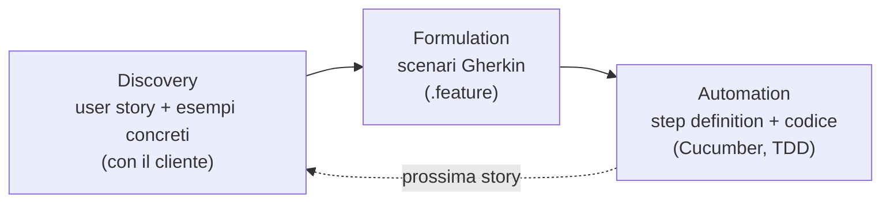

# Behavior-Driven Development

> [!abstract]
> Il **Behavior-Driven Development** (BDD) è il modo in cui, nel ciclo Agile, si decide **cosa** costruire: si parte dal **comportamento** che il cliente vuole, descritto con **user story** concrete. La lezione segue i tre passi del BDD: **Discovery** (user story nel formato Connextra, criteri **SMART**), **Formulation** (scenari scritti in **Gherkin** ed eseguiti da **Cucumber**, con i passi Given/When/Then e le *step definition*) e **Automation**. Chiude con i **mockup lo-fi** e gli **storyboard** dell'interfaccia, il passaggio all'HTML/CSS, e una valutazione di quando il BDD conviene.
>
> Riprende i valori Agile di [[01 - LASS - Software Development Process#Metodi Agile|lezione 1]] e si applica alle app Rails delle lezioni 5–7 (l'esempio è ancora RottenPotatoes). Il **TDD**, che si occupa dell'implementazione, e gli strumenti Cucumber/Capybara/RSpec sono approfonditi in [[15 - LASS - Testing BDD e TDD]].
>
> Indice dei concetti: [[MOC - Lab Architetture Software e Sicurezza]]. Materiale basato sulle slide del prof. Armando Fox.

---

## Perché i progetti software falliscono

Perché?
- **non fanno quello che il cliente vuole**;
- sono **in ritardo**;
- sono **fuori budget**;
- sono **difficili da mantenere ed evolvere**;
- **tutte le precedenti**.

Sono state inventate diverse metodologie per affrontare questi problemi (vedi [[01 - LASS - Software Development Process#Processi di sviluppo del software|lezione 1]]). La metodologia **Agile** ci prova per molti tipi comuni di software.

Ricorda: in Agile **non si passa** (con persone diverse) da una modalità di sviluppo a una di manutenzione. **Si è sempre in manutenzione**: ogni iterazione modifica un software che già funziona.

## Metodi Agile

Vedi [[Agile Manifesto]].

- *"Individuals and interactions over processes and tools"*
- *"Working software over comprehensive documentation"*
- *"Customer collaboration over contract negotiation"*
- *"Responding to change over following a plan"*

Tratti tipici:
- **accogliere il cambiamento**;
- **raffinare continuamente** un prototipo funzionante ma incompleto;
- affidarsi a un **feedback rapido e costante** del cliente;
- enfasi sul **test-driven development**;
- **user story** per raggiungere un accordo.

## Un'iterazione del ciclo di vita Agile

![[LASS-L08-p04.png]]

Il diagramma (dal libro di Fox e Patterson) mostra un'iterazione come una sequenza che si ripete (la freccia esterna riporta all'inizio):
1. **Talk to Customer**: si parla con il cliente;
2. **Behavior-Driven Design**: si traducono le richieste in user story e scenari (questa lezione);
3. **Test-Driven Development**: si implementa scrivendo prima i test ([[15 - LASS - Testing BDD e TDD|lezione 15]]);
4. **Team Coordination**: ci si coordina nel gruppo (git, pianificazione);
5. **Deploy to Cloud**: si mette l'app in produzione.

A sinistra, con frecce tratteggiate, gli argomenti che influenzano più fasi: il **legacy code** (codice esistente da capire e modificare, a cui si arriva dal dialogo con il cliente) e i **design pattern** (che orientano BDD, TDD e il lavoro sul codice legacy). Le prime due fasi sono evidenziate in grigio perché sono il tema di questa lezione.

## Behaviour-Driven Development (BDD)

Vedi [[Behavior-Driven Development]].

Il **BDD** pone domande sul **comportamento** di un'applicazione **prima e durante** lo sviluppo.

Si occupa di **validazione** (*"build the right thing"*, costruire la cosa giusta), non solo di **verifica** (*"build the thing right"*, costruirla bene).

| | Domanda | Chi risponde |
|---|---|---|
| **Validazione** | stiamo costruendo il prodotto **giusto**? | il cliente (BDD, test di accettazione) |
| **Verifica** | stiamo costruendo il prodotto **nel modo giusto**? | gli sviluppatori (TDD, unit test) |

Facendo domande sul comportamento dell'app, il BDD **colma il divario tra le persone di business e quelle tecniche**:
- **comprensione condivisa** del problema da risolvere;
- lavoro in **iterazioni piccole e rapide** per aumentare il feedback;
- **documentazione prodotta automaticamente** e **verificata** rispetto al comportamento reale dell'app (gli scenari sono test eseguibili: se l'app cambia e la documentazione no, i test falliscono).

**User story**: esempi **concreti** e reali che illustrano come vogliamo che il sistema si comporti. **Sostituiscono i documenti di progettazione** degli altri approcci.

- Il BDD si concentra sul **comportamento** dell'app invece che sulla sua **implementazione**; di quest'ultima si occuperà, ad esempio, il **Test-Driven Development**.
- Le user story vengono dalla comunità **HCI** (*Human Computer Interface*), dove si scrivevano su **schede 3x5 pollici** con **una-tre frasi** in linguaggio quotidiano non tecnico.
- Le user story devono essere **testabili**, **abbastanza piccole da essere implementate in un'iterazione**, e avere **valore di business** di per sé.

## BDD steps

Il BDD incoraggia a lavorare in **iterazioni rapide**, scomponendo continuamente i problemi dell'utente in **piccoli pezzi** che possano attraversare il processo di sviluppo il più velocemente possibile. Tre passi:

1. **Discovery**: si prende un piccolo cambiamento in arrivo (una **user story**) e si discute di **esempi concreti** della nuova funzionalità, per esplorare, scoprire e concordare i dettagli di ciò che ci si aspetta.
2. **Formulation**: si **documentano** quegli esempi in un formato **automatizzabile**, e si verifica che ci sia accordo.
3. **Automation**: si **implementa** il comportamento descritto da ogni esempio documentato, **partendo da un test automatico** che guida lo sviluppo del codice.



## Discovery - User Story

Vedi [[User Story]].

Una **user story** è un **piccolo pezzo di funzionalità di valore**, usato per **pianificare e dare priorità** al lavoro in un team agile.
- **1–3 frasi** in linguaggio informale.
- Descrive **come ci si aspetta che l'applicazione venga usata**: illustra una **funzionalità** (*feature*) del sistema.
- È scritta **dal punto di vista dell'utente finale**.

Il **template Connextra** è molto diffuso:

```
As a <type of user>,
So that <I can achieve some goal>,
I want to <do some task>
```

(*In quanto [tipo di utente], per [raggiungere un obiettivo], voglio [fare qualcosa]*.) La forma più comune in letteratura mette *I want to* prima di *So that*; il libro di Fox e Patterson usa l'ordine della slide. Quello che conta è che ci siano tutti e tre gli elementi: **chi**, **cosa**, **perché**.

### Un esempio con RottenPotatoes

![[LASS-L08-p09.png]]

```gherkin
Feature: Add a movie to RottenPotatoes
  As a movie fan
  So that I can share a movie with other movie fans
  I want to add a movie to RottenPotatoes database

Scenario: Add a movie
  Given I am on the RottenPotatoes home page
  When I follow "Add new movie"
  Then I should be on the Create New Movie page
  When I fill in "Title" with "Hamilton"
  And I select "PG-13" from "Rating"
  And I select "July 4, 2020" as the "Released On" date
  And I press "Save Changes"
  Then I should be on the RottenPotatoes home page
  And I should see "Hamilton"
```

In alto la user story nel formato Connextra (un appassionato di cinema vuole aggiungere un film per condividerlo); sotto, uno **scenario** concreto che la illustra passo per passo: dalla home page si segue il link per aggiungere un film, si compila il form (titolo, rating, data) e si salva; alla fine si torna alla home page e il film compare nell'elenco. È esattamente il flusso del form di [[06 - LASS - Rails Parte 2#Collecting Data from Users|lezione 6]], descritto però dal punto di vista dell'utente. Il nome "RottenPotatoen" nel titolo della slide è un refuso per RottenPotatoes.

## SMART User Stories

Vedi [[SMART User Stories]].

Cosa rende **buona** una user story? L'acronimo **SMART**:

| Lettera | Criterio | Significato | Esempio |
|---|---|---|---|
| **S** | Specific | dice esattamente cosa si vuole | ❌ *User can search for a movie* (vago) → ✅ *User can search for a movie by title* |
| **M** | Measurable | ogni story deve essere **testabile**: per alcuni input validi ci sono risultati attesi noti | ❌ *RottenPotatoes should have good response time* → ✅ *When adding a movie, 99% of Add Movie pages should appear within 3 seconds* |
| **A** | Achievable | idealmente si implementa **una story in un'iterazione Agile**; se se ne completa meno di una per iterazione, vanno **suddivise** in story più piccole | |
| **R** | Relevant | deve avere **valore di business** per uno o più stakeholder; per verificarlo si continua a chiedere loro **perché** | |
| **T** | Timeboxed | si **smette di sviluppare** una story quando si supera il budget di tempo | |

**Relevant** e il **Minimum Viable Product** (vedi [[Minimum Viable Product]]): l'**MVP** è un **sottoinsieme** dell'insieme completo delle funzionalità che, una volta completato, ha **valore di business nel mondo reale**. Le story rilevanti per l'MVP vengono prima.

**Timeboxed**: quando si sfora il tempo previsto, o **si rinuncia** (dividendo la story in story più piccole) o si **ripianifica** ciò che resta secondo una nuova stima. Se dividere non aiuta, si torna dal cliente per trovare **la parte di maggior valore** della story che si può fare in fretta.

## Formulation - Cucumber

Vedi [[Cucumber e Gherkin]].

Si cerca un **formato di user story** che possa essere letto **sia dalle persone** (clienti e sviluppatori) **sia dai computer**.
- **Non deve sembrare codice**, così è chiaro per il cliente e si può usare per raggiungere un accordo;
- ma **non deve essere nemmeno testo libero**, altrimenti un computer non può eseguirlo.

**Cucumber** è uno strumento che trasforma user story comprensibili dal cliente in:
- **test di accettazione** (*acceptance test*), per assicurarsi che il **cliente sia soddisfatto**;
- **test di integrazione** (*integration test*), per assicurarsi che le **interfacce tra i moduli** abbiano assunzioni coerenti e comunichino correttamente.

Nel contesto di Cucumber una user story corrisponde a **una singola feature** con **uno o più scenari** che mostrano modi diversi in cui la feature viene usata.

### Gherkin con Cucumber

**Gherkin** è un insieme di **regole grammaticali** che rende il testo semplice abbastanza **strutturato** da essere capito da Cucumber. I criteri di accettazione sono simili al template Connextra.

Gherkin serve a più scopi:
- **specifica eseguibile non ambigua**;
- **test automatici** con Cucumber;
- **documentazione** di come il sistema si comporta davvero.

I documenti Gherkin si salvano in file di testo **`.feature`** (nella cartella `features/` dell'app).

### Struttura di Gherkin

Riferimento: cucumber.io/docs/gherkin/reference/. Parole chiave:

| Keyword | Ruolo |
|---|---|
| `Feature` | descrizione di alto livello della funzionalità, raggruppa gli scenari |
| `Rule` | una regola di business, raggruppa gli esempi che la illustrano |
| `Example` (o `Scenario`) | un esempio concreto, fatto di passi |
| `Given`, `When`, `Then`, `And`, `But` (o `*`) | i **passi** (*step*) |
| `Background` | passi comuni a tutti gli scenari della feature (eseguiti prima di ciascuno) |
| `Scenario Outline` (o `Scenario Template`) | uno scenario "con parametri", eseguito più volte |
| `Examples` (o `Scenarios`) | la tabella di valori per lo Scenario Outline |

Un insieme di file separati, le **step definition**, definisce il **codice Ruby** che testa questi passi.

### Feature

Lo scopo della keyword **`Feature`** è dare una **descrizione di alto livello** di una funzionalità del software e **raggruppare gli scenari** correlati.

Sotto `Feature` si può aggiungere **testo libero** per descriverla meglio. La descrizione finisce quando si inizia una riga con una delle keyword `Rule`, `Example` o `Scenario`.

![[LASS-L08-p18.png]]

```gherkin
Feature: Guess the word

  The word guess game is a turn-based game for two players.
  The Maker makes a word for the Breaker to guess. The game
  is over when the Breaker guesses the Maker's word.
```

L'esempio (dalla documentazione di Cucumber) è il gioco "indovina la parola": il titolo della feature seguito da una descrizione in linguaggio naturale delle regole (due giocatori a turni, il *Maker* sceglie una parola che il *Breaker* deve indovinare).

### Example / Scenario

Vedi [[Given When Then]].

È un **esempio concreto che illustra una regola di business**. Consiste in una **lista di passi**, e segue sempre lo stesso schema:
- descrivere un **contesto iniziale** (passi `Given`);
- descrivere un **evento** (passi `When`);
- descrivere un **risultato atteso** (passi `Then`).

Gli scenari si concentrano spesso sugli **"happy path"** (il caso in cui va tutto bene), ma è importante concordare con il cliente anche cosa deve succedere **quando le cose vanno male** (i **"sad path"**).

### Step: Given

I passi **`Given`** descrivono il **contesto iniziale** del sistema: impostano delle **precondizioni**. Il loro scopo è **mettere il sistema in uno stato noto** prima che l'utente (o un sistema esterno) inizi a interagire con esso (nei passi `When`).

Esempi: *Mickey and Minnie have started a game*; *I am logged in*; *Joe has a balance of £42*.

### Step: When

I passi **`When`** descrivono un **evento** o un'**azione**. È fortemente consigliato avere **un solo passo `When` per scenario** (uno scenario = un comportamento).

Esempi: *Guess a word*; *Invite a friend*; *Withdraw money*.

**Capybara** è una libreria Ruby che **simula come un utente interagisce** con l'applicazione: Cucumber la usa per simulare le azioni in un browser (cliccare, compilare form). Vedi [[15 - LASS - Testing BDD e TDD#Capybara, un utente finto|lezione 15]].

### Step: Then

I passi **`Then`** descrivono un **risultato atteso**. La step definition di un passo `Then` deve usare un'**asserzione** per confrontare il **risultato effettivo** (cosa fa davvero il sistema) con quello **atteso** (cosa il passo dice che dovrebbe fare).

Esempi: *See that the guessed word was wrong*; *Receive an invitation*; *Card should be swallowed* (il bancomat trattiene la carta).

> [!note]
> La slide dice "un solo `When` per scenario", ma l'esempio di RottenPotatoes sopra ne ha due (*When I follow…* e *When I fill in…*). È lo stile del libro di Fox, che descrive un intero percorso dell'utente; le linee guida di Cucumber preferirebbero spezzarlo in scenari più piccoli, usando un `Given` per lo stato di partenza ("Given I am on the Create New Movie page").

### Gherkin Example

![[LASS-L08-p23.png]]

```gherkin
Feature: Multiple site support
  Only blog owners can post to a blog, except administrators,
  who can post to all blogs.

  Background:
    Given a global administrator named "Greg"
    And a blog named "Greg's anti-tax rants"
    And a customer named "Dr. Bill"
    And a blog named "Expensive Therapy" owned by "Dr. Bill"

  Scenario: Dr. Bill posts to his own blog
    Given I am logged in as Dr. Bill
    When I try to post to "Expensive Therapy"
    Then I should see "Your article was published."

  Scenario: Dr. Bill tries to post to somebody else's blog, and fails
    Given I am logged in as Dr. Bill
    When I try to post to "Greg's anti-tax rants"
    Then I should see "Hey! That's not your blog!"

  Scenario: Greg posts to a client's blog
    Given I am logged in as Greg
    When I try to post to "Expensive Therapy"
    Then I should see "Your article was published."
```

- La feature descrive una **regola di autorizzazione**: solo il proprietario può scrivere sul proprio blog, tranne gli amministratori che possono scrivere ovunque.
- Il **`Background`** crea il contesto comune ai tre scenari (un amministratore Greg con il suo blog, un cliente Dr. Bill con il suo blog), evitando di ripeterlo (DRY).
- Tre scenari, ciascuno con un solo Given/When/Then.

Nella slide successiva la stessa feature è annotata: lo scenario in cui **Dr. Bill prova a scrivere sul blog di un altro e fallisce** è un **sad path**, quello in cui **Greg scrive sul blog di un cliente** (e ci riesce perché è amministratore) è un **happy path**. Anche il primo scenario (Dr. Bill sul proprio blog) è un happy path.

> [!tip] BDD e sicurezza
> Il sad path di questo esempio è a tutti gli effetti un **test di controllo degli accessi**. Scrivere scenari per "cosa non deve poter fare un utente" è un ottimo modo per evitare le vulnerabilità di autorizzazione della [[17 - LASS - Sicurezza delle Web Application#A7 – Missing Function Level Access Control|lezione 17]].

## Step Definitions

Vedi [[Step Definition]].

Le **step definition** collegano i passi Gherkin al **codice**.
- Una step definition **esegue l'azione** che il passo descrive: "cabla" la **specifica** all'**implementazione** → codice Ruby.
- Si usano le **espressioni regolari** per far corrispondere le frasi in inglese dei passi degli scenari alle step definition (vedi le regex in [[03 - LASS - Ruby Essentials#Espressioni regolari|lezione 3]]).

```ruby
# features/step_definitions/movie_steps.rb
When /^I fill in "(.*)" with "(.*)"$/ do |field, value|
  fill_in field, with: value          # Capybara compila il campo
end

Then /^I should see "(.*)"$/ do |text|
  expect(page).to have_content(text)  # asserzione sul risultato
end
```

Le parti tra parentesi nella regex vengono **catturate** e passate al blocco come argomenti: lo stesso passo funziona per *I fill in "Title" with "Hamilton"* e per qualunque altro campo e valore. Altri esempi sono in [[15 - LASS - Testing BDD e TDD#Step e step definition con le regex|lezione 15]].

## Lo-Fi User Interface Sketches e Storyboards

Vedi [[Lo-Fi UI e Storyboard]].

Molte applicazioni SaaS interagiscono con utenti finali, quindi quando si aggiunge una funzionalità di solito bisogna **specificare un'interfaccia utente** (UI). Parte del lavoro BDD è spesso **proporre una UI** che corrisponda alle user story.

La comunità HCI propone strumenti "da asilo" per generare i mockup: l'approccio **lo-fi** (*low-fidelity*, a bassa fedeltà) e i **prototipi su carta**, chiamati **sketch**. Idealmente si fanno sketch per **tutte le user story che coinvolgono una UI**.

![[LASS-L08-p26.png]]

Uno sketch a mano della pagina di RottenPotatoes per **creare un nuovo film**: titolo della pagina, campi *Movie Title*, *Movie Rating*, *Release Date*, una casella grande per la *Movie Description* e il pulsante *Save Changes*. È volutamente approssimativo: costa pochi minuti, si può buttare via e rifare, e il cliente si sente libero di criticarlo (con un prototipo "bello" tenderebbe a non farlo).

La stessa immagine compare anche nella slide successiva, che ripete il concetto con parole leggermente diverse: le slide 26 e 27 sono due versioni dello stesso testo.

Uno sketch lo-fi mostra **com'è la UI in un istante**. Ma bisogna anche mostrare **come gli sketch funzionano insieme** mentre l'utente interagisce con le pagine.

**Storyboarding**: lo storyboard di una UI è tipicamente un **albero o un grafo di schermate** guidato dalle diverse scelte dell'utente. Per farlo bisogna pensare a **tutte le interazioni** dell'utente con la web app: pagine o sezioni di pagine, form e pulsanti, popup.

![[LASS-L08-p28.png]]

Lo storyboard collega più sketch con frecce verdi: dalla pagina con **l'elenco di tutti i film** (tabella con titolo, rating, data, e il link *Add new movie*) si passa alla pagina **Create New Movie**; da lì, premendo *Save Changes*, si arriva alla pagina che mostra i **dettagli del film** appena creato (con un link per tornare all'elenco). Le frecce sono le interazioni dell'utente: lo storyboard è il grafo delle schermate.

## Dagli sketch lo-fi all'HTML/CSS

Dopo aver disegnato sketch e storyboard si è pronti a **scrivere l'HTML**.
- Con il lo-fi la chiave è ottenere prima una **buona struttura generale** dagli sketch, con **CSS minimo** (o nessuno) per far somigliare la view allo sketch.
- Si inizia guardando gli sketch e **dividendoli in blocchi** del layout dell'app Rails. Si usano tag **`<div>`** per le sezioni di layout ovvie.
- **Non serve renderla bella finché non funziona tutto!** Stili CSS, immagini e così via si possono aggiungere **dopo**. Si può ricorrere a framework CSS pronti come **Bootstrap**, che aiutano a ottenere velocemente un prototipo dall'aspetto accettabile (le classi `form-control`, `col-6`, `row` viste in [[06 - LASS - Rails Parte 2#View Partials|lezione 6]] sono di Bootstrap).

## Takeaway sul BDD

**Quando conviene**:
- il BDD è perfetto per progetti in cui i **requisiti sono poco chiari o cambiano rapidamente**;
- le user story rendono facile **dividere il progetto in piccoli incrementi**;
- schede 3x5 e mockup su carta tengono i **clienti non tecnici coinvolti** nella progettazione e nella definizione delle priorità.

**Quando non conviene**:
- in alcuni casi può essere **difficile o troppo costoso** avere un **contatto continuo con il cliente** (per esempio, il cliente potrebbe non voler partecipare);
- il BDD potrebbe **non scalare** a progetti **molto grandi** o ad applicazioni **safety critical**. In entrambi i casi è più adatto il [[01 - LASS - Software Development Process#Processi Plan-and-Document|Plan-and-Document]].

**Un altro rischio**: il progetto potrebbe **soddisfare i clienti ma non produrre una buona architettura software**, che è importante per la manutenzione. In questi casi, individuare i **design pattern** adatti alle circostanze e **fare refactoring** del codice quando serve può migliorare la qualità dell'architettura.

Il BDD può non sembrare all'inizio il modo naturale di sviluppare software. Ma una volta padroneggiato, **ripaga molte volte lo sforzo** nel lungo periodo per questo tipo di app.

Il BDD si sposa anche con la cultura della **comunità Ruby** (che ama il codice testabile, elegante e autodocumentante), a favore di pratiche di test che specificano comportamenti sia per **documentare l'intento** dello sviluppatore sia per fornire **test di accettazione eseguibili**.
