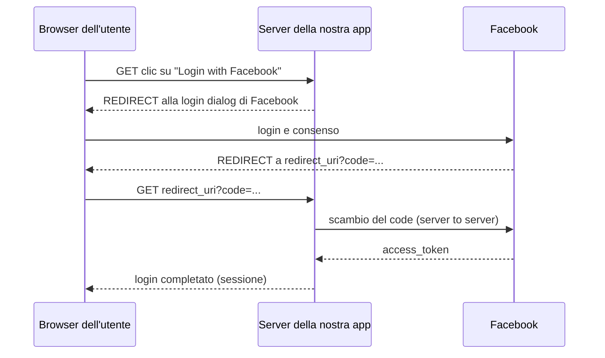

# Autenticazione

> [!abstract]
> Risponde alla prima domanda lasciata aperta da [[13 - LASS - Introduzione alla Sicurezza]]: **come si gestiscono le identità degli utenti?** Si definiscono **identità digitale** e **autenticazione** (identificazione + verifica), i tre fattori di verifica e l'**autenticazione a due fattori**. Poi la gestione delle **password** dal lato utente (regole, comportamenti reali, strategie consigliate) e dal lato sviluppatore: come **memorizzarle** in un database, attraverso cinque soluzioni sempre migliori (in chiaro, hash, hash con segreto fisso, hash con **salt**, **bcrypt**). Chiude con il flusso di **OAuth** (login con Facebook).
>
> Nelle app Rails la gestione della sessione dopo il login è quella vista con `session[]` e i filtri in [[06 - LASS - Rails Parte 2#Controller Filters|lezione 6]]; gli errori tipici di autenticazione e gestione delle sessioni sono la categoria A2 di [[17 - LASS - Sicurezza delle Web Application#A2 – Broken Authentication and Session Management|lezione 17]]. Approfondimenti nei corsi magistrali: [[12 CS Lower Level - Password Authentication]], [[Funzioni Hash Crittografiche]] (Telecomunicazioni), [[Rainbow Table]], [[OAuth]].
>
> Indice dei concetti: [[MOC - Lab Architetture Software e Sicurezza]].

---

## Identità digitali

Vedi [[Identità Digitale]].

Le **identità digitali** sono il modo in cui ogni individuo è **rappresentato nel mondo virtualizzato** dei sistemi software.

![[LASS-L14-p02.png]]

Il diagramma distingue tre livelli:
- **entità** (*entities*): i soggetti reali, una persona e un'organizzazione (l'edificio);
- **identità** (*identities*): le rappresentazioni digitali delle entità. Un'entità può avere **più identità** (la stessa persona ha un account universitario, uno su un social, uno in banca; un'organizzazione ha più identità per scopi diversi): le frecce mostrano che ogni identità *corrisponde a* (*correspond to*) un'entità;
- **attributi / identificatori** (*attributes / identifiers*): le informazioni di cui un'identità *è composta* (*consist of*): username, email, numero di matricola, data di nascita, ruolo. Alcuni attributi sono condivisi da più identità.

Il sistema software vede solo identità e attributi, mai l'entità reale: l'autenticazione serve proprio a collegare le due cose.

## Autenticazione

Vedi [[Autenticazione]].

L'**autenticazione** è l'operazione con cui un'**identità digitale viene associata a un individuo**, in modo che questo possa eseguire delle operazioni tramite essa. Si compone di due fasi:
- **identificazione**: dichiarare in modo **univoco** l'identità digitale con cui si intende interagire con il sistema (es. inserire lo username);
- **verifica**: fornire una **prova** della corrispondenza tra l'identità digitale dichiarata e la propria persona (es. inserire la password).

> [!important]
> **Autenticazione = Identificazione + Verifica**

Da non confondere con l'**autorizzazione**, che viene dopo: stabilire **cosa** l'utente autenticato può fare (vedi [[17 - LASS - Sicurezza delle Web Application#A7 – Missing Function Level Access Control|A7]]). Vedi anche [[Autenticazione e Controllo degli Accessi]] (Sistemi di Calcolo 2) e [[Authentication]].

### I tre fattori di verifica

La verifica può avvenire tipicamente in tre modi:

| Fattore | Esempi |
|---|---|
| **Something you know** (qualcosa che sai) | password, PIN, risposta a una domanda segreta |
| **Something you have** (qualcosa che hai) | telefono/SIM, smart card, bancomat, token hardware |
| **Something you are** (qualcosa che sei) | impronta digitale, riconoscimento del volto, iride |

### Autenticazione a due fattori

Vedi [[Autenticazione a Due Fattori]].

L'**autenticazione a due fattori** (2FA) consiste in una verifica con **due modalità contemporanee** (di tipo diverso):
- es. **password + SIM del telefono** (codice via SMS o app di autenticazione);
- es. **bancomat + PIN**.

Il vantaggio: un attaccante che ruba la password (con un phishing come quello di [[13 - LASS - Introduzione alla Sicurezza#Mai sovrastimare le capacità degli utenti|lezione 13]]) non può comunque entrare senza il secondo fattore. Due password non sono due fattori: devono essere di **categorie diverse**.

## Password Management

La tipologia di verifica più comune è tramite **password**. Le regole riportate nelle slide:
- le password **più brevi di 10 caratteri** sono **deboli**;
- le password **più brevi di 20 caratteri** fatte di **sole minuscole** sono deboli;
- una buona password dovrebbe contenere:
  - **almeno un numero**;
  - **almeno un simbolo**;
  - **almeno una lettera maiuscola**;
  - **nessun termine del dizionario**.

Il motivo è lo **spazio di ricerca**: una password di $n$ caratteri presi da un alfabeto di $k$ simboli ha $k^n$ combinazioni possibili. Con sole minuscole $k = 26$; con minuscole, maiuscole, cifre e simboli $k \approx 95$. Ad esempio $26^{10} \approx 1{,}4 \cdot 10^{14}$, mentre $95^{10} \approx 6 \cdot 10^{19}$.

![[LASS-L14-p06.png]]

La slide mostra il famoso fumetto **xkcd 936 "Password Strength"**, che mette in discussione proprio queste regole:
- **in alto**: la password `Tr0ub4dor&3` segue le regole (parola non comune come base, maiuscola, sostituzioni comuni tipo `0` per `o` e `4` per `a`, un simbolo e un numero in fondo). Ma siccome le sostituzioni sono prevedibili, ha solo **~28 bit di entropia**: $2^{28}$ tentativi = **3 giorni a 1000 tentativi al secondo**. **Facile da indovinare** per un computer, ma **difficile da ricordare** per una persona ("era *trombone*? No, *troubador*. E una delle O era uno zero? E c'era qualche simbolo…");
- **in basso**: `correct horse battery staple`, **quattro parole comuni scelte a caso**, ha **~44 bit di entropia**: $2^{44}$ tentativi = **550 anni a 1000 tentativi al secondo**. **Difficile da indovinare**, e **facile da ricordare** (basta immaginare un cavallo che dice "è una graffetta per batterie, corretto!");
- la didascalia: *"In 20 anni di sforzi abbiamo insegnato a tutti a usare password difficili da ricordare per gli umani ma facili da indovinare per i computer."*

La lezione del fumetto: conta più la **lunghezza** (e la casualità vera) che la complessità forzata. Quattro parole a caso violano la regola "nessun termine del dizionario", eppure sono più sicure.

> [!note] Le raccomandazioni attuali
> Le linee guida del NIST (SP 800-63B, dal 2017) vanno nella direzione del fumetto: privilegiare la **lunghezza** (accettare passphrase lunghe), **non imporre regole di composizione** (numero, simbolo, maiuscola) né **scadenze periodiche**, ma confrontare le nuove password con un **elenco di password note o compromesse** (come quelle di [[13 - LASS - Introduzione alla Sicurezza#Mai sovrastimare le capacità degli utenti|lezione 13]] o di Have I Been Pwned). Le regole della slide restano comuni in pratica, ma non sono più considerate la scelta migliore.

### Il risultato

Con regole del genere, il comportamento reale degli utenti è:
- usano **sempre la stessa password per tutti i servizi** (le password uniche sono difficili da ricordare);
- le password sono **generalmente deboli**;
- le password **non vengono mai cambiate**, neanche dopo essere state compromesse;
- gli utenti si **appuntano le password su carta**.

![[LASS-L14-p08.png]]

Un tweet dell'utente @xavez: *"password reset is the new login"*. È l'ironia sulla conseguenza finale: gli utenti dimenticano le password così spesso che il vero modo di entrare è la procedura **"password dimenticata"**. Il che rende il **reset della password** la vera porta d'ingresso da proteggere: se il reset è debole (domanda segreta indovinabile, link prevedibile, email compromessa), tutta la robustezza della password è inutile (vedi le *side-doors* in [[17 - LASS - Sicurezza delle Web Application#A2 – Broken Authentication and Session Management|A2]]). Sotto, una risposta suggerisce OAuth.io: delegare il login a un altro servizio, come si vedrà alla fine della lezione.

### Strategie consigliate

- **Scegliere password complesse**, ad esempio con **sandwiching + padding**: "inscatolare" una parola tra altri caratteri e allungarla con caratteri ripetuti (es. `..!!Gatto!!..` o `***Roma2024***`). La lunghezza aumenta molto lo spazio di ricerca e il pattern resta facile da ricordare.
- **Layering**: usare password di **complessità proporzionata al loro uso** (molto robusta per email e banca, più semplice per un forum poco importante).
- **Mai usare la stessa password due volte**: se un sito viene violato, l'attaccante prova le stesse credenziali sugli altri (*credential stuffing*).
- **Usare un password manager**: genera e ricorda password lunghe e diverse per ogni sito; l'utente deve ricordarne solo una.

## Password Storage

Vedi [[Password Storage]].

Ora il punto di vista dello sviluppatore. **Problema**: come tenere traccia delle identità degli utenti?
- in un **database** (es. una tabella `users` dell'app Rails);
- in una **directory** (es. LDAP, Active Directory).

**Come memorizzare la password in modo da garantirne la confidenzialità?** Anche se il database viene rubato (e prima o poi può succedere, vedi i data breach di [[13 - LASS - Introduzione alla Sicurezza#Tutti sono potenziali obiettivi|lezione 13]]), l'attaccante non deve poter ricavare le password. Le slide propongono cinque soluzioni, ciascuna che risolve un difetto della precedente.

### Soluzione 1 - password in chiaro

- Memorizzare la password **"in chiaro"** nel database.
- **Svantaggio**: in caso di compromissione del database **tutte le password sono visibili**. E siccome gli utenti riusano le password, l'attaccante può usarle anche su altri siti.

### Soluzione 2 - hash della password

- Memorizzare **`sha1(password)`** nel database.

Una **funzione di hash crittografica** trasforma un input in una stringa di lunghezza fissa ed è **unidirezionale**: dato l'hash è (computazionalmente) impossibile risalire all'input. Al login si calcola l'hash della password inserita e lo si confronta con quello memorizzato. Vedi [[Funzioni Hash Crittografiche]].

- **Pro**: le password **non sono immediatamente visibili**.
- **Svantaggi**:
  - le vecchie funzioni di hash come **MD5 e SHA-1 non sono più considerate sicure**;
  - sono anche **velocissime** da calcolare, quindi un attaccante può provare moltissime password candidate (attacco a forza bruta o a dizionario): un cluster con **25 GPU nel 2012 generava 348 miliardi di hash al secondo**. Oggi? (Molti di più: una singola GPU moderna supera quelle cifre per gli algoritmi veloci.)
  - attacco con **rainbow table**: tabelle precalcolate che associano gli hash alle password più probabili. L'hash di `123456` è sempre lo stesso, quindi basta cercarlo nella tabella. Vedi [[Rainbow Table]].

> [!warning] Correzione
> Il dato dei 348 miliardi di hash al secondo (il cluster di 25 GPU presentato da Jeremi Gosney nel 2012) si riferisce agli hash **NTLM** (quelli delle password di Windows). Per **SHA-1** lo stesso cluster arrivava a circa **63 miliardi** di hash al secondo, per MD5 a circa 180 miliardi. L'ordine di grandezza e la conclusione non cambiano: gli hash "veloci" sono inadatti a proteggere le password.

### Soluzione 3 - hash con segreto fisso

- Memorizzare **`sha1(fixed_secret + password)`** nel database: prima di calcolare l'hash si antepone alla password un **segreto fisso**, uguale per tutti (oggi lo si chiama spesso *pepper*).
- **Pro**: le **rainbow table sono inutili**, perché sono state precalcolate senza il segreto.
- **Svantaggi**:
  - se il **`fixed_secret` è lo stesso per tutte le password**, prima o poi qualcuno lo scoprirà (sta nel codice o nella configurazione dell'app, e può essere rubato insieme al database), e a quel punto si può ricostruire una rainbow table apposita;
  - **ogni attacco lavora contemporaneamente su tutte le password**: due utenti con la stessa password hanno lo stesso hash, quindi ogni tentativo dell'attaccante viene confrontato con tutto il database in un colpo solo.

### Soluzione 4 - hash con salt per password

Vedi [[Salt]].

- Memorizzare **`sha1(per_password_salt + password)`** nel database: il **salt** è una stringa **casuale diversa per ogni password**, memorizzata in chiaro accanto all'hash.
- **Pro**: **ogni attacco può lavorare su una singola password alla volta**. Due utenti con la stessa password hanno hash diversi, le rainbow table precalcolate non servono, e per attaccare $N$ utenti serve $N$ volte il lavoro.
- **Svantaggio**: **non risolve il problema della potenza di calcolo** continuamente crescente a prezzi sempre più bassi. SHA-1 resta velocissimo: una singola password debole si trova comunque in fretta.

### Soluzione 5 - bcrypt con salt

Vedi [[Bcrypt]].

- Memorizzare **`bcrypt(per_password_salt + password)`** nel database.
- **Pro**: **soluzione ad oggi ottimale**.

Lo schema generale della forma protetta di una credenziale è:

$$\text{[protected form]} = \text{[salt]} + \text{protect}(\text{[protection func]}, \text{[salt]} + \text{[credential]})$$

cioè si memorizzano il salt (in chiaro) e il risultato della funzione di protezione applicata a salt + credenziale. Altre funzioni di protezione adatte: **Argon2**, **PBKDF2**, **scrypt**.

#### BCrypt

Come funziona:
- prende in input un **salt casuale**, un **fattore di costo** e la **password**;
- usa il salt per **trasformare la password in una chiave**; la **complessità** di questa fase è regolata dal **fattore di costo** (il lavoro raddoppia a ogni incremento di 1: costo 12 significa $2^{12}$ iterazioni);
- usa la chiave ottenuta per **cifrare una stringa nota** (con l'algoritmo Blowfish);
- la **stringa cifrata** rappresenta la versione sicura della password.

Vantaggi:
- se le **CPU diventano più veloci basta aumentare il fattore di costo**: la funzione resta lenta nel tempo;
- **bcrypt è inerentemente lento** (è voluto: per l'utente legittimo 100 ms al login sono impercettibili, per un attaccante che deve provare miliardi di password sono un ostacolo enorme);
- **bcrypt non è ad oggi ottimizzabile** per il funzionamento su **GPU/ASIC/FPGA** (richiede accessi alla memoria che si adattano male a questo hardware).

L'hash bcrypt contiene già tutto quello che serve per verificarlo, in un formato come:

```
$2a$12$R9h/cIPz0gi.URNNX3kh2OPST9/PgBkqquzi.Ss7KIUgO2t0jWMUW
 \_/ \/ \____________________/\_____________________________/
 alg costo     salt (22 car.)          hash (31 car.)
```

In **Rails** si usa proprio bcrypt: `has_secure_password` nel model (con la gem `bcrypt`) memorizza la password in una colonna `password_digest` e fornisce il metodo `authenticate`:

```ruby
class Moviegoer < ApplicationRecord
  has_secure_password          # usa bcrypt, colonna password_digest
end
user = Moviegoer.find_by(email: params[:email])
if user && user.authenticate(params[:password])
  session[:user_id] = user.id  # login riuscito: vedi il filtro della lezione 6
end
```

> [!note] Aggiornamento
> "Ad oggi" va letto rispetto alla data delle slide. Esistono attacchi a bcrypt su FPGA, e la raccomandazione attuale di OWASP (*Password Storage Cheat Sheet*) è **Argon2id**, vincitore della *Password Hashing Competition* del 2015, che è **memory-hard** (richiede molta memoria, il che lo rende costoso da parallelizzare su GPU e ASIC). bcrypt resta comunque una scelta accettabile e ampiamente usata.

| Soluzione | Cosa si memorizza | Problema risolto | Problema residuo |
|---|---|---|---|
| 1 | `password` | — | database rubato = password rubate |
| 2 | `sha1(password)` | password non visibili | hash veloci, rainbow table |
| 3 | `sha1(secret + password)` | rainbow table | segreto unico scopribile, attacco a tutte le password insieme |
| 4 | `sha1(salt + password)` | attacco una password alla volta | hash ancora troppo veloce |
| 5 | `bcrypt(salt + password)` | funzione lenta e con costo regolabile | (soluzione consigliata) |

## Autenticazione con OAuth

Vedi [[OAuth]].

**OAuth** permette a un'app di far autenticare gli utenti tramite un **servizio esterno** (Facebook, Google, GitHub) invece di gestire password proprie. L'app non vede mai la password dell'utente.

![[LASS-L14-p17.png]]

Il diagramma (dalla documentazione di Facebook) mostra il flusso tra tre attori: il **browser dell'utente**, il **codice server-side della nostra app** e l'**API di Facebook**.

1. **GET**: l'utente clicca il pulsante "Login with Facebook" nella nostra app.
2. **REDIRECT**: la nostra app reindirizza il browser all'**URL della finestra di login di Facebook** (*Login Dialog URL*).
3. L'utente fa login su Facebook (con la sua password di Facebook, su Facebook) e **accetta** di concedere i permessi all'app. Facebook fa un **REDIRECT** del browser verso il **`redirect_uri`** della nostra app, aggiungendo un parametro **`code`** (un codice di autorizzazione temporaneo).
4. **GET**: il browser chiama il `redirect_uri` della nostra app con il parametro `code`.
5. **GET**: la nostra app, **server to server**, chiama `/oauth/authorize` di Facebook passando il `code` (e le credenziali dell'app).
6. **RESPONSE**: Facebook risponde con un **`access_token`**, con cui l'app può chiamare le API di Facebook per conto dell'utente (es. leggerne nome ed email).
7. **Login complete**: l'app crea la sessione per l'utente.



Perché due passaggi (prima il `code`, poi il token)? Perché il `code` passa dal browser (e quindi può essere intercettato), mentre lo scambio con l'`access_token` avviene direttamente tra i due server, autenticato con il segreto dell'app.

> [!note]
> OAuth (oggi OAuth 2.0) nasce come protocollo di **autorizzazione** (delegare a un'app l'accesso alle proprie risorse su un altro servizio), non di autenticazione. Il "login con…" si costruisce sopra di esso; lo standard che lo formalizza è **OpenID Connect**. In Rails si usa tipicamente la gem **OmniAuth**. Il `redirect_uri` va validato con cura: è un caso di [[17 - LASS - Sicurezza delle Web Application#A10 – Unvalidated Redirects and Forwards|redirect non validato]] se si accettano URI arbitrari.
