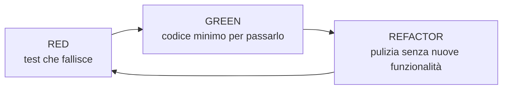

# Testing: BDD e TDD

> [!abstract]
> Lezione sul **testing** di una web app Rails: unit, functional, integration e acceptance test, e come si combinano BDD e TDD nel metodo **outside-in**. Prima parte: **BDD** come raffinamento del TDD e **Cucumber + Capybara** (user story → test di accettazione, step definition con regex, stack di test, ciclo rosso-verde). Seconda parte: **TDD con RSpec** (unit test **FIRST**, ciclo **Red-Green-Refactor**, sintassi di RSpec, matcher, `rspec-rails`), i **seam** (**mock** e **stub**) con l'esempio della ricerca su TMDb, **fixture e factory**, dove fare lo stub in un'architettura a servizi. Chiude con la **copertura** del codice (S0, S1, C0, C1, C2), i tipi di test a confronto e il confronto tra TDD e debugging tradizionale.
>
> Completa [[08 - LASS - Behavior-Driven Development]] (user story, Gherkin) con la parte di implementazione. Gli esempi usano RottenPotatoes delle lezioni [[05 - LASS - Rails Parte 1|5]]–[[07 - LASS - Rails Parte 3|7]] e il Ruby di [[03 - LASS - Ruby Essentials|lezione 3]].
>
> Indice dei concetti: [[MOC - Lab Architetture Software e Sicurezza]]. Gran parte delle slide viene dal corso di Berkeley *Engineering Software as a Service* (© Armando Fox e David Patterson).

---

## Testing: un mezzo per un fine

> *"Our highest priority is to satisfy the customer through early and continuous delivery of valuable software"* (dai principi dell'Agile Manifesto, agilemanifesto.org/principles.html)

Il testing non è un fine in sé: serve a consegnare **presto e continuamente** software di valore, con la sicurezza che quello che c'era continui a funzionare.

### Testing Today

| Prima | Oggi (Agile) |
|---|---|
| gli sviluppatori finiscono il codice e fanno qualche test **ad hoc** | il testing è parte di **ogni** iterazione Agile |
| il codice viene "lanciato oltre il muro" al **Quality Assurance** (QA) | gli sviluppatori **testano il proprio codice** |
| lo staff QA "punzecchia" il software a mano | strumenti e processi di test **altamente automatizzati** |
| | il gruppo QA migliora la **testabilità** e gli **strumenti** |

![[LASS-L15-p04.png]]

La stessa slide con un riquadro sovrapposto che ne riassume il senso: ***"Software Quality is the result of a good process, rather than the responsibility of one specific group"***. La qualità non si aggiunge alla fine (il QA che trova i bug), ma nasce dal **processo** con cui si sviluppa.

### Alcune osservazioni sul testing

- I framework di test BDD sono **DSL** (*domain-specific language*) costruiti sopra i framework di unit testing, per **"usare le parole giuste"** (*get the words right*).
- La maggior parte degli esempi usa ancora le **unità** (classi e metodi) per insegnare il BDD, quindi gli sviluppatori **partono ancora dall'interno**.
- Rails ha mostrato presto che il **testing delle web app si PUÒ automatizzare**.
- L'**integration testing** è ancora difficile da definire per molti sviluppatori.
- L'**acceptance testing NON è integration testing** (a meno che non si intenda "integrazione con gli utenti").

Fonte: c2.com/cgi/wiki?TenYearsOfTestDrivenDevelopment.

## Request Handling

![[LASS-L15-p06.png]]

La pipeline richiesta-risposta di Rails, numerata (è il riepilogo di [[05 - LASS - Rails Parte 1#Il viaggio di una richiesta|lezione 5]], con un model `Project`):
1. l'utente richiede `/projects`;
2. il **router** di Rails inoltra la richiesta all'azione `projects_controller#index`;
3. l'azione `index` crea la variabile d'istanza `@projects` usando il metodo `all` del model `Project`;
4. ActiveRecord traduce `all` in una `SELECT * FROM projects` sul database;
5. `@projects` torna indietro con la collezione di tutti gli oggetti `Project`;
6. l'azione `index` renderizza la view `index.html.erb`;
7. la view produce una tabella HTML dei progetti con ERB, che ha accesso a `@projects`;
8. la risposta HTML viene restituita all'utente.

Serve a capire **cosa** testare e **a quale livello**: ogni freccia del diagramma è un'interfaccia che un test può esercitare (un unit test sul model, un functional test sul controller, un integration test sull'intero percorso).

## Outside-in testing in una figura

Vedi [[Outside-in Testing]].

![[LASS-L15-p07.png]]

La figura disegnata a mano riassume BDD/TDD, unit, integration e acceptance test. L'applicazione è divisa in tre fasce, **views**, **controllers**, **models**; la freccia verticale a sinistra dice **"BDD outside → in"**, dall'esterno verso l'interno. I passi numerati:
1. **scrivere un test di accettazione che fallisce** (*write a failing acceptance test*), che simula l'utente che interagisce con la pagina (*script user interaction w/ page*);
2. scendendo ai controller, **scrivere un test di integrazione che fallisce**;
3. scendendo ai model, **scrivere uno unit test che fallisce**.

A destra, i tre livelli di test: **acceptance** in alto (attraversa tutto), **integration** (controller), **unit** (model), con le frecce che indicano che dopo ogni test fallito si scrive il codice e si fa lo **stub** delle parti sottostanti per vedere i risultati (*stub to see results*). Si parte da ciò che vede l'utente e si scende solo quando serve.

## BDD + TDD: il quadro generale

- **Behavior-driven design (BDD)**:
  - si sviluppano **user story** (*le funzionalità che si vorrebbero avere*) per descrivere come funzionerà l'app;
  - con **Cucumber** le user story diventano **test di accettazione** e **test di integrazione**.
- **Test-driven development (TDD)**:
  - le **step definition** di una nuova story possono richiedere di scrivere **nuovo codice**;
  - il TDD dice: scrivi **unit test e functional test per quel codice prima del codice stesso**;
  - cioè: scrivi i test per **il codice che vorresti avere** (*the code you wish you had*).

### Cucumber e RSpec

![[LASS-L15-p09.png]]

- **Cucumber** descrive il **comportamento** tramite feature e scenari (behavior-driven design).
- **RSpec** testa i **singoli moduli** che contribuiscono a quei comportamenti (test-driven development).

Il diagramma mostra i due cicli annidati:
1. **step Cucumber che fallisce** (rosso);
2. per farlo passare serve codice nuovo: si scrive un **test RSpec che fallisce** (rosso);
3. si scrive il codice fino ad avere il **test RSpec che passa** (verde); se servono altri moduli, si torna al punto 2 (ciclo interno);
4. quando tutti i moduli necessari sono pronti, lo **step Cucumber passa** (verde); si passa allo step successivo (ciclo esterno).

### Testing stacks

![[LASS-L15-p10.png]]

Gli strumenti di test e cosa attraversano:
- **Cucumber** sopra **Capybara**, che pilota l'app tramite **Rack::Test** (simula le richieste HTTP direttamente, senza un browser) oppure tramite **Selenium**, che controlla un **browser** vero che parla con il **web server** e la **SaaS app**: sono i **test di integrazione** (freccia rossa a sinistra), che attraversano tutto lo stack;
- **RSpec** con la gem **rspec-rails**, che usa Rack::Test e arriva fino a **Rack** e alla **Rails app**: sono gli **unit e functional test** (freccia rossa a destra), che chiamano direttamente il codice.

**Rack** è l'interfaccia standard tra i server web Ruby e i framework come Rails.

## BDD (Behavior-Driven Development)

Vedi [[Behavior-Driven Development]].

- Il BDD orienta il TDD a **consegnare il massimo valore possibile agli stakeholder**.
- Il BDD è un **raffinamento del linguaggio e degli strumenti** usati per il TDD.
- Come dice il nome, nel BDD ci si concentra su **specifiche di comportamento**.
- Tipicamente il BDD lavora **dall'esterno verso l'interno** (*outside in*), partendo dalle parti del software il cui comportamento è **percepito direttamente dall'utente**.
- Si dice che il BDD raffina il TDD perché c'è un **disaccoppiamento implicito tra test e implementazione**: non si testano i dettagli implementativi, si testa il **comportamento percepito**.

---

- Il BDD si concentra su **"specifiche"** che descrivono il comportamento del sistema.
- Nello sviluppare una story, le specifiche partono **dall'esterno** e possono spostarsi **verso l'interno** secondo necessità.
- Per una **web app** l'approccio outside-in significa di solito partire dalle specifiche relative all'**interfaccia utente**.
- Per un **componente software**, si parte dalla sua **API**.

---

Il BDD aiuta a capire **cosa testare**, **da dove partire** e **cosa ignorare** (o cosa tenere come "obiettivo d'occasione"):
- **cosa testare?** → i casi d'uso o le user story: si testa **cosa fa** qualcosa (comportamento) piuttosto che **cosa è** (struttura);
- **da dove partire?** → dallo **strato più esterno**;
- **cosa ignorare?** → **tutto il resto**… finché non si dimostra che non si può.

---

- Il BDD punta a **usare le parole giuste**: le specifiche risultanti diventano una forma **eseguibile e auto-verificante di documentazione**.
- Le specifiche BDD seguono un formato che le rende facili da guidare con le **user story** del sistema:

![[LASS-L15-p15.png]]

La figura mostra la corrispondenza tra **user story** e **specifica**:

| User story | Specifica |
|---|---|
| *As a* [**ruolo**], | *Given* [**ruolo e suo stato**] |
| *I want* [**obiettivo**] | *When* [**si verifica un evento/azione**] |
| *so that* [**beneficio**] | *Then* [**il beneficio**] |

Il ruolo della story diventa il contesto `Given`, l'obiettivo diventa l'azione `When`, il beneficio diventa il risultato verificabile `Then`. Vedi [[Given When Then]].

## Cucumber e Capybara

Vedi [[Cucumber e Gherkin]].

(*Engineering Software as a Service*, §7.5.) La copertina della sezione mostra un cetriolo e un capibara: i due strumenti prendono il nome da qui.

### User story → test di accettazione?

- Non sarebbe bello **trasformare automaticamente** le user story delle schede 3x5 in **test** con cui l'utente decide se **accettare** l'app?
- Come si fa a far corrispondere il **testo inglese** al **codice di test**?
- Come si eseguono i test **senza un essere umano** che compie le azioni?

### Cucumber: l'idea

- **Test a partire da user story comprensibili dal cliente**:
  - **acceptance**: assicurarsi che il cliente sia soddisfatto;
  - **integration**: assicurarsi che le interfacce tra i moduli abbiano assunzioni coerenti e comunichino correttamente.
- Cucumber **si incontra a metà strada** tra cliente e sviluppatore:
  - le user story **non sono codice**, quindi sono chiare per il cliente e servono a raggiungere un accordo;
  - ma **non sono nemmeno completamente libere**, quindi si possono collegare a test veri.

### Esempio di user story

![[LASS-L15-p19.png]]

```gherkin
Feature: User can manually add movie

Scenario: Add a movie
  Given I am on the RottenPotatoes home page
  When I follow "Add new movie"
  Then I should be on the Create New Movie page
  When I fill in "Title" with "Men In Black"
  And I select "PG-13" from "Rating"
  And I press "Save Changes"
  Then I should be on the RottenPotatoes home page
  And I should see "Men In Black"
```

Le annotazioni in rosso: **1 Feature** per file; **≥1 Scenario per Feature**; **da 3 a 8 step per Scenario**. È la versione del libro dello scenario di [[08 - LASS - Behavior-Driven Development#Un esempio con RottenPotatoes|lezione 8]].

### User story, feature e step

- **User story**: corrisponde tipicamente a **una feature**.
- **Feature**: **≥1 scenari** che mostrano modi diversi in cui la feature viene usata:
  - le keyword `Feature` e `Scenario` identificano le rispettive componenti;
  - si scrivono scenari sia di **happy path** sia di **sad path**;
  - stanno in `features/*.feature`.
- **Scenario**: tipicamente **3–8 step**.
- **Step definition**: codice Ruby che testa gli step, in `features/step_definitions/*_steps.rb`.

### Le 5 keyword degli step

1. **`Given`**: rappresentano lo **stato del mondo prima dell'evento**, le precondizioni;
2. **`When`**: rappresentano l'**evento** (es. simulare l'utente che preme un pulsante);
3. **`Then`**: rappresentano le **postcondizioni attese**; si controlla che siano vere;
4. / 5. **`And`** e **`But`**: estendono lo step precedente.

**Sono tutti alias dello stesso metodo**: per Cucumber non c'è differenza tra `Given` e `Then`, la parola serve solo alla leggibilità per gli umani.

### Step e step definition con le regex

Vedi [[Step Definition]].

- Le **espressioni regolari** fanno corrispondere le frasi in inglese degli step alle step definition!
- `Given /^(?:|I )am on (.+)$/`
- corrisponde a: *"I am on the Rotten Potatoes home page"*
- le step definition (codice Ruby) usano probabilmente la stringa catturata: *"the Rotten Potatoes home page"*.

Leggendo la regex: `^` e `$` ancorano a inizio e fine riga; `(?:|I )` è un gruppo **non catturante** che accetta "niente" oppure "I " (così funziona sia "I am on…" sia "am on…"); `(.+)` cattura tutto il resto, che viene passato al blocco come argomento:

```ruby
Given /^(?:|I )am on (.+)$/ do |page_name|
  visit path_to(page_name)   # path_to traduce "the Rotten Potatoes home page" in "/movies"
end
```

### Capybara, un utente finto

Vedi [[Capybara]].

- Serve uno **strumento che finga di essere l'utente** e segua gli scenari della user story.
- **Capybara simula un browser**:
  - può interagire con l'app per **ricevere le pagine**;
  - **analizzare l'HTML**;
  - **inviare i form** come farebbe un utente.

```ruby
visit '/movies/new'
fill_in 'Title', with: 'Men In Black'
select 'PG-13', from: 'Rating'
click_button 'Save Changes'
expect(page).to have_content('Men In Black')
```

### Cucumber testing stacks

![[LASS-L15-p24.png]]

Lo stack completo: **Cucumber** e **RSpec** in cima, **Capybara** sotto, che può usare diversi *driver*:
- **Rack::Test**: veloce, senza browser, ma non esegue JavaScript;
- **Capybara-webkit** e **Poltergeist/PhantomJS**: browser "headless" (senza finestra) che eseguono JavaScript;
- **Selenium**: controlla un **browser vero**, che parla con il web server della SaaS app.

Accanto:
- con **Selenium** si possono scriptare **completamente** le interazioni esterne;
- **SauceLabs.com** esegue i test Selenium su molti browser e manda i **video** dei risultati.

(Capybara-webkit e PhantomJS oggi non sono più mantenuti; al loro posto si usano Chrome o Firefox in modalità headless tramite Selenium o Cuprite.)

### Dal rosso al verde

- `cucumber nomefile` esegue una feature, `rake cucumber` le esegue tutte;
- **verde** per gli step che passano;
- **giallo** per quelli non ancora implementati;
- **rosso** per quelli che falliscono (e gli step successivi diventano **blu**, cioè saltati);
- obiettivo: **tutti gli step verdi** (da qui il nome dello strumento: un ortaggio verde).

### Riepilogo su Cucumber

- Nuova feature ⇒ si scrivono la UI della feature, le **nuove step definition**, e persino **nuovi metodi** prima che Cucumber possa colorare di verde gli step.
- Di solito si fanno prima gli **happy path**.
- **`Background`** permette di rendere DRY gli scenari della stessa feature.
- **BDD/Cucumber** testa il **comportamento**; **TDD/RSpec** (capitolo successivo del libro) è il **modo di scrivere i metodi** che fanno passare tutti gli scenari.

## TDD con RSpec

### Unit test FIRST

Vedi [[FIRST Unit Test]].

Gli unit test devono essere **FIRST**:

| Lettera | Proprietà | Significato |
|---|---|---|
| **F** | Fast | si eseguono (sottoinsiemi di) test **in fretta**, perché li si esegue continuamente |
| **I** | Independent | nessun test dipende da un altro, quindi se ne può eseguire **qualsiasi sottoinsieme in qualsiasi ordine** |
| **R** | Repeatable | eseguiti N volte danno **lo stesso risultato** (aiuta a isolare i bug e permette l'automazione) |
| **S** | Self-checking | il test **rileva da solo** se è passato (nessun umano che controlla l'output) |
| **T** | Timely | scritti **più o meno insieme** al codice da testare (con il TDD, **prima**!) |

Un test che dipende dall'ora corrente, dalla rete o dall'ordine di esecuzione viola R o I; per renderlo FIRST si usano i [[#Mocks and Stubs|mock e gli stub]].

### RSpec, un DSL per il testing

Vedi [[RSpec]].

- **DSL**: un piccolo linguaggio di programmazione che **semplifica un compito** a scapito della generalità (esempi già visti: le migration, le regex, l'SQL).
- I test RSpec si chiamano **spec** o **example**.
- Per eseguire i test di un file: `rspec nomefile`: **rosso** fallito, **verde** passato, **giallo** in attesa (*pending*).
- Molto meglio: usare **guard/autotest**, che rieseguono automaticamente i test a ogni salvataggio.

## Test-Driven Development

Vedi [[Test-Driven Development]].

- Il TDD **non riguarda *davvero* il testing**.
- Il TDD è una **tecnica di progettazione**.
- Il TDD porta a **codice più pulito** con **separazione delle responsabilità**.
- Il codice più pulito è più **affidabile** e più facile da **mantenere** (ovvio).

Perché è una tecnica di progettazione: per scrivere il test prima del codice bisogna decidere **come si userà** quel codice (nomi, argomenti, valori restituiti). E un codice difficile da testare è di solito un codice troppo accoppiato: il test lo fa notare subito.

- Il TDD crea un **ciclo di sviluppo stretto** che ci tiene **cognitivamente coinvolti**.
- Il TDD dà un **rigore leggero**, rendendo lo sviluppo **orientato agli obiettivi**: fasi chiare di definizione dell'obiettivo, raggiungimento e miglioramento.
- Le fasi del TDD sono comunemente note come ciclo **Red-Green-Refactor**.

### Il ciclo Red-Green-Refactor

Vedi [[Red-Green-Refactor]].

![[LASS-L15-p33.png]]

Tre fasi in ciclo:
- **RED**: scrivere un **test che fallisce** per la nuova funzionalità (il test fallisce perché il codice non esiste ancora: verifica che il test serva davvero);
- **GREEN**: scrivere il **codice minimo** per far passare il test (anche brutto);
- **REFACTOR**: **ripulire e migliorare** il codice **senza aggiungere funzionalità** (i test, ora verdi, garantiscono che il refactoring non rompa nulla).



### RSpec: struttura

- RSpec usa il metodo **`describe`** per creare un **example group**.
- Gli example group si possono **annidare** con `describe` o `context`.

![[LASS-L15-p34.png]]

```ruby
describe Bowling, "#score" do
  it "returns 0 for all gutter game" do
    bowling = Bowling.new
    20.times { bowling.hit(0) }
    expect(bowling.score).to eq(0)
  end
end
```

Le etichette della figura danno il nome a ogni parte:
- **example group**: il blocco `describe ... do ... end` (qui: il metodo `score` della classe `Bowling`);
- **example**: il blocco `it "..." do ... end`, un singolo test che descrive un comportamento ("restituisce 0 se tutti i tiri finiscono nel canale");
- **expectation**: `expect(bowling.score).to ...`, ciò che si verifica;
- **matcher**: `eq(0)`, il criterio di confronto.

Il test simula una partita di bowling in cui tutti i 20 tiri abbattono 0 birilli, e si aspetta punteggio 0. Si legge quasi come una frase inglese: è il "get the words right" del BDD applicato agli unit test.

### RSpec: esempi di base

```ruby
x = Math.sqrt(9)
expect(x).to eq 3
expect(sqrt(9)).to be_within(.5).of(3)

expect(x.odd?).to be_true
expect(x).to be_odd
expect(hash['key']).to be_truthy

m = Movie.new(:rating => 'R')
expect(m).to be_a_kind_of Movie
```

- `eq 3`: uguaglianza (`==`);
- `be_within(.5).of(3)`: uguaglianza approssimata, utile con i numeri decimali;
- `be_odd`: matcher **dinamico**, chiama `x.odd?` (ogni metodo `xxx?` diventa un matcher `be_xxx`);
- `be_truthy`: il valore è truthy (vedi [[03 - LASS - Ruby Essentials#Condizioni, truthy e falsey|lezione 3]]);
- `be_a_kind_of Movie`: l'oggetto è un'istanza di `Movie` o di una sottoclasse.

Riferimento: relishapp.com/rspec/rspec-expectations/docs/built-in-matchers.

> [!warning] Correzione
> Alcune righe di questo esempio non funzionano così come sono scritte:
> - `Math.sqrt(9)` restituisce **`3.0`**, un `Float`. `expect(x).to eq 3` passa (in Ruby `3.0 == 3` è vero), ma **`Float` non ha il metodo `odd?`** (esiste solo per gli interi): `x.odd?` e `be_odd` sollevano `NoMethodError`. Servirebbe `x.to_i.odd?` o partire da un intero.
> - `expect(sqrt(9))` senza `Math.` funziona solo se `sqrt` è stato incluso (es. `include Math`).
> - **`be_true` non esiste più** da RSpec 3: si usa `be_truthy` (qualunque valore truthy) oppure `be true` (esattamente `true`). Lo stesso vale per `be_false` → `be_falsey` nella tabella dei matcher più sotto.

Una spec completa (slide di solo codice):

```ruby
require 'ruby_intro.rb'
describe "BookInStock" do
  it "should be defined" do
    expect { BookInStock }.not_to raise_error
  end
  describe 'getters and setters' do
    before(:each) { @book = BookInStock.new('isbn1', 33.8) }
    it 'sets ISBN' do
      expect(@book.isbn).to eq('isbn1')
    end
    it 'sets price' do
      expect(@book.price).to eq(33.8)
    end
    it 'can change ISBN' do
      @book.isbn = 'isbn2'
      expect(@book.isbn).to eq('isbn2')
    end
    it 'can change price' do
      @book.price = 300.0
      expect(@book.price).to eq(300.0)
    end
  end
end
```

Questa spec verifica la classe `BookInStock` dell'esercizio Ruby del corso ([[03 - LASS - Ruby Essentials#Hands-on|hands-on di lezione 3]]):
- il primo example controlla che la classe **esista**: `expect { BookInStock }` con le **graffe** passa un blocco, e RSpec verifica che eseguirlo non sollevi eccezioni (se la classe non esiste, `NameError`);
- il gruppo annidato `'getters and setters'` usa **`before(:each)`** per creare un libro nuovo **prima di ogni example**, così gli example sono **indipendenti** (la I di FIRST): modificare l'ISBN in un test non influenza gli altri;
- i quattro example verificano lettura e scrittura di ISBN e prezzo, cioè che la classe abbia `attr_accessor :isbn, :price` (o metodi equivalenti).

### RSpec: altri esempi

```ruby
expect { m.save! }.
  to raise_error(ActiveRecord::RecordInvalid)
m = (create a valid movie)
expect(m).to be_valid
expect { m.save! }.
  to change { Movie.count }.by(1)
```

- `save!` su un film **non valido** deve sollevare `ActiveRecord::RecordInvalid` (vedi le [[06 - LASS - Rails Parte 2#Model Validation|validazioni]]);
- un film valido deve risultare `be_valid` (chiama `valid?`);
- salvare un film valido deve **aumentare di 1** il numero di film nel database.

Le due forme di `expect`:

```ruby
expect { lambda }.to(assertion)       # con il blocco: per effetti (eccezioni, cambiamenti)
expect(expression).to(assertion)      # con le parentesi: per valori
```

Si usano le graffe quando l'asserzione riguarda **cosa succede eseguendo** il codice (solleva un'eccezione? cambia qualcosa?), le parentesi quando riguarda **un valore**.

### Matcher

RSpec ha una buona collezione di **matcher** già pronti:

```ruby
be_true          # passa se actual è truthy (non nil né false)
be_false         # passa se actual è falsy (nil o false)
be_nil           # passa se actual è nil
be               # passa se actual è truthy
expect { ... }.to raise_error
expect { ... }.to raise_error(ErrorClass)
expect { ... }.to raise_error("message")
expect { ... }.to raise_error(ErrorClass, "message")
expect { ... }.to throw_symbol
expect { ... }.to throw_symbol(:symbol)
expect { ... }.to throw_symbol(:symbol, 'value')
be_xxx           # passa se actual.xxx?
have_xxx(:arg)   # passa se actual.has_xxx?(:arg)
```

E ancora:

```ruby
be_empty
be(expected)        # passa se actual.equal?(expected)   stesso oggetto
eq(expected)        # passa se actual == expected        stesso valore
== expected         # passa se actual == expected
eql(expected)       # passa se actual.eql?(expected)     stesso valore e tipo
equal(expected)     # passa se actual.equal?(expected)
be > expected
be >= expected
be <= expected
be < expected
=~ /expression/
match(/expression/)
be_within(delta).of(expected)
be_instance_of(expected)   # esattamente quella classe
be_kind_of(expected)       # quella classe o una sottoclasse
```

Riferimento: relishapp.com/rspec/rspec-expectations/v/2-13/docs/built-in-matchers (la documentazione di RSpec **2.13**: per questo compaiono `be_true`/`be_false`, oggi `be_truthy`/`be_falsey`). Le differenze tra `eq`, `eql` ed `equal`: `3.0` ed `3` sono `eq` (stesso valore) ma non `eql` (tipi diversi); due stringhe `"a"` diverse sono `eq` ma non `equal` (oggetti diversi).

### Cosa c'è in rspec-rails?

- **Metodi aggiuntivi** inseriti in RSpec per testare cose specifiche di Rails:
  - es. `get`, `post`, `put`, … per i controller;
  - l'oggetto `response` per i controller.
- **Matcher** per testare il comportamento delle app Rails: `expect(response).to render_template("movies/index")`.
- Supporto per creare i vari **double** necessari per testare metodi non banali.

## Esempio: chiamare TMDb

- Nuova funzionalità di RottenPotatoes: **aggiungere un film usando le informazioni di TMDb** (The Movie Database) invece di digitarle.
- Come dovrebbero comportarsi gli step della user story?

```gherkin
When I fill in "Search Terms" with "Inception"
And I press "Search TMDb"
Then I expect to be on the RottenPotatoes homepage
...
```

Ricorda la "ricetta Rails #2": **aggiungere una nuova funzionalità = nuova route + nuovo metodo del controller + nuova view**.

### The Code You Wish You Had

Cosa dovrebbe fare il **metodo del controller** che riceve il form di ricerca?
1. **chiamare un metodo** che cercherà su TMDb il film specificato;
2. se trova una corrispondenza: **selezionare la (nuova) view** dei risultati della ricerca per mostrarla;
3. se non trova nulla: fare il **redirect alla home page** con un messaggio.

(Il codice di partenza è su pastebin.com/LcejGjYs.) È il TDD in pratica: si scrive il test per il controller **immaginando** che il metodo di ricerca esista già.

## Mocks and Stubs

Vedi [[Mock e Stub]].

(*Engineering Software as a Service*, §8.4.)

Nello stack di test (la stessa figura di [[#Testing stacks|prima]]) i test del controller sono **unit/functional test** fatti con RSpec e rspec-rails: non devono attraversare tutto lo stack, né tanto meno contattare davvero TMDb.

Riprendendo il codice che vorremmo:
1. dovrebbe **chiamare un metodo** che cerca il film su TMDb (nella slide: *live demo*);
2. se trova una corrispondenza, dovrebbe **rendere disponibili i risultati al template**.

### Rendere disponibili i risultati al template

- Un'altra aggiunta di rspec-rails: **`assigns()`**:
  - si passa un **simbolo** che nomina una variabile d'istanza del controller;
  - restituisce il **valore** che il controller ha assegnato a quella variabile.
- Ops! Il nostro codice attuale **non imposta nessuna variabile d'istanza**:

```ruby
def search_tmdb
  Movie.find_in_tmdb(params[:search_terms])
end
```

- TCWWWH (*the code we wish we had*): la lista dei risultati deve stare in **`@movies`**.

```ruby
it 'makes search results available to template' do
  Movie.stub(:find_in_tmdb).and_return(@fake_results)
  post :search_tmdb, {:search_terms => 'hardware'}
  expect(assigns(:movies)).to eq(@fake_results)
end
```

Il test:
1. **sostituisce** (stub) il metodo `Movie.find_in_tmdb` con una versione finta che restituisce `@fake_results` (dei risultati preparati dal test): così **non si contatta TMDb** e il risultato è sempre lo stesso (test **Fast** e **Repeatable**);
2. simula l'invio del form con `post :search_tmdb`;
3. verifica che il controller abbia messo quei risultati in `@movies`.

Il test fallisce (RED) finché il controller non diventa `@movies = Movie.find_in_tmdb(params[:search_terms])` (GREEN). E non serve che `find_in_tmdb` esista davvero: lo si implementerà dopo, con i suoi test.

### Due nuovi concetti di seam

Un **seam** ("cucitura") è un punto in cui si può cambiare il comportamento del programma **senza modificarne il codice**, per isolare la parte sotto test.

- **stub**:
  - simile a `should_receive` (cioè a un'aspettativa sul metodo), ma **non è un'aspettativa**: il test non fallisce se il metodo non viene chiamato;
  - `and_return` controlla (opzionalmente) il **valore restituito**.
- **mock**: un oggetto **"controfigura"** (*stunt double*), usato spesso per la **verifica del comportamento** (il metodo è stato chiamato?):
  - si fanno stub di singoli metodi su di esso: `m = mock('movie1', :title => 'Rambo')`.

**Ogni seam abilita solo le funzionalità strettamente necessarie** per uno specifico comportamento sotto test.

| | Stub | Mock |
|---|---|---|
| Cos'è | un **metodo** finto su un oggetto (anche reale) | un **oggetto** finto |
| Scopo | controllare il valore restituito, isolare da dipendenze | prendere il posto di un collaboratore, verificare le chiamate |
| Esempio | `Movie.stub(:find_in_tmdb).and_return(...)` | `mock('movie1', :title => 'Rambo')` |

> [!note] Sintassi moderna di RSpec
> Le slide usano la sintassi di RSpec 2 (`obj.stub`, `mock(...)`, `should_receive`, `.should ==`). Da RSpec 3 si scrive:
> ```ruby
> allow(Movie).to receive(:find_in_tmdb).and_return(@fake_results)    # stub
> expect(Movie).to receive(:find_in_tmdb).with('hardware')            # aspettativa (mock)
> fake_movie = double('Movie', title: 'Rambo')                        # mock
> post :search_tmdb, params: { search_terms: 'hardware' }             # Rails 5+
> ```
> Inoltre `assigns` è stato tolto da Rails 5 (si recupera con la gem `rails-controller-testing`); oggi si preferisce testare la risposta (cosa viene mostrato) più che le variabili interne del controller.

### RSpec Cookery #1

- Ogni spec deve testare **un solo comportamento**.
- Usare i **seam** quanto serve per **isolare** quel comportamento.
- Decidere **che tipo di expectation** verificherà il comportamento.
- Scrivere il test e assicurarsi che **fallisca per il motivo giusto** (non per un errore di battitura).
- Aggiungere codice finché il test è **verde**.
- Cercare occasioni per fare **refactoring/abbellire**.

## Unit vs. Functional test nelle app SaaS

Vedi [[Unit, Functional e Integration Test]].

- **Unit test**: comportamento **dentro** un metodo/classe:
  - le **classi collaboratrici** vengono sostituite con **mock**;
  - i **metodi collaboratori** possono essere sostituiti con **stub** (in questa classe o nelle classi collaboratrici);
  - entrambi sono chiamati genericamente **double**.
- **Functional test**: comportamento **attraverso** più metodi/classi:
  - es. il flusso del controller da GET/POST fino al rendering del template, di cui rspec-rails fa lo stub;
  - (quindi non è un vero test full-stack).

## Fixtures and Factories

Vedi [[Fixture e Factory]].

(*Engineering Software as a Service*, §8.5.)

### Quando serve l'oggetto vero

```ruby
fake_movie = mock('Movie')
fake_movie.stub(:title).and_return('Casablanca')
fake_movie.stub(:rating).and_return('PG')
fake_movie.name_with_rating.should == 'Casablanca (PG)'
```

Qui si vuole testare il metodo `name_with_rating` del model, che combina titolo e rating. Ma un mock **non ha** il metodo `name_with_rating` (ha solo gli stub che gli abbiamo dato), quindi il test non può funzionare: per testare un metodo del model serve un **oggetto `Movie` vero**.

Dove si prende un oggetto vero?
- **Fixture**: si **precaricano staticamente** dati noti nelle tabelle del database;
- **Factory**: si crea **solo ciò che serve, per ogni test**.

### Fixtures

- Il database viene **svuotato e ricaricato prima di ogni spec**:
  - si aggiunge `fixtures :movies` all'inizio del `describe`;
  - il file `spec/fixtures/movies.yml` contiene dei `Movie`, che vengono aggiunti alla tabella `movies`.
- **Pro / usi**:
  - dati **davvero statici**, es. informazioni di configurazione che non cambiano mai;
  - è facile vedere **tutti i dati di test in un posto**.
- **Contro / motivi per non usarle**:
  - possono introdurre **dipendenze dai dati delle fixture** (un test che funziona "perché nella fixture c'è *Inception*" si rompe quando qualcuno modifica il file, violando l'indipendenza).

```yaml
# spec/fixtures/movies.yml
inception:
  title: Inception
  rating: PG-13
```

Con le **factory** (gem **FactoryBot**, prima *FactoryGirl*) invece ogni test crea i propri oggetti:

```ruby
movie = FactoryBot.create(:movie, title: 'Casablanca', rating: 'PG')
expect(movie.name_with_rating).to eq 'Casablanca (PG)'
```

## Dove fare lo stub in una Service Oriented Architecture?

La sequenza di slide costruisce un'unica figura. La pila delle dipendenze della ricerca su TMDb, dall'alto in basso:
- `movie.rb` (il nostro model);
- `ruby-tmdb` (la gem client di TMDb);
- `Net::HTTP` / `OpenURI` (le librerie HTTP di Ruby);
- il sistema operativo con TCP/IP;
- Internet;
- il servizio **TMDb**.

Si può inserire lo stub a **ogni livello**:
1. `Movie.stub(:find_in_tmdb).and_return(...)`: sul nostro model;
2. `TmdbMovie.stub(:find).with(...).and_return(...)`: sulla gem;
3. `Net::HTTP.stub(:get).with(...).and_return(...)`: sulla libreria HTTP;
4. si sostituisce TMDb con un **TMDb-dev** finto, che **analizza una richiesta artificiale e restituisce valori preconfezionati** (ad esempio con la gem **FakeWeb**).

![[LASS-L15-p59.png]]

L'ultima slide della sequenza aggiunge la **regola pratica** (il riquadro si sovrappone al codice degli stub, per questo il testo dietro è illeggibile):
- per lo **unit testing**, fare lo **stub vicino** (in alto nella pila), per il **massimo isolamento** della classe sotto test (**F**ast, **I**ndependent);
- per l'**integration testing**, fare lo **stub lontano** (in basso), per testare **quante più interfacce possibile**.

Più in basso si fa lo stub, più codice reale viene esercitato (la gem, la costruzione della richiesta HTTP, il parsing della risposta), e più il test è "integrato".

## Quanto testing basta?

- Pessimo: **"finché non è ora di consegnare"**.
- Un po' meglio: il rapporto **(righe di test) / (righe di codice)**:
  - **1,2–1,5** non è irragionevole;
  - spesso **molto più alto** per i sistemi in produzione.
- Domanda migliore: **"quanto è approfondito il mio testing?"**:
  - **metodi formali** (dimostrare la correttezza matematicamente);
  - **misura della copertura** (*coverage*);
  - ci si concentra sulla seconda, anche se i metodi formali stanno guadagnando terreno.

### Misurare la copertura

Vedi [[Code Coverage]].

![[LASS-L15-p61.png]]

```ruby
class MyClass
  def foo(x,y,z)
    if x
      if (y && z) then bar(0) end
    else
      bar(1)
    end
  end
  def bar(x) ; @w = x ; end
end
```

I livelli di copertura, dal più debole al più forte:

| Livello | Cosa richiede |
|---|---|
| **S0** | ogni **metodo** viene chiamato |
| **S1** | ogni metodo viene chiamato **da ogni punto di chiamata** |
| **C0** | ogni **istruzione** viene eseguita (misurabile in Ruby con la gem **SimpleCov**) |
| **C1** | ogni **ramo** viene percorso **in entrambe le direzioni** |
| **C1 + decision coverage** | ogni **sottoespressione** di una condizione assume entrambi i valori |
| **C2** | ogni **cammino** (difficile, e non c'è accordo su quanto valga) |

Applicandolo all'esempio (i riquadri azzurri nella figura evidenziano le parti da coprire):
- **S0**: basta chiamare `foo` una volta con argomenti che portino a chiamare `bar` (es. `foo(true, true, true)`);
- **S1**: `bar` è chiamata da due punti (`bar(0)` e `bar(1)`): servono `foo(true, true, true)` e `foo(false, _, _)`;
- **C0**: tutte le istruzioni, cioè le stesse due chiamate (che eseguono entrambe le `bar`);
- **C1**: entrambi gli `if` vanno percorsi sia nel ramo vero che in quello falso: `foo(true, true, true)` (x vero, y&&z vero), `foo(true, false, true)` (x vero, y&&z falso), `foo(false, _, _)` (x falso);
- **C1 + decision**: anche `y` e `z` presi singolarmente devono essere sia veri che falsi: si aggiunge ad esempio `foo(true, true, false)`;
- **C2**: tutti i cammini; qui sono 3 (x falso; x vero e y&&z vero; x vero e y&&z falso), ma con cicli e molte condizioni il numero esplode.

> [!tip]
> Una copertura del 100% C0 non garantisce che il codice sia corretto: dice solo che ogni riga è stata eseguita almeno una volta, non che sia stata verificata con gli input giusti. È un indicatore di cosa **non** è testato, più che una prova di qualità.

## Che tipi di test?

![[LASS-L15-p62.png]]

| Tipo | Esempio | Caratteristiche |
|---|---|---|
| **Unit** (un metodo/classe) | spec del model | veloci, **alta copertura**, risoluzione fine (dicono esattamente dove è il problema); **molti mock**, **non testano le interfacce** |
| **Functional o di modulo** (pochi metodi/classi) | spec del controller | via di mezzo |
| **Integration/system** | scenari Cucumber | **pochi mock**, **testano le interfacce**; **lenti**, **bassa copertura**, risoluzione grossolana (se falliscono, il problema può essere ovunque) |

La freccia a doppia punta nella figura indica che è un continuo: servono tutti, in proporzioni diverse (tanti unit test veloci, meno test di integrazione).

## TDD vs. debugging tradizionale

![[LASS-L15-p63.png]]

| Tradizionale | TDD |
|---|---|
| scrivi decine di righe, esegui, trovi un bug: apri il debugger | scrivi poche righe, con il test prima; **sai subito** se si è rotto qualcosa |
| inserisci `printf` per stampare le variabili ed esegui più volte | testi pezzi brevi di codice usando le **expectation** |
| ti fermi nel debugger, modifichi le variabili per controllare il percorso del codice | usi **mock e stub** per controllare il percorso del codice |
| "Accidenti, ero sicuro di averlo sistemato, ora devo rifare tutto da capo" | **riesegui il test automaticamente** |

- **Lezione 1**: il TDD usa le **stesse abilità e tecniche** del debugging tradizionale, ma è **più produttivo** (FIRST).
- **Lezione 2**: scrivere i test **prima** del codice richiede **più tempo all'inizio**, ma spesso **meno tempo complessivamente**.

> [!summary] Riepilogo
> | Livello | Strumento | Ciclo |
> |---|---|---|
> | Comportamento (acceptance/integration) | Cucumber + Capybara | user story → scenario rosso → verde |
> | Moduli (unit/functional) | RSpec + rspec-rails | Red → Green → Refactor |
> | Isolamento | mock, stub, fixture, factory | stub vicino per gli unit, lontano per l'integrazione |
> | Misura | SimpleCov (C0) | copertura come indicatore, non come prova |
