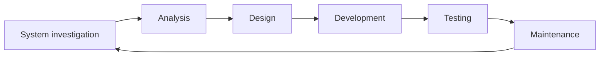

# Ciclo di Vita del Software

> [!summary] In breve
> La sequenza ciclica di fasi che un software attraversa: indagine, analisi, design, sviluppo, test, manutenzione, e di nuovo da capo.

- È un ciclo perché la manutenzione genera nuove versioni.
- I modelli di processo ([[Plan-and-Document]], Agile) si distinguono per come organizzano queste fasi.

## Collegamenti

- **Concetti correlati**: [[Plan-and-Document]] · [[Modello Waterfall]] · [[Sviluppo Incrementale]]
- **Mappa**: [[MOC - Lab Architetture Software e Sicurezza]]

> [!info] Approfondimento
> - [[01 - LASS - Software Development Process#Ciclo di vita del software|Lezione 1 — Ciclo di vita del software]]
