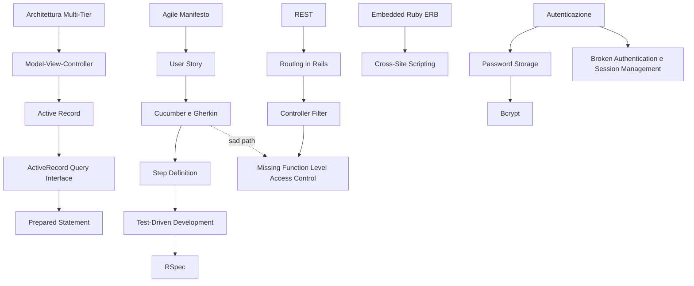

# MOC - Lab Architetture Software e Sicurezza

> [!abstract]
> Mappa del **Laboratorio di Architetture Software e Sicurezza Informatica** (AAF1569, proff. Querzoni e D'Elia): le lezioni, i concetti raggruppati per tema e alcuni percorsi trasversali. Il corso porta a costruire in gruppo una web app Rails testata e sicura: processo Agile → architettura → Ruby e Rails → BDD/TDD → sicurezza.

## Lezioni

| # | Lezione | Argomenti |
|---|---|---|
| 0 | [[00 - LASS - Informazioni Generali]] | docenti, organizzazione, esame a progetto |
| 1 | [[01 - LASS - Software Development Process]] | project vs product, ciclo di vita, Waterfall, Spiral, RUP, Agile, XP, Scrum |
| 2 | [[02 - LASS - Software Architectures]] | attributi di qualità, componenti, layer e tier, SOA, SaaS, cloud |
| 3 | [[03 - LASS - Ruby Essentials]] | principi di Ruby, variabili, classi, blocchi, range, hash, regex |
| 4 | [[04 - LASS - SaaS Essentials]] | client-server, HTTP, cookie, AJAX, API, REST, CRUDI, JSON, MVC |
| 5 | [[05 - LASS - Rails Parte 1]] | DRY, CoC, Active Record, migration, route di default |
| 6 | [[06 - LASS - Rails Parte 2]] | controller e view ERB, form, flash, partial, validation, filter, debugging |
| 7 | [[07 - LASS - Rails Parte 3]] | associazioni, through, nested routes, transazioni, query interface |
| 8 | [[08 - LASS - Behavior-Driven Development]] | user story, SMART, Cucumber e Gherkin, step definition, lo-fi UI |
| 13 | [[13 - LASS - Introduzione alla Sicurezza]] | perché la sicurezza applicativa, principi NIST 800-27, vulnerabilità |
| 14 | [[14 - LASS - Autenticazione]] | identità, fattori, 2FA, password, salt, bcrypt, OAuth |
| 15 | [[15 - LASS - Testing BDD e TDD]] | outside-in, Cucumber/Capybara, RSpec, Red-Green-Refactor, mock e stub, coverage |
| 17 | [[17 - LASS - Sicurezza delle Web Application]] | OWASP Top 10 (2013), da Injection a Unvalidated Redirects |

Le lezioni 9–12 e 16 non hanno slide nella cartella del corso.

## Concetti per tema

### Processo di sviluppo
- [[Project-based vs Product-based Software]] · [[Ciclo di Vita del Software]]
- Plan-and-Document: [[Plan-and-Document]] · [[Modello Waterfall]] · [[Modello a Spirale]] · [[Rational Unified Process]]
- Agile: [[Agile Manifesto]] · [[Sviluppo Incrementale]] · [[Extreme Programming]] · [[Scrum]] · [[Minimum Viable Product]]

### Architetture
- [[Architettura Software]] · [[Linee Guida di Progettazione Architetturale]]
- [[Componenti, Servizi e Microservizi]] · [[Layer e Tier]] · [[Architettura Multi-Tier]]
- [[Modelli di Esecuzione del Software]] · [[Software as a Service]] · [[Cloud Computing IaaS PaaS SaaS]]
- Da Sistemi di Calcolo 2: [[Middleware]] · [[Service-Oriented Architecture]] · [[Modello Client-Server]]

### Web e SaaS
- [[HTTP Request e Response]] · [[Route HTTP e URI]] · [[Codici di Stato HTTP]] · [[AJAX]]
- [[API]] · [[REST]] · [[CRUDI]] · [[Model-View-Controller]]
- Da altri corsi: [[Cookie HTTP]] · [[Protocollo HTTP]] · [[JSON]]

### Ruby
- [[Ruby]] · [[Truthy e Falsey]] · [[Tipi di Variabili in Ruby]] · [[Classi Ruby e Accessor]]
- [[Blocchi Ruby]] · [[Range Ruby]] · [[Hash e Simboli Ruby]]

### Rails
- Fondamenti: [[Ruby on Rails]] · [[Don't Repeat Yourself]] · [[Convention over Configuration]]
- Model: [[Active Record]] · [[Migration Rails]] · [[Model Validation]] · [[Associazioni ActiveRecord]] · [[Through-Association]] · [[Transazioni ActiveRecord]] · [[ActiveRecord Query Interface]]
- Route e controller: [[Routing in Rails]] · [[Nested Routes]] · [[Controller Filter]] · [[Flash e Redirect Rails]]
- View: [[Embedded Ruby ERB]] · [[Form Tag Helper]] · [[View Partial]]
- [[Debugging Rails]]

### BDD e testing
- BDD: [[Behavior-Driven Development]] · [[User Story]] · [[SMART User Stories]] · [[Lo-Fi UI e Storyboard]]
- Cucumber: [[Cucumber e Gherkin]] · [[Given When Then]] · [[Step Definition]] · [[Capybara]]
- TDD: [[Test-Driven Development]] · [[Red-Green-Refactor]] · [[RSpec]] · [[FIRST Unit Test]]
- Isolamento e misura: [[Mock e Stub]] · [[Fixture e Factory]] · [[Code Coverage]] · [[Unit, Functional e Integration Test]] · [[Outside-in Testing]]

### Sicurezza: fondamenti e autenticazione
- [[Sicurezza delle Applicazioni Web]] · [[Principi NIST 800-27]] · [[Vulnerabilità Software]]
- [[Identità Digitale]] · [[Autenticazione]] · [[Autenticazione a Due Fattori]]
- [[Password Storage]] · [[Salt]] · [[Bcrypt]]
- Da altri corsi: [[Rainbow Table]] · [[OAuth]] · [[Funzioni Hash Crittografiche]] · [[Autenticazione e Controllo degli Accessi]]

### Sicurezza: OWASP Top 10
- [[OWASP Top 10]]
- A1 [[SQL Injection]] (Ethical Hacking) · [[Prepared Statement]]
- A2 [[Broken Authentication e Session Management]]
- A3 [[Cross-Site Scripting]]
- A4 [[Insecure Direct Object Reference]]
- A5 [[Security Misconfiguration]]
- A6 [[Sensitive Data Exposure]]
- A7 [[Missing Function Level Access Control]]
- A8 [[Cross-Site Request Forgery]]
- A9 [[Using Known Vulnerable Components]]
- A10 [[Unvalidated Redirects and Forwards]]

## Percorsi trasversali

- **Dalla richiesta del cliente al codice testato**: [[Agile Manifesto]] → [[User Story]] → [[SMART User Stories]] → [[Cucumber e Gherkin]] → [[Given When Then]] → [[Step Definition]] → [[Capybara]] → [[Test-Driven Development]] → [[Red-Green-Refactor]] → [[RSpec]] → [[Mock e Stub]].
- **Il viaggio di una richiesta in Rails**: [[HTTP Request e Response]] → [[Route HTTP e URI]] → [[Routing in Rails]] → [[Controller Filter]] → [[Active Record]] → [[Embedded Ruby ERB]] → [[Codici di Stato HTTP]].
- **Dall'architettura al framework**: [[Architettura Software]] → [[Layer e Tier]] → [[Architettura Multi-Tier]] → [[Model-View-Controller]] → [[Ruby on Rails]] ([[Convention over Configuration]], [[Don't Repeat Yourself]]).
- **Dati e relazioni**: [[Active Record]] → [[Migration Rails]] → [[Associazioni ActiveRecord]] → [[Through-Association]] → [[Nested Routes]]; lato database [[Foreign Key]], [[Join]], [[Transazione]] → [[Transazioni ActiveRecord]].
- **Dove Rails incontra la sicurezza**:
  - query: [[ActiveRecord Query Interface]] → [[Prepared Statement]] → [[SQL Injection]];
  - view: [[Embedded Ruby ERB]] → [[Cross-Site Scripting]];
  - form: [[Form Tag Helper]] → [[Cross-Site Request Forgery]];
  - filtri: [[Controller Filter]] → [[Missing Function Level Access Control]] / [[Insecure Direct Object Reference]];
  - [[Truthy e Falsey]] → il bug di `where` nei filtri delle lezioni 6 e 7.
- **Proteggere le identità**: [[Identità Digitale]] → [[Autenticazione]] → [[Autenticazione a Due Fattori]] → [[Password Storage]] → [[Salt]] → [[Bcrypt]] → [[Broken Authentication e Session Management]] → [[OAuth]].
- **Dai principi alle vulnerabilità**: [[Principi NIST 800-27]] → [[Vulnerabilità Software]] → [[OWASP Top 10]] → [[Security Misconfiguration]] / [[Using Known Vulnerable Components]].
