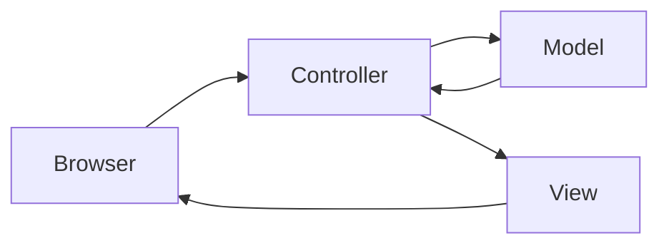

# Model-View-Controller

> [!summary] In breve
> Design pattern che divide l'applicazione server in model (dati e logica), view (presentazione) e controller (mediano tra utente, model e view).

- **Model**: un model per tipo di entità, gestisce i dati.
- **View**: interfaccia tra utente e dati.
- **Controller**: uno per model; riceve l'azione, interroga il model, sceglie la view.
- In Rails: model = [[Active Record]], view = template [[Embedded Ruby ERB]], controller = sottoclassi di `ApplicationController`.

## Collegamenti

- **Concetti correlati**: [[Active Record]] · [[Embedded Ruby ERB]] · [[Ruby on Rails]] · [[Layer e Tier]]
- **Mappa**: [[MOC - Lab Architetture Software e Sicurezza]]

> [!info] Approfondimento
> - [[04 - LASS - SaaS Essentials#Model View Controller (MVC)|Lezione 4 — Model View Controller (MVC)]]
> - [[05 - LASS - Rails Parte 1#Rails e MVC|Lezione 5 — Rails e MVC]]
