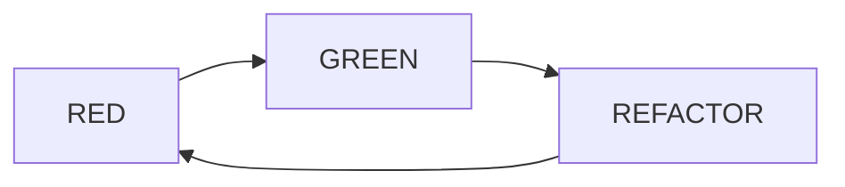

# Red-Green-Refactor

> [!summary] In breve
> Il ciclo del TDD: RED (test che fallisce), GREEN (codice minimo che lo fa passare), REFACTOR (pulizia senza nuove funzionalità).

Il test deve fallire **per il motivo giusto**; il refactoring è sicuro perché i test sono verdi.

## Collegamenti

- **Concetti correlati**: [[Test-Driven Development]] · [[RSpec]]
- **Mappa**: [[MOC - Lab Architetture Software e Sicurezza]]

> [!info] Approfondimento
> - [[15 - LASS - Testing BDD e TDD#Il ciclo Red-Green-Refactor|Lezione 15 — Il ciclo Red-Green-Refactor]]
> - [[15 - LASS - Testing BDD e TDD#RSpec Cookery #1|Lezione 15 — RSpec Cookery #1]]
