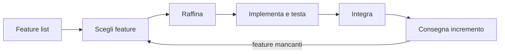

# Sviluppo Incrementale

> [!summary] In breve
> Il software cresce per incrementi funzionanti: si scelgono alcune funzionalità dalla lista, si raffinano, si implementano e testano, si integrano e si consegnano.

## Collegamenti

- **Concetti correlati**: [[Agile Manifesto]] · [[Scrum]] · [[Minimum Viable Product]]
- **Mappa**: [[MOC - Lab Architetture Software e Sicurezza]]

> [!info] Approfondimento
> - [[01 - LASS - Software Development Process#Sviluppo incrementale|Lezione 1 — Sviluppo incrementale]]
