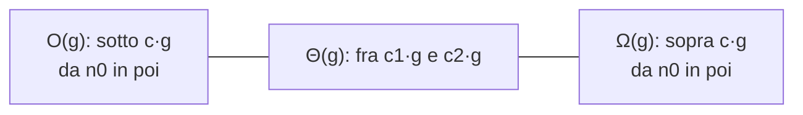

# Notazione asintotica

> [!abstract]
> Nella [[01 - MC - Costo degli algoritmi e modello CEM|lezione 1]] il costo di un algoritmo è diventato una funzione della dimensione dell'input, calcolata sulla CEM. Le costanti di quella funzione ($2n + 4$ invece di $3n + 1$) dipendono però da scelte arbitrarie del modello. Questa lezione mostra che **conta solo l'andamento asintotico**: per input grandi la differenza fra un algoritmo polinomiale ed uno esponenziale schiaccia qualunque costante o miglioramento dell'hardware. Si introducono le notazioni $O$, $\Omega$ e $\Theta$, il concetto di **istruzione dominante** (che permette di contare una sola istruzione invece di tutte) e la regola per sommare i costi nella **composizione** di algoritmi. Le stesse notazioni servono poi per gli [[03 - MC - Esempi di analisi di complessità|esempi di analisi]] e per i [[05 - MC - Delimitazioni superiori e inferiori|bound dei problemi]]. Vedi anche [[Notazione asintotica]] (ASD) per lo stesso argomento dal punto di vista del corso di algoritmi.
> Mappa del corso: [[MOC - Modelli di Calcolo]].

## Analisi asintotica e la notazione O

L'efficienza conta per input di **grandi dimensioni**: per problemi di "piccola taglia" la potenza di calcolo disponibile rende trascurabili le inefficienze. Al crescere dell'input la situazione cambia radicalmente.

**Tabella 1.2 (a)** — tempi di esecuzione su un sistema che esegue $10^6$ operazioni al secondo:

| complessità | 10 | 20 | 30 | 40 | 50 | 60 |
|---|---|---|---|---|---|---|
| $n$ | 10 µs | 20 µs | 30 µs | 40 µs | 50 µs | 60 µs |
| $n^2$ | 0.1 ms | 0.4 ms | 0.9 ms | 1.6 ms | 2.5 ms | 3.6 ms |
| $n^3$ | 1 ms | 8 ms | 27 ms | 64 ms | 125 ms | 216 ms |
| $n^5$ | 0.1 s | 3.2 s | 24.3 s | 1.7 min | 5.2 min | 13.0 min |
| $2^n$ | 1 ms | 1 s | 17.9 min | 12.7 giorni | 35.7 anni | 366 secoli |
| $3^n$ | 59 ms | 58 min | 6.5 anni | 3855 secoli | $2 \times 10^8$ secoli | $1.3 \times 10^{13}$ secoli |

**Tabella 1.2 (b)** — le stesse funzioni con costanti moltiplicative diverse (decrescenti lungo le righe):

| complessità | 10 | 20 | 30 | 40 | 50 | 60 |
|---|---|---|---|---|---|---|
| $10000n$ | 100 ms | 200 ms | 300 ms | 400 ms | 500 ms | 600 ms |
| $1000n^2$ | 100 ms | 400 ms | 900 ms | 1.6 s | 2.5 s | 3.6 s |
| $100n^3$ | 100 ms | 800 ms | 2.7 s | 6.4 s | 12.5 s | 21.6 s |
| $10n^5$ | 10 s | 32 s | 243 s | 17 min | 52 min | 130 min |
| $2^n$ | 1 ms | 1 s | 17.9 min | 12.7 giorni | 35.7 anni | 366 secoli |
| $3^n$ | 59 ms | 58 min | 6.5 anni | 3855 secoli | $2 \times 10^8$ secoli | $1.3 \times 10^{13}$ secoli |

> [!warning] Correzione
> La didascalia della tabella dice che la parte (b) si riferisce a un sistema da $10^9$ operazioni/s. I valori però sono calcolati ancora con $10^6$ operazioni/s: per esempio $10000 \cdot 10 = 10^5$ operazioni a $10^9$/s farebbero 0,1 ms, non 100 ms; e le righe $2^n$, $3^n$ sono identiche a quelle della parte (a). Inoltre, sempre con $10^6$ op/s, la casella $10n^5$ per $n = 10$ vale $10 \cdot 10^5 = 10^6$ operazioni, cioè **1 s** e non 10 s (le altre caselle della riga, per esempio 32 s per $n = 20$, sono coerenti). Le conclusioni che la dispensa trae dalla tabella restano valide, perché riguardano il confronto fra le righe.

Osservazioni:

- per dimensioni piccole tutti gli algoritmi costano al più un decimo di secondo: le differenze non hanno rilevanza pratica;
- già per $n = 60$ gli algoritmi $O(n^5)$ ed esponenziali sono molto peggiori: $n^5$ impiega più di 400 volte il tempo di $n^3$ (per la precisione $n^2 = 3600$ volte), e gli esponenziali hanno tempi non pratici; l'algoritmo lineare è sessanta volte più veloce del migliore degli altri;
- nella parte (b), per $n = 10$ gli esponenziali sono i **migliori** (1 ms e 59 ms contro i 100 ms dei polinomiali con costanti grandi), ma già da $n = 30$ il migliore è il lineare e gli esponenziali sono peggiori di molti ordini di grandezza;
- con sistemi mille volte più veloci i tempi della parte (a) si dividono per 1000, ma per $n = 60$ resterebbero 36,6 anni ($2^n$) e $1{,}3 \times 10^{10}$ secoli ($3^n$).

> [!important] Conclusione
> L'**intrattabilità** computazionale va associata all'**andamento asintotico** (esponenziale) della funzione di costo, non alle costanti moltiplicative né alla scarsa potenza dell'hardware. L'obiettivo primario dell'analisi è quindi individuare l'**andamento asintotico** della funzione di costo; il modello CEM a costi unitari, per quanto rudimentale, basta a determinarlo.

In analisi matematica due funzioni hanno lo **stesso andamento asintotico**, $f(x) \sim g(x)$, se $\lim_{x \to \infty} f(x)/g(x) = 1$. Nell'analisi degli algoritmi si usa il concetto leggermente diverso di **"stesso andamento asintotico a meno di una costante"**: il limite può essere un qualunque valore finito e positivo. Le funzioni sono di norma definite su $\mathbb{N}$ e a valori in $\mathbb{N}$.

### Proprietà delle notazioni

> [!important] Proprietà 1
> $f(n) \in O(g(n)) \iff g(n) \in \Omega(f(n))$

*Dimostrazione* ($\Rightarrow$): per ipotesi $f(n) \le c \cdot g(n)$ per una costante $c > 0$ ed $n$ abbastanza grande. Allora $g(n) \ge f(n)/c = c' \cdot f(n)$ con $c' = 1/c$, cioè $g(n) \in \Omega(f(n))$. ($\Leftarrow$) è analogo.

> [!important] Proprietà 2
> $f(n) \in O(g(n)) \wedge f(n) \in \Omega(g(n)) \iff f(n) \in \Theta(g(n))$

Discende direttamente dalle definizioni.

> [!important] Proprietà 3 (simmetria di $\Theta$)
> $f(n) \in \Theta(g(n)) \iff g(n) \in \Theta(f(n))$

*Dimostrazione* ($\Rightarrow$): per ipotesi $c_1 g(n) \le f(n) \le c_2 g(n)$ per $n$ grande. Dividendo per $c_1$: $g(n) \le f(n)/c_1$, quindi $g(n) \in O(f(n))$. Dividendo per $c_2$: $f(n)/c_2 \le g(n)$, quindi $g(n) \in \Omega(f(n))$. Per la Proprietà 2, $g(n) \in \Theta(f(n))$.

Chiarito che l'obiettivo è l'analisi asintotica **a meno di costanti moltiplicative e additive**, la CEM diventa ancora più comoda: le costanti si possono tralasciare durante l'analisi. Questo vale anche per la dimensione dell'input: se l'input è un array di $n$ elementi da $k$ byte, si usa $n$ e non $k \cdot n$. Nel seguito "stesso andamento asintotico" significa "a meno di costanti moltiplicative e/o additive".

> [!example] Costo costante (dagli appunti)
> $\Theta(1) = O(1) \cap \Omega(1)$, e $O(1) = O(2) = O(3) = \dots$, $\Omega(1) = \Omega(2) = \Omega(4) = \dots$: in analisi asintotica tutti i costi costanti sono uguali.

## Operazioni dominanti

Vedi [[Istruzione dominante]].

Il concetto di istruzione (o operazione) **dominante** semplifica molto il calcolo del costo asintotico di caso peggiore.

> [!important] Definizione
> Un'istruzione elementare $\gamma$ di un programma linearizzato $A$ è **dominante** se fornisce un contributo $C_\gamma(z)$ al costo $C_A(z)$ tale che esistono due costanti positive $\xi$ e $\zeta$ per cui, per ogni $z$:
> $$\xi \cdot C_\gamma(z) + \zeta \ge C_A(z)$$

Poiché ovviamente $C_\gamma(z) \le C_A(z)$, ne segue che $C_\gamma(z)$ e $C_A(z)$ hanno **lo stesso andamento asintotico**: basta contare le esecuzioni dell'istruzione dominante.

Un **programma linearizzato** (nota di Clelia) è uno in cui si ignorano i costi relativi al solo mantenimento dei cicli (test e incrementi): sono asintoticamente assorbiti dal corpo.

Una proprietà utile: l'istruzione dominante è quella **eseguita più frequentemente** (da un punto di vista asintotico: $n$ ed $n + k$ esecuzioni, con $k$ costante, sono equivalenti). Ma attenzione: la definizione vale per istruzioni **elementari**. Se l'algoritmo chiama altri algoritmi, bisogna immaginare di **sostituire alla chiamata il corpo** della funzione chiamata, altrimenti si sbaglia.

```c
...                               /* ciclo A */
for(i = 0; i < n; i++)            /* ciclo B */
   for(j = 0; j < n; j++)         /* ciclo C */
      a = 0;
...
for(k = 1; k <= n; k++)
   b = f(k);
...
```

L'istruzione `a = 0` è eseguita $n^2$ volte; `b = f(k)`, che **non è elementare** perché chiama $f$, è eseguita $n$ volte. Ai cicli annidati va associato costo $n^2$. Ma se $f(k)$ costa $k^2$, al ciclo su $k$ va associato un costo superiore:

$$\sum_{k=1}^{n} k^2 = \frac{2n^3 + 3n^2 + n}{6}$$

(formula dell'$n$-esimo numero piramidale quadrato), che ha lo stesso andamento di $n^3$. L'istruzione dominante non è `a = 0` ma una di quelle **dentro** $f$.

> [!note] Etichette dei cicli
> Nella dispensa il commento `/* ciclo A */` è sulla riga `...` e il testo parla di "costo da associare al ciclo A" ($n^2$, quindi la coppia di cicli annidati) e "al ciclo C" ($\sum k^2$, quindi il ciclo su `k`). Le etichette nel codice non corrispondono a quelle del testo: il ragionamento va letto come "cicli annidati su `i` e `j`: $n^2$; ciclo su `k`: $\Theta(n^3)$".

In pratica, per individuare l'istruzione dominante non serve applicare la definizione: basta guardare l'operazione eseguita più spesso (di solito nei cicli più interni), avendo espanso le chiamate. Se ce n'è più di una, ne basta una qualunque.

> [!tip] Dagli appunti: dal punto di vista operativo
> L'istruzione dominante 1) **deve esistere**, 2) è quella **eseguita più volte**, 3) può **non essere unica**, ma per l'analisi basta trovarne una: il costo è $K \cdot a(z)$, dove $a(z)$ è il numero di sue esecuzioni. Altre semplificazioni utili: si possono buttare le righe fuori dai cicli e trascurare i costi asintoticamente irrilevanti, per esempio $\Theta(n^2) + \Theta(n) = \Theta(n^2)$ per un ciclo semplice seguito da due cicli annidati.

## Le notazioni O, Ω, Θ

Per rendere precise le valutazioni di andamento asintotico si usa la **notazione asintotica**. Vedi [[Notazione O grande]], [[Notazione Omega]] e [[Notazione Theta]].

> [!important] O grande (*upper bound*)
> $$O(g(n)) = \{\, f: \mathbb{N} \to \mathbb{N} \mid (\exists c > 0)(\exists n_0 > 0)(\forall n \ge n_0)\ f(n) \le c \cdot g(n) \,\}$$
> Se $f(n) \in O(g(n))$ si dice che "**$f$ cresce al più come $g$**": asintoticamente la crescita di $f$ non eccede quella di $g$, a meno di costanti moltiplicative. Le funzioni costanti si indicano con $O(1)$.

> [!important] Omega grande (*lower bound*)
> $$\Omega(g(n)) = \{\, f: \mathbb{N} \to \mathbb{N} \mid (\exists c > 0)(\exists n_0 > 0)(\forall n \ge n_0)\ f(n) \ge c \cdot g(n) \,\}$$
> "**$f$ cresce almeno come $g$**".

> [!important] Theta grande (*analisi tight*)
> $$\Theta(g(n)) = \{\, f: \mathbb{N} \to \mathbb{N} \mid (\exists c_1 > 0)(\exists c_2 > 0)(\exists n_0 > 0)(\forall n \ge n_0)\ c_1 g(n) \le f(n) \le c_2 g(n) \,\}$$
> cioè $f \in O(g) \wedge f \in \Omega(g)$: "**$f$ e $g$ crescono nello stesso modo**".

(La dispensa scrive "sia $O(g(n))$ e $\Omega(n)$": è un refuso per $\Omega(g(n))$.)



Negli appunti di Clelia: $O(f(n))$ è una **classe** di funzioni, tutte quelle che stanno "sotto" $f$ (a meno di costante). Per esempio $10n^3 + 7n^2 - 8n - 6 \in O(n^3)$, ma anche $\in O(n^4)$ e $\in O(n^5)$: sono tutti upper bound, e $O(n^3)$ è il più interessante (il più stretto).

> [!warning] Ordine dei quantificatori
> Negli appunti la definizione di $\Omega$ è scritta "$\forall n \ge n_0\ \exists c > 0$". L'ordine corretto è quello della dispensa: **prima** si fissano $c$ ed $n_0$, **poi** la disuguaglianza deve valere per ogni $n \ge n_0$ con **la stessa** costante. Con l'ordine invertito ogni funzione positiva starebbe in $\Omega$ di qualunque altra (basterebbe scegliere $c$ diverso per ogni $n$).

Osservazioni:

- se $f(n) \in O(n)$, allora anche $f(n) \in O(n^2)$ e $f(n) \in O(n^3)$; se $f(n) \in \Omega(n^2)$, allora anche $f(n) \in \Omega(n)$;
- si scrive spesso $f(n) = O(g(n))$ al posto di $f(n) \in O(g(n))$: è comunissimo ma improprio, perché $O(g(n))$ è un insieme;
- $f \in O(g)$ significa che $f$ è "al massimo" $g$ in senso approssimato, ignorando le costanti; $f \in \Omega(g)$ che è "almeno" $g$ nello stesso senso.

### Regole pratiche per confrontare funzioni

1. Le costanti moltiplicative e additive non contano: se $f(n) \in O(g(n))$ allora $1000 f(n) + 1000 \in O(g(n))$.
2. Conta solo il termine che cresce di più: $n^3 + 100n^2 + 1000n \in O(n^3)$.
3. Se $a \le b$ allora $n^a \in O(n^b)$, ma non il contrario: $n^b \notin O(n^a)$ per $a < b$.
4. Un polinomio è sempre più piccolo di un esponenziale: $n^a \in O(2^{n^b})$ per ogni $a > 0$, $b > 0$, anche con $b$ molto più piccolo di $a$ (per esempio $10n^{100} \in O(2^n)$ ma $2^n \notin O(10n^{100})$).
5. Un logaritmo è sempre più piccolo di un polinomio: $100n^2 \log(100n) \in O(n^3)$.
6. Nella maggior parte dei casi pratici (non in tutti!) le costanti nascoste non sono troppo grandi: è ragionevole pensare che $f \in O(g)$ implichi $f(n) \le 100g(n) + 1000$ per $n$ grande, e che $f \in \Omega(g)$ implichi $f(n) \ge 0{,}001\,g(n)$. È questo che giustifica il trascurare le costanti.

## Composizione di algoritmi

Dati due algoritmi $A_1$ e $A_2$, se l'output di $A_1$ e l'input di $A_2$ sono compatibili (dello stesso tipo), si può definire un nuovo algoritmo $A$ che passa l'output di $A_1$ in input ad $A_2$.

![[MC-L02-01.png]]

La figura (*Fig. 1.2*) mostra la composizione: l'input di $A$ entra in $A_1$, l'output di $A_1$ entra in $A_2$, l'output di $A_2$ è l'output di $A$ (il riquadro tratteggiato).

Se $C_1$ e $C_2$ sono i costi di $A_1$ e $A_2$, verrebbe da scrivere $C(n) = C_1(n) + C_2(n)$. È **sbagliato** in generale: se l'input di $A_1$ ha dimensione $n$, non è detto che l'input di $A_2$ abbia dimensione $n$, perché è l'output di $A_1$, che può essere più grande.

> [!important] Coefficiente di dilatazione
> Il **coefficiente di dilatazione** (massima) di $A_1$ è
> $$\delta_{A_1}(n) = \max_{|x| = n} \frac{|A_1(x)|}{|x|}$$
> cioè quanto, al massimo, l'output è più grande dell'input. L'input di $A_2$ ha dimensione al più $n \cdot \delta_{A_1}(n)$, e quindi
> $$C(n) = C_1(n) + C_2(n \cdot \delta_{A_1}(n))$$

Per tre algoritmi:

$$C(n) = C_1(n) + C_2(n\,\delta_{A_1}(n)) + C_3\big(n\,\delta_{A_1}(n)\,\delta_{A_2}(n\,\delta_{A_1}(n))\big)$$

e la generalizzazione a $k$ algoritmi è ovvia.

> [!example] Perché serve (dagli appunti)
> Se $C_1(z_1) = O(z_1) = O(n)$ e $C_2(z_2) = O(z_2)$, scrivere $O(n) + O(n) = O(n)$ è sbagliato perché "le due $n$ non sono uguali": $z_2 = \delta_{A_1} \cdot z_1$. Se $A_1$ produce un output quadratico ($\delta_{A_1}(n) = n$) e $A_2$ è lineare, il costo totale è $O(n) + O(n \cdot n) = O(n^2)$. Lo stesso principio regge le [[Riduzione polinomiale|riduzioni polinomiali]]: la composizione di una riduzione polinomiale con un algoritmo polinomiale resta polinomiale perché l'output della riduzione ha dimensione polinomiale.

## Esercizi svolti sulla notazione asintotica

**1. Dimostrare che $\lfloor \log n \rfloor \in O(\log n)$.** Si applica la definizione:

$$(\exists c > 0)(\exists n_0)(\forall n \ge n_0)\ \lfloor \log n \rfloor \le c \cdot \log n$$

È sempre vero per ogni $n$, scegliendo un qualsiasi $c \ge 1$, perché $\lfloor x \rfloor \le x$.

**2. Dimostrare che $\lceil \log n \rceil \in O(\log n)$.** Si scrive l'analoga relazione. Poiché $\lceil \log n \rceil \le \log n + 1$, prendendo $c \ge 2$ si ha $(\forall n \ge 2)\ \log n + 1 \le 2 \log n$ (vale perché $\log n \ge 1$ per $n \ge 2$, con il logaritmo in base 2).

**3. Dimostrare che $P(n) = 2n^2 - 3n + 2 \in \Theta(n^2)$.**

*Prima parte: $P(n) \in O(n^2)$*, cioè $(\exists c > 0)(\exists n_0)(\forall n \ge n_0)\ P(n) \le c n^2$. La disequazione diventa

$$(2 - c)n^2 - 3n + 2 \le 0$$

Per $c > 2$ il coefficiente di $n^2$ è negativo; il discriminante $9 - 8(2 - c) = 8c - 7$ è positivo, quindi il polinomio ha due zeri reali distinti

$$n_{1,2} = \frac{3 \pm \sqrt{8c - 7}}{2(2 - c)}$$

e si può scrivere $(2 - c)(n - n_1)(n - n_2)$, con $n_2 \ge n_1$. Per $n > n_2$ (cioè fuori dalle radici) il polinomio ha il segno del coefficiente direttore, quindi è negativo: la disuguaglianza è soddisfatta.

*Seconda parte: $P(n) \in \Omega(n^2)$*, cioè esiste $c' > 0$ (con $c' < c$, perché le due condizioni devono essere compatibili) tale che $P(n) \ge c' n^2$ per $n$ grande:

$$(2 - c')n^2 - 3n + 2 \ge 0$$

Per $c' < 2$ il coefficiente di $n^2$ è positivo e per $n$ oltre la radice maggiore la disuguaglianza è soddisfatta.

La congiunzione delle due dà $P(n) \in \Theta(n^2)$.

> [!example] Valori concreti
> Con $c = 3$: $-n^2 - 3n + 2 \le 0$ vale per ogni $n \ge 1$ ($-1 - 3 + 2 = -2$). Con $c' = 1$: $n^2 - 3n + 2 = (n-1)(n-2) \ge 0$ vale per ogni $n \ge 2$. Quindi $n^2 \le P(n) \le 3n^2$ per ogni $n \ge 2$.

> [!note] Figura mancante
> Nella dispensa, dopo la formula delle radici, c'è la frase "Il segno del polinomio (5) risulta come segue:" senza la figura corrispondente. Il segno è quello descritto sopra: per $c > 2$ il polinomio è positivo fra le radici e negativo fuori.

## Riepilogo

> [!summary]
> - Conta l'**andamento asintotico**: un algoritmo esponenziale resta inutilizzabile anche con hardware mille volte più veloce.
> - $O$ = upper bound, $\Omega$ = lower bound, $\Theta$ = entrambi (analisi tight). Le costanti si fissano **prima** del "per ogni $n \ge n_0$".
> - $f \in O(g) \iff g \in \Omega(f)$; $\Theta$ è simmetrica.
> - **Istruzione dominante**: basta contare le esecuzioni dell'istruzione eseguita più spesso, dopo aver espanso le chiamate di funzione.
> - **Composizione**: $C(n) = C_1(n) + C_2(n \cdot \delta_{A_1}(n))$, dove $\delta$ è il coefficiente di dilatazione.
