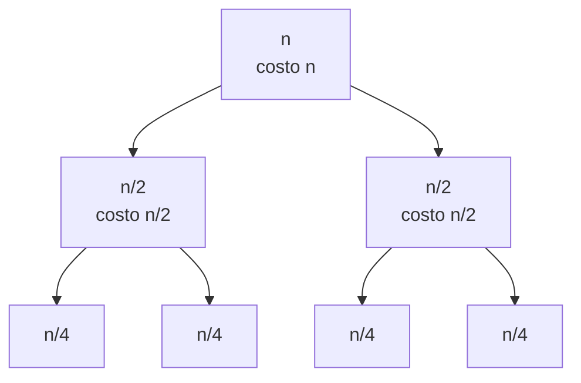

# Algoritmi ricorsivi ed equazioni di ricorrenza

> [!abstract]
> Negli [[03 - MC - Esempi di analisi di complessità|esempi della lezione 3]] gli algoritmi erano iterativi: bastava contare quante volte si eseguiva il corpo di un ciclo. Con la ricorsione il costo di una chiamata dipende dal costo di altre chiamate, quindi la funzione di costo è essa stessa ricorsiva: un'**equazione di ricorrenza**. Questa lezione mostra come impostarla e risolverla (per **srotolamento** e con l'**albero delle chiamate**), e la applica a ricerca binaria ricorsiva, merge sort, algoritmo di Euclide e numeri di Fibonacci. Due lezioni importanti: il costo nascosto della **pila dei record di attivazione**, e il fatto che una ricorsione "naturale" (Fibonacci) può essere esponenziale dove l'iterazione è lineare. Vedi anche [[Equazione di ricorrenza]] e [[05 - ASD - Ricorsione]] nel corso di Algoritmi e Strutture Dati.
> Mappa del corso: [[MOC - Modelli di Calcolo]].

## Analisi di algoritmi ricorsivi

Valutare la complessità di un algoritmo ricorsivo è in genere più difficile che per uno iterativo: la natura ricorsiva della soluzione dà luogo a una funzione di costo anch'essa ricorsiva.

> [!important] Equazione di ricorrenza
> Un'**equazione di ricorrenza** definisce una sequenza di valori a partire da uno o più **valori iniziali** dati; ogni ulteriore valore è funzione dei valori precedenti. È la controparte discreta di un'equazione differenziale (annota Clelia).

Esempio: $G(n) = 1$ se $n = 1$ e $G(n) = 2G(n-1)$ se $n > 1$. Per calcolare $G(3)$ serve $G(2) = 2G(1) = 2$, quindi $G(3) = 4$; i valori sono $1, 2, 4, 8, 16, \dots$, le potenze di 2: $G(n) = 2^{n-1}$.

Dato un algoritmo, **trovare** la funzione di costo ricorsiva è di solito immediato; la parte meno semplice è **risolverla**, cioè trovare una funzione equivalente non ricorsiva (forma chiusa). L'equazione di ricorrenza è costituita dalla formulazione ricorsiva più il **caso base**.

> [!note] Dagli appunti di Clelia
> Per un algoritmo ricorsivo l'istruzione dominante è quella eseguita più volte, quindi si vuole sapere il **numero di chiamate ricorsive**. Le ricorsioni possono essere *lineari* (una chiamata), *binarie* (due) o *multiple*. Vedi [[Ricorsione lineare, binaria e multipla]].

## Equazioni di ricorrenza: ricerca binaria ricorsiva

Il corpo della ricerca binaria ricorsiva, chiamato su un vettore di dimensione $n$, esegue un test per verificare se l'elemento cercato è quello centrale e, se il test fallisce, fa **una** chiamata ricorsiva su $n/2$ elementi.

```c
int RBR(int t[], int primo, int ultimo, int k) {
   if(primo > ultimo) return -1;           /* intervallo vuoto */
   int media = (primo + ultimo) / 2;
   if(t[media] == k) return media;
   if(t[media] < k) return RBR(t, media + 1, ultimo, k);
   else             return RBR(t, primo, media - 1, k);
}
```

$$T(n) = T(n/2) + \Theta(1) \qquad T(1) = \Theta(1)$$

**Soluzione per srotolamento** (il metodo più intuitivo):

$$\begin{aligned}
T(n) &= 1 + T(n/2)\\
&= 1 + 1 + T(n/4) = 2 + T(n/4)\\
&= 3 + T(n/8) = 4 + T(n/16)\\
&= \dots = k + T(n/2^k)
\end{aligned}$$

Se $n$ è una potenza di 2 si srotola finché $n/2^k = 1$, cioè $k = \log_2 n$. Altrimenti ci si ferma appena $n/2^k < 1$, il che dà $k = \lfloor \log_2 n \rfloor + 1$. La soluzione è

$$T(n) = \log_2 n + 1 = O(\log_2 n)$$

Lo stesso costo della versione iterativa della [[03 - MC - Esempi di analisi di complessità#Ricerca binaria|lezione 3]]. C'è però una differenza: l'algoritmo ricorsivo deve gestire la **pila dei record di attivazione** (Clelia), cioè usa $\Theta(\log n)$ spazio in più.

> [!note] Codice degli appunti
> Nella versione della ricerca binaria ricorsiva scritta negli appunti c'è una chiamata `return RBR(t, primo, ultimo, k);` prima del confronto, che richiamerebbe la funzione con gli stessi argomenti all'infinito; qui sopra c'è una versione corretta.

## Ordinamento per fusione (Mergesort)

Vedi [[Merge-sort]] (ASD).

Il merge sort ordina $n$ elementi con costo $O(n \log n)$ nel caso peggiore. Dato un array di $n$ elementi: se $n = 1$ è già ordinato; altrimenti

1. ordina la prima metà (elementi $1, \dots, \lceil n/2 \rceil$);
2. ordina la seconda metà (elementi $\lceil n/2 \rceil + 1, \dots, n$);
3. **fonde** (*merge*) le due parti ordinate in un unico array ordinato.

```c
void merge(int low, int mid, int high) {
   int l1, l2, i;
   for(l1 = low, l2 = mid + 1, i = low; l1 <= mid && l2 <= high; i++) {
      if(a[l1] <= a[l2]) b[i] = a[l1++];
      else               b[i] = a[l2++];
   }
   while(l1 <= mid)  b[i++] = a[l1++];      /* resto della prima metà */
   while(l2 <= high) b[i++] = a[l2++];      /* resto della seconda metà */
   for(i = low; i <= high; i++) a[i] = b[i];
}

void sort(int low, int high) {
   int mid;
   if(low < high) {
      mid = (low + high) / 2;
      sort(low, mid);
      sort(mid + 1, high);
      merge(low, mid, high);
   } else return;
}
```

`merge` scorre le due metà con due indici e copia ogni volta il minore in un array di appoggio `b`; poi copia i residui e riporta tutto in `a`. Il suo costo è **lineare**: a ogni iterazione almeno un elemento viene inserito in `b`. (Nel `sort` della dispensa la chiamata è scritta `merging(low, mid, high)`: la funzione si chiama `merge`.)

$$T(n) = 1 \text{ se } n = 1 \qquad T(n) = n + 2T(n/2) \text{ se } n > 1$$

Srotolando, con $n$ potenza di 2 e fusione di costo esattamente $n$:

$$\begin{aligned}
T(n) &= n + 2T(n/2)\\
&= n + 2(n/2 + 2T(n/4)) = 2n + 4T(n/4)\\
&= 2n + 4(n/4 + 2T(n/8)) = 3n + 8T(n/8)\\
&= \dots = kn + 2^k T(n/2^k)
\end{aligned}$$

Ci si ferma a $n/2^k = 1$, cioè $k = \log_2 n$: $T(n) = n \log_2 n + n$.

Si tolgono le due ipotesi semplificative:

- **$n$ non è una potenza di 2**: sia $n'$ la più piccola potenza di 2 maggiore di $n$ ($n' < 2n$), e si aggiungano all'array $n' - n$ elementi più piccoli di tutti. Ordinare l'array allungato costa almeno quanto l'originale, ed è $O(n' \log n') < 2n(\log_2 n + 1)$: quindi $O(n \log n)$.
- **la fusione non costa esattamente $n$**: costa al più $cn$; srotolando si ottiene $T(n) = kcn + 2^k T(n/2^k)$, stesso risultato a meno della costante.

> [!note] Refusi nello srotolamento
> Nella dispensa il termine finale è scritto $kn + 2^k(n/2^k)$ (manca la $T$) e, nel caso con costante $c$, i passaggi intermedi perdono la $c$ ("$= 2n + 4T(n/4)$" invece di $2cn$). Il risultato non cambia.

Il merge sort è anche $\Omega(n \log n)$ nel caso peggiore: ha un unico test sulla dimensione, quindi le due chiamate ricorsive e il merge vengono eseguiti **sempre**. Quindi $\Theta(n \log n)$.

### Albero delle chiamate (dagli appunti)

Vedi [[Albero delle chiamate ricorsive]].

Clelia (10/03/2022) risolve $T(n) = 2T(n/2) + n$ anche con l'**albero delle computazioni**:



- ogni nodo è una chiamata, etichettata con il **costo locale** (la fusione: proporzionale alla dimensione);
- in ogni strato orizzontale la somma dei costi è $n$ ($n$, $2 \cdot n/2$, $4 \cdot n/4$, …);
- l'albero ha $\log n$ livelli;
- costo totale $n \cdot \log n = \Theta(n \log n)$.

> [!tip] Formule utili
> - Serie geometrica: $\displaystyle\sum_{i=0}^{k} q^i = \frac{q^{k+1} - 1}{q - 1}$
> - Somma di Gauss: $\displaystyle\sum_{i=0}^{k} i = \frac{k(k+1)}{2} \in \Theta(k^2)$

> [!example] Esercizio: $T(n) = T(n-1) + n$, $T(1) = 1$
> Srotolamento:
> $$T(n) = T(n-1) + n = T(n-2) + (n-1) + n = \dots = T(n-k) + (n-k+1) + \dots + n$$
> Per $n - k = 1$, cioè $k = n - 1$: $T(n) = 1 + 2 + \dots + n = \frac{n(n+1)}{2} \in O(n^2)$: soluzione **quadratica** (è il caso del [[03 - MC - Esempi di analisi di complessità#Sort ricorsivo|sort ricorsivo]]).

> [!warning] Quando la ricorrenza non basta (dagli appunti)
> La relazione di ricorrenza è utile quando si conoscono le **dimensioni dei sottoproblemi**. Su un albero non bilanciato, una funzione che fa qualcosa sulla radice e poi due chiamate sui figli non sa quanti nodi ha ciascun sottoalbero. Per la **visita in preordine**
> ```c
> void preorder(Node *root) {
>    if(root == NULL) return;
>    visita(root);
>    preorder(root->leftChild);
>    preorder(root->rightChild);
> }
> ```
> si potrebbe scrivere $T(n) \le 1 + T(n-1) + T(n-1)$ (al più $n-1$ nodi per sottoalbero), arrivando a $1 + 2T(n-1)$, cioè a un costo esponenziale: **sbagliato**. Servono due considerazioni:
> 1. **tutti i nodi vengono visitati**: se un nodo non lo fosse, non lo sarebbe nemmeno il genitore, e così via fino alla radice: contraddizione;
> 2. **nessun nodo viene visitato due volte**: altrimenti il genitore sarebbe visitato due volte, …, fino alla radice: contraddizione.
>
> Ogni nodo è visitato esattamente una volta con costo costante: la visita costa $\Theta(n)$. Lo stesso per la visita **simmetrica** (*inorder*: sinistro, radice, destro).

### Spazio e pila dei record di attivazione

Negli algoritmi ricorsivi c'è una funzione di costo "losca" che non si vede nel codice (Clelia): la **pila dei record di attivazione**, grande quanto il numero di livelli ricorsivi aperti contemporaneamente. Bisogna calcolare la **profondità massima della ricorsione**, che è la dimensione massima della pila. Nello spazio si contano:

- lo spazio per l'**input**;
- lo spazio per le **variabili**;
- lo spazio di **appoggio** (per esempio l'array `b` del merge, e la pila);
- lo spazio per l'**output**.

Un algoritmo è **in-place** se, al crescere dell'input, lo spazio di appoggio resta costante; **off-place** se lo spazio di appoggio cresce illimitatamente con l'input. Il merge sort con l'array `b` non è in-place; un algoritmo ricorsivo, a causa della pila, in generale non lo è.

### Dimensione dell'output

Anche l'output ha una dimensione, e un algoritmo deve almeno scriverlo. Esempio (Clelia): **range query**. Dati $n$ punti su una retta e un intervallo, si può chiedere il **conteggio** ("quanti punti ci sono nell'intervallo?", output $\Theta(1)$) o l'**elenco** ("quali sono?", output di dimensione $K$, con $0 \le K \le n$). Il costo dell'elenco è della forma $\Theta(f(z) + K)$: dipende dall'output, oltre che dall'input. Lo stesso nel caso bidimensionale (punti nel piano e un rettangolo).

| algoritmo | input | output |
|---|---|---|
| ricerca sequenziale | $\Theta(n)$ | $\Theta(1)$ |
| ricerca binaria | $\Theta(n)$ | $\Theta(1)$ |
| algoritmo di Euclide | $\Theta(z) = \Theta(\log n)$ | $\Theta(1)$ |
| merge sort | $\Theta(n)$ | $\Theta(n)$ |
| fattoriale di $k$ | $\Theta(\log k)$ | $\Theta(1)$ |
| range query (elenco) | $\Theta(n)$ | $\Theta(K)$ |

(Per Euclide, i due argomenti differiscono al più di un fattore e hanno la stessa grandezza asintotica, $z = \log n$.)

> [!warning] Correzione
> Per il fattoriale l'output $\Theta(1)$ vale solo nell'ipotesi CEM di interi a costo unitario: in bit, $k!$ ha dimensione $\log_2(k!) = \Theta(k \log k)$, che è addirittura **esponenziale** nella dimensione dell'input $\Theta(\log k)$.

> [!danger] Errore tipico (dagli appunti)
> Input: un array di $n$ celle, quindi dimensione "proporzionale al numero di celle". Trovato l'upper bound $O(f(n))$, si dice che $z = \log n$, quindi $2^z = n$, quindi il costo è $O(f(2^z))$. **Sbagliato**: $\log n$ è la dimensione di **un intero** $n$, non di un array di $n$ celle. Per un array $z = \Theta(n)$ e il costo resta $O(f(z))$.

## Calcolo del massimo comun divisore: l'algoritmo di Euclide

Vedi [[Algoritmo di Euclide]].

Il problema: decidere se due interi $a$ e $b$ sono **relativamente primi**, cioè se $\mathrm{MCD}(a, b) = 1$. Esiste un algoritmo polinomiale, l'algoritmo di Euclide, basato su questa relazione. Dati $x \ge y \ge 0$:

- se $y = 0$, $\mathrm{MCD}(x, 0) = x$;
- altrimenti si divide: $x = yq + r$ con $0 \le r < y$, e $\mathrm{MCD}(x, y) = \mathrm{MCD}(y, r)$.

```c
int mcd(int a, int b) {   /* si assume che a >= b */
   if(b == 0) return a;   /* b può diventare 0 in una chiamata successiva */
   else return mcd(b, a % b);
}
```

> [!example] Esempio
> $\mathrm{MCD}(512, 10)$: $512 = 51 \cdot 10 + 2 \Rightarrow \mathrm{MCD}(10, 2)$; $10 = 5 \cdot 2 + 0 \Rightarrow \mathrm{MCD}(2, 0) = 2$. Due chiamate ricorsive. (Clelia annota anche la versione per sottrazione, $\mathrm{MCD}(x, y) = \mathrm{MCD}(x - y, y)$, che però richiederebbe 51 sottrazioni per passare da 512 a 2.)

### Correttezza

Dalla dispensa *L'algoritmo di Euclide* (D'Amore, 2023). Il **passo base** è ovvio: il MCD fra $a$ e 0 è $a$ (escluso il caso $a = 0$, in cui sarebbe indeterminato). Per il **passo ricorsivo**, sia $g = \mathrm{MCD}(a, b)$ e siano $a' = b$, $b' = a \% b$ i nuovi argomenti:

- **$g$ divide $(a', b')$**. Che $g$ divida $a' = b$ è ovvio. Si scrive $a = b \cdot q + b'$; dividendo per $g$, a sinistra si ha un intero ($g$ divide $a$), a destra $q \cdot b/g$ (intero) più $b'/g$, che allora deve essere intero anch'esso. Quindi $g$ divide $b'$.
- **$g$ è il massimo**. Se esistesse $g' > g$ che divide $(a', b')$, allora $g'$ dividerebbe $b = a'$ e, da $a/g' = q \cdot b/g' + b'/g'$, anche $a$. Si sarebbe trovato un divisore comune di $(a, b)$ maggiore di $g$: assurdo.

Quindi $\mathrm{MCD}(a', b') = \mathrm{MCD}(a, b)$. È essenzialmente una prova per induzione.

### Un'analisi banale

A ogni chiamata il valore di $b$ diminuisce, quindi le chiamate sono $O(b)$. Ma $b$ richiede $\Omega(\log b)$ bit: con $z \ge \lfloor \log_2 b \rfloor + 1$ la dimensione dell'input, $b \le 2^{z-1}$. Le chiamate, che sembravano "polinomiali", sono $O(2^{z-1}) = O(2^z)$: **esponenziali** nella dimensione dell'input (Clelia: un costo **pseudopolinomiale**, che "sembra polinomiale ma è esponenziale").

Ma l'analisi è precisa, cioè il costo è anche $\Omega(2^z)$? **No**: l'analisi non è tight.

### Un'analisi più accurata

Siano $(a_k, b_k)$ le coppie su cui viene invocata la funzione ai vari livelli ricorsivi. Per la struttura dell'algoritmo $a_{k+1} = b_k$ e $b_{k+1} = a_k \% b_k$.

$$\begin{array}{cc}
a_{k-1} & b_{k-1}\\
a_k = b_{k-1} & b_k\\
a_{k+1} = b_k & b_{k+1}
\end{array}$$

Scrivendo la divisione $a_k = q_k b_k + r_k$, con $r_k = b_{k+1}$ e $a_k = b_{k-1}$:

$$b_{k-1} = q_k b_k + b_{k+1}$$

Poiché $q_k \ge 1$:

$$b_{k-1} \ge b_k + b_{k+1}$$

e poiché i $b$ sono **decrescenti** ($b_{k-1} > b_k > b_{k+1}$):

$$b_{k-1} > 2\,b_{k+1} \quad\Longrightarrow\quad b_{k+1} < \frac{b_{k-1}}{2}$$

**Ogni due chiamate ricorsive il secondo argomento almeno si dimezza.** Per portare un valore $x$ a zero dimezzandolo (con divisione intera) servono $\lfloor \log_2 x \rfloor + 1$ dimezzamenti: per esempio $11 \to 5 \to 2 \to 1 \to 0$. Quindi bastano $O(\log_2 b)$ coppie di chiamate, cioè $O(\log_2 b)$ chiamate in tutto.

In funzione della dimensione dell'input, $z = \lfloor \log_2 b \rfloor + 1$, cioè $b \approx 2^{z-1}$:

$$O(\log_2 b) = O(\log_2 2^{z-1}) = O(z - 1) = O(z)$$

**Lineare**, non esponenziale come nell'analisi banale. (Nelle espressioni con il logaritmo la base si può omettere: cambiarla moltiplica per una costante.) Poiché ogni chiamata ha costo costante, l'algoritmo di Euclide ha complessità **lineare nella dimensione dell'input**: il problema MCD è in [[Classe P|P]].

> [!warning] Correzione
> Nella dispensa *Euclide* la catena (6) è scritta $\dots < b_{k-1} < b_k < b_{k+1} < \dots$: i $b_k$ invece **decrescono**, ed è proprio questo che serve per passare da $b_{k-1} \ge b_k + b_{k+1}$ a $b_{k-1} > 2b_{k+1}$. Inoltre il numero di dimezzamenti per portare $x$ a zero è $\lfloor \log_2 x \rfloor + 1$, non $\lceil \log_2 x \rceil$ (per $x = 8$: $8 \to 4 \to 2 \to 1 \to 0$ sono 4 passi, mentre $\lceil \log_2 8 \rceil = 3$). Nella versione del §1.4.3 della dispensa sulla complessità si legge "$b_{k-1} > a_k$": in realtà $b_{k-1} = a_k$. Nessuno di questi dettagli cambia il risultato $O(\log b)$.

## Calcolo dei numeri di Fibonacci

Vedi [[Numeri di Fibonacci]] e [[Fibonacci ricorsivo]] (ASD).

Questo esempio mostra come una realizzazione **diretta** di un algoritmo ricorsivo possa avere un costo, in tempo e memoria, inaccettabile.

Definizione della dispensa: $F(n) = 1$ se $n < 3$, $F(n) = F(n-1) + F(n-2)$ se $n \ge 3$. L'implementazione diretta:

```python
def F(n):
    if n == 1 or n == 2:
        return 1
    return F(n - 1) + F(n - 2)
```

(La dispensa scrive il caso base come `N==0 || N==1`, che corrisponde alla convenzione $F(0) = F(1) = 1$ invece che $F(1) = F(2) = 1$; le due convenzioni differiscono solo per uno spostamento dell'indice.)

Il costo di un'attivazione di $F(n)$ è costante più il costo delle eventuali attivazioni ricorsive: a meno di costanti, il costo è il **numero di attivazioni**.

![[MC-L04-01.png]]

La figura (*Fig. 1.5*) mostra l'albero delle chiamate per $n = 6$: $F(6)$ chiama $F(5)$ e $F(4)$, ma anche $F(5)$ chiama $F(4)$, che viene quindi **ricalcolato**. Le foglie sono le chiamate con $n \le 2$. $F(2)$ è attivata 5 volte e $F(1)$ 3 volte.

> [!warning] Correzione
> La dispensa dice che il numero complessivo di attivazioni è 14. Contando i nodi dell'albero: $F(6)$ una volta, $F(5)$ una, $F(4)$ due, $F(3)$ tre, $F(2)$ cinque, $F(1)$ tre, in tutto **15** attivazioni (di cui 14 sono chiamate *ricorsive*, se non si conta quella iniziale). In ogni caso il numero è maggiore di $F(6) = 8$.

**Valutazione per eccesso.** Il numero di attivazioni $T(n)$ soddisfa

$$T(n) = 2 \text{ se } n = 1, 2 \qquad T(n) = T(n-1) + T(n-2) + 2 \text{ se } n \ge 3$$

Poiché $T(n-1) > T(n-2)$ per $n \ge 3$, si maggiora con $T(n) \le 2T(n-1) + 2$ e si srotola:

$$\begin{aligned}
T(n) &\le 2 + 2T(n-1)\\
&\le 2 + 2(2 + 2T(n-2)) = (2 + 4) + 4T(n-2)\\
&\le (2 + 4 + 8) + 8T(n-3)\\
&\le \dots \le (2 + 4 + \dots + 2^k) + 2^k T(n-k)
\end{aligned}$$

Fermandosi a $k \approx n$ e usando $\sum_{k=1}^{n} 2^k = 2^{n+1} - 2 \le 2 \cdot 2^n$: il costo è $O(2^n)$. La dimensione dell'input è $O(\log n)$ (i bit di $n$): il costo del Fibonacci ricorsivo è **esponenziale nel valore** di $n$ e **doppiamente esponenziale** nella dimensione dell'input ($2^{2^z}$).

Un'analisi più fine mostra che $T(n) = \Theta(\varphi^n)$, con $\varphi = (1 + \sqrt 5)/2 \approx 1{,}618$, la **sezione aurea** (vedi la forma chiusa sotto).

**Versione iterativa.**

```c
if(N == 0 || N == 1) fib = 1;
else {
   fib1 = 1; fib2 = 1; i = 1;
   while(i < N) {
      fib = fib1 + fib2;
      i++;
      fib2 = fib1;
      fib1 = fib;
   }
}
printf("Il valore di fibonacci di %d e': %d\n", N, fib);
```

Tiene solo gli ultimi due valori e li fa "scorrere": costo $O(k)$ con $k$ numero di iterazioni, cioè $O(n)$. È comunque **esponenziale nella dimensione** dell'input, ma esponenzialmente migliore della ricorsione. La lezione: la versione ricorsiva può essere molto più costosa di quella iterativa.

### Forma chiusa dei numeri di Fibonacci

Dalla dispensa *Determinazione della forma chiusa dei numeri di Fibonacci* (D'Amore, 2010). Con la convenzione $F_0 = 0$, $F_1 = 1$, $F_n = F_{n-1} + F_{n-2}$ per $n > 1$ (la successione $0, 1, 1, 2, 3, 5, 8, \dots$ nasce dal problema dei conigli di Leonardo Pisano: ogni coppia diventa fertile dopo un mese e da allora genera una coppia al mese).

Si cerca $f: \mathbb{N} \to \mathbb{N}$ con $F_n = f(n)$, usando la **funzione generatrice**

$$s(x) = \sum_{i=0}^{+\infty} F_i x^i$$

Sfruttando la ricorrenza:

$$s(x) = F_0 + F_1 x + \sum_{i \ge 2}(F_{i-2} + F_{i-1})x^i = x + x^2 \sum_{i \ge 0} F_i x^i + x \sum_{i \ge 1} F_i x^i$$

e, poiché $F_0 = 0$, $s(x) = x + x^2 s(x) + x\,s(x)$, da cui

$$s(x) = \frac{x}{1 - x - x^2}$$

Il denominatore si annulla in $x = \frac{\sqrt 5 - 1}{2} = \varphi - 1$ e $x = -\frac{\sqrt 5 + 1}{2} = -\varphi$, con $\varphi = \frac{1 + \sqrt 5}{2}$ (la sezione aurea). Quindi

$$s(x) = \frac{-x}{(x - (\varphi - 1))(x + \varphi)} = \frac{A}{x - (\varphi - 1)} + \frac{B}{x + \varphi}$$

(decomposizione in fratti semplici). Moltiplicando per $x - (\varphi - 1)$ e valutando in $x = \varphi - 1$ si trova $A = \frac{-(\varphi - 1)}{\sqrt 5}$; analogamente $B = \frac{-\varphi}{\sqrt 5}$. Con qualche passaggio:

$$s(x) = \frac{1/\sqrt 5}{1 - \varphi x} - \frac{1/\sqrt 5}{1 - (1 - \varphi)x}$$

Ricordando la serie geometrica $\sum_{i \ge 0} q^i = \frac{1}{1 - q}$ (se converge):

$$\sum_{i \ge 0} F_i x^i = \frac{1}{\sqrt 5}\sum_{i \ge 0} \varphi^i x^i - \frac{1}{\sqrt 5}\sum_{i \ge 0} (1 - \varphi)^i x^i$$

e uguagliando i coefficienti di $x^i$:

$$\boxed{F_i = \frac{1}{\sqrt 5}\left(\varphi^i - (1 - \varphi)^i\right)}$$

Con $\varphi \approx 1{,}618$ e $\sqrt 5 \approx 2{,}236$: $F_n \approx \frac{1{,}618^n - (-0{,}618)^n}{2{,}236}$. Poiché $|1 - \varphi| < 1$, il secondo termine tende a 0: $F_n$ è l'intero più vicino a $\varphi^n / \sqrt 5$. Verifica: $F_6 \approx 17{,}94/2{,}236 \approx 8{,}02 \to 8$. ✓

> [!example] Esercizi d'esame sulle ricorsioni
> - *Quante chiamate fa `fibo(5)`* con `if(n <= 1) return n;` (luglio 2021)? Con $T(0) = T(1) = 1$ e $T(n) = 1 + T(n-1) + T(n-2)$: $T(2) = 3$, $T(3) = 5$, $T(4) = 9$, $T(5) = 15$ (contando la chiamata iniziale).
> - *Costo di `boh`* (febbraio 2022):
>   ```c
>   static int boh(int a) {
>      if(a > 10) return a;
>      return boh(boh(a + 1));
>   }
>   ```
>   Per $a > 10$ costa $\Theta(1)$. Per $a = 10$: `boh(11)` = 11, poi `boh(11)` = 11. In generale per $a \le 10$ la chiamata interna restituisce 11 e quella esterna `boh(11)` termina subito: $T(a) = T(a+1) + 2$, quindi $T(a) = \Theta(11 - a)$, lineare nel **valore** di $|a|$ (esponenziale nella sua dimensione); lo spazio (profondità della pila) è anch'esso $\Theta(11 - a)$.
> - *Albero delle ricorsioni binario e completo* con $n$ foglie e lavoro 1 per nodo (giugno 2019, maggio 2020, aprile 2022): un albero binario pieno con $n$ foglie ha $2n - 1$ nodi, quindi $T(n) = 2n - 1 = \Theta(n)$; $T(8) = 15$.
> - *Fattoriale ricorsivo* (esercizio 2 della dispensa): $T(n) = T(n-1) + c$, quindi $\Theta(n) = \Theta(2^z)$, esponenziale nella dimensione.

## Riepilogo

> [!summary]
> - Il costo di un algoritmo ricorsivo è un'**equazione di ricorrenza** (passo ricorsivo + caso base), risolta per **srotolamento** o con l'**albero delle chiamate**.
> - Ricerca binaria: $T(n) = T(n/2) + 1 = \Theta(\log n)$. Merge sort: $T(n) = 2T(n/2) + n = \Theta(n \log n)$. $T(n) = T(n-1) + n = \Theta(n^2)$.
> - La ricorsione ha un costo nascosto in **spazio**: la pila dei record di attivazione, profonda quanto la ricorsione.
> - **Euclide**: il secondo argomento si dimezza ogni due chiamate: $O(\log b)$, **lineare** nella dimensione (l'analisi banale $O(b)$ non era tight).
> - **Fibonacci** ricorsivo: $\Theta(\varphi^n)$ chiamate, esponenziale nel valore; iterativo: $O(n)$. Forma chiusa: $F_n = (\varphi^n - (1-\varphi)^n)/\sqrt 5$.
