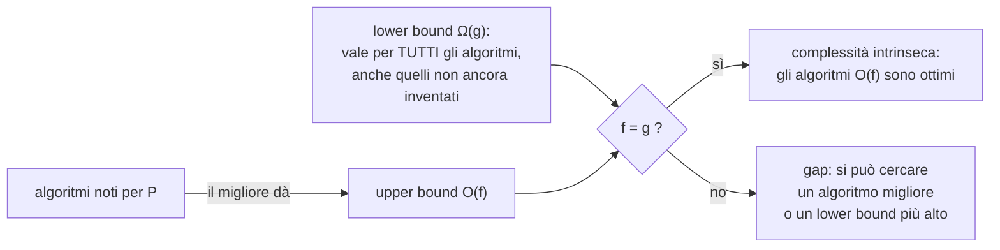
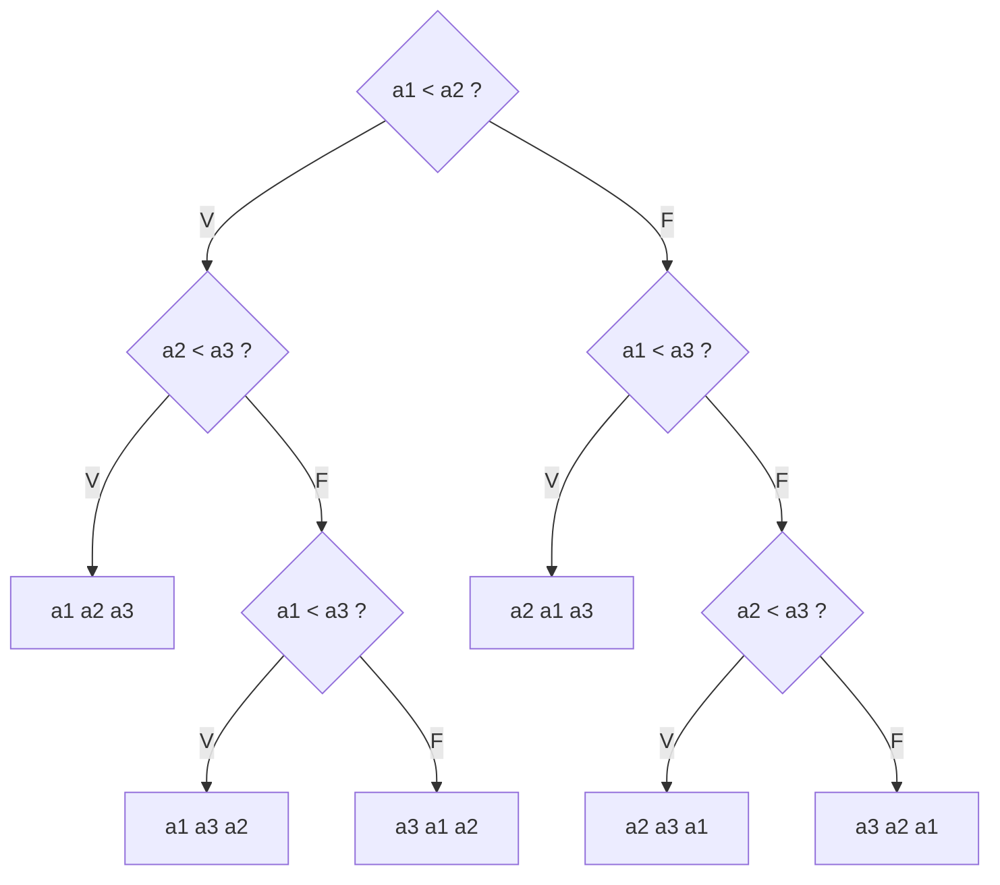
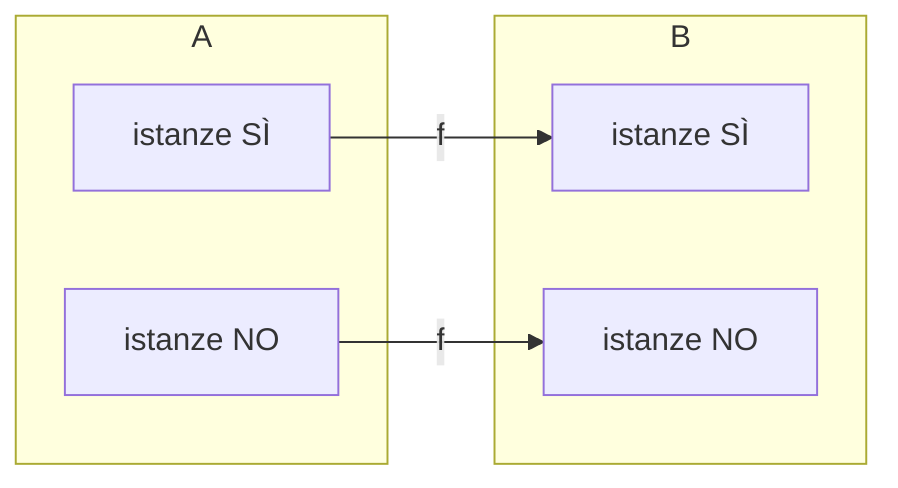

# Delimitazioni superiori e inferiori

> [!abstract]
> Finora si è misurato il costo di **algoritmi**. Ma la domanda vera è sul **problema**: quanto costa, al minimo, risolverlo con *qualunque* algoritmo? Questa lezione sposta $O$ e $\Omega$ dagli algoritmi ai problemi. L'**upper bound** di un problema si dimostra esibendo un algoritmo; il **lower bound** è molto più difficile, perché riguarda *tutti* gli algoritmi possibili, anche quelli non ancora inventati. Si vedono tre tecniche: il **lower bound banale**, gli **alberi di decisione** (con il risultato classico: ordinare per confronti costa $\Omega(n \log n)$) e le **riduzioni** fra problemi, che torneranno per la [[07 - MC - Halting Problem|indecidibilità]] e per l'[[14 - MC - Classi P e NP e NP-completezza#Riduzione fra linguaggi|NP-completezza]]. Quando upper e lower bound coincidono, l'algoritmo è **ottimo**.
> Mappa del corso: [[MOC - Modelli di Calcolo]].

## Delimitazione superiore e inferiore alla complessità di problemi

Vedi [[Delimitazioni superiori e inferiori]].

I concetti di upper e lower bound, usati per i costi di caso peggiore degli algoritmi, si definiscono anche per i **problemi**.

> [!important] Upper bound di un problema
> Un problema $P$ ha **delimitazione superiore** (*upper bound*) $O(f(n))$ se **esiste** un algoritmo $A_P$ che risolve $P$ con $C_{A_P}(n) \in O(f(n))$.

Un algoritmo che risolve il problema gli "**trasferisce**" il suo upper bound. Per esempio `ricercaSequenziale` è $O(n)$, quindi la ricerca in una tabella ordinata ha upper bound lineare; ma lo stesso problema è risolto da `ricercaBinaria`, $O(\log n)$, quindi ha anche upper bound logaritmico. Fra tutti gli upper bound di un problema interessa il più basso; gli altri sono **banali**. Parlando dell'upper bound di un problema ci si riferisce implicitamente al **miglior algoritmo noto**.

> [!important] Lower bound di un problema
> Un problema $P$ ha **delimitazione inferiore** (*lower bound*) $\Omega(f(n))$ se **per ogni** algoritmo $A_P$ che risolve $P$ risulta $C_{A_P}(n) \in \Omega(f(n))$.

Il quantificatore è **universale** invece che esistenziale, e quindi manca una procedura costruttiva: non basta guardare un algoritmo. Per esempio, per l'ordinamento il **selection sort** ha costo $\Omega(n^2)$; questo non significa che il problema abbia lower bound $n^2$, perché il merge sort ha costo $\Omega(n \log n)$. Un lower bound di un **algoritmo** non dice nulla sul lower bound del **problema**.

> [!note] Dagli appunti di Clelia
> - $P$ ammette upper bound $O(f(n)) \iff \exists$ un algoritmo $A$ che risolve $P$ con costo $\in O(f(n))$.
> - $P$ ammette lower bound $g(n) \iff \forall A$ che risolve $P$, il costo di $A$ è $\in \Omega(g(n))$.
> - Il caso interessante è quando upper e lower bound hanno **lo stesso andamento asintotico**: analisi **tight**.



### Complessità intrinseca e algoritmi ottimi

Vedi [[Algoritmo ottimo]].

> [!important] Definizione
> Se un problema ammette **la stessa funzione $f(n)$ come upper e lower bound**, $f(n)$ è la **complessità intrinseca** del problema, e tutti gli algoritmi che lo risolvono con costo $O(f(n))$ si dicono **ottimi** (ottimali). Progettare algoritmi ottimi è l'obiettivo naturale di ogni progettista.

Esempio (Clelia): se l'ordinamento ha upper e lower bound $\Theta(n \log n)$ e trovo un algoritmo che costa $\Theta(n \log n)$, l'algoritmo è **ottimale** (la base del logaritmo è irrilevante).

> [!example] Domanda d'esame (settembre 2022)
> *Se un algoritmo con lower bound asintotico $n^2$ risolve un problema $P$, abbiamo una delimitazione inferiore alla complessità di $P$?* **No**: il lower bound di un singolo algoritmo dice solo che *quell'*algoritmo è lento; un altro algoritmo potrebbe risolvere $P$ più in fretta. Un lower bound del problema deve valere per **tutti** gli algoritmi.

## Tecniche per calcolare il lower bound

La mancanza di una procedura costruttiva rende i lower bound difficili da trovare. Si dimostrano di norma con tecniche più complesse (alberi di decisione, riduzioni fra problemi, circuiti algebrici…). Negli appunti le tecniche sono tre:

1. **lower bound banale**;
2. **alberi di decisione**;
3. **riduzioni**.

### Lower bound banale

Qualunque sia l'algoritmo, **non può non leggere l'intero input**: se la dimensione è $n$, vale il lower bound banale $\Omega(n)$. In molti casi è già quello giusto (per esempio cercare il massimo in un vettore non ordinato: $\Theta(n)$).

Non sempre però si applica: nella **ricerca binaria** non serve leggere tutto l'input (il vettore è ordinato e si leggono solo $\log n$ celle), quindi $\Omega(n)$ sarebbe falso. Il lower bound banale si può a volte migliorare: per l'ordinamento è $\Omega(n)$, ma quello vero è $\Omega(n \log n)$.

### Alberi di decisione

Vedi [[Albero di decisione]].

Si considerano algoritmi che prendono decisioni solo tramite **confronti** fra dati (come il bubble sort e il merge sort). L'esecuzione di un tale algoritmo su un input di dimensione $n$ si rappresenta con un **albero di decisione**:

- ogni **nodo interno** è un confronto ($a_i \overset{?}{<} a_j$), con due rami: vero e falso;
- ogni **foglia** è una possibile **risposta**;
- un'esecuzione è un cammino dalla radice a una foglia; il numero di confronti nel caso peggiore è l'**altezza** dell'albero.

Gli alberi di decisione sono **alberi binari pieni** (ogni nodo interno ha esattamente due figli; pieni, non necessariamente completi). Proprietà (Clelia): in un albero binario pieno con $m$ nodi le foglie sono circa la metà, $f = (m+1)/2$. E un albero binario con $f$ foglie ha altezza almeno $\log_2 f$.

> [!important] Principio
> Se un problema ha $f$ risposte possibili diverse, ogni albero di decisione che lo risolve ha almeno $f$ foglie, quindi altezza almeno $\lceil \log_2 f \rceil$: **servono almeno $\log_2 f$ confronti nel caso peggiore**. Ogni confronto fornisce un solo bit di informazione (vero/falso): è il **limite inferiore teorico dell'informazione**.



Albero di decisione per ordinare 3 elementi distinti: le $3! = 6$ foglie sono le 6 permutazioni, l'altezza è 3 $\ge \lceil \log_2 6 \rceil = 3$.

### Complessità inferiore dell'ordinamento

Vedi [[Limite inferiore per l'ordinamento basato su confronti]] (ASD).

Un algoritmo di ordinamento, data una lista $L$ di $n$ numeri distinti, deve trovare la **permutazione** $p$ che, applicata a $L$, la ordina. Per esempio per $L = \{5, 1, 10, 3\}$ la permutazione è $p = (3, 1, 4, 2)$: il 5 va in terza posizione, l'1 in prima, il 10 in quarta, il 3 in seconda.

Le permutazioni possibili sono $n!$, e l'algoritmo deve saperle distinguere tutte (deve trattare ogni permutazione in modo diverso). L'albero di decisione ha quindi almeno $n!$ foglie, e servono almeno $\log_2(n!)$ confronti.

**Dimostrazione che $\log_2(n!) = \Omega(n \log n)$.** Per $n$ pari:

$$n! = n \cdot (n-1) \cdot (n-2) \cdots 3 \cdot 2 \ge \left(\frac{n}{2}\right)^{n/2}$$

(i primi $n/2$ fattori sono tutti $\ge n/2$). Quindi

$$\log_2(n!) \ge \frac{n}{2}\log_2\frac{n}{2} = \frac{n}{2}(\log_2 n - 1) = \Omega(n \log n)$$

Per $n$ dispari, $n! \ge \lfloor n/2 \rfloor^{\lfloor n/2 \rfloor + 1}$ e $\log_2(n!) \ge \frac{n-1}{2}(\log_2 n - 1) = \Omega(n \log n)$.

> [!tip] Con la formula di Stirling (dagli appunti)
> $n! \approx \sqrt{2\pi n}\left(\frac{n}{e}\right)^n$, quindi
> $$\log n! \approx \log\sqrt{2\pi n} + n \log\frac{n}{e} = \Theta(n \log n)$$
> L'altezza minima di un albero di decisione con $n!$ foglie è $\Omega(n \log n)$: è il **lower bound dell'ordinamento** basato su confronti.

> [!important] Conseguenza
> Qualunque algoritmo di ordinamento basato su confronti richiede $\Omega(n \log n)$ confronti nel caso peggiore. **Heapsort** e **Mergesort** hanno upper bound $O(n \log n)$: sono **ottimi**. Clelia: il merge sort è asintoticamente tight, "non si può fare meglio di $n \log n$".

**Ordinamenti non basati su confronti.** Il lower bound vale solo per algoritmi basati su confronti. Se si sa qualcosa sui dati si può fare meglio. Per esempio, se la sequenza contiene solo 1 e 2:

$$1, 2, 2, 1, 1, 2, 2, 1, 1, 1$$

basta **contare** gli 1 e i 2 con una scansione (sei 1 e quattro 2) e scrivere $1, 1, 1, 1, 1, 1, 2, 2, 2, 2$: costo $O(n)$. Generalizzano questa idea il **bucket sort** e il **radix sort**, che sotto opportune ipotesi sui dati costano $O(n)$; sono però meno generali, perché si basano su presupposti sui dati.

### Esempio: ricerca in una tabella ordinata

Con un albero di decisione si dimostra anche che la ricerca per confronti in un insieme ordinato di $n$ elementi costa $\Omega(\log n)$ (è l'esercizio 3 della dispensa). Gli esiti possibili sono $n + 1$ ("l'elemento c'è ed è in posizione $0, 1, \dots, n-1$" oppure "l'elemento non c'è"), quindi l'albero ha almeno $n + 1$ foglie e altezza almeno $\log_2(n+1)$: $\Omega(\log n)$. La ricerca binaria è $O(\log n)$: è **ottima**.

## Riduzioni

Vedi [[Riduzione tra linguaggi]] e [[Riduzione polinomiale]].

L'idea (Clelia, 14–18/03/2022): **ridurre un problema $A$ a un problema $B$** significa trovare una funzione $f$ che trasforma le istanze di $A$ in istanze di $B$, mandando le istanze "sì" in istanze "sì" e le istanze "no" in istanze "no". Così un algoritmo per $B$, composto con $f$, risolve $A$.



Una riduzione $A \le B$ trasferisce informazioni in **due direzioni opposte**:

1. **verso $A$ l'upper bound di $B$**: un upper bound per $A$ si ottiene dall'upper bound di $B$ più il costo di $f$. Esempio: se $B$ ha upper bound $O(n^2)$ e $f$ costa $O(n)$ (producendo un output di dimensione $O(n)$), l'upper bound di $A$ è $O(n^2)$. Se la riduzione è polinomiale e il suo costo non supera quello di $B$, il costo di $B$ si trasferisce direttamente ad $A$ (attenzione alla [[02 - MC - Notazione asintotica#Composizione di algoritmi|dilatazione]]: conta la dimensione di $f(x)$).
2. **verso $B$ il lower bound di $A$** (se il costo della riduzione è trascurabile): $B$ deve costare almeno quanto il lower bound di $A$, altrimenti, componendo $f$ con un algoritmo veloce per $B$, si risolverebbe $A$ sotto il suo lower bound: contraddizione.

Si usano le riduzioni per:
- prove di **upper bound**;
- prove di **lower bound**;
- prove di **indecidibilità** (o decidibilità): se $A$ è indecidibile e $A \le B$, anche $B$ è indecidibile ([[07 - MC - Halting Problem#Riduzioni|lezione 7]]).

### Esempio: il lower bound del convex hull

Il **convex hull** (involucro convesso) di $n$ punti del piano è il più piccolo poligono convesso che li contiene tutti. Si dimostra che ha lower bound $\Omega(n \log n)$ riducendo a esso l'**ordinamento**.

Dati $n$ numeri $x_1, \dots, x_n$ da ordinare, li si "proietta" sulla parabola $y = x^2$: i punti $(x_i, x_i^2)$. Su una parabola **tutti** i punti sono vertici dell'involucro convesso, e percorrendo l'involucro a partire dal punto più a sinistra si incontrano in ordine di ascissa crescente. Quindi:

1. costruire i punti costa $O(n)$;
2. calcolare il convex hull;
3. dal poligono, trovato il punto più a sinistra (costo $O(n)$), si legge la sequenza ordinata in $O(n)$.

Se esistesse un algoritmo per il convex hull di costo $o(n \log n)$, si potrebbe ordinare in $o(n \log n)$: **assurdo**, perché l'ordinamento (per confronti) ha lower bound $\Omega(n \log n)$. Quindi il convex hull ha lower bound $\Omega(n \log n)$: ordinamento $\le$ convex hull.

## Conclusioni del capitolo

Fra più algoritmi per lo stesso problema si sceglie in base a due proprietà spesso in contraddizione:

1. **semplicità**, che facilita comprensione, programmazione e correzione (costo umano);
2. **complessità** il più bassa possibile (costo macchina).

Se il programma va eseguito poche volte su input piccoli conta di più la semplicità; se va eseguito molte volte su input grandi conviene l'efficienza. I programmi ricorsivi sono semplici ma, a causa delle chiamate, hanno costanti nascoste grandi: su vettori piccoli il bubble sort batte il merge sort. Ogni programma ricorsivo ha comunque un equivalente iterativo, di solito più efficiente.

## Esercizi

**Esercizio 1.** Quali affermazioni sono vere?

| affermazione | | perché |
|---|---|---|
| un algoritmo $\Theta(n)$ è $O(n)$ | **vera** | $\Theta \subseteq O$ |
| un algoritmo $\Theta(n)$ è $O(n^2)$ | **vera** | $n \le n^2$ |
| un algoritmo $\Theta(n^2)$ è $O(n^3)$ | **vera** | $n^2 \le n^3$ |
| un algoritmo $\Theta(n)$ è $O(1)$ | falsa | $n$ non è limitato da una costante |
| un algoritmo $O(1)$ è $\Theta(1)$ | **vera** | ogni algoritmo fa almeno un passo, quindi è anche $\Omega(1)$ |
| un algoritmo $O(n)$ è $\Theta(1)$ | falsa | per esempio la ricerca sequenziale è $O(n)$ ma non $O(1)$ |

**Esercizio 2.** Complessità del fattoriale ricorsivo

```c
int find_factorial(int n) {
   if(n == 0) return(1);              /* 0! = 1 */
   return(n * find_factorial(n - 1)); /* ricorsione */
}
```

*Soluzione.* $T(n) = T(n-1) + c$, $T(0) = c'$, quindi $T(n) = \Theta(n)$. In funzione della dimensione dell'input $z = |n| \approx \log_2 n$: $\Theta(2^z)$, esponenziale.

**Esercizio 3.** Provare che la ricerca in un insieme ordinato di $n$ elementi costa $\Omega(\log n)$ con i confronti: vedi [[#Esempio: ricerca in una tabella ordinata|sopra]].

## Riepilogo

> [!summary]
> - **Upper bound** di un problema: *esiste* un algoritmo con quel costo (il migliore noto).
> - **Lower bound** di un problema: *ogni* algoritmo costa almeno così. Non lo dà un singolo algoritmo.
> - Upper = lower ⇒ **complessità intrinseca**; gli algoritmi che la raggiungono sono **ottimi**.
> - Tecniche di lower bound: **banale** (leggere tutto l'input, $\Omega(n)$), **alberi di decisione** ($\ge \log_2(\#\text{risposte})$ confronti), **riduzioni**.
> - Ordinamento per confronti: $\log_2 n! = \Omega(n \log n)$; merge sort e heap sort sono ottimi. Ricerca per confronti: $\Omega(\log n)$; la ricerca binaria è ottima.
> - Una riduzione $A \le B$ porta ad $A$ l'upper bound di $B$, e a $B$ il lower bound di $A$.
