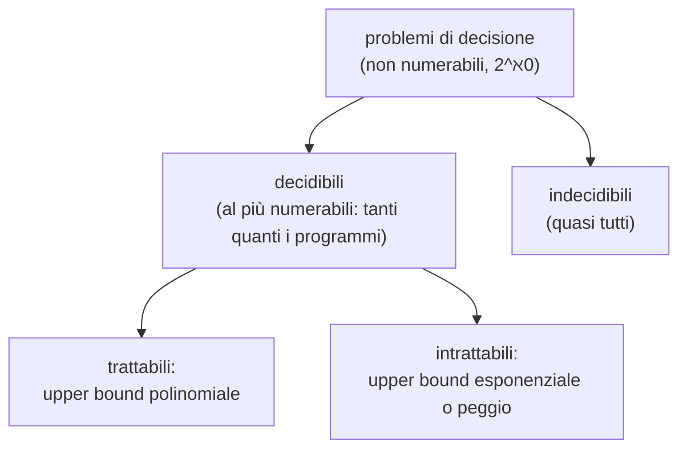

# Cardinalità e diagonalizzazione

> [!abstract]
> Con questa lezione si passa dalla complessità (*quanto costa*) alla **calcolabilità** (*si può calcolare?*). Il primo risultato è sorprendente e si ottiene solo contando: i **programmi** che si possono scrivere sono un'infinità **numerabile**, mentre i **problemi di decisione** sono un'infinità **non numerabile**. Quindi esistono (moltissimi) problemi che **nessun programma risolve**: i problemi **indecidibili**. Per dimostrarlo servono gli strumenti della teoria degli insiemi infiniti: l'**equinumerosità** (due insiemi hanno "lo stesso numero" di elementi se esiste una biiezione), la **numerabilità** e la **tecnica di diagonalizzazione** di Cantor. La stessa tecnica, applicata ai programmi invece che ai numeri, dimostrerà nella [[07 - MC - Halting Problem|lezione successiva]] che il problema della fermata è indecidibile.
> Mappa del corso: [[MOC - Modelli di Calcolo]].

## Decidibilità e indecidibilità

Dagli appunti di Clelia (18/03/2022).

> [!important] Definizioni
> - Un problema di decisione si dice **decidibile** se esiste un algoritmo che risponde SÌ quando la risposta deve essere SÌ e NO quando deve essere NO: $\exists\, A$ risolutivo.
> - Si dice **indecidibile** se non è decidibile: $\nexists\, A$ che risolve il problema.

Ci sono **molti più** problemi indecidibili che decidibili. Un esempio è il problema della fermata, che si dimostrerà nella [[07 - MC - Halting Problem|lezione 7]]. Per capire perché "molti più", bisogna saper confrontare la grandezza di insiemi infiniti.

## Cardinalità di insiemi infiniti e numerabilità

Per un insieme finito la cardinalità è il numero di elementi. Per estenderla agli insiemi infiniti serve una definizione più formale, basata sulla possibilità di **confrontare la "numerosità"** di due insiemi senza contarli.

> [!important] Definizione 1.21 (equinumerosità)
> Due insiemi $A$ e $B$ si dicono **equinumerosi** se esiste una **biiezione** tra di essi.

Vedi [[Equinumerosità]].

*Esempio 1.12.* $\{\text{lunedì}, \text{martedì}, \dots, \text{domenica}\}$ e $\{5, 7, 31, 50, 64, 70, 75\}$ sono equinumerosi (7 elementi ciascuno).

> [!tip] Esercizio 1.13: l'equinumerosità è una relazione d'equivalenza
> - **riflessiva**: l'identità è una biiezione $A \to A$;
> - **simmetrica**: se $f: A \to B$ è una biiezione, lo è anche $f^{-1}: B \to A$;
> - **transitiva**: se $f: A \to B$ e $g: B \to C$ sono biiezioni, lo è $g \circ f: A \to C$.

Con l'equinumerosità si ridefinisce formalmente anche la cardinalità degli insiemi finiti:

> [!important] Definizione 1.22
> $$|A| = \begin{cases} 0 & \text{se } A = \emptyset \\ n & \text{se } A \text{ è equinumeroso a } \{0, 1, \dots, n-1\},\ n \ge 1 \end{cases}$$

Così si può definire in modo insiemistico il **numero cardinale**: il numero $n$ è la classe d'equivalenza di tutti gli insiemi equinumerosi a $\{0, \dots, n-1\}$; lo 0 è la classe dell'insieme vuoto.

> [!important] Definizioni 1.23 e 1.24
> - Un insieme è **numerabile** se è equinumeroso a $\mathbb{N}$.
> - Un insieme è **contabile** se è **finito o numerabile**.

Vedi [[Insieme numerabile]]. Intuitivamente un insieme numerabile è infinito ma si possono **elencare** i suoi elementi in una lista $a_0, a_1, a_2, \dots$ (la biiezione con $\mathbb{N}$ è la posizione nella lista). Per la cardinalità degli insiemi infiniti si usano simboli ad hoc: quella degli insiemi numerabili si indica con $\aleph_0$ (**aleph zero**, $\aleph$ è la prima lettera dell'alfabeto ebraico).

> [!warning] Correzione (appunti)
> Negli appunti si legge "se un insieme è finito **e** numerabile è detto contabile": la definizione corretta è "finito **o** numerabile" (un insieme non può essere entrambe le cose).

> [!important] Teorema 1.3
> Se un insieme $A$ è equinumeroso a un insieme $B$, con $B \subseteq C$ e $C$ contabile, allora anche $A$ è contabile.

*Traccia (Esercizio 1.14).* Se $C$ è finito, $B$ è finito e quindi anche $A$. Se $C$ è numerabile, si elencano gli elementi di $C$ come $c_0, c_1, \dots$ e si tengono, nell'ordine, solo quelli che stanno in $B$: si ottiene una lista finita o infinita di tutti gli elementi di $B$, quindi $B$ è contabile, e $A$ con lui (tramite la biiezione). In breve: **un sottoinsieme di un insieme contabile è contabile**.

### Esempi di insiemi numerabili

**I numeri pari** (paradosso di Cantor, dagli appunti): sono strettamente contenuti in $\mathbb{N}$, eppure sono numerabili ($n \mapsto 2n$ è una biiezione). Un insieme infinito può essere messo in corrispondenza biunivoca con un suo sottoinsieme proprio: per gli insiemi finiti è impossibile (*principio dei cassetti*, o *pigeonhole principle*). È anzi una possibile definizione di insieme infinito.

**Gli interi relativi** (Esempio 1.13): $\mathbb{Z}$ è numerabile, $|\mathbb{Z}| = \aleph_0$, con la biiezione $f: \mathbb{Z} \to \mathbb{N}$

$$f(i) = \begin{cases} -2i & \text{se } i \le 0 \\ 2i - 1 & \text{se } i > 0 \end{cases}$$

che manda $0, -1, -2, \dots$ nei pari $0, 2, 4, \dots$ e $1, 2, 3, \dots$ nei dispari $1, 3, 5, \dots$. Anche qui $\mathbb{N} \subsetneq \mathbb{Z}$ ma i due insiemi sono equinumerosi.

**Le coppie di naturali** (Esempio 1.14): $\mathbb{N}^2$ è numerabile, con la **funzione coppia di Cantor**

$$p(i, j) = \frac{(i+j)(i+j+1)}{2} + i$$

che enumera le coppie per **diagonali** ($i + j = 0$, poi $i + j = 1$, …):

| $i \backslash j$ | 0 | 1 | 2 | 3 | 4 | 5 |
|---|---|---|---|---|---|---|
| **0** | 0 | 1 | 3 | 6 | 10 | 15 |
| **1** | 2 | 4 | 7 | 11 | 16 | |
| **2** | 5 | 8 | 12 | 17 | | |
| **3** | 9 | 13 | 18 | | | |
| **4** | 14 | 19 | | | | |
| **5** | 20 | | | | | |

Per esempio $p(1, 2) = \frac{3 \cdot 4}{2} + 1 = 7$. ✓ Più in generale, se $A$ è contabile anche $A^n$ lo è, per ogni $n$.

> [!tip] Perché non riga per riga
> Elencare le coppie riga per riga, $(0,0), (0,1), (0,2), \dots$, non funziona: la prima riga è già infinita e non si arriverebbe mai alla seconda. Le diagonali sono **finite** ($i + j = k$ contiene $k + 1$ coppie): percorrendole una dopo l'altra si raggiunge ogni coppia in un numero finito di passi.

**I numeri razionali.** Il procedimento fu introdotto da Cantor proprio per mostrare che $\mathbb{Q}$ è numerabile. I razionali sono le classi d'equivalenza della relazione $R$ su $\mathbb{Z} \times \mathbb{Z}^+$ (coppie numeratore/denominatore positivo):

$$\langle a, b \rangle\ R\ \langle c, d \rangle \iff ad = bc$$

($1/2$ e $2/4$ sono frazioni diverse ma lo stesso razionale.) Quindi $\mathbb{Q}$ è equinumeroso a $\mathbb{Z} \times \mathbb{Z}^+ / R$. Poiché $\mathbb{Z}$ è contabile, anche $\mathbb{Z}^2$ lo è; e $\mathbb{Z} \times \mathbb{Z}^+ / R$ è equinumeroso a un sottoinsieme di $\mathbb{Z}^2$ (si sceglie un rappresentante per classe, per esempio la frazione ridotta). Per il Teorema 1.3, **$\mathbb{Q}$ è contabile**.

> [!note] Denso ma numerabile
> $\mathbb{Q}$ è **denso** (fra due razionali ce n'è sempre un altro), eppure è numerabile: la densità non c'entra con la cardinalità.

> [!important] Teorema 1.4
> L'unione di una quantità contabile di insiemi contabili è ancora un insieme contabile.

*Dimostrazione.* Si applica di nuovo il metodo di Cantor, mettendo nella riga $i$ gli elementi dell'$i$-esimo insieme ($a_{i1}, a_{i2}, \dots$) e percorrendo la tabella per diagonali.

$$\begin{array}{ccccc}
a_{01} & a_{02} & a_{03} & a_{04} & \cdots\\
a_{11} & a_{12} & a_{13} & \cdots\\
a_{21} & a_{22} & \cdots\\
a_{31} & \cdots\\
\vdots
\end{array}$$

> [!tip] Esercizio 1.15: i numeri algebrici reali sono numerabili
> I **numeri algebrici reali** sono le soluzioni reali delle equazioni $a_0 + a_1 x + \dots + a_n x^n = 0$ a coefficienti interi. *Soluzione*: un'equazione di grado $n$ è una $(n+1)$-upla di interi, quindi le equazioni di grado $n$ formano $\mathbb{Z}^{n+1}$, contabile; le equazioni di tutti i gradi sono un'unione contabile di insiemi contabili, quindi contabili (Teorema 1.4). Ogni equazione non nulla ha al più $n$ radici: l'insieme delle radici è un'unione contabile di insiemi finiti, quindi contabile. È anche infinito (contiene tutti gli interi), quindi numerabile.

### Programmi e problemi (dagli appunti)

- L'insieme di **tutti i programmi** che si possono scrivere (quelli che esistono e quelli non ancora scritti) è **infinito** e **numerabile**: un programma è una stringa finita su un alfabeto finito, e le stringhe si possono elencare in ordine lessicografico (prima per lunghezza, poi alfabeticamente).
- L'insieme dei **problemi di decisione** è **infinito** e **non numerabile** (lo si dimostra con la diagonalizzazione, sotto).

Quindi **esistono più problemi che programmi**: la maggior parte dei problemi di decisione non ha nessun programma che li risolva.

## Insiemi non numerabili: la diagonalizzazione

Vedi [[Diagonalizzazione di Cantor]].

Per mostrare che esistono insiemi non numerabili si usa la **tecnica di diagonalizzazione**, introdotta da Cantor proprio per i numeri reali e usata ripetutamente in teoria della calcolabilità.

> [!important] La tecnica
> Data una lista di oggetti, si crea un **controesempio**, cioè un oggetto non appartenente alla lista, con un procedimento che lo costruisce deliberatamente **diverso da tutti** gli oggetti della lista: l'**oggetto diagonale**.
>
> Formalmente: data una sequenza $\sigma_0, \sigma_1, \dots$, dove ogni $\sigma_i$ è a sua volta una sequenza infinita $a_{i0}, a_{i1}, \dots, a_{in}, \dots$, si costruisce una sequenza diagonale $\bar\sigma$ il cui elemento $i$-esimo è **diverso** dall'elemento $i$-esimo $a_{ii}$ di $\sigma_i$. Allora $\bar\sigma \ne \sigma_i$ per ogni $i$ (differiscono almeno in posizione $i$).

Lo schema di ogni dimostrazione per diagonalizzazione è:

### I reali non sono numerabili

> [!important] Teorema 1.5
> L'insieme $\mathbb{R}$ dei reali **non è numerabile**.

*Dimostrazione.* L'intervallo aperto $(0, 1)$ e $\mathbb{R}$ sono equinumerosi: una biiezione è $x \mapsto 1/(2^x + 1)$, con dominio $\mathbb{R}$ e codominio $(0, 1)$ (per $x \to -\infty$ tende a 1, per $x \to +\infty$ tende a 0). Basta quindi mostrare che $(0, 1)$ non è numerabile.

Si considerano le sequenze infinite di cifre decimali che rappresentano la **mantissa** (la parte dopo la virgola) dei reali in $(0, 1)$. Per assurdo esista un'enumerazione $\sigma_0, \sigma_1, \dots$ di tali sequenze. Si costruisce $\bar\sigma$ con $i$-esima cifra pari all'$i$-esima cifra di $\sigma_i$ **più 1 (mod 10)**:

| | cifra 0 | cifra 1 | cifra 2 | cifra 3 | … |
|---|---|---|---|---|---|
| $\sigma_0$ | **0** | 0 | … | … | |
| $\sigma_1$ | 0 | **1** | 0 | 1 | |
| $\sigma_2$ | 2 | 1 | **3** | 3 | |
| ⋮ | | | | | |

La diagonale è $0, 1, 3, \dots$, quindi $\bar\sigma = 0{,}124\dots$, che differisce da ogni $\sigma_i$ nella posizione $i$. Supposto di poter enumerare tutte le rappresentazioni decimali dei reali in $(0, 1)$, se ne è costruita per diagonalizzazione un'altra che non sta nell'enumerazione: assurdo.

Resta un dettaglio: un reale può avere **due** rappresentazioni distinte (per esempio $0{,}01000\dots = 0{,}00999\dots$), ma al più due, e questo non cambia la conclusione. $\square$

### L'insieme delle parti dei naturali non è numerabile

> [!important] Teorema 1.6
> $\mathcal{P}(\mathbb{N})$, l'insieme di tutti i sottoinsiemi dei naturali, **non è numerabile**.

*Dimostrazione.* Per assurdo sia $P_0, P_1, \dots$ un'enumerazione di $\mathcal{P}(\mathbb{N})$. A ogni $P_i$ si associa la sequenza $b_{i0}, b_{i1}, \dots$ con

$$b_{ij} = \begin{cases} 1 & \text{se } j \in P_i \\ 0 & \text{se } j \notin P_i \end{cases}$$

(Clelia: 1 = contenuto, 0 = non contenuto.) Si costruisce l'insieme diagonale $P$ con sequenza $p_i = 1 - b_{ii}$. $P$ è un sottoinsieme ben definito di $\mathbb{N}$, ma per costruzione

$$i \in P \iff i \notin P_i$$

quindi $P$ differisce da ogni $P_i$ (almeno sull'elemento $i$). Si è trovato un $P \in \mathcal{P}(\mathbb{N})$ fuori dall'enumerazione: assurdo. $\square$

> [!example] Mini esempio
> | | 0 | 1 | 2 | 3 | 4 |
> |---|---|---|---|---|---|
> | $P_0 = \{0, 3, 4, \dots\}$ | **1** | 0 | 0 | 1 | 1 |
> | $P_1 = \{1, 3, \dots\}$ | 0 | **1** | 0 | 1 | 0 |
> | $P_2 = $ pari | 1 | 0 | **1** | 0 | 1 |
> | $P_3 = \emptyset$ | 0 | 0 | 0 | **0** | 0 |
>
> $P$ ha sequenza $0, 0, 0, 1, \dots$: $P \ni 3$ (perché $3 \notin P_3$), $P \not\ni 0, 1, 2$. Diverso da tutte le righe.

Il risultato vale per l'insieme delle parti di **ogni** insieme di cardinalità $\aleph_0$. In particolare, l'insieme dei **linguaggi** sull'alfabeto $\{0, 1\}$ è $\mathcal{P}(\{0,1\}^*)$ e, poiché $\{0,1\}^*$ è numerabile, **non è numerabile** (è la domanda della prova di settembre 2019).

## Cardinalità transfinita

### Funzione caratteristica

> [!important] Definizione 1.25
> La **funzione caratteristica** $f_S$ di un insieme $S \subseteq \mathbb{N}$ è la funzione totale $f_S: \mathbb{N} \to \{0, 1\}$
> $$f_S(x) = \begin{cases} 1 & \text{se } x \in S \\ 0 & \text{se } x \notin S \end{cases}$$

Serve a **ricondurre il riconoscimento di insiemi al calcolo di una funzione**. Clelia: è una funzione che, preso un numero, risponde 0 o 1, cioè **rappresenta un problema di decisione** (la risposta è binaria). Decidere un problema = calcolare la funzione caratteristica dell'insieme delle sue istanze "sì".

> [!important] Teorema 1.7
> L'insieme delle funzioni caratteristiche $\{f \mid f: \mathbb{N} \to \{0,1\}\}$ **non è numerabile**.

*Dimostrazione.* Per assurdo si abbia un'enumerazione $f_0, f_1, f_2, \dots$:

| | 0 | 1 | 2 | 3 | 4 | ⋯ | $j$ |
|---|---|---|---|---|---|---|---|
| $f_0$ | **0** | 0 | 0 | 0 | 0 | ⋯ | $f_0(j)$ |
| $f_1$ | 0 | **1** | 0 | 1 | 0 | ⋯ | $f_1(j)$ |
| $f_2$ | 0 | 1 | **1** | 0 | 1 | ⋯ | $f_2(j)$ |
| ⋮ | | | | | | | |
| $f_i$ | $f_i(0)$ | $f_i(1)$ | $f_i(2)$ | $f_i(3)$ | $f_i(4)$ | ⋯ | $f_i(j)$ |

Si costruisce la **funzione diagonale** $\hat f(i) = 1 - f_i(i)$. Assume solo valori in $\{0, 1\}$, quindi è una funzione caratteristica, ma differisce da ogni $f_i$ almeno sull'argomento $i$. $\square$

(Il risultato è ovvio una volta osservato che c'è una corrispondenza biunivoca naturale fra sottoinsiemi di $\mathbb{N}$ e funzioni caratteristiche: $S \leftrightarrow f_S$.)

> [!important] Conseguenza fondamentale
> I problemi di decisione corrispondono alle funzioni caratteristiche, che **non sono numerabili**. I programmi sono **numerabili**. Quindi la maggior parte dei problemi di decisione è **indecidibile**.

### Insiemi continui e cardinali transfiniti

Dato un insieme finito $A$ con $|A| = n$, $|\mathcal{P}(A)| = 2^n$. Per analogia, se $A$ è numerabile si dice che $\mathcal{P}(A)$ ha cardinalità $2^{\aleph_0}$ (con un leggero abuso, $2^{|\mathbb{N}|}$). Gli insiemi di cardinalità $2^{\aleph_0}$ si dicono **continui**. Per la corrispondenza con $\mathcal{P}(\mathbb{N})$, l'insieme $\{f \mid f: \mathbb{N} \to \{0, 1\}\}$ è continuo.

Lo stesso vale per **tutte** le funzioni intere:
- da un lato $|\{f \mid f: \mathbb{N} \to \mathbb{N}\}| \ge |\{f \mid f: \mathbb{N} \to \{0,1\}\}| = 2^{\aleph_0}$;
- dall'altro ogni funzione totale intera è un insieme di coppie di interi, cioè un elemento di $\mathcal{P}(\mathbb{N}^2)$, e $\mathbb{N}^2$ è equinumeroso a $\mathbb{N}$: quindi la cardinalità non supera $2^{\aleph_0}$.

Dunque $|\{f \mid f: \mathbb{N} \to \mathbb{N}\}| = 2^{\aleph_0}$.

> [!note] Il problema del continuo
> L'esistenza di un insieme con cardinalità strettamente compresa fra $\aleph_0$ e $2^{\aleph_0}$ è il **problema del continuo**. Se $\aleph_1$ è il primo cardinale transfinito maggiore di $\aleph_0$, si chiede se $\aleph_1 = 2^{\aleph_0}$; l'**ipotesi del continuo** afferma che non esistono cardinalità intermedie. Gödel e Cohen hanno mostrato che non si può né dimostrare né confutare negli assiomi di Zermelo-Fraenkel con l'assioma della scelta. (La dispensa scrive che l'ipotesi del continuo è l'ipotesi "che tale problema abbia soluzione negativa", cioè che **non** esista un insieme intermedio.)

> [!important] Teorema 1.8
> L'insieme $\mathbb{R}$ dei reali è un insieme **continuo**: $|\mathbb{R}| = 2^{\aleph_0}$.

*Dimostrazione.* Basta mostrarlo per $(0, 1)$. A ogni sottoinsieme dei naturali si associa un'unica stringa binaria (la sua funzione caratteristica), che si può leggere come la mantissa binaria di un unico reale in $(0, 1)$. Viceversa ogni reale ha al più due mantisse, quindi corrisponde al più a due sottoinsiemi. I reali in $(0, 1)$ sono dunque almeno la metà dei sottoinsiemi di $\mathbb{N}$ e non più di questi; un fattore moltiplicativo finito non cambia una cardinalità transfinita. $\square$

Cantor ha introdotto i **cardinali transfiniti** ($\aleph_0$, $2^{\aleph_0}$, …) e ha mostrato che ne esistono infiniti: se $A$ ha cardinalità transfinita $\kappa$, $\mathcal{P}(A)$ ha cardinalità $2^\kappa > \kappa$ (sempre per diagonalizzazione).

> [!important] Teorema 1.9
> L'insieme delle funzioni reali $\{f \mid f: \mathbb{R} \to \mathbb{R}\}$ ha cardinalità $2^{2^{\aleph_0}}$.

*Dimostrazione.* Ogni $f$ di $F = \{f \mid f: \mathbb{R} \to \mathbb{R}\}$ è un elemento di $\mathcal{P}(\mathbb{R}^2)$, quindi $|F| \le |\mathcal{P}(\mathbb{R}^2)|$. Inoltre $\mathbb{R}^2$ è equinumeroso a $\mathbb{R}$: basta $|(0,1)| = |(0,1)^2|$, usando la biiezione che associa ad $a \in (0, 1)$ la coppia le cui mantisse sono le cifre di posto dispari e di posto pari di $a$. Quindi $|F| \le |\mathcal{P}(\mathbb{R})| = 2^{2^{\aleph_0}}$. D'altra parte $\mathcal{P}(\mathbb{R})$ è in corrispondenza con $F' = \{f \mid f: \mathbb{R} \to \{0,1\}\} \subset F$, quindi $|F| \ge 2^{2^{\aleph_0}}$. $\square$

**Figura 1.7 — cardinalità di alcuni insiemi notevoli:**

| insiemi | cardinalità |
|---|---|
| $\mathbb{N}, \mathbb{Z}, \mathbb{Q}, \mathbb{N}^n, \mathbb{Z}^n, \mathbb{Q}^n$ | $\aleph_0$ |
| $\mathcal{P}(\mathbb{N})$, $\{f \mid f: \mathbb{N} \to \{0,1\}\}$, $\{f \mid f: \mathbb{N} \to \mathbb{N}\}$, $\mathbb{R}$, $\mathbb{R}^n$ | $2^{\aleph_0}$ |
| $\mathcal{P}(\mathbb{R})$, $\{f \mid f: \mathbb{R} \to \{0,1\}\}$, $\{f \mid f: \mathbb{R} \to \mathbb{R}\}$ | $2^{2^{\aleph_0}}$ |

> [!tip] Esercizio 1.16: soluzioni
> 1. Le relazioni $n$-arie, per $n$ qualunque, su un insieme finito $A$: per ogni $n$ sono $2^{|A|^n}$ (un numero finito); l'unione su tutti gli $n$ è un'unione numerabile di insiemi finiti, infinita: $\aleph_0$.
> 2. Le relazioni $n$-arie sui naturali: per ogni $n$ sono $\mathcal{P}(\mathbb{N}^n)$, di cardinalità $2^{\aleph_0}$; l'unione numerabile resta $2^{\aleph_0}$.
> 3. Le relazioni binarie sui reali: $\mathcal{P}(\mathbb{R}^2)$, cardinalità $2^{2^{\aleph_0}}$.

## Problemi di decisione: il quadro (dagli appunti)

Il confine fra trattabili e intrattabili, nel caso dei problemi NP-completi, non è ancora stato dimostrato: è il *Millennium Prize* del [[14 - MC - Classi P e NP e NP-completezza|problema P vs NP]].

## Riepilogo

> [!summary]
> - Due insiemi sono **equinumerosi** se esiste una biiezione; **numerabile** = equinumeroso a $\mathbb{N}$ ($\aleph_0$); **contabile** = finito o numerabile.
> - Sono numerabili $\mathbb{Z}$, $\mathbb{N}^2$ (funzione coppia di Cantor), $\mathbb{Q}$, le unioni contabili di insiemi contabili, l'insieme dei **programmi**.
> - La **diagonalizzazione** costruisce un oggetto diverso da ogni elemento di una lista cambiando la diagonale: mostra che $\mathbb{R}$, $\mathcal{P}(\mathbb{N})$ e le funzioni $\mathbb{N} \to \{0,1\}$ **non sono numerabili** ($2^{\aleph_0}$).
> - Problemi di decisione ↔ funzioni caratteristiche: non numerabili. Programmi: numerabili. ⇒ **esistono problemi indecidibili**, anzi sono quasi tutti.
