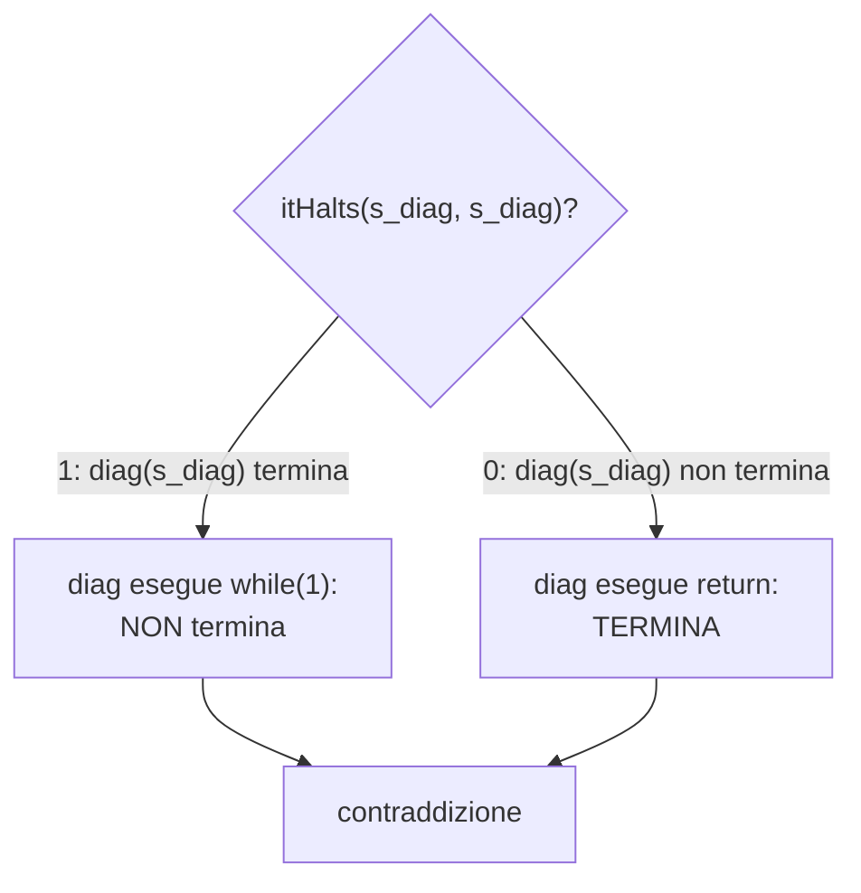
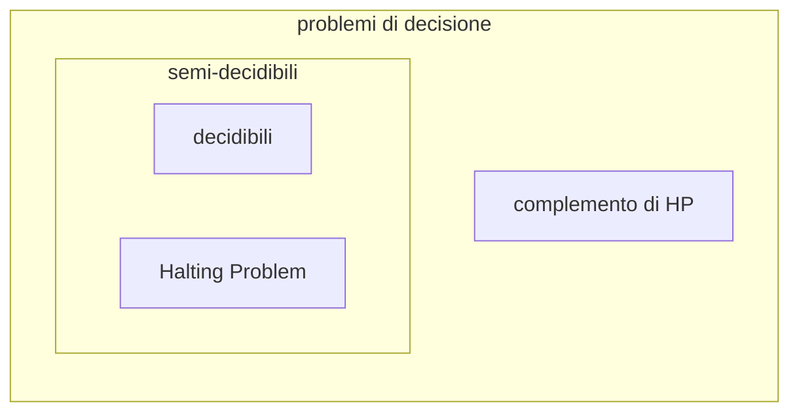

# Halting Problem

> [!abstract]
> La [[06 - MC - Cardinalità e diagonalizzazione|lezione 6]] ha dimostrato, contando, che esistono problemi indecidibili; ma non ne ha mostrato **nessuno** in particolare. Qui si esibisce il più famoso: l'**Halting Problem** (problema della fermata), cioè stabilire se un programma, su un dato input, termina. La dimostrazione è una diagonalizzazione "in C": si suppone che esista una funzione `itHalts()` che risolve il problema e si costruisce un programma `diag` che, eseguito su se stesso, termina se e solo se non termina. Il problema della fermata è però **semi-decidibile**: si può rispondere sì quando la risposta è sì. Con le **riduzioni** l'indecidibilità si propaga ad altri problemi. La versione con le macchine di Turing è nella [[08 - MC - Macchine di Turing e calcolabilità#Funzioni non calcolabili e problemi indecidibili|lezione 8]].
> Mappa del corso: [[MOC - Modelli di Calcolo]].

## Definizione dell'Halting Problem

Vedi [[Problema della fermata]].

- È un **problema di decisione** (output: sì/no).
- **HP**: dato un programma sorgente $S$, scritto in un linguaggio di programmazione (per esempio C), e dato un possibile input $x$ per $S$, si vuole stabilire se $S$ **termina** la computazione sull'input $x$.
- Si vorrebbe **decidere** HP, cioè progettare un algoritmo che, letta la codifica di un programma $S$ (una stringa) e letta una stringa $x$, decida se $S$ termina quando l'input è $x$.

Sarebbe uno strumento utilissimo: un compilatore potrebbe avvisare "questo programma va in loop infinito con questo input". Ma un tale algoritmo **non esiste**.

## Halting problem in C

L'algoritmo cercato avrebbe questa forma:

```c
/*
   sourceCode è stringa che codifica un programma
   input è stringa da dare in input al programma
   codificato da sourceCode
*/
int itHalts(char *sourceCode, char *input) {
   // qui l'algoritmo, che assegna a una variabile b il risultato
   return b;   // b vale zero (falso) o uno (vero)
}
```

`itHalts()` deve restituire **1** se il programma descritto dalla stringa `sourceCode` termina quando il suo input è la stringa `input`, **0** se non termina. Si noti che `itHalts` stessa deve **sempre terminare**: è un algoritmo di decisione.

> [!important] Teorema
> **L'Halting Problem è indecidibile**: non esiste un algoritmo di decisione per HP, quindi non è possibile scrivere la funzione `itHalts()`.

Lo si dimostra **per assurdo**.

## Costruzione della funzione diagonale

Si supponga per assurdo che `itHalts(char*, char*)` esista. Si costruisce una nuova funzione `diag(char*)` che la sfrutta:

```c
void diag(char *sourceCode) {
   if(itHalts(sourceCode, sourceCode)) while(1);  // cicla!
   // N.B. se il programma sourceCode termina, allora diag non termina;
   else return;
   // N.B. se il programma sourceCode non termina, allora diag termina;
}
```

`diag` riceve il sorgente di un programma e chiede a `itHalts` cosa farebbe quel programma **se ricevesse in input il proprio sorgente**. Poi fa **l'opposto**: se il programma terminerebbe, `diag` entra in un ciclo infinito; se non terminerebbe, `diag` termina subito.

## Costruzione della contraddizione

Si costruisce la stringa che contiene il codice sorgente di `diag`:

```c
s_diag = "void diag(char *sourceCode) {
             if(itHalts(sourceCode, sourceCode)) while(1); else return; }"
```

(e, se serve, anche il codice di `itHalts`, che per ipotesi esiste). **Che succede se si invoca `diag(s_diag)`?** I commenti nel codice di `diag` aiutano a capirlo:

- `diag(s_diag)` **non termina** (`while(1)`) se `s_diag`, cioè **se stessa**, termina;
- `diag(s_diag)` **termina** (`return`) se `s_diag`, cioè **se stessa**, non termina.

È **impossibile**: `diag(s_diag)` termina se e solo se non termina.



Poiché tutti i passi del ragionamento sono semplici e costruttivi (scrivere `diag` e la sua stringa sorgente è banale), il fatto che l'assunto "esiste `itHalts`" implichi una conseguenza impossibile dimostra che **l'assunto stesso è impossibile**. Non esiste un algoritmo che fa ciò che è descritto per `itHalts()`: l'Halting Problem è indecidibile. $\square$

> [!warning] Correzione
> Nella slide la stringa è scritta `if(itHalts(sourceCode, sourceCode) while(1);`: manca una parentesi chiusa dopo `sourceCode)`. Così com'è la stringa non sarebbe codice C valido; il ragionamento non cambia.

## Perché si chiama diagonalizzazione

La tecnica si basa sulla tradizionale prova **per assurdo** ed è basata sulla costruzione di un esemplare (di funzione) **diagonale**, cioè non incluso nell'insieme delle funzioni effettivamente realizzabili (e quindi esistenti). Il termine "diagonale" si riferisce all'evidenza visuale della prova di non numerabilità di $2^{\mathbb{N}}$, l'insieme delle parti dei naturali ([[06 - MC - Cardinalità e diagonalizzazione#L'insieme delle parti dei naturali non è numerabile|lezione 6]]).

Il parallelo è preciso. Si immagini la tabella con i **programmi** $S_0, S_1, S_2, \dots$ sulle righe (sono numerabili) e le stesse stringhe come **input** sulle colonne; nella casella $(i, j)$ si scrive T se $S_i$ termina su input $S_j$, L se va in loop:

| | $S_0$ | $S_1$ | $S_2$ | $S_3$ | ⋯ |
|---|---|---|---|---|---|
| $S_0$ | **T** | L | T | T | |
| $S_1$ | L | **L** | T | L | |
| $S_2$ | T | T | **T** | L | |
| $S_3$ | L | T | L | **L** | |
| ⋮ | | | | | ⋱ |

`diag` è costruito per comportarsi, sull'input $S_i$, in modo **opposto** alla casella diagonale $(i, i)$: la sua riga è L, T, L, T, … Quindi `diag` è diverso da ogni $S_i$; ma `diag` è un programma, quindi deve comparire come una delle righe: contraddizione. L'unica ipotesi usata per scrivere `diag` è l'esistenza di `itHalts`, che dunque è falsa.

## Semi-decidibilità

Dagli appunti di Clelia.

> [!important] Definizione
> Un problema è **semi-decidibile** se esiste un algoritmo che:
> - quando la risposta è **sì**, termina e risponde sì;
> - quando la risposta è **no**, **non termina** oppure risponde no.
>
> Non si può contare su una risposta corretta quando la risposta è no.

L'Halting Problem è indecidibile ma **semi-decidibile**: per sapere se $S$ termina su $x$ basta **eseguire** $S$ su $x$ (simulandolo, come fa la [[Macchina di Turing universale|macchina di Turing universale]]). Se $S$ termina, la simulazione termina e si risponde sì; se $S$ non termina, la simulazione non termina e non si risponde mai. Il problema "complementare" (stabilire se $S$ **non** termina su $x$) invece **non è nemmeno semi-decidibile**: se lo fosse, eseguendo in parallelo i due semi-algoritmi uno dei due terminerebbe sempre, e HP sarebbe decidibile.



Vedi [[Linguaggio decidibile]] e [[Linguaggio semidecidibile]].

## Riduzioni

Le riduzioni (vedi [[05 - MC - Delimitazioni superiori e inferiori#Riduzioni|lezione 5]]) trasferiscono l'upper bound, il lower bound e anche le **prove di indecidibilità**.

> [!important] Regola
> Se $A$ è **indecidibile** e $A$ si riduce a $B$, allora anche **$B$ è indecidibile**. Infatti, se $B$ fosse decidibile (cioè esistesse un algoritmo che lo risolve), lo si potrebbe usare, dopo la riduzione, per risolvere $A$: ma si sa che $A$ è indecidibile.

Si dimostra così l'indecidibilità di molti problemi partendo da HP, senza ripetere ogni volta la diagonalizzazione. Per esempio:

- **"$M$ su input $x$ va in loop?"** (prova di giugno 2023): è il complemento di HP; è indecidibile (se lo si decidesse, si deciderebbe HP negando la risposta) e non è nemmeno semi-decidibile.
- **"$P$ termina su input vuoto?"**: si riduce HP costruendo, da $(S, x)$, il programma $P_{S,x}$ che ignora il suo input ed esegue $S$ su $x$. $P_{S,x}$ termina sull'input vuoto se e solo se $S$ termina su $x$.
- **"Due programmi calcolano la stessa funzione?"**, **"un programma termina su ogni input?"**: indecidibili per riduzioni analoghe.

> [!example] Domanda d'esame (luglio 2023)
> *L'indecidibilità del problema della fermata significa che, dato un programma $P$ e un input $x$:*
> - *"per nessun $x$ posso decidere se $P$ si ferma con input $x$"*: **falsa**. Per molte coppie specifiche lo si può stabilire (per esempio un programma senza cicli né ricorsione termina sempre). L'indecidibilità dice che non esiste **un unico algoritmo** che dia la risposta giusta per **tutte** le coppie $(P, x)$.
> - *"posso decidere se $P$ si ferma con input $x$ solo per qualche $x$"*: va precisata. Per ogni singola coppia fissata la risposta è una costante (sì o no), e il "programma" che stampa quella costante la decide banalmente: il problema è che non sappiamo quale dei due sia, e nessun metodo generale lo trova per tutte le coppie. È vero che per classi particolari di programmi o di input la fermata è decidibile.

## Riepilogo

> [!summary]
> - **HP**: dato un programma $S$ e un input $x$, $S$ termina su $x$?
> - Se esistesse `itHalts(S, x)`, il programma `diag`, che fa l'opposto di `itHalts(s, s)`, eseguito sul proprio sorgente terminerebbe se e solo se non termina: **HP è indecidibile**.
> - È una **diagonalizzazione**: `diag` differisce da ogni programma sulla "diagonale" della tabella programmi × input.
> - HP è **semi-decidibile** (basta eseguire $S$ su $x$); il suo complemento non lo è.
> - $A$ indecidibile e $A \le B$ ⇒ $B$ indecidibile.
