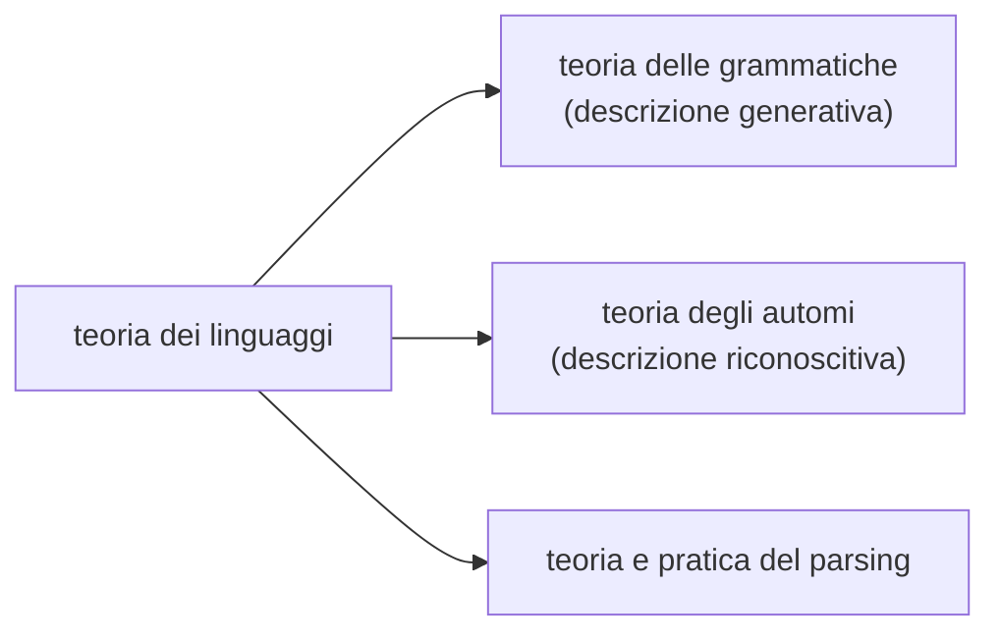
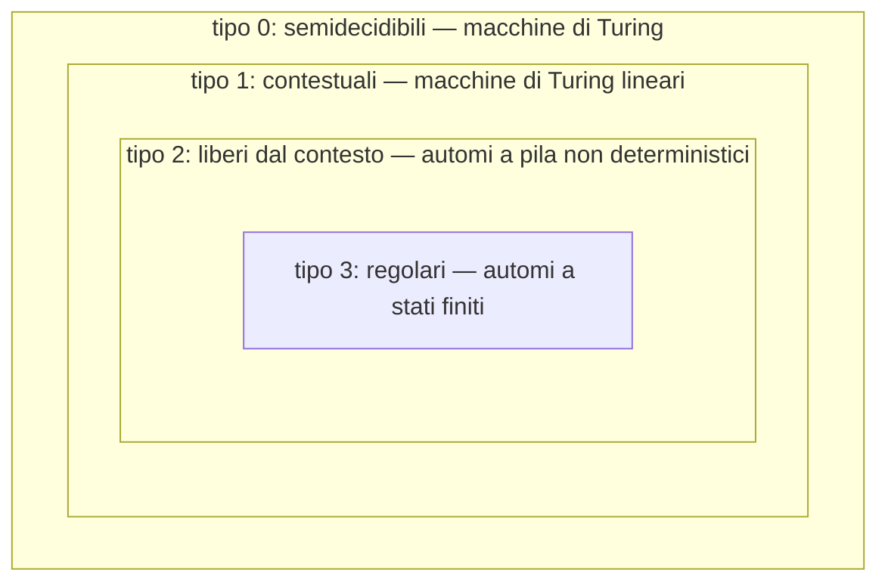
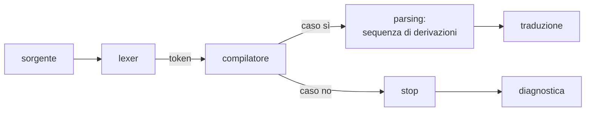

# Grammatiche e gerarchia di Chomsky

> [!abstract]
> Dalla [[08 - MC - Macchine di Turing e calcolabilità|lezione 8]] si sa che un problema di decisione è un **linguaggio**: l'insieme delle stringhe con risposta sì. Questa lezione apre la **teoria dei linguaggi formali**, che ha tre parti: la teoria delle **grammatiche** (come si *generano* i linguaggi), la teoria degli **automi** (come si *riconoscono*, [[10 - MC - Automi a stati finiti ed espressioni regolari|lezione 10]]) e la teoria e pratica del **parsing** (lezioni [[11 - MC - Analisi sintattica top-down e automi a pila|11]] e [[12 - MC - Parsing bottom-up|12]]). Si definiscono linguaggi e operazioni su di essi, le espressioni regolari come descrizione **algebrica**, le grammatiche di Chomsky come descrizione **generativa**, e la **gerarchia di Chomsky** (tipi 0, 1, 2, 3), che classifica le grammatiche in base alla forma delle produzioni. Ogni tipo corrisponde a un modello di calcolo: macchina di Turing, macchina lineare, automa a pila, automa a stati finiti.
> Mappa del corso: [[MOC - Modelli di Calcolo]].

## Teoria dei linguaggi



### Linguaggio

Sia dato un insieme **finito e non vuoto** $\Sigma$ di simboli, l'**alfabeto**: con i suoi simboli si costruiscono delle **parole** (stringhe).

- Esempio: $\Sigma = \{a, b, c\}$, $L = \{a, ba, cab, bb\}$, $|L| = 4$.
- $\Sigma^*$ è l'insieme di **tutte** le parole costruibili con $\Sigma$, compresa la **stringa vuota** $\varepsilon$ (di lunghezza 0). Per $\Sigma = \{0, 1\}$: $\Sigma^* = \{\varepsilon, 0, 1, 00, 01, 10, 11, \dots\}$.
- $\Sigma^*$ è esso stesso un linguaggio. Per definizione, **un linguaggio su $\Sigma$ è un qualunque $L \subseteq \Sigma^*$**.

Casi interessanti: $L = \Sigma^*$; $L = \Sigma$ (le parole di un solo simbolo); $L \subsetneq \Sigma^*$; $L = \Lambda = \emptyset$ (**linguaggio vuoto**).

> [!warning] $\{\varepsilon\} \ne \Lambda$
> Il linguaggio che contiene solo la stringa vuota non è il linguaggio vuoto: $|\{\varepsilon\}| = 1 \ne 0 = |\Lambda|$.

### Linguaggi e programmi

Un **linguaggio di programmazione** è l'insieme di tutti i possibili programmi sintatticamente corretti: il linguaggio C è l'insieme infinito dei programmi C corretti che si possono scrivere. **Linguaggio = insieme.**

L'alfabeto del C **non** è l'insieme dei simboli di base, ma l'insieme delle **parole** del linguaggio: parole chiave (`while`, `for`, …), identificatori, operatori. Il compilatore prende l'input e lo **tokenizza**, cioè lo trasforma in **token** (i simboli dell'alfabeto): è l'**analisi lessicale** (*lexer*). Poi fa il resto (vedi [[11 - MC - Analisi sintattica top-down e automi a pila#Fasi di compilazione|fasi di compilazione]]).

### Problemi di decisione come linguaggi

Un **problema di decisione** è il problema di riconoscere se una stringa $x \in L$. Bisogna **codificare** l'input del problema in qualche modo.

> [!example] Esempio
> *Data $ax^2 + bx + c = 0$, ammette radici reali?* L'input è la terna $(a, b, c)$. Si definisce il linguaggio di tutte le terne (codificate come stringhe) che hanno risposta sì: dato $(a, b, c)$, basta controllare se si trova in quel linguaggio.

Quindi **problema di decisione ≡ problema di riconoscimento dell'appartenenza a un linguaggio**.

> [!tip] Livelli di correttezza di un programma (dagli appunti)
> 1. compila;
> 2. è corretto per qualche istanza;
> 3. è corretto tranne casi particolari;
> 4. è corretto per i casi sì e per i casi no;
> 5. come 4, più una diagnostica se la codifica non descrive un input valido.

## Operazioni fra linguaggi

I linguaggi sono insiemi, quindi hanno senso le normali operazioni fra insiemi (unione, intersezione, prodotto cartesiano, complementazione), più alcune specifiche delle stringhe.

- **Complemento**: dato $L \subseteq \Sigma^*$, $\bar L = \{x \mid x \in \Sigma^* \wedge x \notin L\} = \Sigma^* \setminus L$.
- **Unione** (binaria): $L_1 \cup L_2 = \{x \in \Sigma_1^* \cup \Sigma_2^* \mid x \in L_1 \vee x \in L_2\}$.
- **Concatenazione** (binaria, **non commutativa** ma **associativa**). Date due stringhe $x$ e $y$, la loro concatenazione è $xy$ (o $x \cdot y$): "casa" · "chiese" = "casachiese". Fra linguaggi:
  $$L_1 \cdot L_2 = \{x \in \Sigma^* \mid x = yz \wedge y \in L_1 \wedge z \in L_2\}$$
  Concatenando $L$ con se stesso: $L \cdot L = L^2$, che **non** è $L \times L$ (l'insieme delle coppie); $L^3 = L^2 \cdot L = L \cdot L^2$, e $L^0 = \{\varepsilon\}$.
- **Iterazione** (unaria, *stella di Kleene*):
  $$L^* = \bigcup_{i=0}^{\infty} L^i \qquad L^+ = \bigcup_{i=1}^{\infty} L^i \qquad L^* = L^+ \cup \{\varepsilon\}$$
  In particolare $\Sigma^* = \bigcup_{i \ge 0} \Sigma^i$, e $L^*$ contiene sempre $\varepsilon$.

> [!example] Esempio
> $L_1 = \{a, ab\}$, $L_2 = \{b, \varepsilon\}$:
> - $L_1 \cdot L_2 = \{ab, a, abb\}$ ($ab$ si ottiene in due modi: $a \cdot b$ e $ab \cdot \varepsilon$);
> - $L_2 \cdot L_1 = \{ba, bab, a, ab\}$: diverso, la concatenazione non è commutativa;
> - $L_1^2 = \{aa, aab, aba, abab\}$, mentre $L_1 \times L_1$ contiene coppie come $(a, ab)$.

## Descrizione algebrica: le espressioni regolari

Vedi [[Espressione regolare]].

Un linguaggio può essere descritto in modo:
- **algebrico** (espressioni regolari);
- **generativo** (grammatiche);
- **riconoscitivo** (automi).

L'**espressione regolare** è una descrizione algebrica: un formalismo con regole per scrivere formule corrette, ciascuna associata a un linguaggio. Un'espressione regolare è un meccanismo algebrico che permette di rappresentare un linguaggio. Si definisce per **induzione strutturale** (sintassi e semantica insieme), su un alfabeto $\Sigma = \{\sigma_1, \dots, \sigma_n\}$:

| espressione | linguaggio rappresentato |
|---|---|
| $\sigma$ (per ogni $\sigma \in \Sigma$) | $\{\sigma\}$ |
| $\varepsilon$ | $\{\varepsilon\}$ |
| $\emptyset$ | $\emptyset$ |
| $e_1 + e_2$ | $L(e_1) \cup L(e_2)$ |
| $e_1 e_2$ | $L(e_1) \cdot L(e_2)$ |
| $e^*$ | $L(e)^*$ |

> [!example] Esempi
> 1. $(0 + 1)^* = \Sigma^*$ su $\Sigma = \{0, 1\}$: $0 + 1$ è associata a $\{0, 1\}$ e $(0 + 1)^*$ a $\{\varepsilon, 0, 1, 00, 01, 10, \dots\}$.
> 2. $a(b + c)a^*$ = le stringhe che iniziano con $a$, seguita da $b$ oppure $c$, seguita da un numero arbitrario ($\ge 0$) di $a$: $\{ab, ac, aba, aca, abaa, \dots\}$.

**Non tutti i linguaggi ammettono un'espressione regolare.** La classe dei linguaggi descritti da espressioni regolari si dice dei linguaggi **regolari**; si vedrà che coincide con quella dei linguaggi di tipo 3 e dei linguaggi riconosciuti dagli automi a stati finiti ([[10 - MC - Automi a stati finiti ed espressioni regolari|lezione 10]]).

## Descrizione generativa: le grammatiche

Vedi [[Grammatica generativa]].

> [!important] Grammatica (secondo Chomsky)
> Una grammatica è $G = \langle V_T, V_N, P, S \rangle$:
> - $V_T$: alfabeto dei **simboli terminali** (è il $\Sigma$ del linguaggio: le parole del linguaggio sono composte da terminali);
> - $V_N$: alfabeto dei **simboli non terminali** (simboli "ausiliari", che non compaiono nelle parole finali); $V = V_T \cup V_N$;
> - $P$: insieme delle **produzioni**, una relazione binaria su $V^*$: $P \subseteq V^* V_N V^* \times V^*$, cioè coppie $\langle \alpha, \beta \rangle$ in cui $\alpha$ contiene **almeno un non terminale**. Si scrive $\alpha \to \beta$, e $\alpha \to \beta_1 \mid \beta_2$ per due produzioni con la stessa parte sinistra;
> - $S \in V_N$: l'**assioma** (simbolo di partenza).

(Ricordo: dato un insieme $A$, una relazione binaria su $A$ è un qualunque $R \subseteq A \times A$.)

> [!tip] Convenzioni
> - maiuscole: non terminali ($V_N$); a volte un non terminale si indica con un nome fra parentesi angolari, come `<frase>`;
> - minuscole e cifre: terminali ($V_T$);
> - le ultime lettere $x, y, w, z \in V_T^*$: stringhe di terminali;
> - lettere greche $\alpha, \beta, \gamma \in V^*$: stringhe qualunque.
>
> **Definire una grammatica** significa scriverne le produzioni: da esse si ricavano $V_T$, $V_N$ e (per convenzione) l'assioma.

### Derivazione

> [!important] Derivazione diretta
> Date $\alpha \in V^* V_N V^*$ e $\beta \in V^*$, si ha la **derivazione diretta** $\alpha \Rightarrow \beta$ se
> $$\alpha = \alpha_1 \alpha_2 \alpha_3, \qquad \beta = \alpha_1 \gamma \alpha_3, \qquad \text{ed esiste la produzione } \alpha_2 \to \gamma$$
> cioè $\beta$ si ottiene da $\alpha$ riscrivendo una sua parte $\alpha_2$ con una produzione.
>
> $\Rightarrow^*$ è la **chiusura riflessiva e transitiva** di $\Rightarrow$: $\alpha \Rightarrow^* \alpha$ sempre, e $\alpha \Rightarrow^* \beta$ se si passa da $\alpha$ a $\beta$ con un numero finito di derivazioni dirette.

> [!important] Forme di frase, frasi, linguaggio generato
> - Se $S \Rightarrow^* \alpha$ con $\alpha$ stringa di terminali **e non terminali**, $\alpha$ è una **forma di frase**.
> - Se $S \Rightarrow^* x$ con $x$ stringa di **soli terminali**, $x$ è una **frase**.
> - L'insieme di tutte le frasi è il **linguaggio generato** da $G$:
> $$L(G) = \{x \in V_T^* \mid S \Rightarrow^* x\}$$

> [!example] Esempio: $\{a^n b^n \mid n \ge 1\}$
> $$S \to ASB \mid AB \qquad A \to a \qquad B \to b$$
> $$S \Rightarrow ASB \Rightarrow AASBB \Rightarrow AAABBB \Rightarrow aAABBB \Rightarrow aaABBB \Rightarrow aaaBBB \Rightarrow^3 aaabbb$$
> Ogni applicazione di $S \to ASB$ aggiunge una $A$ a sinistra e una $B$ a destra; alla fine $S \to AB$ e le $A$, $B$ diventano terminali. La grammatica genera $\{a^n b^n \mid n \ge 1\}$.

> [!example] Esempio: una grammatica "di tipo 0"
> $$S \to ABS \qquad AB \to Ab \mid aB \qquad A \to \varepsilon \qquad B \to \varepsilon \qquad AB \to BA$$
> $S \Rightarrow^* ABAB \dots ABS \Rightarrow ABAB \dots AB$ e così via. Qui le parti sinistre come $AB$ contengono **due** simboli: la sostituzione dipende dal "vicino". (Così come trascritta negli appunti la grammatica non elimina mai $S$, quindi non genera nessuna frase: serve anche una produzione $S \to \varepsilon$. Con essa genera stringhe in cui $A$ e $B$ si possono scambiare.)

- **Produzioni infeconde**: produzioni che non portano mai a frasi. Con sola $S \to aS$ "non si va da nessuna parte": $L(G) = \Lambda = \emptyset$.
- **Grammatiche equivalenti**: $G_1$ e $G_2$ sono equivalenti se $L(G_1) = L(G_2)$.
- **$\varepsilon$-produzione** (o produzione vuota): $\alpha \to \varepsilon$.

### Derivazioni sinistre e destre

Spesso si fa riferimento a uno standard:
- **leftmost derivation** (derivazione sinistra): a ogni passo si riscrive il non terminale **più a sinistra**;
- **rightmost derivation** (derivazione destra): quello **più a destra**.

Per una grammatica CF ogni frase ha almeno una derivazione sinistra e una destra; un parser top-down ricostruisce la prima, uno bottom-up la seconda (al contrario).

## Gerarchia di Chomsky

Vedi [[Gerarchia di Chomsky]].

Le grammatiche si classificano in quattro **tipi** (0, 1, 2, 3) in base alla forma delle produzioni. Ogni tipo aggiunge un vincolo al precedente. Per uno stesso linguaggio possono esistere grammatiche di tipi diversi: quando un linguaggio è generato da grammatiche di più tipi, si fa riferimento al tipo **più restrittivo** (il numero più alto).

> [!important] I quattro tipi
> - **Tipo 0** (grammatiche **non ristrette**, o libere): $\alpha \to \beta$ con $\alpha \in V^* V_N V^*$, $\beta \in V^*$. Nessun vincolo ulteriore: sono quelle viste finora.
> - **Tipo 1** (**non contraenti**, o **context sensitive**): tipo 0 + $|\alpha| \le |\beta|$. Le forme di frase non si accorciano mai; le $\varepsilon$-produzioni sono vietate.
> - **Tipo 2** (**context free**, CF, libere dal contesto): tipo 1 + $\alpha \in V_N$: la parte sinistra è **un solo non terminale**.
> - **Tipo 3** (**regolari**): tipo 2 + $\beta \in V_T \cup V_T \cdot V_N$: la parte destra è un terminale, oppure un terminale seguito da un non terminale ($A \to a$, $A \to aB$).



> [!quote] Dal libro
> La tabella riassuntiva di Crescenzi (*Informatica Teorica*, p. 185) mette in corrispondenza tipo di linguaggio, forma delle produzioni e modello di calcolo:
>
> | tipo | produzioni | modello di calcolo |
> |---|---|---|
> | 0 | $\alpha \to \beta$, $\alpha \in (V \cup T)^* V (V \cup T)^*$, $\beta \in (V \cup T)^*$ | macchina di Turing |
> | 1 (contestuale) | come il tipo 0, con $\beta \ne \varepsilon$ e $\lvert\beta\rvert \ge \lvert\alpha\rvert$ | macchina di Turing lineare |
> | 2 (libero da contesto) | $A \to \beta$, $A \in V$, $\beta \ne \varepsilon$ | automa a pila non deterministico |
> | 3 (regolare) | $A \to aB$ e $A \to a$ | automa a stati finiti |
>
> (Nel libro $V$ indica i non terminali e $T$ i terminali.) La classe dei linguaggi di tipo 0 coincide con quella dei **semidecidibili**, mentre le altre tre classi sono interamente contenute in quella dei **decidibili**. La macchina di Turing *lineare* è una MT che usa solo le celle occupate dall'input.

Vedi anche: [[08 - MC - Macchine di Turing e calcolabilità#Linguaggi di tipo 0 e MT|tipo 0 = semidecidibili]], [[11 - MC - Analisi sintattica top-down e automi a pila#Automi pushdown|tipo 2 = automi a pila]], [[10 - MC - Automi a stati finiti ed espressioni regolari#Linguaggi regolari e grammatiche di tipo 3|tipo 3 = automi a stati finiti]].

> [!example] Esempio: $L = \{a^n b^n c^n \mid n \ge 1\}$
> $$\begin{aligned}
> &S \to aSBC \qquad CB \to BC \qquad SB \to bF \qquad FB \to bF\\
> &FC \to cG \qquad GC \to cG \qquad G \to \varepsilon
> \end{aligned}$$
> $$S \Rightarrow aSBC \Rightarrow aaSBCBC \Rightarrow \dots \Rightarrow a^n S (BC)^n \Rightarrow \dots \Rightarrow a^n b^n c^n$$
> - $S \to aSBC$ genera $a^n S (BC)^n$: tante $a$ quante coppie $BC$;
> - $CB \to BC$ riordina portando tutte le $B$ prima delle $C$;
> - $SB \to bF$ inizia a trasformare le $B$ in $b$ ($F$ "scorre" sulle $B$ con $FB \to bF$); poi $FC \to cG$ e $GC \to cG$ trasformano le $C$; infine $G \to \varepsilon$.
>
> **Vincoli soddisfatti?**
> - tipo 3: **no**, nessuna produzione ha a destra la concatenazione di un terminale e di un non terminale;
> - tipo 2: **no**, a sinistra non c'è sempre un solo non terminale (la maggior parte delle volte sono due);
> - tipo 1: **no**, c'è una $\varepsilon$-produzione ($G \to \varepsilon$);
> - tipo 0: **sì**.
>
> Il **linguaggio** però è di tipo 1, perché ammette anche una grammatica non contraente, per esempio $S \to aSBC \mid aBC$, $CB \to BC$, $aB \to ab$, $bB \to bb$, $bC \to bc$, $cC \to cc$ (nessuna produzione accorcia la forma di frase). Ed è un linguaggio **non** di tipo 2: un automa a pila non può confrontare tre quantità. È un caso tipico in cui il tipo di una *grammatica* data non coincide con il tipo (più restrittivo possibile) del *linguaggio*.

### Accettazione, riconoscimento e compilatori

- **Accettazione = semi-decisione**: se la stringa appartiene al linguaggio si risponde sì; se non appartiene si risponde no **oppure non si risponde**.
- **Riconoscimento = decisione**: il problema di decisione $x \in L$.

Il compilatore non si limita a rispondere "$x \in L$ oppure no?": dato un programma, dice se appartiene all'insieme dei programmi sintatticamente corretti e, in caso positivo, ne costruisce la struttura.



**Parsing = analisi sintattica**: ricostruire la derivazione (leftmost o rightmost) della stringa. I linguaggi di programmazione sono (essenzialmente) di **tipo 2**, ma con precisazioni: alcuni vincoli, come "una variabile non può essere dichiarata due volte" o "va dichiarata prima dell'uso", non sono esprimibili con una grammatica CF e si controllano nell'analisi semantica.

### $\varepsilon$-produzioni nei tipi superiori a 0

Che cosa succede ammettendo $\varepsilon$-produzioni nelle grammatiche di tipo superiore a 0?

**Tipo 3.** Con produzioni come $A \to bC \mid c$, $X \to aB \mid a$ si aggiunge $B \to \varepsilon$. Si ottiene una grammatica equivalente senza $\varepsilon$-produzioni aggiungendo, per ogni produzione $X \to aB$, anche $X \to a$ (l'effetto di $B \to \varepsilon$), e togliendo $B \to \varepsilon$. Si possono quindi togliere le $\varepsilon$-produzioni lasciandone **al più una sull'assioma**, quando il linguaggio contiene la parola vuota (per esempio $S \to \varepsilon \mid aS \mid a$).

**Tipo 2.** Da $X \to \alpha Y \beta$ e $Y \to \varepsilon$ si aggiunge $X \to \alpha\beta$. Bisogna fare attenzione alle catene di **produzioni unitarie** annullabili ($A \to B \mid \varepsilon$, $B \to C \mid \varepsilon$, $C \to D \mid \varepsilon$, $D \to \varepsilon$): ripercorrendo la catena si trovano tutti i non terminali annullabili, fino eventualmente all'assioma.

> [!tip] Trucco dell'assioma nuovo
> Se l'assioma $S$ deve produrre $\varepsilon$ ma compare anche nelle parti destre, si introduce un nuovo assioma $S'$ con $S' \to S \mid \varepsilon$: così si eliminano le $\varepsilon$-produzioni da tutto il resto della grammatica, e l'unica rimasta è sull'assioma nuovo, che non compare mai a destra.

**Tipo 1.** Le produzioni sono non contraenti: $|\alpha| \le |\beta|$. Se si ammettessero $\varepsilon$-produzioni $\alpha \to \varepsilon$, si potrebbero ottenere produzioni contraenti $\varphi \to \gamma$ con $|\varphi| > |\gamma|$: basterebbe scrivere la produzione non contraente $\varphi\varphi' \to \gamma$ con $|\varphi\varphi'| \le |\gamma|$ e poi $\varphi' \to \varepsilon$. In questo modo si potrebbe generare **qualsiasi** linguaggio di tipo 0: **non va bene**.

> [!important] Gerarchia di Chomsky rilassata
> Nel corso si usa la gerarchia **rilassata**: le $\varepsilon$-produzioni sono ammesse nei tipi **3 e 2** (si possono sempre eliminare tranne quella sull'assioma, quindi non cambiano la classe dei linguaggi), ma non nel tipo 1.

### Che cosa vuol dire context sensitive

Una **definizione alternativa** delle grammatiche di tipo 1: produzioni $\alpha \to \beta$ con

$$\alpha = \alpha_1 A \alpha_3 \qquad \beta = \alpha_1 \gamma \alpha_3 \qquad \gamma \in V^+$$

cioè la "produzione" $A \to \gamma$ è applicabile **solo se $A$ si trova fra $\alpha_1$ e $\alpha_3$**, che definiscono un **contesto**. Con $\alpha_1, \alpha_3 \in V^*$:
- se $\alpha_1$ e $\alpha_3$ possono essere sempre vuote, la produzione non dipende dal contesto: **context free**;
- altrimenti la produzione è **sensibile al contesto**: **context sensitive**.

In realtà le due definizioni (non contraente e context sensitive) sono **equivalenti**. In una produzione context sensitive la lunghezza non si contrae ($|\gamma| \ge 1 = |A|$), quindi ogni grammatica context sensitive è non contraente. Il viceversa non è immediato.

**Dalla non contraente alla context sensitive** (Clelia, 25/03/2022). Usando grammatiche context sensitive non si genera nulla che non si generi con le non contraenti; per il viceversa, data una grammatica non contraente si costruisce la context sensitive equivalente.
1. Si eliminano i terminali dalle parti sinistre: al posto di ogni $a \in V_T$ si scrive un nuovo non terminale $[a]$ e si aggiunge $[a] \to a$.
2. Ogni produzione $x_1 x_2 \dots x_m \to y_1 y_2 \dots y_n$ (con $n \ge m$, tutti non terminali a sinistra) si sostituisce con $2m$ produzioni context sensitive, usando nuovi non terminali $z_1, \dots, z_m$, ognuna delle quali riscrive **un solo simbolo** nel suo contesto:
$$\begin{aligned}
x_1 x_2 \dots x_m &\to z_1 x_2 \dots x_m\\
z_1 x_2 \dots x_m &\to z_1 z_2 x_3 \dots x_m\\
&\ \vdots\\
z_1 \dots z_{m-1} x_m &\to z_1 \dots z_m y_{m+1} \dots y_n\\
z_1 \dots z_m y_{m+1} \dots y_n &\to y_1 z_2 \dots z_m y_{m+1} \dots y_n\\
&\ \vdots\\
y_1 \dots y_{m-1} z_m y_{m+1} \dots y_n &\to y_1 \dots y_n
\end{aligned}$$
Prima si "marcano" i simboli da sinistra a destra (l'ultimo passo della prima metà espande $x_m$ in $z_m y_{m+1} \dots y_n$, l'unico che allunga), poi si sostituiscono i marcatori con gli $y$.

### Esempi di grammatiche (25/03/2022)

> [!example] Esempi
> 1. $S \to Ab$, $A \to Sa$: non si eliminano mai i non terminali, $L(G) = \Lambda = \emptyset$.
> 2. $S \to aSc \mid A$, $A \to bAc \mid \varepsilon$:
>    $S \Rightarrow^* a^i S c^i \Rightarrow a^i A c^i \Rightarrow^* a^i b^j A c^j c^i \Rightarrow a^i b^j c^{i+j}$, quindi $L = \{a^i b^j c^{i+j} \mid i, j \ge 0\}$.
> 3. $\{a^{2^n} \mid n \ge 0\} = \{a, aa, aaaa, a^8, a^{16}, \dots\}$: serve una grammatica di tipo 0/1 con **marcatori** che percorrono la stringa raddoppiando le $a$. Negli appunti: $S \to a \mid aa \mid IaaF$; $aF \to Maa \mid MaaF$ (decide se continuare a raddoppiare: mantenendo $F$ si fa ripartire il marcatore $M$); $aM \to Maa$ (qui avviene il raddoppio); $IM \to Ia \mid aa$ (trascrizione incerta).
> 4. $\{a^n b^n \mid n \ge 0\}$: $S \to aSb \mid \varepsilon$ ($S \Rightarrow aSb \Rightarrow aaSbb \Rightarrow aabb$).
> 5. Palindromi su $\{a, b\}$:
>    - di lunghezza **pari**: $S \to aSa \mid bSb \mid \varepsilon$ ($S \Rightarrow aSa \Rightarrow abSba \Rightarrow abba$);
>    - di lunghezza **dispari**: $T \to aTa \mid bTb \mid a \mid b$;
>    - **tutti**: $X \to S \mid T$ con le produzioni precedenti.
> 6. $\{a^n b^{n+2} \mid n \ge 0\}$: partendo da $\{a^n b^n\}$ ($S \to aSb \mid \varepsilon$) si cambia il caso base: $S \to aSb \mid bb$.

> [!example] Esercizi d'esame
> - $L = \{a^n b^m \mid m > n \ge 0\}$ (giugno 2019): $S \to aSb \mid B$, $B \to bB \mid b$ (si pareggiano $a$ e $b$, poi si aggiunge almeno una $b$).
> - $S \to aAb \mid aSb$, $A \to aaAbb \mid ab$ (giugno 2019, settembre 2021): $A$ genera $a^{2k+1} b^{2k+1}$, $S$ genera $a^j A b^j$ con $j \ge 1$: $L = \{a^n b^n \mid n \ge 2\}$. La produzione $A \to aaAbb$ è **inutile** (lo stesso effetto si ottiene con $S \to aSb$): la grammatica si semplifica in $S \to aSb \mid aabb$. Derivazione di $aaaabbbb$: $S \Rightarrow aSb \Rightarrow aaSbb \Rightarrow aaaAbbb \Rightarrow aaaabbbb$ (si noti che con $A \to aaAbb$ esiste anche $S \Rightarrow aAb \Rightarrow aaaAbbb \Rightarrow aaaabbbb$: la grammatica originale è **ambigua**).
> - *"Aumentare il numero di stringhe di un linguaggio ne diminuisce il tipo"* (luglio 2021): **falso**. $\{a^n b^n\}$ è di tipo 2 (non regolare), ma aggiungendo stringhe si ottiene $\Sigma^*$, che è di tipo 3; e togliendo stringhe a $\Sigma^*$ si può ottenere $\{a^n b^n c^n\}$, che non è di tipo 2. Il tipo dipende dalla **struttura** del linguaggio, non dalla sua grandezza.
> - $\{0^h 1^k \mid h > k > 0\}$ è libero dal contesto (luglio 2021): $S \to 0S1 \mid 0A1$, $A \to 0A \mid 0$. Che non sia regolare si dimostra con il [[10 - MC - Automi a stati finiti ed espressioni regolari#Pumping lemma|pumping lemma]].
> - Linguaggio su $\{a, b\}$ in cui ogni $a$ è immediatamente seguita da almeno due $b$ (novembre 2019): è regolare, $(b + abb)^*$; una grammatica di tipo 3 (nella gerarchia rilassata) è $S \to bS \mid aA \mid \varepsilon$, $A \to bB$, $B \to bS$. Il **tipo stretto** del linguaggio è quindi 3.

## Grammatiche (e linguaggi) di tipo 2

Produzioni $A \to \alpha$, con $A \in V_N$ e $\alpha \in V^* = (V_N \cup V_T)^*$; si ammettono $\varepsilon$-produzioni (al più sull'assioma, dopo la normalizzazione).

### Alberi sintattici

Vedi [[Albero di derivazione]].

Nelle grammatiche di tipo 2 una derivazione si rappresenta con un **albero sintattico** (albero di derivazione, *parse tree*): la radice è l'assioma, ogni nodo interno è un non terminale con figli la parte destra della produzione applicata, le foglie lette da sinistra a destra formano la stringa.

> [!example] Esempio
> $$A \to aBcD \qquad B \to b \mid caA \qquad D \to c \mid acB$$
> Derivazione sinistra: $A \Rightarrow aBcD \Rightarrow acaAcD \Rightarrow acaaBcDcD \Rightarrow acaabcDcD \Rightarrow acaabcccD \Rightarrow acaabcccc$
>
> ```mermaid
> flowchart TB
>     A --- a1[a]
>     A --- B
>     A --- c1[c]
>     A --- D
>     B --- c2[c]
>     B --- a2[a]
>     B --- A2[A]
>     A2 --- a3[a]
>     A2 --- B2[B]
>     A2 --- c3[c]
>     A2 --- D2[D]
>     B2 --- b1[b]
>     D2 --- c4[c]
>     D --- c5[c]
> ```
>
> L'albero fissa *quali* produzioni sono applicate a *quali* nodi, ma non l'ordine: la visita delle foglie (a, c, a, a, b, c, c, c, c) dà la stringa $acaabcccc$, e la derivazione sinistra corrisponde a espandere i nodi in pre-ordine. (Negli appunti la stringa finale è leggibile solo in parte; quella qui sopra è coerente con l'albero.)

Una grammatica in cui una stessa stringa ha due alberi diversi è **ambigua**: vedi [[Grammatica ambigua]] e [[11 - MC - Analisi sintattica top-down e automi a pila#Grammatiche ambigue|lezione 11]].

### Forme normali

Per i linguaggi di tipo 2 esistono varie **forme normali**: formati standard per le produzioni (che in generale sono $A \to \alpha$, $A \in V_N$, $\alpha \in V^*$).

> [!important] Forme normali
> - **Forma normale di Chomsky (CNF)**: ogni produzione è $A \to a$ oppure $A \to BC$ (un terminale, oppure esattamente due non terminali).
> - **Forma normale di Greibach (GNF)**: ogni produzione è $A \to a\gamma$, con $a \in V_T$ e $\gamma \in V_N^*$ (un terminale seguito da zero o più non terminali).
>
> Per **qualunque** grammatica di tipo 2 esiste una grammatica equivalente in CNF e una in GNF (a parte la parola vuota).

La GNF è interessante perché permette di costruire direttamente l'**automa a pila** equivalente: ogni produzione $A \to a\gamma$ diventa una transizione che legge un carattere ($a$), toglie $A$ dalla cima della pila e vi mette $\gamma$ (cioè fa un *pop* e un *push*). La CNF è utile nelle dimostrazioni (per esempio il pumping lemma per i linguaggi CF, che il libro tratta nel cap. 8) e negli algoritmi di parsing generale.

> [!example] Mini esempio di CNF
> $S \to aSb \mid ab$ (che genera $a^n b^n$, $n \ge 1$) in CNF: si introducono $A \to a$, $B \to b$ e si spezza la parte destra lunga: $S \to AX \mid AB$, $X \to SB$, $A \to a$, $B \to b$.

## Riepilogo

> [!summary]
> - Un **linguaggio** è un sottoinsieme di $\Sigma^*$; un problema di decisione è un linguaggio. $\{\varepsilon\} \ne \emptyset$.
> - Operazioni: unione, concatenazione (associativa, non commutativa), iterazione $L^* = \bigcup_i L^i$, complemento.
> - Descrizioni: **algebrica** (espressioni regolari), **generativa** (grammatiche), **riconoscitiva** (automi).
> - Grammatica $\langle V_T, V_N, P, S \rangle$; $L(G) = \{x \in V_T^* \mid S \Rightarrow^* x\}$.
> - **Chomsky**: tipo 0 (qualunque), tipo 1 ($|\alpha| \le |\beta|$, context sensitive), tipo 2 ($A \to \beta$, context free), tipo 3 ($A \to aB \mid a$, regolari). Modelli: MT, MT lineare, automa a pila, ASF.
> - Gerarchia **rilassata**: $\varepsilon$-produzioni ammesse nei tipi 2 e 3. Non contraente ⇔ context sensitive.
> - Tipo 2: alberi sintattici, forme normali di **Chomsky** ($A \to a$, $A \to BC$) e **Greibach** ($A \to a\gamma$).
