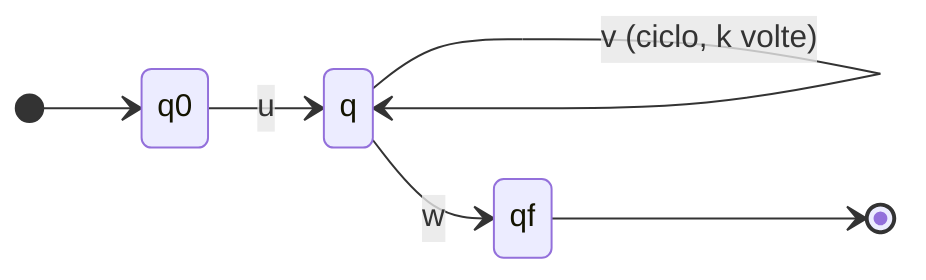
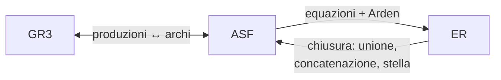

# Automi a stati finiti ed espressioni regolari

> [!abstract]
> La [[09 - MC - Grammatiche e gerarchia di Chomsky|lezione 9]] ha descritto i linguaggi in modo **algebrico** (espressioni regolari) e **generativo** (grammatiche). Qui si introduce il modo **riconoscitivo**: l'**automa a stati finiti** (ASF), una macchina che legge la stringa una volta, da sinistra a destra, con una memoria finita (lo stato), e alla fine dice sì o no. Si vede la versione **non deterministica** (ASFND) e si dimostra che non riconosce più linguaggi di quella deterministica (costruzione per sottoinsiemi). Poi il risultato centrale: **ASF, grammatiche di tipo 3 ed espressioni regolari descrivono la stessa classe**, i **linguaggi regolari**, e si sa passare da una rappresentazione all'altra. Il **pumping lemma** permette di dimostrare che un linguaggio *non* è regolare (per esempio $a^n b^n$). Infine le proprietà di chiusura e i problemi decidibili sui linguaggi regolari. Gli ASF sono la base dell'analisi lessicale dei compilatori ([[11 - MC - Analisi sintattica top-down e automi a pila#Token|lezione 11]]) e degli stati del parser LR ([[12 - MC - Parsing bottom-up#Ripresa dell'esempio: set di item e goto-graph|lezione 12]]).
> Mappa del corso: [[MOC - Modelli di Calcolo]].

## Automa a stati finiti

Vedi [[Automa a stati finiti]].

Un automa a stati finiti caratterizza il comportamento di una macchina astratta **che non può fare quello che vuole**: legge l'input (una stringa su un nastro) un simbolo alla volta e, a ogni simbolo, **cambia stato**. Gli stati sono **finali** o **non finali**. Quando è stato letto l'ultimo carattere, la macchina si ferma: se si trova in uno stato **finale** ha fornito risposta **sì**, se si trova in uno stato **non finale** ha fornito risposta **no**.

> [!important] Definizione
> Un automa a stati finiti è una quintupla
> $$A = \langle \Sigma, Q, F, q_0, \delta \rangle$$
> - $\Sigma$: l'alfabeto (corrisponde a $V_T$ delle grammatiche);
> - $Q$: l'insieme degli stati, **finito e non vuoto**;
> - $F \subseteq Q$: l'insieme degli stati **finali** ($Q \setminus F$ sono i non finali);
> - $q_0 \in Q$: lo stato **iniziale**;
> - $\delta: \Sigma \times Q \to Q$: la **funzione di transizione**, che descrive come evolve lo stato: prende in input una coppia (simbolo letto, stato corrente) e restituisce il prossimo stato.

Data una stringa $x$, la domanda "$x \in L(A)$?" è un **problema di riconoscimento**, quindi un problema di decisione. Un ASF lo risolve **sempre** e in tempo **lineare** (un passo per simbolo).

**Descrizione degli automi.** Si può usare una **tabella** (righe = stati, colonne = simboli, caselle = stato successivo), ma di solito si usa il **diagramma degli stati**: un grafo con un nodo per stato, una freccia entrante sullo stato iniziale, un doppio cerchio sugli stati finali e un arco etichettato $a$ da $q$ a $q'$ se $\delta(a, q) = q'$. In un automa deterministico completo il numero di archi è $|Q| \cdot |\Sigma|$ (uno per stato e simbolo).

> [!example] Un automa che conta le parità
> $\Sigma = \{0, 1\}$; gli stati ricordano la parità degli 0 e degli 1 letti: PP (pari 0, pari 1, iniziale), PD (pari 0, dispari 1), DP, DD. Un 0 cambia la prima lettera, un 1 la seconda.
> ```mermaid
> stateDiagram-v2
>     direction LR
>     [*] --> PP
>     PP --> PD: 1
>     PD --> PP: 1
>     DP --> DD: 1
>     DD --> DP: 1
>     PP --> DP: 0
>     DP --> PP: 0
>     PD --> DD: 0
>     DD --> PD: 0
> ```
> Scegliendo gli stati finali si riconoscono linguaggi diversi:
> - $F = \{PP\}$: numero pari di 0 **e** numero pari di 1 (prova di luglio 2019: accetta `0011`, `01010101`, `00100100`, rifiuta `0111` e `00100`);
> - $F = \{DD\}$: numero dispari di entrambi (febbraio 2020, con $a$ e $b$);
> - $F = \{PD, DD\}$: numero arbitrario di 0 e numero **dispari** di 1 (l'esempio degli appunti).

> [!example] Casi limite
> - **ASF che riconosce il linguaggio vuoto**: basta non avere stati finali (o averli irraggiungibili). Per esempio un solo stato $q_0$ non finale con un cappio su ogni simbolo.
> - **ASF che riconosce solo $\{\varepsilon\}$**: lo stato iniziale è finale; qualunque simbolo porta in uno stato **pozzo** non finale con un cappio su tutti i simboli.

### Linguaggio riconosciuto da un ASF

Per definire il linguaggio riconosciuto (o **accettato**) serve la **funzione di transizione estesa alle stringhe** $\bar\delta: \Sigma^* \times Q \to Q$:

$$\bar\delta(\varepsilon, q) = q \qquad \bar\delta(xa, q) = \delta(a, \bar\delta(x, q)) \quad (x \in \Sigma^*,\ a \in \Sigma)$$

cioè lo stato in cui si arriva da $q$ leggendo tutta la stringa.

> [!important] Linguaggio riconosciuto
> $$L(A) = \{x \in \Sigma^* \mid \bar\delta(x, q_0) \in F\}$$
> (Da confrontare con il linguaggio generato da una grammatica: $L(G) = \{x \in V_T^* \mid S \Rightarrow^* x\}$.)

### Configurazioni (28/03/2022)

Una **configurazione** (istantanea) è una coppia $(q, x)$: $q \in Q$ è lo stato corrente, $x$ la parte di input ancora da leggere.
- **iniziale**: $(q_0, y)$ con $y \in \Sigma^*$ l'input;
- **finale**: $(q, \varepsilon)$ con $q \in Q$ (input finito);
- **accettante**: $(q, \varepsilon)$ con $q \in F$.

Il passaggio da una configurazione all'altra è la **relazione di transizione** $\vdash$:

$$(q_i, aw) \vdash (q_h, w) \quad \text{se } \delta(q_i, a) = q_h, \quad a \in \Sigma,\ w \in \Sigma^*$$

e una computazione è $c_0 \vdash c_1 \vdash c_2 \vdash \dots \vdash c_k$.

> [!important] Definizione alternativa (equivalente)
> $$L(A) = \{x \in \Sigma^* \mid (q_0, x) \vdash^* (q, \varepsilon) \wedge q \in F\}$$
> Per induzione si verifica che le definizioni con $\bar\delta$ e con $\vdash$ danno lo stesso linguaggio (come $\Rightarrow$ per le grammatiche).

Il formalismo delle grammatiche è molto più potente di quello degli automi a stati finiti: gli ASF riconoscono esattamente i linguaggi di **tipo 3**.

> [!example] Esempio 1: un lexer per identificatori
> Un lexer deve riconoscere un **lessema** come identificatore: una stringa alfanumerica (`a-z A-Z 0-9 _`) che **non può iniziare con una cifra**.
> ```mermaid
> stateDiagram-v2
>     direction LR
>     [*] --> q0
>     q0 --> ID: a-z A-Z _
>     ID --> ID: a-z A-Z 0-9 _
>     q0 --> ERR: 0-9
>     ERR --> ERR: qualunque
>     ID --> [*]
> ```
> $ID$ è l'unico stato finale; $ERR$ è un pozzo.

> [!example] Esempio 2: multipli di 3 in base 10
> $\Sigma = \{0, \dots, 9\}$. Un numero è multiplo di 3 se e solo se la somma delle sue cifre lo è, e per la somma conta solo il resto modulo 3. Gli stati ricordano il **resto** della parte letta: $C$ = resto 0 (multiplo di 3, finale), $B$ = resto 1 ("una unità sopra un multiplo di 3"), $D$ = resto 2. Le cifre si dividono in tre gruppi: $\{0, 3, 6, 9\}$ (non cambiano il resto), $\{1, 4, 7\}$ (aggiungono 1), $\{2, 5, 8\}$ (aggiungono 2).
>
> | stato | $\{0,3,6,9\}$ | $\{1,4,7\}$ | $\{2,5,8\}$ |
> |---|---|---|---|
> | $A$ (iniziale) | $C$ | $B$ | $D$ |
> | $B$ (resto 1) | $B$ | $D$ | $C$ |
> | $C$ (resto 0, finale) | $C$ | $B$ | $D$ |
> | $D$ (resto 2) | $D$ | $C$ | $B$ |
>
> $A$ serve solo a non accettare la stringa vuota. Negli appunti c'è anche uno stato di errore $E$ (con cappio su 0–9) a cui si va con uno 0 iniziale, per non accettare numeri con zeri iniziali; nella prova di febbraio 2022 il testo non lo richiede. Verifica: $489$: $A \xrightarrow{4} B \xrightarrow{8} C \xrightarrow{9} C$: accettato ($489 = 3 \cdot 163$).

> [!example] Multipli di 5 (settembre 2019)
> Un numero in base 10 è multiplo di 5 se e solo se l'ultima cifra è 0 o 5: due stati, $N$ (iniziale, non finale) e $M$ (finale); con 0 o 5 si va in $M$, con le altre cifre in $N$, da qualunque stato. Bastano due stati perché conta solo l'**ultimo** simbolo letto.

## Non determinismo

Il non determinismo **non esiste** fisicamente: è uno **strumento teorico**.

- **Parallelismo**: più risorse che possono eseguire computazioni in parallelo, al massimo $K$ per un $K$ fissato.
- **Non determinismo**: parallelismo **arbitrario**: per ogni $K$ si possono fare $K + 1$ computazioni parallele.

Un automa deterministico ha una computazione lineare $c_0 \vdash c_1 \vdash \dots \vdash c_k$; un automa **non deterministico** ha un **albero delle computazioni**: da una configurazione si può passare a più configurazioni.

Vedi [[Automa a stati finiti non deterministico]].

> [!important] Definizione (ASFND)
> Un ASFND è come un ASFD, ma con funzione di transizione
> $$\delta_N: Q \times \Sigma \to 2^Q = \mathcal{P}(Q)$$
> $\delta_N(q, a) = \{q_1, q_2, \dots, q_k\}$ è un **insieme** di stati, eventualmente vuoto.

Gli elementi nuovi rispetto a un ASFD sono due:
1. **assenza di archi**: $\delta_N(q, a) = \emptyset$ (quel ramo della computazione "muore");
2. **duplicazione di archi**: più archi uscenti con lo stesso simbolo, $\delta_N(q_0, 1) = \{q_1, q_2\}$.

Il **grado di non determinismo** è il massimo numero di configurazioni successive a una configurazione, cioè il massimo numero di archi uscenti da uno stato con lo stesso simbolo.

Nel non determinismo conviene ragionare su **insiemi di stati**: la configurazione iniziale è $(\{q_0\}, x)$ e, leggendo $a_1$, si passa a $(\{q_1, q_2, q_3\}, a_2 \dots a_n)$, l'insieme di tutti gli stati raggiungibili. La relazione di transizione è

$$(\{q_{i_1}, \dots, q_{i_k}\}, ay) \vdash (T, y) \qquad T = \bigcup_{j} \delta_N(q_{i_j}, a)$$

e la funzione estesa alle stringhe è $\bar\delta_N(q, \varepsilon) = \{q\}$, $\bar\delta_N(q, xa) = \bigcup_{h \in \bar\delta_N(q, x)} \delta_N(h, a)$.

> [!important] Linguaggio riconosciuto da un ASFND
> $$L(A) = \{x \in \Sigma^* \mid (\{q_0\}, x) \vdash^* (T, \varepsilon) \wedge T \cap F \ne \emptyset\} = \{x \in \Sigma^* \mid \bar\delta_N(q_0, x) \cap F \ne \emptyset\}$$
> Si **accetta** $x$ se **almeno uno** degli stati raggiunti è finale; si **rifiuta** se tutti gli stati a cui si arriva sono non finali.

> [!example] Stringhe binarie che terminano con 1
> ASFND: lo stato $S$ ha un cappio su 0 e 1, e con 1 si può andare anche in $T$, finale, che non ha archi uscenti.
> ```mermaid
> stateDiagram-v2
>     direction LR
>     [*] --> S
>     S --> S: 0, 1
>     S --> T: 1
>     T --> [*]
> ```
> Non ci sono archi uscenti da $T$: se dopo essere arrivati in $T$ si legge altro, quel ramo muore (ma il ramo rimasto in $S$ continua). Per esempio con `11` dopo il primo 1 si è in $\{S, T\}$, dopo il secondo ancora in $\{S, T\}$: accettato.

## Equivalenza fra ASFND e ASFD

Con un ASFND si riesce a fare qualcosa che non si riesce a fare con gli ASFD? Esistono linguaggi riconosciuti da ASFND ma non da ASFD? **No.**

> [!important] Teorema
> Per ogni ASFND $A$ esiste un ASFD $A'$ **equivalente** (che riconosce lo stesso linguaggio). Se $A$ ha $k$ stati, $A'$ ha nel caso peggiore $2^k$ stati.

**Costruzione per sottoinsiemi.** Gli stati di $A'$ sono **insiemi di stati** di $A$ (al più $2^k$):
- lo stato iniziale di $A'$ è $\{q_0\}$;
- da uno stato $T$ di $A'$, con il simbolo $a$, si va in $\bigcup_{q \in T} \delta_N(q, a)$;
- uno stato $T$ di $A'$ è finale se $T \cap F \ne \emptyset$;
- si costruiscono solo gli stati **raggiungibili** a partire da $\{q_0\}$ (in pratica sono spesso molti meno di $2^k$).

$A'$ è deterministico per costruzione (da ogni insieme e simbolo si va in un solo insieme, eventualmente $\emptyset$, che fa da pozzo), e simula "tutti i rami in parallelo" di $A$. $\square$

> [!example] Terminano con 1: versione deterministica
> Da $[S]$ con 0 si resta in $[S]$, con 1 si va in $[ST]$; da $[ST]$ con 1 si resta in $[ST]$, con 0 si torna in $[S]$. $[ST]$ è finale perché contiene $T$.
> ```mermaid
> stateDiagram-v2
>     direction LR
>     [*] --> S
>     S --> S: 0
>     S --> ST: 1
>     ST --> ST: 1
>     ST --> S: 0
>     ST --> [*]
> ```

> [!example] Penultimo carattere uguale a 1
> ASFND: $S$ (cappio su 0, 1) $\xrightarrow{1}$ $T$ $\xrightarrow{0,1}$ $U$ (finale). La costruzione per sottoinsiemi dà quattro stati raggiungibili:
>
> | stato | 0 | 1 | finale? |
> |---|---|---|---|
> | $\{S\}$ | $\{S\}$ | $\{S, T\}$ | no |
> | $\{S, T\}$ | $\{S, U\}$ | $\{S, T, U\}$ | no |
> | $\{S, U\}$ | $\{S\}$ | $\{S, T\}$ | sì |
> | $\{S, T, U\}$ | $\{S, U\}$ | $\{S, T, U\}$ | sì |
>
> Gli stati dell'ASFD ricordano gli ultimi due simboli letti. Per "il $k$-esimo carattere dalla fine è 1" l'ASFND ha $k + 1$ stati, mentre ogni ASFD ne ha almeno $2^k$: l'esplosione esponenziale è inevitabile.

> [!note] Componente connessa
> Negli appunti compare a questo punto la definizione di **componente connessa** di un grafo: un sottografo, **massimale** (non si può aggiungere un nodo senza perdere la proprietà), in cui esiste sempre un percorso fra ogni coppia di nodi. Serve a ragionare sugli stati raggiungibili: gli stati dell'ASFD non raggiungibili da $\{q_0\}$ si possono eliminare. Nell'esempio degli appunti (un ASFND a 4 stati con grado di non determinismo 2, e il suo ASFD con stati $[A]$, $[BC]$, $[CD]$, $[D]$, $[\emptyset]$) la trascrizione degli archi non è abbastanza leggibile da essere riportata.

> [!example] Domanda d'esame (settembre 2021)
> *Esistono linguaggi riconoscibili da un ASFND ma non da un ASFD?* No, per il teorema appena visto: il non determinismo, per gli automi a stati finiti, rende gli automi più **compatti** (anche esponenzialmente) ma non più **potenti**. (Per gli automi a pila invece la versione non deterministica è strettamente più potente: vedi [[11 - MC - Analisi sintattica top-down e automi a pila#Automi pushdown|lezione 11]].)

## Linguaggi regolari e grammatiche di tipo 3

Si vuole dimostrare che gli ASF riconoscono esattamente i linguaggi **regolari**, cioè generati da grammatiche di tipo 3: $\mathcal{L}(ASF) = \mathcal{L}(GR3)$. Servono due inclusioni.

### 1) $\mathcal{L}(ASF) \subseteq \mathcal{L}(GR3)$

Dato un ASF si costruisce una grammatica di tipo 3 equivalente:
- c'è una corrispondenza $V_N \leftrightarrow Q$: un non terminale per stato; lo stato iniziale $q_0$ corrisponde all'assioma $S$;
- $V_T = \Sigma$;
- le produzioni dipendono da $\delta$: per ogni arco $A \xrightarrow{c} B$ si aggiunge $A \to cB$;
- per gli **stati finali**: se l'arco $A \xrightarrow{c} B$ arriva in uno stato finale $B$, si aggiunge anche $A \to c$ (la derivazione può fermarsi lì);
- se l'automa accetta la parola vuota ($q_0$ finale, $\varepsilon \in L$), serve $S \to \varepsilon$. Poiché $S$ può comparire nelle parti destre (se ci sono archi che rientrano in $q_0$), si introduce un nuovo assioma $S'$ che "copia" $S$: se $S \to \alpha \mid \beta \mid \gamma$, allora $S' \to \varepsilon \mid \alpha \mid \beta \mid \gamma$.

Il percorso dell'automa su $x$ e la derivazione di $x$ si corrispondono passo per passo: lo stato corrente è il non terminale in fondo alla forma di frase.

### 2) $\mathcal{L}(GR3) \subseteq \mathcal{L}(ASF)$

Data una grammatica di tipo 3 si costruisce un ASF (deterministico o no):
- $V_N$ dà luogo a $Q$; $S$ dà luogo a $q_0$;
- per ogni produzione $A \to bC$ si mette un arco $A \xrightarrow{b} C$ (per esempio $B \to cB$ diventa un cappio su $B$);
- si introduce un nuovo stato $Z$, l'unico finale ($F = \{Z\}$);
- per le produzioni che terminano con un terminale, $A \to d$, si mette un arco $A \xrightarrow{d} Z$;
- una produzione $B \to \varepsilon$ rende $B$ finale.

L'automa ottenuto è in generale **non deterministico** (più produzioni $A \to bC$, $A \to bD$ con lo stesso terminale), ma si sa renderlo deterministico.

> [!important] Tre rappresentazioni equivalenti
> I linguaggi regolari sono generati dalle grammatiche di tipo 3 e riconosciuti dagli automi a stati finiti (deterministici o no), e si sa passare dall'una all'altra:
> ```mermaid
> flowchart LR
>     GR3["grammatiche di tipo 3"] <--> ASF["ASF deterministici"]
>     ASF <--> ASFND["ASF non deterministici"]
>     ASFND <--> GR3
> ```

> [!example] Esempio
> $$S \to aS \mid bB \qquad B \to aA \mid b \qquad A \to a \mid bB$$
> ```mermaid
> stateDiagram-v2
>     direction LR
>     [*] --> S
>     S --> S: a
>     S --> B: b
>     B --> A: a
>     A --> B: b
>     B --> Z: b
>     A --> Z: a
>     Z --> P: a, b
>     P --> P: a, b
>     Z --> [*]
> ```
> Senza lo stato $P$ l'automa non sarebbe completo: $Z$ non ha archi uscenti (e ad $S$, $A$, $B$ manca qualche simbolo). Si introduce uno stato **pozzo** $P$ per renderlo deterministico (completo); per brevità nel diagramma ci sono solo gli archi di $Z$ verso $P$, ma anche gli archi mancanti di $A$ e $B$ andrebbero lì.
>
> Rifacendo la costruzione inversa si ottiene $S \to aS \mid bB$, $B \to aA \mid b$, $A \to a \mid bB$, $Z \to aP \mid bP$, $P \to aP \mid bP$: il non terminale $Z$ non viene mai generato, quindi le ultime produzioni sono **inutili**.
>
> **Linguaggio generato**: si leggono $a^n$ restando in $S$, poi una $b$ (in $B$), poi coppie $ab$ ($B \to A \to B$), poi si chiude con $b$ (da $B$) oppure con $aa$ (da $B$ ad $A$, poi $A \to a$):
> $$\{a^n b (ab)^m b \mid n, m \ge 0\} \cup \{a^n b (ab)^m aa \mid n, m \ge 0\}$$

## Pumping lemma

Vedi [[Pumping lemma per linguaggi regolari]].

$\{x \in \Sigma^* \mid x = a^n b^n \wedge n \ge 0\}$ **non può essere riconosciuto da un ASF**: per confrontare il numero di $a$ e di $b$ bisognerebbe ricordare un numero arbitrariamente grande, e gli stati sono finiti. Il **pumping lemma** rende rigorosa questa intuizione.

L'idea. Sia $L$ un linguaggio regolare e sia $A$ un ASF che lo riconosce, con il **minimo** numero di stati $n$. Una stringa accettata può essere più lunga o più corta di $n$, a seconda che il percorso nell'automa contenga **cicli** o no: senza cicli si visitano stati tutti diversi, quindi la stringa è lunga al massimo $n - 1$. Una stringa lunga almeno $n$ deve passare **due volte per lo stesso stato**: il percorso contiene un ciclo.

Si scrive allora $x = uvw$, dove $v$ è la parte letta lungo il ciclo. Il ciclo si può percorrere $k$ volte, per qualunque $k \ge 0$ (anche zero): anche $uv^kw$ porta allo stesso stato finale.



> [!important] Pumping lemma (linguaggi regolari)
> Se $L$ è regolare, esiste $n$ (il numero di stati di un ASF minimo per $L$) tale che **ogni** $x \in L$ con $|x| \ge n$ si può decomporre in $x = uvw$ con
> $$|uv| \le n, \qquad |v| \ge 1, \qquad uv^kw \in L \text{ per ogni } k \ge 0$$
> ($|uv| \le n$ perché il primo ciclo si chiude entro i primi $n$ simboli; $|v| \ge 1$ perché il ciclo legge almeno un simbolo.)

**Regolare ⇒ pompaggio**; quindi, per contrapposizione, **non pompaggio ⇒ non regolare**.

> [!warning] Condizione necessaria, non sufficiente
> Il pumping lemma è una condizione **necessaria** ma **non sufficiente** per la regolarità: si può concludere qualcosa solo se **non** si riesce a pompare (allora il linguaggio non è regolare). "Pompare" una stringa significa solo verificare la condizione necessaria: dimostrare che una stringa si pompa non prova che il linguaggio sia regolare.

> [!example] $\{a^n b^n \mid n \ge 0\}$ non è regolare
> Per assurdo sia regolare, con costante $n$. Si prende $x = a^n b^n$, lunga $2n \ge n$. Si vuole mostrare che **nessuna** decomposizione $x = uvw$ fa valere il pompaggio. Negli appunti si considerano tutte le posizioni possibili di $v$:
> - $v$ tutta nelle $a$: pompando ($k = 2$) si ottengono più $a$ che $b$: fuori dal linguaggio;
> - $v$ a cavallo fra $a$ e $b$: pompando si generano $a$ **dopo** delle $b$: fuori dal linguaggio;
> - $v$ tutta nelle $b$: simmetrico al primo caso.
>
> (Con il vincolo $|uv| \le n$ basta il primo caso: $uv$ sta tutto nelle prime $n$ lettere, cioè nelle $a$.) Non si riesce a decomporre la stringa in modo che il pompaggio della seconda parte resti nel linguaggio: **il linguaggio non è regolare**. Infatti è di tipo 2: $S \to aSb \mid \varepsilon$.

I linguaggi in cui bisogna "**contare**" le lettere (per esempio $a^n b^n c^n$, $a^n b^n$, $0^h 1^k$ con $h > k$) non sono regolari.

> [!example] $\{0^h 1^k \mid h > k > 0\}$ non è regolare (luglio 2021)
> Si prende $x = 0^{n+1} 1^n \in L$. Con $|uv| \le n$, $v = 0^j$ con $j \ge 1$. Pompando **verso il basso** ($k = 0$) si ottiene $0^{n+1-j} 1^n$, con $n + 1 - j \le n$: il numero di 0 non è più maggiore di quello degli 1, fuori da $L$. Quindi $L$ non è regolare (ma è libero dal contesto: $S \to 0S1 \mid 0A1$, $A \to 0A \mid 0$).

> [!important] Caso interessante: i linguaggi finiti sono regolari
> Se $|L|$ è finito, $L = \{w_1, w_2, \dots, w_h\}$, l'automa che lo riconosce è un "albero" di $h$ rami, uno per parola, ciascuno lungo $|w_i|$, con stati finali alla fine di ogni ramo. **Ogni linguaggio finito è regolare** (prova di giugno 2023). In alternativa: l'espressione regolare $w_1 + w_2 + \dots + w_h$.

## Proprietà di chiusura dei linguaggi regolari

I linguaggi regolari (descritti con il metodo riconoscitivo, ASF, o generativo, GR3) hanno proprietà di **chiusura**: applicando le operazioni insiemistiche a linguaggi regolari si ottengono linguaggi regolari. Se $L$, $L_1$, $L_2$ sono regolari, sono regolari anche:
- $\bar L$ (complemento);
- $L_1 \cup L_2$ (unione);
- $L_1 \cap L_2$ (intersezione);
- $L_1 \cdot L_2$ (concatenazione);
- $L^*$ (iterazione).

Siano $A_1 = \langle \Sigma_1, Q_1, F_1, q_{01}, \delta_1 \rangle$ e $A_2 = \langle \Sigma_2, Q_2, F_2, q_{02}, \delta_2 \rangle$ gli automi di $L_1$ e $L_2$ (con $Q_1 \cap Q_2 = \emptyset$).

**Unione.** Si costruisce $A = \langle \Sigma, Q, F, q_0, \delta \rangle$ con un nuovo stato iniziale $q_0$ che "copia" gli archi uscenti dei due stati iniziali:
- $\Sigma = \Sigma_1 \cup \Sigma_2$, $Q = Q_1 \cup Q_2 \cup \{q_0\}$;
- $F = F_1 \cup F_2 \cup \{q_0\}$ se $\varepsilon \in L_1$ o $\varepsilon \in L_2$, altrimenti $F = F_1 \cup F_2$;
- $\delta(q, a) = \delta_1(q, a)$ se $q \in Q_1$; $\delta_2(q, a)$ se $q \in Q_2$; $\delta_1(q_{01}, a) \cup \delta_2(q_{02}, a)$ se $q = q_0$.

Il risultato è in generale non deterministico (dal nuovo iniziale si può "entrare" in entrambi gli automi).

**Concatenazione.**
- $\Sigma = \Sigma_1 \cup \Sigma_2$, $Q = Q_1 \cup Q_2$, $q_0 = q_{01}$;
- $F = F_2$ se $\varepsilon \notin L_2$, $F = F_1 \cup F_2$ se $\varepsilon \in L_2$;
- $\delta(q, \sigma) = \delta_1(q, \sigma)$ se $q \in Q_1 \setminus F_1$; $\delta_1(q, \sigma) \cup \delta_2(q_{02}, \sigma)$ se $q \in F_1$ (gli stati finali di $A_1$ si comportano **anche** come lo stato iniziale di $A_2$); $\delta_2(q, \sigma)$ se $q \in Q_2$.

**Complementazione.** Dato $L$, $\bar L = \Sigma^* \setminus L$: verrebbe da **invertire** stati finali e non finali. Ma c'è un problema, visibile su un ASFND: se leggendo $x$ da $A$ si può arrivare sia in $B$ (finale) sia in $C$ (non finale), $x$ è accettata; invertendo, $C$ diventa finale e $x$ resta accettata, mentre dovrebbe essere rifiutata. Il trucco funziona solo se l'automa è una **funzione** (deterministico e completo). Servono due passi:
1. rendere l'ASF un **ASFD completo** (costruzione per sottoinsiemi, più uno stato pozzo per le transizioni mancanti);
2. invertire gli stati: $Q' = Q$, $F' = Q \setminus F$.

Esempio: dall'automa delle parità con $F = \{PD\}$ (numero pari di 0 e dispari di 1), invertendo si ottiene $F' = \{PP, DP, DD\}$, che accetta tutte le altre stringhe.

**Iterazione.** Dato $A = \langle \Sigma, Q, F, q_0, \delta \rangle$ per $L$, un ASF per $L^*$ si costruisce in due passi: (a) si aggiunge un nuovo stato iniziale $q_0'$, **anche finale** (per accettare $\varepsilon$); (b) si fanno comportare tutti gli stati finali **anche** come il vecchio stato iniziale (per ricominciare una nuova parola):
- $\Sigma' = \Sigma$, $Q' = Q \cup \{q_0'\}$, $F' = F \cup \{q_0'\}$;
- $\delta'(q, a) = \delta(q, a)$ se $q \in Q \setminus F$; $\delta(q, a) \cup \delta(q_0, a)$ se $q \in F$; $\delta'(q_0', a) = \delta(q_0, a)$.

**Intersezione.** Per De Morgan:
$$L_1 \cap L_2 = \overline{\bar L_1 \cup \bar L_2}$$
e complemento e unione si sanno già fare. (In alternativa si usa l'**automa prodotto**, con stati coppie $(q_1, q_2)$ che simulano i due automi in parallelo: è la costruzione per esercizi come "stringhe che contengono 010 **e** 111", giugno 2019.)

## Dalle grammatiche alle espressioni regolari

Si mostra come, partendo da una grammatica regolare, si costruisce un'espressione regolare equivalente: le produzioni diventano un **sistema di equazioni** fra linguaggi, che si risolve per sostituzione.

> [!important] Premessa (lemma di Arden)
> L'equazione $X = AX + B$, nell'incognita $X$ (un linguaggio), ha soluzione $X = A^*B$ (unica se $\varepsilon \notin A$).
>
> Infatti $A^*B = B + AA^*B$: le stringhe di $A^*B$ sono quelle di $B$ oppure una di $A$ seguita da una di $A^*B$.

> [!example] Esempio (01/04/2022)
> Automa con stati $S$ (iniziale), $T$, $U$ (finale) e grammatica
> $$S \to aT \qquad T \to bU \mid aT \mid b \qquad U \to aU \mid aS \mid a$$
> Ogni non terminale diventa un'incognita, ogni produzione un addendo:
> $$S = aT \qquad T = aT + bU + b \qquad U = aU + aS + a$$
> - Da $U = aU + (aS + a)$, per Arden: $U = a^*(aS + a)$.
> - Da $T = aT + (bU + b)$: $T = a^*(bU + b) = a^*\big(b\,a^*(aS + a) + b\big)$.
> - Sostituendo in $S = aT$: $S = aa^*b\,a^*a\,S + aa^*b\,a^*a + aa^*b$.
> - Per Arden: $S = (aa^*ba^*a)^*(aa^*ba^*a + aa^*b)$.
> - Con $a^+ = aa^* = a^*a$: $S = (a^+ba^+)^*\,a^+b\,(a^+ + \varepsilon) = (a^+ba^+)^*\,a^+ba^*$.
>
> (Negli appunti il risultato finale è parzialmente illeggibile; questo è il risultato dei passaggi.)

> [!example] Esempio completo: ASF → GR3 → ER (04/04/2022)
> Automa con stati $S$, $T$, $U$:
> $$S \to aT \mid bS \mid b \qquad T \to aT \mid bU \qquad U \to aU \mid aS \mid a$$
> Equazioni: $S = bS + aT + b$, $T = aT + bU$, $U = aU + aS + a$.
> - $U = a^*(aS + a)$;
> - $T = a^*bU = a^*b\,a^*(aS + a)$;
> - $S = bS + aa^*ba^*(aS + a) + b = (b + a^+ba^+)\,S + (a^+ba^+ + b)$;
> - per Arden: $S = (b + a^+ba^+)^*(b + a^+ba^+) = (b + a^+ba^+)^+$.
>
> Tornando all'automa da questa espressione: è l'iterazione $(\ )^+$ di un'unione; poiché $X^+ = X X^*$, l'automa dell'iterazione va **concatenato con l'automa non iterato**. Gli appunti costruiscono così un automa con stati $S, A, B, C, E, F, H$ e la grammatica corrispondente, annotando che "probabilmente c'è qualche errore": la costruzione è laboriosa ed è facile sbagliare; conviene verificare il risultato su qualche stringa.

Anche l'implicazione mancante del triangolo vale: **ogni linguaggio regolare è descritto da un'espressione regolare** (si passa da ASF a GR3 e poi a ER con le equazioni), e ogni espressione regolare descrive un linguaggio regolare (per induzione strutturale, con le costruzioni di chiusura). Quindi:



### Dalle espressioni regolari agli automi

**Tecnica**: si decompone l'espressione in sottoespressioni, si costruisce un automa per ogni pezzo elementare e li si combina con le costruzioni di chiusura.

> [!example] $(0 + 11)^*101$ su $\Sigma = \{0, 1\}$
> 1. Automi per $0$ (due stati) e per $11$ (tre stati); la loro **unione** con un nuovo stato iniziale.
> 2. L'automa per $(0 + 11)^*$ con l'**iterazione** (nuovo stato iniziale, anche finale; i finali si comportano come l'iniziale). Semplificando: uno stato $p$ iniziale e finale con un cappio su 0, e un ciclo $p \xrightarrow{1} p' \xrightarrow{1} p$.
> 3. La **concatenazione** con l'automa che riconosce $101$.
> ```mermaid
> stateDiagram-v2
>     direction LR
>     [*] --> p
>     p --> p: 0
>     p --> p1: 1
>     p1 --> p: 1
>     p --> r1: 1
>     r1 --> r2: 0
>     r2 --> r3: 1
>     r3 --> [*]
> ```
> Il risultato è non deterministico (da $p$ con 1 si va in $p1$ o in $r1$); per un ASFD si applica la costruzione per sottoinsiemi.

## Problemi di decidibilità sui linguaggi regolari

Dato un linguaggio regolare (per esempio tramite un ASF con $n$ stati):

> [!important] Vuoto, finito, infinito
> - **Il linguaggio è vuoto?** Basta provare tutte le stringhe di lunghezza $< n$: se nessuna è accettata il linguaggio è **vuoto**, altrimenti non lo è. Infatti, per il pumping lemma, se l'automa accettasse una stringa lunga $\ge n$, questa conterrebbe un ciclo, e togliendolo ($k = 0$) si otterrebbe una stringa accettata più corta: per accettare una stringa di lunghezza $\ge n$ deve accettarne anche una di al più $n - 1$ caratteri. Le stringhe da provare sono $\sum_{i=0}^{n-1} |\Sigma|^i$: molto **inefficiente**, ma **possibile** (in pratica basta una visita del grafo dallo stato iniziale cercando uno stato finale raggiungibile).
> - **Il linguaggio è finito o infinito?** Si provano le stringhe $x$ con $n \le |x| < 2n$: se anche una sola è accettata il linguaggio è **infinito** (contiene un ciclo pompabile); se nessuna è accettata il linguaggio è **finito** (eventualmente non vuoto).

> [!important] Equivalenza
> **Due ASF (o due espressioni regolari) sono equivalenti?** Sì, è decidibile: si costruisce la **differenza simmetrica**
> $$(L_A \cap \bar L_B) \cup (L_B \cap \bar L_A)$$
> che è regolare per le proprietà di chiusura, e si decide se è **vuota**. È vuota se e solo se i due linguaggi coincidono. Quindi si può anche decidere se due **grammatiche regolari** sono equivalenti (per le CF, invece, l'equivalenza è [[08 - MC - Macchine di Turing e calcolabilità#L'indecidibilità della terminazione|indecidibile]]).

## Esercizi tipici d'esame

> [!example] Automi ed espressioni regolari dalle prove
> - *ASF per le stringhe binarie che contengono 010 e 111* (giugno 2019): automa prodotto fra quello che cerca 010 (4 stati) e quello che cerca 111 (4 stati); finale la coppia (trovato, trovato).
> - *ER per le stringhe binarie che non contengono 101* (ottobre 2021): dopo ogni `10` deve seguire un altro `0` oppure la fine: $0^*(1^+00^+)^*(1^* + 1^+0)$, cioè blocchi di 1 separati da almeno due 0, con un eventuale `10` finale. Conviene costruire prima l'ASF (stati: "niente", "ho letto 1", "ho letto 10", pozzo) e poi ricavare l'ER con le equazioni.
> - *ASF che riconosce le stringhe che contengono le ultime tre cifre della matricola* (aprile e giugno 2022), o che **non** le contengono (luglio 2023): è un automa "cerca-sottostringa" a 4 stati (0, 1, 2 o 3 cifre del pattern già lette, con i ritorni corretti in caso di mismatch, come nell'algoritmo di Knuth-Morris-Pratt); per la versione "non contiene" si complementa (lo stato finale diventa l'unico non finale).
> - *ASFD per $(a + bb)^*ab^*$* (febbraio 2022): si costruisce l'ASFND con le regole di chiusura e lo si determinizza.
> - *Grammatica regolare per $(0 + 11)^*1$* (giugno 2023): $S \to 0S \mid 1A \mid 1$, $A \to 1S$ ($A$ ricorda "ho letto il primo 1 di una coppia $11$").

## Riepilogo

> [!summary]
> - **ASF** = $\langle \Sigma, Q, F, q_0, \delta \rangle$ con $\delta: \Sigma \times Q \to Q$; accetta $x$ se $\bar\delta(x, q_0) \in F$. Riconosce in tempo lineare, con memoria finita.
> - **ASFND**: $\delta_N: Q \times \Sigma \to 2^Q$; accetta se almeno uno stato raggiunto è finale. Equivalente all'ASFD tramite la **costruzione per sottoinsiemi** (fino a $2^k$ stati).
> - **ASF = GR3 = ER**: archi ↔ produzioni $A \to cB$ (e $A \to c$ verso i finali); da GR3 a ER con le equazioni e il **lemma di Arden** ($X = AX + B \Rightarrow X = A^*B$).
> - **Pumping lemma**: se $L$ è regolare, ogni $x \in L$ lunga si scrive $uvw$ con $|uv| \le n$, $|v| \ge 1$, $uv^kw \in L$. Serve a dimostrare la **non** regolarità ($a^n b^n$). I linguaggi finiti sono regolari.
> - **Chiusura** rispetto a unione, concatenazione, stella, complemento (su ASFD completo), intersezione (De Morgan).
> - **Decidibili**: vuoto, finito/infinito, equivalenza (differenza simmetrica vuota).
