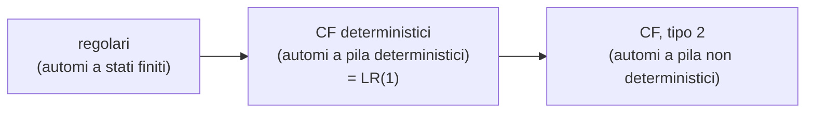

# Analisi sintattica top-down e automi a pila

> [!abstract]
> Le [[09 - MC - Grammatiche e gerarchia di Chomsky|grammatiche di tipo 2]] (libere dal contesto, CF) servono a descrivere la sintassi dei linguaggi di programmazione; il modello di calcolo che le riconosce è l'**automa a pila** (*pushdown automaton*), cioè un [[Automa a stati finiti|automa a stati finiti]] con in più una pila. Un compilatore deve però fare di più che riconoscere: deve costruire l'**albero di derivazione** del programma, e farlo in modo **deterministico ed efficiente**. Questa lezione studia la strategia **top-down**: i parser a **discesa ricorsiva**, poi i **parser predittivi LL(1)**, che decidono quale produzione applicare guardando un solo token grazie agli insiemi **FIRST**, **FOLLOW** e **SELECT**. Si vede anche come trasformare una grammatica perché diventi LL(1) (eliminazione della **ricorsione sinistra** e **fattorizzazione**). La strategia opposta, bottom-up, è nella [[12 - MC - Parsing bottom-up|lezione successiva]].
> Mappa del corso: [[MOC - Modelli di Calcolo]].

## Automi pushdown

Vedi [[Automa a pila]].

![[MC-L11-p2.png]]

La figura mostra la struttura di un **automa a pila**: un nastro di input in sola lettura ($u\,t\,w\,\$$, letto da sinistra a destra), un **controllo** a stati finiti governato da una tabella, e una **pila** ($v, x, y, \dots, z$, con `$` sul fondo) di cui si vede e si modifica solo la cima.

Perché serve una pila? Per riconoscere $\{a^n b^n \mid n > 0\}$ un automa a stati finiti non basta (non può contare un numero illimitato di $a$; vedi [[10 - MC - Automi a stati finiti ed espressioni regolari|lezione 10]]). Basta però una memoria a cui si accede da un solo estremo: si mettono in pila le $a$ lette e, alla prima $b$, se ne toglie una per ogni $b$; la stringa è accettata se alla fine dell'input la pila è vuota.

> [!quote] Dal libro
> **Definizione 8.1.** Un automa a pila non deterministico è una macchina di Turing non deterministica con **due nastri semi-infiniti**, alfabeto di input $\Sigma$ e alfabeto di pila $\Gamma$, in cui ogni transizione è etichettata da triple $(x, y, z)$: $x \in \Sigma^*$ è ciò che si legge sul primo nastro, $y \in \Gamma^*$ ciò che si legge in cima alla pila (secondo nastro), $z \in \Gamma^*$ ciò che si scrive sulla pila al posto di $y$. La testina dell'input si sposta di $|x|$ posizioni a destra, quella della pila resta sulla prima cella (la cima). Un cammino è accettante se termina in uno stato finale **dopo aver letto tutto l'input**.
>
> **Esempio 8.3.** Le stringhe $w_1 \cdots w_n w_n \cdots w_1$ (palindromi binari di lunghezza pari) sono accettate da un automa che mette in pila i simboli letti e, **non deterministicamente**, sceglie il punto di metà stringa da cui iniziare a confrontare l'input con la pila. Il linguaggio è generato da $A \to 0A0 \mid 1A1 \mid 00 \mid 11$.
>
> **Teorema 8.1.** Un linguaggio $L$ è di **tipo 2 se e solo se** esiste un automa a pila **non deterministico** $T$ tale che $L = L(T)$.
> Da grammatica ad automa: si mette in pila un simbolo speciale `#` e l'assioma; se in cima c'è un non terminale $A$ si sceglie non deterministicamente una produzione su $A$ e si impila la parte destra (in ordine inverso); se in cima c'è un terminale lo si confronta con l'input e lo si toglie; con `#` in cima si accetta se l'input è finito. È esattamente un **parser top-down non deterministico**: il parser predittivo LL(1) è lo stesso automa reso deterministico grazie al lookahead.
>
> Il non determinismo è **necessario**: gli automi a pila deterministici riconoscono una classe intermedia fra regolari e CF. Per i palindromi, dopo aver letto $0^n 1 1 0^n$ la pila deve essere vuota (la stringa è accettata), ma allora l'automa non ricorda più $n$ e non può decidere se un seguito $0^m 1 1 0^m$ va accettato. *(Crescenzi, pp. 180–185)*



## Argomenti dell'analisi sintattica

Le slide trattano, in ordine: il compito dell'analisi sintattica, la generazione automatica dei parser, il trattamento degli errori, le grammatiche libere dal contesto, le grammatiche ambigue, analisi top-down contro bottom-up, una semplice analisi top-down.

## Fasi di compilazione

![[MC-L11-p4.png]]

Il compilatore trasforma il **programma sorgente** (una stringa di caratteri) attraverso una sequenza di fasi. Il **front-end** comprende:

1. **analisi lessicale**: spezza il sorgente in **token**;
2. **analisi sintattica** (*parsing*): dai token costruisce l'**albero di derivazione**;
3. **analisi semantica e traduzione**: controlli di tipo, generazione del codice intermedio;

seguono l'**ottimizzazione del codice** e infine la generazione dell'**assembly**. Questa lezione riguarda la seconda fase.

### Token

![[MC-L11-p5.png]]

- Un **token** è una porzione di input **categorizzata** (per esempio "identificatore", "operatore di assegnazione", "letterale intero").
- L'input è una stringa sull'alfabeto Unicode (l'alfabeto di Java non coincide con Unicode).
- **Scanning** = riconoscimento di un token, tramite un ASFD ([[Automa a stati finiti|automa a stati finiti deterministico]]): i token sono linguaggi regolari.
- **Tokenization** = suddivisione dell'input in token.

Nell'esempio di Wikipedia, `sum=3+2;` diventa la sequenza: `sum` (*Identifier*), `=` (*Assignment operator*), `3` (*Integer literal*), `+` (*Addition operator*), `2` (*Integer literal*), `;` (*End of statement*). Il parser lavora su questa sequenza, non sui singoli caratteri.

## Grammatiche libere dal contesto

### Esempio di grammatica di tipo 2

$$\begin{array}{ll}
1\ S \to S ; S & 6\ E \to E + E\\
2\ S \to \mathrm{id} := E & 7\ E \to (S, E)\\
3\ S \to \mathrm{print}(L) & 8\ L \to E\\
4\ E \to \mathrm{id} & 9\ L \to L, E\\
5\ E \to \mathrm{num} &
\end{array}$$

Token: `id`, `num`, `:=`, `print`, `(`, `)`, `,`, `+`, `;`. $S$ è uno *statement* (istruzione), $E$ un'*espressione*, $L$ una lista di espressioni.

### Esempio di derivazione

Una derivazione di `a := 56 ; b := 77 + 16`, cioè `id := num ; id := num + num`:

$$\underline{S} \Rightarrow S ; \underline{S} \Rightarrow \underline{S} ; \mathrm{id} := E \Rightarrow \mathrm{id} := \underline{E} ; \mathrm{id} := E \Rightarrow \mathrm{id} := \mathrm{num} ; \mathrm{id} := \underline{E}$$
$$\Rightarrow \mathrm{id} := \mathrm{num} ; \mathrm{id} := E + \underline{E} \Rightarrow \mathrm{id} := \mathrm{num} ; \mathrm{id} := \underline{E} + \mathrm{num} \Rightarrow \mathrm{id} := \mathrm{num} ; \mathrm{id} := \mathrm{num} + \mathrm{num}$$

A ogni passo si sostituisce un non terminale (sottolineato) con la parte destra di una sua produzione. Questa derivazione non segue un ordine fisso: a volte riscrive il non terminale più a destra, a volte quello più a sinistra.

### Esempio di albero di derivazione

Vedi [[Albero di derivazione]].

![[MC-L11-p8.png]]

L'albero di derivazione rappresenta la stessa derivazione senza l'ordine dei passi: la radice è l'assioma $S$, ogni nodo interno è un non terminale i cui figli sono la parte destra della produzione applicata, le foglie lette da sinistra a destra danno la stringa. Qui $S$ si divide in $S\ ;\ S$; il primo $S$ diventa `id := E` con $E \to$ `num`, il secondo `id := E` con $E \to E + E$ e due `num`. Derivazioni diverse che applicano le stesse produzioni agli stessi nodi danno **lo stesso albero**.

### Grammatiche ambigue

Vedi [[Grammatica ambigua]].

> [!important] Definizione
> Una grammatica è **ambigua** quando per una stessa stringa del linguaggio esistono **due diversi alberi di derivazione**.

Le grammatiche ambigue **non sono adatte** ai linguaggi di programmazione:
- la **semantica non è chiara**: alberi diversi corrispondono a significati diversi;
- l'**analisi è più complessa**: il parser dovrebbe considerare due alberi.

La grammatica di esempio è ambigua: `id := num + num + num` ha due alberi con $E \to E + E$ ($(n+n)+n$ e $n+(n+n)$), e anche $S ; S ; S$ si raggruppa in due modi.

### Grammatiche non ambigue per espressioni aritmetiche

| ambigua | disambiguata | disambiguata (precedenze invertite) |
|---|---|---|
| $E \to E + E$ | $E \to E + T$ | $E \to E * T$ |
| $E \to E * E$ | $E \to T$ | $E \to T$ |
| $E \to \mathrm{id}$ | $T \to T * F$ | $T \to F + T$ |
| $E \to (E)$ | $T \to F$ | $T \to F$ |
| | $F \to \mathrm{id}$ | $F \to \mathrm{id}$ |
| | $F \to (E)$ | $F \to (E)$ |

Nella prima grammatica `id + id * id` ha due alberi: uno "fa prima il $+$", l'altro "fa prima il $*$". Le altre due introducono **livelli** ($E$, $T$, $F$), uno per ogni grado di precedenza:

- nella seconda, $*$ sta più in basso nell'albero (in $T$), quindi lega più forte di $+$: è la convenzione usuale; $E \to E + T$ e $T \to T * F$ sono ricorsive a sinistra, quindi gli operatori associano **a sinistra**;
- nella terza i ruoli sono scambiati: $+$ lega più forte di $*$ (e associa a destra, per $T \to F + T$). Anche questa grammatica **non è ambigua**: l'ambiguità riguarda il numero di alberi, non il fatto che il significato sia quello "giusto". Mostra che la stessa lingua si può disambiguare in modi diversi, e che la scelta fissa la semantica.

### Perché grammatiche CF per i linguaggi di programmazione?

- Le grammatiche di tipo 2 permettono di rappresentare la **struttura gerarchica** dei programmi (blocchi annidati, espressioni dentro istruzioni).
- Sono **più semplici** di quelle di tipo 1, e questo permette di avere **parser efficienti**.
- In realtà, a questo scopo si useranno **ulteriori restrizioni** (LL(1), LR(1)): il parsing di una CF generica costa $O(n^3)$, troppo per un compilatore.

## Analisi sintattica (parsing)

- **Input**: una sequenza di token.
- **Output**: l'albero di derivazione.
- Inoltre: **riporta gli errori** di sintassi e crea la **tabella dei simboli**, che contiene i diversi identificatori usati nel programma.

### Proprietà dei prefissi

Un buon parser segnala un errore **il prima possibile**. Formalmente: per ogni sequenza iniziale di token (prefisso) $t_1, t_2, \dots, t_k$ che l'analisi considera **legale** (cioè che potrebbe essere l'inizio di una stringa del linguaggio), devono esistere token $t_{k+1}, \dots, t_n$ tali che $t_1, \dots, t_n$ sia un programma sintatticamente corretto.

Equivalentemente, considerando un token come un singolo carattere: per ogni "parola prefisso" $x$ che l'analisi considera legale esiste un suffisso $w$ tale che $x \cdot w$ è un programma corretto. Il parser si ferma al **primo** token che rende impossibile completare il programma.

### Bottom-up e top-down

![[MC-L11-p14.png]]

**Bottom-up** (dal basso all'alto):
- costruisce l'albero **dalle foglie**;
- avanza nell'input (*shift*) o deriva un non terminale (*reduce*);
- accetta quando l'input è finito e si è ottenuto l'assioma;
- ricostruisce in effetti l'albero attraverso una sua visita in **post-ordine**.

La figura mostra, sotto, l'input già letto ridotto a "pezzi" di albero (triangoli) e, a destra, l'input ancora da leggere (*remaining input*).

![[MC-L11-p15.png]]

**Top-down** (dall'alto in basso):
- inizia con l'**assioma**;
- ripetutamente sceglie un non terminale $A$ dell'albero finora ottenuto e gli applica una produzione;
- ha successo quando le foglie dell'albero rappresentano la stringa di input;
- l'albero è ricostruito in **pre-ordine**.

Nella figura il triangolo grande è l'albero costruito a partire dalla radice; il nodo $A$ è il prossimo non terminale da espandere.

## Analisi top-down

Si supponga di aver completato parte di una derivazione $S \Rightarrow^* wA\alpha$ e che l'input sia $wxy$: $w$ è già stato "abbinato", $A$ è il prossimo non terminale da espandere.

**Passo ripetuto**: scegliere una produzione su $A$, $A ::= \beta_1 \beta_2 \dots \beta_n$, che sia **congruente con l'input**, cioè con la parte $x$ non ancora ottenuta. Per motivi di efficienza **il passo deve essere deterministico**.

### Parser a discesa ricorsiva

Vedi [[Parser a discesa ricorsiva]].

Un vantaggio dei parser top-down è che sono **più semplici da implementare**. L'idea fondamentale: scrivere **una funzione** (procedura, metodo) **per ogni simbolo non terminale**; ognuna è responsabile di accoppiare il non terminale con il resto dell'input.

Se ci sono due produzioni $A \to \alpha_1 \alpha_2 \dots \alpha_n \mid \beta_1 \beta_2 \dots \beta_m$ bisogna **provare entrambe** le possibilità: la funzione $A$ tenta dapprima la produzione con le $\alpha$; se ha successo termina con successo, altrimenti tenta quella con le $\beta$; se anche questa fallisce, termina con fallimento.

Tentare di usare una produzione significa **consumare porzioni di input** (i terminali della parte destra) e **chiamare le funzioni** associate ai non terminali. Per esempio con $A \to aBcD$ si ha successo se e solo se:
- il prossimo carattere in input è `a`,
- la chiamata `B()` restituisce successo,
- il carattere successivo da leggere è `c`,
- la chiamata `D()` restituisce successo.

**N.B.** Le produzioni del tipo $A \to A\alpha$ sono un problema (vedi [[#Ricorsione sinistra|ricorsione sinistra]]).

```c
int A(...) { /* par.: porzione di input da leggere */
   /* prova la prima possibilità A -> a1 a2 ... an */
   if (a1(...)) {
      if (!a2()) Error("Missing a2");
      if (!a3()) Error("Missing a3");
      ...
      if (!an()) Error("Missing an");
      return SUCCESSO;
   }
   /* prova la seconda alternativa A -> b1 b2 ... bm */
   if (b1(...)) {
      if (!b2()) Error("Missing b2");
      ...
      if (!bm()) Error("Missing bm");
      return SUCCESSO;
   }
   return ERRORE;
}
```

Lo schema: se il primo simbolo dell'alternativa corrisponde, si prosegue con gli altri; se uno manca è un errore. La slide avverte che **mancano la gestione delle "riletture" di token** (se la prima alternativa fallisce a metà, l'input già consumato va restituito: è il *backtracking*, che rende il metodo esponenziale nel caso peggiore) **e delle $\varepsilon$-produzioni**.

### Parser predittivi

Provare tutte le possibili produzioni porta a programmi lenti. Supponendo di dover espandere $A$ con due produzioni $A \to \alpha$ e $A \to \beta$, bisogna saper **scegliere la produzione giusta sulla base dell'input ancora da esaminare**. Se ci si riesce si ottiene un **parser predittivo**, che non ha bisogno di simulare il non determinismo.

> [!example] Esempio
> I linguaggi di programmazione sono spesso adatti al parsing predittivo:
> ```
> Stmt ::= id = exp ;
>        | return exp ;
>        | if ( exp ) stmt
>        | while ( exp ) stmt
> ```
> Se la prima parte dell'input inizia con `IF PARENTESI-SX ID …`, si deve espandere `stmt` come un if-statement (terza produzione): ogni alternativa inizia con un token diverso.

### LL(k) parsing

- È il parsing predittivo top-down, spesso a discesa ricorsiva.
- Analizza l'input da sinistra (**L**eft) a destra e costruisce una derivazione sinistra (**L**eftmost).
- Usa il **lookahead** per scegliere la produzione: lookahead $k$ significa che osservare i prossimi $k$ token da leggere permette di decidere quale regola usare. Si scrive **LL(*k*)**.
- In pratica è rarissimo usare $k > 1$.
- I linguaggi CF per cui è possibile il parsing LL(1) sono un **sottoinsieme proprio dei CF deterministici**.

## Grammatiche LL(1)

Vedi [[Grammatica LL(1)]] e [[Insiemi FIRST e FOLLOW]].

> [!important] Definizione (incompleta, la si completa con FOLLOW)
> Data una produzione $A \to \alpha$, $\mathrm{FIRST}(\alpha)$ è l'insieme dei simboli terminali che possono stare all'inizio di stringhe derivate da $\alpha$.
>
> Una grammatica è LL(1) se, per ogni non terminale $A$ e per ogni coppia di produzioni $A \to \alpha$, $A \to \beta$:
> $$\mathrm{FIRST}(\alpha) \cap \mathrm{FIRST}(\beta) = \emptyset$$

Se la grammatica è LL(1) si costruisce un parser predittivo **esaminando un unico simbolo**: data $A \to \alpha \mid \beta$, si applica la prima produzione se il simbolo in input appartiene a $\mathrm{FIRST}(\alpha)$, la seconda se appartiene a $\mathrm{FIRST}(\beta)$. Al posto di FIRST si usa anche il termine **STARTERS**.

**Nota**: se $\alpha \Rightarrow^* \varepsilon$ servono precisazioni e la definizione va completata (vedi [[#FOLLOW-set|FOLLOW]]).

### Parsing per grammatiche LL(1)

- Spesso il parser si realizza **iterativamente**, usando una **pila inizializzata con l'assioma** (è l'automa a pila del Teorema 8.1, reso deterministico).
- Esamina l'input da sinistra a destra.
- Quando in cima alla pila c'è un non terminale, decide la produzione esaminando **un** simbolo dell'input.

La possibilità di esaminare un solo simbolo è sufficiente per la maggioranza dei linguaggi di programmazione.

### Esempio: grammatica LL(1) per espressioni con parentesi

Espressioni aritmetiche completamente parentesizzate:

```
espressione → digit | '(' espressione operatore espressione ')'
operatore   → '+' | '*'
digit       → '0' | '1' | ... | '9'
```

`((3+5)*2)` appartiene al linguaggio; `3+5*2` e `(3+5)*2` no. La grammatica è LL(1): le due alternative di `espressione` iniziano con una cifra o con `(`, quelle di `operatore` con `+` o `*`.

### Esempio: grammatica non LL(1)

$$S \to Ac \mid Bd \qquad A \to a \qquad B \to a$$

| $\alpha$ | FIRST($\alpha$) |
|---|---|
| $a$ | $\{a\}$ |
| $c$ | $\{c\}$ |
| $d$ | $\{d\}$ |
| $A$ | $\{a\}$ |
| $B$ | $\{a\}$ |
| $S$ | $\{a\}$ |
| $Ac$ | $\{a\}$ |
| $Bd$ | $\{a\}$ |

$\mathrm{FIRST}(Ac) \cap \mathrm{FIRST}(Bd) = \{a\} \ne \emptyset$: leggendo `a` non si sa se espandere $S$ con $Ac$ o con $Bd$. Servirebbero 2 token di lookahead ($ac$ oppure $ad$): la grammatica è LL(2) ma non LL(1). (Il linguaggio $\{ac, ad\}$ ha però la grammatica LL(1) $S \to aX$, $X \to c \mid d$.)

### Parser top-down efficienti

![[MC-L11-p28.png]]

- Sono basati su **automi pushdown deterministici**.
- Riportano un errore **appena l'input non è un prefisso di un programma valido** (proprietà dei prefissi).
- **Non sono applicabili a tutte le grammatiche di tipo 2**.

Lo schema: da una grammatica CF un **generatore del parser** produce il parser, oppure segnala che la grammatica è **ambigua** (o comunque non adatta); il parser riceve i **token** e restituisce l'**albero di derivazione**.

### Approccio imperativo: la tabella di parsing

Il parser si può basare su una **tabella di parsing** con $|V_N|$ righe e $|V_T|$ colonne:
- ogni riga è associata a un non terminale, ogni colonna a un token;
- nella casella $(A, t)$ si inserisce la produzione $A \to \alpha$ se $t \in \mathrm{SELECT}(A \to \alpha)$ (SELECT è definito più avanti; per ora lo si consideri uguale a $\mathrm{FIRST}(\alpha)$);
- le caselle vuote corrispondono a **errori sintattici**.

> [!example] Un semplice esempio: $E \to (E) \mid \mathrm{id}$
> | | `(` | `)` | `id` | `$` |
> |---|---|---|---|---|
> | $E$ | $E \to (E)$ | | $E \to \mathrm{id}$ | |
>
> Parsing di `((id))`: pila $E$, input `(`: si applica $E \to (E)$, si toglie `(`; di nuovo `(` → $E \to (E)$; poi `id` → $E \to \mathrm{id}$; restano da abbinare le due `)`. Leggendo `)` con $E$ in cima si troverebbe una casella vuota: errore.

Per stabilire se una grammatica è LL(1) bisogna calcolare gli insiemi FIRST; l'operazione si complica con le **$\varepsilon$-produzioni** ($A \to \varepsilon$) e con le produzioni ricorsive come `expr ::= expr + term | term`.

## FIRST-set

> [!important] Definizione
> Data una grammatica CF $G = (V_T, V_N, S, P)$ e una forma di frase $\alpha \in V^*$:
> $$\mathrm{FIRST}(\alpha) = \{\, t \mid (t \in V_T \wedge \alpha \Rightarrow^* t\beta) \vee (t = \varepsilon \wedge \alpha \Rightarrow^* \varepsilon) \,\}, \qquad \beta \in V^*$$

**Calcolo**, prima per terminali ed $\varepsilon$:
- $\mathrm{FIRST}(a) = \{a\}$ per ciascun terminale $a$;
- $\mathrm{FIRST}(\varepsilon) = \{\varepsilon\}$.

**Per i non terminali**: per ciascun $A$ si inizializza $\mathrm{FIRST}(A) = \emptyset$ e, per ciascuna produzione $A \to B_1 B_2 \dots B_k$ ($B_i \in V$):

```
FIRST(A) = FIRST(A) ∪ (FIRST(B1) \ {ε})
if (ε ∈ FIRST(B1)) then FIRST(A) = FIRST(A) ∪ (FIRST(B2) \ {ε})
if (ε ∈ FIRST(B2)) then FIRST(A) = FIRST(A) ∪ (FIRST(B3) \ {ε})
...
if (ε ∈ FIRST(Bk-1)) then FIRST(A) = FIRST(A) ∪ (FIRST(Bk) \ {ε})
if (ε ∈ FIRST(Bk))   then FIRST(A) = FIRST(A) ∪ {ε}
(stop al primo test che fallisce)
```

Cioè: si aggiungono i simboli iniziali di $B_1$; se $B_1$ può annullarsi si guarda anche $B_2$, e così via; $\varepsilon$ entra solo se **tutti** i $B_i$ si annullano. Poiché i FIRST dei non terminali dipendono l'uno dall'altro, si ripete il calcolo finché nessun insieme cambia (punto fisso).

**Per le parti destre** $\alpha = B_1 B_2 \dots B_k$ il calcolo è identico, partendo da $\mathrm{FIRST}(\alpha) = \emptyset$.

> [!example] Esempio: calcolare i FIRST-set della grammatica
> $$\begin{aligned}
> \langle exp\rangle &\to \langle term\rangle\ \langle exp'\rangle\\
> \langle exp'\rangle &\to -\ \langle term\rangle\ \langle exp'\rangle \mid \varepsilon\\
> \langle term\rangle &\to \langle factor\rangle\ \langle term'\rangle\\
> \langle term'\rangle &\to /\ \langle factor\rangle\ \langle term'\rangle \mid \varepsilon\\
> \langle factor\rangle &\to \mathrm{INTLITERAL} \mid (\ \langle exp\rangle\ )
> \end{aligned}$$
> *Svolgimento (non nelle slide).*
> - $\mathrm{FIRST}(factor) = \{\mathrm{INTLITERAL}, (\}$;
> - $\mathrm{FIRST}(term) = \mathrm{FIRST}(factor) = \{\mathrm{INTLITERAL}, (\}$ (factor non si annulla, ci si ferma);
> - $\mathrm{FIRST}(exp) = \mathrm{FIRST}(term) = \{\mathrm{INTLITERAL}, (\}$;
> - $\mathrm{FIRST}(exp') = \{-, \varepsilon\}$, $\mathrm{FIRST}(term') = \{/, \varepsilon\}$.
>
> E i FOLLOW (definiti sotto): $\mathrm{FOLLOW}(exp) = \mathrm{FOLLOW}(exp') = \{\$, )\}$; $\mathrm{FOLLOW}(term) = \mathrm{FOLLOW}(term') = \{-, \$, )\}$; $\mathrm{FOLLOW}(factor) = \{/, -, \$, )\}$.

### LL(1) parser: primo tentativo

1. Costruisci i FIRST-set.
2. Se la grammatica non è LL(1), errore.
3. Procedi costruendo un parser predittivo a discesa ricorsiva: un metodo per ciascun non terminale $A$; per ogni token $t \in \mathrm{FIRST}(\alpha)$ usa la regola $A \to \alpha$.

**Problema**: se $\varepsilon \in \mathrm{FIRST}(\alpha)$ si possono "perdere" predizioni. Con $A \to \varepsilon$, quale token deve far scegliere questa produzione? In pratica il parser dovrebbe usare $A \to \alpha$ se $\varepsilon \in \mathrm{FIRST}(\alpha)$ e il prossimo carattere in input appartiene all'insieme dei simboli che **potrebbero seguire** $A$.

## FOLLOW-set

![[MC-L11-p37.png]]

> [!important] Definizione
> Data una grammatica CF $G = (V_T, V_N, S, P)$ e un non terminale $A \in V_N$:
> $$\mathrm{FOLLOW}(A) = \{\, t \mid (t \in V_T \wedge S \Rightarrow^+ \alpha A t \beta) \vee (t = \$ \wedge S \Rightarrow^+ \alpha A) \,\}, \qquad \alpha, \beta \in V^*$$
> dove `$` denota la fine dell'input (talvolta si usa EOF).

La figura mostra i tre casi in cui un simbolo entra in FOLLOW($A$): $a$ segue direttamente $A$ in una forma di frase; $c$ segue $A$ dopo un sottoalbero $B$ che si annulla ($\varepsilon$); EOF segue $A$ quando $A$ è l'ultimo simbolo derivabile.

**Calcolo**: per calcolare $\mathrm{FOLLOW}(B)$, $B \in V_N$, si individuano le produzioni dove $B$ compare nella parte destra:
- per ciascuna produzione $X \to \alpha B \beta$: $\mathrm{FOLLOW}(B) = \mathrm{FOLLOW}(B) \cup (\mathrm{FIRST}(\beta) \setminus \{\varepsilon\})$;
- se $\varepsilon \in \mathrm{FIRST}(\beta)$: $\mathrm{FOLLOW}(B) = \mathrm{FOLLOW}(B) \cup \mathrm{FOLLOW}(X)$;
- per ciascuna produzione $X \to \alpha B$: $\mathrm{FOLLOW}(B) = \mathrm{FOLLOW}(B) \cup \mathrm{FOLLOW}(X)$.

Si parte con $\$ \in \mathrm{FOLLOW}(S)$ e si itera fino al punto fisso. **I FOLLOW-set si calcolano solo per i non terminali.**

## Definizione di grammatica CF LL(1)

> [!important] SELECT e definizione completa
> Per ogni produzione $A \to \alpha$:
> $$\mathrm{SELECT}(A \to \alpha) = \begin{cases} (\mathrm{FIRST}(\alpha) \setminus \{\varepsilon\}) \cup \mathrm{FOLLOW}(A) & \text{se } \varepsilon \in \mathrm{FIRST}(\alpha)\ (\alpha \text{ si può annullare})\\ \mathrm{FIRST}(\alpha) & \text{se } \varepsilon \notin \mathrm{FIRST}(\alpha) \end{cases}$$
> Una grammatica CF è **LL(1)** se, per ogni coppia di produzioni sullo stesso non terminale $A \to \alpha$ e $A \to \beta$:
> $$\mathrm{SELECT}(A \to \alpha) \cap \mathrm{SELECT}(A \to \beta) = \emptyset$$

(La slide scrive $\mathrm{FIRST}(\alpha) \cup \mathrm{FOLLOW}(A)$ nel primo caso: $\varepsilon$ non è un token e va tolto, altrimenti tutti gli insiemi SELECT di produzioni annullabili si intersecherebbero in $\varepsilon$.)

### Esempio "statements"

```
GR LL(1)                         METODO
stmt ::= id = exp ;              // parse stmt ::= id=exp; | ...
       | return exp ;            void stmt() {
       | if ( exp ) stmt           switch(nextToken) {
       | while ( exp ) stmt          RETURN: returnStmt(); break;
                                     IF:     ifStmt();     break;
                                     WHILE:  whileStmt();  break;
                                     ID:     assignStmt(); break;
                                   }
                                 }
```

```
// parse while (exp) stmt        // parse return exp;
void whileStmt() {               void returnStmt() {
   // skip "while ("                // skip "return"
   getNextToken();                  getNextToken();
   getNextToken();                  // parse expression
   // parse condition               exp();
   exp();                           // skip ";"
   // skip ")"                      getNextToken();
   getNextToken();               }
   // parse stmt
   stmt();
}
```

Il metodo `stmt()` è la riga di `stmt` nella tabella di parsing scritta come `switch`: ogni caso è un token di SELECT. Gli altri metodi seguono la parte destra simbolo per simbolo: per un terminale si avanza (`getNextToken()`), per un non terminale si chiama il suo metodo. (Un parser vero, invece di saltare i token, controllerebbe che siano quelli attesi: `expect(WHILE); expect(LPAREN); …`.)

## Possibili problemi

Rendono le grammatiche **non LL(1)**:
- le **ricorsioni sinistre**, es. $E \to E + T \mid T$;
- le **parti destre** di produzioni sullo stesso non terminale **con un prefisso comune**, es. $A \to aBC \mid aCD \mid \dots$

### Ricorsione sinistra

Vedi [[Eliminazione della ricorsione sinistra]].

Con `expr ::= expr + term | term` il codice ovvio è **errato**:

```c
// parse expr ::= ...
void expr() {
   expr();                         // ricorsione infinita!
   if (current token is PLUS) {
      getNextToken();
      term();
   }
}
```

`expr()` richiama se stesso **senza consumare input**: ricorsione infinita (stack overflow). In termini di FIRST: $\mathrm{FIRST}(expr + term) \supseteq \mathrm{FIRST}(term)$, quindi le due alternative si intersecano sempre.

**Tentativo di soluzione**: sostituire la ricorsione sinistra con una destra, `expr ::= term + expr | term`. Ora le due alternative hanno un **prefisso comune** (`term`): ancora non LL(1).

**Risoluzione**: ricorsione destra + **nuovo non terminale**. Da `expr ::= expr + term | term` a

```
expr     ::= term exprtail
exprtail ::= + term exprtail | ε
```

che è codificabile direttamente.

> [!important] Regola generale
> Le produzioni $A \to A\alpha \mid \beta$, dove $\beta$ non inizia con $A$, costruiscono stringhe del tipo $\beta\alpha^*$. Sono generabili da
> $$A \to \beta A' \qquad A' \to \alpha A' \mid \varepsilon$$
> Più in generale $A \to A\alpha_1 \mid A\alpha_2 \mid \dots \mid A\alpha_r \mid \beta_1 \mid \beta_2 \mid \dots \mid \beta_s$ si risolvono con
> $$A \to \beta_1 A' \mid \beta_2 A' \mid \dots \mid \beta_s A' \qquad A' \to \alpha_1 A' \mid \alpha_2 A' \mid \dots \mid \alpha_r A' \mid \varepsilon$$

### Codice per le espressioni

In pratica si usa la notazione EBNF $\{\dots\}^*$ (ripetizione) e la si traduce in un ciclo `while`, che evita anche la ricorsione di `exprtail`:

```c
// parse expr ::= term { + term }*      // parse term ::= factor { * factor }*
void expr() {                           void term() {
   term();                                 factor();
   while (next symbol is PLUS) {           while (next symbol is TIMES) {
      getNextToken();                         getNextToken();
      term();                                 factor();
   }                                       }
}                                       }

// parse factor ::= int | id | ( expr )
void factor() {
   switch (nextToken) {
      case INT:    process int constant; getNextToken(); break;
      case ID:     process identifier;   getNextToken(); break;
      case LPAREN: getNextToken(); expr(); getNextToken(); /* salta ')' */
   }
}
```

Il ciclo `while` mantiene anche l'**associatività a sinistra**: `a + b + c` viene elaborato come $(a+b)+c$. (Nella slide c'è il refuso `getNextToken;()`; e nel caso `LPAREN` un parser reale verificherebbe che il token saltato sia proprio `)`, segnalando altrimenti un errore.)

### Prefissi comuni e fattorizzazione

Vedi [[Fattorizzazione sinistra]].

Se esistono due produzioni sullo stesso non terminale con un prefisso comune, $A \to \alpha\beta \mid \alpha\gamma$, si usa la **fattorizzazione**:

$$A \to \alpha A' \qquad A' \to \beta \mid \gamma$$

Si "raccoglie" il prefisso comune e si rimanda la scelta a dopo averlo letto.

> [!example] Esempio: istruzione if
> Grammatica originale:
> ```
> ifStmt ::= if ( expr ) stmt
>          | if ( expr ) stmt else stmt
> ```
> Grammatica fattorizzata:
> ```
> ifStmt ::= if ( expr ) stmt ifTail
> ifTail ::= else stmt | ε
> ```
> Attenzione: la grammatica fattorizzata è ancora **ambigua** (è il *dangling else*, vedi [[12 - MC - Parsing bottom-up#Conflitti|lezione 12]]): $\mathrm{SELECT}(ifTail \to else\ stmt) = \{else\}$ e $\mathrm{FOLLOW}(ifTail) \ni else$, quindi la tabella ha un conflitto nella casella $(ifTail, else)$.

**Parsing di istruzioni if**: può essere più semplice codificare direttamente la regola "**else assegnato all'ultimo if aperto**", risolvendo il conflitto a favore di `else stmt`:

```c
// parse if (expr) stmt [ else stmt ]
void ifStmt() {
   getNextToken();          // if
   getNextToken();          // (
   expr();
   getNextToken();          // )
   stmt();
   if (next symbol is ELSE) {
      getNextToken();
      stmt();
   }
}
```

(Nella slide l'intestazione è scritta `void ifStmt}()`: è un refuso.)

## LL(1) parsing demo

![[MC-L11-p52.png]]

La slide rimanda a un applet dell'università di Paderborn (*ag-kastens.cs.uni-paderborn.de/lehre/material/compiler/parsdemo/*) che mostra un parser a discesa ricorsiva all'opera su un piccolo linguaggio di assegnazioni ed espressioni. La pagina parte da una grammatica ricorsiva a sinistra (`expr : expr '+' term | …`) e la trasforma con le regole viste sopra (`exprRest`, `stmtsRest`, …) prima di costruire la tabella LL(1); l'applet visualizza la tabella, la pila e l'albero.

## Parser predittivo per espressioni aritmetiche

Si riprende la grammatica non ambigua delle espressioni:

$$1\ E \to E + T \quad 2\ E \to T \quad 3\ T \to T * F \quad 4\ T \to F \quad 5\ F \to \mathrm{id} \quad 6\ F \to (E)$$

### FIRST-set per la grammatica delle espressioni

| FIRST | | regola | SELECT |
|---|---|---|---|
| $\mathrm{FIRST}(F) = \{\mathrm{id}, (\}$ | | 1 | $\{\mathrm{id}, (\}$ |
| $\mathrm{FIRST}(T) = \{\mathrm{id}, (\}$ | | 2 | $\{\mathrm{id}, (\}$ |
| $\mathrm{FIRST}(E) = \{\mathrm{id}, (\}$ | | 3 | $\{\mathrm{id}, (\}$ |
| $\mathrm{FIRST}(E+T) = \{\mathrm{id}, (\}$ | | 4 | $\{\mathrm{id}, (\}$ |
| $\mathrm{FIRST}(T*F) = \{\mathrm{id}, (\}$ | | 5 | $\{\mathrm{id}\}$ |
| $\mathrm{FIRST}((E)) = \{(\}$ | | 6 | $\{(\}$ |

Le regole 1 e 2 (entrambe su $E$) hanno lo stesso SELECT, e così le 3 e 4: **la grammatica non è LL(1)**, a causa della ricorsione sinistra.

### SELECT-set per la grammatica modificata

Eliminando la ricorsione sinistra:

$$1\ E \to TE' \quad 2\ E' \to \varepsilon \quad 3\ E' \to +TE' \quad 4\ T \to FT' \quad 5\ T' \to \varepsilon \quad 6\ T' \to *FT' \quad 7\ F \to \mathrm{id} \quad 8\ F \to (E)$$

| FIRST | FOLLOW | regola | SELECT |
|---|---|---|---|
| $\mathrm{FIRST}(F) = \{\mathrm{id}, (\}$ | $\mathrm{FOLLOW}(E) = \{\$, )\}$ | 1 | $\{\mathrm{id}, (\}$ |
| $\mathrm{FIRST}(T) = \{\mathrm{id}, (\}$ | $\mathrm{FOLLOW}(E') = \{\$, )\}$ | 2 | $\{\$, )\}$ |
| $\mathrm{FIRST}(E) = \{\mathrm{id}, (\}$ | $\mathrm{FOLLOW}(T) = \{+, ), \$\}$ | 3 | $\{+\}$ |
| $\mathrm{FIRST}(E') = \{+, \varepsilon\}$ | $\mathrm{FOLLOW}(T') = \{+, ), \$\}$ | 4 | $\{\mathrm{id}, (\}$ |
| $\mathrm{FIRST}(T') = \{*, \varepsilon\}$ | $\mathrm{FOLLOW}(F) = \{*, +, ), \$\}$ | 5 | $\{+, ), \$\}$ |
| $\mathrm{FIRST}(TE') = \{\mathrm{id}, (\}$ | | 6 | $\{*\}$ |
| $\mathrm{FIRST}(\varepsilon) = \{\varepsilon\}$, $\mathrm{FIRST}(+TE') = \{+\}$ | | 7 | $\{\mathrm{id}\}$ |
| $\mathrm{FIRST}(FT') = \{\mathrm{id}, (\}$, $\mathrm{FIRST}(*FT') = \{*\}$ | | 8 | $\{(\}$ |
| $\mathrm{FIRST}(\mathrm{id}) = \{\mathrm{id}\}$, $\mathrm{FIRST}((E)) = \{(\}$ | | | |

Ora i SELECT delle produzioni sullo stesso non terminale sono disgiunti ($E'$: $\{\$, )\}$ e $\{+\}$; $T'$: $\{+, ), \$\}$ e $\{*\}$; $F$: $\{\mathrm{id}\}$ e $\{(\}$): **la grammatica è LL(1)**.

> [!warning] Correzione
> Nella tabella della slide gli insiemi SELECT delle regole 2 e 5 contengono anche $\varepsilon$ ($\{\$, ), \varepsilon\}$ e $\{+, ), \$, \varepsilon\}$). Secondo la definizione, SELECT contiene solo **token** (terminali e `$`): $\varepsilon$ non va incluso. I valori corretti sono $\{\$, )\}$ e $\{+, ), \$\}$, come nella tabella qui sopra.

> [!example] Tabella di parsing e traccia di `id + id * id`
> | | id | + | * | ( | ) | \$ |
> |---|---|---|---|---|---|---|
> | $E$ | 1 | | | 1 | | |
> | $E'$ | | 3 | | | 2 | 2 |
> | $T$ | 4 | | | 4 | | |
> | $T'$ | | 5 | 6 | | 5 | 5 |
> | $F$ | 7 | | | 8 | | |
>
> | pila (cima a sinistra) | input | azione |
> |---|---|---|
> | $E\,\$$ | `id+id*id$` | 1: $E \to TE'$ |
> | $T E'\,\$$ | `id+id*id$` | 4: $T \to FT'$ |
> | $F T' E'\,\$$ | `id+id*id$` | 7: $F \to \mathrm{id}$ |
> | $\mathrm{id}\, T' E'\,\$$ | `id+id*id$` | abbina `id` |
> | $T' E'\,\$$ | `+id*id$` | 5: $T' \to \varepsilon$ |
> | $E'\,\$$ | `+id*id$` | 3: $E' \to +TE'$ |
> | $+\, T E'\,\$$ | `+id*id$` | abbina `+` |
> | $T E'\,\$$ | `id*id$` | 4, poi 7, abbina `id` |
> | $T' E'\,\$$ | `*id$` | 6: $T' \to *FT'$ |
> | $*\, F T' E'\,\$$ | `*id$` | abbina `*`, poi 7, abbina `id` |
> | $T' E'\,\$$ | `$` | 5: $T' \to \varepsilon$ |
> | $E'\,\$$ | `$` | 2: $E' \to \varepsilon$ |
> | $\$$ | `$` | accept |

## LL contro LR

- **LL(1)**: la decisione si prende sulla base di un **singolo non terminale** e del **prossimo token** da leggere.
- **LR(1)**: la decisione si basa sull'**intero contesto sinistro** (in pila) e sul prossimo token in input.
- LR(1) è più "potente" di LL(1): permette di analizzare un insieme più grande di grammatiche (**tutte le CF deterministiche**).
- Esistono tool per generare automaticamente parser basati su tabelle, sia LL sia LR: ottimo tool per LR è **bison**; celebri tool per LL sono **ANTLR** e **JavaCC**.

Vedi la [[12 - MC - Parsing bottom-up|lezione 12]] per il parsing LR.

## Trattamento degli errori sintattici

Un parser deve:
- **riportare e localizzare** l'errore;
- fare la **diagnosi** dell'errore;
- **correggere** l'errore;
- **recuperare** il processo di analisi per proseguire correttamente e scoprire nuovi errori. È difficile: si possono individuare nuovi errori strani e non effettivi (errori "a cascata").

> [!example] Esempio
> In `a := a * ( b + c * d ;` manca la parentesi chiusa. Il simbolo `;` funziona da **delimitatore** e permette di continuare l'analisi: il parser segnala l'errore, scarta l'input fino al `;` e riparte dall'istruzione successiva (*panic mode recovery*).

## Conclusioni

- Le grammatiche CF sono adatte a definire i linguaggi di programmazione.
- Le ambiguità di una grammatica si possono spesso eliminare.
- I parser predittivi top-down sono la scelta **naturale e più semplice**:
  - funzionano con grammatiche in cui si introducono altri vincoli (LL(1));
  - sono efficienti (tempo lineare);
  - permettono il trattamento degli errori.

## Riepilogo

> [!summary]
> - **Automa a pila** = ASF + pila; nella versione **non deterministica** riconosce esattamente i linguaggi di **tipo 2**; quelli deterministici una classe intermedia (CF deterministici).
> - Il **parser** riceve token e produce l'albero di derivazione; top-down = pre-ordine dalla radice, bottom-up = post-ordine dalle foglie.
> - **Discesa ricorsiva**: una funzione per non terminale; con backtracking è esponenziale.
> - **LL(1)**: per ogni coppia $A \to \alpha \mid \beta$, $\mathrm{SELECT}(A \to \alpha) \cap \mathrm{SELECT}(A \to \beta) = \emptyset$, con SELECT = FIRST, più FOLLOW se $\alpha$ si annulla.
> - Ostacoli a LL(1): **ricorsione sinistra** ($A \to A\alpha \mid \beta$ ⇒ $A \to \beta A'$, $A' \to \alpha A' \mid \varepsilon$) e **prefissi comuni** (fattorizzazione $A \to \alpha A'$, $A' \to \beta \mid \gamma$).
