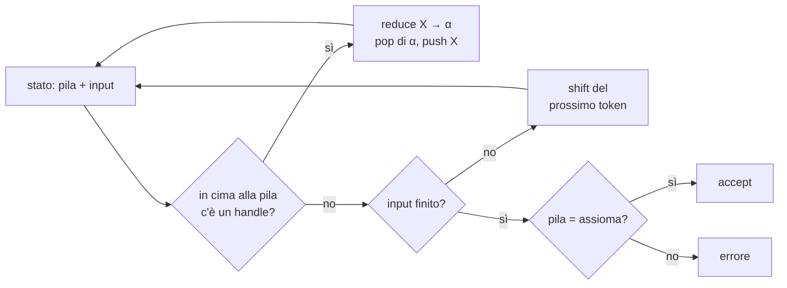
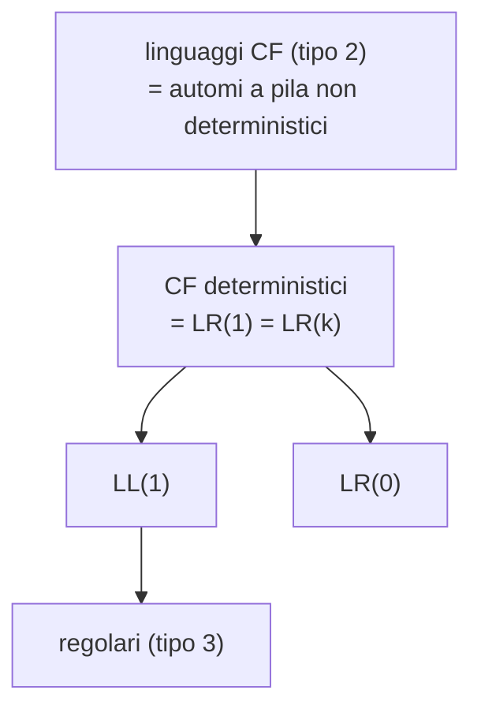

# Parsing bottom-up

> [!abstract]
> Nella [[11 - MC - Analisi sintattica top-down e automi a pila|lezione precedente]] l'albero di derivazione veniva costruito **dalla radice verso le foglie**, scegliendo ogni volta la produzione da espandere. Qui si fa il contrario: si parte dalla stringa (le foglie) e la si **riduce** all'assioma applicando le produzioni al contrario. Il metodo di riferimento è il **parsing shift-reduce** guidato da una pila; lo si rende deterministico con i **parser LR**, che usano le tavole *Action* e *Goto* costruite a partire dagli **item LR(0)**. Il risultato chiave: l'automa degli stati di un parser LR è un [[Automa a stati finiti|automa a stati finiti]], e le grammatiche LR(1) descrivono esattamente i linguaggi liberi da contesto deterministici.
> Mappa del corso: [[MOC - Modelli di Calcolo]].

## Approcci al parsing

Un **parser** (analizzatore sintattico) riceve una grammatica non contestuale $G$ fissata e una stringa $x$, e deve costruire un [[Albero di derivazione|albero di derivazione]] di $x$, oppure segnalare che $x \notin L(G)$. Le strategie sono due:

| | **top-down** | **bottom-up** |
|---|---|---|
| obiettivo | albero di derivazione **sinistro**, costruito dalla **radice** | albero di derivazione **destro**, costruito dalle **foglie** |
| metodi | discesa ricorsiva (con backtracking: esponenziale); analisi predittiva (lineare, grammatiche LL(*k*)) | analisi **shift-reduce** (lineare); analisi predittiva su grammatiche LR(*k*); esistono altri metodi |
| decisione | quale produzione **espandere** | quando e con quale produzione **ridurre** |

In entrambi i casi la grammatica è fissata in anticipo: il parser è costruito *per quella grammatica*, come accade nei generatori di parser (bison per LR, ANTLR e JavaCC per LL; vedi [[11 - MC - Analisi sintattica top-down e automi a pila#LL contro LR|LL contro LR]]).

> [!note] Derivazione destra percorsa al contrario
> Un parser bottom-up ricostruisce una **derivazione destra** (*rightmost*: a ogni passo si riscrive il non terminale più a destra), ma la percorre **all'indietro**: l'ultima riduzione fatta dal parser è la prima produzione applicata nella derivazione.

## Parsing shift-reduce

Vedi [[Parsing shift-reduce]].

Il parser shift-reduce usa una **pila**, inizialmente vuota, e legge l'input un token alla volta. In ogni momento l'input è diviso in due parti:

- la parte **già letta**, che sta in pila ed è stata parzialmente elaborata (*semi-digested*);
- la parte **ancora da leggere** (*undigested*), terminata dal simbolo convenzionale di fine input `$`.

Le operazioni possibili sono due:

- **shift**: sposta in pila il prossimo token dell'input;
- **reduce**: se in cima alla pila affiora una stringa $\alpha \in V^*$ e esiste una produzione $X \to \alpha$, si fanno i pop di tutti i simboli di $\alpha$ e il push di $X$. La stringa $\alpha$ si chiama **handle** (maniglia). Dopo una reduce può essere possibile farne subito un'altra.

Il parsing termina con **successo** quando l'input è stato letto tutto e la pila contiene solo l'assioma; se a un certo punto non è possibile né uno shift né una reduce, si produce un **errore**.



> [!warning] Il diagramma nasconde il vero problema
> "C'è un handle?" non è una domanda banale: in pila possono affiorare più stringhe che coincidono con parti destre di produzioni, e non tutte portano all'assioma. Tutta la teoria LR serve a rispondere a questa domanda in modo deterministico.

### Un semplice esempio

Il linguaggio non contestuale $L = \{a^n b^m c^{n+m} \mid n, m > 0\}$ è generato da

$$S \to aSc \mid aTc \qquad T \to bTc \mid bc$$

Le $a$ vengono "pareggiate" dalle $c$ esterne tramite $S$, le $b$ da quelle interne tramite $T$. Una derivazione (destra) di $abbbcccc$ è

$$\underline{S} \Rightarrow a\underline{T}c \Rightarrow ab\underline{T}cc \Rightarrow abb\underline{T}ccc \Rightarrow abbbcccc$$

e il parser shift-reduce la ripercorre al contrario:

| # | pila | da leggere | azione |
|---|---|---|---|
| 1 | | `abbbcccc$` | shift |
| 2 | `a` | `bbbcccc$` | shift |
| 3 | `ab` | `bbcccc$` | shift |
| 4 | `abb` | `bcccc$` | shift |
| 5 | `abbb` | `cccc$` | shift |
| 6 | `abb`<u>`bc`</u> | `ccc$` | reduce $T \to bc$ |
| 7 | `abbT` | `ccc$` | shift |
| 8 | `ab`<u>`bTc`</u> | `cc$` | reduce $T \to bTc$ |
| 9 | `abT` | `cc$` | shift |
| 10 | `a`<u>`bTc`</u> | `c$` | reduce $T \to bTc$ |
| 11 | `aT` | `c$` | shift |
| 12 | <u>`aTc`</u> | `$` | reduce $S \to aTc$ |
| 13 | `S` | `$` | end (successo) |

Le parti sottolineate sono gli handle. Si noti che le riduzioni (righe 6, 8, 10, 12) elencano esattamente le produzioni della derivazione destra, in ordine inverso.

### Una lieve complicazione

Si modifica il linguaggio ammettendo $m = 0$ e aggiungendo la parola $bc$:

$$L' = L \cup \{a^n c^n \mid n > 0\} \cup \{bc\} \qquad S \to aSc \mid aTc \mid ac \mid bc \qquad T \to bTc \mid bc$$

La traccia di $abbbcccc$ è identica alla precedente, ma ora alla riga 6 il parser ha in cima alla pila `bc` e **due** produzioni con quella parte destra: $T \to bc$ e $S \to bc$.

> [!question] Perché alla riga 6 non si riduce con $S \to bc$?
> Se lo facesse, la pila diventerebbe `abbS` e non esiste nessuna produzione la cui parte destra contenga `bS`: il parser resterebbe bloccato e dichiarerebbe un errore su una stringa che invece appartiene al linguaggio. La scelta giusta dipende dal **contesto sinistro** (cosa c'è sotto in pila: una $b$, non una $a$), non solo dall'handle.

### Conflitti

Vedi [[Conflitti shift-reduce e reduce-reduce]].

A ogni passo del parsing possono nascere due tipi di **conflitto**:

- **reduce-reduce**: si potrebbe ridurre con due produzioni diverse (il caso di `bc` appena visto);
- **shift-reduce**: si potrebbe indifferentemente fare shift o reduce. In realtà non è affatto indifferente: lo è solo in apparenza, perché le due scelte producono alberi diversi.

> [!example] Il *dangling else*
> Con la grammatica
> $$S \to \texttt{if } E \texttt{ then } S \mid \texttt{if } E \texttt{ then } S \texttt{ else } S$$
> si stia analizzando `if E then if E then S else S`. A un certo punto la pila contiene `if E then if E then S` e il prossimo token è `else`:
> - con una **reduce** la pila diventa `if E then S`: l'`else` verrà attaccato al **primo** `if`;
> - con uno **shift** (e gli shift successivi) la pila diventa `if E then if E then S else S`: l'`else` appartiene al **secondo** `if`.
>
> Le due scelte danno programmi con significato diverso. L'ambiguità si risolve con una **regola aggiuntiva che non compare nella grammatica**: di solito "l'`else` si associa all'ultimo `if` aperto", cioè si preferisce lo shift. È la stessa regola che, nel parser top-down, si codifica direttamente nel codice di `ifStmt()` (vedi [[11 - MC - Analisi sintattica top-down e automi a pila#Prefissi comuni e fattorizzazione|lezione 11]]).

I conflitti **reduce-reduce** sono rari e di solito indicano un difetto nella costruzione della grammatica.

## LR parsing

Per risolvere i conflitti bisogna stabilire come:

- **riconoscere un handle**;
- **decidere la produzione** da usare in una riduzione;
- usare strumenti come il **lookahead** (guardare in avanti uno o più token) per dirimere un conflitto shift/reduce.

Si studiano i **parser LR**: **L** = scansione dell'input *left-to-right*, **R** = costruzione di una derivazione *rightmost* (destra).

> [!important] Perché LR e non LL
> - Le grammatiche che ammettono parsing LR sono **più numerose** di quelle che ammettono parsing predittivo LL; in pratica includono quelle di tutti i linguaggi di programmazione.
> - Con LR c'è **meno bisogno di "aggiustare" le produzioni** (niente eliminazione della ricorsione sinistra, niente fattorizzazione).
> - Il prezzo è un lungo lavoro di preparazione delle tabelle, che però è **automatizzabile** perché non richiede creatività: è ciò che fanno yacc/bison.

### Un diverso uso della pila

Nel parsing shift-reduce "puro" la pila contiene le forme di frase via via elaborate. Ma, come si è visto, la produzione da applicare non dipende solo dall'handle, ma anche dagli **altri simboli in pila**, cioè dal **contesto**.

Per catturare il contesto, nel parser LR in pila si mettono non semplici token ma **stati**, che rappresentano il contesto sinistro corrente. Lo **stato che affiora** in cima alla pila, eventualmente aiutato da un lookahead, consente di prendere la decisione corretta: shift o reduce, e con quale produzione.

In prima approssimazione: **stato = produzione di cui abbiamo già verificato una parte**. Per esempio, in $X \to \alpha\beta$, $\alpha$ è la parte già vista e $\beta$ quella ancora da verificare. La definizione precisa arriva con la [[#Chiusura di un set di item|chiusura]].

### Tavole Action e Goto

Vedi [[Tavole Action e Goto]].

Un parser LR è un programma fisso pilotato da due tavole:

- **Action[s, a]**: che cosa fare quando lo stato in cima alla pila è $s$ e il prossimo token è il terminale $a$. Le azioni sono:
  - **shift** di uno stato (push);
  - **reduce** con una produzione, cioè pop di uno o più stati (attenzione: la reduce fa *solo* pop);
  - **accept**: termina con successo;
  - **error**: non è possibile procedere.
- **Goto[s, X]**: quale nuovo stato mettere in cima alla pila dopo la riduzione al non terminale $X$, quando, finiti i pop, affiora lo stato $s$. Serve a **completare** una riduzione.

### Operazioni di un LR parser

La pila è inizializzata con lo stato iniziale $s_0$; sia $a$ il token in input e $s_t$ lo stato in cima.

| Action[$s_t$, $a$] | cosa fa il parser |
|---|---|
| shift($s_u$) | push($s_u$) e legge il prossimo token |
| reduce($A \to B_1 \dots B_k$) | $k$ pop (uno per simbolo della parte destra); se ora affiora $s_v$, push(Goto[$s_v$, $A$]); il token in input **non cambia** |
| accept | fine con successo |
| error | errore sintattico: con questa pila e questo token non si può raggiungere una forma di frase con un handle da ridurre; si può stampare un messaggio diagnostico |

Per ogni reduce il parser **fornisce in output la produzione ridotta**: la sequenza delle produzioni emesse è la derivazione destra al contrario, quindi descrive l'albero.

```python
# schema del driver LR (uguale per ogni grammatica: cambiano solo le tavole)
stack = [s0]
a = next_token()
while True:
    s = stack[-1]
    act = Action[s][a]
    if act.kind == "shift":
        stack.append(act.state); a = next_token()
    elif act.kind == "reduce":            # A -> B1 ... Bk
        for _ in range(len(act.rhs)): stack.pop()
        stack.append(Goto[stack[-1]][act.lhs])
        emit(act.production)
    elif act.kind == "accept":
        return OK
    else:
        return error(s, a)
```

## Costruzione delle tavole Action e Goto

### Notazione punto e item LR(0)

Vedi [[Item LR(0)]].

Si introduce un **punto** $\cdot$ che divide la parte destra di una produzione in due: a sinistra gli elementi già letti e impilati (*shifted*), a destra quelli ancora da analizzare.

Per esempio $E \to E \cdot + T$ significa: in pila ci sono già elementi derivati da $E$ e ora occorre accettare in input il simbolo $+$.

Ogni produzione con il punto si chiama **item LR(0)** (o semplicemente **item**) e descrive lo stato del parser. Per ogni produzione $A \to \alpha$ si considerano tutti gli item ottenuti mettendo il punto in ogni posizione possibile di $\alpha$; da $E \to E+T$:

$$E \to \cdot E+T \qquad E \to E \cdot +T \qquad E \to E+\cdot T \qquad E \to E+T\cdot$$

Un item con il punto **in fondo** dice "ho visto tutta la parte destra": è il segnale di una possibile **reduce**.

### Grammatica aumentata

Si aggiunge una produzione $E' \to E$ (talvolta $E' \to E\$$), dove $E'$ è un nuovo assioma che non compare in nessuna parte destra. Lo scopo è avere l'assioma originale come parte destra di una produzione, così da poter effettuare una **reduce finale**: quando il parser arriva all'item $E' \to E\cdot$ con input finito, accetta.

### Chiusura di un set di item

Di solito lo stato di un parser non si descrive con un solo item: se il punto precede un non terminale $X$ ($\cdot X$), il prossimo simbolo in input può essere uno qualunque degli elementi di $\mathrm{FIRST}(X)$ (o di $\mathrm{FOLLOW}(X)$, se $X$ si annulla). Lo stato si caratterizza allora collezionando più item con una procedura detta **chiusura** (*closure*):

- se il set contiene un item $A \to \alpha \cdot B\beta$ con $B \in V_N$, si aggiunge $B \to \cdot\gamma$ per ogni produzione $B \to \gamma$;
- si continua finché è possibile, aggiungendo produzioni che hanno come parte sinistra i non terminali preceduti dal punto. Le produzioni aggiunte hanno il punto all'inizio.

> [!important] Definizione di stato
> Si definisce **stato** l'insieme che risulta dall'operazione di chiusura di un set di item. Ogni collezione chiusa corrisponde a uno stato del parser. (È la versione precisa della definizione informale "produzione di cui ho verificato una parte".)

### Ripresa dell'esempio: set di item e goto-graph

Si riprende la grammatica di $L'$, aumentata:

$$S' \to S \qquad S \to aSc \mid aTc \mid ac \mid bc \qquad T \to bTc \mid bc$$

> [!warning] Correzione
> Le slide (slide 13) descrivono il linguaggio generato da questa grammatica come $L' = \{a^n b^m c^{n+m} \mid n, m \ge 0 \wedge n+m > 0\}$. Non è esatto: con $n = 0$ l'unica stringa generabile è $bc$ (da $S \to bc$), perché $S$ può produrre $b$ solo tramite $aTc$, cioè dopo almeno una $a$. Per esempio $bbcc$ ha $n = 0$, $m = 2$ ma **non** è generata. Il linguaggio corretto è quello della slide 5: $L' = L \cup \{a^n c^n \mid n > 0\} \cup \{bc\}$.

**Costruzione degli stati.** Si parte da $S' \to \cdot S$ e se ne fa la chiusura: si ottiene lo stato $s_0$. Poi, ricorsivamente, per ogni item $A \to \alpha\cdot B\beta$ di uno stato si crea (se non esiste già) un nuovo stato che contiene $A \to \alpha B\cdot\beta$, e se ne fa la chiusura. **Il simbolo "scavalcato" dal punto determina la transizione** fra i due stati. Il simbolo $(+)$ indica le righe aggiunte dalla chiusura.

| stato | item (chiusura inclusa) | transizioni |
|---|---|---|
| $s_0$ | $S' \to \cdot S$; (+) $S \to \cdot aSc \mid \cdot aTc \mid \cdot ac \mid \cdot bc$ | $S \to s_1$, $a \to s_2$, $b \to s_3$ |
| $s_1$ | $S' \to S\cdot$ | (accept) |
| $s_2$ | $S \to a\cdot Sc \mid a\cdot Tc \mid a\cdot c$; (+) $S \to \cdot aSc \mid \cdot aTc \mid \cdot ac \mid \cdot bc$; (+) $T \to \cdot bTc \mid \cdot bc$ | $S \to s_4$, $T \to s_5$, $c \to s_6$, $a \to s_2$, $b \to s_7$ |
| $s_3$ | $S \to b\cdot c$ | $c \to s_8$ |
| $s_4$ | $S \to aS\cdot c$ | $c \to s_9$ |
| $s_5$ | $S \to aT\cdot c$ | $c \to s_{10}$ |
| $s_6$ | $S \to ac\cdot$ | |
| $s_7$ | $S \to b\cdot c$; $T \to b\cdot Tc \mid b\cdot c$; (+) $T \to \cdot bTc \mid \cdot bc$ | $c \to s_{11}$, $T \to s_{12}$, $b \to s_{13}$ |
| $s_8$ | $S \to bc\cdot$ | |
| $s_9$ | $S \to aSc\cdot$ | |
| $s_{10}$ | $S \to aTc\cdot$ | |
| $s_{11}$ | $S \to bc\cdot$; $T \to bc\cdot$ | |
| $s_{12}$ | $T \to bT\cdot c$ | $c \to s_{14}$ |
| $s_{13}$ | $T \to b\cdot Tc \mid b\cdot c$; (+) $T \to \cdot bTc \mid \cdot bc$ | $T \to s_{12}$, $c \to s_{15}$, $b \to s_{13}$ |
| $s_{14}$ | $T \to bTc\cdot$ | |
| $s_{15}$ | $T \to bc\cdot$ | |

Disegnando stati e transizioni si ottiene il **goto-graph** (*transition diagram*):

![[MC-L12-p35.png]]

Il grafo mostra i 16 stati, con le transizioni etichettate dal simbolo scavalcato. Due osservazioni:

- **è un ASF**: stati in numero finito, transizioni etichettate da simboli, uno stato iniziale. Il goto-graph è proprio un [[Automa a stati finiti|automa a stati finiti]] che riconosce i *prefissi praticabili* (le possibili configurazioni della pila). È il motivo profondo per cui l'LR parsing è lineare: il "contesto sinistro" è un'informazione finita.
- lo stato $s_{11}$ (cerchiato) contiene **due item completi**, $S \to bc\cdot$ e $T \to bc\cdot$: è il conflitto reduce-reduce già intuito nella [[#Una lieve complicazione|lieve complicazione]], ora confermato.

### LR parsing in azione

Dal goto-graph si leggono le tavole: le transizioni su terminali diventano *shift*, quelle su non terminali diventano *goto*, gli stati con un item completo diventano *reduce* (su ogni colonna dei terminali, perché un parser LR(0) non guarda l'input per decidere).

| stato | a | b | c | \$ | **S** | **T** |
|---|---|---|---|---|---|---|
| 0 | shift 2 | shift 3 | | | goto 1 | |
| 1 | | | | accept | | |
| 2 | shift 2 | shift 7 | shift 6 | | goto 4 | goto 5 |
| 3 | | | shift 8 | | | |
| 4 | | | shift 9 | | | |
| 5 | | | shift 10 | | | |
| 6 | reduce $S \to ac$ | | | | | |
| 7 | | shift 13 | shift 11 | | | goto 12 |
| 8 | reduce $S \to bc$ | | | | | |
| 9 | reduce $S \to aSc$ | | | | | |
| 10 | reduce $S \to aTc$ | | | | | |
| 11 | **reduce $S \to bc$ / reduce $T \to bc$** | | | | | |
| 12 | | | shift 14 | | | |
| 13 | | shift 13 | shift 15 | | | goto 12 |
| 14 | reduce $T \to bTc$ | | | | | |
| 15 | reduce $T \to bc$ | | | | | |

(Nelle righe "reduce" l'azione vale per tutte le colonne dei terminali.)

**Parse di $abbbcccc$** (s = shift, r = reduce, g = goto):

s(2), s(7), s(13), s(13), s(15), r($T\to bc$), g(12), s(14), r($T\to bTc$), g(12), s(14), r($T\to bTc$), g(5), s(10), r($S\to aTc$), g(1); in input resta `$`: **accept**.

> [!example] Verifica passo per passo della pila
> | pila (stati) | input | azione |
> |---|---|---|
> | 0 | `abbbcccc$` | s2 |
> | 0 2 | `bbbcccc$` | s7 |
> | 0 2 7 | `bbcccc$` | s13 |
> | 0 2 7 13 | `bcccc$` | s13 |
> | 0 2 7 13 13 | `cccc$` | s15 |
> | 0 2 7 13 13 15 | `ccc$` | r $T\to bc$: 2 pop, affiora 13, Goto[13,T] = 12 |
> | 0 2 7 13 12 | `ccc$` | s14 |
> | 0 2 7 13 12 14 | `cc$` | r $T\to bTc$: 3 pop, affiora 7, Goto[7,T] = 12 |
> | 0 2 7 12 | `cc$` | s14 |
> | 0 2 7 12 14 | `c$` | r $T\to bTc$: 3 pop, affiora 2, Goto[2,T] = 5 |
> | 0 2 5 | `c$` | s10 |
> | 0 2 5 10 | `$` | r $S\to aTc$: 3 pop, affiora 0, Goto[0,S] = 1 |
> | 0 1 | `$` | accept |

Le riduzioni emesse, lette dal basso, costruiscono l'albero dalle foglie verso la radice:

![[MC-L12-p41.png]]

È l'albero finale di $abbbcccc$: tre nodi $T$ annidati (uno per ogni coppia $b \dots c$) e la radice $S$ che pareggia la $a$ con l'ultima $c$. Come osserva la slide, **nonostante l'ambiguità dello stato 11** (due riduzioni possibili) su questa stringa non è mai capitato di doverla affrontare: dopo $a$ e $b$ il parser è andato in $s_7$, ma poi la $b$ successiva l'ha portato in $s_{13}$, non in $s_{11}$.

### Parsing ambiguo di abcc

Diversamente vanno le cose per $abcc$: s(2), s(7), s(11), e ora in $s_{11}$ ci sono due riduzioni possibili.

- con r($S \to bc$): goto(4), s(9), r($S \to aSc$), goto(1), **accept**;
- con r($T \to bc$): goto(5), s(10), r($S \to aTc$), goto(1), **accept**.

![[MC-L12-p54.png]]

Entrambe le strade portano all'accettazione: **esistono due parse tree differenti** per la stessa stringa ($S \to aSc$ con $S \to bc$ dentro, oppure $S \to aTc$ con $T \to bc$ dentro). Il conflitto dello stato 11 non è un difetto del parser: è il sintomo che la [[Grammatica ambigua|grammatica è ambigua]].

### Si risolve? Sì, cambiando grammatica

Si usa la grammatica

$$G'':\quad S' \to S \qquad S \to aSc \mid ac \mid T \qquad T \to bc \mid bTc$$

| stato | a | b | c | \$ | **S** | **T** |
|---|---|---|---|---|---|---|
| 0 | shift 1 | shift 2 | | | goto 4 | goto 3 |
| 1 | shift 1 | shift 2 | shift 5 | | goto 6 | goto 3 |
| 2 | | shift 2 | shift 7 | | | goto 8 |
| 3 | reduce $S \to T$ | | | | | |
| 4 | | | | accept | | |
| 5 | reduce $S \to ac$ | | | | | |
| 6 | | | shift 9 | | | |
| 7 | reduce $T \to bc$ | | | | | |
| 8 | | | shift 10 | | | |
| 9 | reduce $S \to aSc$ | | | | | |
| 10 | reduce $T \to bTc$ | | | | | |

Parse di $abcc$: s(1), s(2), s(7), r($T\to bc$), g(3), r($S\to T$), g(6), s(9), r($S\to aSc$), g(4); in input resta `$`: **accept**. Ora la stringa ha un solo albero: $S \to aSc$, $S \to T$, $T \to bc$.

![[MC-L12-p60.png]]

Il goto-graph di $G''$ ha 11 stati e **nessuno stato con due item completi o con un item completo accanto a uno incompleto**: la grammatica è LR(0) (vedi sotto). In basso a destra la slide costruisce l'albero di $abcc$ dal basso: prima $T$ su $bc$, poi $S \to T$, infine $S \to aSc$.

> [!warning] Correzione
> $G''$ elimina l'ambiguità, ma **non genera lo stesso linguaggio** della grammatica di partenza: con $S \to T$ ora si ottiene anche $b^m c^m$ per ogni $m \ge 1$ (per esempio $bbcc$), che prima non c'era. $G''$ genera esattamente $\{a^n b^m c^{n+m} \mid n, m \ge 0,\ n+m > 0\}$, cioè il linguaggio che la slide 13 attribuiva (erroneamente) alla grammatica precedente. Se si vuole lo stesso linguaggio $L'$ senza ambiguità basta togliere $S \to bc$ dal ruolo di "base" interna, per esempio $S \to aSc \mid aTc \mid ac \mid bc$ diventa $S \to A \mid bc$, $A \to aAc \mid aTc \mid ac$.

## Grammatica LR(0)

Vedi [[Grammatica LR(0)]].

> [!important] Definizione
> Una grammatica è **LR(0)** se in ciascuno degli stati del goto-graph:
> - è presente **al più una** produzione con il punto finale (assenza di conflitti reduce-reduce);
> - non sono presenti **contemporaneamente** una produzione con il punto finale e un'altra con il punto non finale (assenza di conflitti shift-reduce).

In una grammatica LR(0) la decisione shift/reduce viene presa **senza guardare l'input** (lookahead nullo): basta lo stato in cima alla pila.

### LR(0) contro LR(k)

- Il parsing LR(0) si applica a **poche grammatiche**; in particolare non funziona per la grammatica di $L'$ della slide 5, che è ambigua.
- Guardando $k \ge 1$ caratteri in input si può fare LR parsing su **molte più grammatiche**.
- Ma una grammatica **ambigua non ammette nessun tipo di parser** deterministico, proprio a causa dell'ambiguità: nessun lookahead può scegliere fra due alberi entrambi corretti.

> [!note] Alcuni enunciati (senza prova)
> - Un linguaggio può essere generato da una grammatica LR(*k*) **se e solo se** è **context free deterministico**, cioè riconosciuto da un [[Automa a pila|automa a pila]] deterministico.
> - Un linguaggio ammette una grammatica LR(1) se e solo se ammette una grammatica LR(*k*), $k \ge 1$.
>
> **Conseguenza**: tutti i linguaggi context free deterministici ammettono una grammatica generatrice LR(1). Aumentare il lookahead oltre 1 rende più comode le grammatiche, ma non allarga la classe dei linguaggi.



(Il diagramma va letto come "contiene": ogni classe include quelle sotto. $\mathrm{LL}(1)$ e $\mathrm{LR}(0)$ sono incomparabili tra loro.)

## Esempio: espressioni regolari

Si considera la grammatica aumentata che genera le [[Espressione regolare|espressioni regolari]] su $\{0, 1\}$:

$$S \to E\$ \qquad E \to E+T \mid T \qquad T \to TF \mid F \qquad F \to 0 \mid 1 \mid (E) \mid F^* \mid \emptyset \mid \varepsilon$$

- $T \to TF$ sottintende il simbolo di concatenazione fra $T$ ed $F$;
- in $F \to \varepsilon$ il simbolo $\varepsilon$ è un **terminale** (il simbolo che, nelle espressioni regolari, denota la stringa vuota): **non** è una $\varepsilon$-produzione.

La struttura è quella classica delle espressioni aritmetiche: $+$ (unione) ha la precedenza più bassa, poi la concatenazione, poi la stella. La derivazione (destra) di $(10+01^*)^*$ è

$$\underline{S} \Rightarrow \underline{E} \Rightarrow \underline{T} \Rightarrow \underline{F} \Rightarrow \underline{F}^* \Rightarrow (\underline{E})^* \Rightarrow (E+\underline{T})^* \Rightarrow (E+T\underline{F})^* \Rightarrow \dots \Rightarrow (10+01^*)^*$$

(la slide mostra la derivazione completa, sottolineando a ogni passo il non terminale riscritto).

### Set di item e goto-graph per le E.R.

Si parte da $S \to \cdot E\$$ e se ne fa la chiusura:

$$s_0:\ S \to \cdot E\$;\ (+)\ E \to \cdot E+T \mid \cdot T;\ (+)\ T \to \cdot TF \mid \cdot F;\ (+)\ F \to \cdot 0 \mid \cdot 1 \mid \cdot(E) \mid \cdot F^* \mid \cdot\varepsilon \mid \cdot\emptyset$$

Da $s_0$ si ottengono: $s_1$ (su $E$: $S \to E\cdot\$$, $E \to E\cdot+T$), $s_2$ (su $T$: $E \to T\cdot$, $T \to T\cdot F$ e la chiusura su $F$), $s_3$ (su $F$: $T \to F\cdot$, $F \to F\cdot{}^*$), $s_4 \dots s_8$ (su $0, 1, (, \varepsilon, \emptyset$), e così via fino a $s_{20}$. Il goto-graph complessivo è questo:

![[MC-L12-p74.png]]

Il grafo è volutamente "denso": mostra quante transizioni nascono anche da una grammatica piccola, e perché la costruzione delle tavole conviene lasciarla a un programma. Le tavole Action (stati 0–20, colonne $0, 1, +, *, (, ), \varepsilon, \emptyset, \$$) e Goto (colonne $E, T, F$) delle slide 40–42 si ricavano dal grafo con la stessa regola dell'esempio precedente.

> [!warning] Correzione
> Questa grammatica **non è LR(0)**, e le tavole delle slide non lo segnalano:
> - $s_2$ contiene $E \to T\cdot$ (completo) insieme a $T \to T\cdot F$ e agli item $F \to \cdot 0$, …: conflitto **shift-reduce**. Nella riga 2 della tavola Action compaiono solo gli shift, manca la reduce $E \to T$;
> - lo stesso accade in $s_3$ ($T \to F\cdot$ con $F \to F\cdot{}^*$) e in $s_{16}$ ($E \to E+T\cdot$ con $T \to T\cdot F$).
>
> I conflitti si risolvono guardando un simbolo di lookahead: per esempio in $s_2$ si riduce con $E \to T$ solo se il prossimo token è in $\mathrm{FOLLOW}(E) = \{+, ), \$\}$, altrimenti si fa shift. È il metodo **SLR(1)**, il passo successivo dopo LR(0).
>
> Inoltre alcuni stati delle slide sono duplicati: $s_6$ e $s_{12}$ contengono lo stesso insieme di item ($F \to (\cdot E)$ e la sua chiusura), così come $s_{14}$ e $s_{17}$ ($F \to F^*\cdot$); e lo stato $s_{11}$ è descritto in due modi diversi nelle slide 33 e 36. Nel costruire le tavole conviene fondere gli stati uguali: l'automa deve essere deterministico.

## Esercizi

1. Linguaggio delle parentesi bilanciate con un tipo di parentesi.
2. Idem, con due tipi di parentesi.

> [!tip] Traccia per l'esercizio 1
> Una grammatica comoda per LR è $S' \to S$, $S \to S(S) \mid \varepsilon$ (ricorsione sinistra: nessun problema per un parser bottom-up). Si costruiscano gli stati partendo da $S' \to \cdot S$; si noti che la chiusura aggiunge $S \to \cdot$ (item completo) accanto a $S \to \cdot S(S)$: verificare se nasce un conflitto e se un lookahead lo risolve. Agli esami la domanda tipica è "stabilire se la grammatica $S \to aS \mid ab \mid aSb$ è LR(0)" (giugno 2022): si costruisce il goto-graph e si cercano stati con conflitti.

## Riepilogo

> [!summary]
> - Il parsing **bottom-up** costruisce l'albero dalle foglie, ripercorrendo **al contrario una derivazione destra** con operazioni di **shift** e **reduce** su una pila.
> - Le difficoltà sono i **conflitti** shift-reduce (es. *dangling else*) e reduce-reduce (spesso sintomo di grammatica ambigua).
> - Un **parser LR** mette in pila **stati** (insiemi chiusi di **item LR(0)**) e decide con le tavole **Action** e **Goto**; il goto-graph è un ASF.
> - Una grammatica è **LR(0)** se nessuno stato ha due item completi, o un item completo insieme a uno incompleto.
> - **LR(1) = LR(k) = CF deterministici**; una grammatica ambigua non ammette parser LR.
