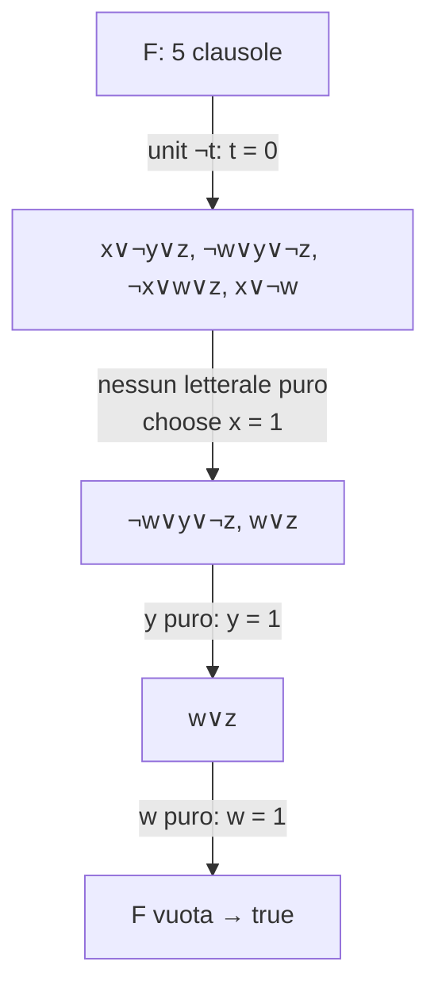

# Forme normali e algoritmo DPLL

> [!abstract]
> Questa lezione prepara il terreno per la [[14 - MC - Classi P e NP e NP-completezza|teoria dell'NP-completezza]], in cui il protagonista è il [[Problema SAT|problema SAT]]: decidere se una formula proposizionale è soddisfacibile. SAT si formula quasi sempre su formule in **forma normale congiuntiva** (CNF), quindi servono due cose: sapere **come portare una formula qualunque in CNF** senza farla esplodere di dimensione (*Convert1* contro *Convert2*), e avere un **algoritmo concreto** per risolverla. L'algoritmo è **DPLL**: backtracking esponenziale nel caso peggiore, ma con due regole (*unit propagation* e *pure literal elimination*) che nella pratica tagliano enormemente lo spazio di ricerca.
> Mappa del corso: [[MOC - Modelli di Calcolo]].

## Clausole e forma normale congiuntiva

Vedi [[Forma normale congiuntiva]].

- **Letterali**: simboli proposizionali (*atomi*) o simboli proposizionali negati. Per esempio $A$ e $\neg B$.
- Una **clausola** è una disgiunzione di letterali $L_1 \vee L_2 \vee \dots \vee L_n$.
- Una formula è in **forma normale negativa** (NNF) se la negazione compare solo davanti agli atomi.
- Una formula è in **forma normale congiuntiva** (CNF, o *forma clausale*) se è in forma normale negativa e ha la forma $C_1 \wedge C_2 \wedge \dots \wedge C_n$, dove le $C_i$ sono clausole. Equivalentemente la si scrive come insieme $\{C_1, C_2, \dots, C_n\}$.

Poiché la disgiunzione è commutativa, ogni clausola si può riordinare come

$$A_1 \vee A_2 \vee \dots \vee A_n \vee \neg B_1 \vee \neg B_2 \vee \dots \vee \neg B_m$$

dove gli $A_i$ sono gli $n$ atomi che compaiono positivi e i $B_j$ gli $m$ atomi che compaiono negati.

### Notazione insiemistica delle clausole

- Se $n = m = 0$ si ha la **clausola vuota**, che si scrive $\{\}$ (o $\square$). È una disgiunzione di zero letterali, quindi è **sempre falsa**: una formula che la contiene è insoddisfacibile.
- Una clausola si indica anche come l'insieme dei suoi letterali $\{L_1, L_2, \dots, L_p\}$, omettendo $\vee$.
- Se $L$ è un letterale e $C = \{L_1, \dots, L_p\}$ una clausola, si scrive $L \cup C$ per la clausola $C' = \{L\} \cup C = \{L, L_1, \dots, L_p\}$.
- Se $n = 1$, cioè la clausola ha **un solo letterale positivo** ($A_1 \vee \neg B_1 \vee \dots \vee \neg B_m$), si parla di **clausola definita**. Equivale all'implicazione $B_1 \wedge \dots \wedge B_m \to A_1$: è la forma delle regole del Prolog.

> [!note] CNF e DNF
> Simmetricamente, una formula è in **forma normale disgiuntiva** (DNF) se è una disgiunzione di *congiunzioni* di letterali: $(L_1 \wedge L_2) \vee (L_3 \wedge \neg L_4) \vee \dots$. La CNF dice "tutti questi vincoli devono valere"; la DNF elenca "uno di questi casi deve valere".

## Trasformazione in clausole: Convert1

> [!important] Teorema
> Ogni formula è equivalente a una formula in **forma normale disgiuntiva** (DNF) ed è equivalente a una formula in **forma normale congiuntiva** (CNF).

Una formula qualunque si porta in CNF applicando ripetutamente tre passi:

1. **Eliminare i connettivi $\to$ e $\leftrightarrow$**:
   $$(\alpha \leftrightarrow \beta) \equiv (\alpha \to \beta) \wedge (\beta \to \alpha) \qquad (\alpha \to \beta) \equiv (\neg\alpha \vee \beta)$$
2. **Portare in forma normale negativa** (NNF), spingendo le negazioni verso gli atomi con De Morgan e la doppia negazione:
   $$\neg(\alpha \wedge \beta) \equiv \neg\alpha \vee \neg\beta \qquad \neg(\alpha \vee \beta) \equiv \neg\alpha \wedge \neg\beta \qquad \neg\neg\alpha \equiv \alpha$$
3. **Distribuire la disgiunzione sulla congiunzione**:
   $$\alpha \vee (\beta \wedge \gamma) \equiv (\alpha \vee \beta) \wedge (\alpha \vee \gamma)$$

A questo punto basta raggruppare i letterali in disgiunzione in clausole.

> [!example] Mini esempio
> $\neg(A \to B) \vee C$
> 1. $\neg(\neg A \vee B) \vee C$
> 2. $(A \wedge \neg B) \vee C$
> 3. $(A \vee C) \wedge (\neg B \vee C)$, cioè le clausole $\{A, C\}, \{\neg B, C\}$.

### Problemi di Convert1

Il problema di Convert1 è che la formula CNF ottenuta può essere **molto più grande** di quella di partenza, a causa del passo 3 (la distributività duplica le sottoformule). Esempio:

$$((A_1 \wedge A_2) \vee (B_1 \wedge B_2)) \vee (C_1 \wedge C_2)$$

Distribuendo passo per passo:

$$\begin{aligned}
&(((A_1 \wedge A_2) \vee B_1) \wedge ((A_1 \wedge A_2) \vee B_2)) \vee (C_1 \wedge C_2)\\
&((A_1 \vee B_1) \wedge (A_2 \vee B_1) \wedge (A_1 \vee B_2) \wedge (A_2 \vee B_2)) \vee (C_1 \wedge C_2)\\
&\dots\\
&(A_1 \vee B_1 \vee C_1) \wedge (A_2 \vee B_1 \vee C_1) \wedge (A_1 \vee B_2 \vee C_1) \wedge (A_2 \vee B_2 \vee C_1) \wedge\\
&(A_1 \vee B_1 \vee C_2) \wedge (A_2 \vee B_1 \vee C_2) \wedge (A_1 \vee B_2 \vee C_2) \wedge (A_2 \vee B_2 \vee C_2)
\end{aligned}$$

Da 6 letterali si passa a $2^3 = 8$ clausole da 3 letterali: ogni clausola sceglie un letterale da ciascuna delle tre congiunzioni.

> [!warning] Esplosione esponenziale
> In generale $(X_1 \wedge Y_1) \vee (X_2 \wedge Y_2) \vee \dots \vee (X_n \wedge Y_n)$, che ha dimensione $2n$, diventa in CNF una formula con $2^n$ clausole. Se si vuole usare la CNF come passo di una [[Riduzione polinomiale|riduzione polinomiale]] (come in [[14 - MC - Classi P e NP e NP-completezza#Linguaggi NP-completi|NP-completezza]]), Convert1 non va bene.

## Trasformazione in clausole: Convert2

Vedi [[Trasformazione Convert2]].

Per evitare l'esplosione si usa una trasformazione diversa: i passi 1 e 2 sono uguali, e producono una formula $F$ in NNF; il passo 3 produce una formula CNF $F_1$ **introducendo nuove lettere** per le sottoformule:

- se $A$ è una lettera proposizionale, $\mathit{Convert2}(A) = A$ e $\mathit{Convert2}(\neg A) = \neg A$;
- per ogni sottoformula $\gamma = \alpha \wedge \beta$ di $F$, si creano tre lettere $A_\gamma, A_\alpha, A_\beta$, si aggiungono a $F_1$ le clausole $\neg A_\gamma \vee A_\alpha$ e $\neg A_\gamma \vee A_\beta$, e si continua con la conversione di $\alpha$ e $\beta$;
- per ogni sottoformula $\gamma = \alpha \vee \beta$ di $F$, si creano tre lettere $A_\gamma, A_\alpha, A_\beta$, si aggiunge a $F_1$ la clausola $\neg A_\gamma \vee A_\alpha \vee A_\beta$ e si continua con $\alpha$ e $\beta$;
- infine si aggiunge la clausola unitaria $A_F$.

> [!tip] Come leggerla
> La lettera $A_\gamma$ significa "la sottoformula $\gamma$ è vera". Le clausole aggiunte sono implicazioni:
> - $\neg A_\gamma \vee A_\alpha$ è $A_\gamma \to A_\alpha$: "se $\alpha \wedge \beta$ è vera, allora $\alpha$ è vera" (e lo stesso per $\beta$);
> - $\neg A_\gamma \vee A_\alpha \vee A_\beta$ è $A_\gamma \to (A_\alpha \vee A_\beta)$.
>
> La clausola finale $A_F$ impone che la formula intera sia vera. Ogni sottoformula produce al più 2 clausole di al più 3 letterali: la CNF risultante ha dimensione **lineare** in quella di $F$.

### Esempio di Convert2

Si usa la formula precedente $((A_1 \wedge A_2) \vee (B_1 \wedge B_2)) \vee (C_1 \wedge C_2)$. Si dà un nome a tutte le sottoformule: $D_1 = A_1 \wedge A_2$, $D_2 = B_1 \wedge B_2$, $D_3 = C_1 \wedge C_2$, $D_4 = D_1 \vee D_2$ e $F = D_4 \vee D_3$, e si parte da $F_1 = \{\}$.

| formula (dopo la sostituzione) | clausole aggiunte a $F_1$ |
|---|---|
| $((A_1 \wedge A_2) \vee (B_1 \wedge B_2)) \vee (C_1 \wedge C_2)$ | — |
| $((D_1 \vee (B_1 \wedge B_2)) \vee (C_1 \wedge C_2))$ | $(\neg D_1 \vee A_1), (\neg D_1 \vee A_2)$ |
| $((D_1 \vee D_2) \vee (C_1 \wedge C_2))$ | $(\neg D_2 \vee B_1), (\neg D_2 \vee B_2)$ |
| $((D_1 \vee D_2) \vee D_3)$ | $(\neg D_3 \vee C_1), (\neg D_3 \vee C_2)$ |
| $(D_4 \vee D_3)$ | $(\neg D_4 \vee D_1 \vee D_2)$ |
| $F$ | $(\neg A_F \vee D_4 \vee D_3)$ |
| | $A_F$ |

Alla fine si hanno 9 clausole (contro le 8 di Convert1 per questa formula piccola; ma la crescita ora è lineare, non esponenziale).

> [!warning] Correzione
> Il riepilogo finale della slide elenca
> $F_1 = \{\dots, (\neg D_4 \vee D_1), (\neg D_4 \vee D_2), (\neg D_1 \vee D_3 \vee D_4), \dots\}$,
> che non corrisponde ai passi appena svolti (e tratterebbe $D_4$ come un AND). Le clausole giuste, coerenti con la tabella della stessa slide, sono
> $$F_1 = \{(\neg D_1 \vee A_1), (\neg D_1 \vee A_2), (\neg D_2 \vee B_1), (\neg D_2 \vee B_2), (\neg D_3 \vee C_1), (\neg D_3 \vee C_2), (\neg D_4 \vee D_1 \vee D_2), (\neg A_F \vee D_4 \vee D_3), A_F\}$$

## Proprietà delle due trasformazioni

- Data una formula $\alpha$, si dimostra facilmente che $\alpha \equiv \mathit{Convert1}(\alpha)$: le due formule sono **equivalenti** (stesso valore di verità per ogni assegnazione).
- Invece $\alpha \not\equiv \mathit{Convert2}(\alpha)$: le due formule non hanno nemmeno lo stesso alfabeto. Si dimostra però che $\alpha$ è **soddisfacibile se e solo se** $\mathit{Convert2}(\alpha)$ è soddisfacibile. Si dice che Convert2 **preserva la soddisfacibilità** (le due formule sono *equisoddisfacibili*).

| | Convert1 | Convert2 |
|---|---|---|
| risultato | formula **equivalente** | formula **equisoddisfacibile** |
| alfabeto | lo stesso | nuove lettere $A_\gamma$ |
| dimensione | può essere esponenziale | lineare |
| uso tipico | semplificazioni logiche | riduzioni a SAT, input dei SAT solver |

> [!note] Perché basta l'equisoddisfacibilità
> Per SAT interessa solo la risposta sì/no "esiste un'assegnazione che rende vera la formula?". Una trasformazione che preserva questa risposta, ed è calcolabile in tempo polinomiale, è esattamente una **riduzione polinomiale** da SAT su formule generiche a SAT su CNF. Convert2 è (una variante del)la trasformazione di Tseitin, usata in tutti i SAT solver.

## Algoritmo DPLL

Vedi [[Algoritmo DPLL]].

### Idea

DPLL (Davis–Putnam–Logemann–Loveland) si applica a un **insieme di clausole** ed è basato sulla tecnica del **backtracking**: prova ricorsivamente tutte le assegnazioni possibili per vedere se una soddisfa la formula. Usa due controlli per ridurre (significativamente) il numero di assegnazioni da provare:

- **Unit propagation**. Se una clausola è **unitaria** (contiene un solo letterale), può essere soddisfatta solo assegnando a quel letterale il valore corretto: 1 se è positivo, 0 se è negativo. Non c'è scelta da fare.
- **Pure literal elimination**. Se una variabile compare **sempre positiva o sempre negativa**, il suo letterale si dice **puro**. I letterali puri possono essere resi tutti veri senza bisogno di fare scelte: renderli veri soddisfa delle clausole e non ne può falsificare nessuna.

### Funzioni di appoggio

- **unit-propagate(letterale $l$, formula $F$)**: per ogni clausola $c \in F$, se $l$ compare in $c$ con lo stesso segno cancella la clausola $c$ (è soddisfatta); se compare con il segno opposto cancella $l$ da $c$ (quel letterale è falso). Restituisce la formula semplificata.
- **pure-literal-assign(letterale $l$, formula $F$)**: cancella tutte le clausole che contengono $l$. Restituisce la formula semplificata.
- **choose-literal(formula $F$)**: seleziona (casualmente) un letterale che compare in $F$ e lo restituisce.

### Codice

```text
function DPLL(F)
   if F is empty
       then return true;
   if F contains an empty clause
       then return false;
   for every unit clause l in F
      F = unit-propagate(l, F);
   for every literal l that occurs pure in F
      F = pure-literal-assign(l, F);
   l := choose-literal(F);
   x := DPLL(F Union {l});
   y := DPLL(F Union {NOT l});
   return x OR y;
```

- **$F$ vuota** (nessuna clausola rimasta): tutte le clausole sono state soddisfatte, quindi la formula è soddisfacibile.
- **$F$ contiene la clausola vuota**: una clausola ha perso tutti i letterali, cioè è falsa con le scelte fatte: si torna indietro.
- La scelta di $l$ si realizza **aggiungendo la clausola unitaria** $\{l\}$ (o $\{\neg l\}$): alla chiamata successiva la unit propagation la applica.

> [!note] Nota della slide: l'algoritmo non è ottimizzato
> Se $x := \mathrm{DPLL}(F \cup \{l\})$ è vero, non serve eseguire $y := \mathrm{DPLL}(F \cup \{\neg l\})$: la funzione restituisce comunque vero. Basta scrivere `if DPLL(F ∪ {l}) return true; else return DPLL(F ∪ {¬l})`.

> [!important] Costo
> Nel caso peggiore DPLL esplora l'albero completo delle assegnazioni: $O(2^n)$ chiamate per $n$ variabili, ognuna con costo polinomiale nella dimensione della formula. È **esponenziale**, come ci si aspetta per un problema [[NP-completezza|NP-completo]]; le due regole riducono il numero di rami in pratica, non nel caso peggiore.

### Esempio (dalla prova di luglio 2021)

$$F = (x \vee \neg y \vee z) \wedge (\neg w \vee y \vee \neg z) \wedge (\neg x \vee w \vee z) \wedge (x \vee t \vee \neg w) \wedge \neg t$$



1. $\neg t$ è unitaria: $t = 0$. Si cancella la clausola $\neg t$ e si toglie $t$ da $(x \vee t \vee \neg w)$, che diventa $(x \vee \neg w)$.
2. Nessuna clausola unitaria; nessun letterale puro ($x, y, z, w$ compaiono tutti con entrambi i segni).
3. Si sceglie $x = 1$: spariscono $(x \vee \neg y \vee z)$ e $(x \vee \neg w)$, e $(\neg x \vee w \vee z)$ diventa $(w \vee z)$.
4. Ora $y$ compare solo positivo: è puro, $y = 1$ cancella $(\neg w \vee y \vee \neg z)$.
5. Resta $(w \vee z)$: $w$ è puro, $w = 1$. $F$ è vuota: **soddisfacibile**, per esempio con $t = 0, x = 1, y = 1, w = 1$ e $z$ qualsiasi.

Verifica: $(1 \vee \dots)$, $(\dots \vee 1 \vee \dots)$, $(\dots \vee 1 \vee \dots)$, $(1 \vee \dots)$, $\neg 0 = 1$. Tutte vere.

## DNF e soddisfacibilità

Tra gli esercizi della [[14 - MC - Classi P e NP e NP-completezza#Esercizi|lezione su NP]] c'è: *dimostrare che la soddisfacibilità di formule in forma disgiuntiva è polinomiale*.

> [!tip] Soluzione
> Una DNF $T_1 \vee T_2 \vee \dots \vee T_k$ è soddisfacibile se e solo se **almeno un termine** $T_i$ è soddisfacibile. Un termine è una congiunzione di letterali, ed è soddisfacibile se e solo se **non contiene una variabile e la sua negazione**. Basta scorrere i termini e controllare ciascuno: tempo lineare nella dimensione della formula.
>
> Per esempio $(x_1 \wedge x_2 \wedge \neg x_4) \vee (\neg x_1 \wedge x_2 \wedge x_3) \vee (\neg x_1 \wedge x_2 \wedge x_4)$ è soddisfacibile già grazie al primo termine ($x_1 = x_2 = 1$, $x_4 = 0$).
>
> Il paradosso apparente (SAT su CNF è NP-completo, su DNF è facile) si spiega con Convert1: portare una formula in DNF può richiedere spazio **esponenziale**, quindi "convertire in DNF e poi risolvere" non è un algoritmo polinomiale. Per lo stesso motivo DPLL, pensato per insiemi di clausole, su una DNF non serve: la domanda d'esame (giugno 2022) su "DPLL per 4DNF" si risponde notando che basta il test lineare sui termini.

## Riepilogo

> [!summary]
> - **CNF** = congiunzione di clausole (disgiunzioni di letterali); ogni formula ha una CNF equivalente.
> - **Convert1** (eliminazione di $\to/\leftrightarrow$, NNF, distributività) dà una formula equivalente ma potenzialmente **esponenziale**.
> - **Convert2** introduce una lettera per ogni sottoformula: formula **equisoddisfacibile** e di dimensione **lineare**, adatta alle riduzioni.
> - **DPLL** = backtracking + **unit propagation** + **pure literal elimination**; caso peggiore $O(2^n)$.
> - La soddisfacibilità in **DNF** è lineare, ma la conversione in DNF può essere esponenziale.
