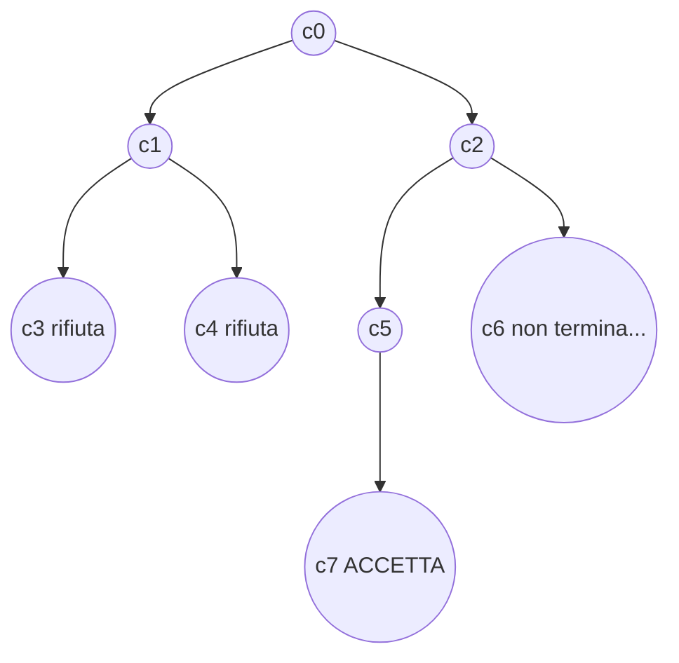
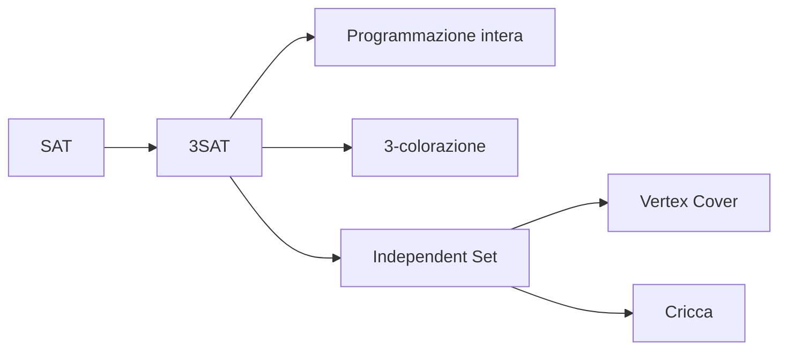

# Classi P e NP e NP-completezza

> [!abstract]
> La teoria della calcolabilità ([[07 - MC - Halting Problem|Halting Problem]], [[08 - MC - Macchine di Turing e calcolabilità|macchine di Turing]]) dice *che cosa* si può calcolare; la prima parte del corso ([[01 - MC - Costo degli algoritmi e modello CEM|analisi della complessità]]) ha insegnato a misurare *quanto costa* un algoritmo. Qui le due cose si uniscono: si classificano i problemi decidibili in base al tempo necessario per risolverli. La classe **P** raccoglie i problemi risolubili in tempo polinomiale ("trattabili"); la classe **NP** quelli le cui soluzioni si possono **verificare** in tempo polinomiale. Con le **riduzioni polinomiali** si individuano i problemi **NP-completi**, i più difficili di NP: se uno solo fosse in P, sarebbe $\mathrm{P} = \mathrm{NP}$. Si vedono le riduzioni classiche da SAT/3SAT a programmazione intera, 3-colorazione e independent set.
> Mappa del corso: [[MOC - Modelli di Calcolo]].

## Problemi trattabili e intrattabili

### La classe P

Vedi [[Classe P]].

La complessità di calcolo è una funzione della **dimensione dell'input**. Se l'input contiene numeri si assume che siano rappresentati **in base 2**: il numero di bit è al massimo uno più del logaritmo del numero (per esempio $1024 = 2^{10}$ richiede 11 bit, `10000000000`). Si escludono così le rappresentazioni "unarie", in cui il numero cinque sarebbe `11111`.

> [!note] Perché la codifica conta
> Con la codifica unaria un numero $N$ occupa $N$ simboli, con quella binaria $\log_2 N$: un algoritmo che fa $N$ passi è *lineare* nel primo caso ed *esponenziale* ($2^{\log N}$) nel secondo. È lo stesso fenomeno visto per la [[03 - MC - Esempi di analisi di complessità|potenza e il test di primalità]]. Le codifiche "ragionevoli" (binaria, decimale, liste di archi, …) sono invece tutte convertibili l'una nell'altra in tempo polinomiale, quindi la scelta fra di esse non cambia la classe di un problema.

> [!important] Definizione (classe P)
> La classe **P** è l'insieme dei linguaggi $L$ per cui esiste un programma (per esempio in Python) che decide $L$ e il cui tempo di esecuzione su input di dimensione $n$ è $O(n^k)$ per qualche costante $k \ge 0$.
>
> Equivalentemente: esiste una [[Macchina di Turing|macchina di Turing]] con un solo nastro che decide $L$ in $O(n^k)$ passi.

Le due definizioni sono equivalenti perché ogni istruzione Python si simula con una macchina di Turing in tempo polinomiale, e viceversa (non lo si dimostra). La definizione di P è quindi **robusta** rispetto al modello di calcolo e alla codifica, purché entrambi siano ragionevoli.

P si identifica con l'insieme dei problemi **trattabili**. Lo mostra la [[02 - MC - Notazione asintotica#Analisi asintotica e la notazione O|tabella dei tempi di esecuzione]]: gli algoritmi polinomiali di grado basso sono utilizzabili, mentre quello di costo $2^n$ è inutilizzabile già oltre $n = 40$. La dispensa aggiunge che per $n = 100$, con un milione di operazioni al secondo, servirebbero "più di 32 milioni di milioni di milioni di anni". Anche complessità "intermedie" non polinomiali, come $O(k^{\log^h n})$, recuperano qualcosa per $n$ piccoli ma poi divergono.

> [!warning] Correzione
> Il conto della dispensa è sovrastimato di circa mille volte: $2^{100} \approx 1{,}27 \cdot 10^{30}$ operazioni a $10^6$ al secondo fanno $1{,}27 \cdot 10^{24}$ secondi, cioè circa $4 \cdot 10^{16}$ anni (40 milioni di miliardi di anni, contro i $3{,}2 \cdot 10^{19}$ della dispensa). La conclusione non cambia: è circa tre milioni di volte l'età dell'universo.

Sono esempi di problemi in P la ricerca di un elemento in un vettore, il calcolo di un polinomio in un punto, il [[Algoritmo di Euclide|massimo comun divisore]].

### La classe NP (dalla dispensa)

Migliaia di problemi interessanti sfuggono a una risoluzione efficiente, ma molti hanno una caratteristica in comune. Per esempio per **SAT** non si conoscono algoritmi polinomiali, però:

- se una formula $F$ con $n$ variabili e $m$ clausole è soddisfacibile, esiste un'**assegnazione** che la soddisfa: una stringa di $n$ bit, quindi di lunghezza polinomiale nella codifica di $F$;
- verificare che un'assegnazione soddisfi $F$ è facile: si sostituiscono i valori e si controlla ogni clausola.

Questa caratteristica ("difficile da trovare, facile da verificare") definisce la classe NP, che si vede in dettaglio [[#La classe NP|più avanti]]. Altri esempi:

- **partizione**: dati $n$ interi $a_1, \dots, a_n$, si possono dividere in due sottoinsiemi disgiunti con la stessa somma?
- **colorazione di una mappa**: si possono colorare gli stati di una carta geografica con tre colori in modo che stati confinanti abbiano colori diversi?
- **percorso più breve per un insieme di punti**: dati $n$ punti nel piano e un valore $x$, esiste un percorso che li collega tutti, di lunghezza minore di $x$, che non passi due volte per lo stesso punto?

Ovviamente $\mathrm{P} \subseteq \mathrm{NP}$; se l'inclusione sia stretta è il problema aperto **P vs NP**, "da un milione di dollari" (è uno dei *Millennium Problems* del Clay Mathematics Institute).

### Oltre NP

Due classi che contengono NP e che molto probabilmente sono strettamente più grandi:

- **EXP**: i linguaggi decidibili in **tempo esponenziale**;
- **PSPACE**: i linguaggi decidibili usando un numero **polinomiale di celle di memoria**.

$$\mathrm{P} \subseteq \mathrm{NP} \subseteq \mathrm{PSPACE} \subseteq \mathrm{EXP}$$

- $\mathrm{P} \subseteq \mathrm{NP}$: un algoritmo deterministico è un caso particolare di algoritmo non deterministico.
- $\mathrm{NP} \subseteq \mathrm{PSPACE}$: un algoritmo non deterministico che lavora in tempo polinomiale usa al massimo spazio polinomiale (al più una cella per passo); e lo si può simulare deterministicamente provando le scelte **una alla volta**, riutilizzando lo stesso spazio.
- $\mathrm{PSPACE} \subseteq \mathrm{EXP}$: una macchina che usa $s$ celle può trovarsi solo in un numero di configurazioni diverse esponenziale in $s$ (stato × posizione della testina × contenuto del nastro, $O(|Q| \cdot s \cdot |\Sigma|^s)$). Se facesse più passi di così, ripasserebbe per una configurazione già vista e quindi entrerebbe in un ciclo infinito. Una macchina che termina impiega dunque tempo al più esponenziale.

Non si sa se queste inclusioni siano proprie (si sa solo che $\mathrm{P} \neq \mathrm{EXP}$, quindi almeno una lo è). Un esempio naturale che si crede fuori da NP è la soddisfacibilità delle **formule booleane quantificate** ("per ogni $x$ esiste $y$ tale che…"), che è PSPACE-completo.

> [!tip] Semplicità contro efficienza (conclusioni della dispensa)
> Fra più algoritmi si sceglie in base a due criteri spesso in conflitto: **semplicità** (costo umano di scrittura e correzione) e **bassa complessità** (costo macchina). Se il programma gira poche volte su input piccoli conta la semplicità; se gira molte volte su input grandi conviene l'efficienza. I programmi ricorsivi sono semplici ma hanno costanti nascoste grandi (ogni chiamata alloca un record di attivazione): su vettori piccoli il bubble sort batte il merge sort. Ogni programma ricorsivo ha un equivalente iterativo, di solito più efficiente.

## SAT

Vedi [[Problema SAT]].

**SAT**: data una formula $F$ del calcolo proposizionale, decidere se è soddisfacibile.

- Data un'assegnazione di valori di verità, si decide se la formula è vera in **tempo polinomiale**.
- Quindi per decidere se $F$ è soddisfacibile si possono provare **tutte** le assegnazioni e verificare se una la soddisfa: se sì la formula è soddisfacibile, se nessuna la soddisfa non lo è.
- Costo: polinomiale $p(n)$ per ogni assegnazione, ma le assegnazioni di una formula con $n$ variabili sono $2^n$. Totale $p(n) \cdot 2^n$: **esponenziale**.

L'algoritmo [[13 - MC - Forme normali e algoritmo DPLL#Algoritmo DPLL|DPLL]] migliora molto in pratica, ma resta esponenziale nel caso peggiore.

## Macchine di Turing non deterministiche

Vedi [[Macchina di Turing non deterministica]].

In una macchina di Turing **deterministica**, dato lo stato $q$ e il simbolo $s$ letto dalla testina, $f(q, s) = (q', s', m)$ determina **univocamente** la transizione da eseguire.

Una macchina di Turing **non deterministica** è una macchina a cui non si impone questo vincolo: per un dato $q$ e $s$ ci possono essere **più transizioni possibili**, quindi $f(q, s)$ non è più una funzione ma una relazione. La macchina termina con successo se **una** delle scelte porta a uno stato finale.

La computazione non è più una sequenza di configurazioni, ma un **albero delle computazioni**: i nodi sono le configurazioni della macchina e gli archi collegano una configurazione a quelle che essa produce in un passo.

> [!important] Accettazione
> Un input $x$ è **accettato** da una macchina non deterministica $T$ se l'albero delle computazioni di $x$ contiene **almeno un cammino accettante**, cioè che termina in una configurazione finale. L'insieme delle stringhe accettate è il linguaggio $L(T)$ accettato da $T$.

Basta il cammino $c_0 \to c_2 \to c_5 \to c_7$ perché $x$ sia accettato, anche se gli altri rami rifiutano o non terminano. Vedi anche [[08 - MC - Macchine di Turing e calcolabilità#MT non deterministiche (MTND)|lezione 8]], dove si dimostra che il non determinismo non aumenta il potere computazionale (ma la simulazione deterministica costa un tempo esponenziale).

## La classe NP

Vedi [[Classe NP]].

> [!important] Definizione con il non determinismo
> - La **classe P** è l'insieme dei linguaggi $L$ per cui **esiste una macchina di Turing deterministica** che in tempo polinomiale decide se $x$ appartiene o meno a $L$.
> - La **classe NP** è l'insieme dei linguaggi $L$ per cui **esiste una macchina di Turing non deterministica** che in tempo polinomiale decide se $x$ appartiene o meno a $L$ (cioè nell'albero delle computazioni esiste almeno un percorso dalla radice a un nodo che termina e accetta).

$\mathrm{P} \subseteq \mathrm{NP}$, perché una macchina deterministica è un caso particolare di macchina non deterministica. Il nome NP viene da **N**ondeterministic **P**olynomial time (e **non** da "non polinomiale"!).

> [!example] Macchina non deterministica per SAT
> 1. per ogni variabile $x_i$, **scegli** non deterministicamente $x_i = 0$ oppure $x_i = 1$ ($n$ passi: l'albero ha $2^n$ foglie, ma ogni cammino è lungo $n$);
> 2. verifica deterministicamente se l'assegnazione scelta soddisfa $F$ (tempo polinomiale);
> 3. accetta se sì.
>
> Ogni cammino ha lunghezza polinomiale, e un cammino accettante esiste se e solo se $F$ è soddisfacibile.

### Definizione alternativa: certificati

> [!important] Definizione con i certificati
> La classe NP è l'insieme dei linguaggi $L$ per cui, **se $x \in L$**, esiste un **certificato** $c(x)$ tale che:
> - $c(x)$ ha **lunghezza polinomiale** in $|x|$;
> - esiste una macchina di Turing **deterministica** che, con input $x$ e $c(x)$, **verifica** che $x \in L$ in tempo polinomiale in $|x|$ e $|c(x)|$.
>
> Formalmente: esistono una funzione $c$ e un polinomio $p$ tali che, se $x \in L$, allora $|c(x)| \le p(|x|)$ ed esiste una macchina $V$ (il *verificatore*) che con ingresso $x$ e $c(x)$ certifica che $x \in L$ terminando in uno stato finale, con complessità polinomiale in $|x|$ e $|c(x)|$.

> [!warning] Asimmetria
> **Non** si richiede un certificato quando $x \notin L$. L'esistenza di un certificato di appartenenza non implica che ne esista uno che dimostri la non appartenenza. (Per SAT: un'assegnazione che soddisfa la formula è un certificato breve; per dimostrare che una formula è *insoddisfacibile* non si conosce nessun certificato breve. La classe dei problemi con certificati brevi per il "no" si chiama coNP.)

> [!note] Correzione minore
> Nella slide "Formalmente" si legge che $V$ ha "ingresso $x$ e $|c(x)|$": l'ingresso del verificatore è il certificato $c(x)$ stesso, non la sua lunghezza.

**Le due definizioni sono equivalenti**: le decisioni non deterministiche della macchina della prima definizione si possono vedere come il certificato della seconda, che "informa" la macchina deterministica su quali scelte fare. Viceversa, una macchina non deterministica può "indovinare" il certificato e poi eseguire il verificatore.

- La prima definizione è **diretta**: fa riferimento a una macchina (o a un algoritmo) non deterministico.
- La seconda evidenzia che per i problemi in NP **verificare** una soluzione è facile (polinomiale), mentre **trovarla**, o dimostrare che non esiste, sembra molto più difficile.

Anche con la seconda definizione $\mathrm{P} \subseteq \mathrm{NP}$: se $L \in \mathrm{P}$, la sequenza delle istruzioni eseguite dall'algoritmo polinomiale certifica sia che $x \in L$ sia che $x \notin L$ (in realtà il verificatore può ignorare il certificato e risolvere il problema da solo).

In molti casi **il certificato è la soluzione stessa**:

| problema | certificato |
|---|---|
| SAT | un'assegnazione Vero/Falso alle variabili |
| esiste in un grafo un percorso da $u$ a $v$ lungo al più $h$ archi? | una sequenza di $k \le h$ archi che collega $u$ a $v$ |
| esiste in un grafo una **cricca** (insieme di nodi mutuamente collegati) di $k$ nodi? | un insieme di $k$ nodi mutuamente collegati |

**Fatto**: SAT appartiene a NP.

Nella definizione, al posto di una macchina di Turing si può usare un algoritmo o un programma in un qualunque linguaggio di programmazione (stessa robustezza della classe P).

## Linguaggi NP-completi

Si è visto che $\mathrm{P} \subseteq \mathrm{NP}$. **La classe P è uguale alla classe NP? Non lo sappiamo.**

Informalmente, la domanda equivale a chiedersi se **trovare** una soluzione di un problema sia, in generale, più difficile che **verificare** se una soluzione proposta è corretta. Chiunque si sia posto questa domanda sa che la risposta più naturale è "sì": per questo il problema è quasi sempre presentato come la dimostrazione della **congettura** $\mathrm{P} \neq \mathrm{NP}$.

### Riduzione fra linguaggi

Vedi [[Riduzione polinomiale]] e [[Riduzione tra linguaggi]].

La riduzione è la stessa tecnica vista per l'[[08 - MC - Macchine di Turing e calcolabilità#Funzioni non calcolabili e problemi indecidibili|indecidibilità]]: intuitivamente, dati due linguaggi $L_1$ e $L_2$, si dimostra che **$L_1$ non è più difficile di $L_2$**, cioè che se esiste una macchina che decide $L_2$ allora ne esiste una che decide $L_1$.

> [!important] Definizioni
> - $L_1$ è **riducibile** a $L_2$ se esiste una funzione totale calcolabile $f: \{0,1\}^* \to \{0,1\}^*$, detta **riduzione**, tale che per ogni stringa binaria $x$:
>   $$x \in L_1 \iff f(x) \in L_2$$
> - Per studiare P e NP ci si limita alle riduzioni **polinomiali**: $L_1$ è **polinomialmente riducibile** a $L_2$ ($L_1 \le_p L_2$) se esiste una riduzione $f$ da $L_1$ a $L_2$ calcolabile da un algoritmo di complessità temporale polinomiale.

Se $L_2$ si decide in tempo polinomiale, componendo $f$ con l'algoritmo per $L_2$ si decide $L_1$ in tempo polinomiale (la composizione di polinomi è un polinomio: $|f(x)|$ è al più polinomiale in $|x|$).

### NP-completezza

Vedi [[NP-completezza]].

> [!important] Definizione
> Un linguaggio $L$ è **NP-completo** se:
> 1. $L \in \mathrm{NP}$;
> 2. ogni altro linguaggio in NP è polinomialmente riducibile a $L$.

Intuitivamente un linguaggio NP-completo è tra i **più difficili** della classe NP: se appartenesse a P, l'intera classe NP sarebbe inclusa in P.

### Teorema di Cook-Levin

Vedi [[Teorema di Cook-Levin]].

> [!important] Teorema
> **SAT è NP-completo.**

La prova è complessa. Dato un linguaggio $L$ in NP, esistono un algoritmo polinomiale $V$ e un polinomio $p$ tali che per ogni stringa $x$:
- se $x \in L$, esiste una stringa $y$ di lunghezza non superiore a $p(|x|)$ tale che $V$, con $x$ e $y$ in ingresso, termina in uno stato finale;
- se $x \notin L$, per ogni $y$, $V$ con $x$ e $y$ in ingresso termina in uno stato non finale.

L'idea della dimostrazione è costruire, per ogni $x$, **in tempo polinomiale**, una formula booleana $F(x, y)$ le cui uniche variabili libere sono le $p(|x|)$ variabili $y_0, y_1, \dots, y_{p(|x|)-1}$ (i bit del certificato), in modo che la soddisfacibilità della formula dipenda solo dai valori assegnati a tali variabili. La formula descrive, con clausole, la computazione di $V$ passo per passo ("al passo $t$ la testina è nella cella $i$", "la cella $i$ contiene il simbolo $a$", …) e impone che termini in uno stato finale. Quindi $F$ è soddisfacibile **se e solo se** esiste un certificato, cioè se e solo se $x \in L$.

> [!note] Fatti
> - ci sono **migliaia** di problemi NP-completi;
> - se si dimostrasse che **un** problema NP-completo ha un algoritmo polinomiale, allora $\mathrm{P} = \mathrm{NP}$;
> - per **nessun** problema NP-completo si conosce un algoritmo polinomiale.
>
> Questo suggerisce che $\mathrm{P} \neq \mathrm{NP}$.

> [!tip] Come si dimostra che un nuovo problema $B$ è NP-completo
> Dopo Cook-Levin non serve più ripetere una prova così complessa: basta
> 1. mostrare che $B \in \mathrm{NP}$ (di solito esibendo un certificato e un verificatore polinomiale);
> 2. ridurre polinomialmente **a $B$** un problema $A$ già noto NP-completo: $A \le_p B$.
>
> La direzione è fondamentale: si riduce il problema **noto** difficile a quello **nuovo**. Tutte le riduzioni che seguono partono da SAT o 3SAT.

## Riduzione polinomiale da SAT a 3SAT

**3SAT** è SAT ristretto a formule in CNF in cui ogni clausola ha **esattamente 3 letterali**.

Data una formula $F$ in CNF si costruisce una formula $F'$ che è soddisfacibile se e solo se $F$ lo è, modificando le clausole e aggiungendo variabili. Una clausola $c$ con $k \ne 3$ letterali si trasforma in un insieme di clausole $D_c$ con nuove variabili $y_i^c$ (diverse per ogni clausola):

![[MC-L14-p19.png]]

- **$k = 1$**: $D_c = \{\{l_0, y_0^c, y_1^c\}, \{l_0, y_0^c, \neg y_1^c\}, \{l_0, \neg y_0^c, y_1^c\}, \{l_0, \neg y_0^c, \neg y_1^c\}\}$. Le quattro clausole coprono tutte le combinazioni di $y_0^c, y_1^c$: comunque si scelgano, una delle quattro ha entrambi i letterali $y$ falsi e quindi richiede $l_0$ vero. Sono soddisfatte se e solo se $l_0$ è soddisfatto.
- **$k = 2$**: $D_c = \{\{l_0, l_1, y_0^c\}, \{l_0, l_1, \neg y_0^c\}\}$. Sono soddisfatte se e solo se $l_0$ oppure $l_1$ è soddisfatto.
- **$k > 3$**: $D_c = \{\{l_0, l_1, y_0^c\}, \{\neg y_0^c, l_2, y_1^c\}, \{\neg y_1^c, l_3, y_2^c\}, \dots, \{\neg y_{k-4}^c, l_{k-2}, l_{k-1}\}\}$.

> [!tip] Perché la catena funziona ($k > 3$)
> Le $y$ fanno da "staffetta". Se un letterale $l_i$ è vero, si pongono vere le $y$ prima di lui e false quelle dopo: ogni clausola contiene o un $y_j$ vero, o un $\neg y_j$ vero, o $l_i$. Viceversa, se tutti gli $l_i$ fossero falsi, la prima clausola costringerebbe $y_0^c = 1$, la seconda $y_1^c = 1$, …, e l'ultima $\{\neg y_{k-4}^c, l_{k-2}, l_{k-1}\}$ sarebbe falsa. Quindi $D_c$ è soddisfacibile se e solo se lo è $c$.
>
> La trasformazione produce $O(k)$ clausole per ogni clausola di $k$ letterali: dimensione lineare, tempo polinomiale.

## Programmazione a numeri interi

La **programmazione a numeri interi** (PI) è un fondamentale problema di ottimizzazione: è una programmazione lineare con variabili limitate ad assumere solo valori interi.

- **Input**: un insieme $V$ di variabili intere, un insieme di disuguaglianze su $V$, una funzione obiettivo da massimizzare $f(V)$ e un intero $B$.
- **Output** (versione decisionale): esiste un'assegnazione di interi a $V$ tale che tutte le disuguaglianze siano vere e $f(V) \ge B$?

> [!example] Esempio
> Due variabili intere $v_1, v_2$ con i vincoli $v_1 \ge 1$, $v_2 \ge 1$, $v_1 + v_2 \le 3$; funzione obiettivo $f(V) = v_1 + 2v_2$, $B = 3$.
> Una soluzione è $v_1 = 1, v_2 = 2$ ($f = 5 \ge 3$). Con $B = 6$ non c'è soluzione: le coppie ammissibili sono $(1,1), (1,2), (2,1)$, con $f$ pari a $3, 5, 4$, quindi il massimo è 5.

### Riduzione da 3SAT a programmazione intera

Si dimostra che la programmazione intera è difficile usando una riduzione da 3SAT (funzionerebbe anche con SAT generale, ma 3SAT facilita la riduzione).

> [!question] In che direzione va la riduzione?
> Si vuole dimostrare che PI è difficile, sapendo che 3SAT è difficile. Se si potesse risolvere 3SAT usando PI, e PI fosse facile, allora anche 3SAT sarebbe facile. Quindi bisogna **"tradurre" 3SAT in PI**: $\mathrm{3SAT} \le_p \mathrm{PI}$.

Ogni istanza di 3SAT contiene variabili booleane; ogni istanza di PI contiene variabili intere e vincoli. Per ogni variabile $x_i$ della formula si introducono **due** variabili intere $v_i$ e $w_i$:

- $0 \le v_i \le 1$ e $0 \le w_i \le 1$ per ogni $i$, così le variabili valgono solo 0 o 1;
- $v_i = 1, w_i = 0$ rappresenta $x_i = $ vero; $w_i = 1, v_i = 0$ rappresenta $x_i = $ falso;
- il vincolo $1 \le v_i + w_i \le 1$, cioè $v_i + w_i = 1$, impone che **esattamente una** fra $v_i$ e $w_i$ valga 1 (la slide dice "al massimo una", ma il vincolo $\ge 1$ impone anche "almeno una");
- per ogni clausola si definisce un vincolo: per $C = (x_1 \vee x_2 \vee x_3)$ si scrive $v_1 + v_2 + v_3 \ge 1$, che impone che almeno una fra $x_1, x_2, x_3$ sia vera; per $C = (x_1 \vee \neg x_2 \vee \neg x_5)$ si scrive $v_1 + w_2 + w_5 \ge 1$, che impone che $x_1$ sia vera oppure una fra $x_2, x_5$ sia falsa.

Per soddisfare il vincolo almeno uno dei letterali della clausola deve valere 1, cioè deve essere vero. La funzione obiettivo non serve: si può prendere $f = 0$ e $B = 0$.

> [!warning] Correzione
> Nella slide, per la clausola $(x_1 \vee \neg x_2 \vee \neg x_5)$ si legge "oppure una fra le variabili $x_2, x_3$ sia falsa": la clausola contiene $x_5$, non $x_3$. Il vincolo $v_1 + w_2 + w_5 \ge 1$ è corretto.

**Correttezza** (bisogna verificare due cose):

- *Ogni soluzione SAT dà una soluzione PI*: un letterale vero corrisponde a una variabile posta a 1; poiché ogni clausola è soddisfatta, la somma in ogni vincolo di clausola è almeno 1.
- *Ogni soluzione PI dà una soluzione SAT*: tutte le variabili valgono 0 o 1; se $v_i = 1$ si pone $x_i = $ vero, se $w_i = 1$ si pone $x_i = $ falso. Poiché $v_i$ e $w_i$ non possono valere entrambe 1, l'assegnazione è consistente; e per ogni clausola almeno un letterale è vero.

La riduzione funziona in entrambi i sensi, quindi la programmazione intera è difficile.

### Conclusioni sulla riduzione

Proprietà che valgono in generale per le riduzioni NP:

- La riduzione **preserva la struttura** del problema: ha permesso di formulare SAT in un formato diverso.
- Le istanze di PI ottenute sono solo un **piccolo sottoinsieme** di tutte le istanze possibili. Ma poiché alcune di esse sono difficili, il problema generale deve essere difficile.
- La trasformazione cattura **l'essenza del perché PI è difficile**: non servono coefficienti grandi né un numero enorme di variabili, bastano valori 0/1. PI è difficile perché soddisfare un insieme di vincoli è difficile **quando si richiedono valori interi**.
- Infatti se si elimina il vincolo di interezza e si permettono valori razionali, il problema (programmazione lineare) diventa **facile** (polinomiale).

> [!important] PI è NP-completo?
> La riduzione dimostra che PI è almeno tanto difficile quanto SAT, cioè che è **NP-hard**. Ma per dire che è **NP-completo** bisogna ancora dimostrare che $\mathrm{PI} \in \mathrm{NP}$. Non è ovvio (bisogna mostrare che, se esiste una soluzione, ne esiste una con numeri di dimensione polinomiale, da usare come certificato); non lo si vede, ma permette di stabilire il teorema: **la programmazione a numeri interi è NP-completa**.

## Colorazione di grafi

Dato un grafo $G$, si vogliono colorare i suoi nodi in modo che **nodi adiacenti abbiano colori diversi**.

- Il **numero cromatico** $C(G)$ è il minimo numero di colori necessario per colorare tutti i nodi.
- Se il grafo ha $n$ nodi, $1 \le C(G) \le n$.
- Il problema di decisione associato: dato $G$, può essere colorato con $k$ colori ($k$ intero)?

![[MC-L14-p27.png]]

La figura mostra una colorazione con 3 colori. Se tre nodi sono mutuamente adiacenti (formano una **cricca**, come i nodi cerchiati), richiedono tre colori diversi: una cricca di $k$ nodi impone $C(G) \ge k$.

**Applicazione: sequenziamento di lavori (*scheduling*).**

- Si devono assegnare dei lavori a intervalli di tempo.
- Alcuni lavori sono in conflitto e non possono essere eseguiti insieme (per esempio usano risorse condivise).
- Si modellano i lavori come nodi e i conflitti come archi.
- Il minimo numero di colori rappresenta il minimo tempo di completamento (*makespan*) per finire i lavori: ogni colore è un intervallo di tempo.

![[MC-L14-p28.png]]

Nel grafo di 5 lavori, la colorazione con 3 colori (rosso, verde, blu) si traduce in tre turni: al tempo 1 il lavoro 4, al tempo 2 i lavori 5 e 2, al tempo 3 i lavori 1 e 3. Nessuna coppia nello stesso turno è collegata da un arco.

### Riduzione da 3SAT a 3-colorazione

Si dimostra che decidere se un grafo è colorabile con 3 colori è difficile usando una riduzione da 3SAT. L'idea è costruire dei **gadget**, piccoli sottografi che simulano il comportamento logico.

Tre colori: **verde** (colore "neutro"), **blu** (rappresenta T, vero), **rosso** (rappresenta F, falso).

![[MC-L14-p29.png]]

- **Gadget di variabile**: per ogni variabile $x$ si crea un triangolo con i nodi $x$, $x'$ (che rappresenta $\neg x$) e il nodo verde. Poiché sono collegati al verde, $x$ e $x'$ devono essere rossi o blu, e diversi fra loro: $x = T, x' = F$ oppure $x = F, x' = T$.
- **Triangolo di riferimento**: i nodi T (blu), F (rosso) e verde formano un triangolo, quindi i tre colori sono "fissati" una volta per tutte.
- **Gadget di clausola**: per ogni clausola $(x \vee y \vee z)$ il grafo a destra (riquadro tratteggiato), collegato ai nodi $x, y, z$ e al nodo T, richiede che **almeno uno** fra $x, y, z$ sia colorato blu (vero). Simula un OR.

![[MC-L14-p30.png]]

**Prova del gadget di clausola** (per contraddizione). Si supponga che esista una colorazione in cui $x, y, z$ non sono blu; essendo adiacenti al nodo verde, sono tutti **rossi**.

1. $z$ rosso: il nodo $a$ è adiacente a $z$ (rosso) e a T (blu), quindi $a$ = verde; il nodo $b$ è adiacente ad $a$ (verde) e a T (blu), quindi $b$ = rosso.
2. Si guardino i nodi $d, e, c$:
   - formano un triangolo, quindi devono avere **tre colori diversi**;
   - ognuno è adiacente a un nodo rosso ($e$ a $x$, $d$ a $y$, $c$ a $b$), quindi nessuno può essere rosso;
   - quindi $d, e, c$ non si possono colorare usando solo verde, rosso e blu.
3. L'assunzione che nessuno fra $x, y, z$ sia blu è falsa.

(Viceversa, se almeno uno fra $x, y, z$ è blu, si verifica che il gadget si colora: lo mostra l'esempio seguente.)

**Costruzione completa.** Data la formula ($x' = \neg x$)

$$(x \vee y \vee z) \wedge (\neg x \vee \neg y \vee z) \wedge (\neg x \vee y \vee \neg z)$$

si ottiene un grafo con un gadget per ogni variabile (tutti collegati allo stesso nodo verde), un gadget per ogni clausola (collegato ai letterali della clausola e a T) e il triangolo verde-T-F. I tre nodi verde, T e F sono mutuamente connessi, quindi usano tre colori diversi, e i colori si possono scegliere arbitrariamente come in figura.

![[MC-L14-p34.png]]

La figura mostra una 3-colorazione con $x$ = blu, $y$ = rosso, $z$ = rosso. Ne segue $x'$ = rosso, $y'$ = blu, $z'$ = blu, e in ogni gadget di clausola almeno uno dei nodi collegati a sinistra è blu. Leggendo i colori come valori di verità, $x$ = vero, $y$ = falso, $z$ = falso è un'assegnazione che rende vera la formula: $(1 \vee 0 \vee 0) \wedge (0 \vee 1 \vee 0) \wedge (0 \vee 0 \vee 1)$.

> [!warning] Correzione
> Nella slide si legge "$x'$ = rosso, $y'$ = blu, $z$ = blu": deve essere $z'$ = blu (dato che $z$ è rosso). Inoltre la terza clausola è scritta "(not x or y or nor z)": il refuso "nor" sta per "not", e la clausola è $(\neg x \vee y \vee \neg z)$, come confermato dalla seconda riga della slide ($x' \vee y \vee z'$).

### Conclusioni sulla 3-colorazione

1. Non è difficile modificare la prova per dimostrare che decidere se un grafo è colorabile con $k$ colori, per ogni $k > 3$, è NP-completo (per esempio aggiungendo un nodo collegato a tutti gli altri si passa da $k$ a $k+1$).
2. Cosa rende difficile la colorazione: i vertici di grado alto? **No**: si può modificare la riduzione in modo che ogni nodo abbia grado massimo 3.
3. Sono facili (polinomiali): decidere se un grafo si colora con **1 colore** (banale: non deve avere archi) e con **2 colori** (buon esercizio: il grafo deve essere *bipartito*; si colora con una visita BFS alternando i colori e si controlla che nessun arco colleghi due nodi dello stesso colore).
4. Per alcune classi di grafi il problema è semplice: ogni **albero** si colora con 2 colori.
5. Ma non sempre restringere lo studio semplifica: per i **grafi planari** (disegnabili sul foglio senza incroci fra gli archi) la 3-colorazione è NP-completa, mentre la 4-colorazione è **facile**: per il teorema dei quattro colori la risposta è sempre sì.

## Vertex Cover e Independent Set

- **Vertex Cover**: dato un grafo $G$ e un intero $k$, esiste un insieme $S$ di $k$ nodi che **copre tutti gli archi**? ($S$ copre gli archi se per ogni arco $(u, v)$ almeno uno fra $u$ e $v$ appartiene a $S$.)
- **Independent Set**: dato un grafo $G$ e un intero $k$, esiste un insieme $S$ di $k$ nodi **non collegati fra loro** (se $u, v \in S$ non esiste l'arco $(u, v)$)?

(Nella slide si legge "S copre i nodi": sono gli **archi** a dover essere coperti.)

È facile vedere che i due problemi sono in NP: si usa come certificato un insieme di $k$ nodi. Algoritmo non deterministico: scegli un insieme $S$ di $k$ nodi, poi verifica (deterministicamente, in tempo $O(|E|)$) se $S$ è un vertex cover o un independent set.

### Riduzione da 3SAT a Independent Set

Data una formula $f$ di 3SAT con $m$ clausole si costruisce un grafo con $3m$ nodi, 3 per ciascuna clausola; $v(C, i)$ è il nodo associato al letterale $l_i$ della clausola $C$. Gli archi sono:

- i tre nodi di una stessa clausola sono **mutuamente collegati** (un triangolo per clausola);
- due nodi $v(C, i)$ e $v(C', j)$ di clausole diverse sono collegati se corrispondono alla **stessa variabile**, positiva in un caso e negata nell'altro (letterali complementari).

Esempio: $F = (\neg x_1 \vee x_2 \vee x_3) \wedge (x_1 \vee \neg x_2 \vee x_3) \wedge (\neg x_1 \vee x_2 \vee x_4)$.

![[MC-L14-p38.png]]

Il grafo ha tre triangoli, uno per clausola. Gli archi fra triangoli collegano letterali complementari: per esempio il nodo blu $v(2,1)$ [$x_1$] è collegato ai due nodi rossi $v(1,1)$ e $v(3,1)$, che corrispondono a $\neg x_1$; e $v(2,2)$ [$\neg x_2$] è collegato a $v(1,2)$ e $v(3,2)$ [$x_2$].

> [!important] Teorema
> $G$ contiene un insieme indipendente di taglia $m$ **se e solo se** $f$ è soddisfacibile.

**Prova ($\Rightarrow$)**: dato un insieme indipendente $S$ di dimensione $m$, si ottiene una soluzione di 3SAT.
- $S$ contiene **esattamente un vertice in ogni triangolo** (i nodi di un triangolo sono adiacenti, quindi al più uno per triangolo; ci sono $m$ triangoli e $|S| = m$).
- Si pongono a vero i letterali corrispondenti.
- L'assegnazione è **consistente**: gli archi fra clausole impediscono di scegliere sia $x$ sia $\neg x$. E **soddisfa $F$**: ogni clausola ha un letterale vero.

![[MC-L14-p39.png]]

Con l'insieme indipendente rosso $\{v(1,1), v(2,3), v(3,3)\}$ si ottiene $x_1$ = falso, $x_3 = x_4$ = vero; $x_2$ può essere sia vero sia falso e la formula è comunque soddisfatta.

**Prova ($\Leftarrow$)**: data un'assegnazione che soddisfa $F$, si sceglie **un letterale vero da ogni triangolo** (ce n'è almeno uno, perché ogni clausola è soddisfatta). L'insieme scelto è indipendente: nello stesso triangolo c'è un solo nodo, e due nodi di triangoli diversi non possono essere complementari perché sono entrambi veri. Ha taglia $m$.

Per esempio, con $x_1 = x_4 = $ falso e $x_2 = x_3 = $ vero, i letterali veri sono $v(1,1), v(1,2), v(2,3), v(3,1), v(3,2)$; scegliendone uno per triangolo, per esempio $v(1,2), v(2,3), v(3,1)$, si ottiene un insieme indipendente di taglia 3.

> [!note] Slide incompleta
> Dopo la riduzione a Independent Set c'è una slide intitolata "Riduzione da SAT a" che ripete solo le definizioni di Vertex Cover e Independent Set: la riduzione a Vertex Cover non è svolta. Si ottiene subito dall'osservazione che **$S$ è un insieme indipendente se e solo se $V \setminus S$ è un vertex cover** (vedi [[#Esercizi|esercizi]]).

## Riduzioni NP: sommario

Dimostrare che **$A$ si riduce a $B$** richiede una trasformazione $f: A \to B$ (da istanze di $A$ a istanze di $B$) tale che:

- se un'istanza $x$ di $A$ appartiene al linguaggio, anche $f(x)$ appartiene a $B$;
- se $f(x)$ appartiene a $B$, anche $x$ appartiene ad $A$.

> [!warning] Correzione
> La slide scrive la seconda condizione come "se un'istanza $y$ di $B$ appartiene al linguaggio, anche $f^{-1}(y)$ appartiene ad $A$". Così formulata richiederebbe che $f$ sia invertibile, e che ogni istanza di $B$ provenga da un'istanza di $A$, cosa che in generale non è vera (le istanze di PI prodotte da 3SAT sono "solo un piccolo sottoinsieme"). La condizione corretta riguarda solo le immagini: **$f(x) \in B \Rightarrow x \in A$**. Insieme alla prima dà $x \in A \iff f(x) \in B$.

Data una riduzione da $A$ a $B$, **$B$ è almeno tanto difficile quanto $A$**:

| se… | allora… |
|---|---|
| $A$ è difficile (NP-completo) | $B$ è difficile |
| $B$ è facile (polinomiale) | $A$ è facile |
| $A$ è facile (polinomiale) | **nulla**: la riduzione non aiuta a capire se $B$ sia polinomiale o no |

### Robustezza della definizione

1. **La composizione di polinomi è un polinomio**: se si riduce SAT a $A$, poi $A$ a $B$, poi $B$ a $C$, la composizione delle riduzioni è una riduzione polinomiale da SAT a $C$. Quindi $C$ è NP-difficile (e se $C \in \mathrm{NP}$ è NP-completo). La riducibilità polinomiale è **transitiva** (domanda frequente agli esami: se $|x| = n$, $f$ costa $p(n)$ e produce un output lungo al più $p(n)$; $g$ su quell'output costa $q(p(n))$, ancora un polinomio).
2. **La definizione non dipende dal modello di calcolo**: i modelli noti (MdT, Java, Python, …) sono tutti **polinomialmente equivalenti**; un algoritmo polinomiale in un modello si traduce in un algoritmo polinomiale in un altro, e viceversa.

(Ogni freccia $A \to B$ è una riduzione $A \le_p B$: tutti i problemi del grafo sono NP-difficili, e poiché sono anche in NP sono NP-completi.)

## Problemi di ottimizzazione e problemi NP-hard

### Problemi di ottimizzazione

Per la colorazione di grafi:
- **problema di decisione**: esiste una colorazione con $k$ o meno colori?
- **problema di ottimizzazione**: qual è il minimo numero di colori necessario per colorare il grafo?

La definizione di NP si estende ai problemi di ottimizzazione **riducendo la ricerca dell'ottimo a più problemi di riconoscimento**. Esempio: determinare il numero cromatico $\mathrm{Crom}(G)$, cioè il più piccolo $k$ tale che $G$ è $k$-colorabile.

1. Il numero cromatico di un grafo con $n$ nodi è compreso fra 1 e $n$.
2. Si fa una **ricerca binaria**: si parte da $h = n/2$ e ci si chiede se $G$ sia $h$-colorabile; se sì ci si chiede se sia $n/4$-colorabile, se no se sia $3n/4$-colorabile, e così via.
3. Risolvendo $O(\log n)$ problemi di riconoscimento si risolve il problema di ottimizzazione.

Questo si applica a tutti i problemi considerati e **giustifica l'attenzione sui problemi di decisione**: se la versione decisionale fosse polinomiale, lo sarebbe anche quella di ottimizzazione (un fattore $\log n$ in più).

### Problemi NP-hard

Vedi [[Problemi NP-hard]].

> [!important] Definizione
> Un linguaggio $L$ è **NP-hard** (NP-difficile) se ogni altro linguaggio in NP è polinomialmente riducibile a $L$. A differenza degli NP-completi, **non si richiede che $L$ appartenga a NP**: $L$ può essere più difficile di tutta la classe.
>
> Equivalentemente: esiste una riduzione da un problema NP-completo a $L$.
>
> NP-completo = NP-hard $\cap$ NP.

Esempi di problemi NP-hard che (probabilmente o sicuramente) non sono in NP:

- **formule logiche con quantificatori**: data una formula booleana $f(x, y, v, w, z)$ ci si chiede se *per ogni* $x$ [(*esiste* $y$ per cui $f$ è vera) oppure (*per ogni* $v$ $f$ è falsa)]. Il gioco degli scacchi è di questo tipo: esiste una mossa del bianco tale che, per ogni mossa del nero, esiste una mossa del bianco tale che… Richiede **spazio polinomiale** (PSPACE).
- il **problema della fermata**: non decidibile, quindi certamente non in NP, ma NP-hard (ogni problema di NP vi si riduce).

## Teoria dell'NP-completezza: conclusioni

- **Desiderata**: classificare i problemi distinguendo quelli che si risolvono in tempo polinomiale da quelli che non si possono risolvere in tempo polinomiale.
- **Notizia frustrante**: molti problemi fondamentali non sono classificabili, anche se studiati da decenni.
- **Cosa sappiamo**: la teoria dell'NP-completezza mostra che molti di questi problemi sono "computazionalmente equivalenti" e appaiono essere formulazioni diverse dello stesso problema.

Spesso il confine fra facile (polinomiale) e difficile (NP-completo) è noto, ma in alcuni casi è controintuitivo:

| facile (polinomiale) | difficile (NP-hard) |
|---|---|
| 2-SAT | 3-SAT |
| colorare i nodi di un grafo con 2 colori | colorare i nodi di un grafo con 3 colori |
| programmazione lineare | programmazione a numeri interi |
| cammino minimo in un grafo | cammino più lungo in un grafo |
| Vertex Cover in grafi bipartiti | Vertex Cover in grafi generali |
| test per stabilire se un numero è primo | fattorizzazione di un numero intero |

> [!warning] Correzione
> L'ultima riga non è corretta così com'è: non è noto che la **fattorizzazione** sia NP-hard, e anzi si ritiene che **non** lo sia. La sua versione decisionale ("$n$ ha un fattore minore di $k$?") sta in $\mathrm{NP} \cap \mathrm{coNP}$, e un problema NP-completo in coNP implicherebbe $\mathrm{NP} = \mathrm{coNP}$. La fattorizzazione è un problema per cui non si conosce un algoritmo polinomiale (su cui si basa la sicurezza di RSA), ma non è un esempio di problema NP-hard. Gli altri esempi della tabella sono corretti.

### Classi di complessità

![[MC-L14-p50.png]]

La figura riassume le relazioni fra le classi **assumendo che la congettura $\mathrm{P} \neq \mathrm{NP}$ sia vera**:

- **P** (dentro NP): massimo accoppiamento in un grafo, 2SAT, cammino più breve in un grafo, calcolo del massimo comun divisore;
- **NP-completi** (l'intersezione fra NP e NP-hard): SAT, 3SAT, cricca in un grafo, colorazione di grafi;
- **NP-hard** fuori da NP: problema della fermata, soddisfacibilità di formule logiche con quantificatori.

Se fosse $\mathrm{P} = \mathrm{NP}$, i cerchi P, NP e NP-completi coinciderebbero (a parte i linguaggi banali $\emptyset$ e $\Sigma^*$).

### Implicazioni pratiche

Il capo vi chiede di trovare un algoritmo veloce (polinomiale) per un problema, e avete due settimane di tempo. Non ci riuscite; dopo due settimane il capo si lamenta e vi concede un'altra settimana. Dopo una settimana riuscite a **provare che il problema è NP-completo**. A questo punto potete dire: "*Io non sono riuscito a trovare un algoritmo polinomiale, ma nessuno di questi ricercatori è riuscito a farlo. La congettura è che non esista un algoritmo veloce; quindi…*" (la vignetta mostra la fila di ricercatori alle spalle).

In pratica dimostrare l'NP-completezza è un risultato utile: indica di smettere di cercare un algoritmo esatto ed efficiente e di passare ad algoritmi di approssimazione, euristiche, o algoritmi esponenziali ben ottimizzati (come DPLL).

> [!example] Domande tipiche d'esame su P vs NP
> - *Si trova un upper bound $O(n^6)$ per 3-COLORABILITÀ*: 3-COL è NP-completo, quindi $\mathrm{P} = \mathrm{NP}$.
> - *Si trova un lower bound $\Omega(2^{n/3})$ per VERTEX-COVER*: nessun algoritmo polinomiale per un problema di NP, quindi $\mathrm{P} \neq \mathrm{NP}$.
> - *Si trova un upper bound esponenziale per 3-SAT*: nessuna conseguenza (lo si conosce già).
> - *Si trova un lower bound polinomiale per un problema NP*: nessuna conseguenza (tutti i problemi non banali hanno almeno un lower bound lineare).
> - *"Il cammino minimo è polinomiale, quindi è in P e quindi in NP; abbiamo un algoritmo polinomiale per un problema di NP, quindi $\mathrm{P} = \mathrm{NP}$"* (settembre 2022): l'errore è che serve un algoritmo polinomiale per un problema **NP-completo**, non per un problema qualunque di NP.

## Esercizi

- Dimostrare che SAT e la colorazione di un grafo sono in NP.
- Ridurre Independent Set a Vertex Cover (e viceversa).
- Ridurre Vertex Cover a Programmazione a numeri interi.
- Ridurre Independent Set a Programmazione a numeri interi.
- Ridurre la colorazione di un grafo con 3 colori a Programmazione a numeri interi.
- Il problema **Cricca** è così definito: dato un grafo $G$ e un intero $k$, esiste un insieme di $k$ nodi a due a due collegati da un arco? Ridurre Independent Set a Cricca.
- Dimostrare che la soddisfacibilità per formule logiche in forma disgiuntiva è polinomiale (risolto nella [[13 - MC - Forme normali e algoritmo DPLL#DNF e soddisfacibilità|lezione 13]]).

> [!tip] Tracce di soluzione
> - **IS ↔ VC**: $S$ è indipendente in $G = (V, E)$ se e solo se $V \setminus S$ è un vertex cover (ogni arco ha almeno un estremo fuori da $S$). Quindi $(G, k) \in \mathrm{IS} \iff (G, |V| - k) \in \mathrm{VC}$: la riduzione cambia solo $k$.
> - **IS → Cricca**: $S$ è indipendente in $G$ se e solo se è una cricca nel **grafo complementare** $\bar G$ (stessi nodi, archi esattamente dove $G$ non li ha). $(G, k) \mapsto (\bar G, k)$, costo $O(|V|^2)$.
> - **VC → PI**: una variabile $x_v \in \{0, 1\}$ per nodo; per ogni arco $(u, v)$ il vincolo $x_u + x_v \ge 1$; infine $\sum_v x_v \le k$.
> - **IS → PI**: $x_v \in \{0, 1\}$; per ogni arco $x_u + x_v \le 1$; $\sum_v x_v \ge k$ (si può usarla come funzione obiettivo con $B = k$).
> - **3-COL → PI**: variabili $x_{v,c} \in \{0,1\}$ per nodo $v$ e colore $c \in \{1, 2, 3\}$; $\sum_c x_{v,c} = 1$ per ogni nodo; $x_{u,c} + x_{v,c} \le 1$ per ogni arco e ogni colore.
> - **SAT ∈ NP**: certificato = assegnazione; **3-COL ∈ NP**: certificato = un colore per nodo, si controlla ogni arco in $O(|E|)$.

## Riepilogo

> [!summary]
> - **P**: decidibili in tempo polinomiale da una MdT deterministica. **NP**: decidibili in tempo polinomiale da una MdT non deterministica, o equivalentemente con **certificati** polinomiali verificabili in tempo polinomiale.
> - $\mathrm{P} \subseteq \mathrm{NP} \subseteq \mathrm{PSPACE} \subseteq \mathrm{EXP}$; $\mathrm{P} = \mathrm{NP}$? è aperto, si congettura di no.
> - **Riduzione polinomiale** $A \le_p B$: $x \in A \iff f(x) \in B$, $f$ polinomiale; è transitiva.
> - **NP-completo** = in NP e ogni problema di NP vi si riduce; **NP-hard** = senza la richiesta di stare in NP.
> - **Cook-Levin**: SAT è NP-completo. Poi: SAT → 3SAT → {PI, 3-colorazione, Independent Set} → Vertex Cover, Cricca.
> - Per mostrare che $B$ è NP-completo: $B \in \mathrm{NP}$ e $A \le_p B$ con $A$ già NP-completo.
