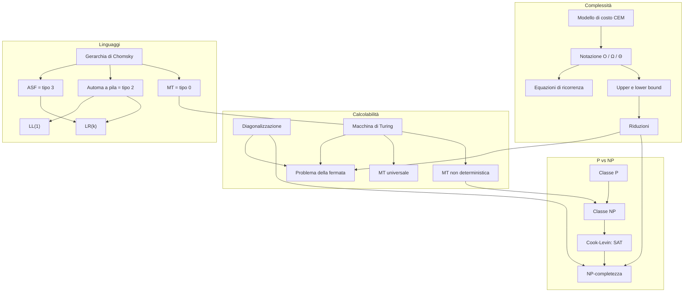

# MOC - Modelli di Calcolo

> [!abstract]
> Mappa del corso di **Modelli di Calcolo** (Fondamenti di Informatica II, Ingegneria Informatica, Sapienza; prof. F. d'Amore, A. Marchetti Spaccamela). Il corso risponde alla domanda *"cosa può essere calcolato da un calcolatore, e quanto costa farlo?"* in tre parti: **analisi della complessità** degli algoritmi, **calcolabilità** (cosa non si può calcolare), **linguaggi formali e parsing**, e infine le **classi di complessità** P e NP. Per l'esame vedi [[MC - Tipologie di esercizi d'esame]].

## Lezioni

| # | lezione | argomenti |
|---|---|---|
| 1 | [[01 - MC - Costo degli algoritmi e modello CEM]] | costo di un programma, CEM, caso peggiore, dimensione dell'input |
| 2 | [[02 - MC - Notazione asintotica]] | tabella dei tempi, $O$, $\Omega$, $\Theta$, istruzione dominante, composizione |
| 3 | [[03 - MC - Esempi di analisi di complessità]] | ricerca binaria, bubble sort, potenza, primalità, Horner, valore vs dimensione |
| 4 | [[04 - MC - Algoritmi ricorsivi ed equazioni di ricorrenza]] | ricorrenze, srotolamento, merge sort, Euclide, Fibonacci, pila |
| 5 | [[05 - MC - Delimitazioni superiori e inferiori]] | upper/lower bound di problemi, alberi di decisione, $\Omega(n\log n)$, riduzioni |
| 6 | [[06 - MC - Cardinalità e diagonalizzazione]] | equinumerosità, numerabilità, Cantor, $2^{\aleph_0}$, problemi vs programmi |
| 7 | [[07 - MC - Halting Problem]] | problema della fermata in C, semidecidibilità, riduzioni |
| 8 | [[08 - MC - Macchine di Turing e calcolabilità]] | MT, multinastro, non deterministiche, universale, Church-Turing, RAM |
| 9 | [[09 - MC - Grammatiche e gerarchia di Chomsky]] | linguaggi, operazioni, espressioni regolari, grammatiche, tipi 0–3, forme normali |
| 10 | [[10 - MC - Automi a stati finiti ed espressioni regolari]] | ASF, ASFND, sottoinsiemi, ASF = GR3 = ER, pumping lemma, chiusura |
| 11 | [[11 - MC - Analisi sintattica top-down e automi a pila]] | automi a pila, compilazione, ambiguità, discesa ricorsiva, FIRST/FOLLOW, LL(1) |
| 12 | [[12 - MC - Parsing bottom-up]] | shift-reduce, conflitti, item LR(0), Action/Goto, LR(0) e LR(k) |
| 13 | [[13 - MC - Forme normali e algoritmo DPLL]] | CNF, Convert1/Convert2, DPLL, DNF |
| 14 | [[14 - MC - Classi P e NP e NP-completezza]] | P, NP, certificati, riduzioni polinomiali, Cook-Levin, SAT→3SAT→PI/3COL/IS |

## Concetti per tema

### Analisi della complessità
- [[Modello di costo CEM]] · [[Dimensione dell'input]] · [[Analisi del caso peggiore]] (ASD)
- [[Notazione O grande]] · [[Notazione Omega]] · [[Notazione Theta]] · [[Notazione asintotica]] (ASD)
- [[Istruzione dominante]] · [[Algoritmo pseudopolinomiale]]

### Ricorsione
- [[Equazione di ricorrenza]] (ASD) · [[Albero delle chiamate ricorsive]]
- [[Algoritmo di Euclide]] · [[Numeri di Fibonacci]] · [[Merge-sort]] (ASD) · [[Fibonacci ricorsivo]] (ASD)

### Bound dei problemi
- [[Delimitazioni superiori e inferiori]] · [[Algoritmo ottimo]] · [[Albero di decisione]]
- [[Limite inferiore per l'ordinamento basato su confronti]] (ASD)

### Calcolabilità
- [[Equinumerosità]] · [[Insieme numerabile]] · [[Diagonalizzazione di Cantor]]
- [[Problema della fermata]] · [[Linguaggio decidibile]] · [[Linguaggio semidecidibile]] · [[Riduzione tra linguaggi]]

### Macchine di Turing
- [[Macchina di Turing]] · [[Macchina di Turing multinastro]] · [[Macchina di Turing non deterministica]]
- [[Macchina di Turing universale]] · [[Tesi di Church-Turing]]

### Linguaggi formali
- [[Grammatica generativa]] · [[Gerarchia di Chomsky]] · [[Albero di derivazione]] · [[Grammatica ambigua]]
- [[Espressione regolare]] · [[Automa a stati finiti]] · [[Automa a stati finiti non deterministico]] · [[Pumping lemma per linguaggi regolari]]
- [[Automa a pila]]

### Parsing
- top-down: [[Parser a discesa ricorsiva]] · [[Insiemi FIRST e FOLLOW]] · [[Grammatica LL(1)]] · [[Eliminazione della ricorsione sinistra]] · [[Fattorizzazione sinistra]]
- bottom-up: [[Parsing shift-reduce]] · [[Conflitti shift-reduce e reduce-reduce]] · [[Item LR(0)]] · [[Tavole Action e Goto]] · [[Grammatica LR(0)]]

### Logica e SAT
- [[Forma normale congiuntiva]] · [[Trasformazione Convert2]] · [[Algoritmo DPLL]] · [[Problema SAT]]

### Classi di complessità
- [[Classe P]] · [[Classe NP]] · [[Riduzione polinomiale]] · [[NP-completezza]] · [[Teorema di Cook-Levin]] · [[Problemi NP-hard]]

## Percorsi trasversali

**Catene di concetti da ripassare insieme:**

1. **Valore e dimensione dell'input**: [[Dimensione dell'input]] → [[Algoritmo pseudopolinomiale]] → [[Algoritmo di Euclide]] → [[Classe P]]. Lo stesso ciclo è lineare su un array e esponenziale su un intero.
2. **Le riduzioni ovunque**: [[Riduzione tra linguaggi]] (lower bound del convex hull) → [[Problema della fermata]] (indecidibilità per riduzione) → [[Riduzione polinomiale]] → [[NP-completezza]]. Stessa idea, tre usi: bound, indecidibilità, NP-completezza.
3. **La diagonalizzazione**: [[Diagonalizzazione di Cantor]] ($\mathcal{P}(\mathbb{N})$ non numerabile) → [[Insieme numerabile]] (programmi numerabili, problemi no) → [[Problema della fermata]] (`diag`).
4. **Il non determinismo**: [[Automa a stati finiti non deterministico]] (non aumenta il potere, costa fino a $2^k$ stati) → [[Automa a pila]] (aumenta il potere) → [[Macchina di Turing non deterministica]] (non aumenta il potere, simulazione esponenziale) → [[Classe NP]] (P vs NP).
5. **Modelli e linguaggi**: [[Gerarchia di Chomsky]] → [[Automa a stati finiti]] / [[Espressione regolare]] (tipo 3) → [[Automa a pila]] (tipo 2) → [[Linguaggio semidecidibile]] (tipo 0).
6. **Dal parsing agli automi**: [[Grammatica ambigua]] → [[Grammatica LL(1)]] (FIRST/FOLLOW) → [[Item LR(0)]] (il goto-graph è un ASF) → [[Grammatica LR(0)]] (LR(1) = CF deterministici).
7. **SAT dalla logica alla complessità**: [[Forma normale congiuntiva]] → [[Trasformazione Convert2]] → [[Algoritmo DPLL]] → [[Problema SAT]] → [[Teorema di Cook-Levin]].

## Collegamenti con altri corsi

- **Algoritmi e Strutture Dati**: notazione asintotica, ricorsione, merge sort, limite inferiore dell'ordinamento ([[04 - ASD - Analisi di algoritmi]], [[05 - ASD - Ricorsione]]).
- **Sistemi di Calcolo**: l'architettura di von Neumann alla base della CEM e delle RAM.
