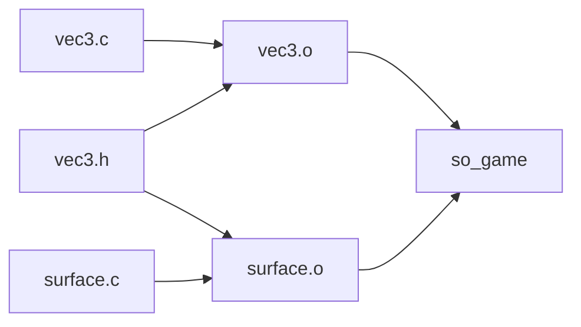

# Programmi, Makefile e pkg-config

> [!abstract] Scopo della lezione
> Prima di parlare di processi bisogna capire **da dove vengono**: come un file sorgente diventa un **program file** eseguibile e come l'OS lo trasforma in un **processo**. La lezione segue la catena *sorgente → object file → eseguibile → immagine in memoria*, e poi presenta gli strumenti che automatizzano la build di progetti grandi: **Makefile**, **pkg-config** e **CMake**.
> Mappa dei concetti: [[MOC - Sistemi Operativi]]

## Programmi ed esecuzione

Un **programma** è un pezzo di software che può essere eseguito da:

- un **programma interprete** (es. Python: l'interprete legge il sorgente ed esegue le operazioni);
- un **programma emulatore** (un programma nativo che simula un altro processore);
- **direttamente dalla CPU** (codice macchina nativo).

In ogni caso, perché qualcosa succeda nel sistema **deve essere eseguito dalla CPU**: anche un interprete o un emulatore sono, alla fine, codice macchina che gira sulla CPU.

La CPU processa le istruzioni **sequenzialmente**. Ogni istruzione è una sequenza di numeri binari; la CPU preleva (*fetch*) istruzioni e operandi dalla **memoria**, li decodifica e li esegue.

### Portabilità e macchine virtuali

Alcuni compilatori/linguaggi sono progettati per la **portabilità tra architetture diverse**: invece di produrre codice macchina per una CPU reale, producono linguaggio macchina per un **processore virtuale** (es. il *bytecode* di Java per la JVM). Per eseguire questi binari serve un **programma nativo che emula il processore virtuale** (la JVM): lo stesso bytecode gira ovunque esista un emulatore per quella piattaforma.

Gli **interpreti** fanno qualcosa di simile ma partendo direttamente dal sorgente (o da una sua rappresentazione intermedia).

## Program file e processo

Un **program file** (file eseguibile) contiene **codice macchina e meta-informazioni** (dove vanno caricate le sezioni, di quali librerie ha bisogno, dov'è il punto d'ingresso…). Queste informazioni servono a generare una **memory image** (immagine di memoria) adatta all'esecuzione sulla CPU. Per costruire la memory image è necessario il **supporto dell'OS** (il *loader*, vedi [[Loader ed ELF]]).

Un **processo** è un **programma in esecuzione**. Lo stesso program file può essere caricato **più volte**, dando origine a **processi diversi** (es. due terminali aperti = due processi dello stesso programma). Vedi [[Program File e Processo]].

![[SO-L02-01.png]]

La figura mostra le fasi di vita di un programma:

1. **Compile time**: il *source program* passa dal **compilatore o assembler** e diventa un **object module** (`.o`).
2. **Load time**: il **linkage editor** (linker) combina l'object module con *altri object modules* e produce un **load module** (l'eseguibile); il **loader** lo carica in memoria insieme alle *system library* statiche.
3. **Execution time (run time)**: si ottiene l'**in-memory binary memory image**; le *dynamically loaded system library* vengono collegate durante l'esecuzione (**dynamic linking**).

Questa stessa figura viene ripresa parlando di [[Address Binding]] in [[10 - SO - Gestione della Memoria|lezione 10]].

## Tipi di file

| Estensione | Significato |
| --- | --- |
| `.h` | **header**: dichiarazioni (prototipi, struct, macro) |
| `.c`, `.cpp`, `.S` | **source files** (C, C++, assembly) |
| `.o` | **object files**: codice macchina non ancora collegato |
| `.a` | **static libraries**: archivi di `.o`, copiati dentro l'eseguibile al link |
| `.so` | **shared libraries**: caricate a runtime, condivise tra processi |
| *(nessuna)* | **eseguibili**: su Unix non hanno estensione |

Perché un program file diventi un programma **eseguibile** deve contenere un `main` (il punto d'ingresso del programma utente).

## Costruzione di un eseguibile

Vedi [[Compilazione e Linking con gcc]].

1. **Generare un object file** (compiler/assembler):
   ```bash
   g++ <options> -c <source file>
   ```
   `-c` significa "compila soltanto, non collegare".
2. **Collegare** (e compilare se necessario) tutti i file indicati per generare un program file chiamato `<name>` (linkage editor):
   ```bash
   g++ <options> -o <name> <files>
   ```
3. **Eseguire**: la shell invoca l'OS per **creare un nuovo processo** e **caricare la process image** dal disco in memoria (vedi [[fork]] e [[exec e Variabili d'Ambiente]]). L'OS si occupa anche di caricare le **librerie condivise** necessarie.

Se durante la compilazione si usa l'opzione `-l<library name>`, nell'eseguibile vengono registrate le informazioni su **quali oggetti condivisi caricare a runtime**.

> [!note]
> Quanto visto vale anche per `gcc` (compilatore C). Sia `g++` che `gcc` sono in realtà dei *driver* che invocano **compilatore + assembler + linker** a seconda di cosa serve.

### Progetti grandi e dipendenze

Nei progetti grandi il codice è **partizionato in molti file**, ognuno compilato in un `.o`. Se si modifica un sorgente o un header, basta **ricompilare e ricollegare solo le parti influenzate**.

Ogni `.o` dipende da:

- i **sources** usati per costruirlo;
- gli **headers** inclusi dai sources.

Esempio di costruzione **manuale** di un eseguibile:

![[SO-L02-02.png]]

Ogni sorgente (`vec3.c`, `surface.c`, `image.c`, …) viene compilato separatamente con `-c` in un `.o`, con le stesse opzioni (`-Wall -O3 -std=gnu99 -I/usr/include/GL`). L'ultimo comando collega tutti gli `.o` nell'eseguibile `so_game` e aggiunge le librerie `glut`, `GLU`, `GL` e `m` (math).

Fatto a mano, ogni volta che si modifica un file si finisce per **ricompilare tutto da capo**, e la build di un progetto ampio può richiedere molto tempo.

## Makefile

Un [[Makefile]] è uno script che specifica l'**albero delle dipendenze** tra i file, per **automatizzare il processo di build**. È composto da una serie di **regole**, attivate in base al **tempo di ultima modifica** dei file.

Forma di una regola:

```make
<target> : <dependencies>
<tab>      <command>
```

> [!warning] Il comando deve essere indentato con un **TAB**, non con spazi.

Esempio: esegue `gcc` **se** `vec3.o` è più vecchio di `vec3.c` o `vec3.h`:

```make
vec3.o: vec3.c vec3.h
	gcc -std=gnu99 -c -o vec3.o vec3.c
```

- Il comando `touch <file>` aggiorna la data di modifica di un file (utile per forzare una ricompilazione).
- `gcc -MM <source files>` (o `g++ -MM`) genera automaticamente la **testa della regola** (target e dipendenze), leggendo gli `#include`.
- Nella cartella che contiene il Makefile, il comando `make` avvia una compilazione **object dependent**: verifica quali regole eseguire confrontando le date di modifica, e ricompila solo ciò che è necessario.



## Pacchetti esterni e pkg-config

Progetti complessi dipendono spesso da altri progetti/librerie complessi, ed è poco pratico trovare a mano dove sono installati i pacchetti esterni.

Nell'ambito di una build C/C++, un **pacchetto** è costituito da:

- un insieme di file **include** (`.h`, `.hpp`);
- un insieme di **librerie** (`.so`, `.a`).

Nella **generazione dei `.o`** bisogna specificare:

- l'**include path** in cui cercare gli header: `-I<path1> -I<path2>`;
- eventuali `#define` che attivano comportamenti specifici della libreria: `-D<statement>` (equivale a scrivere `#define <statement>` nel sorgente).

Nella **fase di linking** bisogna specificare:

- la directory delle librerie: `-L<path>`;
- le librerie: `-l<libname_without_prefix>` (es. `-lm` per `libm.so`).

[[pkg-config]] automatizza il recupero di questi parametri per librerie e pacchetti installati. È un **database di file di testo** che descrivono i pacchetti: per ogni pacchetto fornisce le opzioni di include (`-I…`) e di libreria (`-l…`).

I file `*.pc` presenti nelle directory elencate in `$PKG_CONFIG_PATH` contengono le risposte alle query fatte con `pkg-config`.

```bash
gcc $(pkg-config --cflags gtk+-3.0) -c main.c          # opzioni -I e -D
gcc -o app main.o $(pkg-config --libs gtk+-3.0)        # opzioni -L e -l
```

## CMake

Se si vogliono programmi compilabili con **compilatori e piattaforme diverse**, si usa [[CMake]]: un **generatore di Makefile**. CMake legge un file `CMakeLists.txt`, genera i Makefile adatti alla piattaforma, e poi sono quei Makefile a fare la build vera e propria. Le dipendenze vengono **dedotte dai sorgenti** usando la compiler toolchain.

```bash
cmake <path to CMakeLists.txt>
make
```

### Esempio di CMakeLists.txt

![[SO-L02-03.png]]

**Preambolo**: `cmake_minimum_required` definisce la versione minima di CMake, `project` il nome del progetto.

![[SO-L02-04.png]]

`find_package(... REQUIRED)` invoca le routine per trovare un pacchetto (qui OpenGL e GLUT). Se lo trova, imposta delle variabili (tipicamente `OPENGL_LIBRARIES`, `OPENGL_INCLUDE_DIR`); se non lo trova, la generazione si interrompe con un errore. È l'equivalente CMake di pkg-config.

![[SO-L02-05.png]]

`include_directories` aggiunge all'include path il contenuto delle variabili impostate da `find_package`.

![[SO-L02-06.png]]

`add_executable` definisce un **target** eseguibile `so_game` costruito dai sorgenti elencati. Le dipendenze tra oggetti, sorgenti e header sono determinate **automaticamente** dalla toolchain (`gcc -MM`).

![[SO-L02-07.png]]

`target_link_libraries` specifica che per generare `so_game` servono certe librerie: ogni elemento della lista diventa un flag `-l<name>` sulla riga di comando del linker.

### Comandi principali

Un **target** CMake è un binario eseguibile o una libreria.

```cmake
add_executable(<name> <files...>)               # eseguibile
add_library(<name> [SHARED] <files...>)         # libreria (statica se SHARED è omesso)
target_link_libraries(<target> <libraries...>)  # dipendenze di link (nomi di target)
```

### Variabili

Le variabili CMake possono essere **atomiche** o **liste**, e sono **globali**.

```cmake
${<variable name>}                          # espansione
set(<var> value)                            # variabile atomica
set(<var> <value1> <value2> ... <valueN>)   # lista
set(<var> ${<var>} <value>)                 # accoda value alla lista
```

Sono supportati costrutti condizionali (`if`, `if-else`) che possono contenere qualsiasi altro costrutto.

### Progetti con cartelle annidate

Al livello più alto si usa `add_subdirectory(<folder_name>)`; dentro `<folder_name>` c'è un altro `CMakeLists.txt` che specifica i target di quella cartella.
