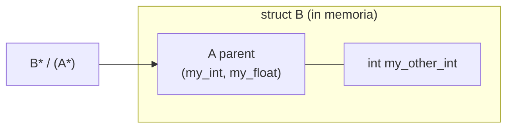

# Programmazione Object Oriented in C

> [!abstract] Scopo della lezione
> Il kernel di un sistema operativo è scritto quasi sempre in **C**, che non ha classi né metodi virtuali. Eppure un OS è pieno di "oggetti" (processi, file, dispositivi) con comportamenti diversi dietro un'interfaccia comune (pensa ai **driver**: ognuno implementa `read`/`write` a modo suo). La lezione mostra come ottenere **ereditarietà** e **polimorfismo (late binding)** in C usando **struct annidate** e **puntatori a funzione**, fino a costruire una **lista polimorfica**. Queste tecniche tornano in tutto il corso: liste di [[Process Control Block|PCB]], [[Interrupt Vector]], [[System Call|syscall vector]], [[Driver e Block Device|driver come classi virtuali]].
> Mappa dei concetti: [[MOC - Sistemi Operativi]]

## OOP come stile di programmazione

La programmazione **object oriented** aiuta a gestire progetti grandi grazie a tre concetti:

- **Incapsulamento**: dati e operazioni su quei dati stanno insieme; l'esterno usa solo l'interfaccia.
- **Polimorfismo (late binding)**: la funzione effettivamente chiamata viene decisa **a runtime** in base al tipo reale dell'oggetto. In Java lo si usa ogni volta che si fa l'*override* di un metodo.
- **Ereditarietà**: una classe figlia riusa ed estende attributi e metodi della classe padre.

L'OOP è uno **stile** di programmazione, non una proprietà del linguaggio. Alcuni linguaggi (C++, Java) lo supportano esplicitamente e lo rendono più comodo, ma lo si può usare **con qualsiasi linguaggio**. Un programma C++ viene compilato in codice macchina esattamente come un programma C: classi, ereditarietà e metodi virtuali sono tradotti dal compilatore in struct, offset e puntatori a funzione. In C facciamo **a mano** quello che il compilatore C++ fa per noi.

## Ereditarietà

Vedi [[Ereditarietà in C]].

Un'istanza di una classe `B` figlia di `A` contiene **tutti gli attributi di `A`**, e un'istanza di `B` **è anche** un'istanza di `A` (si può usare ovunque serva una `A`).

Esempio in C++ (simile a Java):

![[SO-L03-01.png]]

`B` eredita `my_int` e `my_float` da `A` e aggiunge `my_other_int`. La funzione `printMyInt(A* a)` accetta anche un puntatore a `B`. L'assegnamento `a = b` copia in `a` la parte "`A`" di `b` (*slicing*).

In C:

![[SO-L03-02.png]]

Una **classe** si implementa con una **struct**. L'ereditarietà si ottiene mettendo **come primo campo** della struct derivata un'**istanza della struct genitore** (`A parent;`).

> [!important] Perché deve essere il *primo* campo
> Un puntatore a una struct punta alla **prima cella di memoria** della struct, che è occupata dal suo primo campo. Se il primo campo di `B` è una `struct A`, allora l'indirizzo di un `B` coincide con l'indirizzo della sua parte `A`. Quindi un `B*` può essere convertito con un cast in un `A*` (`(A*)&b`) e usato da qualunque funzione che lavora su `A`.

## Una lista generica in C

Vedi [[Lista Generica in C]].

Applichiamo l'idea per costruire una **lista doppiamente concatenata** i cui elementi possono essere estesi per contenere **tipi arbitrari**.

![[SO-L03-03.png]]

L'header `linked_list.h` definisce:

- `ListItem`: il nodo generico, con soli puntatori `prev` e `next`;
- `ListHead`: la testa, con `first`, `last` e `size`;
- le operazioni `List_init`, `List_find`, `List_insert` (inserisce `item` dopo `previous`), `List_detach` (stacca un elemento senza deallocarlo).

Si noti che **non compare nessun campo con il contenuto** degli elementi: la lista gestisce solo i collegamenti. Il contenuto lo aggiungeranno le "classi derivate".

Implementazione:

![[SO-L03-04.png]]

`List_init` azzera la testa; `List_find` scorre linearmente la lista cercando il puntatore `item`.

![[SO-L03-05.png]]

`List_insert` controlla che l'elemento non sia già collegato (`item->next || item->prev`); se è definito `_LIST_DEBUG_` verifica anche con `assert` che l'elemento non sia nella lista e che `prev` lo sia. Poi aggancia `item` tra `prev` e il suo successore (o in testa se `prev == NULL`), aggiorna `first`/`last` e incrementa `size`.

![[SO-L03-06.png]]

`List_detach` ricollega tra loro il predecessore e il successore di `item`, aggiorna `first`/`last` se necessario, decrementa `size` e azzera i puntatori di `item`. **Non chiama `free`**: deallocare è compito di chi ha allocato.

### Estendere la lista: IntListItem

Per usare la lista dobbiamo **estenderla**: ad esempio una lista di interi.

![[SO-L03-07.png]]

`IntListItem` ha come **primo campo** un `ListItem` (ereditarietà) e poi il dato `int info`. `IntList_print` scorre la lista e fa il cast `(IntListItem*) aux` per leggere `info`: il cast è lecito proprio perché `ListItem` è il primo campo.

Un `main` di test:

![[SO-L03-08.png]]

Il main crea 64 `IntListItem` con `malloc`, li inserisce in coda, poi rimuove gli elementi dispari, metà della lista dalla testa, il resto dalla coda finché ne resta uno, e infine l'ultimo. Ad ogni passo stampa la lista.

> [!note] Collegamento al kernel
> Questa è esattamente la tecnica delle liste "intrusive" del kernel Linux (`struct list_head`). La stessa lista verrà riusata per le code di processi in [[05 - SO - Stack e Context Switch|lezione 5]] e in [[08 - SO - disastrOS|disastrOS]].

## Puntatori a funzione

Vedi [[Puntatori a Funzione]].

Un **puntatore a funzione** è una variabile che contiene l'**indirizzo d'inizio di una funzione** (l'indirizzo della sua prima istruzione nella sezione `.text`). Il suo **tipo dipende dalla funzione puntata**: dal tipo di ritorno e dai tipi dei parametri.

![[SO-L03-09.png]]

`IntFloatFnPtr` è "puntatore a funzione che prende `float` e ritorna `int`", `IntCharFnPtr` "che prende `char` e ritorna `int`". `p1 = p3` funziona perché hanno lo stesso tipo; `p2 = p1` **no**, perché i tipi sono diversi.

**Dichiarazione** di un tipo puntatore a funzione:

![[SO-L03-10.png]]

Ad esempio:

![[SO-L03-11.png]]

**Assegnazione** (il nome di una funzione, usato senza parentesi, è il suo indirizzo):

![[SO-L03-12.png]]

Oppure da un altro puntatore dello stesso tipo:

![[SO-L03-13.png]]

**Invocazione** della funzione puntata:

![[SO-L03-14.png]]

`(*p1)('c')` dereferenzia il puntatore e chiama la funzione; in C si può scrivere anche semplicemente `p1('c')`.

I puntatori a funzione sono usatissimi **nell'hardware** (il vettore delle interruzioni è un array di indirizzi di funzioni, vedi [[Interrupt Vector]]), **nell'OS** (il [[System Call|syscall vector]], le operazioni dei driver) e nell'**implementazione dell'OOP** (late binding, polimorfismo).

### Esempio: una macchina a stati

![[SO-L03-15.png]]

La variabile globale `action` è un puntatore a funzione. Ogni `actionFnX` stampa un messaggio e **cambia `action`** facendolo puntare alla funzione successiva. Il `main` a ogni pressione di un tasto chiama `(*action)()`: il comportamento cambia a runtime senza nessun `if` o `switch`. È una semplice **macchina a stati** 1 → 2 → 0 → 1 …

### Esempio: vettore di puntatori a funzione

![[SO-L03-16.png]]

`actions[MAX_ACTIONS]` è un **array di puntatori a funzione**: inizialmente tutti puntano a `actionFnDefault`, poi alcune celle vengono sovrascritte (0, 1, 8 → azioni, 9 → `actionFnQuit`). Il `main` legge un indice da tastiera, controlla che sia valido e invoca `(*actions[v])(v)`.

> [!important] Questa è la struttura dell'interrupt vector e del syscall vector
> Un numero (numero di interrupt, numero di syscall) viene usato come **indice** in un array di puntatori a funzione per scegliere il gestore. Lo rivedremo in [[06 - SO - Interrupt, Syscall, Dual Mode e Processi|lezione 6]] e in [[08 - SO - disastrOS|disastrOS]].

## Polimorfismo (late binding)

Vedi [[Virtual Method Table]].

In **Java** ogni metodo non `static` può essere soggetto a override. In **C++** solo i metodi dichiarati `virtual`.

Esempio in C++:

![[SO-L03-17.png]]

`a_ptr` è di tipo `A*`, ma quando punta a `b` la chiamata `a_ptr->print()` esegue `B::print`. La funzione da chiamare non è nota a tempo di compilazione: viene scelta **a runtime** in base al tipo reale dell'oggetto, cioè con **late binding**.

### Come è implementato: la Virtual Method Table

Il late binding si implementa aggiungendo a **ogni istanza** di una classe con metodi virtuali un **puntatore** a una struttura chiamata **virtual method table (VMT, o vtable)**.

- **Tutti gli oggetti della stessa classe puntano alla stessa istanza di VMT.**
- La VMT contiene i **puntatori alle funzioni** (le implementazioni dei metodi virtuali per quella classe, incluse quelle sovrascritte).
- Una chiamata a un metodo virtuale diventa: *segui il puntatore alla VMT → prendi il puntatore al metodo → chiamalo*.

Il **destructor** (dtor) è un metodo virtuale speciale chiamato quando un oggetto viene distrutto, ed è responsabile del **cleanup** (liberare memoria, chiudere risorse). C++ ne fornisce un'implementazione di default.

![[SO-L03-18.png]]

Due oggetti `A` puntano entrambi a `A_vmt` (con `print_ptr` e `dtor_ptr`); due oggetti `B` puntano entrambi a `B_vmt`.

In C:

![[SO-L03-19.png]]

- `A_ops` è la VMT: una struct che contiene il puntatore a funzione `print_fn`.
- La classe `A` contiene un puntatore `ops` alla sua VMT; `B` eredita da `A` (primo campo `A parent`) e quindi eredita anche il puntatore alla VMT.
- `a_ops` e `b_ops` sono **variabili globali** (un'istanza di VMT per classe), inizializzate con l'implementazione giusta di `print`.
- `A_print(A*)` è il **wrapper**: legge `a_ptr->ops->print_fn` e la chiama. Chiamato su `a1` stampa "A", su `(A*)&b1` stampa "B".

### Lista polimorfica

Con questi concetti si può implementare una **lista polimorfica**, che contiene oggetti arbitrari, istanze di "classi virtuali". Aggiungiamo anche un **destructor virtuale** facoltativo per estensioni successive.

![[SO-L03-20.png]]

Nuova versione dell'header: `ListItemOps` è la VMT con `dtor_fn` e `print_fn`. Ogni `ListItem` ha ora anche il campo `ops`. Le funzioni esposte `ListItem_destroy` e `ListItem_print` chiamano il metodo giusto attraverso la VMT; `ListItem_construct` installa la VMT nell'elemento.

![[SO-L03-21.png]]

Due "classi derivate": `IntListItem` e `FloatListItem`. Ognuna ha il proprio metodo di stampa e la **propria istanza globale di VMT** (`int_list_item_ops`, `float_list_item_ops`), con `dtor_fn = NULL`.

![[SO-L03-22.png]]

`ListItem_construct` azzera i collegamenti e imposta `ops`. I wrapper controllano con `assert` che la VMT e il metodo esistano prima di chiamarli. `List_print` scorre la lista e chiama `ListItem_print` su ogni elemento **senza sapere di che tipo sia**.

![[SO-L03-23.png]]

Il `main` crea elementi alternati: gli indici pari sono `IntListItem`, i dispari `FloatListItem`, ognuno costruito con la propria VMT. La stessa `List_print` stampa correttamente sia gli `[int]` che i `[float]`.

> [!tip] Dove ritroviamo questo schema
> Un **driver** nel kernel è proprio una "classe virtuale": una struct di puntatori a funzione (`open`, `read`, `write`, `ioctl`…) che ogni driver riempie con le proprie implementazioni. Vedi [[Driver e Block Device]] e [[12 - SO - File System|lezione 12]].
