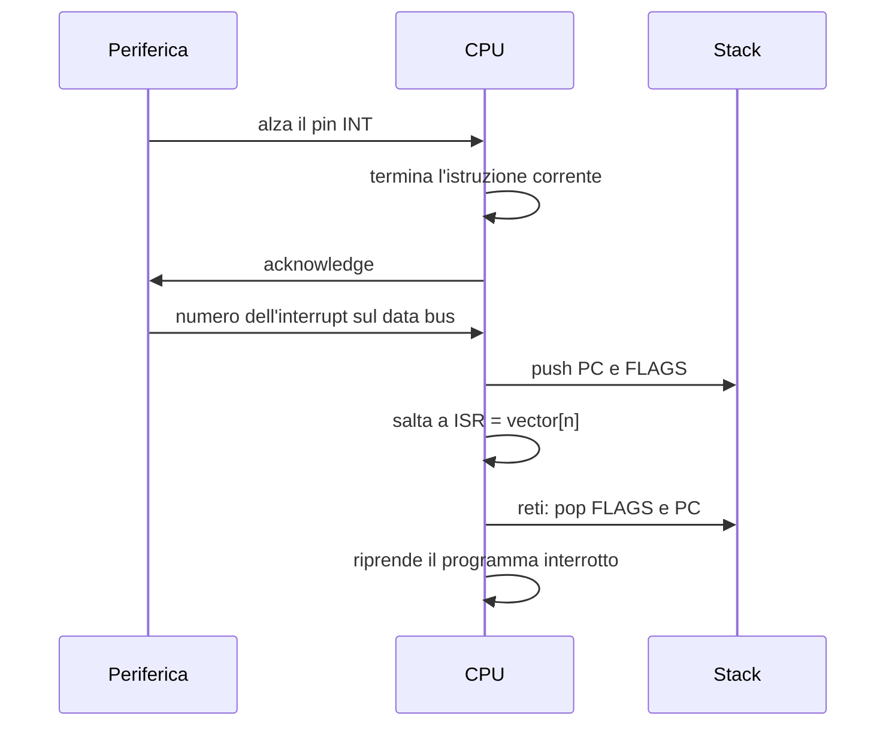

# Hardware e AVR

> [!abstract] Scopo della lezione
> Un sistema operativo esiste per gestire l'hardware, quindi bisogna sapere **come la CPU parla con il resto del mondo**: bus, cicli di lettura/scrittura, I/O mappato in memoria, **interrupt** e **DMA**. Poi si passa alla pratica su un microcontrollore **AVR** (Arduino Mega 2560), dove **non c'è un OS** e si programma direttamente l'hardware: porte digitali, **timer**, **PWM**, **interrupt** interni ed esterni, **UART**. Tutto quello che si vede qui (ISR, interrupt vector, salvataggio di flag e PC sullo stack) è la base su cui costruiremo il **context switch** nella [[05 - SO - Stack e Context Switch|lezione 5]] e le **syscall** nella [[06 - SO - Interrupt, Syscall, Dual Mode e Processi|lezione 6]].
> Mappa dei concetti: [[MOC - Sistemi Operativi]]

## CPU e bus

La **CPU** è sostanzialmente un **circuito**, un chip, che comunica con il resto del mondo attraverso dei **fili elettrici** che trasportano **segnali binari** (tensione alta = 1, tensione bassa = 0). I **pin** sono le uscite/entrate fisiche del circuito.

Un **bus** è un **gruppo di fili** che collega diversi dispositivi: cavi attraverso i quali più periferiche possono leggere o scrivere. Sono **bidirezionali** (la CPU su questi fili può sia leggere che scrivere). Vedi [[Bus di Sistema]].

Ci sono **3 tipi di bus**:

| Bus | Contenuto | Direzione tipica |
| --- | --- | --- |
| **Data bus** | i dati letti dalla / scritti nella memoria | bidirezionale (la CPU legge o scrive) |
| **Address bus** | l'indirizzo della cella di memoria che si sta leggendo/scrivendo | di solito la CPU scrive e basta |
| **Control bus** | segnali di controllo: lettura/scrittura, interrupt, arbitraggio del bus | misto |

- Quando la CPU deve **scrivere** in memoria (che è un altro chip), imposta i valori sui pin del data bus, che poi verranno letti dalla memoria.
- Quando deve **leggere**, si mette **in ascolto** sul data bus per leggere ciò che la memoria scrive.

### Esempio: una CPU a 8 bit (Z80)

![[SO-L04-01.png]]

Ogni pin rappresenta una **variabile binaria**:

- **A0–A15**: address bus a 16 bit, quindi la CPU può indirizzare 2¹⁶ = 64 KB.
- **D0–D7**: data bus a 8 bit: la CPU trasferisce 1 byte alla volta. Sono frecce doppie perché bidirezionali.
- **System control**: `MREQ` (richiesta di memoria), `IORQ` (richiesta di I/O), `RD` e `WR` (indicano se la CPU vuole leggere o scrivere), …
- **CPU control**: `WAIT` (la memoria chiede di aspettare), `INT` e `NMI` (interrupt e interrupt non mascherabile), `RESET`, `HALT`.
- **CPU bus control**: `BUSRQ` / `BUSACK` (una periferica chiede il bus, la CPU lo concede: servono per il [[DMA]]).
- `CLK`, +5V, GND: clock e alimentazione.

> [!note] La barra sopra il nome
> Un segnale con una riga sopra (es. $\overline{RD}$) è **attivo basso**: è "attivo" quando il pin va a 0. Abbassare $\overline{RD}$ significa "sto chiedendo una lettura".

### Architettura di un vecchio sistema

![[SO-L04-02.png]]

Un sistema minimo con Z80: la CPU è collegata tramite data bus e address bus a una **RAM** (32 KB, indirizzi `8000h–FFFFh`) e a una **ROM** (EPROM da 32 KB, indirizzi `0000h–7FFFh`) che contiene il programma eseguito **al boot**. Ci sono poi varie periferiche: un **PIO** (porte parallele) e una **UART** per la seriale RS232. Le porte logiche (74HCT32, 74HCT14) decodificano l'indirizzo per decidere **quale chip** deve rispondere (*chip select*).

Le **periferiche si presentano alla CPU come celle di memoria con un indirizzo** (es. il PIO a `00h–03h`, la UART a `80h–87h`).

### Un'architettura più moderna

![[SO-L04-03.png]]

La stessa architettura **Northbridge/Southbridge** vista nella [[01 - SO - Introduzione e Git#Organizzazione di un computer|lezione 1]]: sono stati aggiunti altri bus, separando i componenti veloci (memoria, grafica) da quelli lenti (dischi, USB, PCI, Super I/O).

### Il clock

Il **ciclo di clock** (o ciclo macchina) è un'**onda quadra** usata per **sincronizzare** il funzionamento dei vari dispositivi: tutto avviene sui fronti del clock. Più è veloce il clock, più operazioni la macchina compie nell'unità di tempo.

## Ciclo di lettura dalla memoria

Vedi [[Ciclo di Lettura e Scrittura in Memoria]].

Alla memoria serve sapere **dove** voglio leggere (l'indirizzo) e **che** voglio leggere. La memoria è una macchina e ha un **tempo di reazione**: la CPU deve essere disposta ad **aspettare** che la memoria serva la richiesta. Per segnalare che il dato è pronto, la memoria alza o abbassa un segnale (`WAIT`).

1. La CPU mette l'indirizzo desiderato sull'**address bus**.
2. Quando l'indirizzo è **stabilizzato elettricamente**, abbassa i pin `MREQ` e `RD` e si mette in ascolto.
3. Dopo un po' la memoria mette sul **data bus** il valore all'indirizzo richiesto (opzionalmente segnala di essere pronta tramite `WAIT`).
4. La CPU preleva il valore dal data bus.
5. Il ciclo di lettura si chiude (la CPU rialza `MREQ` e `RD`).

![[SO-L04-04.png]]

Lettura del diagramma temporale:

- **CLK** è il segnale di clock; il ciclo dura tre periodi T1, T2, T3.
- **A15–A0** porta l'indirizzo; la "X" all'inizio indica una **transizione** del segnale (i bit cambiano valore).
- **D7–D0** all'inizio è vuoto: la CPU vuole solo leggere, quindi non ci mette nulla.
- `MREQ` e `RD` vengono abbassati **dopo** aver impostato l'indirizzo, per dare tempo al segnale sull'address bus di **stabilizzarsi**.
- **WAIT** è un segnale che la CPU **legge**: tramite esso la memoria notifica di essere pronta.
- Ricevuta la notifica, al ciclo di clock successivo la CPU si aspetta di trovare il dato sul data bus ("In").
- Letto il dato, la CPU smette di richiedere la lettura e ripristina i pin che aveva abbassato.

## Ciclo di scrittura in memoria

Processo analogo alla lettura, con la differenza che bisogna **mettere sul data bus il dato** da scrivere.

1. La CPU mette l'indirizzo sull'address bus e il dato sul data bus.
2. Quando indirizzo e dati si sono stabilizzati, abbassa il pin `WR`.
3. La memoria memorizza il dato all'indirizzo richiesto (opzionalmente segnala di essere pronta con `WAIT`).
4. Il ciclo termina.

![[SO-L04-05.png]]

Si noti che qui il data bus è "Data Out" e viene impostato prima di abbassare `WR`.

## I/O mappato in memoria

Vedi [[Memory Mapped IO]].

Se voglio che alcuni segnali provenienti dall'esterno vengano letti o scritti dalla macchina devo definire delle **porte di I/O**. Le porte di I/O si possono vedere come **registri**: **variabili in memoria con locazioni fisse**.

- Quando leggo da una porta di I/O sto leggendo il valore di una locazione di memoria, il cui valore però dipende dai **segnali elettrici che qualcun altro applica dall'esterno**.
- La **scrittura** su I/O avviene quindi come una normale scrittura in memoria.

Questo modo di gestire l'I/O si chiama **memory mapped I/O**. Alcune CPU hanno invece **bus/spazi di indirizzi separati per l'I/O** (es. il pin `IORQ` dello Z80, le istruzioni `in`/`out` di x86), anche perché le operazioni di I/O sono tipicamente più lente di quelle di memoria.

## Interrupt

Vedi [[Interrupt]].

Un **hardware interrupt** è un **evento esterno** che notifica alla CPU che è successo qualcosa. Viene notificato **alzando (o abbassando) un pin** (il pin di interrupt) e porta all'esecuzione di una **routine speciale**, l'**interrupt handler** (o ISR, *Interrupt Service Routine*). Gli interrupt sono quindi causati dal **variare della tensione applicata a un pin**.

Come funziona:

1. Il microcodice (o la logica) della CPU **controlla a intervalli specifici** se si è verificato un interrupt, ad esempio all'inizio di ogni ciclo macchina o di ogni istruzione, leggendo il pin di interrupt.
2. Se c'è un interrupt, il dispositivo che l'ha generato viene **interpellato e identificato**. In alcune architetture la CPU si ferma e alza un segnale che chiede che venga scritto sul **data bus** un valore che identifica la sorgente. La periferica scrive un numero che la identifica: l'**indice** (o un offset) del suo handler nel **vettore delle interruzioni** ([[Interrupt Vector]]).
3. Il **program counter e i flag sono salvati sullo stack** e l'esecuzione salta all'interrupt handler.
4. Terminato l'handler, l'esecuzione **riprende da dove si era interrotta**.



### L'interrupt handler dal punto di vista software

Un interrupt handler è una **funzione speciale** che **non prende argomenti, ritorna `void`** e termina con l'istruzione **`reti`** (*return from interrupt*).

> [!important] `reti` vs `ret`
> `ret` (usata per tornare dalle normali chiamate a funzione) ripristina solo il program counter. `reti` ripristina **anche i flag**: quando arriva un interrupt i flag vengono salvati sullo stack (cosa che non avviene con una `call`), quindi `reti` deve recuperarli. Su AVR, `reti` riabilita anche gli interrupt globali.

Per scrivere un interrupt handler in C si usano **attributi o estensioni del compilatore**:

- `__attribute__((interrupt))`
- su AVR la macro `ISR(<event>)`, dove `<event>` è una costante che identifica l'evento. Ad esempio, per il timer: `ISR(TIMER0_COMPA_vect) { ... }`; per l'interrupt esterno 5: `ISR(INT5_vect) { ... }`.

La macro fa due cose: genera il **preambolo/postambolo** corretti (salvataggio dei registri usati e `reti` finale) e **installa l'indirizzo** della funzione nella posizione corretta dell'interrupt vector.

## DMA

Vedi [[DMA]].

Alcune periferiche hanno bisogno di lavorare sulla memoria **in parallelo alla CPU** (es. un disco che trasferisce un blocco di dati). Il **DMA** (*Direct Memory Access*) è una tecnica che permette a una periferica di **lavorare sulla memoria indipendentemente dalla CPU**. Sull'AVR non lo troveremo.

- Queste periferiche **condividono il bus con la CPU**, chiedendo e rilasciando il controllo del bus con segnali appositi (es. `BUSRQ`/`BUSACK` dello Z80). Servono quindi **segnali addizionali** per la gestione (arbitraggio) del bus.
- Mentre la periferica legge/scrive la memoria, la CPU **non ha accesso al bus**, ma tipicamente **può continuare a lavorare grazie alla cache**.
- A fine trasferimento la periferica avvisa la CPU con un interrupt.

## Microcontrollori

Vedi [[Microcontrollore e Bootloader]].

Un **microcontrollore** è un **sistema su un chip** che integra:

- CPU;
- RAM;
- periferiche (seriale, camera, USB, I/O digitale, ADC, …);
- memoria (flash) per contenere il programma.

È quindi un computer completo su cui posso far girare programmi. Si fa **tight programming**: i microcontrollori devono funzionare in modo affidabile e consumare poco, quindi **non c'è OS**, c'è **poca RAM**, si usa la **cross compilation** (si compila su un PC per un'altra architettura) e il **debugging è difficile**.

Per programmare un microcontrollore servono:

- un **cross compilation environment**, capace di produrre codice macchina per la macchina target;
- un dispositivo (**programmer**) per caricare il binario nella **flash** del microcontrollore;
- una **utility** sul PC host che pilota il programmer (es. **PICkit** per i PIC).

Il flusso era: si scrive il programma, lo si compila col cross compiler, e i byte generati vengono copiati nella memoria permanente (flash). Il programmer si collegava da un lato al PC e dall'altro fisicamente ad alcuni pin del microcontrollore, e riversava il programma nella flash.

### Il bootloader

Il programmer era costoso. Per ovviare al problema si mette direttamente nella flash del microcontrollore un piccolo programma, il **bootloader**:

- all'avvio rimane **in ascolto su una periferica** (una porta seriale, facilmente accessibile tramite USB);
- se riceve una certa **sequenza di attivazione**, avvia un programma che dialoga con il PC attraverso la porta e offre all'host un **protocollo per leggere/scrivere la flash**, cioè per caricare un nuovo programma;
- altrimenti salta al programma utente già presente.

L'**Arduino Mega 2560** ha un chip aggiuntivo (un altro microcontrollore) che fa da **convertitore USB-seriale**; il bootloader nel chip principale implementa l'interfaccia di programmazione, così non serve un programmer esterno.

## AVR

L'**AVR** è la famiglia di microcontrollori usata negli Arduino:

- chip a **8 bit**, architettura **RISC** (set di istruzioni ridotto): molte istruzioni richiedono **un solo ciclo di clock**;
- **32 registri a 8 bit** (R0–R31), uno **status register** (SREG, i flag), un **program counter** e uno **stack pointer** (a 16 bit, diviso in SPH e SPL);
- i modelli avanzati hanno molte periferiche integrate;
- supportato da **gcc/g++**: si programma in C/C++. È progettato per i compilatori (ottima toolchain, alta densità del codice).

![[SO-L04-06.png]]

Il **contesto di esecuzione** di un AVR: i registri general purpose R0–R31 (le coppie R26–R31 formano i registri puntatore a 16 bit **X**, **Y**, **Z**), lo status register **SREG**, il **PC** e lo **stack pointer** (SPH:SPL) che punta allo stack in RAM. Questo è esattamente lo stato che dovremo **salvare e ripristinare** per fare un context switch ([[Contesto di un Processo]], [[05 - SO - Stack e Context Switch|lezione 5]]).

### ATmega2560 (Arduino Mega)

![[SO-L04-07.png]]

Lo schema a blocchi: al centro la **CPU AVR** con **FLASH** (programma) e **SRAM** (dati), più EEPROM. Attorno, collegate al bus interno, le periferiche: porte digitali **A–L** da 8 bit, **timer/counter** a 8 bit (T/C 0 e 2) e a 16 bit (T/C 1, 3, 4, 5), **4 USART**, **SPI**, **TWI** (I²C), **convertitore A/D**, comparatore analogico, JTAG, watchdog, oscillatore e clock.

## Arduino e toolchain

Vedi [[Toolchain AVR]].

**Arduino** è un ambiente di programmazione (IDE + librerie + compilatore C++) e una **board** che integra un convertitore USB-seriale e un bootloader. Noi **non useremo l'IDE**, ma solo il compilatore.

Poiché sull'Arduino c'è già un bootloader, non serve un programmer: servono solo il **cross compiler** e l'**utility che dialoga con il bootloader**.

### La porta seriale

Quando si collega l'Arduino al PC viene creato il file **`/dev/ttyACM0`**: è la porta seriale attraverso cui parliamo con la board. Quando la si scollega il file scompare. Nei sistemi Unix i dispositivi sono file (vedi [[Device File e ioctl]]).

Per accedere a `/dev/ttyACM0` l'utente deve appartenere al gruppo **`dialout`** (il comando `groups` mostra i propri gruppi):

```bash
sudo addgroup <nomeutente> dialout
```

### Installazione

![[SO-L04-08.png]]

(Ubuntu) Il pacchetto `arduino` contiene l'ambiente di programmazione con tutti i compilatori necessari; `arduino-mk` contiene un insieme di script (Makefile) che useremo. Il compilatore si chiama **`avr-gcc`**, e insieme alle utility binarie (`avr-objcopy`, …) permette di generare un programma per Arduino.

### Compilazione

![[SO-L04-09.png]]

Compila `filename.c` e genera `filename.elf`, un formato che contiene codice macchina AVR (vedi [[Loader ed ELF]]).

AVR produce molti microcontrollori diversi, quindi bisogna specificare per quale **chip target** si compila e a che **frequenza** gira:

![[SO-L04-10.png]]

- `-mmcu=atmega2560`: il tipo di MCU;
- `-DF_CPU=16000000UL`: definisce la macro `F_CPU` = 16 MHz, usata ad esempio da `_delay_ms` per calcolare quanti cicli attendere.

Oltre alle opzioni classiche:

![[SO-L04-11.png]]

Comando completo:

```bash
avr-gcc -mmcu=atmega2560 -DF_CPU=16000000UL -Wall --std=gnu99 -o filename.elf filename.c
```

### Caricamento tramite bootloader

1. Convertire il file `.elf` in un `.hex` (formato Intel HEX) comprensibile dal software del programmer:

   ![[SO-L04-12.png]]

   `avr-objcopy` prende `filename.elf` e genera `filename.hex`; `-O ihex` sceglie il formato d'uscita, `-R .eeprom` esclude la sezione EEPROM.

2. Caricare il `.hex` sulla board invocando **`avrdude`**:

   ![[SO-L04-13.png]]

   Dialogando con la scheda, `avrdude` copia `filename.hex` nella flash dell'Arduino collegato su `/dev/ttyACM0`. (Su Arch Linux il file `avrdude.conf` può trovarsi in un percorso diverso, es. `/usr/share/arduino/hardware/archlinux-arduino/avr/bootloaders/gemma/avrdude.conf`.)

3. Significato delle opzioni:

   ![[SO-L04-14.png]]

Ricapitolando:


### Makefile

Tutto questo si automatizza con un [[Makefile]] (vedi [[02 - SO - Programmi, Makefile e pkg-config|lezione 2]]):

```make
BINS = main.elf      # file .elf che contengono un main da eseguire
OBJS = f.o           # un .o per ogni altro file .c
HEADERS = f.h        # header inclusi
include <path>/avr_common/avr.mk   # Makefile del professore con le regole
```

Uso:

```bash
make clean      # elimina .elf e .hex
make            # genera il .elf
make main.hex   # genera main.hex e lo carica sulla board
```

### printf sulla seriale

Il professore fornisce un **wrapper di `printf`** che invia l'output sulla porta seriale (definito in `avr_common/uart.h`). Va attivato all'inizio del programma con `printf_init();`. Per vedere l'output si usa un terminale seriale come **cutecom**, in ascolto alla stessa velocità (**baud rate**, bit al secondo).

Primo programma AVR, che stampa una stringa sulla serial line:

![[SO-L04-15.png]]

Il programma inizializza la printf/UART e poi in un ciclo infinito stampa `hello <k>` e attende 1 secondo con `_delay_ms(1000)`.

Per caricarlo: collegare l'Arduino e, dalla directory del programma, eseguire `make hello_avr.hex`. Per vedere l'output: avviare cutecom sulla porta `/dev/ttyACM0` a **19200 baud, 8 bit di dati, nessuna parità, 1 bit di stop** (8N1).

> [!warning] Baud rate
> Negli appunti compare sia 19600 che 19200: il valore standard (e quello da usare in cutecom) è **19200** baud. Il valore deve coincidere con quello usato nel codice per configurare la UART.

## Periferiche dell'AVR

![[SO-L04-16.png]]

L'AVR integra: **porte seriali** (UART, I²C), **convertitori analogico-digitali**, **generatori PWM**, **timer**, **porte digitali**, **EEPROM**.

Questi dispositivi sono **mappati in memoria** come un insieme di **control register** (variabili): accediamo ai dispositivi come a delle variabili, già dichiarate dall'ambiente (`<avr/io.h>`). Un dispositivo si **configura scrivendo** nei suoi registri. Le periferiche sono collegate alla CPU da molti fili, e alcune possono **generare interrupt** (pressione di un tasto, scadenza di un timer, fine di una conversione A/D…).

## Porte digitali

Vedi [[Porte Digitali AVR]].

Ogni porta è una **variabile a 8 bit**, e ogni bit corrisponde a uno specifico **pin** (per sapere quale pin fisico corrisponde a quale bit si consulta il datasheet/pin mapping). Sull'ATmega le porte sono indicate da lettere (A, B, C, …, L). Ogni pin può valere 0 (0 V) o 1 (5 V), e per ogni pin si può voler **leggere** (input) o **scrivere** (output).

Per ogni porta ci sono **3 registri** a 8 bit:

![[SO-L04-17.png]]

| Registro | Uso | Bit i = 1 | Bit i = 0 |
| --- | --- | --- | --- |
| **DDRx** (*Data Direction*) | direzione del pin (scrittura) | pin in **output** | pin in **input** |
| **PORTx** | valore di output (scrittura) | output: pin a +5V. Input: **abilita la resistenza di pull-up** | output: pin a 0V |
| **PINx** | valore letto (lettura) | sul pin c'è circa 5V | sul pin c'è circa 0V |

`PORTx` ha senso se il pin è in output, `PINx` se è in input.

> [!tip] Pull-up / pull-down
> È buona norma **non lasciare pin "appesi"** (flottanti): un pin di input non collegato a nulla legge valori casuali dovuti ai disturbi. Lo si collega a 5V (pull-up) o a 0V (pull-down) tramite una **resistenza molto alta**, che fissa il valore di riposo senza impedire a un segnale esterno di cambiarlo. Sull'AVR il pull-up interno di un pin di input si attiva mettendo a 1 il bit corrispondente in `PORTx`.

### Esempio: LED blink (scrittura su un pin)

![[SO-L04-18.png]]

Il LED "L" della board è collegato al **pin digitale 13**, che dal pin mapping dell'Arduino Mega corrisponde a **PB7** (bit 7 della porta B). Accendere/spegnere il LED significa quindi mettere a 1/0 il bit 7 di `PORTB`.

- `mask = (1<<7)` = `10000000`: un 1 spostato a sinistra di 7 posizioni.
- `DDRB |= mask`: imposta il pin 7 della porta B come **output** (OR bit a bit: `DDRB` resta uguale tranne il bit 7, che diventa 1).
- Nel ciclo, `k` viene incrementato a ogni iterazione, quindi il suo bit meno significativo (`k&1`) alterna 0 e 1.
- Se `k&1` è 1, `PORTB = mask` (bit 7 a 1, LED acceso); altrimenti `PORTB = 0` (LED spento).
- Stampa `led 0`/`led 1` e aspetta 1 secondo.

### Esempio: lettura da un pin

![[SO-L04-19.png]]

Si sceglie il **pin 12**, che corrisponde a **PB6** (bit 6 della porta B). Lo si configura come input con pull-up, poi lo si "disturba" con un filo collegato a **GND**.

- `mask = (1<<6)` = `01000000` (un 1 spostato a sinistra di **6** posizioni).
- `DDRB &= ~mask`: `~mask` = `10111111`; l'AND azzera solo il bit 6, quindi PB6 diventa **input**.
- `PORTB |= mask`: abilita la **pull-up** sul bit 6, quindi a pin scollegato si legge 1.
- Ogni 500 ms si legge `PINB & mask` (tutti 0 tranne eventualmente il bit 6). `key = (PINB & mask) == 0`: `key` vale 1 quando il pin è a 0, cioè quando è collegato a massa.
- Si stampano `PORTB` e `key`.

Eseguendo il programma `key` vale sempre 0 (grazie alla pull-up il bit 6 è 1). Collegando il filo tra GND e il pin 12, `key` diventa 1: siamo in grado di leggere un input dall'esterno.

Esercizi per casa: *shaft encoder* e *keyboard matrix*.

## Timer

Vedi [[Timer AVR]].

Un **timer** è una periferica che consiste in un **registro che conta, indipendentemente dalla CPU**. Il contatore progredisce a intervalli programmabili: a ogni colpo di clock (eventualmente diviso) oppure a ogni evento su un certo pin. Si può anche fare in modo che il timer generi un evento quando il conteggio raggiunge un valore.

Usi dei timer:

- misurare intervalli di tempo;
- catturare l'istante in cui accade un evento esterno;
- generare forme d'onda (es. per telecomunicazioni, PWM);
- generare interrupt a un tempo specifico (la base del **preemptive multitasking**, vedi [[Preemptive Multitasking su AVR]]).

Il **mega2560 ha 6 timer**: T/C 0 e 2 con contatore a **8 bit** (conta fino a 255), T/C 1, 3, 4, 5 con contatore a **16 bit** (fino a 65535). Di default, quando il conteggio satura, riparte da 0 (*overflow*), ma il comportamento è programmabile.

Per un timer servono:

| Registro | Funzione |
| --- | --- |
| **TCNTn{H/L}** | il **contatore**, incrementato periodicamente dall'hardware. Essendo a 16 bit, `H` e `L` indicano la parte alta e bassa |
| **TCCRnA/B/C** | *Timer Counter Control Register*: bit che abilitano/disabilitano funzionalità, scelgono la modalità e il **prescaler** |
| **OCRnA/B/C{H/L}** | *Output Compare Register* (3 per timer): quando il contatore è uguale a OCR viene generato un **evento** |

### Prescaler

Di default il contatore si incrementa a ogni ciclo di clock (16 MHz su Arduino): è molto veloce. Per rallentarlo si usa il **prescaler**, un circuito tra il clock e il contatore che **divide la frequenza** per una potenza di 2 (1, 8, 64, 256, 1024).

### Eventi di compare

Quando `TCNT == OCR` si genera un **evento**, che può essere:

- un **interrupt**;
- la modifica di un **pin di output** (alzarlo/abbassarlo/invertirlo): usato per generare forme d'onda.

Il comportamento è controllato dai registri **TCCR**, la cui descrizione bit per bit è nel datasheet. Quando si vuole configurare un timer, si apre il datasheet e se ne legge la sezione.

### Esempio: leggere un timer con prescaler

![[SO-L04-20.png]]

Si usa il **timer 4** (16 bit).

- `TCCR4A = 0`: disabilita tutte le funzionalità di PWM e compare.

  ![[SO-L04-21.png]]

- `TCCR4B = (1<<CS42) | (1<<CS40)`: imposta i bit di prescaling `CS42` e `CS40`.

  ![[SO-L04-22.png]]

  Secondo la tabella, la combinazione `CS2:0 = 101` divide il clock per **1024** (= 2¹⁰):

  ![[SO-L04-23.png]]

- Nel ciclo si legge `TCNT4`, lo si stampa e si attende.

Eseguendo il programma si vedono valori crescenti del contatore che, raggiunto 65535, ricominciano da 0.

> [!warning] Correzione
> Negli appunti compare "2^32 = 1024": in realtà 1024 = **2¹⁰**.

## PWM

Vedi [[PWM]].

I circuiti digitali lavorano su due soli valori: 0 (0V) e 1 (5V). Per generare un segnale **pseudo-continuo** (un valore intermedio) si genera un'**onda quadra** e se ne varia il **duty cycle**, cioè la **frazione del periodo in cui il segnale è alto**.

![[SO-L04-24.png]]

![[SO-L04-25.png]]

- duty cycle 50%: onda quadra perfetta;
- duty cycle 25%: il segnale è alto il 25% del tempo;
- duty cycle 0%: sempre 0V; 100%: sempre +5V.

Facendo la **media** del segnale su un periodo si ottiene un valore pari alla stessa percentuale del valore alto: con duty cycle 25% la media è 0.25 × 5V = 1.25V. Così si simula un valore continuo tra 0 e 5V (è quello che fa `analogWrite` di Arduino). La tecnica si chiama **Pulse Width Modulation (PWM)**.

> [!example] Esempio intuitivo
> Un LED può essere solo acceso o spento. Per ottenere metà luminosità lo si accende e spegne **molto velocemente**, tenendolo acceso metà del tempo: l'occhio percepisce la media.

Si implementa la PWM con un **timer** e un **output compare register**: si scrive in OCR il valore del contatore al quale il segnale deve andare alto o basso, e si configura il timer (tramite i registri di controllo) per **pilotare un pin di output**. Ogni OCR è collegato a uno specifico pin (vedi datasheet).

### Esempio: LED che "respira"

![[SO-L04-26.png]]

Si vuole variare la luminosità del LED con un segnale PWM il cui duty cycle cambia nel tempo. Si usa il **timer 1**.

- Dal datasheet si ricavano i bit da impostare in `TCCR1A` e `TCCR1B` per la modalità **Fast PWM a 8 bit** (mode 5: `WGM12` e `WGM10`), output compare in modalità invertente (`COM1C0` e `COM1C1`) e nessun prescaler (`CS10`). Si definiscono le maschere `TCCRA_MASK` e `TCCRB_MASK`.

  ![[SO-L04-27.png]]

- Si scrivono le maschere nei registri di controllo.
- Il contatore 1 è a 16 bit ma si vuole contare a 8 bit: si azzerano parte alta e parte bassa di `OCR1C` (`OCR1CH = 0`, `OCR1CL = 0`); poi si modificherà solo la parte bassa.
- Dal datasheet **OC1C è collegato a PB7**, cioè al LED: si configura PB7 come output.
- Nel ciclo una variabile a 8 bit `intensity` viene incrementata di 8 ogni 100 ms e scritta in `OCR1CL`. Essendo a 8 bit, dopo 255 torna a 0.

Sull'Arduino il LED "pulsa": passa gradualmente da acceso a fioco e poi torna acceso.

> [!note] Perché OCR alto = luce bassa
> Il timer è configurato in modalità **invertente**: l'uscita è **0 finché il contatore è minore di OCR** e 1 dopo. Con OCR piccolo l'uscita è alta per quasi tutto il periodo (duty cycle alto, LED luminoso); con OCR grande è alta solo per poco (LED fioco). Il duty cycle è circa (256 − OCR)/256.

### Calcolare il valore di OCR

Per generare un evento ogni *T* secondi:

1. Si calcolano i **count per secondo**, cioè la frequenza con cui si incrementa il contatore:

   $$f_{count} = \frac{f_{clock}}{prescaler}$$

   Esempio: con prescaler 1024, $16 \cdot 10^6 / 1024 = 15625$ count al secondo.
2. Si moltiplica l'intervallo desiderato per i count al secondo:

   $$OCR = T \cdot f_{count}$$

   Esempio: per un evento ogni 0.01 s, $0.01 \cdot 15625 = 156.25$. (Se ci sono 10 count al secondo e voglio un evento dopo 20 s, scrivo 200.)

Nei registri si possono scrivere solo **interi**: se il risultato ha una parte decimale si ha un **errore di quantizzazione** (156 invece di 156.25).

## Interrupt da timer

Il timer può generare **interrupt a intervalli regolari**. Serve:

1. configurare la frequenza del timer con il **prescaler**;
2. scegliere un registro OCR in grado di generare interrupt;
3. dire al timer cosa fare quando si verifica l'evento (nessuna azione sul pin, solo interrupt);
4. impostare nel registro **TIMSKn** (*Timer Interrupt Mask*) il bit che abilita l'interrupt quando il contatore eguaglia OCR;
5. scrivere l'**interrupt handler**, invocato quando l'evento accade.

> [!important] Gli interrupt handler devono essere brevi
> Un ISR deve essere **piccolo ed efficiente**: mentre gira, gli altri interrupt sono bloccati. Se c'è un calcolo pesante (o una `printf`, che è lenta) si **delega al programma principale**: l'ISR alza solo un flag.

### Esempio: Timer5/OCR5A, un interrupt ogni 100 ms

![[SO-L04-28.png]]

- `interrupt_occurred` e `int_count` sono **`volatile`**: possono essere modificate da un evento esterno al flusso normale (l'ISR), quindi il compilatore non deve ottimizzarne gli accessi (es. tenendole in un registro).
- `ISR(TIMER5_COMPA_vect)`: la macro fa terminare il corpo con `reti` e popola l'interrupt vector scrivendo nella locazione `TIMER5_COMPA_vect` l'indirizzo della routine. L'ISR alza solo il flag e incrementa il contatore.
- Nel `main`: `TCCR5A = 0`; `TCCR5B` imposta la modalità **CTC** (`WGM52`, il contatore riparte da 0 quando raggiunge OCR5A) e prescaler 1024 (`CS50|CS52`).
- `ocrval = 15.625 * timer_duration_ms` (15625 count/s = 15.625 count/ms), scritto in `OCR5A`.
- `cli()` disabilita globalmente gli interrupt mentre si configura; `TIMSK5 |= (1<<OCIE5A)` abilita l'interrupt di compare A del timer 5; `sei()` riabilita gli interrupt.

  ![[SO-L04-29.png]]

- Nel ciclo: attesa attiva finché `interrupt_occurred` è 0, poi lo si azzera e si stampa il contatore.

Ci si aspetta che il programma stampi il contatore ogni 100 ms.

> [!note] `cli()` e `sei()`
> Servono a evitare che parta un interrupt **mentre si sta configurando** (es. a metà dell'impostazione di più maschere). Qui sarebbe superfluo, ma è una buona pratica.

### Evitare il busy waiting

![[SO-L04-30.png]]

Invece di girare a vuoto in `while(!interrupt_occurred);` (*busy waiting*, spreca energia), si mette la CPU a dormire con `sleep_cpu()`. Un interrupt la risveglia. Il controllo `if (!interrupt_occurred) continue;` serve perché anche la `printf` (tramite la UART) genera interrupt che svegliano la CPU: bisogna verificare che il risveglio sia dovuto al timer. È lo stesso confronto **polling vs interrupt** della [[06 - SO - Interrupt, Syscall, Dual Mode e Processi#Polling vs interrupt|lezione 6]].

## Interrupt esterni

Vedi [[Interrupt Esterni AVR]].

Sono interrupt causati da un **pin esterno**. Due tipi:

- **INTn**: legato a **uno specifico pin**. Sono in numero limitato (il datasheet dice quale pin corrisponde a quale INT). Si configura se scatta sul **fronte di salita** (*rising edge*, 0 → 1), sul **fronte di discesa** (*falling edge*, 1 → 0), su **entrambi** o sul **livello basso**.
- **PCINTn** (*pin change interrupt*): legato a **una porta**; scatta quando **un qualunque pin** abilitato della porta **cambia stato**. Chiama la **stessa interrupt routine per tutti i pin** della porta: utile quando una periferica usa più pin e si vuole monitorarli tutti con un solo handler.

### Esempio INTn

![[SO-L04-31.png]]

Si vuole reagire al cambiamento di stato del **pin 21**, che dal pinout corrisponde a **INT0** (bit 0 della porta D).

- Variabili `interrupt_occurred` e `int_count` come nell'esempio precedente; `ISR(INT0_vect)` alza il flag e conta.
- `DDRD = 0x0`: tutti i pin della porta D come input. `PORTD = 0x1`: pull-up sul bit 0.
- `EIMSK |= 1<<INT0`: abilita l'interrupt esterno 0. **EIMSK** è l'*External Interrupt Mask Register*: mettendo a 1 un bit si abilita il pin corrispondente a generare interrupt.

  ![[SO-L04-32.png]]

- `EICRA = 1<<ISC01 | 1<<ISC00`: **EICRA** (*External Interrupt Control Register A*) imposta il tipo di trigger.

  ![[SO-L04-33.png]]

  Con `ISC01 = 1`, `ISC00 = 1` l'interrupt scatta sul **rising edge**:

  ![[SO-L04-34.png]]

- `sei()` abilita gli interrupt; poi il solito ciclo che stampa il contatore.

Collegando il pin a GND con un filo il pin va a 0; **togliendo il filo** la pull-up lo riporta a 1 (fronte di salita) e scatta l'interrupt.

> [!warning] Correzione
> Negli appunti i fronti sono invertiti: il **rising edge** è la transizione **0 → 1**, il **falling edge** è **1 → 0**. Nell'esempio l'interrupt scatta togliendo il filo proprio perché il pin passa da 0 (a massa) a 1 (pull-up).

Su cutecom il contatore non avanza di uno alla volta (es. int2, int14, int18…): inserendo/togliendo il filo il contatto "rimbalza" (**bouncing**) e genera molti fronti spuri. Anche qui si può evitare il busy waiting come prima.

### Esempio PCINTn

![[SO-L04-35.png]]

Si installa un handler che reagisce al cambiamento dei 4 pin **PB0–PB3** (pin 53, 52, 51, 50), collegati a **PCINT0–PCINT3**.

- `PIN_MASK = 0x0F` (`00001111`). Le variabili `previous_pins` e `current_pins` memorizzano lo stato precedente e attuale dei pin.
- L'ISR `ISR(PCINT0_vect)` salva il vecchio stato e legge `current_pins = PINB & PIN_MASK`, cioè i bit 0–3 di `PINB` con gli altri azzerati.
- `DDRB &= ~PIN_MASK`: pin 0–3 della porta B come input, gli altri invariati. `PORTB |= PIN_MASK`: pull-up sui bit 0–3.
- `PCICR |= (1<<PCIE0)`: abilita il gruppo di pin change interrupt 0. **PCICR** dice quale PCINT abilitare.

  ![[SO-L04-36.png]]

- `PCMSK0 |= PIN_MASK`: abilita l'interrupt on change sui singoli bit 0–3. In **PCMSK0** ogni bit a 1 abilita il pin corrispondente.

  ![[SO-L04-37.png]]

- Il ciclo è analogo agli esempi precedenti.

Inserendo o togliendo il filo, cutecom stampa `int_count`, `previous_pins` e `current_pins` (in esadecimale).

## UART: la porta seriale

Vedi [[UART]].

Finora abbiamo usato la seriale tramite `printf`; ora vediamo come **scrivere direttamente** sulla porta seriale.

A livello elettrico una porta seriale ha **3 fili**: **massa** (GND), **TX** (trasmissione) e **RX** (ricezione). Trasmettitore e ricevitore **non condividono un clock**, quindi la comunicazione è **asincrona**: si mettono d'accordo sulla velocità (il **baud rate**, bit al secondo) e ogni byte viene "incorniciato":

- un **bit di start** segnala l'inizio del carattere e permette al ricevitore di sincronizzarsi;
- seguono i **bit di dati** (di solito 8);
- un eventuale **bit di parità** per rilevare errori di trasmissione;
- uno o più **bit di stop** riportano la linea a riposo.

Quindi per inviare 8 bit di dati se ne inviano tipicamente **10** (start + 8 dati + stop).

> [!warning] Correzione
> A riposo la linea seriale TTL è **alta** (idle = 1) e il bit di start è un **livello basso**: il fronte di discesa segnala l'inizio del carattere. Lo stop bit riporta la linea **alta**. Di solito si usano **1 bit di start e 1 bit di stop** (non 0 bit di stop).

Il tutto è gestito da un circuito apposito: la **UART** (*Universal Asynchronous Receiver-Transmitter*). Sull'ATmega2560 ci sono 4 seriali, ognuna con la propria UART.

Una porta seriale è controllata da 3 registri (`n` = numero dell'UART):

| Registro | Funzione |
| --- | --- |
| **UDRn** (*UART Data Register*) | dati da inviare/ricevuti. Scrivendoci un valore la UART inizia a trasmetterlo; leggendolo si ottiene l'ultimo byte ricevuto. In hardware, l'UDR di lettura e quello di scrittura sono **due registri diversi** allo stesso indirizzo |
| **UBRRn{H,L}** (*UART Baud Rate Register*) | velocità di trasmissione: un valore che dipende dalla frequenza del clock, così che la temporizzazione dei bit corrisponda al baud rate scelto |
| **UCSRn{A,B,C}** (*UART Control and Status Register*) | configurazione (bit di dati, parità, stop, abilitazione RX/TX e interrupt) e **stato**: dice se la trasmissione è finita o se è arrivato un dato |

- **Trasmissione**: per scrivere un byte basta scriverlo in `UDRn`. Per sapere se il buffer di trasmissione è libero si controlla il bit **UDREn** di `UCSRnA`.
- **Ricezione**: si controlla il bit **RXCn** di `UCSRnA`: se è 1 è stato ricevuto qualcosa e lo si legge da `UDRn`. La lettura azzera il flag.
- Volendo si può collegare un **interrupt** alla UART: quando ha finito di ricevere un carattere lancia un interrupt il cui handler mette il dato in un **buffer**. Analogamente, quando ha finito di trasmettere, l'handler preleva dal buffer il prossimo dato da inviare. È così che lavorano i driver veri.

### Esempio: funzioni base su UART0

![[SO-L04-38.png]]

`MYUBRR = F_CPU/16/BAUD - 1` è la formula del datasheet per il valore di UBRR in modalità normale.

**`UART_init()`**:

- imposta il baud rate in `UBRR0H` e `UBRR0L` (parte alta e bassa del valore a 12 bit):

  ![[SO-L04-39.png]]

  La tabella del datasheet dà i valori di UBRR e l'errore percentuale per le frequenze di clock più comuni:

  ![[SO-L04-40.png]]

- con `UCSR0C = (1<<UCSZ01) | (1<<UCSZ00)` imposta il formato del frame: **8 bit di dati**.

  ![[SO-L04-41.png]]

  - bit 7–6 (`UMSEL`): modalità di funzionamento (asincrona/sincrona);
  - bit 5–4 (`UPM`): generazione e controllo della **parità** (nessuna/pari/dispari);
  - bit 3 (`USBS`): numero di bit di stop (1 o 2);
  - bit 2–1 (`UCSZ`): numero di bit di dati;
  - bit 0 (`UCPOL`): polarità del clock, solo in modalità sincrona.

- abilita ricezione e trasmissione con `UCSR0B = (1<<RXEN0) | (1<<TXEN0) | (1<<RXCIE0)`:

  ![[SO-L04-42.png]]

  - `RXEN0` abilita il ricevitore;
  - `TXEN0` abilita il trasmettitore;
  - `RXCIE0` abilita l'interrupt di ricezione completata.

**`UART_putChar(c)`**: busy waiting finché il bit `UDRE0` diventa 1 (buffer di trasmissione vuoto), poi scrive `c` in `UDR0`.

**`UART_getChar()`**: busy waiting finché il bit `RXC0` diventa 1 (dato ricevuto), poi restituisce `UDR0`.

Tutte le operazioni sono **bloccanti**, perché fanno polling sui bit di stato.

### Esempio: echo server

![[SO-L04-43.png]]

Sulla base delle primitive precedenti si implementa un **echo server** che ripete sulla seriale la stringa ricevuta da cutecom. Le stringhe terminano con `0`, `'\n'` o `'\r'`.

- **`UART_getString(buf)`**: legge caratteri dalla UART e li salva in `buf` finché non arriva il terminatore; restituisce il numero di caratteri letti.
- **`UART_putString(buf)`**: trasmette i caratteri della stringa sulla UART fino allo `0`.
- Il `main` inizializza la UART, scrive un messaggio di benvenuto e poi in un ciclo legge una stringa, risponde `received` e rimanda indietro la stringa.

### Esercizi per casa

![[SO-L04-44.png]]

1. Risolvere l'esercizio dello *shaft encoder* usando PCINT, per 4 encoder (su bit adiacenti di una porta).
2. Estenderlo per stampare sulla seriale lo stato degli encoder ogni 100 ms, usando **correttamente** il timer: l'interrupt alza un flag e il lavoro lento (la stampa) si fa nel main loop.
3. Estendere l'esercizio 2 usando direttamente la UART (niente `printf`).
