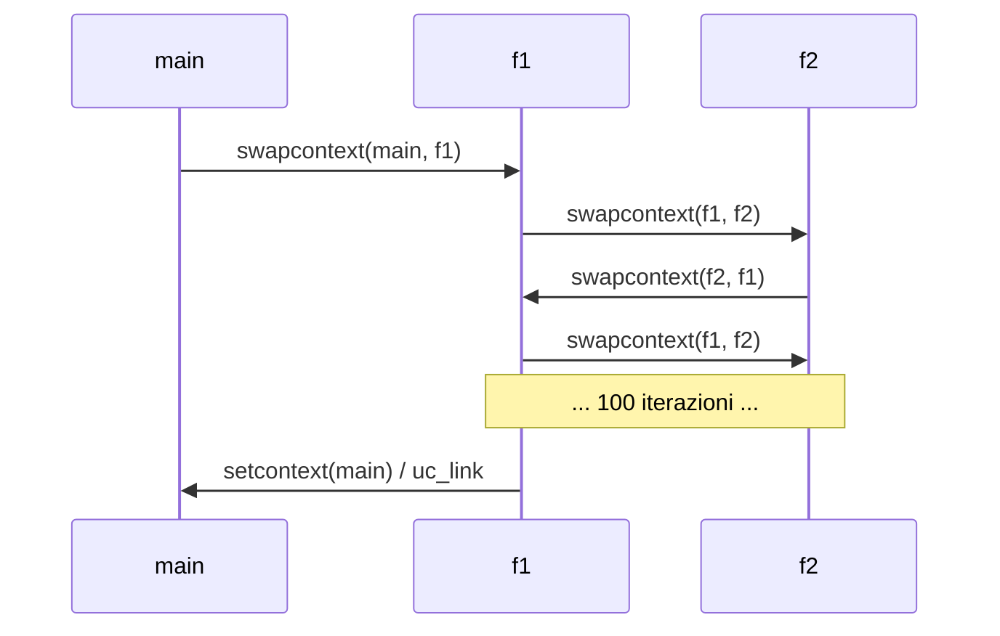
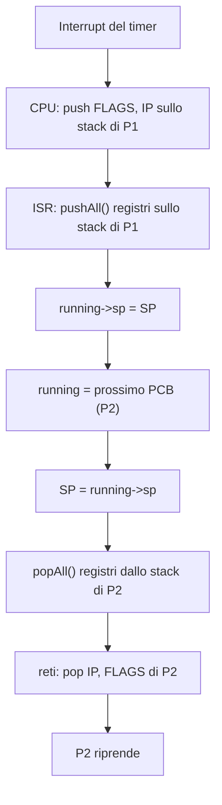

# Stack e Context Switch

> [!abstract] Scopo della lezione
> Un sistema multitasking dà l'illusione che più programmi girino insieme su una sola CPU: in realtà la CPU **salta da un flusso di esecuzione all'altro**, salvando e ripristinando ogni volta lo stato. La lezione chiarisce **cos'è il contesto** di un processo, mostra come cambiare contesto **esplicitamente** in user space con la libreria `ucontext` (coroutine), e poi costruisce un vero **preemptive multitasking su AVR**, in cui il cambio di contesto è forzato da un **interrupt del timer**. Il meccanismo chiave: *salvo i registri sullo stack del processo corrente, salvo lo stack pointer nel suo TCB, carico lo stack pointer di un altro processo, ripristino i suoi registri, `reti`*.
> Mappa dei concetti: [[MOC - Sistemi Operativi]]

## Processo e contesto

Un **processo** è un **programma in esecuzione** (vedi [[Program File e Processo]]).

Il **contesto** di un processo rappresenta lo **stato di un flusso di esecuzione** ([[Contesto di un Processo]]). È caratterizzato da:

- lo **stato dei registri della CPU** (incluso program counter, stack pointer e flag);
- la **memoria del processo**:
  - **codice binario** del programma (`.text`): durante l'esecuzione tipicamente è di sola lettura;
  - **variabili inizializzate** (`.data`);
  - **variabili globali non inizializzate** (`.bss`);
  - **stack**.

![[SO-L05-01.jpeg]]

L'immagine di memoria di un processo ([[Immagine di Memoria di un Processo]]), con i permessi di ogni sezione:

| Sezione | Permessi | Contenuto |
| --- | --- | --- |
| `.text` | `r-x` | codice macchina del programma |
| `.data` | `rw-` | variabili globali **inizializzate** (e il loro contenuto) |
| `.rodata` | `r--` | dati di **sola lettura** (es. stringhe letterali) |
| `.bss` | `rw-` | spazio per le variabili globali **inizializzate a zero** |
| heap | `rw-` | blocchi allocati con `malloc`/`calloc`; cresce verso l'alto |
| libs | | librerie caricate dinamicamente |
| stack | `rw-` | record di attivazione; cresce verso il basso, con dimensione massima `RLIMIT_STACK` |

Ad esempio, con `int *p = malloc(...)` la variabile `p` sta sullo **stack** mentre `*p` sta nello **heap**; con `static char* s = "hello"` sia `s` che la stringa puntata stanno nelle sezioni dati. Al processo sono associati anche dei **metadati** (PID, utente proprietario, …); `ps -e` elenca tutti i processi attivi.

> [!important] L'idea chiave
> Se ogni processo accede **solo alla propria memoria**, l'esecuzione può essere **fermata e ripresa** in seguito semplicemente **salvando e poi ripristinando i registri della CPU**. La memoria non va copiata: resta dov'è.

## Coroutine e gestione esplicita dei contesti

Una **coroutine** è un pezzo di programma che permette di gestire **esplicitamente** diversi flussi di esecuzione, cioè di **saltare da un flusso a un altro** e poi tornare indietro. In assembly basterebbe un'istruzione `jmp`.

In C però un flusso di esecuzione è caratterizzato dalla **pila dei record di attivazione** costruita fino a quel momento e dall'**instruction pointer**: per saltare tra flussi bisogna **preservare la coerenza dello stack**. Serve quindi una **gestione esplicita dei contesti** (e degli stack): ogni flusso deve avere **il proprio stack**.

I contesti si susseguono **sequenzialmente**: se ne esegue uno alla volta.

Il **[[Context Switch]]** è il passaggio da un contesto a un altro.

## La libreria ucontext

Vedi [[ucontext]].

`ucontext.h` è una libreria C (parte della libc) per gestire contesti in modo diretto. È costituita da una **struttura dati** e **4 funzioni**.

### La struct `ucontext_t`

I campi più importanti:

| Campo | Significato |
| --- | --- |
| `ucontext_t* uc_link` | contesto che verrà **ripreso quando questo contesto termina** (quando la funzione del contesto ritorna) |
| `sigset_t uc_sigmask` | maschera dei **segnali bloccati** quando questo contesto è attivo |
| `stack_t uc_stack` | lo **stack** usato da questo contesto: un'area di memoria (array di byte) con puntatore `ss_sp`, dimensione `ss_size` e flag `ss_flags` |
| `mcontext_t uc_mcontext` | lo stato salvato **specifico dell'architettura** (registri). `mcontext_t` è definito per ogni architettura: è un **tipo opaco**, la cui struttura reale è nascosta, e questo rende `ucontext` portabile |

### `int getcontext(ucontext_t *ucp)`

**Salva il contesto corrente** in `ucp`. Una successiva `setcontext(ucp)` farà **continuare l'esecuzione dall'istruzione successiva alla `getcontext`** che ha creato quel contesto.

![[SO-L05-02.png]]

Esempio:

![[SO-L05-03.png]]

Esecuzione:

1. stampa `inizio programma`;
2. `getcontext(&ctx)` salva il contesto; `c == 0` quindi stampa `contesto salvato` e chiama `f()`;
3. `f()` mette `c = 1`, stampa `riportiamo il contesto a dov'era prima` e chiama `setcontext(&ctx)`;
4. l'esecuzione **riprende subito dopo la `getcontext`**; ora `c == 1`, quindi salta l'`if` e stampa `esecuzione continua`.

Output:

```
inizio programma
contesto salvato
riportiamo il contesto a dov'era prima
esecuzione continua
```

> [!note] Perché serve la variabile `c`
> Dopo `setcontext` il programma torna "indietro nel tempo" alla `getcontext`: senza una variabile globale che cambia, si rientrerebbe nell'`if` all'infinito. `c` è globale (in `.bss`), quindi **non** viene ripristinata dal contesto: il contesto contiene solo registri e stack, non la memoria globale.

### `int setcontext(const ucontext_t *ucp)`

**Imposta il contesto corrente** a `ucp`, un contesto salvato in precedenza. Il flusso continua dall'istruzione successiva alla `getcontext(ucp)` (o dall'inizio della funzione se il contesto è stato creato con `makecontext`). **Non ritorna** al chiamante.

![[SO-L05-04.png]]

### `void makecontext(ucontext_t *ucp, void (*func)(), int argc, ...)`

Prende un contesto, un **puntatore a funzione** `func`, il numero di argomenti `argc` e la lista di argomenti. `makecontext` crea un **trampolino** verso `func`: modifica il contesto in modo che, quando lo si attiva con `setcontext`, l'esecuzione **parta dall'inizio di `func`**.

![[SO-L05-05.png]]

Quando `func` termina, l'esecuzione prosegue dal contesto indicato in `uc_link`.

Esempio:

![[SO-L05-06.png]]

Prima di usare `makecontext` bisogna:

- inizializzare `fctx` con `getcontext` (per riempire tutti i campi con valori validi);
- **assegnare uno stack** al contesto (`f_stack` di 16 KB: `ss_sp`, `ss_size`, `ss_flags`);
- impostare `uc_link = &main_context`, cioè dove tornare quando `f` finisce.

Esecuzione: stampa `inizio programma`, `stampa1`, `stampa2`; `getcontext(&main_context)` salva il punto di ritorno; con `c == 0` si fa `setcontext(&fctx)`, quindi parte `f`, che mette `c = 1` e stampa `ciao`. Quando `f` ritorna si riprende da `main_context`, cioè dopo la `getcontext`: ora `c == 1`, quindi si stampa `stampa3`.

```
inizio programma
stampa1
stampa2
ciao
stampa3
```

### `int swapcontext(ucontext_t *oucp, const ucontext_t *ucp)`

**Salva il contesto corrente in `oucp` e salta a `ucp`**, in un'unica operazione. È l'operazione base delle coroutine.

Esempio completo:

![[SO-L05-07.png]]

- Due funzioni `f1` e `f2`, ognuna con **il proprio stack** (`f1_stack`, `f2_stack`) e con `uc_link = &main_context`.
- `f2_context = f1_context` serve solo a inizializzare tutti i campi a partire da qualcosa di valido; poi si sovrascrive lo stack.
- `makecontext` crea i trampolini verso `f1` e `f2`.
- `swapcontext(&main_context, &f1_context)` salva il contesto del main e passa a `f1`. È equivalente a `getcontext(&main_context); setcontext(&f1_context);`, ma in quel caso al ritorno si ripartirebbe dalla `setcontext` creando un loop; con `swapcontext` si riparte dall'istruzione successiva.
- `f1` stampa e fa `swapcontext(&f1_context, &f2_context)`: salva sé stessa e passa a `f2`. `f2` stampa e fa `swapcontext(&f2_context, &f1_context)`: salva sé stessa e torna a `f1`, **esattamente dove si era fermata**. E così via, alternandosi.
- La prima delle due che finisce torna al `main_context` e il programma stampa `exiting`.

```
f1 started
f1: 0
f2 started
f2: 0
f1: 1
f2: 1
...
f1: 99
f2: 99
exiting
```



Questo è **multitasking cooperativo**: ogni flusso **decide da sé** quando cedere il controllo. Se un flusso non chiama mai `swapcontext`, gli altri non girano mai.

## Preemptive multitasking su AVR

Vedi [[Preemptive Multitasking su AVR]].

Ora vogliamo che il passaggio da un flusso all'altro **non sia esplicito**: un flusso deve essere **interrotto** dall'esterno, a opera di un **interrupt del timer**, e la CPU deve passare a un altro flusso. Questo è il **preemptive multitasking**, la base di ogni OS moderno.

### Task Control Block

Un **Task Control Block (TCB)** è una struttura che contiene le informazioni relative a un flusso di esecuzione (*task*). I TCB sono memorizzati in una **lista doppiamente concatenata** (vedi [[Lista Generica in C]]). In un OS completo si parla di **Process Control Block (PCB)** ([[Process Control Block]]).

- C'è **sempre almeno un processo in esecuzione**.
- I dati del processo (i **registri della CPU**) vengono salvati **sul suo stesso stack**. L'unica informazione che serve salvare nel TCB è quindi lo **stack pointer**: da lì si ritrova tutto il resto.

### Il context switch passo per passo

Situazione iniziale:

![[SO-L05-08.png]]

La CPU sta eseguendo **P1**, associato a **PCB1**. Nella CPU ci sono i **FLAGS**, lo **stack pointer (SP)** che punta in cima allo stack di P1 e l'**instruction pointer (IP)** (o program counter) che punta a una regione del `.text`. **P2** è stato sospeso in precedenza: il suo PCB2 contiene il suo SP salvato.

Vogliamo che, dopo un interrupt, la CPU si ritrovi a eseguire **P2**.

**1. Arriva l'interrupt.** La CPU salva automaticamente sullo **stack di P1** i **FLAGS** e l'**IP** (l'indirizzo dell'istruzione successiva, così al ritorno si potrà continuare da lì). **Non** salva gli altri registri. Il salvataggio sposta lo stack pointer.

![[SO-L05-09.png]]

Ora l'IP corrente punta alla **ISR** nel `.text`. Ricordiamo che la ISR termina con `reti`, che ripristinerà dallo stack IP e FLAGS.

**2. La ISR salva i registri.** Siamo nella ISR e sappiamo che passeremo il controllo a un altro processo, che **sporcherà i registri**: è quindi compito della ISR salvare **tutti i registri** sullo stack di P1 (`pushAll()`). Poi salva il valore dello **stack pointer** nel PCB del processo corrente (`saveSP(running)`), dove `running` è la variabile globale che punta al PCB del processo in esecuzione.

![[SO-L05-10.png]]

Per riprendere P1 in futuro basterà caricare nello SP il valore salvato in PCB1, recuperare tutti i registri e fare `reti`.

**3. Si passa a P2.** Si fa puntare `running` a PCB2, si carica nello SP della CPU il valore salvato in PCB2 (`setSP(running->sp)`), si ripristinano i registri dallo stack di P2 (`popAll()`) e si esegue `IRET`/`reti`.

![[SO-L05-11.png]]

![[SO-L05-12.png]]

P2 riprende l'esecuzione **come se nulla fosse**.

> [!summary] Ricapitolando
> Nel processo P1, all'arrivo di un interrupt:
> 1. la CPU salva sullo stack di P1 FLAGS e IP;
> 2. viene chiamata la ISR (che terminerà con `reti`);
> 3. la ISR salva tutti i registri sullo stack di P1;
> 4. la ISR salva lo SP nel PCB puntato da `running` (PCB1).
>
> Per passare a P2:
> 5. `running = PCB2`;
> 6. SP della CPU ← `running->sp`;
> 7. si recuperano i registri dallo stack di P2;
> 8. `reti`: recupera FLAGS e IP di P2.



### Avviare un processo mai eseguito

Nell'esempio abbiamo assunto che lo stack di P2 avesse **la stessa forma** di quello di P1 (FLAGS, IP, registri), perché P2 era stato interrotto in precedenza. Ma all'avvio un processo **non è mai partito**, quindi il suo stack non ha quella forma.

Per farlo partire bisogna **costruirgli lo stack a mano**, con la forma che avrebbe se fosse stato interrotto:

![[SO-L05-13.png]]

Nella posizione dell'**IP** si mette l'**indirizzo della funzione** da eseguire all'avvio del processo.

**Inizializzazione**:

- si riempiono i TCB in modo che ciascuno esegua una funzione;
- si preparano gli stack frame dentro i TCB, in modo che il program counter salvato punti a un **launcher** (trampolino) della funzione del thread e che tutti i registri siano azzerati.

**Start**:

- si imposta lo SP sullo stack del primo TCB;
- si fa il **pop di tutti i registri**;
- si fa un **return**: salta all'indirizzo salvato sullo stack, che abbiamo preparato apposta.

**Context switch** (una volta preparato tutto), su interrupt:

- salva tutti i registri sullo stack;
- cambia lo stack pointer;
- fa il pop di tutti i registri dal nuovo stack;
- ritorna dall'interrupt.

Si attacca quindi a un interrupt una routine che salva i registri sullo stack del contesto corrente, cambia lo SP per puntare allo stack del processo successivo (che si assume contenga già i registri salvati da un interrupt precedente, o preparati a mano) e ritorna dall'interrupt, continuando dalla prima istruzione salvata.

### Implementazione dei TCB

![[SO-L05-14.png]]

- `ThreadFn` è un **puntatore a funzione** `void f(uint32_t)` (vedi [[Puntatori a Funzione]]).
- `ThreadStatus` enumera gli stati `Running`, `Terminated`, `Ready`.
- La struct `TCB` ha come **primo campo `sp_save_ptr`**, lo stack pointer salvato. Siccome è il primo campo, un puntatore a TCB è anche un puntatore allo stack pointer salvato: comodo in assembly.
- `thread_fn` e `thread_arg`: la funzione del thread e il suo argomento.
- `next`, `prev`: per la lista doppiamente concatenata.
- `stack_bottom`, `stack_size`, `status`: non servono all'implementazione minima.

![[SO-L05-15.png]]

`TCB_create` è il **costruttore** del TCB:

- riempie i campi della struct (`thread_fn`, `thread_arg`, `prev`, `next` a `NULL`, `status = Ready`);
- **prepara lo stack**: parte da `stack_top` e scrive "all'indietro" (lo stack cresce verso il basso, quindi `*stack_ptr-- = …`):
  - i 3 byte dell'**indirizzo di ritorno**, cioè l'indirizzo di `_trampoline`: parte bassa, parte alta e un registro di segmento aggiuntivo (sull'ATmega2560 la memoria programma è più grande di 64 KB, quindi gli indirizzi richiedono 3 byte);
  - i valori iniziali dei registri (R2–R17, R28–R29, `RAMPZ`, `EIND`): tutti `0x00` perché il processo non è mai stato eseguito;
- salva lo stack pointer risultante in `tcb->sp_save_ptr`.

![[SO-L05-16.png]]

La **funzione trampolino** `_trampoline` non ha parametri: abilita gli interrupt (`sei()`), chiama `current_tcb->thread_fn(current_tcb->thread_arg)` e, quando questa termina, imposta lo stato del TCB a `Terminated`. Serve perché il "return" iniziale non può passare argomenti: si salta al trampolino, che legge funzione e argomento dal TCB corrente.

### Forma dello stack di un nuovo TCB

![[SO-L05-17.png]]

![[SO-L05-18.jpeg]]

- sopra: la memoria che il processo userà (vuota, il processo è nuovo);
- FLAGS: vuoti (processo nuovo);
- IP: **indirizzo di `_trampoline`** (la prima zona dello stack riempita);
- registri: tutti 0.

Supponiamo che P2 sia appena stato creato e che da P1 si voglia passare a P2. Poiché lo stack di P2 ha la stessa forma di quello di un processo interrotto, si usa lo stesso procedimento:

- `current_tcb = TCB2`;
- SP della CPU ← SP salvato in `current_tcb`;
- si recuperano i registri dallo stack di P2 (tutti 0);
- return: si recupera l'IP, che è l'indirizzo di `_trampoline`, il quale invoca `thread_fn` di TCB2.

### Lista di TCB

![[SO-L05-19.png]]

`TCBList` è una **double linked list** di TCB, **senza allocazione dinamica di memoria** (i TCB sono variabili globali allocate staticamente). Ha `first`, `last` e `size`. `tcb_queue` è la lista globale dei processi in esecuzione. Le operazioni sono solo due:

- `TCBList_dequeue`: toglie l'elemento in **testa**;
- `TCBList_enqueue`: inserisce un elemento in **coda**.

È una coda **FIFO**: insieme al timer realizza uno scheduling **round robin** (vedi [[Round Robin]]).

### Il context switch in assembly

`archContextSwitch(old_tcb_ptr, new_tcb_ptr)` è scritta in assembly AVR. Quando viene chiamata siamo già dentro la ISR, quindi FLAGS e IP sono già stati salvati.

Passando da P1 a P2:

1. salva lo stato del vecchio TCB (TCB1):
   - salva i registri della CPU sullo stack;
   - salva nel vecchio TCB il valore dello stack pointer;
2. recupera lo stato del nuovo TCB (TCB2):
   - imposta lo SP della CPU al valore salvato nel nuovo TCB;
   - recupera i registri dallo stack.

![[SO-L05-20.png]]

- Per la convenzione di chiamata di avr-gcc, il primo argomento (`old_tcb_ptr`) arriva in **R25:R24**, il secondo (`new_tcb_ptr`) in **R23:R22**.
- Si salvano tutti i registri sullo stack con `push` (R2–R17, R28–R29: quelli che la convenzione di chiamata richiede di preservare, *callee-saved*; gli altri li ha già salvati il compilatore nel preambolo della ISR).
- Alcuni registri (`RAMPZ`, `EIND`) non sono accessibili direttamente ma sono **mappati in memoria I/O**: prima li si legge in R0 con `in r0, _SFR_IO_ADDR(<reg>)` e poi si fa `push r0`.
- **Salvataggio dello SP**: anche lo stack pointer è mappato in memoria (`SPL`, `SPH`); lo si legge in R16:R17. Il primo campo del TCB è lo stack pointer, quindi va scritto nei primi due byte di `old_tcb_ptr`. **Y** è un registro puntatore a 16 bit formato da R28:R29: si copia R25:R24 in Y (`mov r28,r24; mov r29,r25`) e si scrive con `st Y, r16; std Y+1, r17`.
- **Lettura del nuovo SP**: si copia R23:R22 (`new_tcb_ptr`) in Y e si leggono i primi due byte in R16:R17 (`ld r16,Y; ldd r17,Y+1`).
- **Switch dello stack**: si scrivono R16:R17 in `SPL` e `SPH` (`out`). Da qui in poi lo stack è quello di P2.
- Si recuperano i registri con `pop` in ordine inverso (per `EIND` e `RAMPZ`, `pop r0` e poi `out`), e infine `ret`.

### Avviare il primo thread

Una volta preparati i TCB, serve una funzione che carichi nella CPU lo stato del **primo** task. `archFirstThreadRestore(new_tcb_ptr)` è semplicemente la **seconda metà** del context switch:

- imposta lo SP della CPU al valore salvato nel TCB;
- recupera i registri dallo stack.

![[SO-L05-21.png]]

Il `ret` finale preleva dallo stack l'indirizzo di `_trampoline` e il thread parte.

### Lo scheduler

Lo scheduler finale è composto da:

- il processo corrente (`current_tcb`) e la coda di TCB (`running_queue`);
- due funzioni:
  - **`startSchedule`**: inizializza il timer e dà il controllo al primo thread;
  - **`schedule`**: chiamata dal timer interrupt, fa il context switch.

![[SO-L05-22.png]]

**`startSchedule`**:

- disabilita gli interrupt (`cli()`);
- prende il primo processo dalla coda e lo segna come corrente;
- con `timerStart()` configura un timer che genera interrupt periodici:

  ![[SO-L05-23.png]]

  Il timer 1 viene configurato in modalità CTC con prescaler 256 e `OCR1A = AVR_CPU_HZ / 256 / SYSTEM_TICKS_PER_SEC`, così da avere un interrupt di compare 1A a ogni *system tick* (vedi [[Timer AVR]] e [[04 - SO - Hardware e AVR#Calcolare il valore di OCR|calcolo di OCR]]).
- chiama `archFirstThreadRestore(current_tcb)`.

**`schedule`**:

- salva il TCB corrente in `old_tcb`;
- rimette il TCB corrente **in fondo** alla `running_queue`;
- prende il **primo** della coda e lo rende `current_tcb`;
- se è diverso dal vecchio, invoca `archContextSwitch(old_tcb, current_tcb)`.

Siccome `schedule` è chiamata dentro una ISR, quando si esce da questa la `reti` ripristinerà anche FLAGS e IP del nuovo processo.

L'unica cosa che fa l'ISR è chiamare `schedule`:

![[SO-L05-24.png]]

### Ricapitolando e test

Il progetto è composto da 3 moduli:

- **TCB**: la struct `TCB` e `TCB_create` (con `_trampoline`);
- **lista di TCB**: struttura della lista, inserimento e rimozione, variabile globale della coda;
- **scheduler**: `schedule` (che chiama `archContextSwitch` in assembly) e `startSchedule` (che chiama `archFirstThreadRestore` in assembly).

![[SO-L05-25.png]]

Il programma di test crea tre TCB (`idle`, `p1`, `p2`), ognuno con il proprio stack statico e una funzione che stampa in un ciclo infinito. Ogni `printf` è racchiusa tra `cli()` e `sei()`: la seriale è una **risorsa condivisa** e uno switch a metà stampa mescolerebbe gli output (è un primo esempio di **sezione critica**). I TCB vengono inseriti nella `running_queue` e poi si chiama `startSchedule()`. L'output alterna `p1`, `p2`, `i` anche se nessuna funzione cede volontariamente il controllo: è il timer a farlo.

> [!tip] Collegamenti
> - Lo stesso meccanismo, in un OS vero, avviene a ogni interrupt o syscall: [[06 - SO - Interrupt, Syscall, Dual Mode e Processi#Context switch nel kernel|context switch nel kernel]].
> - In [[08 - SO - disastrOS|disastrOS]] si costruisce un preemptive scheduler **in user space** combinando `ucontext` e il segnale `SIGALRM` al posto del timer hardware.
> - La scelta di **quale** processo eseguire dopo è il tema dello **scheduling**: [[09 - SO - CPU Scheduling|lezione 9]].
