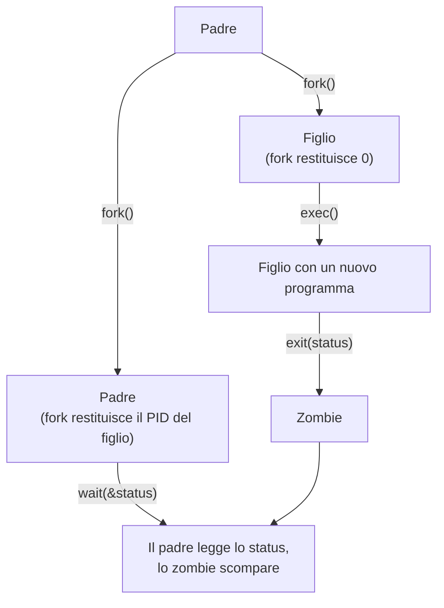

# Interrupt, Syscall, Dual Mode e Processi

> [!abstract] Scopo della lezione
> Questa lezione collega l'hardware visto finora al sistema operativo vero e proprio. Un OS moderno è una **macchina guidata dagli interrupt**: ogni interazione con il kernel nasce da un interrupt, un'eccezione o una **system call**. Per proteggere il kernel dai programmi utente la CPU ha due modalità (**dual mode**), e l'unico modo controllato per passare in modalità privilegiata è proprio un interrupt software (`INT 0x80`). Si vede poi come il kernel rappresenta i processi (**PCB**), come avviene il **context switch** nel kernel, e infine l'API Unix per controllare i processi: `fork`, `wait`, `exit`, `exec`, **segnali** e variabili d'ambiente. (Negli appunti originali la lezione è divisa in *os_07a* e *os_07b*.)
> Mappa dei concetti: [[MOC - Sistemi Operativi]]

## Sistemi operativi basati sugli interrupt

I sistemi operativi moderni sono **basati sugli interrupt**: ogni interazione con l'OS è innescata da un interrupt. Un interrupt può nascere da:

- **eventi esterni** (fine di un I/O, timer, …): una periferica varia la tensione su un pin (vedi [[Interrupt]]);
- **eccezioni interne** del programma (istruzione illegale, divisione per zero, …): vedi [[Eccezioni]];
- **chiamate esplicite** (le **syscall**, ad esempio `INT 0x80` su Linux x86): vedi [[System Call]].

Qualunque sia l'origine, il comportamento è lo stesso: si identifica la sorgente, si va nel **vettore delle interruzioni**, si prende l'interrupt handler corrispondente, lo si esegue, e alla fine si torna al punto in cui l'esecuzione era stata interrotta.

Gli interrupt sono anche ciò che rende possibile il **context switch preemptive**: senza un interrupt del timer, un processo che non cede mai la CPU la terrebbe per sempre (vedi [[05 - SO - Stack e Context Switch|lezione 5]]).

### Polling vs interrupt

Vedi [[Polling vs Interrupt]].

Ci sono due modi per gestire gli eventi.

**Polling**: si chiede continuamente lo stato.

![[SO-L06-01.png]]

Un ciclo sempre in esecuzione controlla una serie di condizioni (tasto premuto? disco ha finito?) e, quando ne trova una vera, la gestisce. È **peggiore** perché spreca CPU ed energia anche quando non succede nulla, e la latenza dipende da quanto è lungo il giro del ciclo.

**Interrupt**: la CPU **dorme** la maggior parte del tempo e si sveglia quando succede qualcosa.

![[SO-L06-02.png]]

Si installano delle **interrupt routine** (`keyISR`, `diskISR`, …) che gestiscono gli eventi; quando la CPU non ha nulla da fare la si mette a dormire (`halt()`, su AVR `sleep_cpu()`). Un interrupt sveglia automaticamente la CPU, che esegue l'handler e poi torna nel ciclo e si riaddormenta.

> [!important] Le ISR fanno parte del kernel
> Un sistema operativo è fondamentalmente una **macchina interrupt-based**: una serie di ISR per gestire le periferiche più un gestore speciale, il **gestore delle syscall**, invocato con `INT 0x80`. Quando non succede nulla, il sistema operativo si mette in pausa.

### Cosa succede quando arriva un interrupt

Quando arriva un interrupt, il **contesto corrente** (flag della CPU e instruction pointer/program counter) viene **salvato sullo stack** e la CPU inizia a eseguire la routine di interrupt.

Di solito **più dispositivi** possono generare lo stesso interrupt fisico, quindi serve un **handshaking** (transazioni a livello elettrico) per capire chi l'ha generato:

1. ogni periferica è collegata alla CPU da due linee: **interrupt request** (IRQ, verso la CPU) e **interrupt acknowledge** (INTA, dalla CPU);
2. una periferica alza l'**interrupt request** e resta in attesa;
3. la CPU, quando è pronta a servire l'interrupt, alza **interrupt acknowledge**;
4. la periferica scrive sul **data bus** il proprio **numero identificativo**;
5. la CPU legge il numero e seleziona la routine corrispondente dall'**interrupt vector**.

Mentre si gestisce un interrupt, gli **interrupt dello stesso tipo sono disabilitati**.

### Interrupt vector

Vedi [[Interrupt Vector]].

Gli indirizzi delle ISR sono memorizzati in una tabella: l'**interrupt vector** è un **array di puntatori a funzione** che contiene gli indirizzi delle ISR. Ogni posizione è associata a uno specifico evento (è lo schema dell'esempio dell'array `actions[]` in [[03 - SO - Programmazione OOP in C#Esempio: vettore di puntatori a funzione|lezione 3]]).

![[SO-L06-03.png]]

Più interrupt possono **condividere la stessa ISR**: lo stesso indirizzo può comparire in più celle del vettore.

## Eccezioni

Vedi [[Eccezioni]].

Le **eccezioni** sono interrupt generati da **eventi software**. Interrupt ed eccezioni sono gestiti quasi allo stesso modo (salvataggio di flag e instruction pointer sullo stack corrente e salto all'handler). La differenza è la sorgente:

- gli **interrupt** veri e propri sono generati da un **dispositivo fisico** (un evento esterno; noi li abbiamo generati disturbando i pin dell'Arduino);
- le **eccezioni** sono generate dal **software** (dall'istruzione in esecuzione).

Su x86 le eccezioni si dividono in tre categorie:

| Tipo | Quando | Esempi | Dopo l'handler |
| --- | --- | --- | --- |
| **Trap** | generata **intenzionalmente** dall'esecuzione di un'istruzione; l'ISR viene invocata **dopo** l'istruzione | `INT` (syscall), breakpoint | si riprende dall'istruzione **successiva** |
| **Fault** | generata **involontariamente**, indica un qualche tipo di errore; l'ISR viene invocata **prima** che l'istruzione sia completata | divisione per 0, **page fault**, istruzione illegale | si può **rieseguire** l'istruzione che ha causato il fault (es. dopo aver caricato la pagina mancante) |
| **Abort** | lo stato del processo **non è recuperabile** | *double fault* (es. un fault dentro l'handler di un fault) | il processo (o il sistema) viene terminato |

La differenza tra trap e fault: una trap è **completamente eseguita** (l'esecuzione della trap *consiste* nella chiamata all'handler), mentre un'istruzione che genera un fault **non viene completata**. Nel caso di un fault la CPU salva anche lo stato dell'istruzione non eseguita, così da poterla ripetere. Questo è essenziale per il **demand paging** (vedi [[Demand Paging]]).

Quando si genera un'eccezione la CPU si comporta come se avesse ricevuto un interrupt e salta alla posizione dell'interrupt vector corrispondente a quel tipo di eccezione. **Per ogni tipo di evento c'è un elemento del vettore.**

## INT vs CALL

Su x86 ci sono due istruzioni per "saltare a una routine":

| | `INT <XX>` | `CALL <YY>` |
| --- | --- | --- |
| **Comportamento** | salta all'ISR il cui indirizzo è in posizione `<XX>` dell'interrupt vector | chiama la subroutine all'indirizzo `<YY>` |
| **Destinazioni** | numero **limitato** di entry point **controllati** (il vettore ha una dimensione fissa) | qualunque indirizzo valido nella memoria eseguibile del processo |
| **Cosa salva sullo stack** | **flag** e instruction pointer | solo l'instruction pointer |
| **Flag** | vengono **alterati**: si entra in **supervisor mode** | non vengono alterati |

Dopo aver salvato i flag, `INT` cambia lo stato della macchina in **modalità supervisore**: dentro la ISR si possono fare più cose.

## Dual mode

Vedi [[Dual Mode]].

L'OS, per fare il suo lavoro, deve avere il **controllo dell'interrupt vector e delle porte di I/O**. Due comportamenti problematici da evitare:

- cosa succede se un programma utente **modifica l'interrupt vector**? Potrebbe sostituire l'handler del timer e non cedere mai più la CPU, o eseguire il proprio codice con privilegi del kernel;
- cosa succede se un programma utente **scrive dati a caso su un dispositivo mappato in memoria**? Potrebbe corrompere il disco o bloccare l'hardware.

Per evitarlo la CPU ha **due modalità operative** (*dual mode*):

- **privileged mode** (o supervisor/kernel mode): la CPU ha accesso a **tutto l'hardware** e può eseguire qualunque istruzione;
- **user mode**: si può eseguire solo un **sottoinsieme** delle istruzioni.

Ogni operazione può essere assegnata a una o a entrambe le modalità.

- La modalità è indicata da un **bit nel registro dei FLAG** (*mode bit*). Per entrare in modalità privilegiata bisognerebbe cambiare quel bit.
- Per evitare che un utente si metta da solo in modalità privilegiata, **modificare quel bit è un'operazione privilegiata**.
- Si stabilisce che l'accesso alla zona di memoria in cui è mappato l'interrupt vector (e ai dispositivi) è consentito **solo in privileged mode**: se un programma utente ci prova, la CPU genera un **fault**.
- Le **ISR sono sempre eseguite in privileged mode**.
- L'**OS gira in privileged mode**, i programmi utente no.

### Come entra in modalità privilegiata un programma utente?

> [!question] Problema
> Per chiamare l'OS da un programma utente bisogna passare in privileged mode, cioè cambiare il flag, ma questa è un'operazione privilegiata.

> [!success] Soluzione
> Le ISR sono eseguite in privileged mode: quando avviene un interrupt, la CPU stessa altera il bit di modalità. Quindi un programma utente può **entrare in privileged mode eseguendo `INT`**, ma solo **saltando a codice scelto dal kernel** (l'handler registrato nel vettore). Non può eseguire codice arbitrario in modalità privilegiata.

L'OS ha moltissime funzionalità, ma con `INT` si può scegliere solo tra un numero limitato di handler. Si **nasconde tutto l'OS dietro un singolo elemento dell'interrupt vector**: prima di invocare `INT` il programma prepara una struttura dati (registri/stack) con i **parametri**; l'ISR decodifica i parametri e capisce quale funzione dell'OS eseguire. La specifica funzione dell'OS si invoca quindi con `INT <OS_ISR>`: è una **syscall**. I parametri possono stare nei registri della CPU o sullo stack.

> [!question] Problema
> Che succede se il programma utente esegue `INT <DISK_ISR>`, cioè finge un interrupt del disco?

> [!success] Soluzione
> Solo un **sottoinsieme** delle posizioni dell'interrupt vector può essere invocato dal programma utente senza generare una **protection exception** (su x86 è il *descriptor privilege level* di ogni entry dell'IDT).

## System call

Vedi [[System Call]].

Una syscall è un **unico entry point controllato** verso il nucleo dell'OS (il kernel).

> [!question] Problema
> Il kernel offre molte funzionalità, ma abbiamo un'unica ISR per gestirle tutte.

> [!success] Soluzione
> Si **numerano** tutte le funzioni offerte dal kernel (il **numero di syscall**) e si crea un **array di puntatori a funzione**, il **system call vector**: in posizione *i* c'è la funzione che implementa la funzionalità *i* dell'OS.

- Tradizionalmente si usa un **registro** per selezionare quale funzione invocare: su Linux x86 è **EAX**, in cui si scrive il numero della syscall.
- I **parametri** si passano per convenzione nei **registri**; se sono tanti si usa anche lo **stack** (o si passa l'indirizzo di una tabella in memoria). La syscall li legge da lì.

![[SO-L06-04.png]]

Il programma utente prepara i parametri in una tabella X in memoria, carica l'indirizzo di X in un registro ed esegue la system call 13. L'OS esegue il codice della syscall 13, che legge i parametri dalla tabella X.

> [!summary] Ricapitolando
> - Per chiamare l'OS (cioè entrare in privileged mode) si usa `INT 0x80`: in posizione 0x80 dell'interrupt vector è "nascosto" tutto l'OS, e le ISR girano in privileged mode.
> - Per scegliere la funzionalità si scrive in **EAX** l'indice nel **syscall vector**.
> - I parametri si mettono in registri/stack; l'ISR li recupera e li passa alla funzione dell'OS.
> - L'OS poi restituisce il controllo al programma utente.

Dopo l'esecuzione della syscall il **mode bit viene ripristinato** dall'istruzione **`iret`** (return from interrupt), che ricarica dallo stack i flag salvati da `INT`.

![[SO-L06-05.png]]

Il processo utente gira con mode bit = 1 (user); la syscall fa una **trap** e il mode bit diventa 0 (kernel); il kernel esegue la syscall; il **return** riporta il mode bit a 1. Poiché `iret` ripristina i flag salvati, si torna esattamente nella modalità in cui si era prima: se si era in user mode si torna in user mode, se si era già in kernel mode si resta lì.

Su Linux c'è anche la funzione di libreria `syscall()` per invocare direttamente una system call dato il suo numero.

L'utente **root** è un utente come gli altri, ma può effettuare syscall che agli altri sono vietate (consiglio: usare un utente normale e passare a root solo quando strettamente necessario).

### Tipi di syscall

**Gestione dei processi**:

![[SO-L06-06.png]]

terminare/interrompere un processo (`end`, `abort`), caricare un processo dal disco e mapparlo in memoria (`load`) ed eseguirlo (`execute`), creare/terminare un processo, leggere/modificare gli attributi di un processo, attendere un certo tempo, attendere/segnalare un evento, allocare e liberare memoria.

**Gestione dei file**:

![[SO-L06-07.png]]

creare/cancellare, aprire/chiudere, leggere/scrivere/riposizionarsi, leggere e impostare gli attributi (read-only, ownership…). Vedi [[12 - SO - File System|lezione 12]].

**Gestione dei dispositivi**:

![[SO-L06-08.png]]

richiedere/rilasciare un dispositivo, leggere/scrivere/riposizionarsi, attributi, collegare/scollegare logicamente un dispositivo.

**Informazioni di sistema**:

![[SO-L06-09.png]]

ora e data, dati di sistema, attributi di processi, file o dispositivi.

**Comunicazione**:

![[SO-L06-10.png]]

creare/eliminare connessioni, inviare/ricevere messaggi, trasferire informazioni di stato.

### vDSO

Vedi [[vDSO]].

È meglio avere un OS **leggero**, con syscall di **basso livello** ed efficienti. Però entrare e uscire dal kernel ha un costo (salvataggio dello stato, cambio di modalità, cache…). Per alcune funzioni frequenti e **non pericolose** (es. leggere l'ora con `gettimeofday`) questo overhead è sproporzionato.

Le **vDSO** (*virtual Dynamic Shared Object*) sono librerie speciali che il kernel **mappa nello spazio di indirizzi di ogni processo** all'avvio, ma che contengono **funzioni del kernel** eseguibili in **user mode** (leggono dati che il kernel espone in una pagina di sola lettura). Non corrispondono a nessun file su disco (con `ldd` compaiono come `linux-vdso.so.1` senza percorso): è il kernel stesso a "regalarle" al processo. Così si evita di entrare e uscire dalla modalità privilegiata per operazioni innocue.

### Le syscall sono primitive di basso livello

Le syscall offrono di solito **operazioni semplici**:

- scrivere/leggere *n* byte su un dispositivo;
- allocare memoria a un processo mappandola nel suo spazio di indirizzi;
- aprire/chiudere un dispositivo;
- aspettare che certi dati siano disponibili;
- aspettare che un altro processo termini;
- …

Devono permettere un **accesso completo all'hardware sottostante**.

## Standard di linguaggio e standard di sistema

Vedi [[Architettura a Strati]].

Un programma che usa **direttamente le syscall non è portabile**: dipende strettamente dal sistema operativo e andrebbe riscritto per ogni OS. Si distinguono quindi due standard:

- **Standard di linguaggio**: implementato dalla **libreria standard** del linguaggio (es. la **libc**).
  - Scrivere programmi usando solo funzioni della libreria standard garantisce la **portabilità**.
  - Le implementazioni di queste funzioni si appoggiano sulle syscall dell'OS.
  - Una libreria standard però **non può definire tutto** (es. i socket non fanno parte dello standard C).
- **Standard di sistema**: sta **in mezzo** tra syscall e standard di linguaggio. Offre a librerie e programmi funzionalità più avanzate, comuni a una **famiglia** di sistemi operativi (es. **POSIX**, o Android).

Lo standard di linguaggio offre funzionalità disponibili **ovunque**; le syscall sono **specifiche del kernel** in uso; lo standard di sistema sta a livello intermedio. La **portabilità** è possibile grazie a questi **livelli di astrazione intermedi** (vedi lo schema a strati della [[01 - SO - Introduzione e Git#Organizzazione a strati|lezione 1]]).

Negli OS le funzionalità sono offerte **a strati**: ogni strato si appoggia sulle funzionalità del livello sottostante. Una regola base del design di sistema è definire un'**architettura a strati**, in cui le funzionalità di alto livello sono costruite **esclusivamente** su quelle di livello inferiore. Quando si progetta un'applicazione si usa sempre **lo strato più alto possibile**, per garantire la portabilità.

### Esempio: printf

![[SO-L06-11.png]]

Il programma chiama `printf("Greetings")` (in user mode). La libreria standard C passa per `vprintf` → `vfprintf` → … e alla fine invoca la syscall **`write`**, che entra in kernel mode, esegue la scrittura e ritorna.

Il comando **`strace`** mostra quali syscall vengono invocate da un programma: permette di vedere cosa succede "dentro" la libc.

```bash
strace ./a.out
```

## Process Control Block

Vedi [[Process Control Block]].

Il **Process Control Block (PCB)** è la struttura dati in cui il **kernel** memorizza le informazioni su un processo. Un PCB tipico contiene:

- **Process ID** (PID);
- **User ID** (UID) del proprietario;
- **stato** del processo (ready, waiting, …);
- **stato della CPU** per il processo (registri, o almeno lo stack pointer);
- **informazioni di scheduling** (priorità, tempo di CPU usato…);
- **informazioni di memoria** (stack, page table);
- **informazioni di I/O** (descrittori aperti).

Il contenuto preciso dipende dall'implementazione: un PCB può contenere informazioni che servono a uno scheduler piuttosto che a un altro. Dal PCB e dalle strutture collegate è possibile **ricostruire lo stato di un processo**.

Il PCB vive in un'**area di memoria privilegiata**, nello spazio di memoria del kernel: è accessibile solo in modalità privilegiata.

## Context switch nel kernel

Vedi [[Context Switch]].

Un **context switch** avviene quando un processo in esecuzione viene interrotto. Può succedere **solo** a causa di un **interrupt o di un'eccezione** (inclusa una syscall), perché solo questi eventi fanno eseguire codice del kernel. Quando il kernel ritorna, il processo che userà la CPU **può essere o non essere** quello interrotto, a seconda della decisione del kernel (dello scheduler).

Vediamolo nel dettaglio:

![[SO-L06-12.png]]

P1 è in esecuzione; P2 era in esecuzione ma è stato interrotto e il suo stato è in PCB2. Ora i PCB contengono anche altre informazioni (`mem_info`, `descriptors`, …). Cosa deve succedere perché, dopo un interrupt o una syscall invocata da P1, la CPU passi a P2?

1. All'arrivo dell'interrupt la CPU salva **flag e IP sullo stack di P1** e passa in **privileged mode** per eseguire la ISR.
2. La ISR salva **tutti i registri** sullo stack di P1 e salva in PCB1 lo stato della CPU (qui solo lo SP).

   ![[SO-L06-13.png]]

3. Si passa in **kernel mode**: il kernel ha **un proprio stack**, quindi si imposta lo SP sullo **stack del kernel** (il PCB corrente resta lo stesso). Così il kernel non rischia di sporcare lo stack di P1 (e un processo utente non può manipolare lo stack su cui lavora il kernel).
4. Se l'interrupt era una syscall, il kernel cerca i parametri nei registri salvati (nel PCB) o nello stack di P1.
5. Il kernel esegue la funzionalità richiesta.
6. Alla fine, per eseguire P2, si cambia la variabile globale che punta al PCB del processo da eseguire: si seleziona **P2 come next running**.
7. Si recupera lo stato della CPU di P2 dal suo stack e si fa `iret`.

> [!summary] Ricapitolando
> - Salvare lo stato della CPU sullo stack e nel PCB.
> - Entrare in kernel mode cambiando lo SP allo stack del kernel.
> - Operazioni del kernel…
> - Impostare P2 come next running.
> - Recuperare lo stato della CPU di P2 dal suo stack.

Ogni ISR del kernel ha quindi un **preambolo** e un **postambolo**:

![[SO-L06-14.png]]

- **Preambolo** (IP e flag sono già sullo stack): `pushAll()` salva i registri; `saveSP(running->sp)` salva lo stack pointer nel PCB; `setSP(kernel_sp)` passa allo stack del kernel.
- **Corpo**: `doMagic()`, l'implementazione della syscall (o la gestione dell'interrupt), che può anche cambiare `running`.
- **Postambolo**: `setSP(running->sp)` passa allo stack del processo da eseguire; `popAll()` ne recupera i registri; `IRET` recupera flag e IP.

Proprio perché l'entrata e l'uscita dal kernel hanno questo preambolo/postambolo, per chiamare le syscall si **impacchettano i parametri nei registri** della CPU, e anche i **valori di ritorno** delle syscall passano sempre attraverso i registri.

Per implementare lo scheduling nel kernel servono: i **PCB**, delle **code** (implementate come linked list) per i processi **ready** e per i processi in **waiting**, e un riferimento al PCB in **running**. Lo vedremo implementato in [[08 - SO - disastrOS|disastrOS]].

### Process scheduler

Il **process scheduler** sceglie il prossimo processo a cui dare la CPU tra quelli pronti. Le caratteristiche dello scheduler dipendono dall'applicazione/contesto (vedi [[CPU Scheduler e Dispatcher]] e [[09 - SO - CPU Scheduling|lezione 9]]). Usa delle **code** per gestire i processi, di solito **linked list di PCB**.

![[SO-L06-15.png]]

Lo scheduler prende un processo dalla **ready queue** e gli assegna la CPU. Il processo esce dalla CPU per vari motivi: termina; fa una **I/O request** (va nella I/O queue e, quando l'I/O è completato, torna nella ready queue); scade il suo **time slice** (torna direttamente nella ready queue); esegue una syscall bloccante come **fork** di un figlio e attesa del figlio, o **attesa di un interrupt**. In ogni caso, quando l'evento atteso si verifica, torna nella ready queue.

## Processi

Vedi [[Program File e Processo]].

Un **processo** è un **programma in esecuzione**. In un OS multitasking più istanze dello stesso programma possono essere in esecuzione contemporaneamente.

Un processo è caratterizzato dal suo **stato**, composto da:

- **registri della CPU**;
- **memoria**: codice (`.text`), stack, heap, variabili globali (`.bss` e `.data`), regioni mappate in memoria (tra stack e heap);

  ![[SO-L06-16.jpeg]]

- **risorse**: descrittori di file/socket, costrutti di sincronizzazione (semafori, code).

### Immagine di memoria di un processo

Vedi [[Immagine di Memoria di un Processo]].

![[SO-L06-17.png]]

Su un sistema a 32 bit lo spazio di indirizzi di 4 GB è diviso in **1 GB di kernel space** in alto (da `0xC0000000`: il codice utente non può leggerlo né scriverlo, altrimenti si ha un *segmentation fault*) e **3 GB di user space**. Dal basso verso l'alto: **Text** (codice, da `0x08048000`), **Data** (variabili statiche inizializzate esplicitamente), **BSS** (variabili statiche non inizializzate, riempite di zeri), **Heap** (allocazione dinamica con `malloc`/`free`, cresce verso indirizzi più alti), spazio libero, **Stack** (variabili automatiche, indirizzi di ritorno, cresce verso indirizzi più bassi).

Nell'esempio: `g_counter` (globale non inizializzata) va in **BSS**; `res`, `str`, `vect`, `p` (variabili locali) vanno sullo **Stack**; il blocco restituito da `calloc`/`malloc` sta nello **Heap**; la stringa letterale `"ciao"` sta nei dati statici.

**Tutti i processi hanno la stessa immagine di memoria** (le sezioni iniziano agli stessi indirizzi). È possibile perché la memoria dei processi è **virtualizzata**: se due processi usano lo stesso indirizzo, in realtà sono mappati su zone fisiche diverse della RAM (vedi [[MMU]], [[Paging]] e [[10 - SO - Gestione della Memoria|lezione 10]]).

### Stack frame

Uno **stack frame** contiene il **record di attivazione** di una funzione: argomenti, indirizzo di ritorno, registri salvati (*clobbered*) e variabili locali.

Da Sistemi di Calcolo 1:

![[SO-L06-18.png]]

Quando `g` invoca `f`, sopra il frame di `g` (variabili locali, parametri, indirizzo di ritorno) viene costruito il frame di `f`.

Il frame corrente è puntato da un registro speciale, il **frame pointer** (FP, su x86 `EBP`/`RBP`):

![[SO-L06-19.png]]

Ogni frame contiene i temporanei salvati, i parametri (a FP + k), l'indirizzo di ritorno, il **FP salvato** del frame precedente (così i frame formano una catena) e le variabili locali (a FP − k). Lo **SP** punta alla cima dello stack, che cresce verso il basso.

### Stati di un processo

Vedi [[Stati di un Processo]].

![[SO-L06-20.png]]

| Stato | Significato |
| --- | --- |
| **new** | il processo è stato creato (si sta caricando in memoria) |
| **ready** | il processo ha **tutte le risorse** per continuare, **tranne la CPU** |
| **running** | il processo sta usando la CPU |
| **waiting** | il processo aspetta che una risorsa sia pronta (I/O, evento) |
| **terminated** | il processo non è più attivo |

Transizioni: *new → ready* (admitted); *ready → running* (scheduler dispatch); *running → ready* (interrupt, es. scade il quanto di tempo); *running → waiting* (attesa di I/O o evento: il processo ha passato il controllo al kernel per fare qualcosa e aspetta che il kernel finisca); *waiting → ready* (completamento dell'I/O o dell'evento); *running → terminated* (exit).

## Controllo dei processi in Unix

Le operazioni fondamentali:

- creare un nuovo processo (`fork`);
- aspettare che un processo termini (`wait`);
- terminare un processo (`exit`);
- caricare un program file ed eseguirlo (`exec`);
- gestire un evento asincrono (segnali).



### Creazione di un processo: fork

Vedi [[fork]].

`fork` è la syscall che **crea un nuovo processo**: fa una **copia dello spazio di memoria** del processo chiamante. Dopo la `fork` esistono **due flussi di esecuzione paralleli**, entrambi subito dopo la chiamata.

Il **valore di ritorno** permette di distinguere in quale dei due ci si trova:

- **0** → si è nel **processo figlio**;
- **≠ 0** → si è nel **processo padre**, e il valore è il **PID del figlio** (−1 in caso di errore).

Il **PID** è il valore che identifica un processo nel sistema. `getpid()` restituisce il PID del processo corrente.

### Attesa della terminazione: wait

Vedi [[wait e Processi Zombie]].

Si presume che un processo padre termini **dopo** i suoi figli; per garantirlo si usa la syscall `wait`.

`wait` **sospende** il processo chiamante finché **uno qualunque** dei suoi figli termina (con *n* figli servono *n* `wait` per aspettarli tutti). Restituisce il **PID del figlio terminato** e prende un puntatore a intero in cui salva il valore che il figlio ha passato con `exit`.

![[SO-L06-21.png]]

`int pid = wait(&retval)` salva in `pid` il PID del figlio terminato e in `retval` il suo stato d'uscita. Per aspettare un figlio **specifico** si usa `waitpid`.

### Processi zombie

Un figlio entra nello stato **zombie** quando **termina prima** che il padre ne abbia letto il valore di terminazione con una `wait`. In questo stato:

- tutte le risorse del processo sono già **rilasciate**;
- il processo esiste solo per **conservare il valore di ritorno** (il suo PCB resta nella tabella dei processi).

Quando il padre fa la `wait`, lo zombie viene eliminato definitivamente. Se il padre non fa mai la `wait`, gli zombie restano nel sistema.

Tutti i processi discendono da **init**, il primo processo avviato dal sistema, con **PID = 1**. Se un padre **termina prima** dei suoi figli, i figli **orfani** vengono adottati da `init` (o da un suo discendente). `init` esegue periodicamente `wait` su tutti i suoi figli, così anche questi, quando terminano, non restano zombie.

#### Esempio fork e wait

![[SO-L06-22.png]]

Il processo stampa il proprio PID e fa `fork`. Nel ramo `fork_result == 0` (figlio) aggiorna il prefisso a `child`, rilegge il proprio PID con `getpid()` ed esegue `childFunction` (5 giri); nel ramo padre esegue `parentFunction` (10 giri). Entrambi stampano `terminating`. Le stampe dei due processi si **mescolano** perché i processi girano in parallelo. Il figlio, che fa meno giri, termina prima del padre e, poiché il padre non fa `wait`, resta **zombie** finché il padre non termina. Si vede quindi prima la terminazione del figlio e poi quella del padre.

### Terminazione e segnali

Vedi [[Segnali]].

- Quando un figlio muore, l'OS manda al padre il segnale **`SIGCHLD`**.
- Quando un padre termina, si può notificare ai figli ancora vivi il segnale **`SIGHUP`** (*hang up*).

Si possono installare degli **handler** per questi segnali.

Un **segnale** è una **notifica inviata a un processo** (da un altro processo o dal kernel). È gestito **interamente via software**: è l'equivalente "per processi" di un interrupt. Un segnale è definito da:

- un **numero** che lo identifica univocamente nel sistema (es. `SIGINT` = 2, `SIGKILL` = 9);
- il **PID** del processo destinatario.

Inviare segnali è un'operazione **privilegiata** (non si possono mandare segnali ai processi di altri utenti), quindi la si fa con una syscall: **`kill(pid, sig)`**.

Come viene consegnato: quando un processo viene **riesumato** dalla CPU, il kernel controlla se ha ricevuto segnali. Se no, il processo prosegue normalmente; se sì, il kernel prepara sullo stack del processo uno **stack frame per il signal handler**, così che il processo esegua prima l'handler; al termine dell'handler l'esecuzione riprende da dove era stata interrotta.

Ogni segnale ha un **comportamento predefinito** (terminare, ignorare, fermare…). Per molti segnali (non per `SIGKILL` e `SIGSTOP`) questo comportamento può essere cambiato con le funzioni **`signal`** o **`sigaction`**:

![[SO-L06-23.jpeg]]

![[SO-L06-24.jpeg]]

![[SO-L06-25.jpeg]]

Dalla dispensa di Sistemi di Calcolo:

```c
#include <signal.h>
int sigaction(int sig, const struct sigaction *act, struct sigaction *oact);

struct sigaction {
    void     (*sa_handler)(int signum);              // gestore
    void     (*sa_sigaction)(int, siginfo_t*, void*); // gestore esteso (SA_SIGINFO)
    sigset_t sa_mask;     // segnali da bloccare mentre il gestore è attivo
    int      sa_flags;    // es. SA_RESTART, SA_SIGINFO
    void     (*sa_restorer)(void);
};
```

- `sig`: il numero del segnale da gestire.
- `act`: se diverso da `NULL`, imposta il **nuovo** comportamento; altrimenti il comportamento resta invariato.
- `oact`: se diverso da `NULL`, ci viene copiato il comportamento **precedente** (così lo si può ripristinare).
- `sa_handler` può essere `SIG_IGN` (ignora il segnale), `SIG_DFL` (ripristina il gestore di default) o una funzione `void handler(int signum)`.
- `sa_mask`: i segnali che devono essere **bloccati** mentre il gestore è attivo.
- `sa_flags`: `SA_RESTART` fa sì che una syscall interrotta dal segnale venga **rieseguita** dopo il gestore; `SA_SIGINFO` usa `sa_sigaction` invece di `sa_handler` (le due varianti non possono coesistere).
- Restituisce 0 in caso di successo, −1 in caso di errore (con `errno`).

#### Esempio SIGCHLD/SIGHUP

![[SO-L06-26.png]]

Il programma crea padre e figlio; entrambi eseguono un ciclo inutile per un certo numero di giri (padre 10, figlio 1). Uno dei due muore prima: il padre viene avvisato della morte del figlio con `SIGCHLD`, il figlio della morte del padre con `SIGHUP`. I due handler stampano solo un messaggio.

![[SO-L06-27.png]]

Nel **figlio** si installa l'handler di `SIGHUP` seguendo lo schema standard:

1. si dichiarano `new_action` e `old_action`;
2. si prepara `new_action`: `sa_handler = sighup_handler`; `sigemptyset(&new_action.sa_mask)` (non bloccare altri segnali); `sa_flags = 0`;
3. `sigaction(SIGHUP, NULL, &old_action)` legge il comportamento attuale, per poterlo ripristinare;
4. se l'handler attuale non è `SIG_IGN`, si installa il nuovo con `sigaction(SIGHUP, &new_action, NULL)`; altrimenti si termina con errore.

Poi il figlio esegue `childFunction`.

![[SO-L06-28.png]]

Nel **padre** si fa lo stesso per `SIGCHLD` con `sigchld_handler`, poi si esegue `parentFunction`. Alla fine il padre invia esplicitamente `SIGHUP` al figlio con `kill(fork_result, SIGHUP)`.

> [!note] Su Linux un padre **non invia `SIGHUP` di default** ai figli quando termina: bisogna inviarlo esplicitamente con `kill`. (`SIGHUP` viene inviato automaticamente dal terminale quando si chiude la sessione.)

### exit

`exit` è la syscall che **termina un processo** e ne **rilascia tutte le risorse**.

La `exit` viene **sempre** invocata, anche se non la si scrive, grazie al **C runtime**: un pezzo di codice collegato nell'eseguibile in fase di compilazione. Quando un programma parte, la prima cosa eseguita è `_start`, che chiama `__libc_start_main`, il quale:

- prepara le **variabili d'ambiente**;
- prende dalla riga di comando i parametri del `main` (`argc` e `argv`);
- carica eventuali **librerie dinamiche**;
- invoca il `main`;
- quando il `main` ritorna, chiama **implicitamente** `exit` con il valore di ritorno del `main`.

È il valore passato a `exit` che viene letto dalla `wait` del padre.

### Lanciare un nuovo programma: exec

Vedi [[exec e Variabili d'Ambiente]].

La `fork` crea un **clone** del padre: non permette di lanciare un **altro** programma.

**`exec`** legge dal disco la descrizione dell'immagine di memoria di un programma, **elimina tutto** del processo corrente e lo **rimpiazza** con l'immagine del nuovo eseguibile. Il PID resta lo stesso.

- Se `exec` va a buon fine **non ritorna**: le istruzioni successive non vengono eseguite (se ritorna, c'è stato un errore).
- Prende come primo parametro il **nome del file eseguibile**, poi gli **argomenti** da passargli.
- Invoca il **loader**, il modulo che elimina le sezioni del processo e le sostituisce con quelle dell'eseguibile caricato (vedi [[Loader ed ELF]]).
- L'esecuzione riprende dalla prima istruzione della funzione `_start` del nuovo eseguibile.

Esempio:

![[SO-L06-29.png]]

Il programma legge da riga di comando un intero `num_instances`, il path di un eseguibile e i suoi argomenti. Lancia `num_instances` processi figli: ognuno fa `execv(prog_path, argv+2)` (se `execv` ritorna, stampa l'errore con `strerror(errno)`). Il padre conta i figli attivi e poi fa `wait` in un ciclo finché non sono terminati tutti, stampando il PID di ognuno.

### Variabili d'ambiente

Un processo può avere bisogno di **variabili d'ambiente**, accessibili tramite l'array globale di stringhe **`char** environ`**. Ogni elemento ha la forma `"NAME=VALUE"` e l'ultimo elemento è `NULL` (0).

- Da terminale si leggono con `env`.
- Quando si lancia un programma lo si lancia con il suo ambiente, preparato dal C runtime.
- Con `fork` il figlio riceve una **copia dell'ambiente** del padre.
- Per lanciare un processo con un **ambiente diverso** si usa una variante della famiglia exec, **`execvpe`**, che dopo gli argomenti prende un'ulteriore lista di stringhe con l'ambiente.

Per leggere l'ambiente in un programma basta dichiarare:

```c
extern char** environ;
```

La variabile esiste già nel programma (è definita dalla libc), ma va dichiarata per poterla usare.

Esempio exec ed env:

![[SO-L06-30.png]]

Come prima, ma con `getenv("PATH")` (funzione della libc) si legge e si stampa la variabile `PATH`, e i figli sono lanciati con `execvpe(prog_path, argv+2, environ)`. La `p` di `execvpe` significa che l'eseguibile viene **cercato nelle directory di `PATH`**: si può lanciare un programma senza specificarne il percorso completo. Passando l'ambiente, il programma lanciato ha anche accesso, ad esempio, ai percorsi in cui cercare le librerie.

### vfork

Spesso si fa `fork` e **subito dopo `exec`**: la `fork` copia tutto lo spazio di memoria del processo, che la `exec` butta via immediatamente. Per evitare questa copia inutile:

**`vfork`** funziona come `fork` ma **non copia** lo spazio di memoria: il figlio usa temporaneamente quello del padre (che resta sospeso). Si può usare **solo** se la prima cosa che il figlio fa dopo la `vfork` è una `exec` (o una `_exit`). È quindi più efficiente.

> [!tip] Nei sistemi moderni
> Grazie al **Copy on Write** ([[Copy on Write]], [[11 - SO - Memoria Virtuale|lezione 11]]) anche la `fork` normale non copia davvero la memoria: copia solo la page table e marca le pagine come condivise in sola lettura; una pagina viene duplicata solo quando qualcuno ci scrive. Per questo oggi `vfork` è molto meno necessaria.
