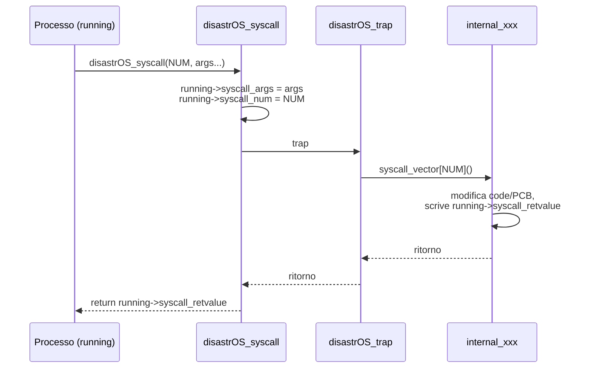
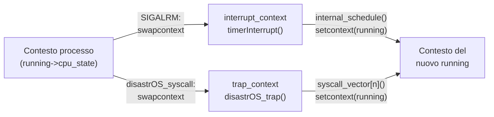

# disastrOS

> [!abstract] Scopo della lezione
> **disastrOS** è un "sistema operativo giocattolo" che gira **interamente in user space** come un normale programma Linux. Mette insieme tutto ciò che abbiamo visto: **liste** ([[03 - SO - Programmazione OOP in C|lezione 3]]), **context switch** con `ucontext` ([[05 - SO - Stack e Context Switch|lezione 5]]), **syscall vector** e **PCB** ([[06 - SO - Interrupt, Syscall, Dual Mode e Processi|lezione 6]]), **SLAB allocator** ([[07 - SO - Allocatori di Memoria|lezione 7]]). Si costruisce in tre passi: *(a)* un primo strato di syscall (`fork`, `wait`, `exit`, `preempt`); *(b)* un **preemptive scheduler** in cui il timer è simulato dal segnale `SIGALRM` e trap e interrupt sono **contesti** separati; *(c)* una syscall **`sleep`** basata su una lista di timer, che sostituisce l'attesa attiva.
> Mappa dei concetti: [[MOC - Sistemi Operativi]] · Concetto: [[disastrOS]]

> [!note] Due note pratiche dagli appunti
> - `Ctrl+Z` mette in pausa un programma in esecuzione nel terminale; il comando `fg` lo fa ripartire.
> - Una **MACRO** del preprocessore C è una semplice **sostituzione di stringhe**.

## Parte A: un primo strato di system call

Vediamo un programma che implementa un primo strato di syscall, realizzando una sorta di sistema operativo. Usa le strutture dati per implementare i meccanismi (soprattutto **liste**) e gli **allocatori di memoria**.

### Variabili globali del kernel

Per gestire i processi servono:

- un puntatore al PCB del **primo processo** (`init`);
- un puntatore al PCB del **processo corrente** (`running`);
- *N* **code** (ready, waiting, zombie, …);
- un **vettore di puntatori a funzione** con le implementazioni delle syscall (il **system call vector**);
- un vettore che dice **quanti argomenti** prende ogni syscall.

**`disastrOS_globals.h`**:

![[SO-L08-01.png]]

Le variabili sono dichiarate `extern` in `disastrOS_globals.h` e **definite** in `disastrOS.c`: `init_pcb`, `running`, `last_pid` (ultimo PID generato), `ready_list`, `waiting_list`, `zombie_list`; il tipo `SyscallFunctionType` (puntatore a funzione `void f()`), `syscall_vector[DSOS_MAX_SYSCALLS]` e `syscall_numarg[DSOS_MAX_SYSCALLS]` (questi ultimi non esportati, visibili solo in `disastrOS.c`).

### Il PCB

Le informazioni da mettere nel PCB dipendono da come è implementato il resto del sistema (sull'AVR c'era solo lo stack pointer). I PCB sono organizzati in **liste**.

- Siccome non vogliamo usare l'assembly, nel PCB mettiamo dei **"registri finti"** per memorizzare gli **argomenti delle syscall** (in un sistema vero andrebbero in registri della CPU).
- Vogliamo organizzare i processi in un **albero** padre/figli: il PCB contiene la **lista dei puntatori ai PCB dei figli**.
- Non vogliamo usare `malloc` nel kernel: i PCB si allocano con uno **SLAB** ([[SLAB Allocator]]).

**`disastrOS_pcb.h`**:

![[SO-L08-02.png]]

- `ProcessStatus` enumera gli stati: `Invalid`, `Created`, `Running`, `Ready`, `Waiting`, `Suspended`, `Zombie` (vedi [[Stati di un Processo]]).
- `ListItem list` **deve essere il primo campo**: così un puntatore a PCB è anche un puntatore a `ListItem` e il PCB può stare in una lista ([[Ereditarietà in C]]).
- `pid`, `return_value` (il valore da restituire al padre), `status`, `signals` e `signals_mask` (segnali pendenti e abilitati), `descriptors`, `parent`, `children`.
- I "registri" per le syscall: `syscall_num`, `syscall_args[DSOS_MAX_SYSCALLS_ARGS]` (`long int`, così possono contenere anche puntatori su macchine a 64 bit), `syscall_retvalue`.

Durante l'esecuzione, la variabile globale `running` punta al PCB del processo in esecuzione.

Funzioni fornite in `disastrOS_pcb.h`:

![[SO-L08-03.png]]

- `PCB_init()`: inizializza lo SLAB per i PCB (chiamata in `disastrOS_start`);
- `PCB_alloc()` / `PCB_free()`: allocano e inizializzano / deallocano un PCB;
- `PCB_print()`, `PCBList_print()`: stampa;
- `PCB_byPID(head, pid)`: restituisce il PCB con un certo PID da una lista;
- `PCBPtr`: una lista di **puntatori** a PCB (usata per la lista dei figli: un PCB non può stare in due liste con lo stesso `ListItem`, quindi la lista dei figli contiene elementi separati che puntano ai PCB), con le funzioni `PCBPtr_alloc`, `PCBPtr_free`, `PCBPtr_byPID`, `PCBPtrList_print`.

### Invocazione di una syscall

Come visto in [[06 - SO - Interrupt, Syscall, Dual Mode e Processi#System call|lezione 6]], un'invocazione di syscall:

1. prende gli argomenti dallo stack e li **impacchetta nei registri** della CPU (qui, nei registri finti del PCB);
2. chiama l'OS con una **trap** (`INT 0x80`);
3. al ritorno legge il **valore di ritorno** dal registro;
4. torna al processo chiamante.

disastrOS emula lo stesso meccanismo con una **funzione con numero variabile di argomenti**. Una syscall è per definizione invocata dal processo in esecuzione, quindi si possono copiare gli argomenti dallo stack nel **PCB di `running`**; poi si chiama `disastrOS_trap()` e si restituisce il valore lasciato nel PCB.

![[SO-L08-04.png]]

`disastrOS_syscall(int syscall_num, ...)`:

- controlla che il numero di syscall sia valido (altrimenti `DSOS_ESYSCALL_OUT_OF_RANGE`);
- legge da `syscall_numarg` quanti argomenti prende la syscall;
- con `va_list`, `va_start`, `va_arg`, `va_end` (le macro di `<stdarg.h>`) scorre gli argomenti variabili e li copia in `running->syscall_args[i]`. `va_start` ottiene l'indirizzo subito dopo l'ultimo argomento fisso, e da lì si visitano gli altri;
- salva il numero della syscall in `running->syscall_num`;
- chiama `disastrOS_trap()`;
- restituisce `running->syscall_retvalue`.

Una **trap** è tecnicamente un interrupt handler: il suo compito è leggere il **numero di syscall** dai registri e invocare la funzione all'indirizzo corrispondente del **syscall vector**. Nel codice ci sono anche delle `printf` condizionali per il debug (`disastrOS_debug(...)`).

![[SO-L08-05.png]]

`disastrOS_trap()`:

- legge `running->syscall_num`;
- se è fuori intervallo imposta `DSOS_ESYSCALL_OUT_OF_RANGE` come valore di ritorno; se la posizione del vettore è vuota imposta `DSOS_ESYSCALL_NOT_IMPLEMENTED`;
- altrimenti invoca `(*my_syscall)()`;
- in `return_to_process`, se non c'è più nessun processo in running stampa lo stato del sistema.

> [!note] goto
> Di solito `goto` non si usa, ma qui serve per saltare a un'unica uscita di pulizia. L'uso "cattivo" di `goto` è quello che salta **all'indietro** creando cicli illeggibili.

> [!summary] Ricapitolando
> - `disastrOS_globals.h` dichiara le variabili globali (`init`, `running`, code, syscall vector…).
> - `disastrOS_pcb.h` dichiara la struttura dei PCB (con l'array dei parametri della syscall, che in un sistema vero starebbero nei registri, il numero della syscall e il valore di ritorno) e le funzioni per allocare/inizializzare/deallocare PCB e puntatori a PCB.
> - `disastrOS.c` implementa `disastrOS_syscall`, che salva i parametri nel PCB, chiama `disastrOS_trap` e restituisce il valore di ritorno salvato nel PCB.
> - `disastrOS_trap` ricava la funzione dal syscall vector e la invoca.

### La syscall fork

Vedi [[fork]].

- Crea un nuovo PCB e lo mette nella coda **ready**.
- Imposta il processo in esecuzione come **genitore** del nuovo PCB.
- Aggiunge il nuovo PCB alla **lista dei figli** del genitore.
- Restituisce al genitore il **PID del figlio**.

![[SO-L08-06.png]]

`internal_fork` alloca il PCB con `PCB_alloc()` (se fallisce imposta `DSOS_ESPAWN`), lo mette in stato `Ready`, imposta `parent = running`, alloca un `PCBPtr` e lo inserisce in `running->children`, inserisce il nuovo PCB in fondo alla `ready_list` e scrive in `running->syscall_retvalue` il PID del figlio.

### La syscall wait

Vedi [[wait e Processi Zombie]].

`wait(int pid)` ha due comportamenti:

- `pid == 0`: aspetta la terminazione di **uno qualunque** dei figli;
- `pid != 0`: aspetta la terminazione del **figlio specifico**.

![[SO-L08-07.png]]

- Legge gli argomenti: `pid_to_wait = syscall_args[0]` e `result = (int*) syscall_args[1]` (dove scrivere il valore di ritorno del figlio).
- Se il processo non ha figli → errore `DSOS_EWAIT`.
- Scorre la lista dei figli e si ferma al primo figlio **zombie** (se `pid == 0`) o al figlio con il **PID cercato** (se `pid != 0`).
- Se cercava un PID specifico e non l'ha trovato tra i figli → errore.

![[SO-L08-08.png]]

- Se il figlio è **già zombie**: lo si toglie dalla lista dei figli e dalla `zombie_list`, si restituisce il suo PID come valore di ritorno, si scrive in `*result` il suo `return_value` e si libera il PCB. La `wait` ritorna subito.
- Altrimenti il processo corrente deve **aspettare**: lo si mette in stato `Waiting`, lo si inserisce nella `waiting_list`, e si sceglie come nuovo `running` il primo della `ready_list`.

### La syscall exit

`exit(int exit_code)`, quando un processo termina:

- rilascia le risorse (non fatto in questa versione);
- **attacca tutti i figli a `init`**;
- invia a tutti i figli il segnale **`SIGHUP`**;
- diventa **zombie**;
- invia al genitore il segnale **`SIGCHLD`**;
- se il genitore aveva fatto una `wait`/`waitpid` ed è in stato waiting, bisogna **svegliarlo**;
- se il genitore è morto, il genitore del processo diventa `init`.

![[SO-L08-09.png]]

- Salva in `running->return_value` il valore passato a `exit` (`syscall_args[0]`).
- Per ogni figlio: lo stacca dalla lista dei figli, lo inserisce nella lista dei figli di `init_pcb` e gli invia `SIGHUP` aggiungendo il bit corrispondente nel campo `signals` del figlio (se abilitato nella sua `signals_mask`).
- Mette `running` in stato `Zombie` e lo inserisce nella `zombie_list`.
- Invia `SIGCHLD` al padre aggiungendo il bit nel campo `signals` del padre.

![[SO-L08-10.png]]

- Se il padre è in `Waiting` **per una `wait`** (`syscall_num == DSOS_CALL_WAIT`) e aspettava un figlio qualunque (`syscall_args[0] == 0`) o proprio questo processo: lo si toglie dalla `waiting_list` e lo si mette in `Running`; si toglie `running` dalla lista dei figli del padre; si imposta come valore di ritorno della `wait` del padre il PID del figlio e si scrive in `*result` il `return_value`; il processo **muore definitivamente** (lo si toglie dalla `zombie_list` e se ne libera il PCB); il padre diventa il nuovo `running`.
- Altrimenti si manda in esecuzione il primo processo della `ready_list`.

### preempt e scheduler

`preempt()` è una **finta syscall** che invoca lo scheduler: lo scheduler si limita a mettere in running il **prossimo processo della coda ready**.

![[SO-L08-11.png]]

`internal_schedule`: se la `ready_list` non è vuota, stacca il primo processo, rimette `running` in stato `Ready` **in fondo** alla `ready_list`, mette il nuovo processo in `Running` e lo assegna a `running`. Se la `ready_list` è vuota non c'è preemption. È uno scheduling **round robin** ([[Round Robin]]). `internal_preempt` chiama semplicemente `internal_schedule`.

### Inizializzazione

- si inizializzano gli **allocatori**;
- si popola il **syscall vector** con i puntatori alle funzioni;
- si inizializzano le variabili globali;
- si lancia la funzione che chiamiamo **init**.

![[SO-L08-12.png]]

`disastrOS_start(f, f_args, logfile)` chiama `PCB_init()` (inizializza lo SLAB dei PCB), azzera `init_pcb` e il syscall vector, e poi registra ogni syscall con la sua implementazione e il numero di argomenti: `preempt` (0), `fork` (0), `spawn` (2), `wait` (2), `exit` (1), … ("add your own").

![[SO-L08-13.png]]

Poi azzera `running`, inizializza le code (`ready`, `waiting`, `zombie`, `resources`, `timer`), alloca il PCB del primo processo, lo mette in `Running` e lo imposta come `init_pcb`. Infine avvia il primo processo chiamando `(*f)(f_args)`.

Testing: …

## Parte B: un preemptive scheduler in user space

Sulla struttura precedente costruiamo uno **scheduler preemptive in user space**. Servono:

- un **surrogato del timer interrupt**: useremo i **segnali** ([[Segnali]]);
- **contesti** per le coroutine ([[ucontext]]), cioè gli stack del sistema: *N* contesti (uno per processo), uno per la **trap** dell'OS e uno per l'**interrupt** del timer.

Il sistema è **puramente user space**. Non si può quindi implementare la vera `fork`: dovremmo copiare la memoria e mantenere i collegamenti, troppo complicato senza accesso alla page table. La sostituiamo con **`spawn(<function pointer>)`**, simile a `pthread_create`: crea un nuovo processo che esegue una funzione. `spawn` preserva comunque la **relazione padre-figlio** della `fork`.

Ogni processo ha un **contesto** con il proprio **stack**, messo dentro il PCB. Ci sono inoltre un contesto per l'**interrupt**, uno per la **trap** e uno per il **main**.

`disastrOS_pcb.h`:

![[SO-L08-14.png]]

Il PCB ora contiene anche `ucontext_t cpu_state` (il contesto del processo) e `char stack[STACK_SIZE]` (il suo stack).

Variabili globali in `disastrOS.c`:

![[SO-L08-15.png]]

`interrupt_context`, `trap_context`, `main_context`.

### Il timer: SIGALRM

Gli interrupt sono simulati con **`SIGALRM`**, un segnale che può essere programmato per arrivare **periodicamente** al processo.

- Il **signal handler** di `SIGALRM` fa uno **switch verso l'interrupt context**.
- Una funzione **`timerInterrupt`** chiama lo scheduler e passa il controllo al processo successivo, il cui contesto è salvato in `running->cpu_state`.

![[SO-L08-16.png]]

`timerHandler` salva il contesto del processo in esecuzione nel suo PCB e salta all'interrupt context: `swapcontext(&running->cpu_state, &interrupt_context)`.

![[SO-L08-17.png]]

`setupSignals`:

- imposta `act.sa_sigaction = timerHandler`;
- `sa_flags = SA_RESTART | SA_SIGINFO`: una syscall interrotta dal segnale viene rieseguita, e l'handler è nella forma estesa `sa_sigaction`;
- svuota la `sa_mask` e prepara un `signal_set` che contiene solo `SIGALRM`;
- installa l'handler con `sigaction(SIGALRM, &act, NULL)`;
- avvia un **timer di sistema** con `setitimer(ITIMER_REAL, &it, NULL)`, che invia un `SIGALRM` ogni `INTERVAL` ms.

Dopo `setupSignals` parte quindi un timer periodico; a ogni `SIGALRM`, `timerHandler` salva il contesto corrente e salta all'interrupt context (cioè a `timerInterrupt`).

![[SO-L08-18.png]]

`timerInterrupt` incrementa `disastrOS_time`, chiama lo scheduler (`internal_schedule`) e salta al contesto di `running` con `setcontext(&running->cpu_state)`. Il salto avviene **senza salvare** lo stato dell'interrupt, quindi la prossima volta l'interrupt ripartirà dall'inizio della funzione. L'**interrupt context** serve quindi per lo **scheduling**.

### Syscall e trap context

Quando si invoca una syscall si riempiono i registri con gli argomenti e si fa una **trap** verso l'OS, cioè uno **swap di contesto**, che salva lo stato del processo nel suo PCB.

![[SO-L08-19.png]]

Rispetto alla versione precedente, `disastrOS_syscall` invece di **chiamare** `disastrOS_trap` fa `swapcontext(&running->cpu_state, &trap_context)`: salva lo stato della CPU nel PCB e salta al contesto della trap.

La trap decodifica la syscall, chiama la routine nel syscall vector, e salta al contesto del PCB in `running`:

![[SO-L08-20.png]]

Come prima, ma alla fine fa `setcontext(&running->cpu_state)`: si torna nella `disastrOS_syscall` del processo `running` (che potrebbe **non** essere quello che ha chiamato la syscall, se la syscall ha cambiato `running`). La prossima istruzione eseguita è `return running->syscall_retvalue`. Il **trap context** serve quindi per le **syscall**.

> [!summary] Ricapitolando
> - **scade il timer** → `interrupt_context` → chiama lo scheduler → torna al contesto di `running`
> - **syscall** → `trap_context` → chiama la funzione della syscall → torna al contesto di `running`

### Inizializzazione dei contesti

- Il **trap context** deve eseguire `disastrOS_trap()`.
- L'**interrupt context** deve eseguire `timerInterrupt()`.
- Il trap context deve **mascherare** i timer interrupt (impostando la `uc_sigmask` del contesto): non si vuole fare scheduling nel mezzo di una syscall.

![[SO-L08-21.png]]

- `getcontext(&main_context)` salva il punto a cui si tornerà allo **spegnimento**; se `shutdown_now` è impostato, si esce.
- `getcontext(&trap_context)` lo inizializza; gli si assegna lo **stack di sistema** (`system_stack`); si aggiunge `SIGALRM` alla sua `uc_sigmask` per **bloccare il timer durante le syscall**; `uc_link = &main_context`; `makecontext(&trap_context, disastrOS_trap, 0)`.
- L'interrupt context viene copiato dal trap context (**condividono lo stesso stack**: non sono mai attivi contemporaneamente); `uc_link = &main_context`; maschera vuota; `makecontext(&interrupt_context, timerInterrupt, 0)`.

### La syscall spawn

`spawn` sostituisce la `fork` e avvia un **thread**, cioè una funzione con prototipo `void f(void* arg)`.

- Crea un nuovo PCB preservando la relazione padre-figlio come la `fork`; il nuovo PCB è messo in stato `Ready`.
- Il contesto del nuovo PCB deve **accettare** i timer interrupt.
- Lo stack del contesto è contenuto nel PCB.
- Argomenti: `args[0]` = `f_ptr`, `args[1]` = `arg`. Il nuovo contesto esegue la funzione puntata da `f_ptr` con argomento `arg`.

![[SO-L08-22.png]]

`internal_spawn` alloca il PCB, lo mette in `Ready` con `parent = running`, lo inserisce nella lista dei figli di `running` e in fondo alla `ready_list`, e restituisce il PID del figlio. Poi prepara il contesto: `getcontext(&new_pcb->cpu_state)`, stack = `new_pcb->stack`, maschera dei segnali **vuota** (il processo accetta `SIGALRM`), `uc_link = &main_context`. Infine `makecontext(&new_pcb->cpu_state, new_function, 1, syscall_args[1])`: quando il contesto verrà attivato partirà dalla funzione passata, con il suo argomento.

Testing: …

## Parte C: sleep e timer

La funzione di attesa usata finora (`delay`) fa **busy waiting**: consuma CPU per nulla. La sostituiamo con un meccanismo di **timer** che mette il thread che vuole dormire per un certo numero di cicli nello stato **waiting**; quando è passato abbastanza tempo, il processo torna **ready**.

Servono:

- una struttura che rappresenta un **evento timer**;
- un **contatore di tempo** incrementato dalla interrupt routine;
- una **coda di eventi timer** con tutti i timer installati dai processi;
- una syscall **`sleep(num_cycles)`** che installa un timer e mette a dormire il processo.

Un evento timer contiene:

- il **tempo di risveglio**: l'istante in cui il processo deve essere svegliato;
- il **puntatore al PCB** del processo da svegliare.

La lista degli eventi timer è **ordinata per tempo di risveglio**: così basta guardare la **testa** per sapere se c'è qualcuno da svegliare.

![[SO-L08-23.png]]

`TimerItem` contiene `list`, `awakening_time` e `pcb`; `TimerHandler` è una lista di timer. Le funzioni: `Timer_init`, `TimerList_init`, `TimerList_add` (inserisce in ordine di tempo di risveglio), `TimerList_current` (restituisce, se c'è, il timer che scade al tempo corrente), `TimerList_removeCurrent` (rimuove la testa), `TimerList_print`, `TimerItem_free`.

Servono una variabile globale per lo scorrere del tempo (`disastrOS_time`) e una lista di timer (`timer_list`):

![[SO-L08-24.png]]

`disastrOS_time` è `volatile` perché viene modificata dall'interrupt. Sono visibili anche `idle_context` (contesto da usare quando nessun processo è pronto), `shutdown_now`, `system_stack`, `signal_set` e `signal_stack`.

`disastrOS_time` viene incrementata a ogni invocazione di `timerInterrupt`:

![[SO-L08-25.png]]

Nel PCB si memorizza un puntatore all'evento timer eventualmente installato dal processo (solo per bookkeeping):

![[SO-L08-26.png]]

Ogni volta che si chiama lo scheduler, si guarda se il tempo corrente coincide con quello della **testa** della lista dei timer. Se sì, si **sveglia** il processo, spostandolo dalla `waiting_list` alla `ready_list`; poi si cancella l'evento timer e se ne toglie il riferimento dal PCB.

![[SO-L08-27.png]]

Il ciclo `while` sveglia **tutti** i processi il cui timer scade ora: per ognuno lo stacca dalla `waiting_list`, lo mette in `Ready`, azzera `pcb->timer`, lo inserisce nella `ready_list` (dopo il precedente svegliato, così da preservare l'ordine) e rimuove il timer dalla lista. Poi segue il normale scheduling round robin.

### La syscall sleep

`sleep(int cycles)` mette il processo a dormire per un certo numero di cicli:

- quando un thread chiama `sleep`, si crea un nuovo **timer**;
- il tempo di risveglio è `current_time + cycles`;
- il processo va nella coda **waiting**.

![[SO-L08-28.png]]

- Se il processo ha già un timer → errore `DSOS_ESLEEP`.
- Calcola `wake_time = disastrOS_time + cycles_to_sleep` e aggiunge il timer alla lista (se fallisce → errore).
- Mette `running` in `Waiting` e lo inserisce nella `waiting_list`.
- Se la `ready_list` non è vuota ne prende il primo come nuovo `running`; altrimenti tutti i processi stanno dormendo: `running = 0` e si stampa lo stato del sistema.

Testing: …

> [!tip] Collegamenti
> - Il round robin di `internal_schedule` e la scelta del quanto di tempo (`INTERVAL`) sono analizzati in [[09 - SO - CPU Scheduling|lezione 9]].
> - Il passaggio *running → waiting → ready* della `sleep` è esattamente il diagramma degli [[Stati di un Processo]].
