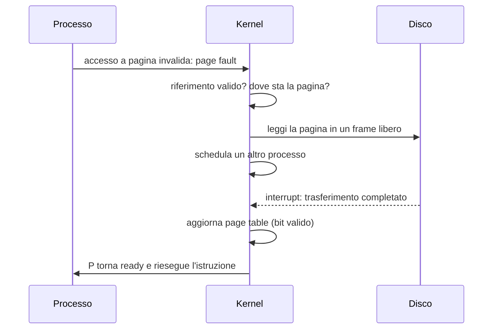
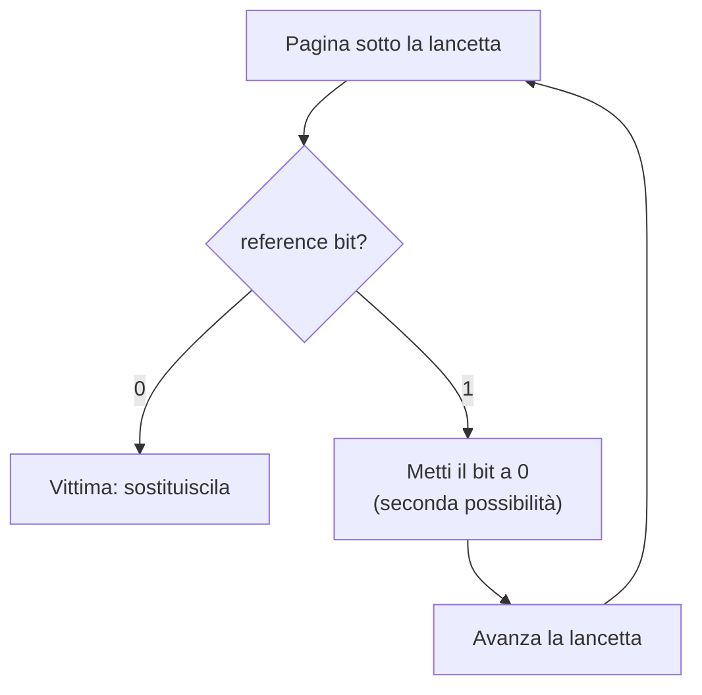

# Memoria Virtuale

> [!abstract] Scopo della lezione
> Il paging della [[10 - SO - Gestione della Memoria|lezione 10]] separa lo spazio logico da quello fisico. La **memoria virtuale** sfrutta questa separazione fino in fondo: un processo può girare anche se **solo una parte** delle sue pagine è in RAM, e le altre restano su disco finché non servono (**demand paging**). La lezione descrive cosa succede durante un **page fault** e quanto costa (EAT), le ottimizzazioni (**swap space**, **copy on write**, free frame list), gli algoritmi di **page replacement** (FIFO, ottimo, LRU e le sue approssimazioni, con l'**anomalia di Belady**) e infine il **thrashing** e il **working set model**.
> Mappa dei concetti: [[MOC - Sistemi Operativi]]

## Perché la memoria virtuale

Vedi [[Memoria Virtuale]].

Il codice deve essere in memoria per essere eseguito, ma **raramente si usa tutto il programma**: gestione di errori rari, funzioni poco usate, array dimensionati per il caso peggiore… Non serve quindi avere tutto il codice in memoria nello stesso momento: si possono eseguire **programmi caricati solo in parte**.

Vantaggi:

- il programma **non è più limitato dalla dimensione della memoria fisica**;
- ogni programma occupa meno memoria, quindi se ne possono eseguire **di più contemporaneamente**: aumentano l'utilizzo della CPU e il throughput, senza aumentare il tempo di risposta o di turnaround;
- serve **meno I/O** per caricare o swappare i programmi, quindi ogni programma utente parte più velocemente.

La memoria virtuale **separa la memoria logica da quella fisica**: solo una parte del programma deve stare in memoria, quindi lo spazio degli indirizzi logici può essere **molto più grande** della memoria fisica. Permette anche a più processi di **condividere** spazi di indirizzi.

Lo spazio logico di solito parte dall'indirizzo 0 ed è **contiguo** fino alla fine, mentre la memoria fisica è organizzata in frame sparsi. Come visto, è la **MMU** a mappare lo spazio logico su quello fisico ([[MMU]]).

La memoria virtuale si può implementare con **demand paging** (paginazione su richiesta) o **demand segmentation**.

### Lo spazio di indirizzi virtuale

Di solito si progetta lo spazio logico in modo che lo **stack** parta dall'indirizzo logico massimo e cresca **verso il basso**, mentre lo **heap** cresce **verso l'alto**. Così si sfrutta al massimo lo spazio. Lo spazio vuoto tra stack e heap non occupa memoria fisica finché non viene usato: serve alla crescita dei due e per mappare le **shared libraries**.

Memoria e librerie possono essere **condivise** mappandole nello spazio virtuale di più processi. Le pagine possono essere condivise anche durante una `fork()`, per velocizzare la creazione del processo (vedi [[Copy on Write]]).

![[SO-L11-01.png]]

Due processi hanno ognuno il proprio stack, heap, dati e codice, ma la **shared library** di entrambi è mappata sulle **stesse pagine fisiche**.

## Demand paging

Vedi [[Demand Paging]].

Con il **demand paging**, al caricamento non si porta in memoria l'intero processo: si porta una pagina **solo quando serve**. Il comportamento è simile a un sistema di paging con swapping:

![[SO-L11-02.png]]

Le pagine dei programmi vengono spostate tra memoria principale e disco (swap out/swap in) **una alla volta**, invece che a processi interi.

Quando serve una pagina che non è in memoria, la si porta dentro.

- **Lazy swapper**: non porta mai una pagina in memoria finché non è necessaria.
- **Pager**: uno swapper che lavora sulle **pagine** (quello della lezione scorsa lavorava su processi interi).
- **Pure demand paging**: caso estremo, il processo **parte senza nessuna pagina in memoria**. L'OS imposta l'instruction pointer sulla prima istruzione, che non è in memoria: si verifica subito un page fault, che carica la pagina; e così via per ogni pagina toccata per la prima volta.

Una singola istruzione può accedere a **più pagine** (es. un'istruzione che copia da un indirizzo a un altro, e che è a cavallo tra due pagine), causando più page fault.

Per il demand paging servono:

- una **page table con bit di validità** (*invalid* = pagina non in memoria, o non valida);
- una **memoria secondaria** per lo swap (*swap device* con spazio di swap);
- il **restart delle istruzioni**: la macchina deve poter tornare al punto esatto in cui l'istruzione è stata interrotta e rieseguirla. È per questo che il page fault è un **fault** e non una trap (vedi [[Eccezioni]]).

### Gestione di un page fault

Caso peggiore: accesso a una pagina che non è in RAM.

1. Il **page fault** (eccezione) causa un context switch verso l'OS.
2. Si controlla che il riferimento alla pagina fosse **valido** (altrimenti il processo viene terminato, *segmentation fault*) e si determina dove si trova la pagina **sul disco**.
3. Si avvia una lettura dal disco verso un **frame libero** in RAM:
   - si aspetta in coda finché la richiesta di lettura viene servita;
   - si aspetta il tempo di ricerca e di latenza del dispositivo;
   - si trasferisce la pagina nel frame libero.
4. Mentre si aspetta, si **assegna la CPU a un altro processo**.
5. Il disco segnala la fine del trasferimento con un **interrupt**, che causa un altro context switch verso l'OS.
6. Si aggiornano la **page table** e le altre tabelle: ora la pagina è in memoria.
7. Il processo che aveva causato il page fault torna ready; quando riceve la CPU, **riesegue l'istruzione** che aveva causato il fault.



### Prestazioni

Si misurano con l'**EAT** (*Effective Access Time*, vedi [[Effective Access Time]]):

$$EAT = (1-\rho)\cdot T_{mem} + \rho\cdot(\text{overhead del page fault} + \text{swap in della pagina})$$

con ρ = **page fault rate**:

- ρ = 0: tutte le pagine sono in memoria, non c'è mai page fault;
- ρ = 1: nessuna pagina è in memoria, c'è un page fault a ogni accesso.

Le tre attività principali del servizio di un page fault: **gestire l'interrupt**, **leggere/scrivere la pagina**, **riavviare il processo**. La seconda domina (millisecondi contro nanosecondi).

> [!example] Perché ρ deve essere minuscolo
> Con accesso a memoria di 200 ns e servizio del page fault di 8 ms: EAT = 200 + ρ · 7 999 800 ns. Con un solo page fault ogni 1000 accessi l'EAT è circa 8.2 µs, cioè **40 volte** più lento. Per restare entro il 10% di rallentamento serve ρ < 1 / 400 000.

## Ottimizzazioni

**Swap space**: un'area del disco **senza file system** (raw mode).

- L'I/O è più veloce che passando per un file system: non c'è overhead del file system (allocazione di blocchi, directory…).
- Una possibilità: al caricamento del processo si copia l'intera immagine nello swap space, e durante l'esecuzione si fa swapping dentro e fuori dallo swap space.
- Quando si porta fuori una pagina **read-write modificata** bisogna riscriverla; una pagina **read-only** (es. codice) non va riscritta: la si può ricaricare dal file eseguibile.

**Copy on Write (COW)** (vedi [[Copy on Write]]): se si duplica una risorsa ma non la si modifica, non serve crearne davvero una copia: la risorsa può essere **condivisa** tra copia e originale. Solo quando una delle due viene **modificata** si crea la copia.

- Alla `fork` si **replica solo la page table**, che punta ai frame del padre: le pagine sono condivise. Si alzano dei flag sulle pagine.
- Se il flag `trap_on_write` (in pratica: la pagina viene marcata read-only) è 1, una scrittura sulla pagina genera una **trap**: il kernel **copia il frame**, aggiorna la page table del processo che scrive e cancella il flag, così gli accessi successivi non generano trap.

**Free frames**: il sistema mantiene una **lista di frame liberi** (simile a uno [[SLAB Allocator|SLAB]]), così da ottenere subito un frame quando serve. Per **sicurezza**, i frame vengono **azzerati** prima di essere riassegnati (*zero-fill-on-demand*), altrimenti un processo potrebbe leggere i dati di un altro.

Esempio di COW:

![[SO-L11-03.png]]

**Prima**: il processo 1 fa `fork` e genera il processo 2; la page table viene solo copiata e si imposta il bit `trap_on_write`; i frame **non** vengono copiati. Entrambi i processi puntano alle pagine A, B, C.

![[SO-L11-04.png]]

**Dopo**: quando il processo 1 scrive sulla pagina C viene generata una trap; il frame C viene copiato ("Copy of page C") e la page table del processo 1 viene aggiornata per puntare alla copia. A e B restano condivise.

## Page replacement

Vedi [[Page Replacement]].

Quando **non ci sono frame liberi** e bisogna caricare una pagina, si sceglie un frame in memoria da portare fuori: la **vittima** (*victim*).

- Idealmente si sceglierebbe la pagina che verrà usata **più tardi** nel futuro (bisognerebbe conoscere il futuro).
- Le pagine **non modificate** in RAM non devono essere riscritte su disco quando vengono rimosse.
- Il **modify bit** (*dirty bit*) indica se la pagina è stata modificata: serve a ridurre l'overhead dei trasferimenti (si scrive su disco solo se dirty).

Quando si richiede una pagina che non è in memoria:

1. si trova la posizione della pagina sul disco;
2. si cerca un frame libero: se c'è lo si usa; altrimenti un **algoritmo di page replacement** sceglie il frame vittima. Se il suo dirty bit è attivo, lo si **scrive su disco**;
3. si porta la pagina desiderata nel frame liberato e si aggiornano page table e frame table;
4. si riprende il processo, **rieseguendo l'istruzione** che aveva causato la trap.

![[SO-L11-05.png]]

1. swap out della pagina vittima; 2. la sua entry nella page table diventa *invalid*; 3. swap in della pagina desiderata nel frame *f*; 4. la page table viene aggiornata per la nuova pagina.

L'obiettivo degli algoritmi di page replacement è **minimizzare il page fault rate ρ**.

Si valutano con una **simulazione**, usando un array (la *reference string*) che codifica il pattern di accesso: `s[i] = x` significa che al tempo *i* il sistema ha usato la pagina *x*. Si conta il numero di page fault.

![[SO-L11-06.png]]

In generale, **più frame si hanno, meno page fault** si verificano.

### FIFO

Si sceglie come vittima la pagina che è in memoria **da più tempo** (quella caricata per prima).

![[SO-L11-07.png]]

Con la reference string `7 0 1 2 0 3 0 4 2 3 0 3 2 1 2 0 1 7 0 1` e 3 frame, FIFO fa **15 page fault**.

> [!warning] Correzione
> Negli appunti si legge "la pagina che era stata swapped in per ultima": FIFO sceglie la pagina caricata per **prima** (la più vecchia), come una coda.

#### Anomalia di Belady

Vedi [[Anomalia di Belady]].

**Aumentare il numero di frame può aumentare i page fault.** Ne soffre FIFO con certi pattern di accesso. Ad esempio con il pattern

```
1 2 3 4 1 2 5 1 2 3 4 5
```

si ha il comportamento:

![[SO-L11-08.png]]

con 3 frame si hanno **9** page fault, con 4 frame **10**.

### Optimal page replacement

Si sceglie come vittima la pagina che **non verrà usata per il periodo più lungo**. Non si può applicare nella pratica perché richiede di conoscere il futuro, ma fornisce un **limite**: nessun algoritmo può fare meglio. Serve come riferimento per confrontare gli altri. (Sulla reference string di prima fa 9 page fault.)

### LRU (Least Recently Used)

Si approssima l'ottimo **usando il passato per prevedere il futuro**: si sceglie come vittima la pagina **non usata da più tempo**. È il principio di località applicato all'indietro.

LRU **non soffre** dell'anomalia di Belady (come l'ottimo, è un *algoritmo a stack*: l'insieme di pagine in memoria con *n* frame è sempre contenuto in quello con *n+1*).

![[SO-L11-09.png]]

Sulla stessa reference string, LRU fa **12 page fault** (contro 15 di FIFO e 9 dell'ottimo).

Implementazioni di LRU:

- **contatore**: a ogni pagina è associato un contatore; a ogni accesso vi si copia il valore del clock. Per scegliere la vittima si scorre la page table cercando il contatore minimo;
- **lista (stack)**: si mantiene una lista di pagine; a ogni accesso la pagina viene spostata **in cima**. La vittima è l'**ultima** della lista.

LRU esatto è **troppo lento** (richiede un aggiornamento a ogni accesso a memoria) e non si usa: si usano **approssimazioni**.

> [!warning] Correzione
> LRU significa **Least** Recently Used (usata meno recentemente), non "Last".

### LRU approssimato

Serve supporto hardware: un **reference bit** per ogni entry della page table.

- inizialmente ogni pagina ha reference bit = 0;
- quando una pagina viene acceduta, l'hardware mette il bit a 1;
- si sceglie come vittima una pagina con reference bit = 0 (non si sa *quanto* tempo fa è stata usata, ma si sa che non è stata usata di recente).

**Second-chance (clock)**: le pagine sono disposte in un buffer circolare con una "lancetta". Si esamina la pagina puntata: se ha reference bit = 0 la si sostituisce; se ha reference bit = 1, si mette il bit a 0 (le si dà una **seconda possibilità**), la si lascia in memoria e si passa alla successiva.



**Second-chance migliorato**: si classificano le pagine in base alla coppia (reference bit, modify bit):

| (ref, dirty) | Significato | Come vittima |
| --- | --- | --- |
| (0, 0) | né usata di recente né modificata | **candidata migliore** |
| (0, 1) | non usata di recente, ma modificata (va riscritta su disco) | buona |
| (1, 0) | usata di recente, ma non modificata | peggiore |
| (1, 1) | usata di recente e modificata | **candidata peggiore** |

## Thrashing

Vedi [[Thrashing e Working Set]].

Il **thrashing** si verifica quando il sistema passa **più tempo a paginare che a eseguire**. Succede quando un processo **non ha abbastanza frame** per le pagine che usa attivamente, quindi il page fault rate è altissimo: si ha un page fault, si porta dentro la pagina, ma presto bisogna rimuoverla di nuovo per far posto a un'altra che serve subito.

Conseguenza perversa: l'utilizzo della CPU crolla (i processi sono tutti in attesa del disco), quindi l'OS pensa di dover **aumentare il grado di multiprogrammazione** e aggiunge un altro processo, che ruba altri frame e peggiora la situazione.

![[SO-L11-10.png]]

L'utilizzo della CPU cresce con il grado di multiprogrammazione fino a un massimo, poi **crolla** quando inizia il thrashing.

### Località e working set

Le regioni di memoria a cui si accede cambiano **lentamente** mentre il sistema evolve.

**Principio di località**: se si è acceduto a qualcosa poco fa, è molto probabile che ci si acceda di nuovo nel prossimo futuro (località temporale); e probabilmente si accederà anche alle zone vicine (località spaziale). Un processo passa da una **località** all'altra (es. da una funzione a un'altra).

Il **working set model** modella i pattern di accesso e le località.

- **Working set**: l'insieme delle pagine a cui si è acceduto **di recente**.
- `wss(p, t)`: l'insieme delle pagine a cui il processo *p* accede nella finestra di tempo *t* (con *t* l'intervallo che si vuole analizzare, *p* l'identificatore del processo).

Numero totale di frame necessari al tempo *t*:

![[SO-L11-11.png]]

$$D(t) = \sum_p |wss(p, t)|$$

Si ha thrashing quando i frame disponibili non bastano:

![[SO-L11-12.png]]

$$D(t) > max\_frames$$

In tal caso l'OS deve **sospendere** (swap out) qualche processo, invece di aggiungerne altri.

![[SO-L11-13.png]]

Il page fault rate di un processo ha dei **picchi** quando il processo passa a un nuovo working set (nuova località) e poi scende quasi a zero finché resta nella stessa località. La dimensione della finestra *t* è critica: troppo piccola non copre l'intera località, troppo grande ne copre più d'una.
