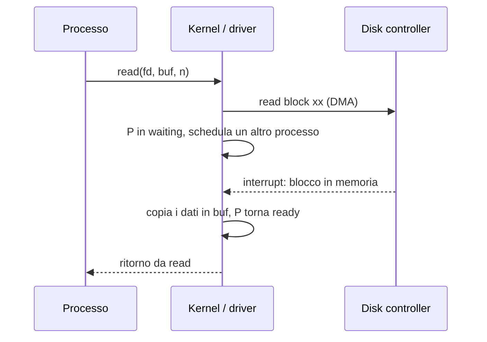
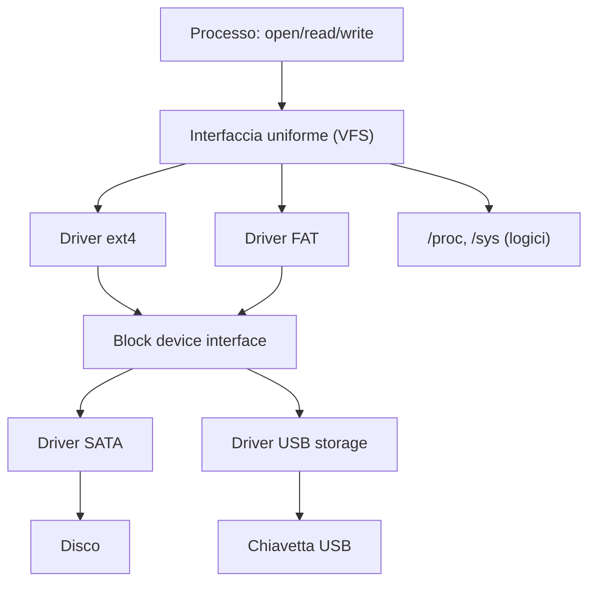

# File System

> [!abstract] Scopo della lezione
> Il **file system** è l'astrazione con cui l'OS presenta un disco, che sa solo leggere e scrivere **blocchi** numerati, come un albero di **file** e **directory** con nomi, permessi e proprietari. La lezione parte dalla vista dell'utente (gerarchia, **mount**, **link**, **permessi**, comandi), passa all'API del programmatore (`FILE*` della libc e **file descriptor** delle syscall, `mmap`), mostra il principio Unix "**tutto è un file**" applicato ai dispositivi (`/dev`, `ioctl`, **driver**), e chiude con l'implementazione: block device, partizioni, file system driver e strutture dati in memoria e su disco.
> Mappa dei concetti: [[MOC - Sistemi Operativi]]

## Concetti base

Vedi [[File System]].

Il **file system** risiede sul **disco** (memoria secondaria) e:

- fornisce un'**interfaccia utente** per il disco, mappando la struttura logica su quella fisica;
- permette un accesso **efficiente e comodo**: i dati si possono memorizzare, trovare e recuperare facilmente.

Gli elementi:

- **file**: pezzi di dati memorizzati, con un nome;
- **directory**: collezioni di file o di altre directory;
- **mount point**: directory che contiene il file system di un dispositivo;
- **link**: puntatore a un file nel file system:
  - **link logico** (soft/simbolico): cancellare il link non ha effetti sul file originale;
  - **link fisico** (hard): quando si cancellano **tutti** i link fisici di un file, il file viene cancellato.

![[SO-L12-01.png]]

Il file system Unix è un **albero** con radice `root` (`/`): sotto ci sono `bin`, `dev`, `etc` (con `group`, `passwd`), `home` (con le home degli utenti), `lib`, `tmp`, `usr`, `var`… I rettangoli sono **directory**, i cerchi **file non-directory**.

La radice `/` contiene di solito diverse directory, e alcune contengono **altri file system** (altri dischi, immagini di file system, directory remote).

Ci sono anche **file system logici**, popolati dall'OS, che **non corrispondono a byte fisici** sul disco:

- `/proc`: informazioni sui **processi** in esecuzione (es. `/proc/<pid>/maps` mostra la mappa di memoria di un processo);
- `/sys`: informazioni sul **sistema** e sui dispositivi;
- `/dev`: i **dispositivi fisici**, presentati come file.

## Mount e umount

Vedi [[Mount]].

Per collegare il file system di un dispositivo al file system globale si usa `mount`:

```bash
mount -t <type> <device> <mount point>
```

Monta il file system del dispositivo `<device>`, di tipo `<type>` (es. `ext4`, `vfat`), nella directory `<mount point>`, che diventa la **radice** del file system montato.

Per scollegarlo si usa l'operazione inversa:

```bash
umount <device> | <dir>
```

- Il mounting può essere fatto automaticamente da un **daemon** (programma in background) che ascolta sulle porte USB e aggiunge i dispositivi rimovibili al file system.
- Montare un dispositivo può richiedere privilegi (`sudo`).
- Una directory che ospita un file system montato **mostra la radice di quel file system**; i file che conteneva prima **non sono accessibili** finché il file system non viene smontato.

## File

Un **file regolare** è una memoria **permanente** con uno **spazio di indirizzi contiguo** (una sequenza di byte). Il contenuto lo decide chi l'ha creato (convenzionalmente indicato dall'estensione).

Il tipo di un file si può identificare con:

```bash
file <filename>
```

che legge i **primi byte** del file (il *magic number*, es. `\x7fELF` per gli eseguibili) per capire di che tipo è.

Attributi di un file **per l'utente**:

- nome (stringa);
- identificatore;
- directory;
- dimensione;
- permessi;
- ownership;
- tempo di creazione;
- tempo di ultima modifica;
- …

Attributi **per il sistema**:

- identificatore **unico** nel sistema (su Unix il numero di *inode*);
- locazione (dove si trova sul dispositivo/file system);
- …

## Ownership e permessi

Vedi [[Permessi e Ownership]].

Un file appartiene a un **proprietario** (*user*) e a un **gruppo**. Rispetto a un file, ogni utente ricade in una di tre classi: **user** (il proprietario), **group** (membri del gruppo del file), **others** (tutti gli altri).

Cambiare ownership:

```bash
chown <user>:<group> <file>
```

A ogni classe si assegnano i permessi **read**, **write**, **execute**. Per le directory: *read* = poter **elencare** il contenuto, *write* = creare/eliminare file al suo interno, *execute* = poterla **attraversare** (accedere ai file al suo interno).

> [!warning] Correzione
> Negli appunti "nel caso di directory execute significa listing": il listing è il permesso **read**; **execute** su una directory permette di attraversarla (`cd`, accesso ai file per nome).

I permessi possono essere cambiati dal proprietario o da root:

```bash
chmod <ugo>[+|-]<rwx> <file>
```

- `<ugo>`: le classi a cui si applica la modifica (`u` user, `g` group, `o` others);
- `+` aggiunge, `-` toglie il permesso;
- `<rwx>`: i permessi.

Esempio: `chmod go-w file` toglie il permesso di scrittura a gruppo e altri; `chmod u+x script.sh` rende uno script eseguibile dal proprietario. Esiste anche la forma ottale: `chmod 644 file` = `rw-r--r--`.

![[SO-L12-02.png]]

Nell'output di `ls -l`, `-rw-rw-r--` significa: file regolare (`-`); l'utente può leggere e scrivere (`rw-`); il gruppo può leggere e scrivere (`rw-`); gli altri possono solo leggere (`r--`). Seguono il numero di hard link (1), il proprietario `giorgio`, il gruppo `giorgio`, la dimensione, la data e il nome.

## Directory e link

Una **directory** è un file che contiene **elementi** (entry), che possono essere:

- **soft link** (link logico): puntatore "per nome" a un altro percorso. Se si cancellano tutti i soft link, il file **non** viene cancellato; se si cancella il file, il soft link resta "appeso";
- **hard link** (link fisico): un altro **nome** per lo stesso file (stesso inode). Tutti gli hard link sono **equivalenti** tra loro (non c'è un "originale"); il file viene eliminato quando l'ultimo hard link viene rimosso;
- altre **directory**.

Vedi [[Link Hard e Soft]].

Comandi:

| Comando | Effetto |
| --- | --- |
| `ls` | elenca il contenuto di una directory |
| `ln -s <old_name> <new>` | crea un **soft** link; senza `-s` crea un **hard** link |
| `rm <filename>` | rimuove un file/link; `rm -rf` rimuove ricorsivamente |
| `rmdir <dirname>` | rimuove una directory (vuota) |

## Il FILE come tipo di dato astratto

Un FILE è un tipo di dato astratto, con le operazioni:

- create, delete;
- truncate (svuota il file portandolo a dimensione 0);
- open, close;
- seek;
- read, write;
- wait for a change (`select`).

### FILE* della libc

In `<stdio.h>`, `FILE` è un **puntatore opaco**: punta a una struttura i cui campi non sono documentati, per cui l'accesso avviene solo tramite funzioni (incapsulamento, come in [[03 - SO - Programmazione OOP in C|lezione 3]]).

`FILE*` offre un'interfaccia di **alto livello** (con buffering):

- **`fopen`**, **`fclose`**;
- **`fprintf`** / **`fscanf`**;
- **`fread`** / **`fwrite`**;
- **`fseek`**.

Queste operazioni sono implementate sopra le syscall specifiche dell'OS, in modo da comportarsi coerentemente su sistemi diversi (è lo **standard di linguaggio**, vedi [[06 - SO - Interrupt, Syscall, Dual Mode e Processi#Standard di linguaggio e standard di sistema|lezione 6]]).

### File descriptor

Vedi [[File Descriptor]].

Un **file descriptor** è un **intero** che identifica un file aperto **all'interno di un processo**.

- Lo si ottiene aprendo o creando un file.
- Lo stesso file può essere aperto più volte: ogni apertura restituisce un descriptor **diverso**.
- Ogni processo parte con tre descriptor già aperti:
  - **0**: `stdin` (input standard);
  - **1**: `stdout` (output standard);
  - **2**: `stderr` (errore standard).
- Tutte le operazioni su un file si fanno tramite il suo descriptor.

> [!warning] Correzione
> Negli appunti 0 e 1 sono invertiti: **0 = stdin**, **1 = stdout**, 2 = stderr.

![[SO-L12-03.png]]

- `open(pathname, flags, mode)`: `flags` è una bitmap che dice come aprire (`O_RDONLY`, `O_WRONLY`, `O_RDWR`, `O_CREAT`, `O_APPEND`, …), `mode` i permessi se il file viene creato;
- `creat(pathname, mode)`: crea un file;
- `close(fd)`;
- `dup`, `dup2`, `dup3`: **clonano** un descriptor (il nuovo punta allo stesso file aperto, con la stessa posizione), senza effetti sul file system. Servono ad esempio a redirigere `stdout` su un file (`dup2(fd, 1)`).

Un file è una sequenza di byte, quindi lo si può vedere come un **array** che si legge e scrive a pezzi. A ogni file descriptor è associata una **posizione corrente** (file pointer) mantenuta dall'OS.

- `read`/`write` operano **alla posizione corrente** e la **spostano** (leggere *n* byte dalla posizione *x* porta il puntatore a *x + n*).
- `lseek` sposta il puntatore all'interno del file.
- Un processo può mettersi in attesa con `select()` finché uno tra più descriptor diventa pronto (dati da leggere, possibilità di scrivere).

![[SO-L12-04.png]]

- `read(fd, buf, count)` / `write(fd, buf, count)`: restituiscono il numero di byte effettivamente letti/scritti (può essere meno di `count`; 0 in lettura significa fine del file);
- `lseek(fd, offset, whence)`: `whence` è `SEEK_SET` (dall'inizio), `SEEK_CUR` (dalla posizione corrente) o `SEEK_END` (dalla fine);
- `select(nfds, readfds, writefds, exceptfds, timeout)`: attende su **insiemi** di descriptor, manipolati con le macro `FD_ZERO`, `FD_SET`, `FD_CLR`, `FD_ISSET`.

Altre operazioni:

- gli **attributi** di un file (dimensione, proprietario, …) si leggono con `stat`/`fstat`;
- le **directory** si leggono a blocchi, con funzioni speciali (`getdents`);
- i **link** si creano/rimuovono con `link`/`unlink`. Eliminare un file significa rimuoverne il link (**unlinking**): `rm` usa `unlink`;
- `mount` è anche una syscall.

![[SO-L12-05.png]]

## Dispositivi come file

Vedi [[Device File e ioctl]].

Il file system `/dev` fornisce "ganci" verso i dispositivi fisici:

- `/dev/sda`: il primo disco;
- `/dev/sda1`: la prima partizione del primo disco;
- `/dev/ttyACM0`: una porta seriale (es. l'Arduino della [[04 - SO - Hardware e AVR#La porta seriale|lezione 4]]);
- `/dev/video0`: una webcam.

Nei sistemi Unix i dispositivi sono accessibili **come file**. I file di dispositivo sono di due tipi:

- **block**: accesso a blocchi, supportano **seek** e read/write di blocchi in posizioni arbitrarie (dischi);
- **character**: sono **stream** di byte, senza seek (seriali, tastiere).

Esempi:

- scrivere sulla porta seriale: `open("/dev/ttyACM0", ...)` e `write` sul descriptor ottenuto;
- da terminale: `cat filename > /dev/ttyACM0` copia il file sulla seriale;
- `cat /dev/ttyACM0 > file` legge dalla seriale e scrive su un file.

Unix permette quindi di accedere ai dispositivi attraverso l'interfaccia dei file.

### ioctl e driver

Alcune funzioni sono **specifiche di un dispositivo** e non rientrano in read/write (es. impostare il baud rate di una seriale, espellere un CD). Vi si accede con la syscall **`ioctl()`**.

- Un **driver** è il codice che gestisce uno specifico dispositivo hardware.
- `ioctl` è un **gancio verso il driver**, e funziona come una "syscall annidata": prende un parametro `request`, un intero che specifica l'azione da svolgere, più eventuali argomenti.
- Ogni driver, quando viene caricato, registra i propri codici `request` e il proprio **request handler**.
- I dispositivi a caratteri (terminali, seriali) si configurano attraverso l'interfaccia unificata **termios**.

## mmap

Vedi [[mmap]].

`mmap` **mappa un file in memoria**: una regione dello spazio di indirizzi del processo corrisponde al contenuto del file, e lo si legge/scrive come un array, senza `read`/`write`.

![[SO-L12-06.png]]

`mmap(addr, length, prot, flags, fd, offset)` mappa `length` byte del file `fd` a partire da `offset`, con protezione `prot` (`PROT_READ`, `PROT_WRITE`, …) e `flags` (`MAP_SHARED`, `MAP_PRIVATE`, …); restituisce l'indirizzo della mappatura. `munmap` la rimuove.

- Le **cache** sono gestite in modo **trasparente**, e il caricamento/riscrittura del file è gestito dal **memory manager**: è il meccanismo del **demand paging** ([[Demand Paging]]) applicato a un file. Una pagina viene letta dal file al primo accesso (page fault) e riscritta se è dirty.
- Quando si legge/riscrive una pagina, viene chiamato il driver corretto.
- Si possono mappare in memoria anche **dispositivi speciali**, senza passare dal disco (es. la memoria video).

L'OS fornisce astrazioni di tutti questi meccanismi.

## Tutto è un file

In Unix **tutto è un file**: file su disco e dispositivi. Quando qualcosa non è un file (es. un socket, una pipe), ha comunque un'**interfaccia file-like**: descriptor, riferimenti, operazioni di apertura/chiusura, read/write.

A livello hardware le cose sono ovviamente molto diverse:

- dischi (SCSI, IDE, SATA);
- bus (PCIe, USB);
- porte (seriale, parallela);
- schede grafiche;
- schede di rete;
- altri dispositivi (tastiera, mouse, telecamera, …).

L'OS deve gestire ognuno di questi dispositivi, e ognuno è diverso.

## Driver e block device

Vedi [[Driver e Block Device]].

L'implementazione dei dispositivi dovrebbe **massimizzare la coerenza dell'interfaccia** e **obbligare il driver a seguire un'interfaccia specifica**, per garantire la portabilità.

- Un **driver è una classe virtuale**: deve fare l'**override** dei metodi standard definiti dall'interfaccia (open, read, write, ioctl…). È esattamente la [[Virtual Method Table]] della [[03 - SO - Programmazione OOP in C#Polimorfismo (late binding)|lezione 3]].
- I dispositivi di storage obbediscono alla **block interface**.
- A volte il driver di un dispositivo di storage usa **altri dispositivi** del sistema (es. un disco USB usa il driver USB): si ottiene un'**architettura a strati** per i driver.
- I block device in `/dev` devono implementare la **block device interface**: query (dimensione, dimensione del blocco), seek, read block, write block, …

### Partizioni e disk controller

Lo storage è spesso organizzato in **partizioni**. All'inizio del disco c'è la **partition table**: la struttura dati che descrive il layout del disco (dove inizia e finisce ogni partizione, e di che tipo è).

Si accede al disco tramite un **disk controller**, che comprende operazioni del tipo:

```
read block xx
write block yy
```

- La **parte bassa** del disk driver offre un'interfaccia unificata di alto livello per queste operazioni.
- Tipicamente si usa il **DMA** ([[DMA]]): la gestione della memoria deve garantire che ci siano alcune **pagine fisiche contigue** disponibili per il trasferimento.
- La **parte alta** del driver fa **scheduling** delle richieste (riordinandole per ridurre i movimenti della testina) e **caching**, a seconda delle caratteristiche del supporto.

A livello di OS, quando un processo chiede `read block xx`:

1. si fa partire la richiesta e si **passa a un altro processo** (il richiedente va in waiting);
2. il disco gestisce la richiesta e scrive i dati in memoria (DMA);
3. arriva un **interrupt**: si identifica il disco, si riprende il processo e si copiano i dati nel suo spazio di indirizzi.



## Implementare un file system

Con l'interfaccia del disco si possono solo **leggere e scrivere blocchi** (sul disco o in una partizione). La struttura di file e cartelle va implementata aggiungendo allo storage delle **strutture di bookkeeping**.

Nell'implementazione si pensa al disco come a un **grande file binario**, accessibile a pezzi di 512 o 4096 byte (**blocchi**). In questo "file" bisogna mappare un file system, e ci sono molti modi per farlo (FAT, ext4, NTFS…).

- L'OS deve conoscere il **tipo di file system** di una partizione per poterci lavorare.
- Possono coesistere diversi file system in partizioni diverse.

Il **file system driver** è il componente dell'OS che gestisce un file system specifico:

- **espone un'interfaccia uniforme** verso l'alto (open, close, read, …): un'interfaccia astratta, una classe virtuale (su Linux il **VFS**, *Virtual File System*);
- **usa l'interfaccia uniforme di un block device** verso il basso.



### Strutture dati

Vedi [[Strutture Dati del File System]].

**Nel kernel** (in memoria):

- per ogni **file aperto** nel sistema c'è un'istanza di una struttura `OpenFileInfo` (la *system-wide open-file table*);
- per ogni descriptor aperto da un processo c'è una struttura `OpenFileRef`, in una lista accessibile dal **PCB** (la *per-process open-file table*: il file descriptor è l'**indice** in questa tabella);
- ogni `OpenFileRef` punta alla corrispondente `OpenFileInfo` e memorizza un **file pointer indipendente** per seek/read/write. Per questo due `open` dello stesso file hanno posizioni indipendenti, mentre due descriptor ottenuti con `dup` (o ereditati con `fork`) la condividono.

**Sul disco**:

- ogni file è descritto da una struttura chiamata **File Control Block (FCB)** (su Unix l'**inode**), con le informazioni specifiche del file (dimensione, permessi, proprietario, date, puntatori ai blocchi di dati);
- ogni directory ha un header che **estende** l'FCB, seguito da una sequenza di record con le informazioni di ogni file/sottodirectory contenuto (nome → FCB).

Sia i file che le directory possono occupare **più blocchi**, collegati tramite **puntatori a blocchi**.

![[SO-L12-07.png]]

- **(a) `open(file name)`**: il kernel cerca il nome nella **directory structure** (in cache in memoria, o letta dal disco), trova il **file-control block** sul disco e lo carica.
- **(b) `read(index)`**: l'indice (il file descriptor) seleziona una entry nella **per-process open-file table**, che punta alla **system-wide open-file table**, che contiene l'FCB e quindi l'indirizzo dei **data blocks** sul disco.

… fine slide.
