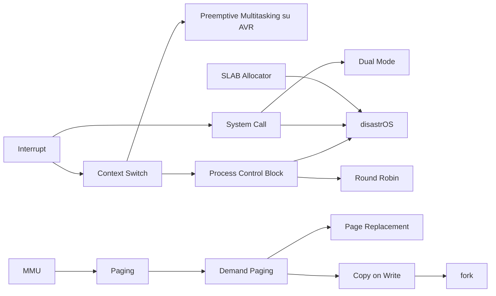

# MOC — Sistemi Operativi

> [!abstract] Come usare questa mappa
> Le **lezioni** sono note complete da cui studiare, nell'ordine del corso. I **concetti** sono note brevi per il ripasso: ognuna rimanda alle sezioni della lezione in cui l'argomento è spiegato nel dettaglio.
> Molti concetti (processi, memoria virtuale, file system, system call) sono trattati anche in **Sistemi di Calcolo**, dal punto di vista del programmatore: [[MOC - Sistemi di Calcolo]].

## Lezioni

| # | Lezione | Argomenti |
| --- | --- | --- |
| 1 | [[01 - SO - Introduzione e Git]] | cos'è un OS, strati, kernel, SMP, Git |
| 2 | [[02 - SO - Programmi, Makefile e pkg-config]] | program file, compilazione, Makefile, pkg-config, CMake |
| 3 | [[03 - SO - Programmazione OOP in C]] | ereditarietà, liste generiche, puntatori a funzione, VMT |
| 4 | [[04 - SO - Hardware e AVR]] | bus, interrupt, DMA, AVR: porte, timer, PWM, UART |
| 5 | [[05 - SO - Stack e Context Switch]] | contesto, ucontext, preemptive multitasking su AVR |
| 6 | [[06 - SO - Interrupt, Syscall, Dual Mode e Processi]] | eccezioni, dual mode, syscall, PCB, fork/wait/exec, segnali |
| 7 | [[07 - SO - Allocatori di Memoria]] | SLAB, buddy allocator |
| 8 | [[08 - SO - disastrOS]] | OS didattico: syscall, scheduler preemptive, sleep |
| 9 | [[09 - SO - CPU Scheduling]] | FCFS, SJF, priorità, RR, code multilivello, real-time |
| 10 | [[10 - SO - Gestione della Memoria]] | binding, MMU, segmentazione, paging, TLB, swapping |
| 11 | [[11 - SO - Memoria Virtuale]] | demand paging, COW, page replacement, thrashing |
| 12 | [[12 - SO - File System]] | file, link, permessi, fd, device, driver, strutture dati |

## Concetti

### Fondamenti e strumenti

- [[Sistema Operativo]] · [[Architettura a Strati]] · [[Kernel Monolitico e Microkernel]] · [[Symmetric Multiprocessing]]
- [[Git]] · [[Program File e Processo]] · [[Compilazione e Linking con gcc]] · [[Makefile]] · [[pkg-config]] · [[CMake]]

### C per sistemi

- [[Ereditarietà in C]] · [[Lista Generica in C]] · [[Puntatori a Funzione]] · [[Virtual Method Table]]

### Hardware e AVR

- [[Bus di Sistema]] · [[Ciclo di Lettura e Scrittura in Memoria]] · [[Memory Mapped IO]] · [[Interrupt]] · [[DMA]]
- [[Microcontrollore e Bootloader]] · [[Toolchain AVR]] · [[Porte Digitali AVR]] · [[Timer AVR]] · [[PWM]] · [[Interrupt Esterni AVR]] · [[UART]]

### Contesti, interrupt e kernel

- [[Contesto di un Processo]] · [[ucontext]] · [[Context Switch]] · [[Preemptive Multitasking su AVR]]
- [[Polling vs Interrupt]] · [[Interrupt Vector]] · [[Eccezioni]] · [[Dual Mode]] · [[System Call]] · [[vDSO]]

### Processi

- [[Process Control Block]] · [[Immagine di Memoria di un Processo]] · [[Stati di un Processo]]
- [[fork]] · [[wait e Processi Zombie]] · [[Segnali]] · [[exec e Variabili d'Ambiente]] · [[disastrOS]]

### Allocatori di memoria

- [[Frammentazione]] · [[SLAB Allocator]] · [[Array List]] · [[Buddy Allocator]]

### Scheduling

- [[CPU Scheduler e Dispatcher]] · [[CPU Burst e IO Burst]] · [[Criteri di Scheduling]]
- [[First Come First Served]] · [[Shortest Job First]] · [[Priority Scheduling]] · [[Round Robin]] · [[Code Multilivello]]
- [[Scheduling Multiprocessore]] · [[Scheduling Real-Time]] · [[Valutazione degli Algoritmi di Scheduling]]

### Memoria

- [[Address Binding]] · [[Linking Statico e Dinamico]] · [[Loader ed ELF]] · [[MMU]] · [[Allocazione Contigua]]
- [[Segmentazione]] · [[Paging]] · [[TLB]] · [[Effective Access Time]] · [[Page Table Gerarchica]] · [[Swapping]]

### Memoria virtuale

- [[Memoria Virtuale]] · [[Demand Paging]] · [[Copy on Write]] · [[Page Replacement]] · [[Anomalia di Belady]] · [[Thrashing e Working Set]]

### File system e I/O

- [[File System]] · [[Link Hard e Soft]] · [[Mount]] · [[Permessi e Ownership]] · [[File Descriptor]]
- [[Device File e ioctl]] · [[mmap]] · [[Driver e Block Device]] · [[Strutture Dati del File System]]

## Percorsi trasversali

- **Dall'interrupt al processo**: [[Interrupt]] → [[Interrupt Vector]] → [[Context Switch]] → [[Process Control Block]] → [[CPU Scheduler e Dispatcher]]
- **Dalla syscall al kernel**: [[Puntatori a Funzione]] → [[System Call]] → [[Dual Mode]] → [[disastrOS]]
- **Dall'indirizzo al dato**: [[Address Binding]] → [[MMU]] → [[Paging]] → [[TLB]] → [[Demand Paging]] → [[Page Replacement]]
- **Dal file al disco**: [[File Descriptor]] → [[Strutture Dati del File System]] → [[Driver e Block Device]] → [[DMA]]
