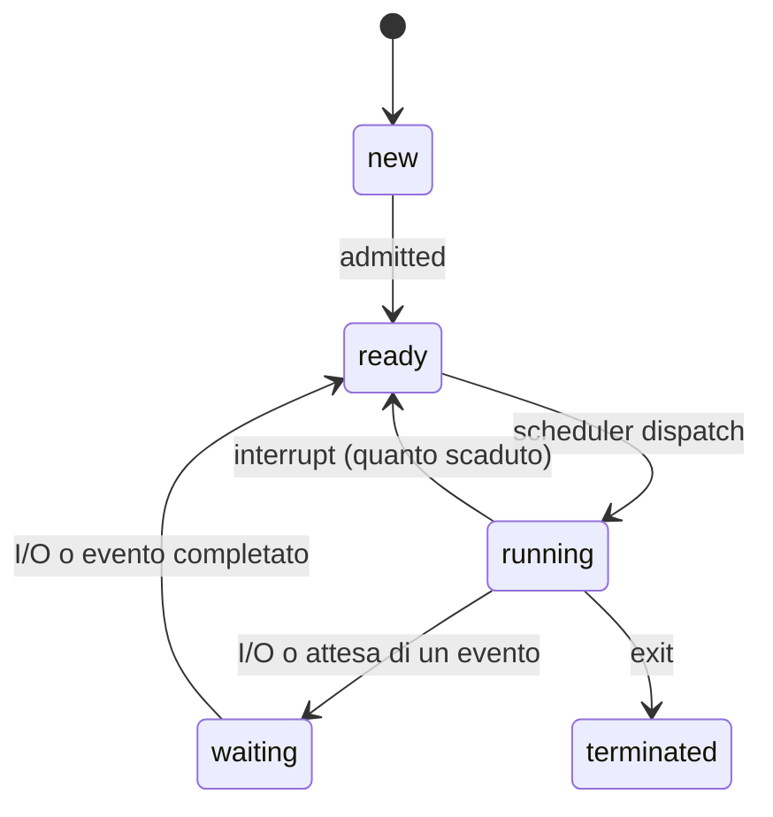

# Stati di un Processo

> [!summary] In breve
> new → ready → running → (waiting → ready) → terminated. Ready: ha tutto tranne la CPU. Waiting: aspetta un evento o un I/O.

- In Unix c'è anche lo stato **zombie** (terminato, ma il padre non ha ancora fatto `wait`).
- Lo scheduler gestisce **code** di PCB: ready queue, code dei dispositivi, waiting.

## Collegamenti

- **Concetti correlati**: [[Process Control Block]] · [[CPU Scheduler e Dispatcher]] · [[wait e Processi Zombie]]
- **Mappa**: [[MOC - Sistemi Operativi]]

> [!info] Approfondimento
> - [[06 - SO - Interrupt, Syscall, Dual Mode e Processi#Stati di un processo|Lezione 6 — Stati di un processo]]
> - [[06 - SO - Interrupt, Syscall, Dual Mode e Processi#Process scheduler|Lezione 6 — Process scheduler]]
