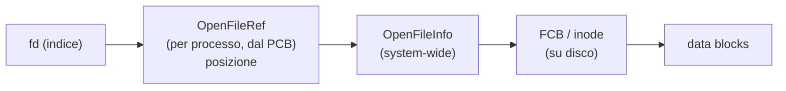

# Strutture Dati del File System

> [!summary] In breve
> Su disco: un File Control Block (inode) per file e directory che sono FCB estesi con elenchi nome → FCB. In memoria: OpenFileInfo (system-wide) e OpenFileRef per processo (con la posizione).

- Il disco viene visto come un grande array di blocchi da 512/4096 byte su cui mappare il file system.
- Il **file system driver** espone un'interfaccia uniforme (VFS) e usa la block interface.
- File e directory possono occupare più blocchi, collegati da puntatori.

## Collegamenti

- **Concetti correlati**: [[File System]] · [[File Descriptor]] · [[Driver e Block Device]] · [[Process Control Block]] · [[Link Hard e Soft]]
- **Mappa**: [[MOC - Sistemi Operativi]]

> [!info] Approfondimento
> - [[12 - SO - File System#Implementare un file system|Lezione 12 — Implementare un file system]]
> - [[12 - SO - File System#Strutture dati|Lezione 12 — Strutture dati]]
