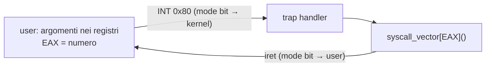

# System Call

> [!summary] In breve
> L'interfaccia controllata verso il kernel: `INT 0x80` entra in kernel mode, EAX contiene il numero della syscall (indice nel syscall vector), gli argomenti stanno nei registri e il risultato torna in un registro.

- **Syscall vector**: array di puntatori a funzione; tutto l'OS è "nascosto" dietro un'unica entry dell'interrupt vector.
- Categorie: processi, file, dispositivi, informazioni, comunicazione.
- Sono primitive di **basso livello** (leggi n byte, mappa memoria, apri dispositivo, aspetta un processo…), non portabili: si usano tramite libc/POSIX.
- `strace` mostra le syscall fatte da un programma; `syscall()` permette di invocarle direttamente.
- In [[disastrOS]]: `disastrOS_syscall(num, ...)` copia gli argomenti nel PCB e chiama `disastrOS_trap()`.

## Collegamenti

- **Concetti correlati**: [[Dual Mode]] · [[Interrupt Vector]] · [[Puntatori a Funzione]] · [[vDSO]] · [[Architettura a Strati]] · [[disastrOS]]
- **Mappa**: [[MOC - Sistemi Operativi]] · [[MOC - Sistemi di Calcolo]]

> [!info] Approfondimento
> - [[06 - SO - Interrupt, Syscall, Dual Mode e Processi#System call|Lezione 6 — System call]]
> - [[06 - SO - Interrupt, Syscall, Dual Mode e Processi#Tipi di syscall|Lezione 6 — Tipi di syscall]]
> - [[08 - SO - disastrOS#Invocazione di una syscall|Lezione 8 — Invocazione di una syscall]]
> - [[06 - SDC - Esecuzione dei programmi#System call con int $0x80|Sistemi di Calcolo, cap. 6 — System call con int $0x80]]
> - [[04 - SDC - Librerie standard del C#Tracciare le system call: strace|Sistemi di Calcolo, cap. 4 — Tracciare le system call: strace]]
