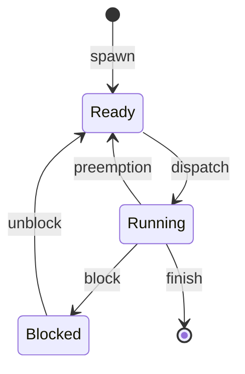

# Processi e Thread

> [!abstract] Scopo della lezione
> Il corso riparte dalle due astrazioni con cui un sistema operativo esegue codice: il **processo**, che possiede le risorse (memoria, file), e il **thread**, che è un flusso di esecuzione. Si rivedono `fork`, `exit` e `wait`; si separano i due ruoli del processo (proprietà delle risorse e unità di scheduling) per arrivare al **multithreading**; si confrontano i thread **user-level** e **kernel-level**; si introducono i **Pthreads** e il problema della **thread safety**, che porta dritto alla concorrenza della [[02 - SDC2 - Concorrenza|lezione 2]]; si chiude con la tassonomia di Flynn e il **Symmetric Multiprocessing**.
> Mappa dei concetti: [[MOC - Sistemi di Calcolo 2]]

> [!tip] Per gli esercizi
> Le primitive di questa lezione (`fork`, `wait`, `pthread_create`, `pthread_exit`, `pthread_join`, `pthread_detach`) sono riassunte in [[SDC2 - Primitive C per UNIX System Programming (Sintesi)#2.1 Creazione di un processo figlio|Primitive C — §2]] e in [[SDC2 - Funzioni Esame.pdf]].

## Processi: fork() e wait()

Vedi [[Program File e Processo]].

Un **processo** è un'entità dinamica, caricata in RAM, generata da un programma: una sequenza di attività (**task**) controllate da un **program scheduler**, eseguita su un processore sotto la supervisione del sistema operativo. Il programma è il file statico su disco; il processo è la sua esecuzione.

I requisiti principali di un sistema operativo si riassumono in:

- **interleaved execution**: eseguire più processi alternandoli sulla CPU;
- **resource allocation and policies**: assegnare le risorse secondo delle politiche;
- **user creation of processes and inter-process communication**: permettere ai programmi di creare processi e farli comunicare.

Un processo è composto da:

- il **codice** del programma (eventualmente condiviso tra più processi dello stesso programma);
- un insieme di **dati**;
- un insieme di **attributi** che ne descrivono lo stato durante l'esecuzione.

### Process Control Block

Vedi [[Process Control Block]].

Durante l'esecuzione un processo è caratterizzato da: **identifier**, **state**, **priority**, **program counter**, **memory pointers**, **context data** (i registri), **I/O status information** (file aperti, richieste pendenti) e **accounting information** (tempo di CPU usato, limiti…).

Tutte queste informazioni stanno nel **Process Control Block (PCB)**, creato e gestito dal sistema operativo: è grazie ai PCB che l'OS può gestire più processi, salvandone e ripristinandone lo stato (vedi [[Context Switch]]).

![[SDC2-L01-001-000.png]]

Il PCB come una "scheda" con un campo per ognuno degli elementi elencati; i puntini indicano che un PCB reale contiene molti altri campi.

### Creazione di un processo

Vedi [[fork]].

I comandi principali per gestire i processi sono `fork()`, `wait()` ed `exit()`. Un processo **padre** crea un processo **figlio** con `fork()`: padre e figlio vengono eseguiti **concorrentemente**, e il figlio è un **duplicato** del padre.

![[SDC2-L01-002-001.png]]

Dopo una `fork` padre e figlio continuano entrambi l'esecuzione, ed entrambi possono fare altre `fork`. Ne risulta un **albero dei processi** (*process tree*):

![[SDC2-L01-002-002.png]]

A crea B e C; B crea D, E ed F; C crea G; D crea H; H crea I. La **radice** dell'albero è un processo speciale creato dal sistema operativo all'avvio (su Unix `init`, oggi spesso `systemd`, con PID 1).

Un processo può **aspettare la terminazione dei figli** con `wait()`. Ad esempio, se C chiama `wait`, si blocca finché G non termina.

**Bootstrapping**: quando il computer viene acceso o riavviato serve un programma iniziale che avvii il sistema (il boot loader, che carica il kernel, che a sua volta crea il primo processo).

Dopo una `fork` il processo corrente si "divide in due", *parent* e *child*, e `fork` restituisce:

| Valore | Dove |
| --- | --- |
| −1 | nel chiamante, se la creazione è fallita |
| 0 | nel processo **figlio** |
| PID del figlio | nel processo **padre** |

Il figlio eredita dal padre:

- una **copia identica della memoria** (con il copy-on-write la copia è solo logica finché nessuno scrive, vedi [[Copy on Write]]);
- i **registri** della CPU, quindi anche il program counter: per questo l'esecuzione riprende **dall'istruzione successiva alla `fork`** in entrambi;
- tutti i **file aperti** dal padre (i descrittori puntano alle stesse entry della tabella dei file aperti).

Anche il **PCB** del figlio è una copia di quello del padre (con PID e alcuni campi diversi).

![[SDC2-L01-003-003.png]]

Prima della `fork`: il processo con PID 25 ha il suo PCB, le sezioni text, data e stack, e usa risorse e file. Sta per eseguire `ret = fork();`, seguito da uno `switch` sul valore restituito: −1 errore (`perror` + `exit(1)`), 0 codice del figlio, default codice del padre (che alla fine fa `wait(0)`).

![[SDC2-L01-003-004.png]]

Dopo la `fork`: esiste un secondo processo con PID 26, con text, data e stack copiati, che condivide con il padre le **stesse risorse e gli stessi file**. Entrambi sono fermi subito dopo la `fork`, ma nel padre `ret = 26` (finisce nel ramo *default*), nel figlio `ret = 0` (finisce nel ramo *case 0*).

Uno schema tipico in C:

```c
pid_t ret = fork();
switch (ret) {
case -1:
    perror("fork");
    exit(1);
case 0:                 // sono il figlio
    /* codice del figlio */
    exit(0);
default:                // sono il padre, ret = PID del figlio
    /* codice del padre */
    wait(0);
}
```

### exec, exit e _exit

Vedi [[exec e Variabili d'Ambiente]] e [[wait e Processi Zombie]].

Se la `fork` serve a far eseguire **un altro programma**, il figlio chiama **`exec()`**: l'OS sostituisce l'immagine del processo corrente (text, data, stack) con quella del nuovo programma, che deve avere un `main()`.

Per terminare, un figlio può chiamare **`exit(status)`**, che:

- salva il risultato (`status`);
- esegue le funzioni registrate con **`atexit(fun)`** e **`on_exit(fun)`**;
- svuota i buffer degli stream con **`fflush()`** (es. il testo di `printf` non ancora scritto);
- chiude i file e le connessioni aperte (non quelli condivisi);
- chiama **`_exit(status)`**.

La system call **`_exit(status)`**:

- salva il risultato;
- **dealloca la memoria**;
- se il processo ha dei figli, li **assegna a `init`**, la radice dell'albero dei processi;
- controlla il **padre**: se è vivo, conserva il valore di ritorno finché il padre non lo legge con `wait`. In questo periodo il figlio non è davvero morto: è uno **zombie**. Se il padre è già morto, il figlio termina del tutto.

> [!note] exit vs _exit
> `exit` è una funzione della libreria C che fa pulizia "a livello utente" e poi chiama `_exit`, la vera system call. Dopo una `fork` il figlio dovrebbe usare `_exit`, per non eseguire una seconda volta gli handler di `atexit` del padre né svuotarne i buffer (vedi [[Gestione degli Errori in C]]).

### wait e waitpid

```c
#include <sys/types.h>
#include <sys/wait.h>

pid_t wait(int *status);
pid_t waitpid(pid_t pid, int *status, int options);
```

![[SDC2-L01-004-005.png]]

- `wait()` aspetta la terminazione di un **figlio qualsiasi** e ne restituisce il PID (−1 se non ci sono figli);
- `waitpid()` aspetta un **figlio specifico** (o, con `pid = -1`, uno qualsiasi); con `options = WNOHANG` non si blocca se nessun figlio è terminato.

Lo stato di uscita si estrae da `status` con le macro `WIFEXITED(status)` e `WEXITSTATUS(status)`.

### Processi in Python

![[SDC2-L01-004-006.png]]

La creazione dei processi è gestita dal sistema operativo, quindi anche Python deve chiederla all'OS, tramite il modulo `os`. I comandi sono gli stessi del C: `os.fork()`, `os.wait()`, `os.waitpid()`, `os.exit()`, `os._exit()`.

![[SDC2-L01-004-008.png]]

Lo stesso schema del C: `ret = os.fork()`; se `ret == 0` si è nel figlio, che alla fine chiama `os._exit(0)`; altrimenti si è nel padre, che chiama `os.wait()`.

> [!warning] Correzione
> Nell'immagine compare `os.exit()`: in Python il modulo `os` non ha `exit`. Si usa `sys.exit()` (che fa la pulizia) oppure `os._exit()` (che termina subito, come la `_exit` del C).

## Thread: proprietà delle risorse ed esecuzione

Vedi [[Thread]].

Un processo ha due caratteristiche distinte:

- **scheduling/execution**: segue un percorso di esecuzione (*execution path*), che può alternarsi con quello di altri processi;
- **resource ownership**: possiede uno **spazio di indirizzi virtuale** che contiene l'immagine del processo, più file, dispositivi e altre risorse.

Il sistema operativo può trattare queste due caratteristiche **indipendentemente**:

- **thread** (o *lightweight process*): l'unità di **dispatching**, cioè ciò che viene schedulato sulla CPU;
- **task** (o processo): l'unità di **resource ownership**.

Il **multithreading** è la capacità di un OS di supportare **più percorsi di esecuzione concorrenti all'interno di un singolo processo**.

![[SDC2-L01-005-009.png]]

Le quattro combinazioni (ogni linea ondulata è una traccia di istruzioni, cioè un thread):

| | Un thread per processo | Più thread per processo |
| --- | --- | --- |
| **Un processo** | MS-DOS | Java runtime environment (un processo, molti thread) |
| **Più processi** | alcuni UNIX storici | Windows, Linux, Solaris, macOS moderni |

In un OS multithreaded, a livello di **processo** ci sono lo spazio di indirizzi virtuale con l'immagine del processo e l'accesso protetto a processori, altri processi, file e risorse di I/O.

Ogni **thread** ha invece:

- un proprio **stato di esecuzione** (running, ready, …);
- un **contesto salvato** quando non è in esecuzione (i registri, compreso il program counter);
- un proprio **stack** di esecuzione;
- spazio statico per thread per le variabili locali (*thread-local storage*);
- accesso alla memoria e alle risorse del suo processo, **condivise con tutti gli altri thread del processo**.

Un thread si può vedere come un **program counter indipendente** che lavora dentro un processo.

![[SDC2-L01-005-010.png]]

A sinistra il modello a thread singolo: un PCB, uno spazio di indirizzi utente e uno stack utente e kernel. A destra il modello multithreaded: un solo PCB e un solo spazio di indirizzi, ma **ogni thread ha il proprio Thread Control Block, il proprio stack utente e il proprio stack kernel**.

![[SDC2-L01-006-011.png]]

Lo stesso confronto sull'immagine di memoria. Con un solo thread c'è un solo stack (con le variabili di `routine1`), e un solo stack pointer, program counter e set di registri. Con due thread ci sono **due stack** (uno con `routine1`, l'altro con `routine2`) e **due set di registri**, mentre text (`main`, `routine1`, `routine2`), data (`arrayA`, `arrayB`), heap, process/user/group ID e file, lock e socket sono **condivisi**.

### Vantaggi dei thread

- **Creare o terminare** un thread richiede **meno tempo** che un processo (non bisogna duplicare lo spazio di indirizzi).
- **Passare** da un thread all'altro dello stesso processo è molto più rapido (non cambia lo spazio di indirizzi, quindi non si svuotano tabelle delle pagine e TLB).
- I thread **comunicano attraverso la memoria condivisa** senza invocare il kernel (mentre i processi devono usare meccanismi IPC, vedi [[05 - SDC2 - Comunicazione tra Processi|lezione 5]]).

Usi tipici:

- **foreground and background work** (es. un foglio di calcolo: un thread gestisce l'interfaccia, un altro ricalcola);
- **asynchronous processing** (es. un thread che salva periodicamente in background);
- **speed of execution** (calcolo su una parte dei dati mentre un altro thread aspetta l'I/O, o parallelismo su più core);
- **modular program structure** (attività diverse in thread diversi).

Alcune azioni hanno effetto su **tutti** i thread di un processo: ad esempio `exit` termina il processo e quindi tutti i suoi thread.

### Stati di un thread

I thread hanno stati di esecuzione e possono doversi sincronizzare, come i processi. Gli stati principali sono **running**, **ready** e **blocked** (lo stato "sospeso", che riguarda la memoria, ha senso a livello di processo).

Operazioni che cambiano lo stato di un thread:

- **spawn**: crea un nuovo thread (pronto per l'esecuzione);
- **block**: il thread si blocca in attesa di un evento. *Il blocco di un thread può bloccare altri thread, o l'intero processo?* Dipende dall'implementazione (vedi ULT e KLT sotto);
- **unblock**: l'evento si verifica e il thread torna ready;
- **finish**: il thread termina e vengono deallocati il suo contesto (registri) e il suo stack.



### Esempio: Remote Procedure Call

Un programma esegue due **Remote Procedure Call** (RPC) verso due host diversi e combina i risultati (ad esempio un client che interroga due server e unisce le risposte).

**Con un solo thread**:

![[SDC2-L01-007-013.png]]

Il processo invia la prima RPC e resta **bloccato** (tratteggio) finché il primo server non risponde; solo dopo invia la seconda RPC e aspetta di nuovo. I due tempi di attesa si **sommano**.

**Con un thread per server**:

![[SDC2-L01-007-014.png]]

![[SDC2-L01-007-015.png]]

Il thread B invia la sua RPC subito dopo che il thread A ha inviato la propria: le due attese si **sovrappongono**. Il piccolo tratto grigio indica che, su un solo processore, A deve attendere che B liberi la CPU (legenda: tratteggio = bloccato in attesa della risposta RPC; grigio scuro = in attesa del processore, usato dal thread B; verde = in esecuzione).

**Multithreading su un unico processore**:

![[SDC2-L01-007-016.png]]

Tre thread (A e B del processo 1, C del processo 2) si alternano su una CPU. A fa una richiesta di I/O e si blocca (rosso); B va in esecuzione (verde); allo scadere del quanto di tempo B torna ready (giallo); viene creato il processo 2 e il thread C va in esecuzione quando scade un altro quanto. Su un solo processore non c'è vero parallelismo, ma l'I/O di un thread si sovrappone al calcolo degli altri.

### User Level Thread e Kernel Level Thread

Vedi [[User Level Thread e Kernel Level Thread]].

**User Level Thread (ULT)**: tutta la gestione dei thread è fatta dall'**applicazione**, tramite una libreria. Il **kernel non sa** che i thread esistono: vede solo il processo.

![[SDC2-L01-007-017.png]]

Tre thread sopra una *threads library* nello spazio utente; nello spazio kernel c'è un solo processo P.

Rapporto tra i thread ULT e gli stati del processo: se un thread fa una system call bloccante (ad esempio una richiesta di I/O), il **processo intero** passa la richiesta al kernel e **si blocca**, quindi nessun altro thread del processo può andare avanti.

![[SDC2-L01-008-018.png]]

Gli stati dei thread T1 e T2 (sopra, gestiti dalla libreria) e del processo B (sotto, visto dal kernel):

- **(a)** T2 è running, T1 è ready; per il kernel il processo B è running.
- **(b)** T2 fa una **chiamata bloccante**: il kernel blocca **tutto** il processo B. Per la libreria, però, T2 risulta ancora "running", perché non ha avuto occasione di aggiornarne lo stato.
- **(c)** In alternativa, il processo B esaurisce il suo **time slice** e il kernel lo rimette ready; anche qui per la libreria T2 è ancora "running". Quando B torna in esecuzione, riprende da T2.
- **(d)** T2 aspetta un'azione di T1: la libreria blocca T2 e manda in esecuzione T1, senza che il kernel se ne accorga.

> [!note]
> Il commento negli appunti per il caso (c) ("ricevuta la risposta il processo B torna in stato ready") descrive il ritorno dopo la chiamata bloccante; la figura (c) mostra invece l'esaurimento del time slice. In entrambi i casi il punto è lo stesso: lo stato visto dalla libreria e quello visto dal kernel possono non coincidere.

**Kernel Level Thread (KLT)**, detti anche *kernel-supported threads* o *lightweight processes*: il kernel mantiene le informazioni di contesto sia del processo sia dei singoli thread. È il sistema operativo a gestire i thread come tanti piccoli processi, e lo scheduling è fatto **per thread**. È il modello di Linux e Windows.

![[SDC2-L01-008-020.png]]

Ogni thread utente corrisponde a un thread del kernel; il processo P contiene tre thread, tutti visibili al kernel.

| | ULT | KLT |
| --- | --- | --- |
| **Vantaggi** | scheduling specifico per l'applicazione, indipendente dalle politiche dell'OS; il cambio di thread **non richiede di passare in kernel mode**; funzionano su **qualsiasi OS** (basta una libreria) | il kernel può schedulare **più thread dello stesso processo su più processori**; se un thread si blocca, il kernel può eseguirne un altro **dello stesso processo**; le stesse routine del kernel possono essere multithreaded |
| **Svantaggi** | una system call **bloccante** blocca **tutti** i thread del processo; un ULT puro **non sfrutta i multiprocessori**/multicore | passare da un thread all'altro dello stesso processo richiede un **mode switch** verso il kernel |

### Approcci combinati

La creazione dei thread avviene nello spazio utente, e lì si fanno anche la maggior parte dello scheduling e della sincronizzazione. Gli **u** ULT vengono mappati su **k** KLT (k = u in Solaris).

![[SDC2-L01-009-021.png]]

Una libreria in spazio utente distribuisce quattro thread utente su tre thread kernel, che a loro volta appartengono a due processi P.

Possibili rapporti tra thread e processi:

![[SDC2-L01-009-023.png]]

| Thread:Processi | Descrizione | Esempi |
| --- | --- | --- |
| **1:1** | ogni thread di esecuzione è un processo con il proprio spazio di indirizzi e le proprie risorse | UNIX tradizionale |
| **M:1** | un processo definisce lo spazio di indirizzi e le risorse; al suo interno si possono creare ed eseguire più thread | Windows NT, Solaris, Linux, OS/2, OS/390, MACH |
| **1:M** | un thread può migrare da un ambiente di processo a un altro, quindi spostarsi facilmente tra sistemi diversi | Ra (Clouds), Emerald |
| **M:N** | combina M:1 e 1:M | TRIX |

> [!note] Due notazioni diverse
> Questa tabella (da Stallings) conta **thread : processi**. Quando si parla dei modelli di implementazione dei thread si usa invece **thread utente : thread kernel**: "molti a uno" (ULT puri), "uno a uno" (Linux e Windows), "molti a molti" (approccio combinato).

## Case study: Pthreads

Vedi [[Pthreads]].

I **Pthreads** (*POSIX Threads*) sono l'interfaccia standard per i thread nei sistemi POSIX: tipi di dato e funzioni C definiti in `pthread.h` (si compila con `-lpthread`, o `-pthread`). Il motivo principale per usarli è migliorare le **prestazioni**: un thread si crea con molto meno overhead per il sistema operativo e richiede meno risorse di sistema, quindi è più efficiente di una `fork()`.

### Progettare programmi multithread

Per trarre vantaggio dai thread, un programma dovrebbe essere organizzato in **task discreti e indipendenti** che possono essere eseguiti in modo concorrente.

![[SDC2-L01-010-024.png]]

Se `routine1` e `routine2` possono essere **scambiate**, **interlacciate** o **sovrapposte nel tempo** senza cambiare il risultato, sono candidate a diventare thread. Le quattro righe mostrano: prima r1 e poi r2; prima r2 e poi r1; r1 e r2 alternate a pezzi; r1 e r2 sovrapposte. In tutti i casi segue la `final routine`, che ha bisogno di entrambi i risultati.

Modelli per i programmi multithread:

- **manager/worker**: un thread *manager* riceve l'input e assegna il lavoro agli altri thread, i *worker* (es. un server che smista le richieste);
- **pipeline**: un'attività è divisa in una serie di sotto-operazioni, ognuna gestita in serie, ma in modo concorrente, da un thread diverso (come una catena di montaggio).

### Modello a memoria condivisa

Tutti i thread hanno accesso alla stessa **memoria globale condivisa**, e ognuno ha anche dati **privati** (il proprio stack).

![[SDC2-L01-010-026.png]]

Sei thread attorno a una memoria condivisa, ognuno con il suo riquadro *private*.

I **programmatori sono responsabili della sincronizzazione** degli accessi alla memoria condivisa, soprattutto in scrittura. Se il thread A e il thread B modificano la stessa zona di memoria, A potrebbe credere che ci sia il valore scritto da lui, mentre B l'ha appena sovrascritto.

### Thread safety

Vedi [[Thread Safety e Race Condition]].

Un codice è **thread-safe** quando più thread possono eseguirlo contemporaneamente senza interazioni indesiderate: senza sporcare dati condivisi (*clobbering*) e senza **race condition**, cioè situazioni in cui il risultato finale dipende dall'ordine di esecuzione (ad esempio, il valore finale è quello scritto dall'ultimo thread che arriva in quella cella).

Esempio: un'applicazione crea più thread, e ognuno chiama la stessa routine di libreria, che accede o modifica una struttura globale o una locazione di memoria. I thread potrebbero modificarla **nello stesso momento**: se la routine non usa un meccanismo di sincronizzazione per evitare la corruzione dei dati, **non è thread-safe**.

![[SDC2-L01-011-027.png]]

Tre thread del programma chiamano la stessa funzione `subA`, che modifica la stessa cella di memoria globale (`0x4450A`): ognuno scrive un valore diverso, e il risultato dipende da chi arriva per ultimo. Le soluzioni a questo problema (mutua esclusione, semafori, mutex) sono il tema della [[02 - SDC2 - Concorrenza|lezione 2]].

### Creazione e terminazione

Il `main()` di un programma è inizialmente un **singolo thread**.

**`pthread_create()`** crea un nuovo thread e lo rende eseguibile. Il numero massimo di thread per processo dipende dall'implementazione. Una volta creati, i thread sono "**pari**" (*peers*): non c'è una gerarchia padre-figlio come per i processi, e ognuno può creare altri thread.

Un thread può terminare perché:

- la funzione da cui è partito arriva al `return`;
- chiama **`pthread_exit()`** quando ha finito il suo lavoro;
- un altro thread lo cancella con **`pthread_cancel()`** (nel corso non si usa);
- un thread qualsiasi chiama **`exit()`**, che termina l'intero processo;
- il `main` termina senza chiamare `pthread_exit()` (il `return` dal `main` chiama implicitamente `exit`).

Se il thread principale termina prima degli altri, questi **continuano** solo se il `main` è terminato con `pthread_exit()`. (Un thread su cui è stato chiamato `pthread_detach()` muore comunque con il processo, se il `main` fa `return`.)

`pthread_exit()` **non libera le risorse del processo** (ad esempio i file aperti), che vanno chiuse esplicitamente.

> [!warning] Correzione
> Gli appunti dicono che gli altri thread continuano "se su di loro era stato invocato `pthread_detach()`". Il detach serve solo a liberare automaticamente le risorse di un thread quando termina: **non** lo tiene in vita se il processo termina. Per far sopravvivere gli altri thread, il `main` deve terminare con `pthread_exit()`.

#### Esempio: creare cinque thread

![[SDC2-L01-012-028.png]]

![[SDC2-L01-012-029.png]]

```c
#include <pthread.h>
#include <stdio.h>
#include <stdlib.h>
#define NUM_THREADS 5

void* printHello(void *arg) {
    int threadID = *(int*) arg;
    printf("Hey! It's me, thread #%d!\n", threadID);
    free(arg);
    pthread_exit(NULL);
}

int main(int argc, char *argv[]) {
    pthread_t threads[NUM_THREADS];
    int ret, t;
    for (t = 0; t < NUM_THREADS; t++) {
        printf("In main: creating thread %d\n", t);
        int *arg = malloc(sizeof(int));
        *arg = t;
        ret = pthread_create(&threads[t], NULL, printHello, (void*)arg);
        if (ret != 0) {                       // se un thread non parte, termina tutto
            printf("ERROR: code %d\n", ret);
            exit(-1);
        }
    }
    pthread_exit(NULL);                       // il main esce, i thread continuano
}
```

`pthread_create` riceve: dove scrivere l'ID del thread, gli attributi (`NULL`), la **funzione da eseguire** e il suo **argomento**. A ogni thread si passa un intero **allocato a parte con `malloc`**: se si passasse `&t`, tutti i thread vedrebbero la stessa variabile, che il `main` continua a modificare. Il thread libera l'argomento con `free(arg)` (l'annotazione scritta a mano nell'immagine).

Un possibile output:

![[SDC2-L01-012-030.png]]

```
In main: creating thread 0
In main: creating thread 1
Hey! It's me, thread #0!
In main: creating thread 2
Hey! It's me, thread #2!
Hey! It's me, thread #1!
...
```

L'ordine **non è deterministico**: il thread 2 stampa prima del thread 1. Lo scheduler decide quando ogni thread va in esecuzione.

#### Esempio: aspettare i thread con pthread_join

![[SDC2-L01-012-031.png]]

```c
#include <stdio.h>
#include <pthread.h>
#define NUM_THREADS 4

void *hello(void *arg) {
    printf("Hello Thread\n");
}

main() {
    pthread_t tid[NUM_THREADS];
    for (int i = 0; i < NUM_THREADS; i++)
        pthread_create(&tid[i], NULL, hello, NULL);
    for (int i = 0; i < NUM_THREADS; i++)
        pthread_join(tid[i], NULL);           // aspetta un thread specifico
}
```

`pthread_join` è l'equivalente di `waitpid` per i thread: il `main` aspetta ognuno dei 4 thread prima di terminare.

### Thread in Java e Python

**Java**: si usa una sottoclasse di `Thread` (o una classe che implementa `Runnable`). `Thread` ha un metodo `run()` che la sottoclasse ridefinisce; si crea il thread con `new`, lo si avvia con `start()` (che chiama `run()`), e un thread può aspettarne un altro con `join()`.

**Python**: la libreria standard offre il modulo `threading`. Si crea un thread con `Thread(target=funzione)`, lo si avvia con `start()` e lo si aspetta con `join()`.

> [!note] GIL
> In CPython il *Global Interpreter Lock* fa sì che un solo thread esegua bytecode Python alla volta: i thread servono per l'I/O concorrente, mentre per il calcolo parallelo su più core si usa `multiprocessing`.

## Symmetric Multiprocessing (SMP)

Vedi [[Symmetric Multiprocessing]].

Tradizionalmente il computer è visto come una **macchina sequenziale**: un processore esegue istruzioni una alla volta, e ogni istruzione è una sequenza di operazioni. Due approcci molto usati per il parallelismo sono i **Symmetric MultiProcessors (SMP)** e i **cluster**.

### Tassonomia di Flynn

Vedi [[Tassonomia di Flynn]].

Le categorie di sistemi di calcolo, in base a quanti flussi di istruzioni e di dati ci sono:

- **Single Instruction Single Data (SISD)**: un processore esegue un singolo flusso di istruzioni su dati in una singola memoria. È il classico uniprocessore.

  ![[SDC2-L01-013-032.png]]

- **Single Instruction Multiple Data (SIMD)**: la **stessa istruzione** viene eseguita da più unità di elaborazione, ognuna su **dati diversi** (processori vettoriali, istruzioni SSE/AVX, GPU).

  ![[SDC2-L01-013-033.png]]

- **Multiple Instruction Single Data (MISD)**: una sequenza di dati viene trasmessa a più processori, ognuno dei quali esegue una sequenza di istruzioni diversa. Non è mai stata realizzata commercialmente (si cita per alcuni sistemi ridondanti fault-tolerant).

  ![[SDC2-L01-014-034.png]]

- **Multiple Instruction Multiple Data (MIMD)**: più processori eseguono **contemporaneamente sequenze di istruzioni diverse su dati diversi**. È la categoria dei multicore e dei cluster.

  ![[SDC2-L01-014-035.png]]

In tutti gli schemi c'è un *instruction pool* (le istruzioni), un *data pool* (i dati) e delle unità di elaborazione PU.

### Architetture dei processori paralleli

![[SDC2-L01-014-036.png]]

I processori paralleli sono SIMD o MIMD. I MIMD si dividono in:

- **a memoria condivisa** (*tightly coupled*): i processori condividono la memoria principale. Possono essere **master/slave** (il kernel gira su un solo processore, gli altri eseguono solo programmi utente) o **SMP** (il kernel può girare su qualsiasi processore, e ognuno fa lo scheduling da sé);
- **a memoria distribuita** (*loosely coupled*): ogni processore ha la propria memoria e comunica tramite messaggi: i **cluster** (vedi i sistemi distribuiti nella [[08 - SDC2 - Sistemi Distribuiti|lezione 8]]).

Organizzazione tipica di un SMP:

![[SDC2-L01-014-037.png]]

Più processori, ognuno con la propria cache L1 e L2, collegati da un **bus di sistema** comune alla memoria principale e al sottosistema di I/O. Dal punto di vista del programma non si sa **su quale processore** verrà eseguito un certo calcolo: è il sistema operativo a deciderlo. (Le cache private pongono il problema della **coerenza delle cache**, gestito dall'hardware.)

### Progettare un OS multiprocessore

Le questioni principali di progetto:

- **processi o thread concorrenti simultanei**: le routine del kernel devono essere rientranti, perché più processori possono eseguirle contemporaneamente;
- **scheduling**: va fatto su più processori (vedi [[Scheduling Multiprocessore]]);
- **sincronizzazione**: l'accesso alle risorse e alla memoria condivisa va coordinato (mutua esclusione, ordinamento degli eventi);
- **gestione della memoria**: va coordinata tra i processori, tenendo conto della condivisione;
- **affidabilità e tolleranza ai guasti**: il guasto di un processore non deve far cadere il sistema.
