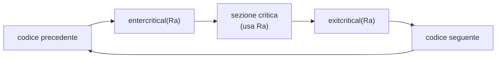

# Concorrenza: mutua esclusione e sincronizzazione

> [!abstract] Scopo della lezione
> Quando più processi o thread accedono alle stesse risorse, il risultato può dipendere da chi arriva prima (**race condition**). La lezione definisce il vocabolario (sezione critica, mutua esclusione, deadlock, starvation…), mostra il supporto **hardware** alla mutua esclusione (disabilitare gli interrupt, **compare&swap**, **exchange**) e poi i meccanismi di più alto livello: **semafori**, **monitor** e **message passing**. Li applica a due problemi classici: **produttore/consumatore** (con le soluzioni sbagliate e il perché) e **lettori/scrittori**. Il deadlock, citato qui, è il tema della [[03 - SDC2 - Deadlock|lezione 3]].
> Mappa dei concetti: [[MOC - Sistemi di Calcolo 2]]

> [!tip] Per gli esercizi
> I semafori POSIX (anonimi e named) sono in [[SDC2 - Primitive C per UNIX System Programming (Sintesi)#3.1 Semafori anonimi|Primitive C — §3]]; gli esempi completi (mutua esclusione e produttore/consumatore con semafori) sono in [[SDC2 - Esempi di applicazioni.pdf]] e [[SDC2 - Funzioni Esame.pdf]].

## Introduzione alla concorrenza

Il progetto di un sistema operativo ruota attorno alla gestione di processi e thread in tre scenari:

- **multiprogramming**: più processi su un **singolo** processore;
- **multiprocessing**: più processi su **più** processori;
- **distributed processing**: più processi su **più computer** (vedi [[08 - SDC2 - Sistemi Distribuiti|lezione 8]]).

Il problema della concorrenza, cioè dell'accesso alla stessa risorsa da parte di più processi e thread, nasce in tre contesti:

- **applicazioni multiple**: la multiprogrammazione permette di condividere il tempo di CPU tra più applicazioni attive;
- **applicazioni strutturate**: con la progettazione modulare e la programmazione strutturata, un'applicazione può essere scritta come un insieme di processi o thread concorrenti;
- **struttura del sistema operativo**: gli OS stessi sono implementati come insiemi di processi o thread.

Serve quindi che l'OS gestisca la concorrenza.

### Terminologia

Vedi [[Sezione Critica e Mutua Esclusione]].

| Termine | Definizione |
| --- | --- |
| **Operazione atomica** | operazione indivisibile: nessun altro processo può interromperla o vederne uno stato intermedio |
| **Sezione critica** | porzione di codice di un processo che accede a risorse **condivise** con altri processi/thread, e che non deve essere eseguita mentre un altro processo è in una sezione critica corrispondente |
| **Mutua esclusione** | quando un processo è in una sezione critica, nessun altro processo può essere in una sezione critica che accede alle stesse risorse |
| **Race condition** | più thread o processi leggono e scrivono dati condivisi, e il risultato finale dipende dalla tempistica relativa (chi arriva prima) |
| **Deadlock** | due o più processi non possono procedere perché ognuno aspetta che un altro faccia qualcosa |
| **Livelock** | due o più processi cambiano continuamente stato in risposta l'uno all'altro, senza fare lavoro utile (all'esame compare solo il deadlock) |
| **Busy waiting** | attesa attiva: un processo occupa la CPU controllando continuamente una condizione. Se so che un evento arriva tra 5 minuti, aspettarlo in un ciclo spreca 5 minuti di CPU che potrei cedere ad altri |
| **Starvation** | un processo pronto non viene mai scelto dallo scheduler, anche se potrebbe proseguire |

Con la multiprogrammazione, **l'output di un processo deve essere indipendente dalla velocità di esecuzione** degli altri processi concorrenti.

### Principi e difficoltà

- **Interleaving** (esecuzione alternata su un processore) e **overlapping** (esecuzione sovrapposta su più processori) pongono **lo stesso problema**.
- Su un uniprocessore la velocità relativa dei processi **non è prevedibile**: dipende dalle attività degli altri processi, da come l'OS gestisce gli interrupt e dalla politica di scheduling.

Difficoltà:

- la **condivisione di risorse globali** è pericolosa (l'ordine di letture e scritture conta);
- per l'OS è difficile **allocare le risorse in modo ottimale** (es. un processo blocca un canale di I/O e poi viene sospeso);
- è difficile **trovare gli errori di programmazione**, perché i risultati **non sono deterministici né riproducibili**.

### Race condition

Vedi [[Thread Safety e Race Condition]].

Una race condition si ha quando più processi o thread leggono e scrivono dati condivisi e il risultato dipende dall'ordine di esecuzione. Il "**perdente**" della corsa è il processo che aggiorna **per ultimo**: è lui a determinare il valore finale della variabile.

> [!example] Esempio classico
> Due thread eseguono `count++` su una variabile condivisa che vale 5. `count++` sono in realtà tre istruzioni (leggi in un registro, incrementa, riscrivi). Se entrambi leggono 5 prima che l'altro abbia scritto, entrambi scrivono 6: un incremento è andato perso.

L'OS, di fronte alla concorrenza, deve:

- tenere traccia dei vari processi (tramite i PCB);
- allocare e deallocare le risorse per ogni processo attivo;
- **proteggere** dati e risorse fisiche di ogni processo dalle interferenze degli altri;
- garantire che i processi e i loro output **non dipendano dalla velocità** di elaborazione.

### Interazione tra processi

![[SDC2-L02-002-000.png]]

| Grado di consapevolezza | Relazione | Influenza di un processo sull'altro | Problemi di controllo |
| --- | --- | --- | --- |
| Processi **inconsapevoli** l'uno dell'altro | **competizione** | i risultati sono indipendenti; i **tempi** possono cambiare | mutua esclusione, deadlock (risorse riutilizzabili), starvation |
| Processi **indirettamente** consapevoli (es. un oggetto condiviso) | **cooperazione tramite condivisione** | i risultati possono dipendere da informazioni ottenute dagli altri; i tempi possono cambiare | mutua esclusione, deadlock (risorse riutilizzabili), starvation, **coerenza dei dati** |
| Processi **direttamente** consapevoli (hanno primitive di comunicazione) | **cooperazione tramite comunicazione** | i risultati possono dipendere dalle informazioni ricevute; i tempi possono cambiare | deadlock (risorse consumabili), starvation |

Le risorse riutilizzabili e consumabili sono definite nella [[03 - SDC2 - Deadlock#Risorse riutilizzabili e consumabili|lezione 3]].

### Processi in competizione

I processi concorrenti entrano in **conflitto** quando competono per la stessa risorsa (dispositivi di I/O, memoria, tempo di CPU, clock). In questo caso ci sono tre problemi di controllo:

- il bisogno di **mutua esclusione**;
- il **deadlock**;
- la **starvation**.

![[SDC2-L02-003-001.png]]

Ognuno degli n processi esegue in un ciclo: codice precedente, `entercritical(Ra)`, **sezione critica**, `exitcritical(Ra)`, codice seguente. Bisogna gestire l'ingresso e l'uscita dalla sezione critica: all'ingresso si devono bloccare gli altri processi che vogliono accedere **alla stessa risorsa** Ra, non quelli che usano risorse diverse.



### Requisiti per la mutua esclusione

1. La mutua esclusione deve essere **garantita**: un solo processo alla volta nella sezione critica per una certa risorsa.
2. Un processo che si ferma **fuori** dalla sezione critica non deve interferire con gli altri.
3. Non ci devono essere **deadlock** né **starvation**: chi chiede di entrare prima o poi entra.
4. Se nessuno è nella sezione critica, chi chiede di entrare deve poterlo fare **subito**.
5. Nessuna assunzione sulla **velocità relativa** dei processi o sul loro **numero**.
6. Un processo resta nella sezione critica solo per un **tempo finito**.

## Supporto hardware alla mutua esclusione

### Disabilitare gli interrupt

Su un **uniprocessore** basta disabilitare gli interrupt prima di entrare nella sezione critica e riabilitarli all'uscita: senza interrupt la CPU non può cambiare processo (vedi [[Interrupt]]).

```c
while (true) {
    /* disabilita gli interrupt */;
    /* sezione critica */;
    /* abilita gli interrupt */;
    /* resto */;
}
```

Svantaggi:

- l'efficienza può **peggiorare molto** (il sistema non può reagire a nessun evento);
- **non funziona sui multiprocessori**: gli altri processori continuano a girare.

È la stessa tecnica usata con `cli()`/`sei()` sull'AVR in [[05 - SO - Stack e Context Switch|Sistemi Operativi]].

### Compare&Swap

Vedi [[Compare and Swap]].

L'istruzione **compare&swap** (o *compare and exchange*) confronta un valore in memoria con un valore di test; se sono uguali, sostituisce il valore in memoria con uno nuovo. Il tutto è **atomico**: fatto dall'hardware in un'unica istruzione indivisibile (su x86 `lock cmpxchg`).

![[SDC2-L02-003-002.png]]

```c
int compare_and_swap(int* reg, int oldval, int newval) {
    ATOMIC();
    int old_reg_val = *reg;
    if (old_reg_val == oldval)
        *reg = newval;
    END_ATOMIC();
    return old_reg_val;
}
```

Se il valore puntato da `reg` è uguale a `oldval`, scrive `newval` in `reg`. In ogni caso **restituisce il valore originale** di `reg`, cambiato o no.

![[SDC2-L02-004-003.png]]

Mutua esclusione con compare&swap:

```c
const int n = /* numero di processi */;
int bolt;                       // 0 = sezione critica libera, 1 = occupata
void P(int i) {
    while (true) {
        while (compare_and_swap(&bolt, 0, 1) == 1)
            /* do nothing */;   // aspetta finché bolt vale 1
        /* sezione critica */;
        bolt = 0;               // libera la sezione critica
        /* resto */;
    }
}
void main() {
    bolt = 0;
    parbegin(P(1), P(2), ..., P(n));   // n processi concorrenti
}
```

Se `bolt` vale 1, `compare_and_swap` restituisce 1 e il processo resta nel ciclo. Appena `bolt` vale 0, la stessa chiamata atomica ci scrive 1 e restituisce 0: il processo esce dal ciclo ed **entra**. Nessun altro può "infilarsi" tra il controllo e la scrittura, perché sono la stessa istruzione. Alla fine il processo rimette `bolt = 0`. Ogni processo in attesa fa **busy waiting**.

`parbegin(P1, …, Pn)` è una notazione per "sospendi il main e avvia P1…Pn in parallelo".

### Exchange

L'istruzione **exchange** scambia **atomicamente** il contenuto di un registro con quello di una locazione di memoria (su x86 `xchg`):

![[SDC2-L02-004-004.png]]

```c
void exchange(int *register, int *memory) {
    int temp;
    temp = *memory;
    *memory = *register;
    *register = temp;
}
```

![[SDC2-L02-004-006.png]]

```c
int bolt;
void P(int i) {
    while (true) {
        int keyi = 1;
        do exchange(&keyi, &bolt);
        while (keyi != 0);
        /* sezione critica */;
        bolt = 0;
        /* resto */;
    }
}
```

Ogni processo prova a scambiare il suo `keyi = 1` con `bolt`:

- se `bolt` = 1 (sezione occupata), lo scambio scrive 1 in `bolt` e 1 in `keyi`: nulla cambia e il processo resta nel ciclo;
- se `bolt` = 0 (libera), lo scambio scrive 1 in `bolt` (la occupa) e 0 in `keyi`: il processo esce dal ciclo ed entra.

Vale sempre l'**invariante** `bolt + Σ keyi = n`: c'è un solo "1" in giro, e chi ha 0 in `keyi` è nella sezione critica.

### Vantaggi e svantaggi delle istruzioni hardware

Vantaggi:

- funzionano con **qualsiasi numero di processi**, su uniprocessore o su più processori che condividono la memoria;
- sono **semplici** e facili da verificare;
- supportano **più sezioni critiche**, ognuna con la propria variabile.

Svantaggi:

- **busy waiting**: chi aspetta consuma tempo di CPU;
- **starvation possibile**: quando un processo esce, la scelta tra i processi in attesa è arbitraria e qualcuno potrebbe non entrare mai;
- **deadlock possibile**: se un processo a bassa priorità è nella sezione critica e uno ad alta priorità fa busy waiting, il secondo occupa la CPU e il primo non riesce mai a finire (*priority inversion*);
- non sono disponibili su **qualsiasi architettura**: lo sviluppatore deve conoscerla.

## Meccanismi di concorrenza: semafori, monitor, message passing

Meccanismi di concorrenza comuni:

| Meccanismo | Descrizione |
| --- | --- |
| **Semaforo** | valore intero usato per segnalare tra processi; solo 3 operazioni atomiche: inizializzazione, decremento e incremento. Il decremento può **bloccare** un processo, l'incremento può **sbloccarne** uno |
| **Semaforo binario** | semaforo che vale solo 0 o 1 |
| **Mutex** | simile al semaforo binario, ma il processo che lo blocca (lo porta a 0) **deve essere lo stesso** che lo sblocca (lo porta a 1) |
| **Condition variable** | tipo di dato usato per bloccare un processo o thread finché una certa condizione non diventa vera |
| **Monitor** | costrutto (tipico dei linguaggi a oggetti) che incapsula variabili, procedure di accesso e codice di inizializzazione in un tipo di dato astratto. Le variabili sono accessibili solo tramite le procedure, e **un solo processo alla volta** può essere nel monitor. Può avere una coda di processi in attesa |
| **Event flags** | una parola di memoria usata per la sincronizzazione: ogni bit corrisponde a un evento. Un thread può attendere uno o più eventi, e bloccarsi finché tutti i bit richiesti sono a 1 (AND) o almeno uno lo è (OR) |
| **Mailbox / messaggi** | due processi si scambiano informazioni, anche per sincronizzarsi |
| **Spinlock** | mutua esclusione in cui un processo esegue un ciclo infinito finché la variabile di lock non indica che la risorsa è disponibile (busy waiting) |

### Semafori

Vedi [[Semafori]].

Un **semaforo** è una variabile intera su cui sono definite **solo tre operazioni**:

- **inizializzazione** a un valore **non negativo**: dice quante unità della risorsa sono disponibili;
- **`semWait`** (decremento): il processo chiede di riservare un'unità. Se dopo il decremento il valore è **< 0**, non ci sono unità disponibili e il processo viene **bloccato**, finché non gli verrà assegnata l'unità;
- **`semSignal`** (incremento): il processo rilascia un'unità. Se c'erano processi in attesa, uno viene **sbloccato**.

Un processo si blocca quindi quando chiede con `semWait` una risorsa occupata, e viene sbloccato quando un altro la rilascia con `semSignal`.

Conseguenze della definizione:

- non c'è modo di ispezionare o modificare un semaforo se non con queste operazioni;
- prima di decrementare, un processo **non può sapere se si bloccherà**;
- su un uniprocessore con due processi concorrenti, dopo una `semSignal` **non si sa quale processo continuerà** subito;
- dopo una `semSignal` non si sa se c'era un processo in attesa: il numero di processi sbloccati può essere 0 o 1.

Quando il valore è negativo, il suo valore assoluto è il **numero di processi in attesa**.

![[SDC2-L02-006-007.png]]

```c
struct semaphore {
    int count;
    queueType queue;
};
void semWait(semaphore s) {
    s.count--;                     // chiede un'unità
    if (s.count < 0) {             // non disponibile: deve aspettare
        /* metti il processo in s.queue */;
        /* blocca il processo */;
    }
}
void semSignal(semaphore s) {
    s.count++;                     // rilascia un'unità
    if (s.count <= 0) {            // c'era un processo in attesa
        /* togli un processo P da s.queue */;
        /* metti P nella ready list */;
    }
}
```

#### Semaforo binario

![[SDC2-L02-007-008.png]]

```c
struct binary_semaphore {
    enum {zero, one} value;
    queueType queue;
};
void semWaitB(binary_semaphore s) {
    if (s.value == one)            // risorsa libera
        s.value = zero;            // la occupa
    else {                         // occupata: aspetta
        /* metti il processo in s.queue */;
        /* blocca il processo */;
    }
}
void semSignalB(semaphore s) {
    if (s.queue is empty())        // nessuno in attesa
        s.value = one;             // la risorsa torna libera
    else {                         // c'è qualcuno: lo sveglia
        /* togli un processo P da s.queue */;
        /* metti P nella ready list */;
    }
}
```

Ogni semaforo ha la sua **coda** di processi in attesa. In che ordine vengono svegliati?

- **semaforo strong**: politica **FIFO**, chi aspetta da più tempo viene svegliato per primo. **Evita la starvation**;
- **semaforo weak**: l'ordine **non è specificato**.

#### Esempio: flusso di esecuzione con un semaforo

![[SDC2-L02-007-flow.png]]

I processi A, B e C consumano un risultato prodotto da D (il classico esempio di Stallings); il semaforo `s` parte da 1. Ogni pannello mostra ready queue, processore, blocked queue e valore di s:

1. A esegue `semWait`: s passa a 0, A prosegue e poi il suo quanto scade.
2. B esegue `semWait`: non ci sono unità, quindi B finisce nella **blocked queue** (s = −1).
3. D va in esecuzione e fa `semSignal`: B torna nella ready queue (s = 0).
4. D fa un'altra `semSignal` e poi il suo quanto scade.
5. C esegue `semWait` e finisce bloccato; i processi continuano ad alternarsi…
6. …finché A, B e C sono tutti bloccati (s = −3) e D, l'unico in esecuzione, fa `semSignal`.
7. Il primo della coda, C, viene sbloccato (s = −2); A e B restano in attesa.

Quando s è negativo, il suo valore assoluto è il **numero di processi in coda**: con s = −3 ci sono 3 processi bloccati.

#### Mutua esclusione con un semaforo

![[SDC2-L02-008-018.png]]

```c
semaphore s = 1;                   // una sola risorsa
void P(int i) {
    while (true) {
        semWait(s);                // richiede la risorsa
        /* sezione critica */;
        semSignal(s);              // la rilascia
        /* resto */;
    }
}
```

![[SDC2-L02-008-019.png]]

Tre processi A, B e C accedono a dati condivisi protetti dal semaforo `lock`, inizializzato a 1. A fa `semWait` (lock = 0) ed entra; B fa `semWait` (lock = −1) e si blocca; C fa `semWait` (lock = −2) e si blocca. Quando A fa `semSignal` (lock = −1) entra B; quando B fa `semSignal` (lock = 0) entra C; quando C fa `semSignal`, lock torna a 1. L'esecuzione normale procede in parallelo, mentre le **sezioni critiche sono serializzate**.

#### Implementazione dei semafori

- `semWait` e `semSignal` **devono essere atomiche**: due processi non possono eseguirle contemporaneamente. Manipolare un semaforo è a sua volta un problema di mutua esclusione.
- Si possono implementare in hardware o firmware.
- Si possono usare schemi software come gli algoritmi di **Dekker** o di **Peterson** (solo lettura e scrittura in memoria).
- Oppure uno degli schemi hardware visti prima.

![[SDC2-L02-009-020.png]]

**Con compare&swap**: il semaforo ha un campo `s.flag` che protegge la sua struttura. `semWait` e `semSignal` iniziano con un breve busy waiting finché `s.flag` non diventa 0 (e lo portano a 1); poi decrementano o incrementano `s.count` e, se serve, mettono il processo in coda o ne svegliano uno; alla fine rimettono `s.flag = 0`. Il busy waiting resta, ma solo per il tempo brevissimo delle operazioni sul semaforo, non per l'intera sezione critica.

![[SDC2-L02-009-021.png]]

**Con gli interrupt** (uniprocessore): `semWait` e `semSignal` disabilitano gli interrupt all'inizio e li riabilitano alla fine; il resto è uguale.

#### Semafori POSIX

```c
#include <semaphore.h>
int sem_init(sem_t *sem, int pshared, unsigned value);
int sem_wait(sem_t *sem);
int sem_post(sem_t *sem);
int sem_destroy(sem_t *sem);
```

- `sem`: il semaforo;
- `pshared`: 0 se il semaforo è condiviso **tra thread** (il caso usato nel corso), diverso da 0 se è condiviso **tra processi** (allora deve stare in memoria condivisa);
- `value`: il valore iniziale, cioè quante unità della risorsa sono disponibili.

Restituiscono 0 in caso di successo, −1 in caso di errore (con `errno`).

![[SDC2-L02-010-022.png]]

```c
#include <semaphore.h>
sem_t sem;

void* thread_fun(void* arg) {
    sem_wait(&sem);
    // sezione critica: l'accesso è gestito dal semaforo
    sem_post(&sem);
}

int main() {
    sem_init(&sem, 0, 1);    // tra thread, una sola unità: un thread alla volta
    pthread_t t1, t2;
    pthread_create(&t1, NULL, thread_fun, NULL);
    pthread_create(&t2, NULL, thread_fun, NULL);
    pthread_join(t1, NULL);
    pthread_join(t2, NULL);
    sem_destroy(&sem);
    return 0;
}
```

> [!warning] Correzione
> Nell'immagine `pthread_create` riceve `thread` come funzione, ma la funzione definita si chiama `thread_fun`.

#### Semafori in Java

- costruttori: `Semaphore(int value)` e `Semaphore(int value, boolean fair)`, dove `fair = true` dà un semaforo **strong** (FIFO) e `false` (default) uno **weak**;
- wait: `acquire()`; signal: `release()`.

![[SDC2-L02-011-023.png]]

Ogni `MyThread` riceve lo stesso `Semaphore` nel costruttore e in `run()` racchiude la sezione critica tra `sem.acquire()` e `sem.release()`. Il `main` crea il semaforo con valore 1, avvia due thread con `start()` e li aspetta con `join()`.

#### Semafori in Python

- `threading.Semaphore([value])` (default 1);
- wait: `acquire([blocking])`; signal: `release()`;
- `blocking = True` (default) blocca se il valore non è positivo; con `False` non blocca e restituisce `True` o `False`.

![[SDC2-L02-011-024.png]]

```python
import threading
sem = threading.Semaphore()

def fun():
    while True:
        sem.acquire()
        # sezione critica
        sem.release()

t1 = threading.Thread(target=fun); t1.start()
t2 = threading.Thread(target=fun); t2.start()
```

### Monitor

Vedi [[Monitor]].

Il **monitor** è un costrutto dei linguaggi di programmazione che offre funzionalità equivalenti ai semafori, ma **più facili da controllare**: con i semafori, `semWait` e `semSignal` sono sparsi nel codice e un solo errore rompe tutto. È implementato in diversi linguaggi (es. i metodi `synchronized` di Java) e anche come libreria. È un modulo software con una o più **procedure**, una sequenza di **inizializzazione** e dei **dati locali**.

Caratteristiche:

- i dati locali sono accessibili **solo** dalle procedure del monitor;
- un processo entra nel monitor **invocando una sua procedura**;
- **solo un processo alla volta** può essere in esecuzione nel monitor: la mutua esclusione è garantita dal costrutto stesso.

La sincronizzazione si ottiene con le **condition variable**, contenute nel monitor e accessibili solo da lì:

- **`cwait(c)`**: sospende il processo chiamante sulla condizione c (e libera il monitor per altri);
- **`csignal(c)`**: risveglia un processo che era bloccato con `cwait` sulla condizione c (se nessuno è in attesa, non fa nulla: a differenza di un semaforo, il segnale **non viene memorizzato**).

![[SDC2-L02-012-025.png]]

- In alto la **coda dei processi in ingresso**: se qualcuno sta già lavorando nel monitor, gli altri aspettano qui.
- Dentro il monitor: dati locali, condition variable, procedure 1…k e codice di inizializzazione.
- A sinistra la **monitor waiting area**: una coda per ogni condizione c1…cn, dove finiscono i processi che hanno chiamato `cwait(ci)`, più una **urgent queue** per i processi che hanno fatto `csignal` e aspettano di poter rientrare.

### Scambio di messaggi

Vedi [[Message Passing]].

Quando dei processi interagiscono servono due cose:

- **sincronizzazione**, per imporre la mutua esclusione;
- **comunicazione**, per scambiarsi informazioni.

Il **message passing** fornisce entrambe. Funziona sia nei sistemi distribuiti sia su multiprocessori a memoria condivisa e uniprocessori.

Le primitive sono una coppia:

- `send(destination, message)`
- `receive(source, message)`

e sono **atomiche**. Un processo invia informazioni sotto forma di messaggio a un processo destinatario; un processo riceve informazioni eseguendo `receive` e indicando la sorgente.

![[SDC2-L02-013-026.png]]

Caratteristiche di progetto di un sistema a messaggi:

- **sincronizzazione**:
  - send **blocking** (aspetto che qualcuno riceva) o **nonblocking** (proseguo);
  - receive **blocking** (se non ci sono messaggi mi fermo), **nonblocking** (se non ci sono messaggi proseguo) o **test for arrival** (controllo ogni tanto se ne sono arrivati);
- **indirizzamento**:
  - **diretto**: send e receive verso/da un processo specifico; la receive può essere **esplicita** (aspetto un messaggio proprio da qualcuno) o **implicita** (ricevo e poi guardo chi l'ha mandato);
  - **indiretto**: tramite una "casella postale" condivisa, che può essere **statica** (esiste sempre), **dinamica** (creata quando serve e distrutta quando non serve più) e avere un **proprietario** che la gestisce;
- **formato**: contenuto, lunghezza **fissa** o **variabile**;
- **disciplina della coda**: **FIFO** o a **priorità**.

La comunicazione implica sincronizzazione: il destinatario non può ricevere un messaggio prima che sia stato inviato. Quando un processo esegue `receive`:

- se non c'è nessun messaggio, si **blocca** finché non ne arriva uno, oppure continua abbandonando il tentativo;
- se un messaggio era già stato inviato, lo riceve e prosegue.

#### Sincronizzazione

| Combinazione | Comportamento | Uso |
| --- | --- | --- |
| **blocking send, blocking receive** | mittente e destinatario restano bloccati finché il messaggio non è consegnato (**rendezvous**) | sincronizzazione stretta |
| **nonblocking send, blocking receive** | il mittente prosegue, il destinatario aspetta il messaggio | la più utile: un mittente può inviare rapidamente più messaggi a più destinazioni; tipica di un server che offre un servizio |
| **nonblocking send, nonblocking receive** | nessuno aspetta | |

#### Indirizzamento

- **Diretto**: la `send` include l'identificatore del processo destinatario. La `receive` può indicare esplicitamente il mittente (utile per processi concorrenti che cooperano) oppure usare l'indirizzamento implicito: il parametro sorgente viene **riempito** con il mittente quando la ricezione va a buon fine.
- **Indiretto**: i messaggi vanno a una struttura dati condivisa fatta di **code** che li conservano temporaneamente: le **mailbox**. Un processo invia alla mailbox, un altro preleva dalla mailbox. Offre più flessibilità.

![[SDC2-L02-014-027.png]]

**(a) one to one**: un mittente e un ricevente, un canale privato; **(b) many to one**: molti mittenti verso un ricevente, tipico del client/server; in questo caso la mailbox si chiama **port**.

![[SDC2-L02-014-028.png]]

**(c) one to many**: un mittente e più riceventi (broadcast); **(d) many to many**: più mittenti e più riceventi sulla stessa mailbox.

#### Formato di un messaggio

![[SDC2-L02-015-029.png]]

**Header**: tipo di messaggio, ID del destinatario, ID del mittente, lunghezza, informazioni di controllo. **Body**: il contenuto. A seconda dell'implementazione l'header contiene più o meno campi.

#### Mutua esclusione con il message passing

![[SDC2-L02-015-030.png]]

```c
void P(int i) {
    message msg;
    while (true) {
        receive(box, msg);    // riceve dalla mailbox il "gettone": la sezione critica è libera
        /* sezione critica */;
        send(box, msg);       // rimette il gettone nella mailbox: sezione libera
        /* resto */;
    }
}
void main() {
    create_mailbox(box);
    send(box, null);          // un messaggio (anche vuoto) = un gettone
    parbegin(P(1), P(2), ..., P(n));
}
```

La mailbox contiene **un solo messaggio**, che fa da gettone: chi lo riceve entra nella sezione critica, e gli altri si bloccano sulla `receive` (bloccante) finché non viene rimesso. È lo stesso comportamento di un semaforo inizializzato a 1.

## Problemi classici

### Produttore/consumatore

Vedi [[Produttore-Consumatore]].

Uno o più **produttori** generano dati e li mettono in un **buffer**; uno o più **consumatori** prelevano gli elementi uno alla volta. Solo un produttore o un consumatore alla volta può accedere al buffer.

Problema: il produttore **non deve aggiungere dati a un buffer pieno** e il consumatore **non deve prelevare da un buffer vuoto**.

![[SDC2-L02-015-031.png]]

Il buffer è un array; `in` è l'indice dove i produttori inseriscono, `out` quello da cui prelevano i consumatori. Le celle colorate (tra `out` e `in`) sono occupate.

Il problema si risolve in diversi modi: con i semafori, con i monitor o con il message passing.

#### Soluzione sbagliata con semafori binari (1)

![[SDC2-L02-016-032.png]]

![[SDC2-L02-016-033.png]]

```c
int n = 0;                              // elementi nel buffer
binary_semaphore s = 1, delay = 0;      // s: mutua esclusione; delay: buffer non vuoto

void producer() {
    while (true) {
        produce();
        semWaitB(s);
        append();
        n++;
        if (n == 1) semSignalB(delay);  // primo elemento: sveglia il consumatore
        semSignalB(s);
    }
}
void consumer() {
    semWaitB(delay);                    // aspetta che il buffer non sia vuoto
    while (true) {
        semWaitB(s);
        take();
        n--;
        semSignalB(s);
        consume();
        if (n == 0) semWaitB(delay);    // buffer vuoto: si mette in attesa
    }
}
```

Errore: **viene consumato un elemento che non esiste**.

![[SDC2-L02-017-034.png]]

![[SDC2-L02-017-035.png]]

![[SDC2-L02-017-036.png]]

Il problema è che il test `if (n == 0)` del consumatore è **fuori dalla sezione critica**. Il consumatore preleva l'unico elemento (n = 0), esce dalla sezione critica, ma viene **deschedulato prima di eseguire il test**. Il produttore entra, aggiunge un elemento (n = 1) e, siccome n == 1, fa `semSignalB(delay)`: delay = 1. Ora il consumatore riprende ed esegue il test: n vale 1, quindi **non** fa `semWaitB(delay)`, anche se delay è già stato "speso". Al giro successivo preleva l'elemento (n = 0), fa il test: n == 0, quindi `semWaitB(delay)`, ma delay vale 1 (il segnale di prima), quindi **non si blocca**. Ripete il ciclo e preleva da un buffer vuoto: **n = −1**.

![[SDC2-L02-018-037.png]]

La traccia completa, passo per passo (21 righe), con i valori di s, n e delay: alla riga 20 n diventa −1.

#### Soluzione sbagliata con semafori binari (2)

![[SDC2-L02-018-038.png]]

![[SDC2-L02-019-039.png]]

Un tentativo di correzione: spostare il test `if (n == 0) semWaitB(delay)` **dentro** la sezione critica, prima di `semSignalB(s)`. Ma così il consumatore si blocca su `delay` **tenendo ancora `s`**: il produttore non può più entrare nella sezione critica per aggiungere un elemento e svegliarlo. Risultato: **deadlock**.

#### Soluzione corretta con semafori binari

![[SDC2-L02-019-040.png]]

```c
void consumer() {
    int m;                          // variabile locale
    semWaitB(delay);
    while (true) {
        semWaitB(s);
        take();
        n--;
        m = n;                      // copia locale di n, presa dentro la sezione critica
        semSignalB(s);
        consume();
        if (m == 0) semWaitB(delay);   // il test usa la copia, non la variabile condivisa
    }
}
```

Il valore di n viene **copiato** in una variabile locale `m` mentre si è ancora nella sezione critica; il test fuori dalla sezione critica usa `m`, che nessun altro può modificare.

#### Soluzione con semafori generali

![[SDC2-L02-019-041.png]]

![[SDC2-L02-019-042.png]]

```c
semaphore n = 0, s = 1;             // n conta gli elementi nel buffer

void producer() {
    while (true) {
        produce();
        semWait(s);
        append();
        semSignal(s);
        semSignal(n);               // un elemento in più: libera un consumatore
    }
}
void consumer() {
    while (true) {
        semWait(n);                 // aspetta che ci sia almeno un elemento
        semWait(s);
        take();
        semSignal(s);
        consume();
    }
}
```

Con un semaforo generale il **contatore stesso è il semaforo**: niente variabile `n` separata da tenere coerente. Funziona anche con **più produttori e più consumatori**.

#### Buffer circolare finito

![[SDC2-L02-020-043.png]]

Finora il buffer era infinito. Con un buffer **finito** di dimensione n si usa un buffer **circolare**: gli indici `in` e `out` ripartono da zero dopo l'ultima cella (`in = (in + 1) % n`). Nella seconda riga `in` ha già "girato" ed è prima di `out`: le celle occupate sono da `out` alla fine e dall'inizio fino a `in`.

![[SDC2-L02-020-044.png]]

```c
const int sizeofbuffer = /* dimensione del buffer */;
semaphore s = 1, n = 0, e = sizeofbuffer;   // e = posti liberi

void producer() {
    while (true) {
        produce();
        semWait(e);       // occupa un posto libero (si blocca se il buffer è pieno)
        semWait(s);
        append();
        semSignal(s);
        semSignal(n);
    }
}
void consumer() {
    while (true) {
        semWait(n);       // si blocca se il buffer è vuoto
        semWait(s);
        take();
        semSignal(s);
        semSignal(e);     // libera un posto
        consume();
    }
}
```

Ci sono tre semafori: `s` per la mutua esclusione sul buffer, `n` per gli elementi presenti, `e` per i posti liberi.

![[SDC2-L02-020-045.png]]

> [!question] E se scambio due semWait o semSignal adiacenti? E con un solo produttore o consumatore?
> - Scambiare due **`semSignal`** è innocuo: le signal non bloccano.
> - Scambiare due **`semWait`** è pericoloso: se il produttore facesse `semWait(s)` **prima** di `semWait(e)` e il buffer fosse pieno, si bloccherebbe su `e` **tenendo `s`**, e il consumatore non potrebbe mai entrare a liberare un posto: **deadlock**. Lo stesso vale per il consumatore con `semWait(s)` prima di `semWait(n)` a buffer vuoto.
> - Con **un solo produttore e un solo consumatore** il semaforo `s` serve comunque, a meno che `append` e `take` lavorino su indici diversi senza variabili condivise (come in un buffer circolare in cui il produttore tocca solo `in` e il consumatore solo `out`).

#### Soluzione con un monitor

Nel monitor:

- i dati locali sono accessibili solo dalle procedure;
- un solo processo alla volta è attivo nel monitor;
- il programmatore decide quando una procedura deve fermarsi (`cwait`) o farne ripartire un'altra (`csignal`).

Quindi `producer` e `consumer` **non devono sapere** come sono implementate `append` e `take`.

![[SDC2-L02-021-046.png]]

![[SDC2-L02-021-047.png]]

```c
void producer() {
    char x;
    while (true) { produce(x); append(x); }
}
void consumer() {
    char x;
    while (true) { take(x); consume(x); }
}
```

![[SDC2-L02-021-048.png]]

```c
monitor boundedbuffer;
char buffer[N];                 // spazio per N elementi
int nextin, nextout;            // indici del buffer
int count;                      // elementi nel buffer
cond notfull, notempty;         // condition variable
// init: nextin = nextout = count = 0;
```

![[SDC2-L02-022-049.png]]

```c
void append(char x) {
    if (count == N) cwait(notfull);       // buffer pieno: aspetta
    buffer[nextin] = x;
    nextin = (nextin + 1) % N;
    count++;
    csignal(notempty);                    // sveglia un consumatore in attesa (se c'è)
}
```

Se il buffer è pieno il produttore aspetta; alla fine notifica un eventuale consumatore in attesa.

![[SDC2-L02-022-050.png]]

```c
void take(char x) {
    if (count == 0) cwait(notempty);      // buffer vuoto: aspetta
    x = buffer[nextout];
    nextout = (nextout + 1) % N;
    count--;
    csignal(notfull);                     // sveglia un produttore in attesa (se c'è)
}
```

Se il buffer è vuoto il consumatore aspetta; alla fine notifica un eventuale produttore in attesa. Anche questo algoritmo supporta più consumatori.

> [!note] `if` o `while`?
> Con la semantica di Hoare (quella di questi esempi) il processo svegliato da `csignal` entra subito nel monitor, quindi basta `if`. Nei monitor reali (Java, pthread condition variable) il processo svegliato rientra più tardi e la condizione può essere di nuovo falsa: si usa `while (count == N) cwait(notfull);`.

#### Soluzione con il message passing

![[SDC2-L02-022-051.png]]

```c
const int capacity = /* capacità del buffer */;
void producer() {
    message pmsg;
    while (true) {
        receive(mayproduce, pmsg);   // aspetta un "permesso di produrre"
        pmsg = produce();
        send(mayconsume, pmsg);      // invia il dato invece di metterlo in un buffer
    }
}
void consumer() {
    message cmsg;
    while (true) {
        receive(mayconsume, cmsg);   // riceve un dato
        consume(cmsg);
        send(mayproduce, null);      // restituisce un permesso al produttore
    }
}
void main() {
    create_mailbox(mayproduce);
    create_mailbox(mayconsume);
    for (int i = 1; i <= capacity; i++) send(mayproduce, null);   // capacity permessi
    parbegin(producer, consumer);
}
```

Due mailbox: `mayconsume` contiene i dati prodotti (fa da buffer) e `mayproduce` contiene dei messaggi vuoti che fanno da **permessi**. All'inizio ci sono `capacity` permessi: il produttore può produrre al massimo `capacity` elementi prima di dover aspettare che il consumatore ne restituisca uno.

### Lettori/scrittori

Vedi [[Lettori-Scrittori]].

Un'area di dati è condivisa tra più processi: alcuni la **leggono** soltanto (**reader**), altri la **scrivono** soltanto (**writer**). Condizioni:

- un numero qualsiasi di reader può leggere contemporaneamente;
- un solo writer alla volta può scrivere;
- mentre un writer scrive, nessun reader può leggere.

È diverso dal produttore/consumatore: lì entrambi modificano il buffer, qui i reader non modificano nulla e possono stare insieme.

Soluzione con i semafori (**priorità ai lettori**):

![[SDC2-L02-023-052.png]]

```c
int readcount = 0;
semaphore x = 1, wsem = 1;
```

![[SDC2-L02-023-053.png]]

![[SDC2-L02-023-054.png]]

```c
void writer() {
    while (true) {
        semWait(wsem);       // lock esclusivo
        WRITEUNIT();
        semSignal(wsem);
    }
}
```

Il writer prende il lock esclusivo con il semaforo binario `wsem`.

![[SDC2-L02-023-055.png]]

![[SDC2-L02-023-056.png]]

```c
void reader() {
    while (true) {
        semWait(x);
        readcount++;
        if (readcount == 1) semWait(wsem);   // il primo reader blocca gli scrittori
        semSignal(x);
        READUNIT();
        semWait(x);
        readcount--;
        if (readcount == 0) semSignal(wsem); // l'ultimo reader li sblocca
        semSignal(x);
    }
}
```

- `x` protegge l'aggiornamento della variabile condivisa `readcount`;
- il **primo** reader (`readcount == 1`) prende `wsem`: niente scritture finché ci sono reader;
- l'**ultimo** reader (`readcount == 0`) rilascia `wsem`.

Finché arrivano reader, `readcount` non torna mai a 0: **i writer possono andare in starvation**. Servono estensioni (es. una versione con priorità agli scrittori, con semafori aggiuntivi che bloccano i nuovi reader quando un writer è in attesa).
