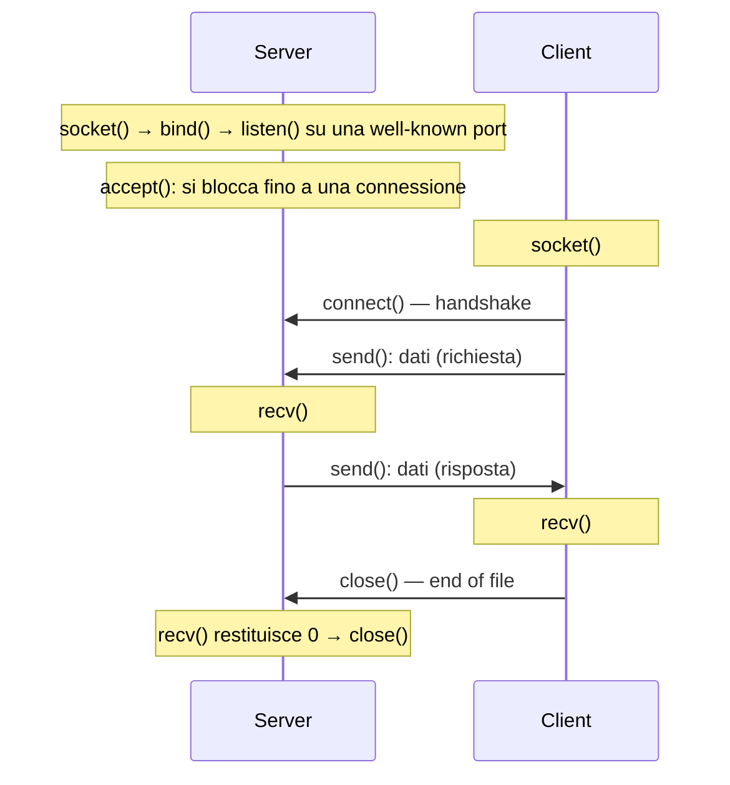

# Network e socket

> [!abstract] Scopo della lezione
> I **socket** sono l'interfaccia con cui un programma usa la rete: un descrittore, come quello di un file, attraverso cui si inviano e ricevono dati con TCP o UDP. La lezione richiama protocolli e architettura TCP/IP, introduce i socket di **Berkeley** (tipi, porte, primitive, struttura `sockaddr_in`), descrive il ciclo di vita **client/server TCP** (`socket`, `bind`, `listen`, `accept`, `connect`, `send`, `recv`, `close`) con il **server concorrente** basato su `fork`, il caso **UDP** (`sendto`, `recvfrom`), le funzioni sugli indirizzi, WinSock e gli esempi in Java e Python. Chiude scendendo nell'hardware: la **scheda di rete**, i registri **CSR**, DMA, la **buffer descriptor list** e il driver.
> Mappa dei concetti: [[MOC - Sistemi di Calcolo 2]]

> [!tip] Per gli esercizi
> Le firme delle funzioni sui socket sono in [[SDC2 - Primitive C per UNIX System Programming (Sintesi)#4.1 Strutture Dati|Primitive C — §4]]; il pattern di server multiprocesso/multithread è in [[SDC2 - Esempi di applicazioni.pdf]].

## Richiami di rete

- **Computer communication**: scambio di informazioni tra computer diversi per svolgere azioni cooperative.
- **Computer network**: due o più computer collegati da una rete di comunicazione.

Due concetti fondamentali: i **protocolli** e le **architetture** di comunicazione (vedi [[06 - SDC2 - Reti di Calcolatori|lezione 6]]).

- **Protocollo**: l'insieme di regole che governano lo scambio di dati tra due **entità** in sistemi diversi.
- **Entità**: qualsiasi cosa capace di inviare o ricevere informazioni (un processo, un'applicazione).
- **Sistema**: oggetto fisico che contiene una o più entità (un computer).

Per comunicare, due entità devono "parlare la stessa lingua". Gli elementi chiave di un protocollo:

- **sintassi**: formato dei dati e livelli dei segnali;
- **semantica**: informazioni di controllo per la coordinazione e la gestione degli errori;
- **timing**: adattamento delle velocità e sequenziamento.

Una **protocol architecture** è un insieme strutturato di moduli che implementa le funzioni di comunicazione. Serve un alto grado di cooperazione tra i due sistemi: invece di un unico modulo, il compito è diviso in sotto-compiti. Esempio, il trasferimento di un file:

- il **file transfer module** contiene la logica specifica dell'applicazione;
- il **communications service module** si assicura che i due sistemi siano attivi e pronti, e tiene traccia dei dati scambiati per garantire la consegna;
- il **network access module** contiene la logica per interagire davvero con la rete.

![[SDC2-L07-001-000.png]]

Ogni modulo del computer X comunica "logicamente" con il modulo corrispondente del computer Y: le applicazioni si scambiano file e comandi, i moduli di servizio messaggi di comunicazione, i moduli di accesso parlano con la rete.

### Architettura TCP/IP

Vedi [[Modello OSI e TCP-IP]].

L'architettura **TCP/IP** nasce dalla ricerca sulla rete a commutazione di pacchetto sperimentale **ARPANET**, ed è detta *TCP/IP protocol suite*. Si organizza in 5 livelli indipendenti:

| Livello | Funzione |
| --- | --- |
| **Applicazione** | la logica delle applicazioni utente; un modulo separato per ogni tipo di applicazione |
| **Trasporto** (host-to-host) | comune a tutte le applicazioni; garantisce l'affidabilità dello scambio. Il protocollo più diffuso è **TCP** |
| **Internet** | permette ai dati di attraversare **più reti** interconnesse; usa **IP** per il routing. IP è implementato negli end system **e nei router** |
| **Network access** | scambio di dati tra un end system e la rete a cui è collegato; il software dipende dal tipo di rete |
| **Fisico** | interfaccia fisica tra il dispositivo e il mezzo: caratteristiche del mezzo, natura dei segnali, data rate |

Un **router** è un processore che collega due reti: la sua funzione principale è passare dati da una rete all'altra.

![[SDC2-L07-002-001.png]]

L'host A (sulla rete 1) e l'host B (sulla rete 2) sono collegati tramite il router J, che implementa IP e due diversi protocolli di accesso (NAP 1 e NAP 2). Le applicazioni (App X, App Y) sono collegate a TCP tramite **porte** (1, 2, 3 su A; 2, 4, 6 su B). Tra le porte c'è una **connessione logica TCP**; IP usa un **indirizzo Internet globale**; ogni host ha anche un indirizzo di aggancio alla sottorete.

Ogni entità deve avere un indirizzo univoco. Servono **due livelli di indirizzamento**:

- ogni **host** ha un indirizzo Internet globale univoco, usato da IP per il routing e la consegna;
- ogni **applicazione** dentro un host ha un indirizzo univoco nell'host, che permette a TCP di consegnare i dati al processo giusto: le **porte**.

![[SDC2-L07-003-002.png]]

L'header TCP (vedi [[06 - SDC2 - Reti di Calcolatori#TCP|lezione 6]]).

![[SDC2-L07-003-003.png]]

L'header IPv4 nella versione moderna: il vecchio "tipo di servizio" è diviso in **DS** (*Differentiated Services*, priorità) ed **ECN** (*Explicit Congestion Notification*).

Applicazioni standard su TCP:

- **SMTP** (*Simple Mail Transfer Protocol*): posta elettronica (liste di distribuzione, ricevute di ritorno, inoltro);
- **FTP** (*File Transfer Protocol*): trasferimento di file di testo e binari, con controllo degli accessi;
- **SSH** (*Secure Shell*): login remoto sicuro (si lavora su un computer remoto come se fosse locale) e trasferimento di file, su una connessione TCP.

**UDP**: meccanismi minimi, senza connessione, nessuna garanzia su consegna, ordine o duplicati. Utile per applicazioni a transazioni, supporta il multicast.

![[SDC2-L07-004-004.png]]

## Socket

Vedi [[Socket]].

Il **socket** nasce come **Berkeley Sockets Interface (BSI)**, in BSD Unix. Permette la comunicazione tra un processo client e un processo server; può essere **con connessione** o **senza**. Si può considerare un **estremo** (*endpoint*) della comunicazione. L'interfaccia di Berkeley è lo **standard de facto** per programmare applicazioni di rete; anche i socket di Windows (**WinSock**) si basano su di essa.

Gli indirizzi IP identificano gli host; la **concatenazione di un indirizzo IP e di una porta forma un socket**, univoco in tutta Internet:

$$\text{socket} = \text{indirizzo IP} + \text{porta}$$

Una connessione è identificata dalla **quadrupla** (IP client, porta client, IP server, porta server):

![[SDC2-L07-004-005.png]]

L'interfaccia socket è la **TLI** (*Transport Layer Interface*): il confine tra l'applicazione (processo utente) e il livello di trasporto (nel kernel).

![[SDC2-L07-004-006.png]]

Sopra l'interfaccia ci sono i dettagli dell'applicazione, gestiti dal processo utente; sotto (TCP/UDP, IP, interfaccia di rete) ci sono i dettagli della comunicazione, gestiti dal kernel.

Servizi forniti al livello applicativo:

![[SDC2-L07-005-007.png]]

Sull'host 1 l'applicazione (o il livello di sessione) parla con l'**entità di trasporto** attraverso un **indirizzo di trasporto** (la porta), e l'entità di trasporto parla con il livello di rete attraverso un **indirizzo di rete**. Le due entità di trasporto si scambiano **TPDU** (*Transport Protocol Data Unit*) secondo il protocollo di trasporto. Sull'host 2 più applicazioni usano la stessa entità di trasporto, ciascuna con la propria porta.

### Tipi di socket

- **Stream socket**: usa **TCP**; trasferimento affidabile e orientato alla connessione.
- **Datagram socket**: usa **UDP**; consegna non garantita, ordine non necessariamente preservato.
- **Raw socket**: accesso diretto ai protocolli di livello inferiore (es. per costruire pacchetti ICMP come `ping`; richiede root).

Caratteristiche:

- un socket rappresenta un **estremo** di una connessione di rete: è ciò a cui l'applicazione "si attacca" (al programmatore interessa l'API);
- un estremo è determinato da due cose: **indirizzo dell'host** (IP, livello di rete) e **numero di porta** (livello di trasporto);
- **due estremi** determinano una connessione: una **coppia di socket** (*socket pair*). Ad esempio:

![[SDC2-L07-005-008.png]]

```
206.62.226.35, p21 + 198.69.10.2, p1500
206.62.226.35, p21 + 198.69.10.2, p1499
```

Sono **due connessioni diverse** verso lo stesso server FTP (porta 21) dallo stesso client: differiscono solo per la porta del client. È così che un server distingue più client, o più connessioni dello stesso client.

### Porte

Nell'approccio client-server il client invia una richiesta al server su una **porta nota** (*well-known port*): o la conosce già, o il server espone una porta per i servizi noti a cui chiedere quale porta usare.

![[SDC2-L07-005-009.png]]

Le porte sono numeri da **0 a 65535** (16 bit).

![[SDC2-L07-006-010.png]]

![[SDC2-L07-006-011.png]]

| Intervallo | Uso |
| --- | --- |
| **0 – 1023** | **riservate**: per usarle serve essere **root** |
| **1024 – 5000** | **effimere**: assegnate automaticamente dal sistema ai client, durano poco |
| **5001 – 65535** | utilizzabili dai server non privilegiati (le nostre) |

Molti sistemi offrono però più di 3977 porte effimere, perché un singolo PC gestisce sempre più connessioni (Solaris ne fornisce 30 000 nell'ultima parte dell'intervallo non privilegiato BSD). (Lo standard IANA attuale usa 49152–65535 per le effimere.)

Servizi noti, elencati in `/etc/services`: `ftp 21/tcp`, `telnet 23/tcp`, `finger 79/tcp`, `snmp 161/udp`.

Alcuni programmi client devono essere **anche server** come parte dell'autenticazione client-server (`rlogin`, `rsh`): chiamano la funzione di libreria `rresvport` per creare un socket e assegnargli una porta riservata libera nell'intervallo 512–1023.

### Socket e sistema operativo

L'utente vede un **descrittore**, un indice intero:

![[SDC2-L07-006-012.png]]

come un `FILE *` o l'indice restituito da `open()`; lo restituisce la chiamata `socket()`.

![[SDC2-L07-006-013.png]]

L'applicazione usa il socket, che è l'ingresso nel sistema operativo, dentro il quale stanno TCP, IP, il driver Ethernet e l'hardware. È il principio Unix "tutto è un file" (vedi [[File Descriptor]]): su un socket si possono usare anche `read` e `write`.

### Primitive di un servizio di trasporto

![[SDC2-L07-007-015.png]]

| Primitiva | Pacchetto inviato | Significato |
| --- | --- | --- |
| **LISTEN** | nessuno | si blocca finché un processo non prova a connettersi |
| **CONNECT** | CONNECTION REQ. | prova attivamente a stabilire una connessione |
| **SEND** | DATA | invia informazioni |
| **RECEIVE** | nessuno | si blocca finché non arriva un pacchetto DATA |
| **DISCONNECT** | DISCONNECTION REQ. | questo lato vuole rilasciare la connessione |

Il server fa `listen` per aspettare i client; i client fanno `connect` per connettersi al server, trasmettendo le proprie informazioni (indirizzo e porta).

### Struttura dell'indirizzo

![[SDC2-L07-007-016.png]]

```c
struct in_addr {
    in_addr_t s_addr;          // indirizzo IPv4 a 32 bit
};
struct sockaddr_in {
    uint8_t        sin_len;    // lunghezza della struttura
    sa_family_t    sin_family; // AF_INET (famiglia di protocolli)
    in_port_t      sin_port;   // porta TCP/UDP
    struct in_addr sin_addr;   // indirizzo IPv4
    char           sin_zero[8];// inutilizzato
};
```

Prima di usarla si **azzera** (`bzero`, `memset`). Porta e indirizzo vanno messi in **network byte order** (big-endian): si usano `htons()` per la porta e `htonl()` per l'indirizzo (vedi [[Endianness]]). (`sin_len` esiste in BSD e macOS, non in Linux.)

### Gestione della connessione

![[SDC2-L07-007-017.png]]

Un diagramma a stati per un semplice schema di gestione delle connessioni. Le transizioni in corsivo sono causate dall'**arrivo di pacchetti**; le linee continue sono la sequenza di stati del **client**, quelle tratteggiate del **server**:

- **connessione**: il client esegue *connect* e passa da IDLE ad ACTIVE ESTABLISHMENT PENDING; il server riceve la richiesta e va in PASSIVE ESTABLISHMENT PENDING; quando il server accetta e il client riceve la conferma, entrambi sono in **ESTABLISHED**;
- **disconnessione**: chi esegue *disconnect* va in ACTIVE DISCONNECT PENDING; l'altro, ricevuta la richiesta, va in PASSIVE DISCONNECT PENDING; alla fine entrambi tornano in IDLE.

### Primitive dei Berkeley socket

![[SDC2-L07-008-018.png]]

| Primitiva | Significato |
| --- | --- |
| **SOCKET** | crea un nuovo endpoint di comunicazione |
| **BIND** | associa un indirizzo locale al socket |
| **LISTEN** | annuncia di essere pronto ad accettare connessioni, con la dimensione della coda |
| **ACCEPT** | stabilisce **passivamente** una connessione in arrivo |
| **CONNECT** | prova **attivamente** a stabilire una connessione |
| **SEND** | invia dati sulla connessione |
| **RECEIVE** | riceve dati dalla connessione |
| **CLOSE** | rilascia la connessione |

Con `accept` la connessione viene davvero stabilita.

Per uno **stream socket** (TCP), dopo averlo creato bisogna stabilire una connessione con un socket remoto: un lato fa da **client** e chiede la connessione, l'altro fa da **server**.

- **Client**: chiama `connect()` indicando il socket locale e l'indirizzo del socket remoto. Una volta connesso, `getpeername()` dice chi c'è dall'altra parte.
- **Server**: chiama `listen()` per dire che il socket è pronto ad accettare connessioni; ogni connessione in arrivo resta in **coda** finché il server non chiama `accept()`.

Serve una struttura per gli indirizzi, che viaggia in due direzioni:

![[SDC2-L07-008-019.png]]

**Dall'utente al sistema operativo**: `bind()`, `connect()` (solo TCP), `sendto()` (solo UDP).

![[SDC2-L07-008-020.png]]

**Dal sistema operativo all'utente**: `accept()` (solo TCP), `recvfrom()` (solo UDP).

## Client/server TCP

![[SDC2-L07-009-021.png]]



**Server**: `socket()` crea il socket; `bind()` gli associa un indirizzo (la porta nota); `listen()` lo rende pronto ad accettare connessioni; `accept()` si blocca finché un client non si connette; poi un ciclo di `recv()` (riceve la richiesta) e `send()` (invia la risposta); quando `recv` segnala la fine del file, `close()`.

**Client**: `socket()`; `connect()` (l'handshake); un ciclo di `send()` e `recv()`; `close()`.

### socket()

Il primo passo è creare un socket, che restituisce un intero (simile a un file descriptor). Tre parametri:

```c
int socket(int family, int type, int protocol);
```

- `family`: `AF_INET` (IPv4), `AF_INET6` (IPv6), `AF_LOCAL` (socket Unix locali), `AF_ROUTE` (accesso alle tabelle di routing), `AF_KEY` (crittografia);
- `type`: `SOCK_STREAM` (TCP), `SOCK_DGRAM` (UDP), `SOCK_RAW` (pacchetti IP speciali, es. PING; serve root);
- `protocol`: 0 (il protocollo predefinito per quella famiglia e quel tipo; si usa per alcune opzioni dei raw socket).

Restituisce il descrittore del socket, o −1.

### bind()

```c
int bind(int sockfd, const struct sockaddr *myaddr, socklen_t addrlen);
```

Assegna un **indirizzo locale** (il "nome") al socket.

- `sockfd`: il descrittore restituito da `socket()`;
- `myaddr`: puntatore alla struttura con porta e indirizzo IP. Con porta 0 il sistema sceglie una porta effimera; con indirizzo `INADDR_ANY` si accettano connessioni su tutte le interfacce;
- `addrlen`: dimensione della struttura.

Restituisce 0, o −1 (es. `EADDRINUSE`, "Address already in use").

> [!note] Perché si passa la dimensione della struttura
> Le funzioni ricevono un generico `struct sockaddr *` (che può puntare a un `sockaddr_in`, a un `sockaddr_in6`…), quindi serve sapere quanti byte copiare.
> - Nelle chiamate che passano l'indirizzo **dall'utente al kernel** (es. `bind`) si passa il puntatore e un **intero** con la dimensione: il kernel sa quanti byte copiare.
> - Nelle chiamate che lo passano **dal kernel all'utente** (es. `accept`) si passa il puntatore e un **puntatore a un intero** che contiene la dimensione del buffer: il kernel non lo supera e, al ritorno, scrive in quell'intero quanti byte ha effettivamente scritto (*value-result argument*). Lo stesso schema si usa in `select` e `getsockopt`.

### listen()

```c
int listen(int sockfd, int backlog);
```

Mette il socket in stato di **ascolto** (lo trasforma in un socket passivo per un server TCP).

- `backlog`: numero massimo di connessioni **in coda** in attesa di `accept` (storicamente 5; l'implementazione può usarlo solo come indicazione).

### accept()

```c
int accept(int sockfd, struct sockaddr *cliaddr, socklen_t *addrlen);
```

Restituisce la **prossima connessione completata** dalla coda.

- `cliaddr` e `addrlen` ricevono l'indirizzo del **client**.
- Restituisce un **nuovo descrittore**, creato dal sistema, dedicato a quella connessione; −1 in caso di errore.

Il socket di ascolto (`lisfd`) resta disponibile per altre connessioni; il nuovo socket (`connfd`) serve solo a parlare con quel client.

- Con `fork()` si ottiene un **server concorrente**;
- con `pthread_create()` un **server multithread**.

### Server concorrente con accept() e fork()

![[SDC2-L07-010-022.png]]

```c
lisfd = socket(...);                 // crea il socket
bind(lisfd, ...);                    // lo associa a indirizzo e porta
listen(lisfd, 5);                    // pronto ad accettare connessioni
while (1) {
    connfd = accept(lisfd, ...);     // accetta una connessione
    if ((pid = fork()) == 0) {       // figlio: gestisce il client
        close(lisfd);                // il figlio non deve accettare connessioni
        doit(connfd);                // send, recv, elaborazione
        close(connfd);
        _exit(0);
    }
    close(connfd);                   // il padre non parla con il client
}
```

Il **padre** accetta una connessione, crea un **figlio** che serve il client, chiude la propria copia del socket di connessione e torna ad accettare. Ogni processo chiude i descrittori che non gli servono: il figlio chiude il socket di ascolto, il padre quello di connessione (lo stesso principio delle pipe, vedi [[05 - SDC2 - Comunicazione tra Processi#pipe() in Unix|lezione 5]]).

![[SDC2-L07-011-024.png]]

![[SDC2-L07-011-025.png]]

1. Il server ascolta su `lisfd` (la porta nota) e il client si connette: `accept` restituisce `connfd`.
2. Dopo la `fork`, il figlio ha una copia sia di `lisfd` sia di `connfd`.
3. Il padre chiude `connfd` e il figlio chiude `lisfd`: il padre resta in ascolto, il figlio parla con il client.

> [!tip] Zombie nei server concorrenti
> Il padre non fa `wait` sui figli, che quindi restano **zombie** quando terminano. Un server reale installa un handler per `SIGCHLD` che chiama `waitpid(-1, NULL, WNOHANG)` in un ciclo (vedi [[wait e Processi Zombie]]).

### close()

```c
int close(int sockfd);
```

Chiude il socket in lettura e scrittura. **Ritorna subito** (non si blocca) e prova a inviare i dati non ancora spediti. Con l'opzione `SO_LINGER` si può invece bloccare finché i dati non sono inviati, o scartare quelli rimasti. Restituisce −1 in caso di errore.

![[SDC2-L07-011-026.png]]

(Lo stesso schema client-server TCP, con evidenziate le fasi di scambio dei dati.)

### connect()

```c
int connect(int sockfd, const struct sockaddr *servaddr, socklen_t addrlen);
```

Connette il socket al server.

- `servaddr`: indirizzo e porta del **server** (obbligatori, a differenza di `bind`).
- Il **client non ha bisogno di `bind()`**: il sistema sceglie una porta effimera.
- Restituisce 0, o −1.

### send() e recv()

```c
int recv(int sockfd, void *buff, size_t numBytes, int flags);
int send(int sockfd, void *buff, size_t numBytes, int flags);
```

Uguali a `read()` e `write()`, ma con dei **flag**:

| Flag | Effetto |
| --- | --- |
| `MSG_DONTWAIT` | operazione non bloccante |
| `MSG_OOB` | dati *out of band* (1 byte urgente inviato in anticipo) |
| `MSG_PEEK` | legge senza togliere i dati dalla coda |
| `MSG_WAITALL` | non restituire meno byte del massimo richiesto |
| `MSG_DONTROUTE` | ignora la tabella di routing |

Restituiscono il numero di byte trasferiti; `recv` restituisce **0** quando l'altro lato ha chiuso la connessione. Con TCP una `recv` può restituire **meno** byte di quelli inviati con una `send` (è un flusso di byte, non di messaggi): per leggere un messaggio completo si ripete `recv` finché non arrivano tutti i byte attesi.

## Client/server UDP

![[SDC2-L07-012-028.png]]

**Server**: `socket()`, `bind()` sulla porta nota, poi un ciclo di `recvfrom()` (si blocca finché non arriva un datagram) e `sendto()` (risposta). **Client**: `socket()`, poi `sendto()` e `recvfrom()`, infine `close()`.

Con UDP: **niente handshake**, niente chiusura simultanea, **niente `fork()`** per i server concorrenti (un solo socket riceve i datagram di tutti i client).

```c
int recvfrom(int sockfd, void *buff, size_t numBytes, int flags,
             struct sockaddr *from, socklen_t *addrlen);
int sendto(int sockfd, void *buff, size_t numBytes, int flags,
           const struct sockaddr *to, socklen_t addrlen);
```

Come `recv` e `send`, ma con l'**indirizzo**:

- `recvfrom` riempie `from` con l'indirizzo da cui è arrivato il datagram;
- `sendto` richiede l'indirizzo a cui inviarlo.

> [!warning] Correzione
> Gli appunti scrivono "sento": la funzione è **`sendto`**.

## Funzioni sugli indirizzi

```c
int gethostname(char *hostname, int bufferLength);
```

Restituisce in `hostname` il nome dell'host su cui gira il programma; `bufferLength` limita i byte scritti.

```c
unsigned long inet_addr(char *address);
char *inet_ntoa(struct in_addr address);
```

- `inet_addr` converte un indirizzo in notazione puntata (es. `"128.173.41.41"`) in un valore a 32 bit in **network byte order**;
- `inet_ntoa` fa l'inverso: da `struct in_addr` (il cui `s_addr` è la rappresentazione intera) alla stringa.

(Oggi si preferiscono `inet_pton` e `inet_ntop`, che supportano anche IPv6.)

> [!warning] Correzione
> Gli appunti dicono che `inet_addr` "genera l'indirizzo IP corrispondente all'host name": converte solo un indirizzo **già in forma numerica** puntata. Per i nomi si usa `gethostbyname` (o `getaddrinfo`).

![[SDC2-L07-013-030.png]]

```c
struct hostent *gethostbyname(const char *hostname);
```

Dato un nome di host (es. `acavax.lynchburg.edu`) restituisce le informazioni sull'host, in una `struct hostent`:

- `char *h_name`: il nome ufficiale;
- `char **h_aliases`: la lista degli alias;
- `short h_addrtype`: la famiglia di indirizzi (es. `AF_INET`);
- `short h_length`: la lunghezza dell'indirizzo (4 per `AF_INET`);
- `char **h_addr_list`: la lista degli indirizzi (terminata da `NULL`).

![[SDC2-L07-013-032.png]]

```c
struct hostent *gethostbyaddr(const void *addr, int len, int type);
```

Fa l'inverso: dato un indirizzo, restituisce il nome dell'host. `addr` punta a una struttura che dipende dal tipo di indirizzo (es. `struct in_addr`), `len` è 4 per `AF_INET`, `type` è la famiglia.

(Queste funzioni usano il DNS, vedi [[DNS]]. Oggi sono sostituite da `getaddrinfo` e `getnameinfo`.)

## WinSock

I socket di Windows, **WinSock**, derivano dai Berkeley socket e includono molte estensioni per l'ambiente Windows. Sono un'interfaccia aperta (l'API è libera, più produttori forniscono WinSock, con compatibilità di sorgenti e binari).

![[SDC2-L07-013-033.png]]

| Berkeley | WinSock |
| --- | --- |
| `bzero()` | `memset()` |
| `close()` | `closesocket()` |
| `read()` | non richiesta |
| `write()` | non richiesta |
| `ioctl()` | `ioctlsocket()` |

**WinSock 1.1** supporta tre modalità:

- **bloccante**: le funzioni non ritornano finché non hanno finito (come i Berkeley socket);
- **non bloccante**: chiamate come `accept()` non si bloccano, restituiscono solo uno stato;
- **asincrona**: usa i messaggi di Windows (`FD_ACCEPT` connessione in attesa, `FD_CONNECT` connessione stabilita…).

**WinSock 2** supporta anche suite di protocolli diverse da TCP/IP (DecNet, IPX/SPX, OSI), quindi applicazioni indipendenti dal protocollo di rete, ed è retrocompatibile con la 1.1. Usa file diversi (`winsock2.h`, la DLL `WS2_32.DLL`) e alcune API cambiano nome: `accept()` diventa `WSAAccept()`, `connect()` diventa `WSAConnect()`, `inet_addr()` diventa `WSAAddressToString()`, …

Un server ben fatto deve prevedere:

- la **generazione di processi o thread** per servire più client;
- l'**ascolto continuo** di nuove connessioni;
- la **comunicazione ripetuta** con ogni client.

## Socket in Java

### Stream socket (TCP)

![[SDC2-L07-014-034.png]]

**Server** (`GreetServer`): `new ServerSocket(port)` crea il socket in ascolto (fa `socket`, `bind` e `listen`); `serverSocket.accept()` attende un client e restituisce un `Socket`. Dal socket si ottengono un `PrintWriter` per scrivere e un `BufferedReader` per leggere. Il server legge una riga: se è `"hello server"` risponde `"hello client"`, altrimenti `"unrecognised greeting"`. `stop()` chiude stream e socket.

![[SDC2-L07-015-036.png]]

**Client** (`GreetClient`): `new Socket(ip, port)` crea il socket **e si connette** (fa `socket` e `connect`); `sendMessage` scrive una riga e legge la risposta. Il `main` si connette a `127.0.0.1:6666`, invia `"hello server"` e verifica di ricevere `"hello client"`.

### Datagram socket (UDP)

![[SDC2-L07-015-038.png]]

**Server** (`UDPServer`): `new DatagramSocket(9876)`; in un ciclo infinito riceve un `DatagramPacket`, ne legge il contenuto e l'indirizzo e la porta del mittente, converte la frase in maiuscolo e la rimanda in un nuovo `DatagramPacket` all'indirizzo e alla porta del mittente.

![[SDC2-L07-016-039.png]]

**Client** (`UDPClient`): legge una riga da tastiera, risolve l'indirizzo del server con `InetAddress.getByName("hostname")`, la invia in un `DatagramPacket` alla porta 9876, aspetta la risposta e stampa `FROM SERVER: …`.

## Socket in Python

### Stream socket (TCP)

![[SDC2-L07-016-041.png]]

```python
# server
import socket
HOST = '127.0.0.1'   # interfaccia di loopback (localhost)
PORT = 65432         # porta non privilegiata (> 1023)

s = socket.socket(socket.AF_INET, socket.SOCK_STREAM)
s.bind((HOST, PORT))
s.listen()
conn, addr = s.accept()
with conn:
    print('Connected by', addr)
    while True:
        data = conn.recv(1024)
        if not data:          # 0 byte: il client ha chiuso
            break
        conn.sendall(data)    # echo
s.close()
```

![[SDC2-L07-017-043.png]]

```python
# client
import socket
HOST = '127.0.0.1'
PORT = 65432

s = socket.socket(socket.AF_INET, socket.SOCK_STREAM)
s.connect((HOST, PORT))
s.sendall(b'Hello, world')
data = s.recv(1024)
print('Received', repr(data))
s.close()
```

Le chiamate sono le stesse del C: `socket`, `bind`, `listen`, `accept`, `connect`, `recv`, `sendall`.

### Datagram socket (UDP)

![[SDC2-L07-017-044.png]]

Il server crea un socket `SOCK_DGRAM`, fa `bind` su `127.0.0.1:5005` e in un ciclo riceve con `recvfrom(1024)` e rimanda i dati al mittente con `sendto(data, addr)`.

![[SDC2-L07-017-046.png]]

Il client crea un socket `SOCK_DGRAM`, invia `"Hello, World!"` con `sendto(MESSAGE, (UDP_IP, UDP_PORT))` e attende la risposta con `recvfrom(1024)`.

> [!note]
> Gli esempi UDP sono scritti in sintassi Python 2 (`print "..."`, `sendto` di una `str`): in Python 3 servono `print(...)` e bytes (`b"Hello, World!"` o `.encode()`).

## Network adapter

Vedi [[Network Adapter e Driver]].

La **scheda di rete** (*network adaptor*) interfaccia il computer con la rete.

![[SDC2-L07-018-047.png]]

La CPU, con la sua cache, è collegata alla memoria; la scheda di rete è collegata al **bus di I/O** e da lì alla rete.

La scheda ha **due parti separate**, che comunicano tramite una **FIFO** che maschera l'asincronia tra la rete e il bus interno (che possono avere velocità diverse):

- la prima parte interagisce con il **bus** e quindi con la CPU;
- la seconda interagisce con la **rete**, implementando il livello fisico e di collegamento.

Il tutto è comandato da una **SCO** (*sottosistema di controllo della scheda*).

![[SDC2-L07-018-048.png]]

Dentro l'adaptor: la **bus interface** (verso il bus di I/O dell'host) e la **link interface** (verso la rete), collegate da due code FIFO (una per direzione) e controllate dalla SCO.

### CSR

L'adaptor espone alla CPU uno o più **registri** macchina: i **CSR** (*Control Status Register*). Il CSR è il mezzo di comunicazione tra la SCO della scheda e la CPU.

![[SDC2-L07-018-050.png]]

```c
/* CSR — legenda:
 * RO  read only;  RC Read/Clear (scrivere 1 azzera, scrivere 0 non ha effetto);
 * W1  write-1-only (scrivere 1 imposta, scrivere 0 non ha effetto);
 * RW  read/write; RW1 Read-Write-1-only */
#define LE_ERR  0x8000
#define LE_RINT 0x0400   /* RC  richiesta di interruzione per ricevere un pacchetto */
#define LE_TINT 0x0200   /* RC  pacchetto trasmesso */
#define LE_INEA 0x0040   /* RW  abilita l'adaptor a emettere un interrupt verso la CPU */
#define LE_TDMD 0x0008   /* W1  richiesta di trasmissione di un pacchetto dal driver all'adaptor */
```

L'host può sapere cosa succede nel CSR in due modi (vedi [[Polling vs Interrupt]]):

- **busy waiting**: la CPU testa continuamente il CSR finché non cambia, indicando una nuova operazione. Ha senso solo per macchine che non devono fare altro che ricevere e trasmettere pacchetti (es. i router);
- **interrupt**: l'adaptor invia un interrupt all'host, che esegue un **interrupt handler**; l'handler legge il CSR per capire che operazione fare.

### Trasferimento dei dati tra adaptor e memoria

**DMA** (*Direct Memory Access*, vedi [[DMA]]):

- la CPU **non è coinvolta** nello scambio dei dati;
- il sistema operativo assegna all'adaptor un'area di memoria dell'host;
- i frame vengono inviati subito nella memoria di lavoro dell'host;
- sulla scheda bastano pochi byte di memoria.

**Programmed I/O**:

- lo scambio tra memoria e adaptor **passa per la CPU**;
- bisogna bufferizzare almeno un frame sull'adaptor;
- la memoria dell'adaptor deve essere **dual port**: sia il processore sia l'adaptor possono leggerla e scriverla.

### Buffer descriptor list

Con il DMA, la memoria in cui allocare i frame è organizzata con una **buffer descriptor list** (una per la scrittura e una per la lettura): un vettore di puntatori ad aree di memoria (**buffer**), ognuno con la quantità di memoria disponibile in quell'area. In Ethernet si preallocano tipicamente **64 buffer da 1500 byte** (la dimensione massima del payload di un frame Ethernet).

![[SDC2-L07-019-052.png]]

La lista contiene le dimensioni dei buffer (100, 1400, 1500, 1500, …, 1500) e ogni elemento punta al buffer corrispondente in memoria.

Per i frame che arrivano dall'adaptor si usa la tecnica **scatter read / gather write**: frame distinti vanno in buffer distinti, e un frame può occupare **più buffer** se è più grande di uno di essi (in Ethernet non serve, perché i pacchetti stanno sempre nei 1500 byte).

> [!warning] Correzione
> Negli appunti compare la sigla "PMA": nel contesto (la buffer descriptor list usata con il trasferimento senza CPU) si intende il **DMA**.

### Invio di un messaggio

Quando un utente invia un messaggio su un socket:

1. il sistema operativo **copia** il messaggio dal buffer in memoria utente in una zona della **BD** (buffer descriptor list);
2. il messaggio attraversa tutti i livelli di protocollo (TCP, IP, driver), che aggiungono i propri header e aggiornano i puntatori nella BD, così da poter sempre ricostruire il messaggio;
3. finito l'attraversamento dello stack, il driver avvisa la SCO dell'adaptor impostando i bit **`LE_TDMD`** (invita la SCO a inviare il messaggio sulla linea) e **`LE_INEA`** (abilita la SCO a generare un interrupt) del CSR;
4. la SCO **invia** il messaggio sulla linea;
5. terminata la trasmissione, la SCO lo notifica alla CPU impostando il bit **`LE_TINT`** del CSR e generando un **interrupt**;
6. l'interrupt avvia un **interrupt handler** che prende atto della trasmissione, azzera i bit opportuni (`LE_TINT` e `LE_INEA`) e libera le risorse (una `semSignal` su `xmit_queue`).

### Il device driver

Un **device driver** è un insieme di routine del sistema operativo (inizializzare l'adaptor, inviare un frame sul link…) che "ancora" il sistema operativo all'hardware specifico dell'adaptor (vedi [[Driver e Block Device]]).

Esempio: la routine che chiede l'invio di un messaggio.

![[SDC2-L07-020-053.png]]

```c
#define csr ((u_int) 0xffff3579)   /* indirizzo del CSR */

Transmit(Msg *msg) {
    descriptor *d;
    semwait(xmit_queue);           /* al massimo 64 accessi alla BD (semaforo inizializzato a 64: 64 buffer) */
    d = next_desc();
    prepare_desc(d, msg);
    semwait(mutex);                /* un solo processo alla volta (dei potenziali 64) trasmette verso l'adaptor */
    disable_interrupts();          /* il processo si protegge da eventuali interrupt dell'adaptor */
    csr = LE_TDMD | LE_INEA;       /* invita la SCO a trasmettere e la abilita a emettere un interrupt alla fine */
    enable_interrupts();
    semsignal(mutex);              /* sblocca il semaforo per un altro processo */
}
```

- `next_desc()` restituisce il prossimo buffer descriptor libero;
- `prepare_desc(d, msg)` mette il messaggio nel buffer d in un formato comprensibile dall'adaptor.

È un'applicazione diretta dei semafori della [[02 - SDC2 - Concorrenza|lezione 2]]: `xmit_queue` è un semaforo **contatore** (64 posti nella BD, come i posti liberi `e` nel produttore/consumatore) e `mutex` un semaforo binario per la mutua esclusione sul CSR.

![[SDC2-L07-021-054.png]]

L'**interrupt handler**:

- disabilita gli interrupt;
- legge il CSR per capire cosa fare. Tre possibilità:
  1. c'è stato un **errore** (`LE_ERR`): lo stampa, azzera i bit di errore, riabilita gli interrupt;
  2. una **trasmissione è stata completata** (`LE_TINT`): azzera `LE_TINT` (è un bit RC) e `LE_INEA`, ammette un nuovo processo nella BD perché un frame è stato trasmesso (`semsignal(xmit_queue)`) e riabilita gli interrupt;
  3. un **frame è stato ricevuto** (`LE_RINT`): azzera l'interrupt, elabora il frame ricevuto (`lance_receive()`), riabilita gli interrupt.

(Il codice nell'immagine è quello del driver della scheda AMD LANCE.)

### Il meccanismo complessivo

![[SDC2-L07-021-056.png]]

1. L'utente chiama `send(...)` sul socket;
2–4. il messaggio passa per TCP, IP e il driver Ethernet, che lo preparano nella BD;
5. il driver scrive nel CSR (all'indirizzo `0xffff3579`), avvisando la SCO;
6–7. l'adaptor preleva il frame dalla memoria (DMA) e lo trasmette sulla rete;
8. a fine trasmissione l'adaptor alza l'interrupt verso la CPU;
9. la CPU esegue l'interrupt handler;
10. l'handler legge e aggiorna il CSR.
