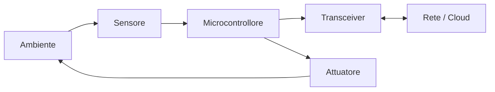

# Internet of Things

> [!abstract] Scopo della lezione
> L'**Internet of Things** (IoT) estende Internet agli oggetti: sensori, attuatori, elettrodomestici, veicoli. La lezione parte da cosa ne sa il pubblico, definisce l'IoT e la sua evoluzione (IT, OT, personal technology, sensori/attuatori), descrive le **componenti** di un dispositivo (sensore, attuatore, microcontrollore, transceiver, RFID) e la struttura a livelli della rete, e soprattutto i **dispositivi vincolati** e i **sistemi operativi per IoT** (TinyOS, RIOT, µClinux) con i loro requisiti. Chiude con il potenziale economico, molti esempi di applicazione e le critiche.
> Mappa dei concetti: [[MOC - Sistemi di Calcolo 2]]

## Cosa ne sa il pubblico

Sondaggi di qualche anno fa:

![[SDC2-L09-001-000.png]]

Alla domanda "cos'è l'IoT?" il **69%** ha risposto "non lo so" e solo il **9%** "oggetti di uso quotidiano collegati a Internet che inviano e ricevono dati". Contando altre descrizioni più o meno sensate (smart home, "tutto connesso") si arriva a circa l'**11%** di risposte corrette.

![[SDC2-L09-001-001.png]]

Tra chi dice di aver sentito parlare di IoT, una buona parte risponde comunque "non lo so" (29%) o lo confonde con altro; tra chi non ne ha sentito parlare, l'82% non sa cosa sia. I giornalisti tecnologici parlano meno dell'argomento, ma c'è molto "rumore" tra i consumatori, e anche chi dice di conoscere l'IoT spesso lo fraintende.

![[SDC2-L09-002-002.png]]

Alla domanda "hai comprato oggetti *smart*?" il 64% ha risposto **no** e il 36% sì. In realtà **il 100%** li aveva comprati: lo smartphone è un oggetto smart.

![[SDC2-L09-002-003.png]]

Per ogni categoria (smartphone, TV, auto, orologi, elettrodomestici, illuminazione, riscaldamento, sicurezza, tecnologie mediche…) la quota di chi ne ha sentito parlare, chi è interessato, chi li ha comprati e chi nessuna di queste. A parte smartphone (67% comprati) e TV (36%), le percentuali di acquisto sono basse: c'è ancora **molto spazio di mercato**.

## Definizione

Vedi [[Internet of Things]].

L'**IoT** è l'ultimo sviluppo della lunga rivoluzione dell'informatica e delle comunicazioni. Il termine indica:

- l'interconnessione crescente di **dispositivi smart**,
- che vanno dagli **elettrodomestici** ai **sensori minuscoli**,
- e l'interconnessione di **miliardi** di oggetti industriali e personali, di solito tramite sistemi **cloud**.

Dispositivi IoT: PC, smartphone… Con l'IoT però sono arrivati soprattutto i **dispositivi embedded con risorse limitate**: poca banda, acquisizione di dati poco frequente, uso di dati a bassa banda.

All'inizio l'**RFID** era visto come un prerequisito dell'IoT: se tutti gli oggetti e le persone avessero un identificatore, i computer potrebbero gestirli e inventariarli. Oltre all'RFID, gli oggetti si possono "etichettare" con NFC (*Near Field Communication*), codici a barre, QR code, Bluetooth e *digital watermarking*.

### Evoluzione

1. **Information technology (IT)**: PC, server, router, firewall… Comprati come dispositivi IT dal personale IT delle aziende, con connessioni soprattutto **cablate**.
2. **Operational technology (OT)**: macchine e apparecchi con IT integrata, costruiti da aziende non informatiche: macchinari medici, **SCADA** (*supervisory control and data acquisition*), controllo di processo, chioschi. Comprati come apparecchi dal personale OT, con connessioni soprattutto cablate.
3. **Personal technology**: smartphone, tablet, eBook reader comprati come dispositivi IT dai consumatori (o dipendenti), con connessioni **esclusivamente wireless**, spesso di più tipi.
4. **Sensor/actuator technology**: dispositivi a **scopo singolo** comprati da consumatori, IT e OT, con connessione wireless, di solito di un solo tipo, come parte di sistemi più grandi.

## Componenti

Vedi [[Sensori e Attuatori]].

- **Sensore**: misura un parametro di un'entità fisica, chimica o biologica e restituisce un **segnale elettronico** proporzionale, come tensione analogica o segnale digitale. In entrambi i casi l'uscita va di solito a un microcontrollore o un altro elemento di gestione.
- **Attuatore**: riceve un segnale elettronico da un controllore e **agisce sull'ambiente** per modificare un parametro fisico, chimico o biologico. Esempio: in un deodorante per ambienti smart, ricevuto il segnale che la qualità dell'aria è pessima, l'attuatore spruzza il profumo.
- **Microcontrollore**: lo "smart" di un dispositivo smart è un microcontrollore profondamente integrato (vedi [[Microcontrollore e Bootloader]]).
- **Transceiver**: l'elettronica per trasmettere e ricevere dati. La maggior parte dei dispositivi IoT ha un transceiver **wireless** (Wi-Fi, ZigBee o altro).
- **RFID** (*Radio-Frequency Identification*): identifica gli oggetti con le onde radio ed è sempre più una tecnologia abilitante dell'IoT. Gli elementi principali sono **tag** e **lettori**. I tag sono piccoli dispositivi programmabili usati per tracciare oggetti, animali e persone, in molte forme, dimensioni, funzionalità e costi.

## Struttura dell'IoT

L'IoT si può vedere come una **rete gigantesca** fatta di reti di dispositivi e computer, collegati tramite tecnologie intermedie in cui RFID e connessioni wireless fanno da abilitanti.

- **Tagging things**: tracciabilità e indirizzabilità degli oggetti in tempo reale tramite RFID.
- **Feeling things**: i **sensori** sono i dispositivi primari che raccolgono dati dall'ambiente.
- **Shrinking things**: la **miniaturizzazione** e le nanotecnologie permettono a oggetti sempre più piccoli di interagire e connettersi.
- **Thinking things**: l'**intelligenza integrata** nei dispositivi li collega alla rete e permette il controllo intelligente.

![[SDC2-L09-004-004.png]]

I livelli dell'IoT, dal basso verso l'alto:

| Livello | Tecnologie | Tempi di risposta | Numero di dispositivi |
| --- | --- | --- | --- |
| **Smart things network** | Bluetooth, Wi-Fi, cablato | millisecondi | milioni |
| **Fog network** | 3G/4G/LTE/Wi-Fi, intelligenza distribuita | tempo reale | decine di migliaia |
| **Core network** | IP/MPLS, sicurezza, QoS/QoE | guidati dalla qualità del servizio | migliaia |
| **Data center / cloud** | Ethernet, gestione della rete e applicazioni | transazionali | centinaia |

Il **fog computing** porta parte dell'elaborazione vicino ai dispositivi, invece di mandare tutto al cloud.

## Dispositivi vincolati e sistemi operativi

Vedi [[Sistemi Operativi per IoT]].

Spesso, quando si parla di IoT, si intendono i **dispositivi embedded**. I **constrained devices** hanno:

- risorse **molto limitate**: RAM (kilobyte) e ROM;
- requisiti di **basso consumo** (batterie);
- **nessuna MMU** (niente memoria virtuale, vedi [[MMU]]);
- prestazioni del processore limitate.

Servono quindi **sistemi operativi appositi** per i sistemi embedded (i più usati: **TinyOS**, **RIOT**, **µClinux**). Requisiti:

- **memoria minima** (*small memory footprint*): con poca memoria bisogna far stare sia l'OS sia le applicazioni. Servono librerie ottimizzate in dimensione e prestazioni e strutture dati compatte.
- **supporto per hardware eterogeneo**: nei sistemi più grandi (server, PC, portatili) domina l'architettura **x86**; in quelli più piccoli (smartphone e molti dispositivi IoT) domina **ARM**. I dispositivi vincolati usano molte famiglie di microcontrollori, soprattutto a **8 e 16 bit** (come l'AVR di [[04 - SO - Hardware e AVR|Sistemi Operativi]]), e molte tecnologie di comunicazione diverse.
- **connettività di rete**:
  - **IEEE 802.15.4** (WPAN a bassa velocità, come **ZigBee**);
  - **Bluetooth Low Energy** (BLE);
  - **6LoWPAN** (IPv6 su reti personali wireless a basso consumo);
  - **CoAP** (*Constrained Application Protocol*, una sorta di HTTP leggero);
  - **RPL** (routing per reti a basso consumo e con perdite);
  - **LoRaWAN** (reti a lungo raggio e basso consumo).
- **efficienza energetica**: un dispositivo deve funzionare **per anni con una sola batteria**. Processore il più efficiente possibile, trasmissioni wireless a consumo minimo, e un OS che offra funzioni di gestione dell'energia (le metta a disposizione dei livelli superiori e le usi).
- **capacità real-time**: molti dispositivi devono supportare applicazioni real-time (sorveglianza, auto intelligenti); l'OS deve rispettare i vincoli temporali (vedi [[Scheduling Real-Time]]).
- **sicurezza**:
  - a livello **applicativo**: autorizzazione e autenticazione, confidenzialità dei dati, antivirus, privacy;
  - a livello di **rete**: autorizzazione e autenticazione, confidenzialità, protezione dell'integrità dei dati;
  - a livello di **dispositivo**: autorizzazione e autenticazione, validazione dell'integrità del dispositivo, controllo degli accessi.

![[SDC2-L09-005-005.png]]

La struttura tipica di un OS per IoT, dal basso: hardware; **Hardware Abstraction Layer** (GPIO, UART, SPI, I2C); **kernel** (scheduler, task manager, lock…); sopra, lo **stack di rete a basso consumo** (802.15.4, BLE, 6LoWPAN, IPv6, CoAP, RPL) e i **driver** e il file system logico; poi le **librerie** di sistema e di supporto; in cima le **applicazioni**. Le applicazioni possono anche accedere direttamente ai livelli inferiori.

![[SDC2-L09-006-006.png]]

| | µClinux | TinyOS | RIOT |
| --- | --- | --- | --- |
| RAM minima | < 32 MB | < 1 kB | ~1.5 kB |
| ROM minima | < 2 MB | < 4 kB | ~5 kB |
| Supporto C | ✓ | ✗ | ✓ |
| Supporto C++ | ✓ | ✗ | ✓ |
| Multithreading | ✓ | parziale | ✓ |
| Microcontrollori senza MMU | ✓ | ✓ | ✓ |
| Modularità | parziale | ✗ | ✓ |
| Real time | parziale | ✗ | ✓ |

µClinux è un Linux ridotto (richiede molta più memoria); TinyOS è minimo ma programmato in nesC, non in C; RIOT unisce memoria ridotta, C/C++, multithreading e real time.

## Una rete di reti

![[SDC2-L09-006-007.png]]

L'IoT è una **rete di reti**: (1) reti individuali (trasporti, energia, casa, istruzione, business…), (2) collegate tra loro, (3) con aggiunta di sicurezza, analisi dei dati e gestione. Questo rende l'IoT ancora più utile.

![[SDC2-L09-006-008.png]]

Con miliardi di macchine connesse nasce l'**Industrial Internet**: dispositivi medici intelligenti e ottimizzazione degli ospedali, *smart grid*, ottimizzazione delle fabbriche e della logistica, pianificazione della rete in tempo reale e visibilità delle spedizioni per le ferrovie.

### Il potenziale

![[SDC2-L09-007-010.png]]

"Il valore dell'Industrial Internet è enorme": macchine e dati connessi potrebbero eliminare fino a **150 miliardi di dollari** di sprechi. Ad esempio, in 15 anni, un 1% di risparmio di carburante varrebbe 30 miliardi nell'aviazione e 66 nella produzione di energia a gas; un 1% di riduzione delle inefficienze 63 miliardi nella sanità e 27 nei trasporti ferroviari merci; un 1% di riduzione delle spese in conto capitale 90 miliardi nel petrolio e gas.

![[SDC2-L09-007-011.png]]

La *technology roadmap* dell'IoT (SRI): dai tag RFID per logistica e inventario (2000, *supply-chain helpers*), alle applicazioni verticali (sorveglianza, sanità, trasporti, sicurezza alimentare), al posizionamento ubiquo (localizzare persone e oggetti), fino al *Physical-World Web* (teleoperazione e telepresenza, agenti software e fusione di sensori).

### Applicazioni

- automazione di edifici e case;
- produzione industriale;
- sistemi medici e sanitari;
- media;
- monitoraggio ambientale;
- gestione delle infrastrutture;
- gestione dell'energia;
- trasporti;
- migliore qualità della vita per gli anziani;
- …

![[SDC2-L09-008-012.png]]

Le aree di applicazione: **casa** (luci, sicurezza, irrigazione, allarmi fumo, frigorifero, monitoraggio energetico…), **trasporti** (instradamento del traffico, telematica, parcheggi intelligenti, spedizioni…), **salute** (cura dei pazienti, monitoraggio degli anziani, diagnosi remota, dispositivi indossabili…), **edifici** (climatizzazione, sicurezza, illuminazione, allarmi, integrità strutturale…), **città** (distribuzione elettrica, manutenzione, sorveglianza, smart grid, gestione dei rifiuti…).

**Esempio: smart parking.**

![[SDC2-L09-008-013.png]]

Rendere visibile la disponibilità dei posti auto in città potrebbe valere 41 miliardi di dollari: i residenti trovano e prenotano il posto più vicino, i vigili individuano gli usi non conformi, il comune può introdurre tariffe variabili in base alla domanda.

**Esempio: gestione efficiente dei rifiuti (sensing-as-a-service).**

![[SDC2-L09-009-014.png]]

I cassonetti hanno sensori (passivi a basso costo o attivi) che ne misurano il riempimento. I dati arrivano a una piattaforma **cloud** che offre il *sensing as a service* (1) tramite l'infrastruttura urbana, oppure (2) tramite i camion della spazzatura, che fanno da raccoglitori di dati, e (3) vengono inoltrati al cloud. La piattaforma (4) fornisce i dati a comune, impianti di riciclo, industrie e autorità sanitarie. Un camion sa dove andare perché conosce quali cassonetti sono quasi pieni.

**Esempio: le mucche.** Nell'IoT anche le mucche sono connesse: sensori impiantati nelle orecchie dei bovini permettono agli allevatori di monitorarne la salute e i movimenti, per una produzione di latte e carne più sana e abbondante. Ogni mucca genera in media circa **200 MB di dati all'anno**.

**Esempio: shopping.**

![[SDC2-L09-009-015.png]]

(1) entrando nel negozio, gli scanner identificano i tag sui vestiti della cliente; (2) mentre fa la spesa, i prodotti "si presentano" (offerte, informazioni); (3) quando prende un prodotto, il lettore avvisa il personale di rimetterne uno sullo scaffale; (4) alla cassa, il microchip della carta di credito comunica con il lettore e il pagamento è automatico.

**Esempio: quanto dormo bene?**

![[SDC2-L09-010-016.png]]

Un braccialetto **Fitbit Flex** registra il sonno: efficienza (92%), ora in cui si va a letto, tempo per addormentarsi, numero di risvegli, tempo effettivo di sonno, e le statistiche degli ultimi 30 giorni.

**Esempio: dati personali.**

![[SDC2-L09-010-017.png]]

Un'app che registra dove si va, con chi si interagisce, quanto si parla con gli amici, quanto tempo serve per andare al lavoro, il tono dei messaggi, quanto si scrive sui social, quanto esercizio si fa, quanto ci si distrae…

**Esempio: thought controlled computing.**

![[SDC2-L09-010-018.png]]

Il visore **MindWave** di NeuroSky usa un EEG per comandare il computer con il pensiero (i ricercatori l'hanno usato per far avanzare un'auto giocattolo) e può misurare battito e altri parametri, per i dispositivi indossabili di nuova generazione.

Tutte queste applicazioni producono **enormi quantità di dati**, a cui bisogna saper dare un senso: avere tanti dati non serve se non li si sa interpretare. *Big Data is not magic.*

## Critiche e controversie

Ci sono dubbi sulle promesse della rivoluzione dell'*ubiquitous computing*, in aree come:

- **privacy** (vedi gli esempi sopra: dati sul sonno, sui movimenti, sulle abitudini);
- **sicurezza** (milioni di dispositivi poco protetti, vedi [[10 - SDC2 - Sicurezza|lezione 10]]);
- **autonomia e controllo**;
- **controllo sociale**;
- **manipolazione politica**;
- **design**;
- **impatto ambientale**;
- **influenza sulle decisioni morali** delle persone.

In sintesi: l'IoT è solo la **punta dell'iceberg**.
