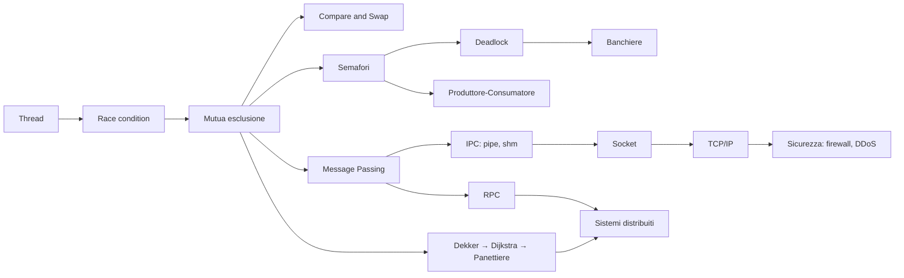

# Sistemi di Calcolo 2 — Mappa dei concetti

> [!abstract]
> Indice del corso: le 10 lezioni (dagli appunti di Filippo), i materiali per gli esercizi e le note atomiche di ripasso raggruppate per tema.
> Corsi collegati: [[MOC - Sistemi Operativi]] · [[MOC - Sistemi di Calcolo]]

## Lezioni

| # | Lezione | Argomenti |
| --- | --- | --- |
| 1 | [[01 - SDC2 - Processi e Thread]] | fork/exec/wait, PCB, thread, ULT/KLT, Pthreads, SMP, Flynn |
| 2 | [[02 - SDC2 - Concorrenza]] | race condition, mutua esclusione, compare&swap, semafori, monitor, messaggi, produttore/consumatore, lettori/scrittori |
| 3 | [[03 - SDC2 - Deadlock]] | condizioni di Coffman, grafo delle risorse, prevention/avoidance/detection, banchiere, filosofi, Dekker, Dijkstra |
| 4 | [[04 - SDC2 - Algoritmo del Panettiere]] | bakery algorithm, versioni sbagliate, biglietti limitati, versione client/server |
| 5 | [[05 - SDC2 - Comunicazione tra Processi]] | IPC, shared memory POSIX, message passing, pipe, FIFO |
| 6 | [[06 - SDC2 - Reti di Calcolatori]] | livelli e protocolli, OSI, TCP/IP, IP, ARP, TCP, UDP, DNS |
| 7 | [[07 - SDC2 - Socket]] | Berkeley socket, client/server TCP e UDP, server concorrente, network adapter e driver |
| 8 | [[08 - SDC2 - Sistemi Distribuiti]] | trasparenza, middleware, client/server, SOA, RPC, cluster |
| 9 | [[09 - SDC2 - Internet of Things]] | componenti, struttura, sistemi operativi per dispositivi vincolati |
| 10 | [[10 - SDC2 - Sicurezza]] | CIA, attacchi, malware, DDoS, crittografia, autenticazione, firewall, IDS |

## Esercizi

- [[SDC2 - Primitive C per UNIX System Programming (Sintesi)]]: la sintesi delle primitive (processi, semafori, memoria condivisa, file, pipe, socket)
- [[SDC2 - Primitive C per UNIX System Programming.pdf]]
- [[SDC2 - Funzioni Esame.pdf]]
- [[SDC2 - Esempi di applicazioni.pdf]]

## Concetti per tema

### Processi e thread
- [[fork]] · [[wait e Processi Zombie]] · [[exec e Variabili d'Ambiente]] · [[Process Control Block]] · [[Context Switch]] *(da SO/SDC)*
- [[Thread]] · [[User Level Thread e Kernel Level Thread]] · [[Pthreads]] · [[Thread Safety e Race Condition]]
- [[Symmetric Multiprocessing]] · [[Tassonomia di Flynn]]

### Concorrenza e sincronizzazione
- [[Sezione Critica e Mutua Esclusione]] · [[Compare and Swap]]
- [[Semafori]] · [[Monitor]] · [[Message Passing]]
- Problemi classici: [[Produttore-Consumatore]] · [[Lettori-Scrittori]] · [[Problema dei Cinque Filosofi]]

### Deadlock
- [[Deadlock]] · [[Risorse Riutilizzabili e Consumabili]] · [[Condizioni di Coffman]] · [[Grafo di Allocazione delle Risorse]]
- [[Gestione del Deadlock]] · [[Algoritmo del Banchiere]]

### Mutua esclusione in software (domanda d'esame)
- [[Algoritmo di Dekker]] → [[Algoritmo di Dijkstra per la Mutua Esclusione]] → [[Algoritmo del Panettiere]]

### Comunicazione tra processi
- [[Inter-Process Communication]] · [[Shared Memory POSIX]] · [[mmap]] · [[Pipe e FIFO]] · [[File Descriptor]] · [[Segnali]]

### Reti
- [[Modello Client-Server]] · [[Architettura a Livelli dei Protocolli]] · [[Modello OSI e TCP-IP]]
- [[Protocollo IP]] · [[ARP]] · [[TCP e UDP]] · [[DNS]] *(da Telecomunicazioni)*
- [[Socket]] · [[Network Adapter e Driver]] · [[DMA]] · [[Interrupt]]

### Sistemi distribuiti
- [[Sistema Distribuito]] · [[Trasparenza nei Sistemi Distribuiti]] · [[Middleware]]
- [[Service-Oriented Architecture]] · [[Remote Procedure Call]] · [[Cluster]]

### Internet of Things
- [[Internet of Things]] · [[Sensori e Attuatori]] · [[Sistemi Operativi per IoT]] · [[Microcontrollore e Bootloader]]

### Sicurezza
- [[Triade CIA]] · [[Attacchi Passivi e Attivi]] · [[Malware]] · [[Buffer Overflow]] *(da Ethical Hacking)* · [[Botnet e DDoS]]
- [[Crittografia Simmetrica e Asimmetrica]] · [[Autenticazione e Controllo degli Accessi]] · [[Permessi e Ownership]] · [[Firewall e Intrusion Detection]]

## Percorsi trasversali

- **Dalla race condition al deadlock**: [[Thread Safety e Race Condition]] → [[Sezione Critica e Mutua Esclusione]] → [[Semafori]] → [[Produttore-Consumatore]] (scambiare due `wait` provoca un deadlock) → [[Deadlock]] → [[Condizioni di Coffman]]
- **Mutua esclusione senza hardware e senza memoria condivisa**: [[Algoritmo di Dekker]] → [[Algoritmo di Dijkstra per la Mutua Esclusione]] → [[Algoritmo del Panettiere]] → [[Sistema Distribuito]]
- **Dai processi alla rete**: [[fork]] → [[Pipe e FIFO]] → [[Socket]] (server concorrente con `fork`) → [[TCP e UDP]] → [[Protocollo IP]] → [[Network Adapter e Driver]]
- **Comunicazione locale e remota**: [[Message Passing]] → [[Remote Procedure Call]] → [[Middleware]]
- **Attacchi e difese**: [[Buffer Overflow]] → [[Malware]] → [[Botnet e DDoS]] → [[Firewall e Intrusion Detection]]
