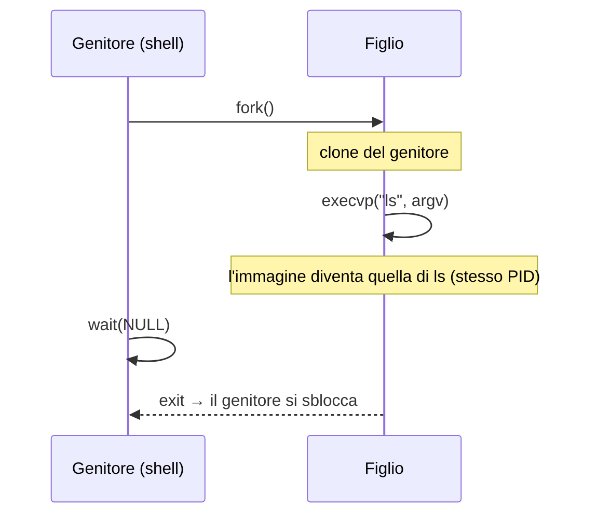

# Esecuzione dei programmi

> [!abstract] Scopo del capitolo
> Cosa succede quando un programma gira? Il capitolo parte dal **processo** (immagine di memoria, `/proc/[pid]/maps`) e dai **thread**; scende all'hardware con l'esecuzione di una singola istruzione e il **pipelining** (con gli **hazard** e le contromisure); risale al sistema operativo con la **multiprogrammazione**: stati dei processi, scheduling **round-robin**, `fork`, `wait`, `exec`, e i **Pthread**. Chiude con il **flusso del controllo eccezionale**: **interrupt** (asincroni, trap, fault, abort), context switch, system call con `int $0x80`, interrupt vs polling, e i **segnali** (`kill`, `sigaction`, `pause`, `alarm`).
> Mappa dei concetti: [[MOC - Sistemi di Calcolo]] · Approfondimento lato OS: [[06 - SO - Interrupt, Syscall, Dual Mode e Processi]]

## Processi

Vedi [[Program File e Processo]].

Quando un programma viene eseguito diventa un **processo**: un **programma in esecuzione**. Gestire i processi è uno dei compiti principali del sistema operativo.

Lo **stesso programma** può essere istanziato in **più processi**. Ogni processo ha un identificatore univoco, il **PID** (*Process ID*): un numero progressivo, incrementato di uno a ogni nuovo processo.

![[SDC-p119-1.png]]

La mappa del sistema con evidenziato il modulo **Esecuzione dei processi** del kernel: le system call `fork`, `wait`, `exec`, `exit`, `getpid`…; loader, stati, scheduling, context switch e PCB; i segnali (`sigaction`, `kill`) e l'**IVT** (*Interrupt Vector Table*). È il tema di questo capitolo.

> [!warning] Correzione
> Nella dispensa questa figura è numerata "5.1", come la figura della legge di Moore del capitolo 5.

Un processo è caratterizzato da:

- un'**immagine di memoria** con il codice e i dati (variabili, blocchi allocati dinamicamente…);
- lo **stato della CPU** (registri);
- le **risorse in uso** (file aperti…);
- dei **metadati** (PID, utente proprietario, tempo di esecuzione…).

Un processo può essere avviato:

- su **richiesta esplicita dell'utente**, dalla riga di comando o con un clic nell'interfaccia grafica;
- su **richiesta di altri processi**;
- in **risposta a eventi**, come lo scadere di un timer (es. controllo periodico della posta).

Le informazioni per gestire un processo stanno nel **Process Control Block (PCB)** ([[Process Control Block]]). Il comando `ps -e` elenca tutti i processi attivi.

_(dispensa, pp. 119–120)_

### Immagine di memoria di un processo

Vedi [[Immagine di Memoria di un Processo]].

![[SDC-p120-1.png]]

È l'organizzazione tipica su Linux dopo il caricamento di un eseguibile ELF. Ogni processo vede la memoria come un array di byte con indirizzi da 0 a $2^b - 1$ (b = numero di bit di un puntatore, 32 o 64). Gli spazi dei processi sono **isolati** grazie alla **memoria virtuale** ([[07 - SDC - Gestione dei dati in memoria centrale#Memoria fisica e memoria virtuale|capitolo 7]]).

> [!warning] Correzione
> La figura è didascalizzata "Figura 4.1.1", ma si trova nel capitolo 6 (§6.1.1).

1. **`.text`**: il codice macchina, caricato dall'eseguibile dal **loader** (inizia a `0x08048000` a 32 bit, `0x00400000` a 64 bit; `%eip` punta qui).
2. **`.data`**: i dati **inizializzati**: variabili globali (o `static`) e i letterali stringa. La parte di sola lettura, come i letterali stringa, si chiama **`.rodata`**. Anche `.data` viene caricata dall'eseguibile.
3. **`.bss`**: lo spazio per le variabili globali **inizializzate a zero** (non occupa spazio nel file, viene solo azzerato).
4. **heap**: i blocchi di `malloc`/`calloc`. Inizia a una **distanza casuale** dopo `.bss`, per **sicurezza**: un attaccante non può contare su indirizzi fissi (ASLR). Cresce verso indirizzi alti; il limite è il *program break* (`brk`).
5. **stack**: in cima alla memoria, cresce verso il basso, anch'esso a posizione **randomizzata**; ha una dimensione massima (`RLIMIT_STACK`, tipicamente 8 MB).
6. **librerie dinamiche** (es. `libc.so`), mappate dal loader in una zona intermedia tra heap e stack.

**Esempio**: dove finiscono le parti di un programma.

```c
// mem.c
#include <stdio.h>
#include <stdlib.h>
#include <unistd.h>
int i[10000000], j = 10;
int main(int argc, char* argv[]) {
    static char *k = "hello";
    int *p = malloc(sizeof(int));
    free(p);
    printf("&i=%p|&j=%p|&main=%p|&argc=%p|", &i, &j, &main, &argc);
    printf("&k=%p|k=%p|&p=%p|p=%p\n", &k, k, &p, p);
    pause();
    return 0;
}
```

| Oggetto | Regione | Perché |
| --- | --- | --- |
| `i` | `.bss` | array globale inizializzato automaticamente a 0 |
| `j` | `.data` | globale inizializzata a un valore |
| `main` | `.text` | indirizzo del codice della funzione |
| `argc`, `argv` | stack | parametri del `main` (ABI i386 a 32 bit) |
| `k` | `.data` | locale `static` inizializzata con l'indirizzo di una stringa |
| `*k` | `.rodata` | i caratteri del letterale `"hello"` |
| `p` | stack | variabile locale |
| `*p` | heap | il blocco allocato da `malloc` |

> [!warning] Correzione
> La dispensa colloca `*k` in `.data`; dall'output di `/proc/[pid]/maps` più sotto risulta in una regione di **sola lettura** (`.rodata`), come dice la dispensa stessa.

#### /proc/[pid]/maps

Su Linux le regioni della memoria di un processo si vedono nello **pseudo-file** `/proc/[pid]/maps` (un file che esiste solo in memoria; vedi [[File System]]):

```
$ gcc mem.c -o mem -m32
$ ./mem
&i=0x804a060|&j=0x804a02c|&main=0x80484ad|&argc=0xffe56c80|&k=0x804a030|k=0x8048606|&p=0xffe56c6c|p=0xb3c7008
$ ps -e | grep mem
17339 pts/0    00:00:00 mem
$ cat /proc/17339/maps
08048000-08049000 r-xp 00000000 00:19 55       /home/.../mem
08049000-0804a000 r--p 00000000 00:19 55       /home/.../mem
0804a000-0804b000 rw-p 00001000 00:19 55       /home/.../mem
0804b000-0a670000 rw-p 00000000 00:00 0
0b3c7000-0b3e8000 rw-p 00000000 00:00 0        [heap]
...
f754e000-f76f6000 r-xp 00000000 08:01 415168   /lib/i386-linux-gnu/libc-2.19.so
...
f771f000-f7720000 r-xp 00000000 00:00 0        [vdso]
f7720000-f7740000 r-xp 00000000 08:01 415161   /lib/i386-linux-gnu/ld-2.19.so
...
ffe38000-ffe59000 rw-p 00000000 00:00 0        [stack]
```

Ogni riga contiene:

1. l'intervallo di indirizzi [inizio, fine);
2. i **permessi** (`r` lettura, `w` scrittura, `x` esecuzione, `p` privata, cioè non condivisa con altri processi);
3. l'offset all'interno del file mappato;
4. il codice del dispositivo (0 se non mappata su file);
5. il codice (inode) del file (0 se non mappata su file);
6. il nome del file, `[heap]`, `[stack]`, o vuoto per le regioni anonime.

Tutti gli estremi sono **multipli di 4096** (4 KB): è la dimensione di una **pagina**, l'unità di base della memoria (vedi [[Paging]]).

Localizzazione:

| | indirizzo | regione |
| --- | --- | --- |
| `&i` | 0804a060 | 0804a000–0a670000 (`.data` e `.bss`) |
| `&j` | 0804a02c | 0804a000–0804b000 (`.data`) |
| `&main` | 080484ad | 08048000–08049000 (`.text`) |
| `&argc` | ffe56c80 | ffe38000–ffe59000 (stack) |
| `&k` | 0804a030 | 0804a000–0804b000 (`.data`) |
| `k` | 08048606 | 08049000–0804a000 (`.rodata`, stringa read-only) |
| `&p` | ffe56c6c | ffe38000–ffe59000 (stack) |
| `p` | 0b3c7008 | 0b3c7000–0b3e8000 (heap) |

L'array `i` (400 MB) inizia nella pagina di `.data`, per completarla, e prosegue nella regione anonima di `.bss`. Le sezioni non hanno nome nel file `maps`, ma si riconoscono: `.text` ha permesso di **esecuzione** e sta nell'ELF; `.data` è **lettura/scrittura** e sta nell'ELF; `.bss` viene subito prima dell'heap, è lettura/scrittura e **non** sta su disco; `.rodata` è di **sola lettura**.

> [!warning] Correzione
> Nella tabella della dispensa `p = 0927c008` non coincide con l'output del programma (`p=0xb3c7008`) né rientra nell'intervallo dell'heap indicato: il valore corretto è **`0b3c7008`**.

Le regioni `[vdso]` (vedi [[vDSO]]) e le librerie `.so` vanno oltre il corso.

_(dispensa, pp. 120–124)_

### Thread

Vedi [[Thread]].

I processori moderni hanno molte unità di calcolo parallele. Usare **più processi** per sfruttarle è spesso inefficiente, a causa del costo del passaggio da un processo all'altro. Per questo esiste un'altra astrazione: il **thread**.

Un **thread** è una sequenza di istruzioni eseguibile **indipendentemente all'interno di un processo**: l'unità minima di esecuzione gestita dal sistema operativo. Ogni programma in esecuzione è fatto di uno o più processi, e ogni processo di uno o più thread.

Tutti i thread di un processo **condividono la stessa immagine di memoria**:

| Condiviso tra i thread del processo | Proprio di ogni thread |
| --- | --- |
| codice | thread ID |
| gran parte dei dati: costanti, globali, **tutto l'heap** | **stack** |
| file aperti (descrittori) | **registri** |
| segnali e gestori | `errno` |
| directory di lavoro corrente | proprietà specifiche del thread |
| diritti di utente e gruppo | |

Quindi un thread esiste dentro un processo e ne usa le risorse, ha un proprio flusso di controllo, duplica solo le poche risorse che servono per eseguirlo in modo indipendente e può condividere il resto con gli altri thread. Di conseguenza:

- le modifiche di un thread alle risorse comuni sono **visibili** agli altri (es. la chiusura di un file);
- due puntatori con lo stesso valore in thread diversi puntano **alla stessa locazione**;
- letture e scritture di thread diversi sulla stessa locazione sono possibili e vanno **sincronizzate** (tema che va oltre la dispensa, se non per `pthread_join`).

_(dispensa, pp. 124–125)_

## Esecuzione di una singola istruzione

Per il programmatore un'istruzione è indivisibile, ma l'hardware la scompone in sotto-operazioni che coinvolgono **unità di controllo**, **registri**, **ALU** e **interfaccia verso memoria e I/O**. Le CPU sono organizzate in **stadi**. Uno schema classico dei processori **RISC**:

1. **Fetch** (F): preleva l'istruzione dalla memoria e calcola l'indirizzo della successiva;
2. **Decode** (D): legge gli operandi immediati e i registri di input;
3. **Execute** (E): se serve, l'ALU esegue l'operazione;
4. **Memory** (M): se serve, legge o scrive la memoria;
5. **Write-Back** (W): se serve, aggiorna i registri di output.

> [!note] RISC vs CISC
> I processori **RISC** (*Reduced Instruction Set Computer*: MIPS, PowerPC, SPARC, **ARM**) hanno poche istruzioni semplici a bassa latenza. I **CISC** (*Complex Instruction Set Computer*, come **x86**) hanno istruzioni complesse e più lente, ma ne servono meno per lo stesso compito.

Istruzioni diverse usano stadi diversi:

- `movl $0, %eax`: fetch, decode (legge `$0`), write-back (scrive `%eax`);
- `addl %eax, %ecx`: fetch, decode (legge i registri), execute (somma), write-back;
- `addl $10, (%eax)` **non** si può eseguire con questi stadi, perché la lettura della memoria (M) viene **dopo** la somma (E). I processori Intel reali hanno 20 stadi e più.

Ogni stadio richiede qualche **centinaio di picosecondi** (10⁻¹² s). Il ritmo è dato dal **clock**:

![[SDC-p126-1.png]]

In principio l'intera sequenza potrebbe completarsi in **un ciclo di clock**, con il fronte di salita che fa partire il fetch. La **frequenza di clock** (cicli al secondo) misura quindi la velocità di esecuzione.

_(dispensa, pp. 125–126)_

## Pipelining

Vedi [[Pipelining]].

L'idea, degli anni '60: gli stadi usano **parti diverse** della CPU. Quando un'istruzione passa dal fetch al decode, si può subito fare il fetch della successiva, come in una **catena di montaggio**. Si ottiene parallelismo tra istruzioni (**Instruction-Level Parallelism**, ILP).

![[SDC-p127-1.png]]

Senza pipelining tre istruzioni richiedono 15 stadi in sequenza; con il pipelining partono una ogni stadio e finiscono in 7.

- La **latenza** della singola istruzione **non cambia** (può anche crescere leggermente per la complessità in più).
- Il **throughput** (istruzioni per unità di tempo) può crescere, idealmente, **di un fattore pari al numero di stadi**.
- Con il pipelining ogni stadio dura **un ciclo di clock**, con frequenze più alte.

### Hazard

Non sempre la pipeline può restare piena. Le cause sono gli **hazard**:

1. **strutturali**: più istruzioni vogliono usare **lo stesso componente** hardware nello stesso ciclo (es. la memoria);
2. **sui dati**: un'istruzione usa come input l'output di una precedente **non ancora completata**;
3. **sul controllo**: dopo un salto condizionato la CPU deve **indovinare** quale ramo verrà preso (**branch prediction**) per continuare a caricare istruzioni. Se sbaglia (**branch misprediction**) deve **svuotare la pipeline** e ripartire.

**Hazard strutturali**:

![[SDC-p128-1.png]]

Al ciclo 4 sia istr1 (`movl (%eax),%ecx`, che legge un dato dalla memoria) sia istr4 (che fa il fetch dell'istruzione) vogliono accedere alla memoria. Il problema è mitigato da **cache separate per dati e istruzioni**. In generale si risolve **duplicando l'hardware** o con lo **stallo**.

**Hazard sui dati**:

```asm
movl $1, %eax
movl %eax, %ecx    # ha bisogno di %eax, che viene scritto solo in W
```

![[SDC-p128-2.png]]

La seconda istruzione legge `%eax` nello stadio D, ma la prima lo scrive solo nello stadio W. L'hardware la risolve mettendo in **stallo** la pipeline: inserisce delle **"bolle"** che occupano il posto delle istruzioni senza fare nulla.

![[SDC-p129-1.png]]

Servono 3 cicli di stallo prima che il decode di `movl %eax,%ecx` possa leggere il valore aggiornato.

L'alternativa **software** (del compilatore o di chi scrive assembly) è l'**instruction scheduling**: **riordinare le istruzioni** inserendo tra le due istruzioni dipendenti altre istruzioni indipendenti:

```asm
# prima: 3 cicli di stallo       # dopo il riordino: nessuno stallo
movl $1, %eax                     movl $1, %eax
movl %eax, %ecx                   movl $2, %esi
movl $2, %esi                     movl $3, %edi
movl $3, %edi                     movl $4, %edx
movl $4, %edx                     movl %eax, %ecx
```

![[SDC-p129-2.png]]

Quando `movl %eax,%ecx` arriva al decode, `movl $1,%eax` ha già completato il write-back.

**Hazard sul controllo**: oltre agli stalli e alla branch prediction in hardware, il compilatore o il programmatore possono **ridurre i salti condizionati**, sostituendoli con istruzioni **branchless** come `CMOV` (vedi [[03 - SDC - Traduzione dei programmi C in linguaggio macchina#CMOVcc: assegnamento condizionato|capitolo 3]]):

```asm
# con salto                 # branchless
testl %eax, %eax            testl %eax, %eax
je L                        cmovnel %ecx, %eax
movl %ecx, %eax
L: ...
```

_(dispensa, pp. 126–130)_

## Esecuzione di più processi

Vedi [[Stati di un Processo]].

I sistemi operativi moderni hanno più processi vivi contemporaneamente: è la **multiprogrammazione**.

### Stati, scheduling, preemption, time-sharing

Gli **stati principali** di un processo:

1. **ready**: pronto, ma fermo perché tutti i core sono occupati da altri processi;
2. **running**: in esecuzione su un core;
3. **waiting** (o **sleeping**): in attesa di un evento, ad esempio il completamento di un I/O (una system call che legge un blocco dal disco). Il processo libera il core per un altro processo ready.

![[SDC-p130-1.png]]

- *start → ready*; *ready → running*: **scheduling**; *running → ready*: **preemption**; *running → waiting*: **system call** bloccante; *waiting → ready*: ricezione dell'**evento di sblocco**; da ogni stato si può andare in *end*.
- Un processo entra in waiting **volontariamente**, con una system call che può richiedere un'attesa lunga (rete, disco). Quando l'operazione finisce, torna ready.
- Lo **scheduling** sceglie un processo ready da eseguire.
- La **preemption** toglie un core a un processo running per darlo a un altro. Contrasta la **starvation**, in cui un processo resta in attesa per sempre perché altri tengono tutti i core.

La preemption è alla base dei sistemi **time-sharing** (Linux, macOS, Windows), che eseguono più processi dei core disponibili dando l'illusione che girino in contemporanea. A ogni processo running si assegna una **time slice** (un quanto di tempo dell'ordine dei **millisecondi**); alla scadenza avviene la preemption e parte un altro processo ready. Un algoritmo popolare è il **round-robin**: i core vengono assegnati **a rotazione** a ciascun processo ready per una time slice (vedi [[Round Robin]]). Si possono anche assegnare **priorità**, per schedulare alcuni processi più spesso.

![[SDC-p131-1.png]]

Tre processi con la stessa priorità: ognuno è *running* (linea continua) per una time slice e poi *ready* (punteggiata) mentre girano gli altri. Il round-robin **non genera starvation**: tutti avanzano.

Il sistema operativo tiene i PCB in **liste separate per ciascuno stato** (lista ready, lista waiting…). Un sistema reale ha più stati (ad esempio per distinguere un processo ready in modalità utente da uno in modalità kernel). Lo scheduling è approfondito in [[09 - SO - CPU Scheduling|Sistemi Operativi]].

_(dispensa, pp. 130–131)_

### Creare processi: fork

Vedi [[fork]].

```c
#include <unistd.h>
pid_t fork();
```

Crea un **nuovo processo figlio, clone** del genitore. All'uscita da `fork` **sia il figlio sia il genitore** proseguono, in modo indipendente, dall'istruzione dopo la `fork`. Si distinguono dal valore restituito:

- **PID del figlio** nel processo genitore;
- **0** nel processo figlio;
- **−1** in caso di errore (con `errno`).

![[SDC-p132-1.png]]

La semantica è diversa da una normale chiamata a funzione: si entra con un processo e se ne esce con due.

```c
#include <stdio.h>
#include <stdlib.h>
#include <unistd.h>
int main() {
    pid_t pid = fork();
    if (pid == -1) { perror("fork"); exit(EXIT_FAILURE); }
    if (pid == 0) printf("sono nel processo figlio\n");
    else          printf("sono nel processo genitore\n");
    return EXIT_SUCCESS;
}
```

Si ottengono **entrambe** le stampe. Non viola la mutua esclusione dell'`if…else`: dopo la `fork` i processi sono due e ognuno esegue un ramo diverso.

> [!warning] fork e atexit
> Il figlio è un clone, quindi eredita anche gli handler installati con `atexit` (vedi [[04 - SDC - Librerie standard del C#atexit: un gestore per la terminazione|capitolo 4]]) e li eseguirebbe a sua volta, con il rischio di inconsistenze (es. un file chiuso due volte). È buona norma che il **genitore** termini con `exit` (o `return` dal `main`) e il **figlio** con **`_exit`**, che non esegue gli handler di `atexit`.

### getpid e getppid

```c
#include <sys/types.h>
#include <unistd.h>
pid_t getpid();    // PID del processo
pid_t getppid();   // PID del genitore
```

Non falliscono mai. La relazione padre-figlio forma un **albero dei processi**, con radice **`init`** (il primo processo avviato dal sistema).

### Attesa della terminazione di un figlio: wait

Vedi [[wait e Processi Zombie]].

Se un **genitore termina prima del figlio**, il figlio viene adottato da un antenato di sistema (`init` o un suo discendente). Il problema è che il genitore non potrebbe più conoscere lo **stato di terminazione** del figlio, che potrebbe segnalare un errore. Per questo esiste `wait`:

```c
#include <sys/types.h>
#include <sys/wait.h>
pid_t wait(int* status_ptr);
```

- Attende la terminazione di **un** figlio.
- `status_ptr`: dove scrivere lo stato di terminazione (`NULL` se non interessa).
- Restituisce il PID del figlio terminato, o −1 (con `errno`).

Se un figlio termina prima che il genitore abbia fatto `wait`, diventa uno **zombie**: rilascia tutte le risorse (memoria, CPU, file…) e conserva solo lo stato di terminazione, in attesa della `wait` del genitore.

`status` **non** contiene direttamente il codice di `exit`: si usano le macro

1. `WIFEXITED(status)`: 1 se il figlio è terminato normalmente (`return` dal `main`, `exit` o `_exit`), 0 altrimenti (ad esempio se è stato ucciso da un segnale);
2. `WEXITSTATUS(status)`: gli **8 bit** meno significativi, cioè il codice di terminazione.

```c
int main() {
    pid_t pid = fork();
    if (pid == -1) { perror("fork"); exit(EXIT_FAILURE); }
    if (pid == 0) {
        printf("Processo figlio restituisce 25...");
        _exit(25);
    }
    int status;
    pid = wait(&status);
    if (pid == -1) { perror("wait"); exit(EXIT_FAILURE); }
    if (WIFEXITED(status))
        printf("Il figlio ha restituito %d\n", WEXITSTATUS(status));   // 25
    return EXIT_SUCCESS;
}
```

### Parametri ai programmi: argc e argv

```c
#include <stdio.h>
int main(int argc, char* argv[]) {
    int i;
    for (i = 0; i < argc; ++i) printf("%s\n", argv[i]);
    return 0;
}
```

`argv[0]` è il **nome del programma**, i parametri partono da `argv[1]`. `./param uno due tre` stampa `./param`, `uno`, `due`, `tre`.

### Caricare programmi: exec

Vedi [[exec e Variabili d'Ambiente]].

`fork` crea un clone, quindi da sola non lancia un altro programma. Per questo c'è la famiglia **`exec`**: prende come primo parametro il percorso dell'eseguibile e poi gli argomenti. Le `exec` invocano il **loader**, che **elimina tutte le sezioni** del processo (text, data, heap, stack…) e le sostituisce con quelle del nuovo eseguibile. Si entra in `exec` con un'immagine di memoria e se ne esce con una **completamente diversa**, ripartendo da `_start` del nuovo programma. Se `exec` ritorna, lo fa **solo per un errore**. Il **PID resta lo stesso**.

```c
#include <unistd.h>
int execvp(const char *file, char *const argv[]);
```

- `file`: nome dell'eseguibile, cercato nei percorsi della variabile d'ambiente **`PATH`**;
- `argv`: array di stringhe terminato da `NULL`, con `argv[0]` = nome del programma;
- restituisce −1 in caso di errore.

Esempio: lanciare `ls -l`.

```c
int main() {
    pid_t pid = fork();
    if (pid == -1) { perror("fork"); exit(EXIT_FAILURE); }
    if (pid == 0) {
        char* argv[] = { "ls", "-l", NULL };
        execvp("ls", argv);
        perror("execvp");        // si arriva qui solo se execvp fallisce
        _exit(1);
    }
    pid = wait(NULL);
    if (pid == -1) { perror("wait"); exit(EXIT_FAILURE); }
    return EXIT_SUCCESS;
}
```

È lo schema **fork + exec + wait** che usa ogni shell per lanciare un comando.



_(dispensa, pp. 131–137)_

## Esecuzione di più thread: Pthreads

Il modello è simile a quello dei processi. L'interfaccia standard è **POSIX threads** (Pthreads, 1995). Per usarla bisogna compilare con **`-lpthread`**.

### pthread_create

```c
#include <pthread.h>
int pthread_create(pthread_t *thread, const pthread_attr_t *attr,
                   void *(*start_routine)(void *), void *arg);
```

- `thread`: in caso di successo riceve l'**ID** del nuovo thread;
- `attr`: attributi del thread (`NULL` per i default);
- `start_routine`: la funzione eseguita dal thread ([[Puntatori a Funzione|puntatore a funzione]]);
- `arg`: l'argomento passato a `start_routine`;
- restituisce **0** in caso di successo, altrimenti un **codice di errore** (non −1 ed `errno`).

Si può passare **un solo argomento `void*`**, che con un cast può contenere qualsiasi cosa. Per più argomenti si usa una `struct`.

```c
#include <pthread.h>
#include <stdio.h>
#define NUM_THREADS 5

void *PrintHello(void *threadid) {
    long tid = (long)threadid;
    printf("Hello World! Sono il thread #%ld!\n", tid);
    return NULL;
}

int main(int argc, char *argv[]) {
    pthread_t threads[NUM_THREADS];
    long t;
    for (t = 0; t < NUM_THREADS; t++) {
        printf("Funzione main: creo il thread %ld\n", t);
        int rc = pthread_create(&threads[t], NULL, PrintHello, (void *)t);
        if (rc) { printf("ERRORE: codice %d\n", rc); exit(-1); }
    }
    sleep(2);   // per dare ai thread il tempo di stampare
}
```

Il valore `t` viene passato "travestito" da puntatore (`(void*)t`) e riconvertito con `(long)threadid`. Passare `&t` sarebbe un errore: tutti i thread vedrebbero la stessa variabile, che nel frattempo cambia.

### pthread_exit

Un thread termina quando la sua funzione ritorna, oppure chiamando `exit()` (che però termina **l'intero processo**), oppure, ed è la prassi consigliata, con:

```c
void pthread_exit(void *retval);
```

`retval` è il valore di ritorno, di tipo `void*` (non solo un intero). **Non deve puntare allo stack** del thread, che viene rimosso alla terminazione: va in memoria globale o nell'heap.

Quando il `main` fa `return`, il processo termina e con lui **tutti i thread**. Per lasciar continuare gli altri thread, il `main` può terminare con `pthread_exit()` invece di `return`.

### pthread_join

È il meccanismo di sincronizzazione più semplice: **attende la terminazione** di uno specifico thread (se è già terminato, ritorna subito).

```c
int pthread_join(pthread_t thread, void **retval);
```

- `thread`: l'ID del thread da attendere;
- `retval`: se non è `NULL`, riceve il valore di ritorno del thread;
- restituisce 0 o un codice di errore.

Solo i thread **joinable** (lo stato di default) possono essere attesi; quelli **detached** no.

```c
void *BusyWork(void *t) {
    long tid = (long)t;
    double result = 0.0;
    printf("Thread %ld avviato...\n", tid);
    for (int i = 0; i < 1000000; i++) result += sin(i) * tan(i);
    printf("Thread %ld terminato. Risultato = %e\n", tid, result);
    pthread_exit((void*) t);
}

int main(int argc, char *argv[]) {
    pthread_t thread[NUM_THREADS];   // NUM_THREADS = 4
    void *status;
    for (long t = 0; t < NUM_THREADS; t++)
        pthread_create(&thread[t], NULL, BusyWork, (void *)t);    // (controllo di rc omesso)
    for (long t = 0; t < NUM_THREADS; t++) {
        pthread_join(thread[t], &status);
        printf("Main: ho completato il join con il thread %ld uscito con stato %ld\n",
               t, (long)status);
    }
    printf("Main: programma terminato.\n");
}
```

Qui non serve la `sleep` dell'esempio precedente: il `main` aspetta davvero i thread. (Servono `-lpthread` e `-lm`.)

### pthread_detach

```c
int pthread_detach(pthread_t thread);
```

Mette il thread nello stato **detached**: quando termina, le sue risorse vengono **rilasciate subito**, senza bisogno di una join. Restituisce 0 o un codice di errore.

| Processi | Thread |
| --- | --- |
| `fork` | `pthread_create` |
| `exit` / `_exit` | `pthread_exit` |
| `wait` | `pthread_join` |
| zombie fino alla `wait` | joinable fino alla join; detached → risorse rilasciate subito |

_(dispensa, pp. 137–141)_

## Flusso del controllo eccezionale

Normalmente il **flusso del controllo** è determinato dalla sequenza delle istruzioni e dai salti. Si parla di **flusso del controllo eccezionale** quando il program counter (EIP) assume un valore che porta l'esecuzione in una zona di codice **non prevista dal normale flusso**. Le **eccezioni** dei linguaggi di alto livello (`throw`, `try`, `catch`) ne sono un esempio. Qui se ne vedono due forme: le **interruzioni**, gestite con l'aiuto dell'hardware, e i **segnali**, un servizio di comunicazione tra processi offerto dal sistema operativo.

### Interruzioni

Vedi [[Interrupt]] e [[Eccezioni]].

Un'**interruzione** (*interrupt*) è una notifica inviata alla CPU, via hardware o con un'istruzione software, per segnalare un evento che richiede **attenzione immediata**. Interrompe il programma in esecuzione su un core e fa eseguire un **codice di gestione** stabilito dal sistema operativo. Esempi: clic del mouse, tasto premuto, fine di una lettura o scrittura su disco, divisione per zero, accesso errato alla memoria. A seconda del tipo, il programma interrotto può riprendere o no.

- I tipi di interruzione sono identificati da **numeri** che indicizzano un array di puntatori ai gestori: l'**interrupt vector table** (su x86 la **IDT**, *Interrupt Descriptor Table*). Non è accessibile ai programmi utente: la imposta il sistema operativo (vedi [[Interrupt Vector]]).
- Un'interruzione è **recuperabile** se il programma interrotto può continuare, **intenzionale** se è voluta dal programma.

Due grandi categorie:

- **Interruzioni asincrone**: generate dall'**hardware** con un segnale elettrico (**IRQ**, *Interrupt Request*) su un pin della CPU. Sono quelle dei dispositivi esterni: CTRL+C o CTRL+ALT+DEL, arrivo di un pacchetto di rete, fine di un'operazione su disco, tasto di reset, clic del mouse.
- **Interruzioni sincrone**, causate dall'istruzione in esecuzione:
  - **trap** (interruzioni software): **intenzionali**, generate con un'istruzione apposita. In IA32 `INT k`, dove k è il numero dell'interruzione; `INT $0x80` passa il controllo al sistema operativo per una **system call**. Dopo una trap l'esecuzione riprende dall'istruzione **successiva**.
  - **fault**: **non intenzionali**, di solito **recuperabili**. Dopo la gestione del kernel il programma **riesegue l'istruzione** che ha causato il fault. Esempio: il **page fault**, l'accesso a una zona di memoria non accessibile (vedi [[Demand Paging]]).
  - **abort**: non intenzionali e **non recuperabili**; a volte bloccano la CPU e richiedono il riavvio (es. un errore nella diagnostica interna della CPU).

La terminologia varia tra architetture (a volte "trap" indica anche alcuni fault).

#### Preemption e context switch

Vedi [[Context Switch]].

Il time-sharing si basa sugli **interrupt di un timer**: allo scadere di una time slice (ordine dei millisecondi) il timer interrompe il processo in esecuzione e passa il controllo al kernel attraverso l'IVT. Il kernel sceglie un processo ready (es. round-robin) e fa un **context switch**:

1. lo stato del processo interrotto (registri, ecc.) viene salvato nel suo **PCB**, così potrà riprendere esattamente da dove era;
2. il PCB del processo interrotto viene messo nella **coda dei ready**;
3. lo stato del processo da eseguire viene caricato dal suo PCB: lo stato iniziale per un processo nuovo, o quello salvato in un context switch precedente.

![[SDC-p143-1.png]]

P1 e P2 si alternano su un core. Durante la time slice l'esecuzione è in **user mode** (salvo system call o altri interrupt); il **context switch**, innescato dal **timer interrupt**, avviene in **kernel mode**.

Il context switch è **puro overhead**: non fa lavoro utile per i processi. Però rende possibile il time-sharing e migliora l'interazione. La time slice si sceglie **né troppo piccola** (troppi context switch, che hanno un costo fisso) **né troppo grande** (l'utente si accorgerebbe che i processi si alternano). L'implementazione dettagliata è in [[05 - SO - Stack e Context Switch|Sistemi Operativi]].

#### System call con int $0x80

Vedi [[System Call]].

Le system call usano interrupt **sincroni** (trap). Il vantaggio: si passa dalla modalità **utente** a quella **supervisore** ed è possibile eseguire codice del kernel in modo **sicuro e controllato**, come una chiamata a funzione ma con tutti i privilegi necessari. Vedi [[Dual Mode]].

Su Linux IA32 una system call si fa con **`INT $0x80`** (cioè `INT $128`), dopo aver preparato i registri:

| Registro | Contenuto |
| --- | --- |
| `eax` | numero della system call |
| `ebx` | 1° argomento |
| `ecx` | 2° argomento |
| `edx` | 3° argomento |
| `esi` | 4° argomento |
| `edi` | 5° argomento |
| `ebp` | 6° argomento |

Il valore restituito è in **`eax`**. (I numeri delle system call sono negli header del kernel, es. `unistd_32.h`. Sui sistemi a 64 bit si usa l'istruzione `syscall`, più efficiente, che non passa dall'IVT.)

Per chiamare le system call come normali funzioni C si usano **funzioni wrapper** in assembly, che preparano i registri e invocano la system call:

```asm
.globl exit
exit:                     # int exit(int)
    pushl %ebx            # ebx è callee-save: va preservato
    movl $1, %eax         # numero della system call exit
    movl 8(%esp), %ebx    # passa il parametro (8: c'è anche ebx salvato)
    int $0x80             # invoca la exit
    popl %ebx
    ret
```

#### Da waiting a ready: interrupt vs polling

Vedi [[Polling vs Interrupt]].

Quando un processo P attende un evento e libera la CPU, come si intercetta l'evento per riportarlo ready?

- **Interrupt** (asincroni), la tecnica più efficace: se P aspetta una lettura da disco, al termine il dispositivo genera un interrupt e il kernel rimette il PCB di P nella lista dei ready. Allo stesso modo `sleep` ferma il processo, e un interrupt del **timer** lo risveglia allo scadere del tempo.

  ![[SDC-p145-1.png]]

  Il diagramma degli stati con il ruolo delle interruzioni: la **preemption** è causata dal **timer interrupt**, la **ricezione dell'evento di sblocco** da un **interrupt** del dispositivo.

- **Polling**: il processo **controlla attivamente** se l'evento si è verificato (es. un bit impostato dal dispositivo). La forma estrema è il **busy waiting**, un ciclo che controlla continuamente. Se l'attesa è lunga, **spreca tempo di CPU**: i sistemi operativi moderni non lo usano per le transizioni waiting → ready.

_(dispensa, pp. 141–145)_

### Segnali

Vedi [[Segnali]].

Un **segnale** è una **notifica**, di solito asincrona, inviata a un **processo**. La differenza dagli interrupt: un segnale è **gestito completamente via software** e il destinatario è **un processo, non la CPU**. Può essere inviato dal kernel a un processo, da un processo a un altro, o da un processo a sé stesso. Esempi: la richiesta di terminazione da parte di un altro processo; la notifica di un accesso errato alla memoria; CTRL+C dall'utente per terminare il processo in **foreground**. Quest'ultimo mostra che un segnale può nascere **in risposta a un interrupt** (della tastiera).

Un segnale è definito da:

1. un **numero** che lo identifica nel sistema;
2. il **PID** del processo destinatario (si possono inviare segnali anche a gruppi di processi).

> [!warning] Segnali ≠ eccezioni
> Le eccezioni sono notifiche dall'**hardware al sistema operativo**; i segnali dal sistema operativo (o da un processo) **a un processo**. Anche le numerazioni sono del tutto diverse.

Comportamenti predefiniti alla ricezione:

| | |
| --- | --- |
| **Term** | il processo termina |
| **Core** | il processo termina e genera un **core dump**, un'istantanea della memoria e dei registri per il debugging |
| **Ign** | il segnale viene ignorato |

Segnali principali:

| Categoria | Segnale | N | Descrizione | Ignorabile | Gestibile | Default |
| --- | --- | --- | --- | --- | --- | --- |
| Terminazione | `SIGTERM` | 15 | terminazione "morbida": il processo può liberare le risorse. Inviato di default da `kill` | Sì | Sì | Term |
| | `SIGINT` | 2 | come SIGTERM, ma da **CTRL+C** | Sì | Sì | Term |
| | `SIGQUIT` | 3 | come SIGTERM, ma da CTRL+\\ | Sì | Sì | Core |
| | `SIGKILL` | 9 | terminazione **forzata**: il processo non può opporsi né liberare risorse | **No** | **No** | Term |
| | `SIGCHLD` | 17 | un figlio è terminato | Sì | Sì | Ign |
| Memoria | `SIGSEGV` | 11 | accesso errato alla memoria (*segmentation fault*) | Sì | Sì | Term |
| Espressioni | `SIGFPE` | 8 | errore aritmetico (es. divisione per zero) | Sì | Sì | Core |
| Timing | `SIGALRM` | 14 | evento temporale | Sì | Sì | Term |
| Messaggi | `SIGUSR1` | 10 | libero per l'utente | Sì | Sì | Term |
| | `SIGUSR2` | 12 | libero per l'utente | Sì | Sì | Term |

(Numerazione valida su x86, ARM e altri.) "Ignorabile" significa che il processo può fare in modo che il segnale non abbia effetto; "gestibile" che può installare un **handler** (gestore) invocato a ogni ricezione.

> [!warning] Correzione
> Nella tabella della dispensa `SIGSEGV` ha come default **Term**; secondo `man 7 signal` il default di SIGSEGV è **Core** (genera un core dump).

#### Invio di segnali: kill

```c
#include <signal.h>
int kill(pid_t pid, int sig);
```

- `pid`: il destinatario (il mittente è chi chiama `kill`);
- `sig`: il numero del segnale; meglio usare le costanti (`SIGKILL` invece di 9). Con `sig = 0` non invia nulla e verifica solo che il PID sia valido;
- restituisce 0, oppure −1 ed `errno`.

Da terminale c'è il comando omonimo; queste forme sono tutte equivalenti:

```bash
kill -s SIGTERM 8756
kill -s 15 8756
kill -SIGTERM 8756
kill -15 8756
kill 8756          # di default invia SIGTERM
```

Alcuni segnali, come `SIGSEGV`, li invia il **kernel**, non un altro processo.

#### Gestione dei segnali: sigaction

Salvo eccezioni (come `SIGKILL`) si può ridefinire cosa succede alla ricezione di un segnale: ad esempio far sì che un processo, prima di terminare per un `SIGTERM`, lasci i file in uno stato consistente. La vecchia funzione `signal` è **deprecata** a favore di `sigaction`:

```c
#include <signal.h>
int sigaction(int sig, const struct sigaction *act, struct sigaction *oact);
```

- `sig`: il segnale da gestire;
- `act`: se non `NULL`, il **nuovo** comportamento;
- `oact` ("old act"): se non `NULL`, riceve il comportamento **precedente**;
- `struct sigaction`:
  - `void (*sa_handler)(int signum)`: `SIG_IGN` (ignora), `SIG_DFL` (ripristina il default) o una funzione `void handler(int signum)`;
  - `int sa_flags`: `SA_RESTART` (la system call interrotta dal segnale viene **rieseguita** dopo l'handler); `SA_SIGINFO` (se impostato si usa il gestore più potente `sa_sigaction` invece di `sa_handler`; i due non possono coesistere);
- restituisce 0, oppure −1 ed `errno`.

Esempio: ignorare CTRL+C.

```c
#include <signal.h>
#include <stdio.h>
#include <stdlib.h>
int main() {
    struct sigaction act = { 0 };            // prepara la struttura
    act.sa_handler = SIG_IGN;                // ignora il segnale
    int ret = sigaction(SIGINT, &act, NULL); // installa il gestore
    if (ret == -1) { perror("sigaction"); exit(EXIT_FAILURE); }
    unsigned i = 0;                          // ciclo di esecuzione attiva
    while (i++ >= 0)
        if (i % 100000000 == 0) printf("0xDEADBEEF...\n");
    return EXIT_SUCCESS;
}
```

Premendo CTRL+C il programma non termina (si può fermare con CTRL+\\ o `kill`). Il ciclo è infinito: `i` è `unsigned`, quindi `i++ >= 0` è sempre vero.

> [!warning] Nota della dispensa sullo scope di `act`
> La dispensa afferma che l'oggetto `struct sigaction` passato a `sigaction` "deve rimanere in vita per tutta la durata della gestione del segnale", e mostra come errato un esempio in cui `act` è locale a una funzione `setup_signal()`. In realtà su Linux/POSIX `sigaction` **copia** la struttura nel kernel al momento della chiamata, quindi `act` può tranquillamente uscire di scope: l'esempio della dispensa funziona. Va però conosciuta la posizione della dispensa per l'esame.

```c
void setup_signal() {
    struct sigaction act = { 0 };
    act.sa_handler = SIG_IGN;
    int ret = sigaction(SIGINT, &act, NULL);
    if (ret == -1) { perror("sigaction"); exit(EXIT_FAILURE); }
}   // secondo la dispensa: errore, act va out of scope
```

#### Attesa di segnali: pause

```c
#include <unistd.h>
int pause();
```

Sospende il processo **indefinitamente**, finché non arriva un segnale (che viene gestito). Non può mai "riuscire": restituisce sempre −1 con `errno = EINTR`. L'esempio `mem.c` usava `pause()` per tenere vivo il processo mentre si leggeva `/proc/[pid]/maps`.

#### Timer: alarm e ualarm

Si possono programmare segnali `SIGALRM` futuri:

```c
#include <unistd.h>
unsigned alarm(unsigned seconds);
useconds_t ualarm(useconds_t useconds, useconds_t interval);
```

- `alarm(s)`: tra **s secondi** (tempo reale) il processo riceve `SIGALRM` (default: terminazione), mentre il programma continua normalmente. Una nuova `alarm` prima della scadenza **sostituisce** la precedente; `alarm(0)` la annulla. Restituisce 0, oppure i secondi mancanti alla `alarm` precedente non ancora scaduta. Non fallisce.
- `ualarm(us, interval)`: primo `SIGALRM` dopo `us` **microsecondi**; se `interval` ≠ 0, poi un `SIGALRM` ogni `interval` µs (**timer periodico**). Restituisce i µs rimanenti della chiamata precedente, o 0.

Con un timer periodico e un handler per `SIGALRM` si può simulare in user space il timer hardware di un sistema operativo: è quello che fa [[08 - SO - disastrOS#Il timer: SIGALRM|disastrOS]] (con `setitimer`).

_(dispensa, pp. 145–151)_
