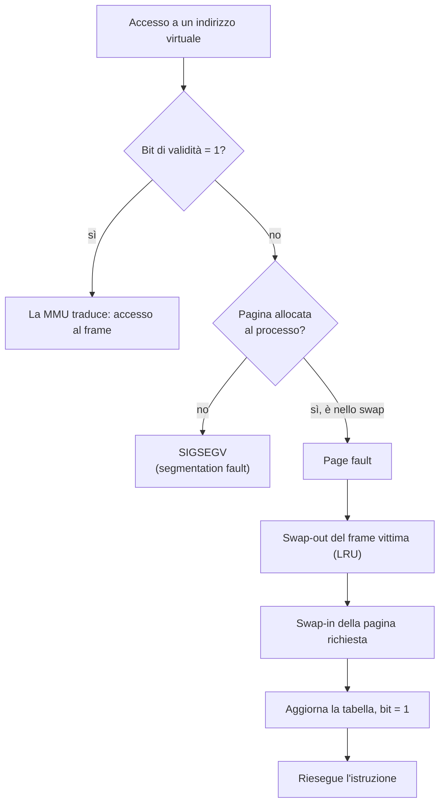

# Gestione dei dati in memoria centrale

> [!abstract] Scopo del capitolo
> Due domande: **come viene allocata la memoria** e **come usarla in modo efficiente**. La prima parte introduce le unità di misura, gli **allocatori** (frammentazione, qualità, allocatori in cascata), la **memoria virtuale** con **MMU** e **paginazione** (bit di validità, swap, page fault, thrashing, paginazione su richiesta) e un semplice **`malloc`/`free`** con lista libera. La seconda parte spiega le **cache**: linee e blocchi, hit e miss, rimpiazzo **LRU**, **località** spaziale e temporale con l'esempio della somma di una matrice per righe e per colonne, **associatività**, tipi di miss e **gerarchia di memoria**.
> Mappa dei concetti: [[MOC - Sistemi di Calcolo]] · Approfondimento lato OS: [[10 - SO - Gestione della Memoria]], [[11 - SO - Memoria Virtuale]]

## Come viene allocata la memoria

Un processo vede la memoria come uno **spazio di indirizzi contigui** con codice, variabili, blocchi dinamici, stringhe letterali… Tenere traccia di quali zone sono **libere** e quali **in uso** è il problema dell'**allocazione della memoria**, uno dei più antichi e fondamentali dell'informatica.

![[SDC-p153-1.png]]

La mappa del sistema con evidenziato il modulo **Memoria** del kernel: le system call `mprotect` e `sbrk`; lo **spazio logico** a pagine, la **tabella delle pagine** e lo **spazio fisico** a frame; memoria virtuale e thrashing. A livello hardware: allineamento, cache e gerarchie di memoria.

> [!warning] Correzione
> Nella dispensa questa figura è didascalizzata "Figura 6.1".

### Unità di misura

La dimensione di un registro o di un bus si misura in **bit**, quella della memoria in **byte** e multipli. Ci sono due famiglie di prefissi (standard ISO/IEC 80000):

| Binari (potenze di 2: RAM, cache) | | Decimali (potenze di 10: dischi) | |
| --- | --- | --- | --- |
| KiB (kibibyte) | 2¹⁰ byte | KB (kilobyte) | 10³ byte |
| MiB (mebibyte) | 2²⁰ | MB (megabyte) | 10⁶ |
| GiB (gibibyte) | 2³⁰ | GB (gigabyte) | 10⁹ |
| TiB (tebibyte) | 2⁴⁰ | TB (terabyte) | 10¹² |
| PiB (pebibyte) | 2⁵⁰ | PB (petabyte) | 10¹⁵ |
| EiB (exbibyte) | 2⁶⁰ | EB (exabyte) | 10¹⁸ |
| ZiB (zebibyte) | 2⁷⁰ | ZB (zettabyte) | 10²¹ |
| YiB (yobibyte) | 2⁸⁰ | YB (yottabyte) | 10²⁴ |

I produttori di dischi usano KB, MB… in senso decimale, ma storicamente la stessa notazione si usava in senso binario per RAM e cache. Per evitare ambiguità si consiglia KiB, MiB… per le potenze di 2. (Per questo un disco "da 1 TB" appare come circa 931 GiB.)

> [!warning] Correzione
> La dispensa scrive "mibibyte": il nome corretto è **mebibyte**.

_(dispensa, pp. 153–154)_

### Allocazione dinamica

Un **allocatore** è una struttura dati per la gestione della memoria, con tre primitive:

- `p = alloca(n)`: restituisce l'indirizzo di un blocco di **almeno n byte contigui**;
- `p = ridimensiona(p, n)`: porta il blocco p alla nuova dimensione n e restituisce il nuovo indirizzo (che può cambiare);
- `dealloca(p)`: rilascia il blocco p.

In C sono `malloc`, `realloc` e `free`.

Un errore classico è non deallocare un blocco che non serve più: il **memory leak**, cioè l'accumularsi di blocchi che l'allocatore considera in uso ma che il programma non usa. È un bug serio, che può portare all'**esaurimento progressivo** della memoria. Si scopre con Valgrind (vedi [[09 - SDC - Appendici#Valgrind|Appendice C]]).

#### Frammentazione interna ed esterna

Vedi [[Frammentazione]].

La **frammentazione** è il fenomeno per cui c'è spazio libero, ma non è utilizzabile per le richieste dei programmi.

- **Interna**: spazio **inutilizzato dentro un blocco** allocato. Esempi: il **padding** per l'allineamento (vedi [[Allineamento e Padding]]); gli allocatori che riservano più memoria del richiesto (se si chiedono meno di 16 byte, ne viene restituito comunque un blocco di dimensione minima).
- **Esterna**: una richiesta **non può essere soddisfatta** non perché manchi spazio libero, ma perché **non è contiguo**. Si ha solo con **blocchi di dimensioni diverse**: se tutti i blocchi avessero la stessa dimensione, ogni blocco liberato sarebbe riutilizzabile per una richiesta futura (è il principio dello [[SLAB Allocator]]).

#### Qualità di un allocatore

1. **tempo**: allocare, ridimensionare e deallocare il più velocemente possibile;
2. **spazio**: riusare il più possibile lo spazio liberato.

Scrivere un allocatore veloce è facile, usare bene lo spazio è difficile. Il problema di fondo è la **mancanza di informazioni sulle richieste future**: se l'allocatore potesse aspettare di conoscere tutte le richieste, userebbe lo spazio molto meglio, ma deve rispondere **subito** (gestione *on-line*).

#### Allocazione in cascata

Un blocco reso disponibile da un allocatore può essere suddiviso in blocchi più piccoli da un altro allocatore. Ci sono quindi più allocatori **in cascata**:

1. il **sistema operativo** assegna **memoria fisica** ai processi, perché ognuno abbia spazio per la propria immagine (codice, dati, heap, stack);
2. in ogni processo un allocatore in **spazio utente** gestisce l'**heap** con `malloc`/`free`;
3. alcune applicazioni usano un terzo **allocatore custom** che suddivide i blocchi di `malloc` in blocchi più piccoli, per usare meglio lo spazio e andare più veloci (es. gli allocatori del kernel visti in [[07 - SO - Allocatori di Memoria|Sistemi Operativi]]).

_(dispensa, pp. 154–156)_

## Memoria fisica e memoria virtuale

Nei sistemi più semplici (alcuni sistemi embedded: router, fotocamere, elettrodomestici) i processi indirizzano **direttamente la memoria fisica**: ogni puntatore è un indirizzo fisico e tutti i processi condividono lo stesso spazio. Questo schema ha due problemi:

- **mancanza di protezione**: ogni processo vede tutta la memoria e può accedere, per errore o per malizia (malware), a quella degli altri;
- **frammentazione esterna**: lo spazio fisico va diviso tra processi che vengono creati e distrutti continuamente, e ognuno vuole uno spazio contiguo.

Nei sistemi più complessi si usa la **memoria virtuale** ([[Memoria Virtuale]]): ogni processo ha un proprio **spazio virtuale di indirizzi** (o **spazio logico**), distinto da quello fisico.

### MMU: da indirizzi virtuali a fisici

Vedi [[MMU]].

La **MMU** (*Memory Management Unit*) è un modulo hardware che **traduce** gli indirizzi dello spazio virtuale di un processo in indirizzi della memoria fisica. Gli indirizzi noti a un programma (i puntatori) sono **sempre virtuali**: la traduzione avviene al momento dell'accesso, in modo trasparente.

![[SDC-p157-1.png]]

Eseguendo `movl $10, (%eax)`, l'indirizzo logico x contenuto in `%eax` viene tradotto dalla MMU nell'indirizzo fisico y, dove viene scritto il 10. Il programma **non vede mai** y.

### Paginazione

Vedi [[Paging]].

La tecnica più usata per il mapping:

- lo **spazio logico** di ogni processo è diviso in blocchi della stessa dimensione, le **pagine** (tipicamente 4 KB o 8 KB), numerate da 0 (**indice di pagina**);
- lo **spazio fisico** è diviso in **frame** della stessa dimensione, numerati da 0 (**indice di frame**);
- la **tabella delle pagine**, accessibile alla MMU, dice per ogni pagina in quale frame si trova. **Ogni processo ha la propria**.

Dimensione della pagina con POSIX:

```c
#include <stdio.h>
#include <unistd.h>
int main(void) {
    printf("Dimensione pagina: %ld byte.\n", sysconf(_SC_PAGESIZE));   // tipicamente 4096
    return 0;
}
```

![[SDC-p158-1.png]]

Una memoria fisica di 8 frame divisa tra due processi da 4 e 2 pagine. Il processo 1 ha le pagine 0, 1, 2, 3 nei frame 1, 5, 0, 7; il processo 2 ha le pagine 0, 1 nei frame 4, 2. I frame bianchi sono liberi o usati dal sistema operativo (ad esempio per le tabelle delle pagine stesse).

Lo spazio di un processo è **virtualmente contiguo** ma può non esserlo fisicamente: si allocano spazi di dimensioni diverse **senza frammentazione esterna**. La pagina è però l'unità minima, quindi c'è **frammentazione interna**.

### Come avviene la traduzione

Spazio virtuale di $2^v$ byte (v = 32 o 64), pagine di $2^d$ byte (d = 12 → 4 KB), spazio fisico di $2^r$ byte (es. r = 33 → 8 GB). Un indirizzo virtuale x a v bit diventa un indirizzo fisico y a r bit così:

- i **v−d bit alti** di x sono l'**indice di pagina p**;
- i **d bit bassi** di x sono l'**offset** dentro la pagina;
- i **r−d bit alti** di y sono l'**indice di frame f**;
- i **d bit bassi** di y sono lo **stesso offset**.

![[SDC-p159-1.png]]

Si legge l'entry p della tabella delle pagine, si ottiene f, e y = f concatenato all'offset.

> [!example] Esempio numerico
> Pagine da 4 KB (d = 12): l'indirizzo virtuale `0x00403A10` ha p = `0x00403` e offset `0xA10`. Se la tabella dice che la pagina `0x403` sta nel frame `0x1F2`, l'indirizzo fisico è `0x1F2A10`.

### Paginazione con bit di validità

Allocare in memoria fisica l'intero spazio virtuale sarebbe troppo costoso: lo spazio logico di un processo coincide di solito con tutto ciò che un puntatore può indirizzare ($2^{32}$ = 4 GB a 32 bit, $2^{64}$ = 16 EB a 64 bit), e la somma degli spazi dei processi supera di molto la memoria fisica. Soluzione: una parte delle pagine sta **su disco**, nell'**area di swap**, e la tabella delle pagine ha un **bit di validità** (1 = la pagina è in un frame fisico, 0 = no).

![[SDC-p159-2.png]]

Le pagine 0, 1, 3 sono valide (frame 4, 3, 0); la pagina 2 non è valida.

Se il bit di validità è 0, due casi:

1. la pagina **non è allocata** al processo → **segmentation fault**: il processo riceve `SIGSEGV` e di default termina;
2. la pagina è allocata ma **sta su disco**, nell'area di swap → **page fault**, che innesca:
   1. il kernel sceglie un **frame vittima**, di solito quello non usato da più tempo (politica **LRU**, *least recently used*), e ne salva il contenuto nello swap (**swap-out**);
   2. carica dallo swap la pagina richiesta nel frame vittima (**swap-in**);
   3. aggiorna la tabella delle pagine: la pagina punta al frame e il bit di validità diventa 1;
   4. la computazione riprende **rieseguendo l'istruzione** che ha causato il page fault.



Un page fault è **costoso** (due accessi a disco, per salvare la vittima e caricare la pagina), quindi deve essere **raro**. Serve che al processo siano assegnati abbastanza frame da contenere il suo **working set**, cioè l'insieme delle pagine in uso attivo. Altrimenti si rischia il **thrashing**: il sistema passa più tempo a fare swapping che a calcolare. Si combatte dando più frame al processo (togliendoli ad altri) o terminandolo. In generale si va in thrashing quando la somma dei working set supera i frame disponibili. Vedi [[Thrashing e Working Set]].

Vantaggi della paginazione con bit di validità:

1. **tutti i processi hanno uno spazio virtuale della stessa dimensione**, pari a tutto lo spazio indirizzabile, il che semplifica la gestione;
2. si mappano in memoria fisica **solo le zone effettivamente usate** (code, data, heap, stack), senza che lo spazio inutilizzato tra di esse occupi memoria.

Svantaggi:

1. il rischio di **thrashing**;
2. un sistema di gestione della memoria **più complesso**;
3. i sistemi embedded con poche risorse potrebbero non supportarla.

![[SDC-p160-1.png]]

Lo spazio logico di un processo a 32 bit con pagine da 4 KB (indici da 0 a $2^{20}-1$): sono valide le pagine di **code**, **data**, **heap** e **stack**; quelle tra heap e stack e dopo lo stack sono **non valide** e non occupano memoria fisica. Le ultime pagine di ogni sezione hanno **frammentazione interna**, perché non sono usate per intero.

### Paginazione su richiesta

Vedi [[Demand Paging]].

La **paginazione su richiesta** (*on-demand paging*) è uno schema **pigro** (*lazy*): all'inizio tutte le pagine sono su disco e vengono portate in memoria **solo al primo accesso** (tramite page fault). È molto diffusa: non si caricano all'avvio pagine che il processo non userà mai.

_(dispensa, pp. 156–161)_

## malloc e free

Vedi [[malloc e free]].

L'allocazione a contatto diretto con le applicazioni avviene **interamente in spazio utente**, con `malloc` e `free`. Queste primitive suddividono l'**heap** (che il kernel fa crescere con la system call **`sbrk`**; in alcuni ambienti si usa invece `mmap`) in:

1. spazio allocato con `malloc` e usato dall'applicazione;
2. spazio libero, allocabile;
3. spazio con le informazioni che servono all'allocatore stesso.

Uno schema semplice: l'heap è diviso in **blocchi**, regioni contigue che possono essere **in uso** o **libere**. Ogni byte dell'heap appartiene a uno e un solo blocco. Ogni blocco ha un **header**:

- blocco **in uso**: la dimensione (*size*);
- blocco **libero**: la dimensione e un puntatore **next** al blocco libero successivo.

![[SDC-p162-1.png]]

La zona usata dal programma si chiama **payload**. I blocchi liberi formano una **lista semplice**, e il campo `next` è ricavato dallo spazio che sarebbe il payload. Con size a 32 bit e puntatori a 64 bit, la dimensione minima di un blocco è 4 + 8 = **12 byte**, quindi il payload minimo è **8 byte**: anche chiedendo meno di 8 byte se ne ottengono 8 (più il campo size).

Una variabile globale **`free_list`** punta al primo blocco libero (`NULL` se non ce ne sono):

![[SDC-p162-2.png]]

L'heap alterna blocchi in uso e liberi; `free_list` punta all'ultimo blocco libero, il cui `next` punta al primo blocco libero, il cui `next` è `NULL`.

Le operazioni:

- **`p = malloc(n)`**: cerca in `free_list` un blocco libero abbastanza grande per n byte e lo toglie dalla lista. La scelta può essere:
  - **first-fit**: il primo blocco abbastanza grande;
  - **best-fit**: il più piccolo blocco abbastanza grande.

  Se non c'è un blocco abbastanza grande, espande l'heap di n+4 byte con `sbrk(n+4)` e crea lì il nuovo blocco. Restituisce l'indirizzo del **primo byte del payload**.
- **`free(p)`**: aggiunge il blocco che inizia a **p−4** (dove c'è il campo size) in testa alla `free_list`.

Miglioramenti possibili:

- **fusione dei blocchi liberi** adiacenti in un blocco unico (serve un bit che distingua i blocchi liberi da quelli in uso);
- **partizione dei blocchi liberi**: se un blocco libero viene usato solo in parte, la rimanenza (se abbastanza grande) diventa un nuovo blocco libero;
- **più liste** di blocchi liberi per dimensione, per trovare più rapidamente un blocco adatto (come le liste per livello del [[Buddy Allocator]]);
- **allineamento**: `malloc` restituisce indirizzi multipli di 4, 8 o 16 byte.

**Esempio** (si ignorano gli header; ogni quadratino è una regione di 4 byte, grigio = allocato, bianco = libero):

![[SDC-p163-1.png]]

1. `p1=malloc(16)`, `p2=malloc(24)`, `p3=malloc(8)`, `p4=malloc(12)` allocano blocchi consecutivi;
2. `free(p1)` e `free(p3)` lasciano due buchi, da 16 e da 8 byte;
3. `p5=malloc(20)` non entra in nessuno dei due buchi (16 e 8 < 20, anche se in totale sono 24 byte liberi): l'heap viene **esteso di 20 byte**.

Alla fine l'heap è di **80 byte, di cui 24 non usati**: è **frammentazione esterna**. Con `malloc`/`free` **non si può compattare** spostando i blocchi, perché l'applicazione ha in mano gli indirizzi restituiti da `malloc` e non ritroverebbe più i propri dati.

_(dispensa, pp. 161–163)_

## Come ottenere le migliori prestazioni usando la memoria

Finora la memoria è stata vista come un grande array "piatto", in cui ogni accesso costa uguale. Se fosse così, accedere alla RAM costerebbe quasi **due ordini di grandezza** più di un registro: un registro richiede frazioni di nanosecondo, una DRAM circa 100 ns. `movl $1,(%eax)` costerebbe 100 volte `movl $1,%eax`.

### Memorie cache

Vedi [[Memoria Cache]].

Dagli anni '80 tra CPU e DRAM si interpone una memoria **più piccola, costosa e veloce**: la **cache**, che tiene una copia dei dati usati più spesso. È costruita in **SRAM** (static RAM), molto più veloce (e costosa) della **DRAM** (dynamic RAM).

![[SDC-p164-1.png]]

La cache è fatta di **linee** di dimensione fissa (es. **64 byte**), che contengono copie di dati della DRAM. La DRAM è vista come divisa in **blocchi** della stessa dimensione di una linea, allineati a multipli di quella dimensione.

![[SDC-p164-2.png]]

Solo un numero limitato di blocchi può stare in cache in ogni istante. Il blocco che contiene l'indirizzo x è il blocco numero **x / L** (divisione intera), con L = dimensione della linea.

- **Cache hit**: l'indirizzo cade in un blocco già in cache, quindi la CPU legge o scrive direttamente nella linea, senza accedere alla DRAM. È il caso migliore.
- **Cache miss**: il blocco va caricato dalla DRAM in una linea libera. Se la cache è piena bisogna scegliere una **linea vittima** e **rimpiazzarla**; se la vittima era stata **scritta** mentre era in cache, va prima **ricopiata in memoria** per non perdere dati. I miss costano molto tempo.

I trasferimenti tra cache e memoria avvengono **a linee intere**.

### Politiche di rimpiazzo

La scelta **ottima** sarebbe sacrificare la linea che **non verrà usata per più tempo**, ma non si conosce il futuro. Una politica molto diffusa è **LRU** (*Least Recently Used*): si sceglie la linea **non usata da più tempo**, assumendo che ciò che non si usa da molto difficilmente servirà a breve. LRU approssima l'ottimo usando il passato per stimare il futuro (è lo stesso principio del page replacement, vedi [[Page Replacement]]).

### Località spaziale e temporale

Vedi [[Località dei Riferimenti]].

Se la CPU accedesse a indirizzi casuali, la cache servirebbe a poco (miss continui). I programmi reali invece mostrano due proprietà:

- **località temporale**: un indirizzo usato ora sarà probabilmente usato di nuovo a breve (es. una variabile in un ciclo);
- **località spaziale**: dopo un indirizzo, si useranno probabilmente quelli vicini (es. la scansione sequenziale di un array).

La cache conserva i blocchi in uso (località temporale), e caricando un intero blocco porta in cache anche i dati vicini (località spaziale). Non sempre però i programmi hanno buona località: è **compito del programmatore** riscriverli per usare meglio la cache.

_(dispensa, pp. 163–165)_

### Esempi

#### Somma di una matrice

Lo stesso calcolo, due ordini di accesso diversi:

```c
// per righe                          // per colonne
int sum(int** m, int n) {             int sum(int** m, int n) {
    int i, j, s = 0;                      int i, j, s = 0;
    for (i=0; i<n; i++)                   for (i=0; i<n; i++)
        for (j=0; j<n; j++)                   for (j=0; j<n; j++)
            s = s + m[i][j];                      s = s + m[j][i];
    return s;                             return s;
}                                     }
// 0.273 secondi                      // 1.406 secondi
```

Su un Intel i7 a 2.8 GHz con linee da 64 byte, per matrici abbastanza grandi la versione **per colonne è molto più lenta**: speedup di 1.406/0.273 ≈ **5.15x** a favore della versione per righe.

**Per righe**: gli indirizzi (supponendo che la riga parta da 0) sono `00 04 08 12 … 60 | 64 68 72 …`, che corrispondono ai blocchi `0 0 0 … 0 | 1 1 1 …`. Anche con una sola linea di cache: un **miss** al primo accesso, che carica gli interi da 00 a 60, poi **15 hit** (località spaziale); il miss successivo è all'indirizzo 64. **Un miss ogni 64/sizeof(int) = 16 iterazioni.**

**Per colonne**: con 16 colonne gli indirizzi della prima colonna sono `00 64 128 192 …` (ogni riga è lunga 16 · 4 = 64 byte), cioè i blocchi `0 1 2 3 …`. **Ogni accesso** cade in un blocco diverso: un miss a ogni accesso. Di ogni blocco caricato si usa un solo intero, gli altri 15 sono caricati inutilmente.

> [!warning] Correzione
> La dispensa elenca gli indirizzi della colonna come `00 16 32 64 80 96…` e i blocchi come `00 01 02 03 04 05`. Con 16 colonne di `int` (64 byte per riga) gli indirizzi corretti sono **0, 64, 128, 192, 256, 320…** (passo 64 byte), che corrispondono proprio ai blocchi 0, 1, 2, 3, 4, 5. La conclusione (un miss per accesso) non cambia.

> [!tip] Regola pratica
> In C le matrici sono memorizzate **per righe** (*row-major*): il ciclo **interno** deve scorrere l'**ultimo indice**.

#### Analisi di una sequenza di accessi

Una cache con **4 linee da 64 byte**, completamente associativa, con rimpiazzo LRU. Per ogni indirizzo x il blocco è L = x / 64:

![[SDC-p167-1.png]]

| x | 20 | 464 | 128 | 36 | 608 | 360 | 204 | 112 | 264 | 268 | 48 | 592 |
| --- | --- | --- | --- | --- | --- | --- | --- | --- | --- | --- | --- | --- |
| L | 0 | 7 | 2 | 0 | 9 | 5 | 3 | 1 | 4 | 4 | 0 | 9 |
| esito | miss | miss | miss | **hit** | miss | miss | miss | miss | miss | **hit** | miss | miss |

La figura mostra il contenuto della cache dopo ogni accesso: in grassetto la linea appena rimpiazzata, accanto ai blocchi l'"età" (da quanto tempo non sono usati). Si rimpiazza sempre il blocco **più vecchio** (LRU). Su 12 accessi si hanno **10 miss** e solo **2 hit** (36 nel blocco 0, ancora in cache; 268 nel blocco 4, appena caricato da 264).

_(dispensa, pp. 165–167)_

### Associatività

Vedi [[Associatività delle Cache]].

Finora si è assunto che un blocco possa andare in **qualsiasi** linea: cache **completamente associativa** (*fully associative*). Le cache reali hanno vincoli:

- **mapping diretto**: ogni blocco ha **una sola linea** possibile (tipicamente `blocco mod numero_linee`);
- **associativa a k vie**: ogni blocco può andare in un insieme di **k linee** (k tipicamente tra 2 e 64).

![[SDC-p168-1.png]]

Con 4 linee: a sinistra il mapping diretto (il blocco 0 va solo nella linea 0, il blocco 4 di nuovo nella 0, …); al centro la cache a 2 vie (ogni blocco ha 2 linee possibili); a destra la fully associative (ogni blocco può andare in ognuna delle 4 linee).

Più associatività significa meno conflitti, ma hardware più complesso e lento (bisogna confrontare più linee in parallelo).

### Tipi di cache miss

1. **cold** (o **compulsory**): il blocco viene caricato **per la prima volta**, in una linea vuota; inevitabile;
2. **capacity**: tutte le linee sono occupate e serve un rimpiazzo (la cache è troppo piccola per il working set);
3. **conflict**: due blocchi sono mappati sulla **stessa linea** per i vincoli di associatività e non possono stare entrambi in cache, anche se altre linee sono libere.

### Gerarchie di memoria

Vedi [[Gerarchia di Memoria]].

I sistemi moderni hanno **più livelli di cache**: **L1** (la più piccola e veloce, usata direttamente dalla CPU), **L2**, **L3** (la più grande e lenta). Ogni livello fa da cache a quello sotto.

![[SDC-p169-1.png]]

| Livello | Tempo | Capacità |
| --- | --- | --- |
| CPU (registri) | < 1 ns | decine/centinaia di byte |
| L1 | ~1 ns | ~64 KB |
| L2 | ~4 ns | ~256 KB |
| L3 | ~16 ns | ~6 MB |
| Memoria centrale | ~100 ns | ~16 GB |
| Disco (memoria virtuale) | ~16 µs (SSD), ~3 ms (magnetico) | terabyte |

Scendendo: **costo per byte decrescente, capacità crescente, velocità decrescente**. Il disco tiene i frame **swapped out** della memoria virtuale. I valori sono indicativi.

Il messaggio principale: le differenze arrivano a **6 ordini di grandezza**. Una `mov` che accede a un dato finito su disco può costare **un milione di volte** un accesso a registro, e nel frattempo la CPU è in **stallo**: avrebbe potuto eseguire milioni di istruzioni. Per questo è essenziale che i programmi abbiano buona **località**, e questo richiede attenzione da parte del programmatore.

In un Intel Core i7 multi-core, **L1 e L2 sono replicate su ogni core**, mentre **L3 è condivisa** tra i core.

_(dispensa, pp. 167–169)_
