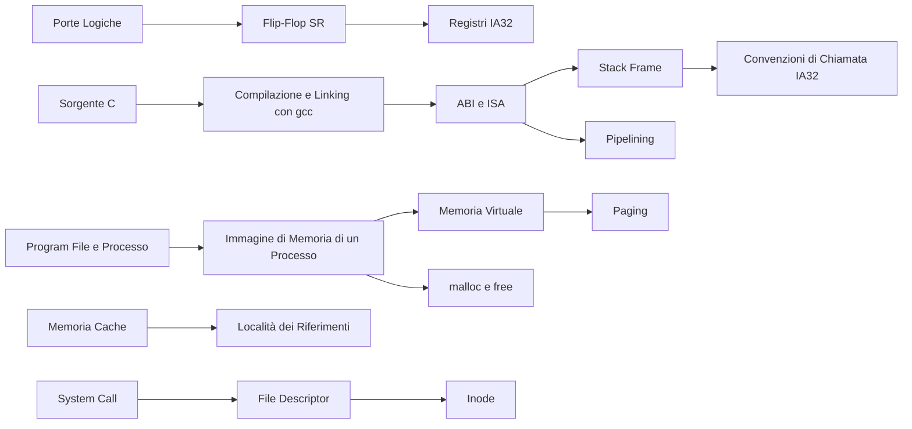

# MOC — Sistemi di Calcolo

> [!abstract] Come usare questa mappa
> Le **lezioni** seguono i capitoli della *Dispensa Sistemi di Calcolo* (Demetrescu et al.): sono note complete da cui studiare. I **concetti** sono note brevi per il ripasso, ognuna con il link alle sezioni esatte delle lezioni. Molti concetti sono **condivisi con Sistemi Operativi**, che approfondisce il lato kernel degli stessi argomenti: le note atomiche di quel corso sono collegate anche da qui. Mappa dell'altro corso: [[MOC - Sistemi Operativi]].

## Lezioni (capitoli della dispensa)

| # | Lezione | Argomenti |
| --- | --- | --- |
| 1 | [[01 - SDC - Cosa è un sistema di calcolo]] | Von Neumann, bus, memoria, porte logiche, addizionatori, flip-flop, sistema operativo |
| 2 | [[02 - SDC - Programmazione di un sistema di calcolo]] | compilazione vs interpretazione, toolchain gcc, ELF, objdump |
| 3 | [[03 - SDC - Traduzione dei programmi C in linguaggio macchina]] | IA32 AT&T, registri, indirizzamento, salti, costrutti C, stack frame, x86-64 |
| 4 | [[04 - SDC - Librerie standard del C]] | man, gestione errori, stringhe, memoria, stream, qsort, strace, ltrace |
| 5 | [[05 - SDC - Ottimizzazione dei programmi]] | Amdahl, profiling, gprof, ottimizzazioni di gcc, padding |
| 6 | [[06 - SDC - Esecuzione dei programmi]] | processi, /proc/maps, thread, pipelining, fork/wait/exec, pthread, interrupt, segnali |
| 7 | [[07 - SDC - Gestione dei dati in memoria centrale]] | allocatori, memoria virtuale, paginazione, malloc/free, cache, località |
| 8 | [[08 - SDC - Gestione dei file]] | albero delle directory, inode, descrittori, mount, open/read/write/lseek, link |
| A–D | [[09 - SDC - Appendici]] | ASCII, shell, permessi, redirezione, gdb, Valgrind, elettronica |

Note già presenti nel corso: [[GDB]] (guida completa a gdb).

## Concetti

### Hardware

- [[Macchina di Von Neumann]] · [[Bus di Sistema]] · [[Gerarchia di Memoria]]
- [[Porte Logiche]] · [[Circuiti Combinatori e Addizionatori]] · [[Flip-Flop SR]]
- [[Pipelining]] · [[Memoria Cache]] · [[Associatività delle Cache]] · [[Località dei Riferimenti]]

### Dal C al linguaggio macchina

- [[Compilazione e Interpretazione]] · [[Compilazione e Linking con gcc]] · [[Loader ed ELF]] · [[objdump]]
- [[ABI e ISA]] · [[Registri IA32]] · [[Modi di Indirizzamento]] · [[Endianness]] · [[LEA]]
- [[Istruzioni di Salto e Condition Code]] · [[Traduzione dei Costrutti C in Assembly]]
- [[Convenzioni di Chiamata IA32]] · [[Stack Frame]] · [[Registri Caller-save e Callee-save]] · [[x86-64]]

### Librerie e strumenti

- [[Funzioni della libc]] · [[Gestione degli Errori in C]] · [[strace e ltrace]] · [[Puntatori a Funzione]]
- [[GDB]] · [[Valgrind]] · [[Shell e Comandi Unix]] · [[Codifica ASCII]]

### Prestazioni

- [[Speedup e Legge di Amdahl]] · [[Profiling]] · [[Ottimizzazioni del Compilatore]]
- [[Loop-Invariant Code Motion]] · [[Allineamento e Padding]]

### Processi ed esecuzione (condivisi con Sistemi Operativi)

- [[Sistema Operativo]] · [[Architettura a Strati]] · [[Dual Mode]] · [[System Call]]
- [[Program File e Processo]] · [[Immagine di Memoria di un Processo]] · [[Process Control Block]] · [[Stati di un Processo]] · [[Thread]]
- [[fork]] · [[wait e Processi Zombie]] · [[exec e Variabili d'Ambiente]] · [[Round Robin]]
- [[Interrupt]] · [[Interrupt Vector]] · [[Eccezioni]] · [[Context Switch]] · [[Polling vs Interrupt]] · [[Segnali]]

### Memoria (condivisi con Sistemi Operativi)

- [[Frammentazione]] · [[malloc e free]] · [[SLAB Allocator]] · [[Buddy Allocator]]
- [[Memoria Virtuale]] · [[MMU]] · [[Paging]] · [[Demand Paging]] · [[Page Replacement]] · [[Thrashing e Working Set]]

### File (condivisi con Sistemi Operativi)

- [[File System]] · [[Inode]] · [[File Descriptor]] · [[Mount]] · [[Link Hard e Soft]] · [[Permessi e Ownership]]

## Percorsi trasversali

- **Dal transistor al registro**: [[Porte Logiche]] → [[Circuiti Combinatori e Addizionatori]] → [[Flip-Flop SR]] → [[Registri IA32]]
- **Dal sorgente all'esecuzione**: [[Compilazione e Linking con gcc]] → [[Loader ed ELF]] → [[Immagine di Memoria di un Processo]] → [[Stack Frame]]
- **Perché un programma è lento**: [[Speedup e Legge di Amdahl]] → [[Profiling]] → [[Ottimizzazioni del Compilatore]] → [[Pipelining]] → [[Località dei Riferimenti]]
- **Dalla chiamata C al kernel**: [[Funzioni della libc]] → [[strace e ltrace]] → [[System Call]] → [[Dual Mode]] → [[Interrupt]]
- **Dal puntatore al byte su disco**: [[MMU]] → [[Paging]] → [[Demand Paging]] → [[File Descriptor]] → [[Inode]]
