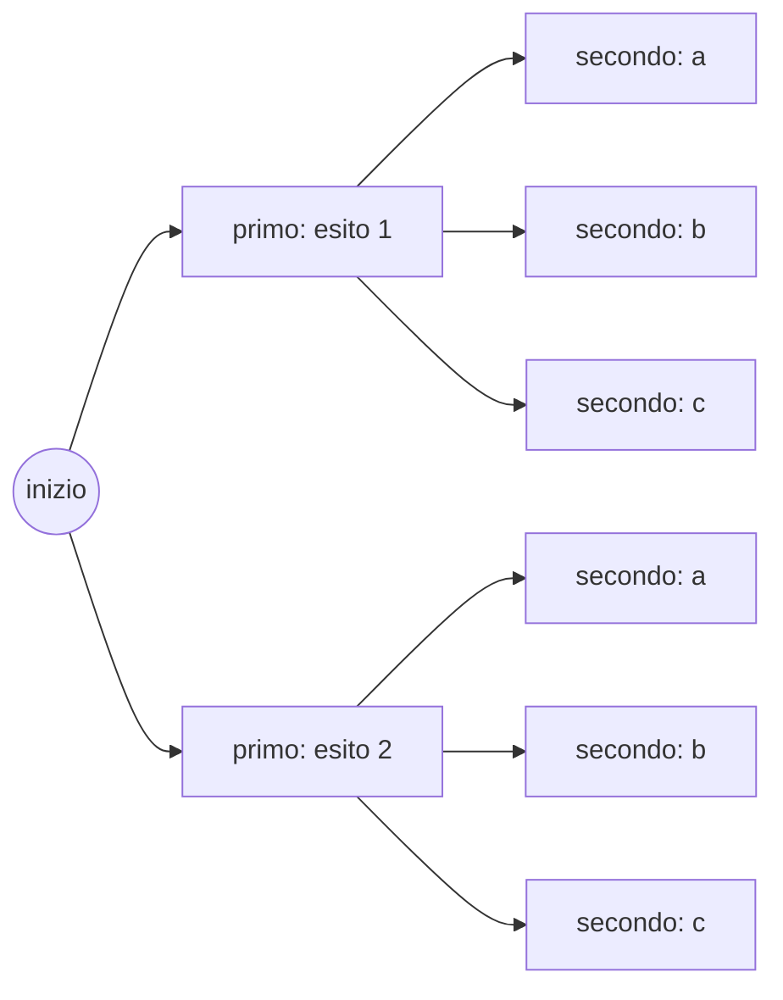
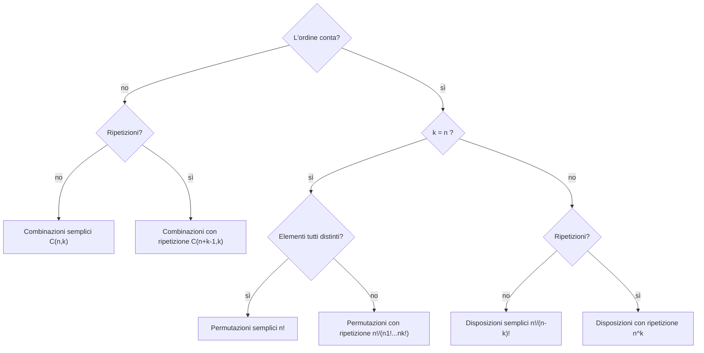

# Spazi di Probabilità e Calcolo Combinatorio

> [!abstract]
> Prima lezione del corso: costruisce il **linguaggio** di tutta la probabilità. Si parte da cosa è un esperimento casuale e dagli eventi visti come insiemi, si fissano i tre **assiomi** di Kolmogorov e se ne ricavano le prime regole (complementare, unione, inclusione-esclusione). Poi si affronta il caso più semplice e più frequente negli esercizi, quello degli **esiti equiprobabili**, dove calcolare una probabilità vuol dire *contare*: da qui nasce la necessità del **calcolo combinatorio** (disposizioni, permutazioni, combinazioni).
> Tutto ciò che segue — [[02 - PS - Probabilità Condizionata e Indipendenza|probabilità condizionata]], [[03 - PS - Variabili Aleatorie Discrete|variabili aleatorie]], distribuzioni — poggia su queste definizioni.
> Mappa del corso: [[MOC - Probabilità e Statistica]].

> [!info] Fonte
> La dispensa è scritta a mano (by Marco Turchetti) e segue il programma del corso, che rimanda ai capitoli del libro di testo (cap. 3 = probabilità, cap. 4 = variabili aleatorie, cap. 5 = variabili aleatorie speciali). I riquadri incollati nella dispensa vengono in parte dal libro e in parte da siti divulgativi; qui sono trascritti.

---

## Prime definizioni

Vedi [[Spazio Campionario ed Eventi]].

La probabilità serve a ragionare su fenomeni di cui **non possiamo prevedere il risultato**. Per farlo in modo rigoroso servono pochi oggetti di base.

| Oggetto | Definizione | Esempio (lancio di un dado) |
|---|---|---|
| **Esperimento casuale** (o aleatorio) | fenomeno *osservabile* ma con esito non certo | lancio il dado |
| **Spazio campionario** $S$ (o $\Omega$) | insieme di tutti i possibili esiti; i suoi elementi si chiamano **punti campionari** | $S=\{1,2,3,4,5,6\}$ |
| **Evento** $E$ | sottoinsieme di $S$, cioè un insieme di esiti possibili | "esce un pari" $E=\{2,4,6\}$ |

Se l'esito dell'esperimento appartiene a $E$, diciamo che **l'evento $E$ si è verificato**. Esce 4 → si è verificato "pari", ma anche "maggiore di 3", e così via: lo stesso esito fa verificare tanti eventi diversi.

> [!tip] Perché gli eventi sono insiemi
> Trattare gli eventi come insiemi permette di usare tutta l'algebra degli insiemi per costruire eventi complessi da quelli semplici ("pari **e** maggiore di 3", "non esce 6", …). È esattamente quello che fanno le operazioni seguenti.

### Operazioni insiemistiche tra eventi

Siano $E$ e $F$ eventi dello **stesso** spazio $S$:

- **Unione** $E\cup F$: gli esiti che stanno in $E$ **o** in $F$ → si verifica se *almeno uno* tra $E$ e $F$ si verifica.
- **Intersezione** $E\cap F$: gli esiti che stanno **sia** in $E$ **sia** in $F$ → si verifica se si verificano *entrambi*.
- **Complementare** $E^c$: gli esiti di $S$ che non stanno in $E$ → si verifica se e solo se $E$ *non* si verifica.
- **Inclusione** $E\subset F$: tutti gli esiti di $E$ appartengono a $F$ (se si verifica $E$, si verifica anche $F$).
- **Uguaglianza** $E=F$ se $E\subset F$ e $F\subset E$.

L'**evento vuoto** $\emptyset$ non contiene esiti: non può mai verificarsi. Se $E\cap F=\emptyset$, $E$ e $F$ non possono verificarsi insieme e si dicono **disgiunti** (o mutuamente esclusivi, o incompatibili).

### Leggi di De Morgan e proprietà distributiva

Vedi [[Leggi di De Morgan]].

$$(E\cup F)^c = E^c\cap F^c \qquad\qquad (E\cap F)^c = E^c\cup F^c$$

A parole: "non (almeno uno dei due)" = "nessuno dei due"; "non (entrambi)" = "almeno uno dei due no". Sono utilissime perché spesso è più facile calcolare la probabilità del complementare.

**Proprietà distributiva** (l'intersezione distribuisce sull'unione e viceversa):

$$(E\cup F)\cap G = (E\cap G)\cup(F\cap G) \qquad\qquad (E\cap F)\cup G = (E\cup G)\cap(F\cup G)$$

### Frequenza empirica

L'intuizione da cui nasce la probabilità è la **frequenza empirica**: ripetendo l'esperimento molte volte, la frazione di prove in cui $E$ si verifica si stabilizza attorno a un numero, che chiamiamo probabilità di $E$. Questa idea verrà resa rigorosa dalla [[05 - PS - Disuguaglianze e Legge dei Grandi Numeri#Legge debole dei grandi numeri|legge dei grandi numeri]]; per ora la usiamo solo come motivazione degli assiomi. _(dispensa, pp. 3–4)_

---

## Assiomi della probabilità

Vedi [[Assiomi della Probabilità]].

Indichiamo con $P(E)$ la probabilità dell'evento $E$. Si chiede che valgano tre assiomi:

1. $0\le P(E)\le 1$;
2. $P(S)=1$;
3. **additività numerabile**: se $E_1,E_2,\dots$ sono eventi **a due a due disgiunti** ($E_i\cap E_j=\emptyset$ per $i\ne j$), allora
$$P\Big(\bigcup_{i=1}^{n} E_i\Big)=\sum_{i=1}^{n} P(E_i),\qquad n=1,2,\dots,\infty$$

Il terzo assioma dice che, per un insieme **finito o numerabile** di eventi mutuamente esclusivi, la probabilità che se ne verifichi almeno uno è la somma delle loro probabilità.

> [!note] Perché proprio questi tre
> Sono le proprietà che ha la frequenza empirica: è un numero tra 0 e 1, l'evento certo ha frequenza 1, e se due eventi non possono capitare insieme la frequenza della loro unione è la somma delle frequenze. Gli assiomi chiedono solo queste proprietà, senza dire *come* si assegnano i numeri: questo è compito del modello (es. esiti equiprobabili).

### Conseguenze immediate

**Complementare.** $E$ ed $E^c$ sono disgiunti e la loro unione è $S$, quindi per gli assiomi 2 e 3:

$$1=P(S)=P(E\cup E^c)=P(E)+P(E^c)\quad\Longrightarrow\quad \boxed{P(E^c)=1-P(E)}$$

**Unione di due eventi qualsiasi** (estensione dell'assioma 3 a eventi non disgiunti):

$$\boxed{P(E\cup F)=P(E)+P(F)-P(E\cap F)}$$

Si verifica facilmente con un diagramma di Venn: sommando $P(E)$ e $P(F)$ la zona $E\cap F$ viene contata due volte, quindi va tolta una volta. Più formalmente: $E\cup F = E\cup(E^c\cap F)$ è un'unione disgiunta e $F=(E\cap F)\cup(E^c\cap F)$, da cui il risultato. _(dispensa, pp. 4–5)_

---

## Principio di inclusione-esclusione

Vedi [[Principio di Inclusione-Esclusione]].

Il principio dice come ricavare la **cardinalità di un'unione** a partire dalle cardinalità delle intersezioni. Indichiamo con $|A|$ la cardinalità (numero di elementi) di $A$.

- Due insiemi: $|A\cup B|=|A|+|B|-|A\cap B|$
- Tre insiemi: $|A\cup B\cup C|=|A|+|B|+|C|-|A\cap B|-|A\cap C|-|B\cap C|+|A\cap B\cap C|$

La formula per tre insiemi si dimostra applicando più volte quella per due e la proprietà distributiva:

$$
\begin{aligned}
|A\cup B\cup C| &= |(A\cup B)\cup C| = |A\cup B|+|C|-|(A\cup B)\cap C|\\
&= \big(|A|+|B|-|A\cap B|\big)+|C|-|(A\cap C)\cup(B\cap C)|\\
&= |A|+|B|+|C|-|A\cap B|-\big[|A\cap C|+|B\cap C|-|A\cap B\cap C|\big]
\end{aligned}
$$

Per $n$ insiemi si alternano i segni:

$$\Big|\bigcup_{i=1}^n E_i\Big|=\sum_{i}|E_i|-\sum_{i<j}|E_i\cap E_j|+\sum_{i<j<k}|E_i\cap E_j\cap E_k|-\dots+(-1)^{n+1}|E_1\cap\dots\cap E_n|$$

Le intersezioni si prendono a 1 a 1, poi a 2 a 2, poi a 3 a 3, e così via; il segno è "+" per un numero dispari di insiemi e "−" per un numero pari. La stessa formula vale sostituendo $|\cdot|$ con $P(\cdot)$: è il [[02 - PS - Probabilità Condizionata e Indipendenza#Probabilità dell'unione|teorema della probabilità dell'unione]] della lezione 2. _(dispensa, pp. 5–6)_

> [!example] Esempio
> In una classe di 30 studenti, 18 studiano inglese, 12 tedesco e 5 entrambi. Quanti studiano almeno una lingua? $18+12-5=25$. Quanti nessuna? $30-25=5$ (De Morgan: "né inglese né tedesco" è il complementare dell'unione).

---

## Misura di probabilità

Riprendendo quanto sopra in forma più compatta: dato un esperimento casuale con spazio campionario $S$, la probabilità di un evento misura **quanto è plausibile** che l'evento si verifichi in un'esecuzione dell'esperimento.

Matematicamente, una **misura di probabilità** (o **distribuzione**) $P$ è una funzione a valori reali definita sulla collezione degli eventi che soddisfa:

1. $0\le P(A)\le 1$ per ogni evento $A$;
2. $P(S)=1$;
3. $P\big[\bigcup_{j\in J}A_j\big]=\sum_{j\in J}P(A_j)$ se $\{A_j: j\in J\}$ è una collezione **numerabile** di eventi a due a due disgiunti.

Sono gli stessi assiomi di prima: la coppia (spazio campionario, misura di probabilità) si chiama **spazio di probabilità**. _(dispensa, p. 6)_

---

## Spazi di esiti equiprobabili

Vedi [[Spazi Equiprobabili]].

Per molti esperimenti (dado, moneta, estrazione di una carta) è naturale assumere che **ogni esito abbia la stessa probabilità**. Ciò può accadere solo se $S$ è **finito**: su un insieme infinito non si può distribuire probabilità uguale e positiva a tutti i punti, perché la somma divergerebbe.

Sia $S=\{1,2,\dots,N\}$ e $P(\{1\})=P(\{2\})=\dots=P(\{N\})=p$. Dagli assiomi 2 e 3:

$$1=P(S)=P(\{1\})+\dots+P(\{N\})=Np \quad\Longrightarrow\quad p=\frac1N$$

e quindi, per ogni evento $E$:

$$\boxed{P(E)=\frac{|E|}{|S|}=\frac{\#\text{casi favorevoli}}{\#\text{casi possibili}}}$$

> [!summary] Ricetta per gli esercizi (esiti equiprobabili)
> 1. Calcolo il numero di tutti gli esiti possibili dell'esperimento → $|S|$;
> 2. calcolo il numero di esiti in cui si verifica $E$ → $|E|$;
> 3. $P(E)=|E|/|S|$.
>
> Il problema si riduce a **contare**: è qui che serve il calcolo combinatorio.

_(dispensa, p. 7)_

> [!example] Esercizio svolto — i tecnici dei televisori
> *In un paese ci sono 4 tecnici. Si guastano 4 TV: qual è la probabilità che vengano chiamati esattamente 2 tecnici? (Cosa stiamo assumendo?)*
> Assumiamo che ogni TV scelga il tecnico a caso, in modo uniforme e indipendente dalle altre: $|S|=4^4=256$ esiti equiprobabili.
> Per avere esattamente 2 tecnici: scelgo la coppia di tecnici ($\binom42=6$ modi) e poi distribuisco le 4 TV tra loro in modo che entrambi lavorino: $2^4-2=14$ modi (tolgo i casi "tutte al primo" e "tutte al secondo"). Quindi
> $$P=\frac{6\cdot 14}{256}=\frac{84}{256}\approx 0{,}328$$
>
> > [!warning] Correzione
> > Nello svolgimento negli esercizi (p. 2) compare $\frac{4\cdot3\cdot4}{256}=0{,}1875$, contando solo alcune ripartizioni (2+2 e 3+1 per una coppia fissata). Il conteggio completo dà $84/256\approx0{,}328$: per ogni coppia di tecnici le ripartizioni sono $\binom41+\binom42+\binom43=4+6+4=14$, e le coppie sono 6.
>
> _(esercizi, p. 2)_

---

## Principio di enumerazione

Vedi [[Principio di Enumerazione]].

> Se si eseguono $r$ esperimenti, e il primo ammette $n_1$ esiti possibili, per ognuno dei quali il secondo ammette $n_2$ esiti, per ogni combinazione dei primi due il terzo ammette $n_3$ esiti, e così via, allora ci sono in totale
> $$n_1\cdot n_2\cdot n_3\cdots n_r$$
> combinazioni di esiti degli $r$ esperimenti considerati tutti insieme.

È il "principio della moltiplicazione": ogni scelta si ramifica nelle scelte successive, come in un albero.

Con $n_1=2$ e $n_2=3$ le foglie sono $2\cdot3=6$.

> [!note]
> La dispensa annota che il principio "si basa sulla probabilità condizionata": in effetti, quando lo si usa per calcolare probabilità ("la prima carta è un asso, *e poi* la seconda…"), lo si sta applicando insieme alla [[02 - PS - Probabilità Condizionata e Indipendenza#Formula delle probabilità composte|regola delle probabilità composte]]. Come principio di conteggio, però, è puramente combinatorio.

_(dispensa, p. 8)_

---

## Calcolo combinatorio

Come si calcola il numero di esiti possibili, o di esiti che verificano un evento? Si distinguono tre tipi di raggruppamenti: **disposizioni**, **permutazioni**, **combinazioni**. Le domande da farsi sono due: *l'ordine conta?* e *sono ammesse ripetizioni?*

### Disposizioni

Vedi [[Disposizioni]].

Una **disposizione** è una sequenza **ordinata** di $k$ elementi scelti tra $n$ elementi distinti. I raggruppamenti:
- contengono esattamente $k$ elementi;
- differiscono per almeno un elemento **oppure per l'ordine**.

| | Formula | Perché |
|---|---|---|
| **Disposizioni semplici** (senza ripetizione, $k\le n$) | $D_{n,k}=\dfrac{n!}{(n-k)!}=n(n-1)\cdots(n-k+1)$ | principio di enumerazione: $n$ scelte per il primo posto, $n-1$ per il secondo, … |
| **Disposizioni con ripetizione** | $D'_{n,k}=n^k$ | ogni posto ha sempre $n$ scelte |

> [!example]
> Podio (oro, argento, bronzo) tra 10 atleti: $D_{10,3}=10\cdot9\cdot8=720$. PIN di 4 cifre: $D'_{10,4}=10^4$.

### Permutazioni

Vedi [[Permutazioni]].

La **permutazione semplice** è il caso particolare di disposizione semplice con $k=n$: si ordinano **tutti** gli $n$ elementi. I raggruppamenti contengono tutti gli $n$ elementi e differiscono solo per l'ordine.

- **Permutazioni semplici**: $P_n=n!$ (principio di enumerazione).
- **Permutazioni circolari**: gli elementi sono disposti in cerchio e non si distingue la prima posizione dall'ultima: $P^c_n=(n-1)!$ (fisso un elemento e permuto gli altri).
- **Permutazioni con ripetizione**: ho $n$ elementi di cui $n_1$ di un tipo, $n_2$ di un altro, …, $n_k$ dell'ultimo, con $n_1+\dots+n_k=n$:
$$P_n^{n_1,\dots,n_k}=\frac{n!}{n_1!\,n_2!\cdots n_k!}$$
Dalle $n!$ permutazioni tolgo quelle che risultano uguali perché scambiano tra loro elementi identici: per ogni tipo, $n_i!$ scambi danno la stessa sequenza.

Il rapporto $\frac{n!}{n_1!\cdots n_k!}$ è il **coefficiente multinomiale**: conta i modi di mettere $n$ oggetti in $k$ scatole con $n_1$ oggetti nella prima, $n_2$ nella seconda, e così via.

> [!example]
> Anagrammi di MAMMA: $\frac{5!}{3!\,2!}=10$.

> [!warning] Correzione
> A p. 10 la dispensa distingue permutazioni con ripetizione "ordinate" $=\frac{n!}{n_1!\cdots n_k!}$ e "non ordinate" $=\frac{n!}{n_1!\cdots n_k!\cdot k!}$. La seconda formula non corrisponde a un oggetto standard e in generale non conta niente di sensato (dividere per $k!$ avrebbe senso solo se i $k$ gruppi avessero tutti la stessa dimensione e fossero indistinguibili). Per gli esercizi basta la formula del coefficiente multinomiale.

### Combinazioni

Vedi [[Combinazioni]].

Una **combinazione** è un raggruppamento di $k$ elementi presi da $n$ elementi distinti **senza tener conto dell'ordine**: i raggruppamenti differiscono per almeno un elemento, ma **non** per l'ordine.

- **Combinazioni semplici**:
$$C_{n,k}=\binom nk=\frac{n!}{k!\,(n-k)!}=\frac{D_{n,k}}{P_k}$$
Ogni gruppo di $k$ elementi compare $k!$ volte tra le disposizioni (sono le sue permutazioni); siccome l'ordine non interessa, lo vogliamo contare una volta sola, quindi divido per $k!$.
- **Combinazioni con ripetizione** (lo stesso elemento può comparire più volte; qui $k$ può essere maggiore di $n$):
$$C'_{n,k}=\binom{n+k-1}{k}=\frac{(n+k-1)!}{k!\,(n-1)!}$$

> [!example]
> Mani di 5 carte da un mazzo di 52: $\binom{52}{5}=2\,598\,960$. Comprare 3 gelati scegliendo tra 4 gusti (ripetizioni ammesse): $\binom{4+3-1}{3}=20$.

### Schema risolutivo

Per risolvere un problema di calcolo combinatorio si legge il testo e si individuano $n$ (numero totale di elementi) e $k$ (numero di elementi del raggruppamento). Poi:

| Raggruppamento | Ordine | Ripetizioni | Formula |
|---|:-:|:-:|---|
| Disposizioni semplici | sì | no | $\frac{n!}{(n-k)!}$ |
| Disposizioni con ripetizione | sì | sì | $n^k$ |
| Permutazioni semplici | sì ($k=n$) | no | $n!$ |
| Permutazioni circolari | sì, in cerchio | no | $(n-1)!$ |
| Permutazioni con ripetizione | sì ($k=n$) | sì | $\frac{n!}{n_1!\cdots n_k!}$ |
| Combinazioni semplici | no | no | $\binom nk$ |
| Combinazioni con ripetizione | no | sì | $\binom{n+k-1}{k}$ |

_(dispensa, pp. 9–12)_

> [!example] Esercizio svolto — una coppia d'assi
> *Da un mazzo di 52 carte se ne pescano 2. Probabilità che siano due assi?*
> - **Senza ordine**: $|S|=\binom{52}{2}=\frac{52\cdot51}{2}=1326$ coppie non ordinate, $|E|=\binom42=6$ coppie di assi: $P=\frac{6}{1326}=\frac{1}{221}$.
> - **Con ordine** (prima carta, seconda carta): $|S|=52\cdot51$, $|E|=4\cdot3$: $P=\frac{4\cdot3}{52\cdot51}=\frac1{221}$.
>
> I due conteggi danno lo stesso risultato **purché si usi lo stesso criterio** al numeratore e al denominatore. _(esercizi, p. 3)_

> [!tip] Collegamento
> Il calcolo combinatorio "a coppie" è alla base del **paradosso del compleanno**, che in crittografia diventa il *birthday attack* sulle funzioni hash: vedi [[4 CS  Lower Level - Data Integrity - MAC, attacks and SHA-1#Birthday paradox and attack|Cybersecurity — Birthday paradox]].
