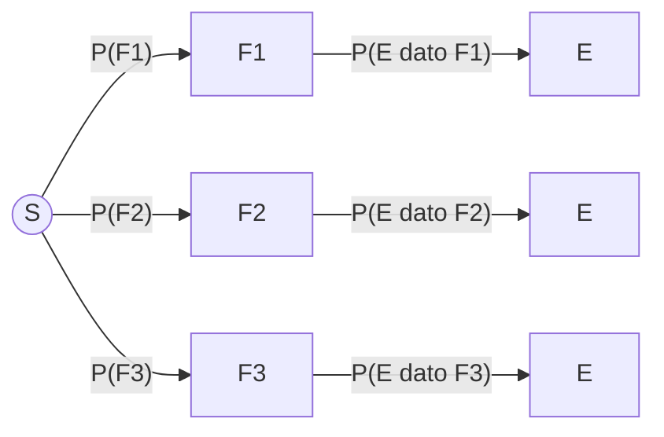

# Probabilità Condizionata e Indipendenza

> [!abstract]
> Nella [[01 - PS - Spazi di Probabilità e Calcolo Combinatorio|lezione 1]] le probabilità erano calcolate "a freddo", senza informazioni sull'esito. Qui ci si chiede come cambia la probabilità di un evento quando **sappiamo** che un altro evento si è verificato. Da questa idea nascono gli strumenti più usati negli esercizi: la **formula inversa** (probabilità dell'intersezione), la **regola della catena**, la **formula di fattorizzazione** (probabilità totale) e la **formula di Bayes**. Chiude la lezione la nozione di **indipendenza**: il caso in cui l'informazione non cambia nulla.
> Gli stessi concetti verranno poi estesi alle [[03 - PS - Variabili Aleatorie Discrete#Distribuzioni condizionali|variabili aleatorie]].
> Mappa del corso: [[MOC - Probabilità e Statistica]].

---

## Probabilità condizionata

Vedi [[Conditional Probability]].

Si dice **probabilità condizionata di $E$ dato $F$**, e si scrive $P(E\mid F)$, la probabilità che si verifichi $E$ sapendo che si è verificato $F$.

Il ragionamento è questo:
1. se si è verificato $F$, affinché si verifichi anche $E$ l'esito deve stare **sia in $E$ sia in $F$**, cioè in $E\cap F$;
2. essendosi verificato $F$, questo evento diventa il **nuovo spazio degli esiti (ridotto)**;

quindi la probabilità condizionata è il rapporto tra la probabilità di $E\cap F$ e quella di $F$:

$$\boxed{P(E\mid F)=\frac{P(E\cap F)}{P(F)}}\qquad\text{definita solo se } P(F)>0$$

Se $P(F)=0$, $P(E\mid F)$ non si definisce.

![[PS-p013-1.png]]

La figura del libro (Figura 3.5) mostra l'idea: dentro il rettangolo $S$, una volta saputo che siamo in $F$, guardiamo solo il cerchio $F$; la probabilità di $E$ diventa la frazione di $F$ occupata dalla zona scura $E\cap F$. Sopra la figura sono annotate a mano la definizione e la formula inversa $P(E\cap F)=P(E\mid F)P(F)$.

> [!warning] Attenzione
> - $P(E\cap F)$ e $P(F)$ vanno calcolate **sullo spazio degli esiti $S$ originale**, non su quello ridotto.
> - La probabilità condizionata **non è simmetrica**: in generale $P(E\mid F)\ne P(F\mid E)$ (la probabilità di avere la febbre sapendo di avere l'influenza è alta; quella di avere l'influenza sapendo di avere la febbre molto meno).

### Formula inversa

Rigirando la definizione:

$$P(E\cap F)=P(E\mid F)\,P(F)=P(F\mid E)\,P(E)$$

"La probabilità che $E$ e $F$ si verifichino entrambi è pari a quella che si verifichi $F$ per la probabilità condizionata di $E$ dato che si è verificato $F$". È la formula che si usa per calcolare le intersezioni negli esperimenti "a stadi" (prima succede $F$, poi $E$).

### Proprietà della probabilità condizionata

Siano $E,E_1,E_2,F$ eventi con $P(F)\ne0$.

| | Proprietà | Spiegazione |
|---|---|---|
| P1 | $E\subseteq F\iff P(E\mid F)=\dfrac{P(E)}{P(F)}$ | se $E\subseteq F$ allora $E\cap F=E$ |
| P2 | $P(E\mid F)=1\iff F\subseteq E$ | se $F$ si è verificato e $F$ sta dentro $E$, $E$ è certo |
| P3 | $E,F$ incompatibili $\Rightarrow P(E\mid F)=0=P(F\mid E)$ | $E\cap F=\emptyset$ (serve anche $P(E)\ne0$ per la seconda) |
| P4 | $P(E^c\mid F)=1-P(E\mid F)$ | il complementare funziona anche condizionando |
| P5 | $P(E_1\cup E_2\mid F)=P(E_1\mid F)+P(E_2\mid F)-P(E_1\cap E_2\mid F)$ | [[01 - PS - Spazi di Probabilità e Calcolo Combinatorio#Principio di inclusione-esclusione|inclusione-esclusione]] |

> [!tip]
> P4 e P5 dicono che, fissato $F$, la funzione $E\mapsto P(E\mid F)$ è a sua volta una **misura di probabilità**: soddisfa tutti gli assiomi. Quindi tutte le regole della lezione 1 valgono anche "condizionando a $F$".

_(dispensa, pp. 13–14)_

---

## Formula delle probabilità composte

Vedi [[Regola della Catena]].

Applicando più volte la formula inversa si ottiene la probabilità dell'intersezione di più eventi. Per tre eventi:

$$P(A_1\cap A_2\cap A_3)=\underbrace{P(A_1)\,P(A_2\mid A_1)}_{P(A_1\cap A_2)}\;\underbrace{P(A_3\mid A_1\cap A_2)}_{\frac{P(A_1\cap A_2\cap A_3)}{P(A_1\cap A_2)}}$$

I primi due fattori danno $P(A_1\cap A_2)$; il terzo, per definizione, è $P(A_1\cap A_2\cap A_3)/P(A_1\cap A_2)$, e il prodotto si semplifica.

**Caso generale (regola della catena).** Siano $E_1,\dots,E_n\subseteq\Omega$ con $P(E_1\cap\dots\cap E_{n-1})\ne0$. Allora

$$P(E_1\cap E_2\cap\dots\cap E_n)=P(E_1)\,P(E_2\mid E_1)\,P(E_3\mid E_1\cap E_2)\cdots P(E_n\mid E_1\cap\dots\cap E_{n-1})$$

cioè la probabilità del primo evento, per quella del secondo dato il primo, per quella del terzo dati i primi due, … fino all'$n$-esimo dato tutti i precedenti (l'ultimo termine condiziona all'intersezione dei primi $n-1$).

> [!example]
> Estraggo 3 carte senza reinserimento: probabilità che siano tutte cuori?
> $$\frac{13}{52}\cdot\frac{12}{51}\cdot\frac{11}{50}\approx 0{,}0129$$
> Ogni fattore è la probabilità condizionata dato che le estrazioni precedenti erano cuori.

_(dispensa, p. 15)_

---

## Probabilità dell'unione

La dispensa chiama **probabilità totale** (o probabilità dell'unione) la probabilità che si realizzi **almeno uno** tra due o più eventi, cioè la probabilità della loro unione. Per due eventi:

$$P(E_1\cup E_2)=P(E_1)+P(E_2)-P(E_1\cap E_2)$$

Non sempre serve questa formula: se gli esiti sono **equiprobabili e in numero finito**, si può usare direttamente la definizione classica

$$P(E_1\cup E_2)=\frac{\#\text{casi favorevoli}}{\#\text{casi possibili}}=\frac{|E_1\cup E_2|}{|S|}$$

**Caso generale.** Per $n$ eventi $E_1,\dots,E_n\subseteq\Omega$ si rifà al [[01 - PS - Spazi di Probabilità e Calcolo Combinatorio#Principio di inclusione-esclusione|principio di inclusione-esclusione]]:

$$P\Big(\bigcup_{i=1}^n E_i\Big)=\sum_{i=1}^nP(E_i)-\sum_{i<j}P(E_i\cap E_j)+\sum_{i<j<k}P(E_i\cap E_j\cap E_k)-\dots+(-1)^{n+1}P(E_1\cap\dots\cap E_n)$$

Per $n=3$: $P(E_1\cup E_2\cup E_3)=P(E_1)+P(E_2)+P(E_3)-P(E_1\cap E_2)-P(E_1\cap E_3)-P(E_2\cap E_3)+P(E_1\cap E_2\cap E_3)$.

**Caso particolare — eventi incompatibili.** Se $E_i\cap E_j=\emptyset$ per ogni $i\ne j$, tutte le intersezioni sono vuote e hanno probabilità nulla, quindi resta solo l'additività dell'assioma 3: $P(E_1\cup\dots\cup E_n)=\sum_i P(E_i)$.

> [!warning] Correzione (terminologia)
> Nella dispensa (pp. 16–17, ripresa da un sito divulgativo) la formula dell'unione è chiamata "teorema della probabilità totale". Nella terminologia standard, e nel libro di testo, il **teorema della probabilità totale** è invece la [[#Fattorizzazione di un evento|formula di fattorizzazione]] della sezione seguente, $P(E)=\sum_i P(E\mid F_i)P(F_i)$. All'esame conviene usare il nome standard; la formula dell'unione è il principio di inclusione-esclusione.

_(dispensa, pp. 16–17)_

---

## Fattorizzazione di un evento

Vedi [[Formula di Fattorizzazione]].

Siano $E$ ed $F$ due eventi qualsiasi. Si può sempre scrivere

$$E=(E\cap F)\cup(E\cap F^c)$$

![[PS-p018-1.png]]

La Figura 3.6 mostra la scomposizione: la parte di $E$ fuori da $F$ (scura, $E\cap F^c$) e la parte dentro $F$ ($E\cap F$). Le due parti sono **disgiunte**, quindi per l'assioma 3:

$$
\begin{aligned}
P(E)&=P(E\cap F)+P(E\cap F^c)\\
&=P(E\mid F)P(F)+P(E\mid F^c)P(F^c)\\
&=P(E\mid F)P(F)+P(E\mid F^c)\,[1-P(F)]
\end{aligned}
$$

La probabilità di $E$ è la **media pesata** delle probabilità condizionate di $E$ sapendo (1) che $F$ si è verificato e (2) che non si è verificato; i pesi sono le probabilità degli eventi rispetto a cui si condiziona.

> [!tip] Perché è così utile
> In molte situazioni non si riesce a calcolare $P(E)$ direttamente, mentre è facile calcolarla **condizionando** al verificarsi o meno di un secondo evento ("se ho scelto l'urna A… se ho scelto l'urna B…").

### Generalizzazione: formula di fattorizzazione

Siano $F_1,\dots,F_n$ eventi **mutuamente esclusivi** con $\bigcup_{i=1}^nF_i=S$: gli $F_i$ "ricoprono" $S$, cioè si verifica sempre **esattamente uno** di essi (si dice che formano una **partizione** di $S$). Ogni evento $E$ si scrive come

$$E=\bigcup_{i=1}^n(E\cap F_i)$$

e anche gli $E\cap F_i$ sono mutuamente esclusivi. Dall'assioma 3:

$$\boxed{P(E)=\sum_{i=1}^nP(E\cap F_i)=\sum_{i=1}^nP(E\mid F_i)\,P(F_i)}\qquad\text{(formula di fattorizzazione o di disintegrazione)}$$

Nell'albero, $P(E)$ è la somma, su tutti i rami che finiscono in $E$, del prodotto delle probabilità lungo il ramo. _(dispensa, pp. 18–19)_

---

## Formula di Bayes

Vedi [[Teorema di Bayes]].

**Nota preliminare.** Supponiamo di voler calcolare $P(K\mid C)$ conoscendo $P(C\mid K)$, $P(C)$ e $P(K)$. Basta usare due volte la definizione:

$$P(K\mid C)=\frac{P(K\cap C)}{P(C)}=\frac{P(C\mid K)\,P(K)}{P(C)}\qquad\Longleftrightarrow\qquad P(K\mid C)P(C)=P(C\mid K)P(K)$$

Ora generalizziamo. Con la stessa partizione $F_1,\dots,F_n$ di prima, supponiamo di avere l'ulteriore informazione che **si è verificato $E$**. Che probabilità hanno ora gli $F_j$?

$$\boxed{P(F_j\mid E)=\frac{P(F_j\cap E)}{P(E)}=\frac{P(E\mid F_j)\,P(F_j)}{\displaystyle\sum_{i=1}^nP(E\mid F_i)\,P(F_i)}}\qquad\text{(formula di Bayes)}$$

Il denominatore è proprio la formula di fattorizzazione.

> [!note] Interpretazione
> Se pensiamo agli $F_j$ come **ipotesi alternative** che influenzano un esperimento, la formula di Bayes mostra come vanno modificate le opinioni su tali ipotesi **da prima a dopo** l'esperimento: le loro probabilità passano da $P(F_j)$ (*a priori*) a $P(F_j\mid E)$ (*a posteriori*). È il fondamento della statistica bayesiana e del classificatore Naive Bayes: vedi [[1 - ML - Decision Theory#1.3 Naive Bayes Classifier|Machine Learning — Naive Bayes]].

_(dispensa, pp. 19–20)_

> [!example] Esercizio svolto — le tre scatole di viti
> *A contiene 200 viti con il 5% difettose, B 500 viti con il 20%, C 1000 viti con il 10%. Si sceglie a caso una scatola e da essa una vite. (a) Probabilità che la vite sia difettosa? (b) Probabilità di aver scelto A, B o C sapendo che la vite è difettosa?*
>
> Le scatole formano una partizione con $P(A)=P(B)=P(C)=\frac13$ (attenzione: si sceglie **prima la scatola**, quindi il numero di viti in ciascuna non conta). Sia $D$ = "vite difettosa".
>
> (a) Fattorizzazione:
> $$P(D)=0{,}05\cdot\tfrac13+0{,}20\cdot\tfrac13+0{,}10\cdot\tfrac13=\frac{0{,}35}{3}\approx0{,}117$$
> (b) Bayes:
> $$P(A\mid D)=\frac{0{,}05/3}{0{,}35/3}=\frac17\approx0{,}143\qquad P(B\mid D)=\frac{0{,}20}{0{,}35}=\frac47\approx0{,}571\qquad P(C\mid D)=\frac{0{,}10}{0{,}35}=\frac27\approx0{,}286$$
> Le tre probabilità sommano a 1, come devono. _(esercizi, p. 43)_

> [!example] Esercizio d'esame (gennaio) — i tre macchinari
> *Tre macchine producono al giorno 300, 100 e 100 transistor; la probabilità di difetto è 1%, 2%, 3%. Si sceglie a caso un transistor tra i 500 prodotti e risulta difettoso: probabilità che venga dalla macchina 1?*
> Qui si sceglie un transistor tra tutti, quindi $P(M_1)=\frac{300}{500}=\frac35$, $P(M_2)=P(M_3)=\frac15$.
> $$P(M_1\mid T_D)=\frac{0{,}01\cdot\frac35}{0{,}01\cdot\frac35+0{,}02\cdot\frac15+0{,}03\cdot\frac15}=\frac{0{,}006}{0{,}016}=0{,}375$$
> _(esercizi, p. 51)_

---

## Eventi indipendenti

Vedi [[Eventi Indipendenti]].

Nel caso particolare in cui $P(E\mid F)=P(E)$ diciamo che **$E$ è indipendente da $F$**: la conoscenza che $F$ si è avverato **non cambia** la probabilità di $E$.

Poiché $P(E\mid F)=P(E\cap F)/P(F)$, la condizione equivale a

$$\boxed{P(E\cap F)=P(E)\,P(F)}\qquad\Longrightarrow\qquad E\text{ e }F\text{ sono indipendenti}$$

Questa forma è simmetrica (se $E$ è indipendente da $F$, anche $F$ lo è da $E$) e ha senso anche quando $P(F)=0$; per questo si usa come definizione.

> [!warning] Indipendenti ≠ disgiunti
> Due eventi disgiunti con probabilità positiva **non** sono mai indipendenti: se $E\cap F=\emptyset$ allora $P(E\cap F)=0\ne P(E)P(F)$. Anzi, sapere che si è verificato $F$ dice che $E$ è impossibile — l'informazione massima.

**Se $E$ e $F$ sono indipendenti, lo sono anche $E$ e $F^c$.**

*Dimostrazione.* $E$ è l'unione disgiunta di $E\cap F$ ed $E\cap F^c$, quindi
$$
\begin{aligned}
P(E\cap F^c)&=P(E)-P(E\cap F)\\
&=P(E)-P(E)P(F)\qquad\text{(indipendenza di $E$ e $F$)}\\
&=P(E)\,[1-P(F)]=P(E)\,P(F^c)\qquad\square
\end{aligned}
$$
Raccogliendo $P(E)$ compare $1-P(F)=P(F^c)$. Allo stesso modo sono indipendenti $E^c$ e $F$, ed $E^c$ e $F^c$.

### Indipendenza di più eventi

Tre eventi $E,F,G$ si dicono **indipendenti** se valgono **tutte e quattro** le equazioni:

1. $P(E\cap F\cap G)=P(E)P(F)P(G)$
2. $P(E\cap F)=P(E)P(F)$
3. $P(E\cap G)=P(E)P(G)$
4. $P(F\cap G)=P(F)P(G)$

Non basta l'indipendenza a coppie (2–4) e non basta la (1) da sola: esistono controesempi per entrambi i casi.

Se tre eventi sono indipendenti, ciascuno è indipendente da **qualunque evento si possa costruire con gli altri due** (ad esempio $E$ risulta indipendente da $F\cup G$). La definizione si estende a un numero finito arbitrario di eventi: per ogni sottoinsieme di indici, la probabilità dell'intersezione è il prodotto delle probabilità. _(dispensa, pp. 21–22)_

> [!example] Esercizio svolto — il sistema del satellite
> *Un sistema ha 4 componenti e funziona se almeno 2 funzionano. Ogni componente funziona, indipendentemente dagli altri, con probabilità 0,6. Probabilità che il sistema funzioni?*
> Il numero $X$ di componenti funzionanti conta i successi di 4 prove indipendenti: è una [[06 - PS - Bernoulli, Binomiale, Ipergeometrica e Uniforme#Variabili aleatorie binomiali|binomiale]] $B(4;\,0{,}6)$.
> $$P(X\ge2)=1-P(X=0)-P(X=1)=1-0{,}4^4-4\cdot0{,}6\cdot0{,}4^3=1-0{,}0256-0{,}1536=0{,}8208$$
> _(esercizi, p. 5)_
