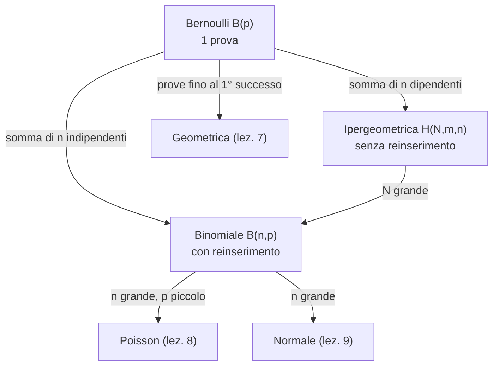

# Bernoulli, Binomiale, Ipergeometrica e Uniforme

> [!abstract]
> Con questa lezione inizia lo studio delle **variabili aleatorie speciali**: distribuzioni che compaiono così spesso da meritare un nome. Per ciascuna si ricava la PMF, il **valore atteso** e la **varianza** con gli strumenti della [[04 - PS - Valore Atteso, Varianza e Covarianza|lezione 4]].
> Il mattone di base è la **Bernoulli** (un solo esperimento successo/insuccesso). Sommando Bernoulli **indipendenti** si ottiene la **binomiale** (estrazioni con reinserimento); sommando Bernoulli **dipendenti** l'**ipergeometrica** (estrazioni senza reinserimento). Chiude la **uniforme discreta**. Le altre distribuzioni discrete seguono nelle lezioni [[07 - PS - Pascal, Geometrica, Massimo e Minimo|7]] e [[08 - PS - Distribuzione di Poisson|8]].
> Mappa del corso: [[MOC - Probabilità e Statistica]].

---

## Variabili aleatorie di Bernoulli

Vedi [[Distribuzione di Bernoulli]].

Una v.a. $X$ si dice **di Bernoulli** (o bernoulliana) se può assumere solo i valori 0 e 1. La sua PMF è

$$P(X=0)=1-p\qquad\qquad P(X=1)=p$$

dove $p$ è la probabilità che l'esperimento registri un "successo"; ovviamente $0\le p\le1$. Si scrive $X\sim B(p)$.

$$E[X]=1\cdot P(X=1)+0\cdot P(X=0)=p\qquad\qquad\mathrm{Var}(X)=E[X^2]-E[X]^2=p-p^2=p(1-p)$$

(Siccome $X\in\{0,1\}$, $X^2=X$ e quindi $E[X^2]=p$.) Una Bernoulli è esattamente la [[04 - PS - Valore Atteso, Varianza e Covarianza#Valore atteso|funzione indicatrice]] dell'evento "successo". _(dispensa, p. 49)_

---

## Variabili aleatorie binomiali

Vedi [[Distribuzione Binomiale]].

Supponiamo di realizzare $n$ esperimenti **indipendenti**, ciascuno modellabile con una Bernoulli di probabilità di successo $p$. Per avere il numero di successi basta sommare i valori delle $n$ Bernoulli. Consideriamo quindi

$$X=\sum_{i=1}^nY_i\qquad\text{con $Y_i$ v.a. indipendenti di Bernoulli di parametro $p$}$$

I valori possibili di $X$ sono $0,1,2,\dots,n$. Vogliamo le probabilità con cui sono assunti, cioè costruire la PMF di $X$.

> [!example] Esempio — 6 teste in 10 lanci
> I lanci di una moneta sono indipendenti; qual è la probabilità di ottenere 6 teste in 10 lanci?
> Consideriamo prima una **prefissata** sequenza, ad esempio T T C T T C C T T C. Per l'indipendenza la sua probabilità è
> $$p\cdot p\cdot(1-p)\cdot p\cdot p\cdot(1-p)(1-p)\cdot p\cdot p\cdot(1-p)=p^6(1-p)^4$$
> Qualunque altra sequenza con 6 teste e 4 croci, in posizioni diverse, ha la stessa probabilità. Quante sono? Tante quanti i modi di scegliere le 6 posizioni delle teste tra le 10: $\frac{10!}{6!\,4!}=\binom{10}6$, il **coefficiente binomiale**. Quindi
> $$P(\text{6 teste})=\binom{10}{6}p^6(1-p)^4$$

In generale la PMF di una **binomiale di parametri $(n,p)$** è

$$\boxed{P(X=i)=\binom ni p^i(1-p)^{n-i}\qquad i=0,1,\dots,n}$$

Il coefficiente binomiale rappresenta "il numero di [[01 - PS - Spazi di Probabilità e Calcolo Combinatorio#Combinazioni|combinazioni]] differenti che possiamo ottenere scegliendo $i$ elementi da un insieme di $n$ oggetti".

*Perché è corretta.* Fissata una qualunque sequenza di esiti con $i$ successi e $n-i$ fallimenti, la probabilità che si realizzi **esattamente** tale sequenza è $p^i(1-p)^{n-i}$, per l'indipendenza delle ripetizioni. La formula segue contando quante sono le sequenze con questa caratteristica: sono $\binom ni$, tutti i modi di scegliere gli $i$ esperimenti con esito positivo tra gli $n$ totali.

> [!summary] Esperimento binomiale
> Si parla di **esperimento binomiale** quando:
> 1. interessa esclusivamente il successo (1) o l'insuccesso (0);
> 2. il successo ha probabilità $p$;
> 3. si effettuano $n$ prove indipendenti.
>
> La v.a. $X$ = "numero di successi in $n$ prove" è la **variabile casuale binomiale di parametri $n$ (numero di prove) e $p$ (probabilità di successo in una prova)**, e si scrive $X\sim B(n,p)$.

### Valore atteso e varianza

$$E[X]=\sum_{i=1}^nE[Y_i]=np\qquad\qquad\mathrm{Var}(X)=\sum_{i=1}^n\mathrm{Var}(Y_i)=np(1-p)$$

*Dimostrazione.* La binomiale si rappresenta come somma di bernoulliane: se $X$ è binomiale di parametri $(n,p)$,
$$X=\sum_{i=1}^nX_i\qquad X_i:=\begin{cases}1&\text{se la prova $i$-esima ha successo}\\0&\text{altrimenti}\end{cases}$$
Le $X_i$ sono bernoulliane di parametro $p$: $E[X_i]=p$, $E[X_i^2]=p$ (infatti $X_i\equiv X_i^2$), $\mathrm{Var}(X_i)=p-p^2=p(1-p)$. Dalla [[04 - PS - Valore Atteso, Varianza e Covarianza#Linearità|linearità]] segue $E[X]=np$; dalla [[04 - PS - Valore Atteso, Varianza e Covarianza#Formula della varianza di una somma|varianza della somma]] di v.a. **indipendenti** segue $\mathrm{Var}(X)=np(1-p)$.

> [!note] Somma di binomiali (Osservazione 5.1.1)
> Se $X_1\sim B(n_1,p)$ e $X_2\sim B(n_2,p)$ sono **indipendenti**, la loro somma è binomiale $B(n_1+n_2,\,p)$. Lo si vede per costruzione: se si fanno $n_1$ e poi altre $n_2$ prove indipendenti dello stesso esperimento, $X_1$ e $X_2$ contano i successi nelle due tranche e $X_1+X_2$ conta i successi sul totale delle $n_1+n_2$ prove. Serve che $p$ sia lo stesso.

### Calcolo esplicito della distribuzione binomiale

Per calcolare operativamente la funzione di ripartizione o la funzione di massa,
$$P(X\le i)=\sum_{k=0}^i\binom nk p^k(1-p)^{n-k}\qquad\qquad P(X=i)=\binom nip^i(1-p)^{n-i}$$
è molto utile la relazione ricorsiva tra $P(X=k+1)$ e $P(X=k)$:

$$\boxed{P(X=k+1)=\frac{p}{1-p}\cdot\frac{n-k}{k+1}\cdot P(X=k)}$$

*Dimostrazione.* Facciamo il rapporto:
$$\frac{P(X=k+1)}{P(X=k)}=\frac{\frac{n!}{(k+1)!\,(n-k-1)!}p^{k+1}(1-p)^{n-k-1}}{\frac{n!}{k!\,(n-k)!}p^k(1-p)^{n-k}}=\frac{k!}{(k+1)!}\cdot\frac{(n-k)!}{(n-k-1)!}\cdot\frac{p}{1-p}=\frac{n-k}{k+1}\cdot\frac p{1-p}$$
Partendo da $P(X=0)=(1-p)^n$ si calcolano tutte le altre probabilità con una sola moltiplicazione ciascuna. _(dispensa, pp. 49–53)_

> [!example] Esercizio svolto — il quiz televisivo
> *In un quiz ci sono 5 domande. Ogni risposta esatta raddoppia il montepremi, ogni errore lo lascia invariato. Montepremi iniziale 1000 €; il concorrente risponde esattamente e indipendentemente a ogni domanda con probabilità $\frac34$.*
> Il numero di risposte esatte è $K\sim B(5,\frac34)$ e la vincita è $W=1000\cdot2^K$.
> 1. Vincere 4000 € vuol dire $K=2$:
> $$P(K=2)=\binom52\Big(\frac34\Big)^2\Big(\frac14\Big)^3=10\cdot\frac9{16}\cdot\frac1{64}=\frac{45}{512}\approx0{,}088$$
> 2. Valore atteso, con la [[04 - PS - Valore Atteso, Varianza e Covarianza#Proprietà del valore atteso|proposizione su $E[g(X)]$]] e il binomio di Newton:
> $$E[W]=1000\sum_{k=0}^5 2^k\binom5k\Big(\frac34\Big)^k\Big(\frac14\Big)^{5-k}=1000\Big(\frac14+2\cdot\frac34\Big)^5=1000\Big(\frac74\Big)^5=\frac{16\,807\,000}{1024}\approx16\,413\ \text{€}$$
> Negli esercizi (p. 9) si arriva allo stesso risultato sommando i sei termini uno per uno.
> 3. Varianza: $E[W^2]=10^6\,E[4^K]=10^6\big(\frac14+4\cdot\frac34\big)^5=10^6\big(\frac{13}4\big)^5$, e $\mathrm{Var}(W)=E[W^2]-E[W]^2$.

---

## Variabili aleatorie ipergeometriche

Vedi [[Distribuzione Ipergeometrica]].

La distribuzione **ipergeometrica** è una distribuzione discreta che si indica con $H(N,m,n)$: descrive la v.a. che conta, per $n$ elementi **distinti** estratti a caso (in modo equiprobabile) da un insieme $A$ di cardinalità $N$, quanti stanno nel sottoinsieme $B$ di cardinalità $m$, con $N\ge m$.

In termini concreti: data un'urna con $m$ palline **bianche** e $N-m$ **nere**, conta il numero di palline bianche ottenute **estraendo senza reinserimento** $n$ palline.

La probabilità di ottenere esattamente $i$ elementi in $B$ è

$$\boxed{P(X=i)=\frac{\binom mi\binom{N-m}{n-i}}{\binom Nn}}$$

- $\binom Nn$: modi di estrarre $n$ palline da $N$ (casi possibili);
- $\binom mi$: modi di estrarre esattamente $i$ bianche dalle $m$;
- $\binom{N-m}{n-i}$: modi di estrarre le restanti $n-i$ nere dalle $N-m$.

È la formula [[01 - PS - Spazi di Probabilità e Calcolo Combinatorio#Spazi di esiti equiprobabili|casi favorevoli su casi possibili]].

Per una **singola** estrazione la distribuzione ipergeometrica $H(N,m,1)$ coincide con la **Bernoulli** $B(\frac mN)$. A differenza dell'ipergeometrica, la binomiale $B(n,\frac mN)$ corrisponde a un processo in cui dopo ogni estrazione la pallina viene **reinserita** nell'urna, lasciando invariata la probabilità di estrarre in seguito una pallina vincente: è una successione di esperimenti indipendenti.

> [!note] Notazione
> Nelle pagine seguenti la dispensa (come il libro) cambia notazione: $N$ = elementi **accettabili** (le bianche) e $M$ = elementi restanti, quindi il totale è $N+M$. Le due notazioni si traducono con $m\to N$ e $N\to N+M$.

### Calcolo del valore atteso

Sia $X$ ipergeometrica. Rappresentiamo $X$ come somma di $n$ v.a. (una per estrazione) $X_1,\dots,X_n$ con
$$X_i:=\begin{cases}1&\text{se l'$i$-esimo elemento estratto è accettabile}\\0&\text{altrimenti}\end{cases}$$
Siccome non sappiamo nulla delle altre estrazioni, la probabilità che l'$i$-esimo elemento estratto sia accettabile è la stessa per tutte le estrazioni:
$$P(X_i=1)=\frac N{N+M}$$
(per simmetria: la pallina estratta per $i$-esima è, a priori, una qualunque delle $N+M$ con uguale probabilità). Ciascuna $X_i$ è quindi una bernoulliana $B\big(\frac N{N+M}\big)$ e $E[X_i]=\frac N{N+M}$. Per la linearità — che vale anche se le $X_i$ sono **dipendenti** —
$$E[X]=\sum_{i=1}^nE[X_i]=\boxed{n\,\frac{N}{N+M}}$$

### Calcolo della varianza

$$\mathrm{Var}(X_i)=E[X_i^2]-E[X_i]^2=\frac N{N+M}-\frac{N^2}{(N+M)^2}=\frac{NM}{(N+M)^2}$$

Qui le $X_i$ **non** sono indipendenti, quindi usiamo la formula generale della varianza della somma:
$$\mathrm{Var}(X)=\sum_{i=1}^n\mathrm{Var}(X_i)+2\sum_{j=2}^n\sum_{i<j}\mathrm{Cov}(X_i,X_j)$$

Per $\mathrm{Cov}(X_i,X_j)=E[X_iX_j]-E[X_i]E[X_j]$ serve $E[X_iX_j]$. Si noti che $X_iX_j$ è ancora una bernoulliana (vale solo 0 o 1), quindi con la [[02 - PS - Probabilità Condizionata e Indipendenza#Formula inversa|formula inversa]]:
$$E[X_iX_j]=P(X_i=1,X_j=1)=P(X_j=1\mid X_i=1)\,P(X_i=1)=\frac{N-1}{N+M-1}\cdot\frac N{N+M}$$
(sapendo che una accettabile è già uscita, ne restano $N-1$ su $N+M-1$). Da cui
$$\mathrm{Cov}(X_i,X_j)=\frac{(N-1)N}{(N+M-1)(N+M)}-\Big(\frac N{N+M}\Big)^2=\frac{-NM}{(N+M)^2(N+M-1)}$$
La covarianza è **negativa**: aver estratto un'accettabile rende meno probabile estrarne un'altra.

Sostituendo in ciascuno dei $\binom n2=\frac{n(n-1)}2$ addendi della sommatoria doppia:
$$\mathrm{Var}(X)=\frac{nNM}{(N+M)^2}-\frac{n(n-1)NM}{(N+M)^2(N+M-1)}=\boxed{\frac{nNM}{(N+M)^2}\left(1-\frac{n-1}{N+M-1}\right)}$$

dove $n$ = numero di estrazioni e $N+M$ = numero di elementi totali. Ponendo $p:=\frac N{N+M}$ (frazione di elementi accettabili, quindi $\frac M{N+M}=1-p$):

$$E[X]=np\qquad\qquad\mathrm{Var}(X)=np(1-p)\left[1-\frac{n-1}{N+M-1}\right]$$

> [!tip] Confronto con la binomiale
> La media è la stessa della binomiale $B(n,p)$; la varianza è più piccola, moltiplicata per il **fattore di correzione** $1-\frac{n-1}{N+M-1}$. Se si fissa $p$ e si fa tendere $N+M\to\infty$, $\mathrm{Var}(X)\to np(1-p)$, la varianza della binomiale. Non deve stupire: se l'urna è enorme, togliere qualche pallina non cambia quasi la composizione, e estrarre senza reinserimento è quasi come estrarre con reinserimento.

### Relazione tra binomiale e ipergeometrica

Esiste una relazione tra binomiali e ipergeometriche che servirà per i test statistici su due popolazioni binomiali.

> [!example] Esempio 5.3.3
> Siano $X\sim B(n,p)$ e $Y\sim B(m,p)$ **indipendenti**. La PMF di $X$ condizionata all'evento $X+Y=k$ è:
> $$
> \begin{aligned}
> P(X=i\mid X+Y=k)&=\frac{P(X=i,\,X+Y=k)}{P(X+Y=k)}=\frac{P(X=i,\,Y=k-i)}{P(X+Y=k)}=\frac{P(X=i)P(Y=k-i)}{P(X+Y=k)}\\
> &=\frac{\binom nip^i(1-p)^{n-i}\binom m{k-i}p^{k-i}(1-p)^{m-k+i}}{\binom{n+m}kp^k(1-p)^{n+m-k}}=\frac{\binom ni\binom m{k-i}}{\binom{n+m}k}
> \end{aligned}
> $$
> usando l'indipendenza e il fatto che $X+Y\sim B(n+m,p)$ (Osservazione 5.1.1). Tutte le potenze di $p$ e $1-p$ si semplificano.

Quindi **la distribuzione di $X$ condizionata al valore di $X+Y$ è ipergeometrica**: $X\mid X+Y=k\;\sim\;H(n+m,\,n,\,k)$.

Il risultato si ottiene anche con un ragionamento diretto: si eseguono $n+m$ prove indipendenti con probabilità di successo $p$; $X$ conta i successi nelle prime $n$, $Y$ nelle ultime $m$. Sapere che i successi totali sono $k$ non modifica l'omogeneità delle prove, quindi ogni sottoinsieme di $k$ prove ha la stessa probabilità di essere quello dei successi: le $k$ prove riuscite sono distribuite come se fossero estratte a caso tra le $n+m$ disponibili, e il numero di quelle tra le prime $n$ è ipergeometrico. _(dispensa, pp. 54–57)_

> [!example] Esercizio svolto — i palloni del supermercato
> *Ci sono 100 palloni: 30 rossi, 50 bianchi, 20 gialli. Se ne vendono 60 presi a caso. (a) Valore atteso del numero di palloni rossi, bianchi e gialli venduti. (b) Probabilità che si vendano tutti i gialli.*
> Ogni conteggio è ipergeometrico con $n=60$ estrazioni su 100 palloni, ad esempio $P(R=i)=\frac{\binom{30}i\binom{70}{60-i}}{\binom{100}{60}}$.
>
> | | accettabili | $E=n\frac{N}{N+M}$ | $\mathrm{Var}=n\frac{NM}{(N+M)^2}\big(1-\frac{n-1}{N+M-1}\big)$ |
> |---|:-:|:-:|:-:|
> | Rossi | 30 | $60\cdot0{,}3=18$ | $60\cdot0{,}3\cdot0{,}7\cdot\frac{40}{99}=\frac{168}{33}\approx5{,}09$ |
> | Bianchi | 50 | $30$ | $60\cdot0{,}25\cdot\frac{40}{99}=\frac{200}{33}\approx6{,}06$ |
> | Gialli | 20 | $12$ | $60\cdot0{,}16\cdot\frac{40}{99}=\frac{128}{33}\approx3{,}88$ |
>
> (b) $P(G=20)=\dfrac{\binom{20}{20}\binom{80}{40}}{\binom{100}{60}}=\dfrac{\binom{80}{40}}{\binom{100}{60}}$, un numero piccolissimo (circa $7{,}8\cdot10^{-6}$). _(esercizi, pp. 21–24)_

> [!example] Esercizio svolto — somma dei numeri estratti
> *Un'urna contiene due palline con il 2, tre con il 5 e cinque con l'1; se ne estraggono 5 senza reinserimento e $X$ è la somma. $P(X=6)$?*
> $X=6$ solo con quattro "1" e un "2" (cinque "1" danno 5; un "5" con quattro "1" dà 9). Contando come nell'ipergeometrica:
> $$P(X=6)=\frac{\binom54\binom21}{\binom{10}5}=\frac{5\cdot2}{252}=\frac5{126}\approx0{,}040$$
> _(esercizi, p. 31)_

---

## Variabili aleatorie uniformi

Vedi [[Distribuzione Uniforme Discreta]].

Una distribuzione discreta **uniforme** attribuisce la **stessa probabilità** a ogni elemento dell'insieme $S$ su cui è definita (in particolare, l'insieme deve essere **finito**). Esempio: il lancio di un dado equilibrato, in cui ognuno dei valori 1–6 ha probabilità $\frac16$.

È la distribuzione che fornisce la classica definizione di probabilità "casi favorevoli su casi possibili": la probabilità di un evento $A\subset S$ è il rapporto tra le cardinalità, $P(A)=\frac{\#A}{\#S}$. Per la v.a. uniforme su $\{1,\dots,N\}$:

$$P(X=i)=\frac1N\qquad N=\#S$$

Anche la Bernoulli con $p=\frac12$ è uniforme: i due valori 0 e 1 hanno entrambi probabilità $p=1-p=\frac12$.

**Valore atteso.** Con la somma dei primi $N$ interi $\sum_{i=1}^Ni=\frac{N(N+1)}2$:
$$E[X]=\sum_{i=1}^Ni\cdot\frac1N=\frac1N\cdot\frac{N(N+1)}2=\boxed{\frac{N+1}2}$$

**Varianza.** Con la somma notevole $\sum_{i=1}^Ni^2=\frac{N(N+1)(2N+1)}6$:
$$\mathrm{Var}(X)=E[X^2]-E[X]^2=\frac1N\cdot\frac{N(N+1)(2N+1)}6-\frac{(N+1)^2}4=\frac{(N+1)\big[2(2N+1)-3(N+1)\big]}{12}=\boxed{\frac{N^2-1}{12}}$$

> [!example]
> Per un dado: $E[X]=\frac72=3{,}5$ e $\mathrm{Var}(X)=\frac{35}{12}\approx2{,}92$.

_(dispensa, pp. 58–59)_

> [!example] Esercizio svolto — estrazioni in sequenza
> *Un'urna contiene 10 palline numerate da 1 a 10, estratte in sequenza senza reimmissione; $X_n$ è il risultato dell'$n$-esima estrazione. Calcolare $E[X_3+X_7]$.*
> Per simmetria (come per l'ipergeometrica), **ogni** $X_n$ da sola è uniforme su $\{1,\dots,10\}$: $P(X_n=k)=\frac1{10}$. Quindi $E[X_n]=\frac{11}2$ e, per linearità,
> $$E[X_3+X_7]=\frac{11}2+\frac{11}2=11$$
>
> > [!warning] Correzione
> > Negli esercizi (pp. 46–47) compaiono prima $\frac{165}8$ e poi $55$. Entrambi sono sbagliati: $X_3+X_7$ è la somma di due numeri tra 1 e 10, quindi non può superare 19, e il suo valore atteso è $11$. L'errore nasce dal calcolo di $P(X_n=k)$, che non dipende né da $n$ né da $k$ e vale semplicemente $\frac1{10}$.
