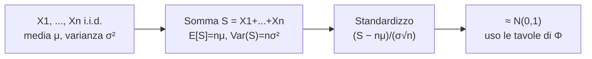

# Distribuzione Normale e Teorema del Limite Centrale

> [!abstract]
> Ultima lezione di teoria e l'unica su una v.a. **continua**: la **normale** (o gaussiana), la distribuzione più importante della statistica. Si vedono la densità e le sue proprietà, la **normale standard** con le **tavole** della funzione $\Phi$, e infine il **teorema del limite centrale** (TLC): la somma di molte v.a. indipendenti è approssimativamente normale, qualunque sia la distribuzione di partenza. Da qui le **approssimazioni normali** della [[06 - PS - Bernoulli, Binomiale, Ipergeometrica e Uniforme#Variabili aleatorie binomiali|binomiale]] e della [[08 - PS - Distribuzione di Poisson|Poisson]], usate in quasi tutti gli esercizi d'esame.
> Il TLC completa il discorso della [[05 - PS - Disuguaglianze e Legge dei Grandi Numeri#Legge debole dei grandi numeri|legge dei grandi numeri]]: non dice solo che la media campionaria si concentra attorno a $\mu$, ma anche **come** è distribuita.
> Mappa del corso: [[MOC - Probabilità e Statistica]].

---

## Variabili aleatorie normali

Vedi [[Gaussian]].

La distribuzione di v.a. continua più importante è la distribuzione **normale**. Venne introdotta nel 1733 dal matematico francese De Moivre, che la utilizzò per approssimare le probabilità associate a v.a. **binomiali** quando il parametro $n$ è grande.

> [!note] V.a. continue in due righe
> La dispensa non tratta le v.a. continue in generale. Basta sapere che una v.a. continua non ha una PMF (ogni singolo valore ha probabilità 0) ma una **densità** $f(x)\ge0$, e le probabilità sono **aree** sotto la densità: $P(a\le X\le b)=\int_a^bf(x)\,dx$, con $\int_{-\infty}^{+\infty}f=1$. Media e varianza si definiscono come nel discreto, con l'integrale al posto della somma: $E[X]=\int xf(x)\,dx$. Tutte le proprietà della [[04 - PS - Valore Atteso, Varianza e Covarianza|lezione 4]] (linearità, varianza della somma, …) restano valide.

Una v.a. $X$ **normale** di parametri $\mu$ e $\sigma^2$, e si scrive $X\sim N(\mu,\sigma^2)$, ha funzione di densità

$$\boxed{f(x)=\frac1{\sqrt{2\pi}\,\sigma}\exp\left\{-\frac{(x-\mu)^2}{2\sigma^2}\right\}}\qquad\forall x\in\mathbb R$$

La densità normale è una **curva a campana simmetrica** rispetto all'asse $x=\mu$, dove ha il massimo pari a $\frac1{\sqrt{2\pi}\,\sigma}$.

$$E[X]=\mu\qquad\qquad\mathrm{Var}(X)=\sigma^2$$

**Trasformazioni lineari.** Se $X$ è gaussiana e $Y$ è una trasformazione lineare di $X$, allora anche $Y$ è gaussiana:
$$Y=\alpha X+\beta\quad\Longrightarrow\quad Y\sim N(\alpha\mu+\beta,\;\alpha^2\sigma^2)$$
(media e varianza seguono dalle regole $E[aX+b]=aE[X]+b$ e $\mathrm{Var}(aX+b)=a^2\mathrm{Var}(X)$; il fatto notevole è che la *forma* resta normale). _(dispensa, p. 78)_

### Caratteristiche della densità normale

Le caratteristiche fondamentali di $f(x)$ sono:
- la forma a campana;
- la simmetria rispetto al valor medio $\mu$;
- il massimo per $x=\mu$, dove l'ordinata vale $\frac1{\sqrt{2\pi}\,\sigma}$;
- quanto più $x$ si allontana da $\mu$, tanto più $f(x)$ decresce tendendo asintoticamente a zero.

![[PS-p079-1.png]]

Il valore di $\mu$ si chiama anche **centro della distribuzione** e caratterizza la posizione della curva rispetto all'asse delle ordinate. Nella figura tre normali con $\mu_1<\mu_2<\mu_3$ e la stessa $\sigma$: al variare di $\mu$ la curva **si sposta** lungo l'asse $x$, ma resta invariata la sua forma.

![[PS-p079-2.png]]

Il parametro $\sigma$ caratterizza la **forma** della curva, perché rappresenta la dispersione dei valori attorno al massimo. Nella figura tre normali con la stessa $\mu$ e $\sigma_1<\sigma_2<\sigma_3$: all'aumentare di $\sigma$ la curva **si appiattisce e si allarga**, mentre al diminuire di $\sigma$ si restringe e si alza (l'area totale resta 1, quindi se si allarga deve abbassarsi).

![[PS-p079-3.png]]

Per determinare la probabilità che la v.a. assuma valori in un intervallo $(a,b)$ bisogna calcolare l'**area sottesa alla curva** compresa tra $a$ e $b$ (la zona gialla):
$$P(a\le X\le b)=\int_a^bf(x)\,dx=\int_a^b\frac1{\sigma\sqrt{2\pi}}e^{-\frac12\left(\frac{x-\mu}\sigma\right)^2}dx$$
Questo integrale non ha una primitiva elementare: per calcolarlo si passa alla normale standard e si usano le tavole.

La distribuzione normale è **riproducibile**: la somma di v.a. normali **indipendenti** ha essa stessa distribuzione normale (con media e varianza somma delle medie e delle varianze). _(dispensa, p. 79)_

---

## Distribuzione normale standard

Vedi [[Normale Standard]].

Se $X$ è una v.a. normale, $X\sim N(\mu,\sigma^2)$, allora

$$Z:=\frac{X-\mu}\sigma$$

è una v.a. normale con **media 0 e varianza 1** (è una trasformazione lineare di $X$ con $\alpha=\frac1\sigma$, $\beta=-\frac\mu\sigma$). Una tale v.a. si dice **normale standard**. La sua funzione di ripartizione riveste un ruolo importante in statistica ed è indicata con $\Phi$:

$$\Phi(x):=\frac1{\sqrt{2\pi}}\int_{-\infty}^xe^{-y^2/2}\,dy\qquad\forall x\in\mathbb R$$

Il fatto che $Z$ sia normale standard permette di esprimere le probabilità relative a $X$ in termini di probabilità su $Z$. Ad esempio, per trovare $P(X<b)$ notiamo che $X<b$ se e solo se $\frac{X-\mu}\sigma<\frac{b-\mu}\sigma$, così che

$$P(X<b)=P\left(\frac{X-\mu}\sigma<\frac{b-\mu}\sigma\right)=P\left(Z<\frac{b-\mu}\sigma\right)=\Phi\left(\frac{b-\mu}\sigma\right)$$

Analogamente, per ogni $a<b$:
$$P(a<X<b)=P\left(\frac{a-\mu}\sigma<Z<\frac{b-\mu}\sigma\right)=\Phi\left(\frac{b-\mu}\sigma\right)-\Phi\left(\frac{a-\mu}\sigma\right)$$

In entrambi i casi bisogna determinare un valore di $\Phi$. L'integrale che la definisce non si può risolvere analiticamente, ma si calcola con approssimazioni numeriche: i valori sono tabulati (vedi [[#Tavola della normale standard|tavola]] qui sotto) o si ottengono con un calcolatore.

**Simmetria.** Le tavole riportano $\Phi(z)$ solo per valori **non negativi** di $z$. Per i valori negativi si usa la simmetria della distribuzione rispetto a 0:

![[PS-p080-1.png]]

La Figura 5.8 mostra che le due code tratteggiate, $P(Z<-x)$ a sinistra e $P(Z>x)$ a destra, hanno la stessa area. Quindi, per $x>0$:

$$\boxed{\Phi(-x)=P(Z<-x)=P(Z>x)=1-P(Z\le x)=1-\Phi(x)}$$

> [!example]
> $P(Z<-1)=\Phi(-1)=1-\Phi(1)\approx1-0{,}8413=0{,}1587$.

> [!summary] Formule da tenere a mente
> - $P(Z<z)=\Phi(z)$
> - $P(Z>z)=1-P(Z<z)=1-\Phi(z)$
> - $\Phi(-z)=1-\Phi(z)$
> - $\dfrac{X-\mu}{\sigma}\sim N(0,1)$ se $X\sim N(\mu,\sigma^2)$

_(dispensa, p. 80)_

---

## Teorema del limite centrale

Vedi [[Teorema del Limite Centrale]].

Il **teorema del limite centrale** è uno dei risultati più notevoli della teoria della probabilità. In termini semplicistici, esso afferma che **la somma di un numero elevato di variabili aleatorie indipendenti tende ad avere distribuzione approssimativamente normale**. La sua importanza è duplice: da un lato siamo in grado di ottenere stime approssimative delle probabilità che riguardano la somma di v.a. indipendenti; dall'altro giustifica il fatto notevole che la distribuzione empirica delle frequenze di un gran numero di popolazioni naturali esibisce forme a campana (in realtà, gaussiane).

> [!important] Teorema 6.3.1 (Teorema del limite centrale)
> Siano $X_1,X_2,\dots,X_n$ v.a. **i.i.d.** (indipendenti e identicamente distribuite), tutte con media $\mu$ e varianza $\sigma^2$. Allora, se $n$ è grande, la somma
> $$X_1+X_2+\dots+X_n$$
> è approssimativamente normale con **media $n\mu$** e **varianza $n\sigma^2$**.
> Normalizzando la somma si ottiene una distribuzione approssimativamente normale **standard**:
> $$\frac{X_1+X_2+\dots+X_n-n\mu}{\sigma\sqrt n}\;\dot\sim\;N(0,1)$$

Il simbolo $\dot\sim$ significa "è approssimativamente distribuito come". Ciò significa che per $n$ grande e $x$ qualsiasi vale l'approssimazione

$$P\left(\frac{X_1+\dots+X_n-n\mu}{\sigma\sqrt n}<x\right)\approx\Phi(x)$$

dove $\Phi$ è la funzione di ripartizione della normale standard.

> [!note] Da dove vengono $n\mu$ e $n\sigma^2$
> Media e varianza della somma sono **esatte** e non dipendono dal TLC: $E[\sum X_i]=n\mu$ per linearità e $\mathrm{Var}(\sum X_i)=n\sigma^2$ per l'indipendenza. Quello che il TLC aggiunge è la **forma** della distribuzione. Dividendo per $n$: la media campionaria $\bar X_n$ è approssimativamente $N(\mu,\frac{\sigma^2}n)$ — la stessa varianza $\frac{\sigma^2}n$ della [[05 - PS - Disuguaglianze e Legge dei Grandi Numeri#Legge debole dei grandi numeri|legge dei grandi numeri]], ma con una forma precisa.

In sintesi: **la distribuzione di probabilità della somma (o della media) di v.a. i.i.d. con media e varianza finite si avvicina alla distribuzione normale.** _(dispensa, pp. 81, 83)_

> [!summary] Ricetta per gli esercizi con il TLC
> 1. Riconosco una **somma** (o media) di tante v.a. i.i.d. — anche nascosta: una binomiale è una somma di Bernoulli, una Poisson di parametro grande è una somma di Poisson piccole.
> 2. Calcolo media $n\mu$ e deviazione standard $\sigma\sqrt n$ della somma.
> 3. Standardizzo l'evento: $P(S<s)\approx\Phi\big(\frac{s-n\mu}{\sigma\sqrt n}\big)$.
> 4. Leggo $\Phi$ sulla tavola, usando $\Phi(-z)=1-\Phi(z)$ per gli argomenti negativi.

---

## Approssimazione normale della binomiale

Vedi [[Approssimazione Normale]].

Una delle più dirette applicazioni del TLC riguarda le v.a. binomiali. Siccome una binomiale $X$ di parametri $(n,p)$ rappresenta il numero di successi in $n$ prove indipendenti, ciascuna con probabilità $p$ di riuscita, possiamo scrivere

$$X=X_1+X_2+\dots+X_n\qquad X_i:=\begin{cases}1&\text{se l'$i$-esima prova ha successo}\\0&\text{altrimenti}\end{cases}$$

Poiché $E[X_i]=p$ e $\mathrm{Var}(X_i)=p(1-p)$, segue dal TLC che, per $n$ grande,

$$\frac{X-np}{\sqrt{np(1-p)}}\;\dot\sim\;N(0,1)$$

cioè vale un'**approssimazione normale** delle v.a. binomiali.

> [!important] Due approssimazioni della binomiale
> A questo punto disponiamo di due diverse approssimazioni per le v.a. binomiali:
> - quella di **Poisson**, valida quando $n$ è grande e $p$ piccolo;
> - quella **normale**, valida quando $np(1-p)$ è grande; in effetti, per ottenere risultati accettabili, basta che **$np(1-p)$ sia almeno 10** ($npq\ge10$).

> [!tip] Correzione di continuità
> La binomiale è discreta e la normale continua. Quando si approssima la probabilità di un **singolo valore** (o di un intervallo di interi) conviene allargare l'intervallo di $\frac12$ da ogni lato: $P(X=k)\approx P(k-\frac12<Y<k+\frac12)$ con $Y$ normale. La dispensa non la introduce e negli esercizi del corso spesso si omette quando l'intervallo è largo; diventa indispensabile per i valori singoli (vedi l'esercizio dei vasi, punto d).

_(dispensa, pp. 81–82)_

---

## Tavola della normale standard

$P(Z<z)\approx\Phi(z)$. La riga dà la parte intera e il primo decimale di $z$, la colonna il secondo decimale (es. $\Phi(1{,}15)$: riga 1.1, colonna 0.05 → 0,8749). Per $z\ge4$ si ha $\Phi(z)\approx1$ ($\Phi(4)=0{,}99997$).

| $z$ | 0.00 | 0.01 | 0.02 | 0.03 | 0.04 | 0.05 | 0.06 | 0.07 | 0.08 | 0.09 |
|---|---|---|---|---|---|---|---|---|---|---|
| **0.0** | 0.5000 | 0.5040 | 0.5080 | 0.5120 | 0.5160 | 0.5199 | 0.5239 | 0.5279 | 0.5319 | 0.5359 |
| **0.1** | 0.5398 | 0.5438 | 0.5478 | 0.5517 | 0.5557 | 0.5596 | 0.5636 | 0.5675 | 0.5714 | 0.5753 |
| **0.2** | 0.5793 | 0.5832 | 0.5871 | 0.5910 | 0.5948 | 0.5987 | 0.6026 | 0.6064 | 0.6103 | 0.6141 |
| **0.3** | 0.6179 | 0.6217 | 0.6255 | 0.6293 | 0.6331 | 0.6368 | 0.6406 | 0.6443 | 0.6480 | 0.6517 |
| **0.4** | 0.6554 | 0.6591 | 0.6628 | 0.6664 | 0.6700 | 0.6736 | 0.6772 | 0.6808 | 0.6844 | 0.6879 |
| **0.5** | 0.6915 | 0.6950 | 0.6985 | 0.7019 | 0.7054 | 0.7088 | 0.7123 | 0.7157 | 0.7190 | 0.7224 |
| **0.6** | 0.7257 | 0.7291 | 0.7324 | 0.7357 | 0.7389 | 0.7422 | 0.7454 | 0.7486 | 0.7517 | 0.7549 |
| **0.7** | 0.7580 | 0.7611 | 0.7642 | 0.7673 | 0.7704 | 0.7734 | 0.7764 | 0.7794 | 0.7823 | 0.7852 |
| **0.8** | 0.7881 | 0.7910 | 0.7939 | 0.7967 | 0.7995 | 0.8023 | 0.8051 | 0.8078 | 0.8106 | 0.8133 |
| **0.9** | 0.8159 | 0.8186 | 0.8212 | 0.8238 | 0.8264 | 0.8289 | 0.8315 | 0.8340 | 0.8365 | 0.8389 |
| **1.0** | 0.8413 | 0.8438 | 0.8461 | 0.8485 | 0.8508 | 0.8531 | 0.8554 | 0.8577 | 0.8599 | 0.8621 |
| **1.1** | 0.8643 | 0.8665 | 0.8686 | 0.8708 | 0.8729 | 0.8749 | 0.8770 | 0.8790 | 0.8810 | 0.8830 |
| **1.2** | 0.8849 | 0.8869 | 0.8888 | 0.8907 | 0.8925 | 0.8944 | 0.8962 | 0.8980 | 0.8997 | 0.9015 |
| **1.3** | 0.9032 | 0.9049 | 0.9066 | 0.9082 | 0.9099 | 0.9115 | 0.9131 | 0.9147 | 0.9162 | 0.9177 |
| **1.4** | 0.9192 | 0.9207 | 0.9222 | 0.9236 | 0.9251 | 0.9265 | 0.9279 | 0.9292 | 0.9306 | 0.9319 |
| **1.5** | 0.9332 | 0.9345 | 0.9357 | 0.9370 | 0.9382 | 0.9394 | 0.9406 | 0.9418 | 0.9429 | 0.9441 |
| **1.6** | 0.9452 | 0.9463 | 0.9474 | 0.9484 | 0.9495 | 0.9505 | 0.9515 | 0.9525 | 0.9535 | 0.9545 |
| **1.7** | 0.9554 | 0.9564 | 0.9573 | 0.9582 | 0.9591 | 0.9599 | 0.9608 | 0.9616 | 0.9625 | 0.9633 |
| **1.8** | 0.9641 | 0.9649 | 0.9656 | 0.9664 | 0.9671 | 0.9678 | 0.9686 | 0.9693 | 0.9699 | 0.9706 |
| **1.9** | 0.9713 | 0.9719 | 0.9726 | 0.9732 | 0.9738 | 0.9744 | 0.9750 | 0.9756 | 0.9761 | 0.9767 |
| **2.0** | 0.9772 | 0.9778 | 0.9783 | 0.9788 | 0.9793 | 0.9798 | 0.9803 | 0.9808 | 0.9812 | 0.9817 |
| **2.1** | 0.9821 | 0.9826 | 0.9830 | 0.9834 | 0.9838 | 0.9842 | 0.9846 | 0.9850 | 0.9854 | 0.9857 |
| **2.2** | 0.9861 | 0.9864 | 0.9868 | 0.9871 | 0.9875 | 0.9878 | 0.9881 | 0.9884 | 0.9887 | 0.9890 |
| **2.3** | 0.9893 | 0.9896 | 0.9898 | 0.9901 | 0.9904 | 0.9906 | 0.9909 | 0.9911 | 0.9913 | 0.9916 |
| **2.4** | 0.9918 | 0.9920 | 0.9922 | 0.9925 | 0.9927 | 0.9929 | 0.9931 | 0.9932 | 0.9934 | 0.9936 |
| **2.5** | 0.9938 | 0.9940 | 0.9941 | 0.9943 | 0.9945 | 0.9946 | 0.9948 | 0.9949 | 0.9951 | 0.9952 |
| **2.6** | 0.9953 | 0.9955 | 0.9956 | 0.9957 | 0.9959 | 0.9960 | 0.9961 | 0.9962 | 0.9963 | 0.9964 |
| **2.7** | 0.9965 | 0.9966 | 0.9967 | 0.9968 | 0.9969 | 0.9970 | 0.9971 | 0.9972 | 0.9973 | 0.9974 |
| **2.8** | 0.9974 | 0.9975 | 0.9976 | 0.9977 | 0.9977 | 0.9978 | 0.9979 | 0.9979 | 0.9980 | 0.9981 |
| **2.9** | 0.9981 | 0.9982 | 0.9982 | 0.9983 | 0.9984 | 0.9984 | 0.9985 | 0.9985 | 0.9986 | 0.9986 |
| **3.0** | 0.9987 | 0.9987 | 0.9987 | 0.9988 | 0.9988 | 0.9989 | 0.9989 | 0.9989 | 0.9990 | 0.9990 |
| **3.1** | 0.9990 | 0.9991 | 0.9991 | 0.9991 | 0.9992 | 0.9992 | 0.9992 | 0.9992 | 0.9993 | 0.9993 |
| **3.2** | 0.9993 | 0.9993 | 0.9994 | 0.9994 | 0.9994 | 0.9994 | 0.9994 | 0.9995 | 0.9995 | 0.9995 |
| **3.3** | 0.9995 | 0.9995 | 0.9995 | 0.9996 | 0.9996 | 0.9996 | 0.9996 | 0.9996 | 0.9996 | 0.9997 |
| **3.4** | 0.9997 | 0.9997 | 0.9997 | 0.9997 | 0.9997 | 0.9997 | 0.9997 | 0.9997 | 0.9997 | 0.9998 |
| **3.5** | 0.9998 | 0.9998 | 0.9998 | 0.9998 | 0.9998 | 0.9998 | 0.9998 | 0.9998 | 0.9998 | 0.9998 |
| **3.6** | 0.9998 | 0.9998 | 0.9999 | 0.9999 | 0.9999 | 0.9999 | 0.9999 | 0.9999 | 0.9999 | 0.9999 |
| **3.7** | 0.9999 | 0.9999 | 0.9999 | 0.9999 | 0.9999 | 0.9999 | 0.9999 | 0.9999 | 0.9999 | 0.9999 |
| **3.8** | 0.9999 | 0.9999 | 0.9999 | 0.9999 | 0.9999 | 0.9999 | 0.9999 | 0.9999 | 0.9999 | 0.9999 |
| **3.9** | 1.0000 | 1.0000 | 1.0000 | 1.0000 | 1.0000 | 1.0000 | 1.0000 | 1.0000 | 1.0000 | 1.0000 |

> [!info]
> La tavola è ricalcolata numericamente (con $\Phi(z)=\frac12[1+\mathrm{erf}(z/\sqrt2)]$) e coincide con quella della dispensa (p. 82). Valori utili per gli esercizi "al contrario": $\Phi(1{,}28)\approx0{,}90$, $\Phi(1{,}645)\approx0{,}95$, $\Phi(1{,}96)\approx0{,}975$, $\Phi(2{,}33)\approx0{,}99$.

---

## Regola empirica delle tre sigma

Se $X$ è normale, conoscendo media e deviazione standard si sa quale frazione delle osservazioni cade in intervalli centrati sulla media:
- il **68,26%** delle osservazioni rientra in $(\mu-\sigma,\;\mu+\sigma)$ ("più o meno una deviazione standard");
- il **95,44%** rientra in $(\mu-2\sigma,\;\mu+2\sigma)$;
- il **99,72%** rientra in $(\mu-3\sigma,\;\mu+3\sigma)$.

In particolare, se $Z\sim N(0,1)$, il 99,7% delle osservazioni rientra nell'intervallo $(-3,+3)$.

> [!warning] Correzione
> La dispensa (p. 83, da un sito divulgativo) attribuisce queste percentuali alla "disuguaglianza di Cebicev". Non è così: sono valori **esatti per la normale**, che si ricavano dalla tavola ($2\Phi(1)-1=0{,}6826$, $2\Phi(2)-1=0{,}9544$, $2\Phi(3)-1=0{,}9973$). La [[05 - PS - Disuguaglianze e Legge dei Grandi Numeri#Disuguaglianza di Chebyshev|disuguaglianza di Chebyshev]] vale per **qualunque** distribuzione e garantisce molto meno: almeno il $0\%$ entro $1\sigma$, almeno il $75\%$ entro $2\sigma$, almeno l'$88{,}9\%$ entro $3\sigma$. (Anche l'ultimo valore, più precisamente, è 99,73%.)

---

## Approssimazione normale della Poisson

È possibile approssimare la distribuzione di Poisson con la distribuzione normale se il valore medio di occorrenze è $\lambda\ge10$:
$$X\sim\mathrm{Poi}(\lambda)\quad\Longrightarrow\quad\frac{X-\lambda}{\sqrt\lambda}\;\dot\sim\;N(0,1)$$
Il motivo è ancora il TLC: una $\mathrm{Poi}(\lambda)$ con $\lambda$ intero è la somma di $\lambda$ Poisson indipendenti di parametro 1 ([[08 - PS - Distribuzione di Poisson#Somma di Poisson indipendenti|riproducibilità]]), con media e varianza entrambe uguali a $\lambda$. _(dispensa, p. 83)_

---

## Esercizi svolti

> [!example] Esercizio 1 — i vasi di prima scelta
> *Una fabbrica produce 400 vasi a settimana; ogni vaso, indipendentemente, è di prima scelta con probabilità $\frac14$. I vasi di seconda scelta sono invendibili, indipendentemente, con probabilità $\frac1{100}$.*
> (a) Il numero di vasi di prima scelta è $X\sim B(400,\frac14)$: $P(X=i)=\binom{400}i(\frac14)^i(\frac34)^{400-i}$.
> (b) Probabilità di più di 110 vasi di prima scelta: $E[X]=100$, $\mathrm{Var}(X)=400\cdot\frac14\cdot\frac34=75$, $\sigma\approx8{,}66$ ($npq=75\ge10$, l'approssimazione normale è lecita):
> $$P(X>110)\approx1-\Phi\Big(\frac{110-100}{8{,}66}\Big)=1-\Phi(1{,}15)=1-0{,}8749=0{,}1251$$
> (c) Un vaso è invendibile se è di seconda scelta **e** invendibile: per la [[02 - PS - Probabilità Condizionata e Indipendenza#Formula inversa|formula inversa]] $p=\frac34\cdot\frac1{100}=\frac3{400}$. Il numero di invendibili è $Y\sim B(400,\frac3{400})$.
> (d) Probabilità di esattamente 3 invendibili. $E[Y]=3$ e $p$ è piccolo: l'approssimazione giusta è quella di **Poisson**, $Y\approx\mathrm{Poi}(3)$:
> $$P(Y=3)\approx\frac{3^3}{3!}e^{-3}\approx0{,}224$$
> (il valore esatto binomiale è $0{,}2249$).
>
> > [!warning] Correzione
> > Negli esercizi (pp. 35–36) il punto (d) è risolto con l'approssimazione normale, $P(Y=3)\approx P(2<Y<4)=2\Phi(\frac1{1{,}725})-1\approx0{,}438$. Il risultato è circa il doppio di quello vero, per due motivi: qui $npq\approx2{,}98$, molto meno di 10, quindi la normale non è adatta; e l'intervallo $(2,4)$ per una variabile continua ha ampiezza 2, mentre "esattamente 3" corrisponde all'intervallo di ampiezza 1, $(2{,}5;\,3{,}5)$ (correzione di continuità). Con la correzione si otterrebbe $2\Phi(0{,}29)-1\approx0{,}228$, già vicino al valore corretto.

> [!example] Esercizio 2 — somma di geometriche
> *$(X_n)$ i.i.d. con $X_i\sim\mathrm{Geom}(\frac14)$. Calcolare approssimativamente $P\big(\sum_{i=1}^{100}X_i\le395\big)$.*
> $E[X_i]=\frac1p=4$, $\mathrm{Var}(X_i)=\frac q{p^2}=\frac{3/4}{1/16}=12$. La somma di 100 ha media 400 e deviazione standard $\sqrt{1200}\approx34{,}6$. Per il TLC:
> $$P\Big(\sum X_i\le395\Big)\approx\Phi\Big(\frac{395-400}{34{,}6}\Big)=\Phi(-0{,}14)=1-\Phi(0{,}14)=1-0{,}5557=0{,}4443$$
> _(esercizi, p. 44)_

> [!example] Esercizio 3 — le uova in un lotto
> Riprendendo l'[[08 - PS - Distribuzione di Poisson#Calcolo esplicito della distribuzione di Poisson|esercizio delle uova]]: il numero di difetti di un lotto è $Y\sim\mathrm{Poi}(30)$, con $\lambda\ge10$. Probabilità di più di 40 difetti:
> $$P(Y>40)\approx1-\Phi\Big(\frac{40-30}{\sqrt{30}}\Big)=1-\Phi(1{,}83)=1-0{,}9664\approx0{,}034$$
> _(esercizi, p. 40)_

> [!example] Esercizio d'esame (gennaio) — il guadagno settimanale
> *Una ditta ha un guadagno settimanale medio di 1000 € con deviazione standard 200 €; i guadagni settimanali sono i.i.d. (a) Probabilità di guadagnare meno di 35 000 € in 36 settimane. (b) Numero di settimane necessario per superare 40 000 € con probabilità circa 95%.*
> (a) La somma di 36 settimane ha media 36 000 e deviazione standard $200\sqrt{36}=1200$:
> $$P\Big(\sum X_i<35\,000\Big)\approx\Phi\Big(\frac{35\,000-36\,000}{1200}\Big)=\Phi(-0{,}83)=1-0{,}7967=0{,}2033$$
> (b) Cerco $n$ con $P(\sum X_i>40\,000)\ge0{,}95$, cioè $\Phi\big(\frac{40\,000-1000n}{200\sqrt n}\big)\le0{,}05$, cioè
> $$\frac{40\,000-1000n}{200\sqrt n}\le-1{,}645$$
> Con $t=\sqrt n$: $1000t^2-329t-40\,000\ge0$, da cui $t\ge\frac{329+\sqrt{329^2+16\cdot10^7}}{2000}\approx6{,}49$ e $n\ge42{,}1$. Servono **43 settimane**. Verifica: con $n=42$ il rapporto vale $-1{,}54$ e la probabilità è circa $0{,}939$ (meno del 95%); con $n=43$ vale $-2{,}29$ e la probabilità è circa $0{,}989$.
>
> > [!warning] Correzione
> > Negli esercizi (pp. 53–54) la ricerca per tentativi si ferma a $n=42$, che dà $-1{,}54$ ("quasi" $-1{,}645$). Ma $-1{,}54>-1{,}645$ vuol dire probabilità **inferiore** al 95%: il primo $n$ che soddisfa la richiesta è 43.

> [!example] Esercizio d'esame (luglio) — Aldo contro Bruno su 50 tiri
> *Aldo centra il bersaglio con probabilità $\frac9{10}$, Bruno con $\frac45$, tiri indipendenti; 50 turni, vince chi fa più centri. $X$ = centri di Aldo − centri di Bruno.*
> Sia $Y_n$ il contributo del turno $n$: $+1$ se centra solo Aldo ($\frac9{10}\cdot\frac15=\frac9{50}$), $-1$ se centra solo Bruno ($\frac1{10}\cdot\frac45=\frac4{50}$), 0 altrimenti ($\frac{37}{50}$). Le $Y_n$ sono i.i.d. con
> $$E[Y_n]=\frac9{50}-\frac4{50}=\frac1{10}\qquad E[Y_n^2]=\frac{13}{50}\qquad\mathrm{Var}(Y_n)=\frac{13}{50}-\frac1{100}=\frac14$$
> $X=\sum_{n=1}^{50}Y_n$: $E[X]=5$, $\mathrm{Var}(X)=50\cdot\frac14=12{,}5$, $\sigma\approx3{,}54$. Per il TLC:
> $$P(\text{Aldo vince})=P(X>0)\approx1-\Phi\Big(\frac{0-5}{3{,}54}\Big)=\Phi(1{,}41)\approx0{,}92$$
>
> > [!warning] Correzione
> > Negli esercizi (p. 58) si scrive $\mathrm{Var}(X)=\frac14$, cioè la varianza di un singolo turno: manca il fattore 50. Con $\sigma=\frac12$ si ottiene $\Phi(10)\approx1$, mentre il valore corretto è circa $0{,}92$.

> [!example] Esercizio — le famiglie (TLC)
> *Il numero di componenti di una famiglia ha media 2 e deviazione standard 1,2. Si scelgono 300 famiglie: stimare $P(\sum X_i\ge800)$.*
> La somma ha media 600 e deviazione standard $1{,}2\sqrt{300}\approx20{,}8$:
> $$P\Big(\sum X_i\ge800\Big)\approx1-\Phi\Big(\frac{200}{20{,}8}\Big)=1-\Phi(9{,}6)\approx0$$
> _(esercizi, p. 33)_
