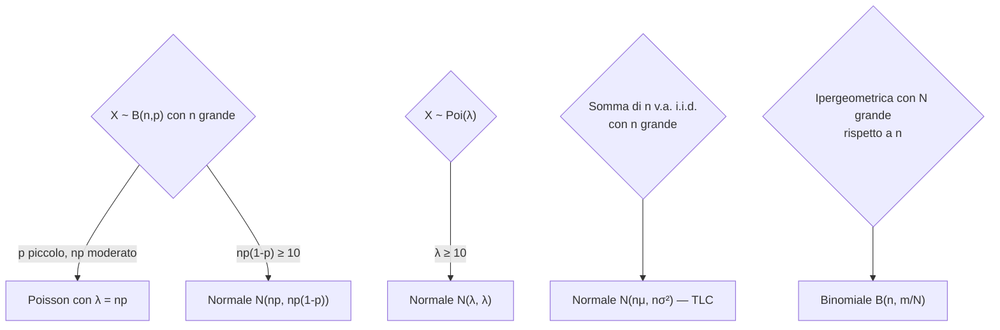

# Formulario e Domande d'Orale

> [!abstract]
> Nota di **ripasso** che raccoglie le ultime pagine della dispensa (schema delle distribuzioni, formulario in due pagine, lista delle domande d'orale) e il file `distribuzioni.pdf`. Non introduce argomenti nuovi: ogni riga rimanda alla lezione in cui il risultato è spiegato e dimostrato.
> Mappa del corso: [[MOC - Probabilità e Statistica]].

---

## Schema delle distribuzioni

| Distribuzione | PMF / densità | $E[X]$ | $\mathrm{Var}(X)$ | Lez. |
|---|---|:-:|:-:|---|
| **Bernoulli** $B(p)$ | $P(X=1)=p,\ P(X=0)=1-p$ | $p$ | $p(1-p)$ | 6 |
| **Binomiale** $B(n,p)$ | $\binom ni p^i(1-p)^{n-i}$ | $np$ | $np(1-p)$ | 6 |
| **Ipergeometrica** $H(N,m,n)$ | $\dfrac{\binom mi\binom{N-m}{n-i}}{\binom Nn}$ | $np$, $p=\frac mN$ | $np(1-p)\Big[1-\frac{n-1}{N-1}\Big]$ | 6 |
| **Uniforme** su $N$ valori | $P(A)=\frac{\#A}{\#S}$, $P(X=i)=\frac1N$ | $\frac{N+1}2$ | $\frac{N^2-1}{12}$ | 6 |
| **Pascal** $NB(p,n)$ (fallimenti) | $\binom{k+n-1}kp^nq^k$ | $\frac{nq}p$ (*) | $\frac{nq}{p^2}$ | 7 |
| **Geometrica** $\mathcal G(p)$ | $p(1-p)^{k-1}$, $k\ge1$ | $\frac1p$ | $\frac q{p^2}$ | 7 |
| **Poisson** $\mathrm{Poi}(\lambda)$ | $\frac{\lambda^i}{i!}e^{-\lambda}$ | $\lambda$ | $\lambda$ | 8 |
| **Normale** $N(\mu,\sigma^2)$ | $\frac1{\sqrt{2\pi}\sigma}\exp\big\{-\frac{(x-\mu)^2}{2\sigma^2}\big\}$ | $\mu$ | $\sigma^2$ | 9 |
| **Normale standard** | $Z:=\frac{X-\mu}\sigma$ | $0$ | $1$ | 9 |

Spiegazioni e dimostrazioni: [[06 - PS - Bernoulli, Binomiale, Ipergeometrica e Uniforme#Variabili aleatorie di Bernoulli|Bernoulli]], [[06 - PS - Bernoulli, Binomiale, Ipergeometrica e Uniforme#Variabili aleatorie binomiali|binomiale]], [[06 - PS - Bernoulli, Binomiale, Ipergeometrica e Uniforme#Variabili aleatorie ipergeometriche|ipergeometrica]], [[06 - PS - Bernoulli, Binomiale, Ipergeometrica e Uniforme#Variabili aleatorie uniformi|uniforme]], [[07 - PS - Pascal, Geometrica, Massimo e Minimo#Variabili aleatorie di Pascal|Pascal]], [[07 - PS - Pascal, Geometrica, Massimo e Minimo#Variabili aleatorie geometriche|geometrica]], [[08 - PS - Distribuzione di Poisson#Variabile aleatoria di Poisson|Poisson]], [[09 - PS - Distribuzione Normale e Teorema del Limite Centrale#Variabili aleatorie normali|normale]], [[09 - PS - Distribuzione Normale e Teorema del Limite Centrale#Distribuzione normale standard|normale standard]].

Nell'ipergeometrica, $N$ è il numero totale di elementi; nella notazione "$N$ accettabili e $M$ restanti" usata nelle dimostrazioni (e in `distribuzioni.pdf`) si ha $E[X]=n\frac N{N+M}$ e $\mathrm{Var}(X)=n\frac{NM}{(N+M)^2}\big(1-\frac{n-1}{N+M-1}\big)$.

> [!warning] Correzione (*)
> Lo schema della dispensa (p. 84), il formulario (p. 87) e `distribuzioni.pdf` riportano $E[X]=\frac np$ per la Pascal. Con la PMF scritta, che conta i **fallimenti** prima dell'$n$-esimo successo, il valore atteso è $\frac{nq}p$; $\frac np$ è la media del numero di **prove**. Dettagli nella [[07 - PS - Pascal, Geometrica, Massimo e Minimo#Variabili aleatorie di Pascal|lezione 7]].

> [!info] Dal file `distribuzioni.pdf`
> Il riassunto delle distribuzioni contiene, oltre allo schema, alcune proprietà da ricordare:
> - **binomiale**: estrazione *con* reinserimento (esperimenti indipendenti); somma di binomiali indipendenti con lo stesso $p$ è binomiale; ricorsione $P(X=k+1)=\frac p{1-p}\frac{n-k}{k+1}P(X=k)$;
> - **ipergeometrica**: estrazione *senza* reinserimento (somma di Bernoulli dipendenti); $P(X=i\mid X+Y=k)$ è ipergeometrica;
> - **geometrica**: serie geometrica $\sum_{i\ge0}q^i=\frac1{1-q}$; assenza di memoria; $P(X\le k)=1-(1-p)^k$; minimo di geometriche è geometrica $\mathrm{Ge}(1-(1-p)^n)$;
> - **Poisson**: $\lambda$ proporzionale all'intervallo di tempo; $B(n,p)$ con $p\to0$ e $n$ grande $\approx\mathrm{Poi}(np)$; somma di Poisson indipendenti; suddivisione in tipi; Poisson condizionata alla somma $\sim B(n,\frac{\lambda_1}\lambda)$; ricorsione $P(X=i+1)=\frac\lambda{i+1}P(X=i)$;
> - **normale**: trasformazioni lineari, somma di normali indipendenti, TLC $\sim N(n\mu,n\sigma^2)$, standardizzazione $P(X<i)=P\big(Z<\frac{i-\mu}\sigma\big)$.

---

## Formulario

**Valore atteso e varianza** ([[04 - PS - Valore Atteso, Varianza e Covarianza|lezione 4]])

| | |
|---|---|
| $E[X]=\sum_ix_iP(X=x_i)$ | $E[aX+b]=aE[X]+b$ |
| $E[g(X)]=\sum_xg(x)P(X=x)$ | $E[\sum_iX_i]=\sum_iE[X_i]$ (sempre) |
| $E[XY]=E[X]E[Y]$ (se indipendenti) | $\mathrm{Var}(X)=E[(X-\mu)^2]=E[X^2]-E[X]^2$ |
| $\mathrm{Var}(aX+b)=a^2\mathrm{Var}(X)$ | $\mathrm{Cov}(X,Y)=E[XY]-E[X]E[Y]$ |
| $\mathrm{Var}(X\pm Y)=\mathrm{Var}(X)+\mathrm{Var}(Y)\pm2\mathrm{Cov}(X,Y)$ | $\mathrm{Corr}(X,Y)=\frac{\mathrm{Cov}(X,Y)}{\sqrt{\mathrm{Var}(X)\mathrm{Var}(Y)}}\in[-1,1]$ |
| $E[X\mid Y=y]=\sum_xxP(X=x\mid Y=y)$ | $E\big[E[g(Y)\mid X]\big]=E[g(Y)]$ |
| $E[cX+dZ\mid Y=y]=cE[X\mid Y=y]+dE[Z\mid Y=y]$ | Indipendenti $\Rightarrow$ incorrelate (non viceversa) |

**Probabilità** ([[02 - PS - Probabilità Condizionata e Indipendenza|lezione 2]])

$$E=\bigcup_{i=1}^n(E\cap F_i)\quad\text{(unione di eventi mutuamente esclusivi)}$$
$$P(E)=\sum_{i=1}^nP(E\cap F_i)=\sum_{i=1}^nP(E\mid F_i)P(F_i)\qquad\text{(fattorizzazione)}$$
$$P(F_j\mid E)=\frac{P(F_j\cap E)}{P(E)}=\frac{P(E\mid F_j)P(F_j)}{\sum_iP(E\mid F_i)P(F_i)}\qquad\text{(Bayes)}$$

**Distribuzioni congiunte** ([[03 - PS - Variabili Aleatorie Discrete|lezione 3]]): dalla congiunta $P(X=x,Y=y)$ si ricavano le marginali $P(X=x)=\sum_yP(X=x,Y=y)$, $P(Y=y)=\sum_xP(X=x,Y=y)$, ma non vale il viceversa. Due v.a. sono indipendenti se $P(X=x,Y=y)=P(X=x)P(Y=y)$ per ogni $x,y$.

**Disuguaglianze** ([[05 - PS - Disuguaglianze e Legge dei Grandi Numeri|lezione 5]])
- Markov ($X\ge0$, $a>0$): $P(X\ge a)\le\frac{E[X]}a$
- Chebyshev ($r>0$): $P(|X-\mu|\ge r)\le\frac{\sigma^2}{r^2}$, cioè $P(\mu-r\le X\le\mu+r)\ge1-\frac{\sigma^2}{r^2}$

**Assenza di memoria** della geometrica: $P(T=m+n\mid T>m)=P(T=n)$.

**Normale e TLC** ([[09 - PS - Distribuzione Normale e Teorema del Limite Centrale|lezione 9]])
- $P(Z<z)\approx\Phi(z)$, $\;P(Z>z)=1-\Phi(z)$, $\;\Phi(-z)=1-\Phi(z)$
- $\frac{X-\mu}\sigma\;\dot\sim\;N(0,1)$
- TLC: $\dfrac{\sum_{i=1}^nX_i-n\mu}{\sigma\sqrt n}\;\dot\sim\;N(0,1)$ con $X_i$ i.i.d., $E[X_i]=\mu$, $\mathrm{Var}(X_i)=\sigma^2$
- La tavola di $\Phi$ è nella [[09 - PS - Distribuzione Normale e Teorema del Limite Centrale#Tavola della normale standard|lezione 9]].

_(dispensa, pp. 84, 86–88)_

### Quale approssimazione usare

---

## Domande d'orale

Lista dei possibili argomenti chiesti all'orale, con il punto delle note in cui sono trattati:

1. **Come sono definite le variabili aleatorie** (in particolare la Bernoulli, la binomiale e la geometrica) → [[03 - PS - Variabili Aleatorie Discrete#Variabili aleatorie|v.a.]], [[06 - PS - Bernoulli, Binomiale, Ipergeometrica e Uniforme#Variabili aleatorie di Bernoulli|Bernoulli]], [[06 - PS - Bernoulli, Binomiale, Ipergeometrica e Uniforme#Variabili aleatorie binomiali|binomiale]], [[07 - PS - Pascal, Geometrica, Massimo e Minimo#Variabili aleatorie geometriche|geometrica]]
2. **Definizione di valore atteso** → [[04 - PS - Valore Atteso, Varianza e Covarianza#Valore atteso|lezione 4]]
3. **Proprietà di linearità** → [[04 - PS - Valore Atteso, Varianza e Covarianza#Linearità|lezione 4]]
4. **Disuguaglianza di Chebyshev** (con dimostrazione) → [[05 - PS - Disuguaglianze e Legge dei Grandi Numeri#Disuguaglianza di Chebyshev|lezione 5]]
5. **Disuguaglianza di Markov** (con dimostrazione) → [[05 - PS - Disuguaglianze e Legge dei Grandi Numeri#Disuguaglianza di Markov|lezione 5]]
6. **Legge debole dei grandi numeri** → [[05 - PS - Disuguaglianze e Legge dei Grandi Numeri#Legge debole dei grandi numeri|lezione 5]]
7. **Proprietà della variabile aleatoria di Poisson** → [[08 - PS - Distribuzione di Poisson|lezione 8]] (media e varianza, approssimazione della binomiale, somma di Poisson indipendenti, suddivisione in tipi, Poisson condizionata alla somma)
8. **Il minimo di due variabili aleatorie geometriche è ancora una variabile aleatoria geometrica** (dimostrazione) → [[07 - PS - Pascal, Geometrica, Massimo e Minimo#Il minimo di geometriche è geometrico|lezione 7]]

> [!tip] Come prepararle
> Per ogni domanda: enunciato preciso, dimostrazione (sono tutte brevi, di 3–5 passaggi) e un esempio. Le dimostrazioni di Markov → Chebyshev → legge dei grandi numeri formano una **catena**: conviene saperle esporre una dopo l'altra.

_(dispensa, p. 85)_
