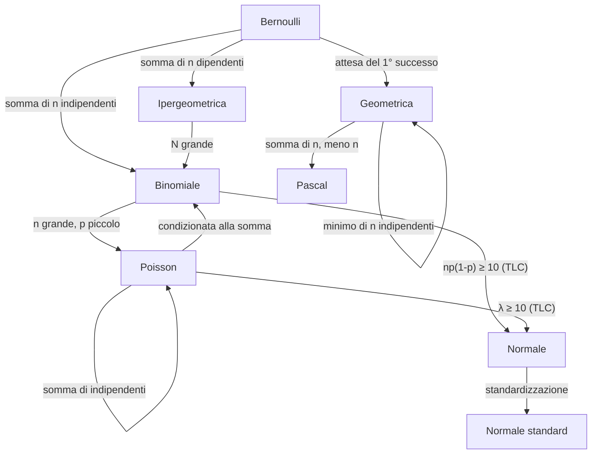

# MOC — Probabilità e Statistica

> [!abstract]
> Mappa del corso di Probabilità e Statistica (Triennale), costruita sulla dispensa `pdf/Probabilità e Statistica Dispensa.pdf` e integrata con gli esercizi svolti (`pdf/Esercizi Probabilità .pdf`) e il riassunto `pdf/distribuzioni.pdf`. Le **lezioni** sono note complete da studiare; i **concetti** sono schede brevi per il ripasso, ognuna con il link alla sezione della lezione che la spiega.
> Nella cartella del corso ci sono anche le note precedenti, ricavate da `Sintesi statistica.pdf` e orientate al Machine Learning: [[Variabile Aleatoria]], [[Conditional Probability]], [[Teorema di Bayes]], [[Expected Value]], [[Variance]], [[Covariance]], [[Gaussian]]. Qui sono usate come schede atomiche dei rispettivi concetti.

## Lezioni

| # | Lezione | Argomenti | Dispensa |
|:-:|---|---|:-:|
| 1 | [[01 - PS - Spazi di Probabilità e Calcolo Combinatorio]] | eventi, De Morgan, assiomi, inclusione-esclusione, esiti equiprobabili, disposizioni, permutazioni, combinazioni | pp. 3–12 |
| 2 | [[02 - PS - Probabilità Condizionata e Indipendenza]] | probabilità condizionata, regola della catena, unione, fattorizzazione, Bayes, eventi indipendenti | pp. 13–22 |
| 3 | [[03 - PS - Variabili Aleatorie Discrete]] | v.a., CDF, PMF, congiunta e marginali, indipendenza, distribuzioni condizionali | pp. 23–30 |
| 4 | [[04 - PS - Valore Atteso, Varianza e Covarianza]] | valore atteso, linearità, valore atteso condizionato, varianza, covarianza, correlazione | pp. 31–42 |
| 5 | [[05 - PS - Disuguaglianze e Legge dei Grandi Numeri]] | Markov, Chebyshev, legge debole dei grandi numeri | pp. 43–48 |
| 6 | [[06 - PS - Bernoulli, Binomiale, Ipergeometrica e Uniforme]] | Bernoulli, binomiale, ipergeometrica, uniforme discreta | pp. 49–59 |
| 7 | [[07 - PS - Pascal, Geometrica, Massimo e Minimo]] | binomiale negativa, geometrica, assenza di memoria, max e min | pp. 60–69 |
| 8 | [[08 - PS - Distribuzione di Poisson]] | Poisson, approssimazione della binomiale, somma, suddivisione | pp. 70–77 |
| 9 | [[09 - PS - Distribuzione Normale e Teorema del Limite Centrale]] | normale, normale standard e tavole, TLC, approssimazioni normali | pp. 78–83 |
| 10 | [[10 - PS - Formulario e Domande d'Orale]] | schema delle distribuzioni, formulario, domande d'orale | pp. 84–88 |

> [!info] Programma del corso (dispensa, p. 2)
> - **Cap. 3** — Esperimenti casuali, spazio degli esiti, eventi e operazioni insiemistiche, leggi di De Morgan, misura di probabilità, misura uniforme su spazi finiti e calcolo combinatorio, probabilità di unioni di eventi, probabilità condizionata, probabilità composte e totali, Bayes, indipendenza → lezioni 1–2.
> - **Cap. 4** — V.a. discrete, PMF, funzione di ripartizione, v.a. bidimensionali, congiunte e marginali, distribuzioni condizionate, indipendenza (anche per trasformazioni); valore atteso e linearità, valore atteso condizionato, varianza e covarianza, varianza della somma, coefficiente di correlazione → lezioni 3–4.
> - **Cap. 5** — Bernoulli, binomiale, uniforme, ipergeometrica, geometrica, Pascal (media e varianza di tutte), assenza di memoria, minimo di geometriche, Poisson e approssimazione della binomiale, somma di Poisson, somma di $N\sim\mathrm{Poi}(\lambda)$ Bernoulli, Poisson condizionata alla somma → lezioni 6–8.
> - **Sparsi nel libro** — Markov, Chebyshev, legge debole dei grandi numeri, cenni sulla normale standard e uso delle tavole, cenni al TLC e uso dell'approssimazione normale → lezioni 5 e 9.

## Concetti per tema

### Eventi e probabilità
- [[Spazio Campionario ed Eventi]] · [[Leggi di De Morgan]] · [[Assiomi della Probabilità]] · [[Principio di Inclusione-Esclusione]]

### Calcolo combinatorio
- [[Spazi Equiprobabili]] · [[Principio di Enumerazione]] · [[Disposizioni]] · [[Permutazioni]] · [[Combinazioni]]

### Probabilità condizionata
- [[Conditional Probability]] · [[Regola della Catena]] · [[Formula di Fattorizzazione]] · [[Teorema di Bayes]] · [[Eventi Indipendenti]]

### Variabili aleatorie
- [[Variabile Aleatoria]] · [[Funzione di Ripartizione]] · [[Funzione di Massa di Probabilità]] · [[Distribuzione Congiunta e Marginali]] · [[Variabili Aleatorie Indipendenti]] · [[Distribuzione Condizionale]]

### Valore atteso, varianza, covarianza
- [[Expected Value]] · [[Linearità del Valore Atteso]] · [[Valore Atteso Condizionato]] · [[Teorema del Valore Atteso Iterato]]
- [[Variance]] · [[Covariance]] · [[Varianza della Somma]] · [[Coefficiente di Correlazione]]

### Disuguaglianze e teoremi limite
- [[Disuguaglianza di Markov]] · [[Disuguaglianza di Chebyshev]] · [[Legge Debole dei Grandi Numeri]] · [[Media Campionaria]] · [[Teorema del Limite Centrale]]

### Distribuzioni discrete
- [[Distribuzione di Bernoulli]] · [[Distribuzione Binomiale]] · [[Distribuzione Ipergeometrica]] · [[Distribuzione Uniforme Discreta]]
- [[Distribuzione di Pascal]] · [[Distribuzione Geometrica]] · [[Assenza di Memoria]] · [[Massimo e Minimo di Variabili Indipendenti]]
- [[Distribuzione di Poisson]] · [[Approssimazione di Poisson della Binomiale]] · [[Somma di Poisson Indipendenti]] · [[Suddivisione di una Poisson]]

### Distribuzione normale
- [[Gaussian]] · [[Normale Standard]] · [[Approssimazione Normale]]

## Percorsi trasversali

### Famiglia delle distribuzioni

### Catene di concetti

- **Dal conteggio alla probabilità**: [[Spazio Campionario ed Eventi]] → [[Assiomi della Probabilità]] → [[Spazi Equiprobabili]] → [[Principio di Enumerazione]] → [[Combinazioni]] → [[Distribuzione Binomiale]]
- **Condizionare**: [[Conditional Probability]] → [[Regola della Catena]] → [[Formula di Fattorizzazione]] → [[Teorema di Bayes]]; e per le v.a. [[Distribuzione Condizionale]] → [[Valore Atteso Condizionato]] → [[Teorema del Valore Atteso Iterato]]
- **Indipendenza a tutti i livelli**: [[Eventi Indipendenti]] → [[Variabili Aleatorie Indipendenti]] → [[Coefficiente di Correlazione]] (indipendenti ⇒ incorrelate) → [[Varianza della Somma]]
- **Catena delle domande d'orale**: [[Disuguaglianza di Markov]] → [[Disuguaglianza di Chebyshev]] → [[Media Campionaria]] → [[Legge Debole dei Grandi Numeri]] → [[Teorema del Limite Centrale]]
- **Approssimazioni**: [[Distribuzione Binomiale]] → [[Approssimazione di Poisson della Binomiale]] / [[Approssimazione Normale]] → [[Normale Standard]]
- **Geometrica e attese**: [[Distribuzione Geometrica]] → [[Assenza di Memoria]] → [[Massimo e Minimo di Variabili Indipendenti]] → [[Distribuzione di Pascal]]

## Collegamenti con altri corsi

- **Machine Learning** — probabilità condizionata, Bayes e gaussiana sono i prerequisiti del corso: [[0 - ML - Requirements to understand ML#5. Probability Review|ML — Probability Review]], [[1 - ML - Decision Theory#1.3 Naive Bayes Classifier|ML — Naive Bayes]].
- **Cybersecurity** — calcolo combinatorio e paradosso del compleanno: [[4 CS  Lower Level - Data Integrity - MAC, attacks and SHA-1#Birthday paradox and attack|CS — Birthday paradox]].
