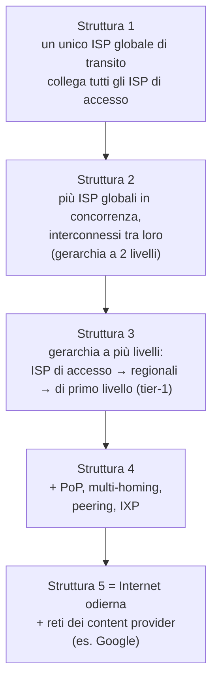
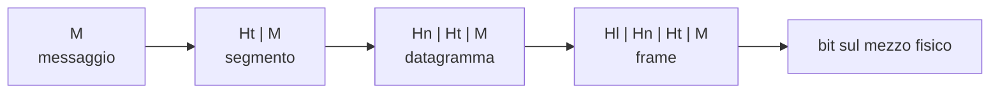
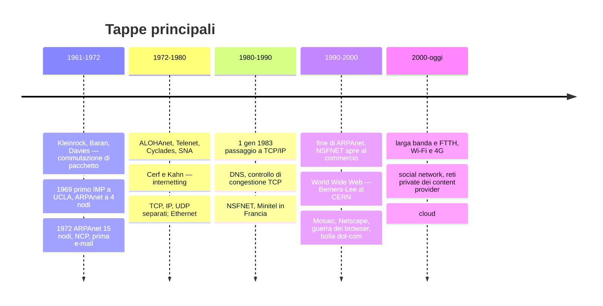
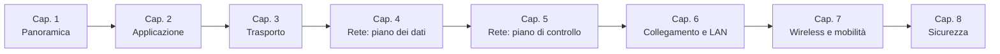

# Reti di calcolatori e Internet

> [!abstract] Di cosa parla questo capitolo
> È la **panoramica** dell'intero corso: un mini-corso di reti in un solo capitolo. Si parte dall'esterno della rete (i dispositivi degli utenti e il modo in cui si collegano), si entra nel **nucleo** (router, commutazione di pacchetto e di circuito, struttura degli ISP), poi si costruiscono i primi **modelli quantitativi** (ritardi, perdite, throughput). Infine si introducono l'**architettura a livelli** dei protocolli, i principali **attacchi** e un po' di **storia**.
> Ogni argomento qui è solo accennato: i capitoli successivi del libro scendono lungo la pila protocollare dall'alto verso il basso (approccio *top-down*): applicazione → trasporto → rete → collegamento.
> Mappa del corso: [[MOC - Telecomunicazioni]].

> [!info] Fonte
> J. F. Kurose, K. W. Ross, *Reti di calcolatori e Internet. Un approccio top-down*, 7ª ed., Pearson 2017, Capitolo 1 (pp. 1–64). I numeri di pagina citati sono quelli **del libro**: per trovarli nel PDF aggiungi 27 (p. 1 del libro = p. 28 del PDF).

---

## 1.1 Che cos'è Internet

Alla domanda "che cos'è Internet?" il libro risponde in due modi complementari:

1. descrivendone gli **ingranaggi**, cioè i componenti hardware e software che la costituiscono;
2. descrivendola come **infrastruttura che fornisce servizi** alle applicazioni distribuite.

Le due viste non si escludono: la prima risponde a "di cosa è fatta", la seconda a "a cosa serve".

### Gli ingranaggi di Internet

Vedi [[Host e Sistemi Periferici]].

Internet è una rete di calcolatori che interconnette **miliardi di dispositivi** in tutto il mondo. Un tempo erano PC, workstation e server; oggi sono anche smartphone, TV, console, termostati, automobili, elettrodomestici… Per questo il termine "rete di *calcolatori*" comincia a essere datato. In gergo tutti questi dispositivi si chiamano **host** (*ospiti*) o **sistemi periferici** (*end system*).

![[TLC-p030-1.png]]

La figura mostra i **componenti di base di Internet**: in basso la legenda dei simboli usati in tutto il libro. Notare la struttura:
- **in periferia** ci sono le reti degli utenti: una *rete mobile* (smartphone, auto, semaforo connessi a un'antenna cellulare), una *rete domestica* (PC, frigorifero, termostato dietro un modem) e una *rete aziendale* (PC, server e switch);
- **al centro** ci sono gli **ISP** (*Internet Service Provider*): un ISP distrettuale/regionale e un ISP nazionale/internazionale, fatti di router (i cerchi con le frecce incrociate) collegati tra loro.

I mattoni che servono per costruire tutto questo sono pochi:

| Componente | Cos'è | Esempi |
| --- | --- | --- |
| **Sistema periferico (host)** | dispositivo ai bordi della rete che esegue le applicazioni | PC, server, smartphone, sensori |
| **Collegamento** (*communication link*) | mezzo fisico che trasporta i bit | cavo coassiale, rame, fibra ottica, onde radio |
| **Commutatore di pacchetto** (*packet switch*) | dispositivo che riceve un pacchetto da un collegamento in ingresso e lo ritrasmette su uno in uscita | **router** (nel nucleo della rete), **switch a livello di collegamento** (nelle reti di accesso) |

- La **velocità di trasmissione** (*transmission rate*) di un collegamento si misura in **bit al secondo (bps)**.
- Quando un host deve inviare dati, li suddivide in parti e aggiunge a ciascuna un'**intestazione** (*header*): il risultato si chiama **pacchetto**. I pacchetti viaggiano separatamente e vengono riassemblati a destinazione.
- La sequenza di collegamenti e commutatori attraversata da un pacchetto si chiama **percorso** o **cammino** (*route*, *path*).

> [!example] L'analogia dei camion
> Un'azienda deve spostare un grosso carico di merci a un deposito lontano. Divide il carico su una flotta di camion che viaggiano **indipendentemente** sulla rete stradale e lo ricompone all'arrivo.
> - pacchetti ↔ camion
> - collegamenti ↔ strade e autostrade
> - commutatori di pacchetto ↔ incroci
> - sistemi periferici ↔ edifici di partenza e arrivo

I sistemi periferici accedono a Internet tramite gli **ISP**: ISP residenziali (compagnie telefoniche o via cavo), aziendali, universitari, Wi-Fi negli aeroporti, operatori mobili. Ogni ISP è a sua volta **una rete di commutatori di pacchetto e collegamenti**. Gli ISP di livello più basso sono interconnessi a ISP nazionali e internazionali di livello più alto (es. Level 3, AT&T, Sprint, NTT): questa gerarchia è approfondita in [[#Una rete di reti]].

Tutti i componenti di Internet usano dei **protocolli** che controllano l'invio e la ricezione delle informazioni. I due più importanti sono:
- **TCP** (*Transmission Control Protocol*);
- **IP** (*Internet Protocol*), che specifica il **formato dei pacchetti** scambiati tra router e host.

Per questo i protocolli di Internet vengono chiamati collettivamente **TCP/IP** (vedi [[TCP e UDP]] e [[Protocollo IP]] in Sistemi di Calcolo 2).

> [!note] Gli standard di Internet
> Perché dispositivi costruiti da produttori diversi riescano a comunicare, serve un accordo su cosa fa ogni protocollo: gli **standard**.
> - Gli standard di Internet sono sviluppati dall'**IETF** (*Internet Engineering Task Force*) e pubblicati come **RFC** (*Request For Comments*). Il nome viene dalle origini, quando erano davvero richieste di commenti. Oggi sono documenti tecnici e dettagliati: ne esistono più di 7000 e definiscono, tra gli altri, TCP, IP, HTTP e SMTP.
> - Altri enti definiscono gli standard per i componenti di rete: per esempio l'**IEEE 802 LAN/MAN Standards Committee** specifica Ethernet e il Wi-Fi.

_(libro, pp. 2–5)_

### Internet come infrastruttura di servizi

Dal secondo punto di vista, Internet è un'**infrastruttura che fornisce servizi alle applicazioni**: posta elettronica, Web, messaggistica, streaming, social network, videoconferenza…

Queste si chiamano **applicazioni distribuite**, perché coinvolgono più sistemi periferici che si scambiano dati.

> [!important] Le applicazioni girano ai bordi della rete
> Le applicazioni Internet vengono eseguite **sui sistemi periferici**, non sui commutatori di pacchetto del nucleo. I router permettono lo scambio di dati, ma non sanno nulla dell'applicazione che li ha generati.

Se scrivo un'applicazione distribuita (in Java, C o Python), i suoi pezzi in esecuzione su host diversi devono scambiarsi dati. Come fa un programma a chiedere a Internet di consegnare dati a un programma su un altro host?

I sistemi periferici forniscono un'**interfaccia socket** (*socket interface*): un insieme di regole che il programma mittente deve rispettare perché Internet recapiti i dati al programma di destinazione. È il "canale di comunicazione" tra applicazione e rete. Le socket sono trattate nel Capitolo 2; vedi anche [[Socket]] e [[Sockets in Python]].

> [!example] L'analogia del servizio postale
> Alice vuole mandare una lettera a Bob. Non può scrivere la lettera e lanciarla dalla finestra: deve metterla in una busta, scriverci nome, indirizzo e CAP del destinatario, sigillarla, affrancarla e imbucarla. Queste regole sono l'"interfaccia del servizio postale".
> Allo stesso modo, Internet ha un'interfaccia socket che il programma mittente deve rispettare.
> E come le poste offrono più servizi (posta prioritaria, raccomandata, ordinaria…), anche Internet offre alle applicazioni **più servizi** diversi (Capitolo 2).

_(libro, pp. 5–6)_

### Che cos'è un protocollo

Vedi [[Protocollo di Rete]].

Il concetto di **protocollo** è centrale in tutto il corso. Il libro lo introduce con un'analogia con il comportamento umano.

![[TLC-p034-1.png]]

A sinistra c'è un **protocollo umano**: per chiedere l'ora a qualcuno si comincia con un saluto ("Ciao"). Se la risposta è un "Ciao" cordiale si può procedere con la domanda ("Sai l'ora?") e si riceve la risposta ("2:00"). Se invece la risposta fosse "Non mi scocciare" o una lingua che non capiamo, rinunceremmo a chiedere. In questo protocollo:
- ci sono **messaggi specifici** che si inviano;
- ci sono **azioni** intraprese in risposta ai messaggi ricevuti o a eventi (es. la mancata risposta entro un tempo ragionevole);
- se le due persone usano protocolli diversi (una è educata e l'altra no, oppure una comprende il concetto di tempo e l'altra no) i protocolli **non interoperano** e non si conclude nulla.

A destra c'è un **protocollo di rete**: il browser chiede una pagina a un web server.
1. Il client invia una **richiesta di connessione TCP**.
2. Il server risponde con una **risposta di connessione TCP**.
3. Il client invia una richiesta **GET** con l'indirizzo della pagina (`http://www.pearsonhighered.com/cs-resources/`).
4. Il server restituisce il **file** richiesto.

Il tempo scorre verso il basso: ogni freccia inclinata è un messaggio che impiega del tempo ad arrivare.

Il libro aggiunge una seconda analogia, quella della lezione in aula. Il docente chiede "Ci sono domande?", un messaggio inviato a tutti. Uno studente alza la mano, cioè trasmette un messaggio implicito. Il docente risponde "Sì…" per incoraggiarlo, lo studente pone la domanda e il docente risponde. Anche qui il protocollo è fatto di messaggi inviati, messaggi ricevuti e azioni conseguenti.

Nei **protocolli di rete** le entità che si scambiano messaggi sono componenti hardware o software (schede di rete, sistemi operativi, router…). Ogni attività in Internet che coinvolge due o più entità remote è governata da un protocollo:
- i protocolli cablati nelle **schede di rete** controllano il flusso di bit sul "cavo";
- i protocolli di **controllo di congestione** negli host regolano la velocità di trasmissione;
- i protocolli nei **router** determinano il percorso di un pacchetto.

> [!quote] Dal libro — Definizione di protocollo (p. 8)
> Un **protocollo** definisce il **formato** e l'**ordine** dei messaggi scambiati tra due o più entità in comunicazione, così come le **azioni** intraprese in fase di trasmissione e/o di ricezione di un messaggio o di un altro evento.

Quindi un protocollo specifica tre cose: **formato** dei messaggi, **ordine** dei messaggi e **azioni** in risposta a messaggi o eventi. "Padroneggiare il campo delle reti equivale a comprendere l'essenza, la finalità e le modalità operative dei protocolli di rete."

_(libro, pp. 6–8)_

> [!tip] Box 1.1 — Internet of Things
> Il libro dedica un box all'**IoT**: un mondo in cui quasi tutto (auto, occhiali, giocattoli, sensori, elettrodomestici, animali domestici) è connesso a Internet. Le stime parlavano di 5 miliardi di "cose" connesse nel 2015 e 25 miliardi nel 2020. L'IoT porta grandi benefici ma anche **rischi enormi per sicurezza e privacy**: una bambola connessa controllata da un malintenzionato, oppure database di dati medici raccolti da dispositivi indossabili. Vedi [[Internet of Things]]. _(libro, p. 9)_

---

## 1.2 Ai confini della rete

Si comincia dalla **periferia** (*edge*) della rete, cioè dai componenti più familiari: computer, smartphone e altri dispositivi.

![[TLC-p037-1.png]]

La figura evidenzia l'**interazione tra sistemi periferici**: la freccia collega un portatile nella rete mobile, in alto, a un server nella rete aziendale, in basso. I due comunicano attraversando tutta la rete, ma **l'applicazione esiste solo alle due estremità**.

I sistemi periferici si chiamano anche **host** perché "ospitano" ed eseguono programmi applicativi (browser, web server, client di posta). Gli host si dividono in:
- **client**: richiedono servizi (tipicamente PC, smartphone);
- **server**: erogano servizi (macchine potenti che memorizzano e distribuiscono pagine web, video, e-mail).

Oggi la maggior parte dei server sta in grandi **data center**: Google, per esempio, ne ha 50–100, di cui 15 molto grandi, con più di 100.000 server ciascuno. Vedi anche [[Modello Client-Server]].

_(libro, pp. 9–11)_

### Le reti di accesso

Vedi [[Reti di Accesso]].

La **rete di accesso** (*access network*) è la rete che connette fisicamente un sistema periferico al suo **edge router** (router di bordo), cioè il **primo router** sul percorso dal sistema di origine verso qualsiasi destinazione fuori dalla rete di accesso.

![[TLC-p038-1.png]]

Le reti di accesso sono evidenziate con linee spesse e ombreggiate: sono i collegamenti tra le case, le aziende e la rete mobile e il primo router dell'ISP. L'annotazione verde "EDGE router" indica proprio quel primo router (in questo caso quello della rete mobile, a cui si collega l'antenna).

Il libro distingue tre ambienti di accesso: **residenziale**, **aziendale** e **wireless su scala geografica**.

#### Accesso residenziale: DSL, cavo, FTTH, satellite e dial-up

Già nel 2014 oltre il 78% delle abitazioni nei Paesi sviluppati aveva accesso a Internet (oltre l'80% in Corea, Paesi Bassi, Finlandia e Svezia), quasi sempre a larga banda.

**DSL (Digital Subscriber Line)**

L'accesso DSL viene fornito dalla **compagnia telefonica**, che in questo caso fa anche da ISP. Usa il **doppino telefonico in rame già esistente** tra la casa e la centrale.

![[TLC-p039-1.png]]

Nella figura (accesso a Internet tramite DSL):
- in casa, uno **splitter** separa il telefono dal **modem DSL** a cui è collegato il computer;
- la linea telefonica esistente porta tutto alla **centrale locale** (*CO, central office*);
- in centrale il **DSLAM** (*Digital Subscriber Line Access Multiplexer*) separa i dati, che manda verso Internet, dalla voce, che manda verso la rete telefonica tradizionale.

Il modem DSL converte i dati digitali in **toni ad alta frequenza** da trasmettere sul doppino; il DSLAM li riconverte in digitale. Sullo stesso doppino convivono tre bande di frequenza **non sovrapposte**:

| Canale | Banda | Velocità |
| --- | --- | --- |
| Downstream (verso casa) | 50 kHz – 1 MHz | alta |
| Upstream (verso il DSLAM) | 4 – 50 kHz | media |
| Telefono tradizionale (bidirezionale) | 0 – 4 kHz | — |

Così un unico collegamento DSL si comporta come **tre collegamenti separati**: telefonata e connessione Internet possono essere contemporanee. Questa tecnica si chiama *multiplexing a divisione di frequenza* (vedi [[#Multiplexing FDM e TDM]]).

- Velocità standard: 12 Mbps downstream / 1,8 Mbps upstream, oppure 55 / 15 Mbps. L'accesso è **asimmetrico** perché le due velocità sono diverse.
- Le velocità reali possono essere più basse: il provider può limitarle in base all'abbonamento, e dipendono da **distanza dalla centrale**, qualità del doppino e interferenze elettriche.
- La DSL è progettata per **distanze brevi**: oltre 5–10 miglia (8–16 km) dalla centrale serve un'alternativa.

_(libro, pp. 11–13)_

**Accesso via cavo (HFC)**

Se la DSL riusa l'infrastruttura della compagnia telefonica, l'**accesso via cavo** riusa quella della **TV via cavo**.

![[TLC-p040-1.png]]

La figura mostra una rete **ibrida fibra-coassiale (HFC, *hybrid fiber coax*)**:
- dalla **stazione di testa** (*cable head end*) partono cavi in **fibra ottica** fino ai **nodi ottici** di quartiere;
- da ogni nodo ottico parte il tradizionale **cavo coassiale**, che raggiunge le singole abitazioni (ogni nodo ne serve da 500 a 5000);
- nella stazione di testa il **CMTS** (*Cable Modem Termination System*) ha un ruolo analogo al DSLAM: converte in digitale i segnali analogici che arrivano dai **cable modem** delle case.

Caratteristiche:
- Anche qui l'accesso è **asimmetrico**: lo standard DOCSIS 2.0 prevede fino a 42,8 Mbps in downstream e 30,7 Mbps in upstream.
- **Mezzo condiviso**: è la differenza principale rispetto alla DSL. Ogni pacchetto inviato dalla stazione di testa viaggia sul canale di downstream verso **tutte** le abitazioni, e i pacchetti in upstream delle varie case condividono lo stesso canale.
  - Se molti utenti scaricano video contemporaneamente, ciascuno riceve molto meno della velocità totale del canale.
  - Se pochi utenti navigano, ognuno può ottenere quasi la velocità massima, perché è raro che due richiedano una pagina nello stesso istante.
  - Poiché anche l'upstream è condiviso, serve un **protocollo di accesso multiplo distribuito** che coordini le trasmissioni ed eviti collisioni (Capitolo 6).

_(libro, pp. 13–14)_

**FTTH (Fiber To The Home)**

L'idea è semplice: portare la **fibra ottica dalla centrale fino a casa**. Le architetture possibili sono:
- **fibra diretta**: una fibra per ogni abitazione, la soluzione più semplice;
- **fibra condivisa**: una fibra esce dalla centrale ed è condivisa da più case, poi si divide vicino alle abitazioni. Questa suddivisione si fa con due architetture:
  - **AON** (*Active Optical Networks*): in sostanza Ethernet commutata (Capitolo 6);
  - **PON** (*Passive Optical Networks*).

![[TLC-p042-1.png]]

Architettura PON (usata ad esempio nel servizio FIOS di Verizon):
- in ogni casa c'è un **ONT** (*Optical Network Terminator*), collegato con una fibra dedicata a uno **splitter ottico** di quartiere;
- lo splitter combina più abitazioni (di solito meno di 100) su un'unica fibra condivisa, che arriva all'**OLT** (*Optical Line Terminator*) nella centrale;
- l'OLT converte tra segnali ottici ed elettrici e si collega a Internet tramite un router della compagnia telefonica;
- tutti i pacchetti inviati dall'OLT allo splitter vengono **replicati** su tutte le case, come nella stazione di testa HFC.

L'FTTH può arrivare in teoria al **gigabit al secondo**. Nel 2011 la velocità media negli USA era circa 20 Mbps, contro i 13 Mbps del cavo e meno di 5 Mbps della DSL.

**Satellite e dial-up**

- **Satellite**: dove non arrivano DSL, cavo o FTTH (zone rurali) si usa un collegamento satellitare, a oltre 1 Mbps (provider come StarBand e HughesNet).
- **Dial-up**: stesso modello della DSL (modem in casa ↔ modem dell'ISP su linea telefonica), ma lentissimo: **56 kbps**.

_(libro, pp. 14–15)_

#### Accesso aziendale (e residenziale): Ethernet e Wi-Fi

Nelle aziende, nelle università e sempre più nelle case si usa una **rete locale (LAN, *Local Area Network*)** per collegare i sistemi periferici al router di bordo. La tecnologia più diffusa è **Ethernet**.

![[TLC-p043-1.png]]

Nella figura (accesso tramite Ethernet), più host sono collegati con **doppino di rame** a uno **switch Ethernet** a 100 Mbps. Allo switch sono collegati anche un server e il **router aziendale**, che porta verso l'ISP dell'azienda. Gli utenti hanno di solito accesso a 100 Mbps, mentre i server possono arrivare a 1 o 10 Gbps. Vedi [[Switch]] e [[Router]].

Sempre più utenti si collegano **senza fili**. In una **LAN wireless** i dispositivi comunicano con un **access point** (detto anche *stazione base*) entro un raggio di poche decine di metri; l'access point è collegato alla rete cablata. Le LAN wireless basate su **IEEE 802.11 (Wi-Fi)** forniscono una velocità condivisa di circa 100 Mbps (Capitolo 7).

Le reti domestiche combinano accesso a larga banda e LAN wireless:

![[TLC-p044-1.png]]

La figura mostra una **tipica rete domestica**: portatili e PC (anche frigorifero e termostato), un **access point** wireless, un **router** che li interconnette e un **cable modem** che porta verso la stazione di testa e quindi a Internet.

_(libro, pp. 16–17)_

#### Accesso wireless su scala geografica: 3G e LTE

Smartphone e tablet usano la **stessa infrastruttura della telefonia cellulare**: inviano e ricevono pacchetti tramite una **stazione base** gestita dall'operatore. A differenza del Wi-Fi, l'utente può trovarsi a **decine di chilometri** dalla stazione base, non a decine di metri.

- **3G**: accesso a commutazione di pacchetto su scala geografica, a oltre 1 Mbps.
- **4G / LTE** (*Long-Term Evolution*): deriva dal 3G e può superare i 10 Mbps; in ambito commerciale si sono misurate decine di Mbps in downstream.

_(libro, p. 17)_

### Mezzi trasmissivi

Vedi [[Mezzi Trasmissivi]].

Per capire cos'è un **mezzo fisico** il libro segue la vita di un bit. Il bit parte dall'host sorgente, viene ritrasmesso da router a router e arriva alla destinazione. In ogni tratta passa da un **trasmettitore** a un **ricevitore** sotto forma di onda elettromagnetica o impulso ottico, e il mezzo può essere diverso da una tratta all'altra.

I mezzi fisici si dividono in due categorie:
- **mezzi vincolati** (*guided media*): le onde sono contenute in un mezzo solido (fibra, rame, coassiale);
- **mezzi non vincolati** (*unguided media*): le onde si propagano nell'atmosfera e nello spazio (Wi-Fi, satellite).

> [!tip] Il costo vero è l'installazione
> Il costo del cavo è spesso trascurabile rispetto alla **manodopera** per installarlo, che può superarlo di vari ordini di grandezza. Per questo negli edifici nuovi conviene posare insieme doppini, fibra e coassiale in ogni stanza: anche se all'inizio se ne usa uno solo, si evita di ripetere l'installazione in futuro.

| Mezzo | Tipo | Struttura | Caratteristiche |
| --- | --- | --- | --- |
| **Doppino di rame intrecciato** | vincolato | due fili di rame (< 1 mm) attorcigliati a spirale per ridurre l'interferenza elettrica delle coppie vicine; più coppie formano un cavo | il più economico e diffuso (> 99% delle connessioni telefoniche). L'**UTP** (*unshielded twisted pair*) è usato nelle LAN: da 10 Mbps a 10 Gbps; la categoria 6a arriva a 10 Gbps entro un centinaio di metri. Usato da dial-up e DSL |
| **Cavo coassiale** | vincolato | due conduttori di rame **concentrici** con isolamento e schermatura | alte frequenze; TV via cavo e accesso via cavo a decine di Mbps; è un **mezzo condiviso** (tutti gli host collegati ricevono ciò che inviano gli altri) |
| **Fibra ottica** | vincolato | conduce **impulsi di luce**, ognuno rappresenta un bit | da decine a centinaia di Gbps; **immune alle interferenze elettromagnetiche**; attenuazione bassissima fino a 100 km; difficile da intercettare. Usata nelle dorsali e nei collegamenti intercontinentali. Costo elevato dei dispositivi ottici per le brevi distanze |
| **Canali radio terrestri** | non vincolato | spettro elettromagnetico | non serve cablaggio, attraversano le pareti, supportano la mobilità; soffrono di **path loss** (attenuazione con la distanza), **shadow fading** (ostacoli), **multipath fading** (riflessioni) e interferenze |
| **Canali radio satellitari** | non vincolato | il satellite riceve su una banda, rigenera il segnale e lo ritrasmette su un'altra | GEO e LEO (vedi sotto) |

**Velocità della fibra (standard OC)**: le velocità dei collegamenti *Optical Carrier* vanno da 51,8 Mbps a 39,8 Gbps e si indicano come **OC-n**, con velocità $n \times 51{,}8$ Mbps (OC-1, OC-3, OC-12, OC-24, OC-48, OC-96, OC-192, OC-768). Per esempio OC-768 → $768 \times 51{,}84 \text{ Mbps} \approx 39{,}8 \text{ Gbps}$.

**Canali radio terrestri**: si classificano per distanza in tre gruppi:
- **pochi metri**: dispositivi personali, cuffie, tastiere wireless;
- **area locale** (centinaia di metri): LAN wireless;
- **area vasta** (decine di km): accesso cellulare.

**Satelliti**:
- **geostazionari (GEO)**: a circa 36.000 km, sincronizzati con la rotazione terrestre, quindi sempre sopra lo stesso punto. La distanza introduce un **ritardo di propagazione di circa 280 ms** (andata e ritorno stazione–satellite). Sono comunque usati a centinaia di Mbps dove non arrivano DSL o cavo.
- **a bassa quota (LEO)**: più vicini alla Terra, ruotano intorno al pianeta e possono comunicare tra loro; per coprire un'area servono **molti** satelliti.

> [!note] Da dove vengono i 280 ms
> Se la stazione a terra fosse esattamente sotto il satellite, il percorso terra → satellite → terra sarebbe $2 \times 36.000 \text{ km}$, e alla velocità della luce ($\approx 3 \times 10^5$ km/s) servirebbero $72.000 / 300.000 = 240$ ms. In pratica le stazioni vedono il satellite inclinato e la distanza obliqua arriva a circa 41.000 km per tratta, quindi si sale verso i ~280 ms citati dal libro.

_(libro, pp. 17–20)_

---

## 1.3 Il nucleo della rete

![[TLC-p048-1.png]]

Il **nucleo della rete** (*network core*) è la **maglia di commutatori di pacchetto e collegamenti** che interconnette i sistemi periferici. Nella figura è evidenziato in rosso: comprende i router degli ISP e quelli che collegano le reti tra loro, mentre i dispositivi degli utenti restano fuori.

Per spostare dati in una rete di collegamenti e commutatori esistono due approcci fondamentali: **commutazione di pacchetto** e **commutazione di circuito**.

_(libro, p. 21)_

### Commutazione di pacchetto

Vedi [[Commutazione di Pacchetto]].

Le applicazioni si scambiano **messaggi**, che possono avere funzioni di controllo (come il "Ciao" della figura del protocollo) o contenere dati (un'e-mail, un JPEG, un MP3). La sorgente suddivide i messaggi lunghi in parti più piccole, i **pacchetti**. Tra sorgente e destinazione i pacchetti attraversano collegamenti e **commutatori di pacchetto**, che sono di due tipi principali: **router** e **switch a livello di collegamento**.

Su ogni collegamento un pacchetto viene trasmesso alla **velocità piena** del collegamento. Quindi, se un pacchetto di $L$ bit viene inviato su un collegamento a $R$ bps:

$$t_{\text{trasmissione}} = \frac{L}{R} \text{ secondi}$$

_(libro, p. 22)_

#### Trasmissione store-and-forward

La maggior parte dei commutatori usa la **trasmissione store-and-forward** ("memorizza e inoltra"): il commutatore deve **ricevere l'intero pacchetto** prima di cominciare a trasmetterne il primo bit sul collegamento in uscita.

![[TLC-p049-1.png]]

La figura mostra una sorgente che deve inviare tre pacchetti (1, 2, 3) di $L$ bit ciascuno, attraverso un solo router, verso la destinazione. Nell'istante raffigurato la sorgente ha già trasmesso parte del pacchetto 1: i primi bit sono già nel router, che però **non può ancora inoltrarli**. Li tiene nel buffer finché non arrivano anche gli altri bit del pacchetto.

**Calcolo del ritardo** (ignorando il ritardo di propagazione, cioè supponendo che i bit viaggino quasi alla velocità della luce):

- al tempo $L/R$ la sorgente ha trasmesso tutto il pacchetto 1, che è interamente nel router. Il router inizia a trasmetterlo;
- al tempo $2L/R$ il destinatario ha ricevuto tutto il pacchetto 1.

Il ritardo per un pacchetto su due collegamenti è quindi $2L/R$. Se il router inoltrasse i bit appena arrivati (*cut-through*), sarebbe $L/R$; ma i router devono ricevere, memorizzare ed **elaborare** l'intero pacchetto prima di inoltrarlo (Paragrafo 1.4).

Con **tre pacchetti** la sorgente inizia a inviare il secondo pacchetto proprio a $L/R$, mentre il router inoltra il primo. La trasmissione procede "a catena di montaggio":

| Tempo | Sorgente → router | Router → destinazione | Ricevuti dalla destinazione |
| --- | --- | --- | --- |
| $0 \to L/R$ | pacchetto 1 | — | — |
| $L/R \to 2L/R$ | pacchetto 2 | pacchetto 1 | 1 |
| $2L/R \to 3L/R$ | pacchetto 3 | pacchetto 2 | 1, 2 |
| $3L/R \to 4L/R$ | — | pacchetto 3 | 1, 2, 3 |

Tutti e tre i pacchetti arrivano a $4L/R$.

**Caso generale**: con un percorso di $N$ collegamenti a velocità $R$ (quindi $N-1$ router), il ritardo end-to-end per **un** pacchetto è:

$$d_{\text{end-to-end}} = N \frac{L}{R} \qquad (1.1)$$

dove $L$ è il numero di bit del pacchetto e $R$ la velocità di trasmissione.

> [!example] Esercizio lasciato al lettore: $P$ pacchetti su $N$ collegamenti
> Il libro invita a calcolare il ritardo per $P$ pacchetti su $N$ collegamenti. Generalizzando la tabella sopra: il primo pacchetto arriva dopo $N \cdot L/R$, e ogni pacchetto successivo arriva $L/R$ dopo il precedente, perché la "pipeline" è piena. Quindi:
> $$d = (N + P - 1)\frac{L}{R}$$
> Verifica con l'esempio: $N = 2$, $P = 3$ → $(2 + 3 - 1) L/R = 4L/R$. ✓

_(libro, pp. 22–23)_

#### Ritardi di accodamento e perdita di pacchetti

Un commutatore ha molti collegamenti e, per ciascuno, un **buffer di output** (o **coda di output**) dove tiene i pacchetti che stanno per essere inviati su quel collegamento.

- Se un pacchetto arriva mentre il collegamento d'uscita è occupato da un'altra trasmissione, deve **aspettare in coda**: oltre al ritardo store-and-forward, subisce un **ritardo di accodamento**. Questo ritardo è **variabile** e dipende dal traffico.
- Il buffer ha dimensione **finita**: se è pieno, il pacchetto in arrivo (o uno già in coda) viene scartato. È una **perdita di pacchetto** (*packet loss*).

![[TLC-p051-1.png]]

Nella figura gli host A e B inviano pacchetti a E. Lo spessore dei pacchetti rappresenta il numero di bit, qui uguale per tutti. Il problema sta nelle velocità:
- A e B arrivano al primo commutatore su collegamenti Ethernet a **100 Mbps**;
- il commutatore inoltra verso E su un collegamento a **15 Mbps**.

Se per un po' di tempo la velocità con cui arrivano i pacchetti supera quella del collegamento in uscita, si crea **congestione**: i pacchetti si accumulano nella coda in attesa del collegamento di output. È come la fila in banca o al casello. Se A e B inviano insieme una raffica di cinque pacchetti, alcuni dovranno attendere.

_(libro, pp. 23–24)_

#### Tabelle di inoltro e protocolli di instradamento

Come fa un router a decidere su quale collegamento inoltrare un pacchetto? In Internet:

- ogni sistema periferico ha un **indirizzo IP**;
- ogni pacchetto contiene nell'intestazione l'**indirizzo IP di destinazione**, che come un indirizzo postale ha una **struttura gerarchica**;
- ogni router ha una **tabella di inoltro** (*forwarding table*) che associa indirizzi di destinazione, o loro parti, ai collegamenti in uscita;
- quando un pacchetto arriva, il router esamina l'indirizzo, consulta la tabella e lo dirige sul collegamento d'uscita indicato.

> [!example] L'analogia di Giovanni
> Giovanni deve andare da Milano a Conegliano, in Via Abate Tommaso 515, senza cartine: chiede la strada man mano.
> - Il benzinaio sulla tangenziale gli dice di prendere la A4.
> - L'addetto di un'area di servizio vicino a Vicenza gli dice di proseguire fino alla barriera di Mestre.
> - Un altro benzinaio gli indica la A27 verso Vittorio Veneto.
> - A Conegliano la cassiera di un bar gli indica Via Abate Tommaso.
> - Un bambino in bicicletta gli indica il civico 515.
>
> Ognuno conosce solo **un pezzo** del percorso e guarda **una parte** dell'indirizzo, come i router con le loro tabelle di inoltro.

Come si compilano le tabelle di inoltro? Non a mano: Internet usa dei **protocolli di instradamento** (*routing protocol*), che le configurano automaticamente, per esempio calcolando il percorso più breve da ogni router verso ogni destinazione (Capitolo 5; vedi anche [[BGP]]).

Per vedere il percorso reale di un pacchetto si può usare **Traceroute** (vedi [[#Traceroute]] e [[Traceroute]]).

_(libro, pp. 24–25)_

### Commutazione di circuito

Vedi [[Commutazione di Circuito]].

Nelle reti a **commutazione di circuito** le risorse necessarie lungo il percorso (buffer e velocità di trasmissione dei collegamenti) sono **riservate per tutta la durata della sessione**. Nella commutazione di pacchetto invece **non sono riservate**: i messaggi le usano quando servono e, se il collegamento è occupato, aspettano in coda.

> [!example] L'analogia dei ristoranti
> - Ristorante con prenotazione (circuito): bisogna telefonare prima, ma all'arrivo il tavolo è subito pronto.
> - Ristorante senza prenotazione (pacchetto): non serve prenotare, ma all'arrivo si può dover aspettare che si liberi un tavolo.

Le **reti telefoniche** tradizionali sono l'esempio classico. Prima di poter iniziare l'invio, la rete deve stabilire una **connessione** tra mittente e destinatario; nel gergo della telefonia questa connessione si chiama **circuito**.
- I commutatori sul percorso mantengono lo **stato** della connessione.
- La rete riserva al circuito una **velocità di trasmissione costante** (una frazione della capacità di ogni collegamento) per tutta la durata della chiamata.
- Il mittente può quindi trasmettere a **velocità costante garantita**.

![[TLC-p053-1.png]]

La rete in figura ha **quattro commutatori** collegati da **quattro collegamenti**, ognuno dei quali dispone di **quattro circuiti**. Quando due host vogliono comunicare, la rete stabilisce una **connessione end-to-end** (o *punto a punto*) dedicata. Qui la connessione usa il 2° circuito del primo collegamento e il 4° circuito del secondo, come indicano le annotazioni in rosso.

Ogni collegamento ospita 4 circuiti, quindi la connessione ottiene **1/4 della capacità** di ogni collegamento. Se i collegamenti sono a 1 Mbps, ogni connessione riceve **250 kbps** dedicati.

Nella commutazione di pacchetto, invece, il pacchetto viene immesso in rete **senza riservare risorse**. Se un collegamento è congestionato il pacchetto aspetta nel buffer: Internet "fa del suo meglio" (*best effort*) per consegnare in tempo, ma **non offre garanzie**.

_(libro, pp. 25–27)_

#### Multiplexing FDM e TDM

Un circuito all'interno di un collegamento si realizza con il **multiplexing**:

- **FDM** (*Frequency-Division Multiplexing*, a divisione di frequenza): lo spettro di frequenze del collegamento è suddiviso tra le connessioni, e ognuna ha una **banda di frequenza** dedicata per tutta la durata della connessione. Nelle reti telefoniche la banda è di **4 kHz**; anche le radio FM usano FDM, con ogni stazione su una banda tra 88 e 108 MHz. La larghezza della banda si chiama **ampiezza di banda** (*bandwidth*).
- **TDM** (*Time-Division Multiplexing*, a divisione di tempo): il tempo è suddiviso in **frame** di durata fissa, ognuno diviso in un numero fisso di **slot**. A ogni connessione è assegnato **uno slot in ogni frame**.

![[TLC-p055-1.png]]

La figura confronta i due schemi per un collegamento che supporta 4 circuiti:
- **FDM**: il dominio delle frequenze è diviso in 4 bande da 4 kHz, e ogni circuito ne occupa una **con continuità**;
- **TDM**: il tempo è diviso in frame, ognuno con 4 slot (1, 2, 3, 4). Il circuito "2" (slot grigi) usa lo slot 2 di **ogni** frame: occupa **tutta la banda**, ma solo per brevi intervalli.

In TDM la velocità di un circuito è:

$$R_{\text{circuito}} = \text{frame al secondo} \times \text{bit per slot}$$

> [!example] Esempio
> 8000 frame/s, slot da 8 bit → $8000 \times 8 = 64.000$ bps = **64 kbps** per circuito.

**Critiche alla commutazione di circuito**:
- **spreco durante i periodi di silenzio**: le risorse dedicate restano inutilizzate quando non si trasmette. Durante una telefonata, se nessuno parla, banda e slot non possono essere usati da altri. Un radiologo che guarda una lastra tiene occupato il circuito senza trasmettere nulla;
- **complessità**: stabilire circuiti e riservare banda punto a punto richiede un software complesso per coordinare i commutatori lungo il percorso.

> [!example] Esempio numerico — invio di un file a commutazione di circuito
> - File: 640.000 bit da A a B.
> - Tutti i collegamenti usano TDM con 24 slot e hanno capacità 1,536 Mbps.
> - Instaurare il circuito richiede 500 ms.
>
> Velocità di un circuito: $1{,}536 \text{ Mbps} / 24 = 64 \text{ kbps}$.
> Tempo di trasmissione: $640.000 / 64.000 = 10$ s.
> Totale: $10 + 0{,}5 = $ **10,5 s**.
>
> Il tempo di trasmissione **non dipende dal numero di collegamenti**: 10 s sia con 1 sia con 100 collegamenti, perché il circuito è dedicato e i bit scorrono senza store-and-forward. Al totale andrebbe aggiunto il ritardo di propagazione (Paragrafo 1.4).

_(libro, pp. 27–29)_

#### Confronto tra commutazione di pacchetto e di circuito

| | Commutazione di **circuito** | Commutazione di **pacchetto** |
| --- | --- | --- |
| Risorse | **riservate** per tutta la sessione | **su richiesta**, condivise |
| Setup | serve stabilire il circuito | nessuno |
| Velocità | costante e garantita | variabile |
| Ritardi | prevedibili | variabili, non determinabili a priori (accodamento) |
| Adatta a | tempo reale (telefonia, videoconferenza) | traffico a raffiche (*bursty*) |
| Efficienza | spreco nei periodi di silenzio | migliore condivisione della banda |
| Complessità | software di segnalazione complesso | più semplice ed economica |

Chi critica la commutazione di pacchetto sostiene che non va bene per il tempo reale, a causa dei ritardi variabili. Chi la difende risponde che **condivide meglio la banda** ed è **più semplice, efficiente ed economica**.

> [!example] Esempio 1 — Più utenti con lo stesso collegamento
> - Collegamento da 1 Mbps.
> - Ogni utente, quando è attivo, genera 100 kbps; è attivo solo il **10%** del tempo (e "beve caffè" il resto del tempo).
>
> **Circuito**: bisogna *riservare* 100 kbps per utente, quindi al massimo $1 \text{ Mbps} / 100 \text{ kbps} = $ **10 utenti**. Con TDM, per esempio, un frame da 1 s diviso in 10 slot da 100 ms.
>
> **Pacchetto**: con 35 utenti la probabilità che 11 o più siano attivi contemporaneamente è circa **0,0004**. Gli utenti attivi sono una variabile binomiale con $n = 35$ e $p = 0{,}1$:
> $$P(X \ge 11) = \sum_{k=11}^{35} \binom{35}{k} 0{,}1^k \, 0{,}9^{35-k} \approx 0{,}00042$$
> (l'ho ricalcolato ed è corretto; il libro rimanda al Problema 8). Con 10 o meno utenti attivi, cioè con probabilità 0,9996, la velocità aggregata è ≤ 1 Mbps e i pacchetti passano senza ritardo, come con il circuito. Con più di 10 attivi la coda cresce finché il traffico non scende sotto 1 Mbps.
>
> **Risultato**: stesse prestazioni del circuito, ma con **più del triplo degli utenti** (35 contro 10).

> [!example] Esempio 2 — Un solo utente a raffica
> - 10 utenti. Uno genera improvvisamente 1000 pacchetti da 1000 bit (1 Mbit in totale), gli altri sono inattivi.
>
> **Circuito TDM** (10 slot da 1000 bit per frame): l'utente attivo usa **solo il suo slot**, e gli altri 9 restano vuoti. Servono **10 secondi**.
> **Pacchetto**: l'utente attivo trasmette alla piena velocità di 1 Mbps, quindi basta **1 secondo**.

> [!summary] Il punto chiave
> La commutazione di circuito **prealloca** il collegamento indipendentemente dalla richiesta: le risorse garantite ma non usate sono sprecate. La commutazione di pacchetto alloca **su richiesta**, pacchetto per pacchetto, e condivide la capacità solo tra chi deve davvero trasmettere.
> Oggi convivono entrambe, ma la tendenza è verso la **commutazione di pacchetto**: anche molte reti telefoniche stanno migrando, in particolare per le costose chiamate internazionali.

_(libro, pp. 29–30)_

### Una rete di reti

Vedi [[Gerarchia degli ISP]].

I sistemi periferici si collegano a Internet tramite un **ISP di accesso** (DSL, cavo, FTTH, Wi-Fi, cellulare). L'ISP di accesso può essere una compagnia telefonica, ma anche un'università o un'azienda. Collegare gli utenti agli ISP di accesso però è solo una parte del problema: bisogna **interconnettere gli ISP tra loro**, creando una **rete di reti**. Capire questo concetto è la chiave per capire Internet.

La struttura di Internet si è evoluta soprattutto per **ragioni economiche e politiche**, non di prestazioni. Il libro la ricostruisce con una sequenza di strutture via via più realistiche.

> [!warning] L'approccio ingenuo: maglia completa
> Collegare direttamente ogni ISP di accesso a tutti gli altri (*mesh*) è troppo costoso: ogni ISP dovrebbe avere un collegamento separato verso ciascuna delle centinaia di migliaia di altri ISP.



**Struttura 1.** Un **unico ISP globale di transito** collega tutti gli ISP di accesso. È una rete (immaginaria) di router e collegamenti che copre il globo e ha almeno un router vicino a ogni ISP di accesso. Per guadagnare fa pagare gli ISP di accesso in base al traffico: l'ISP di accesso è il **cliente** (*customer*), l'ISP globale è il **fornitore** (*provider*).

**Struttura 2.** Se un ISP globale è redditizio, altre aziende ne costruiranno di concorrenti. Si arriva a centinaia di migliaia di ISP di accesso e **più ISP globali di transito**, e gli ISP di accesso possono scegliere il provider più conveniente. Gli ISP globali devono però essere **interconnessi tra loro**, altrimenti i clienti di uno non potrebbero comunicare con i clienti di un altro. Ne risulta una **gerarchia a due livelli**.

**Struttura 3.** Nella realtà nessun ISP è presente in ogni città del mondo. In ogni regione può esserci un **ISP regionale** a cui si connettono gli ISP di accesso della regione, e ogni ISP regionale si connette agli **ISP di primo livello** (*tier-1 ISP*). I tier-1 sono simili all'ISP globale immaginario, ma non sono presenti ovunque. Ne esistono circa una dozzina (Level 3, AT&T, Sprint, NTT…). Curiosità: nessuno si dichiara ufficialmente tier-1. Come dice il libro, "se chiedi se sei membro di un gruppo, probabilmente non lo sei".
- A ogni livello c'è una relazione **cliente–fornitore**: ogni ISP paga quello superiore. Un ISP di accesso può anche collegarsi direttamente a un tier-1 e pagarlo.
- Gli ISP di primo livello, in cima alla gerarchia, **non pagano nessuno**.
- La gerarchia può avere più livelli. In Cina, per esempio: ISP di accesso cittadini → ISP provinciali → ISP nazionali → tier-1.

**Struttura 4.** Alla struttura 3 si aggiungono quattro elementi:

| Elemento | Cos'è | Perché |
| --- | --- | --- |
| **PoP** (*Point of Presence*) | gruppo di router del provider a cui i clienti possono connettersi (affittando un collegamento ad alta velocità verso un router del PoP) | presenti a tutti i livelli tranne quello di accesso |
| **Multi-homing** | connettersi a **due o più** provider (es. un ISP di accesso con due ISP regionali) | continuare a funzionare se un provider si guasta; lo può fare qualsiasi ISP tranne i tier-1 |
| **Peering** | due ISP vicini e di pari livello si connettono **direttamente** e scambiano traffico **senza pagarsi** | ridurre i costi verso il fornitore comune; anche i tier-1 fanno peering tra loro gratuitamente |
| **IXP** (*Internet Exchange Point*) | punto d'incontro, spesso in un edificio dedicato gestito da terzi, dove più ISP fanno peering | facilitare il peering; nel 2016 c'erano circa 400 IXP |

> [!note] Origine del termine *peering*
> Da *peer*, "pari", "sullo stesso livello": l'accordo è tra pari, non tra cliente e fornitore. _(nota del curatore italiano, p. 32)_

**Struttura 5 — Internet odierna.** Alla struttura 4 si aggiungono le **reti dei fornitori di contenuti** (*content provider networks*), come Google.

![[TLC-p060-1.png]]

La figura mostra le **interconnessioni tra ISP**:
- in alto due **ISP di primo livello** e un **fornitore di contenuti** (es. Google);
- al centro gli **ISP regionali**;
- in basso gli **ISP di accesso**;
- i quadrati **IXP** sono i punti di scambio dove gli ISP fanno peering.

Il fornitore di contenuti si collega sia agli ISP regionali sia direttamente agli ISP di accesso, saltando i livelli superiori.

Google ha 50–100 data center (alcuni con più di 100.000 server), interconnessi da una **rete privata** che copre il globo ma è separata dalla Internet pubblica e trasporta solo traffico da e per i server di Google. Google cerca di **aggirare i provider di alto livello** facendo peering, gratuito, con gli ISP di livello basso, direttamente o tramite IXP. Molti ISP di accesso però sono raggiungibili solo tramite i tier-1, quindi Google si collega anche a questi e paga per il traffico. Così un content provider:
- **riduce i costi** verso gli ISP superiori;
- ha **più controllo** su come i suoi servizi arrivano agli utenti.

> [!summary] In sintesi
> Internet è una rete di reti complessa: una dozzina di ISP di primo livello e centinaia di migliaia di ISP di livello inferiore. Gli utenti e i fornitori di contenuti sono clienti degli ISP di livello basso, che sono clienti di quelli di livello superiore. I grandi content provider hanno reti private che si connettono direttamente agli ISP di livello basso. L'instradamento tra ISP è gestito da [[BGP]] (Capitolo 5).

_(libro, pp. 30–33)_

---

## 1.4 Ritardi, perdite e throughput

Idealmente Internet sposterebbe qualsiasi quantità di dati tra due host **istantaneamente e senza perdite**. Nella realtà le leggi fisiche fanno sì che le reti:
- **limitino il throughput**, cioè la quantità di dati al secondo trasferibile tra due host;
- **introducano ritardi**;
- **perdano pacchetti**.

Questo paragrafo comincia a quantificare questi tre fenomeni.

_(libro, p. 34)_

### I quattro tipi di ritardo

Vedi [[Ritardi nelle Reti a Commutazione di Pacchetto]].

Lungo il percorso il pacchetto subisce a **ogni nodo** (host o router) diversi tipi di ritardo. I principali sono quattro e, sommati, formano il **ritardo totale di nodo** (*nodal delay*).

![[TLC-p062-1.png]]

La figura scompone il ritardo **al router A** per un pacchetto diretto al router B:
1. **elaborazione di nodo**: il pacchetto entra in A e il router ne esamina l'intestazione;
2. **accodamento**: il pacchetto attende nella coda del collegamento A→B;
3. **trasmissione**: i bit vengono "spinti" sul collegamento;
4. **propagazione**: i bit viaggiano lungo il collegamento fino a B.

Un pacchetto può essere trasmesso su un collegamento solo se non ci sono altri pacchetti in trasmissione o davanti a lui in coda.

| Ritardo | Simbolo | Cosa misura | Da cosa dipende | Ordine di grandezza |
| --- | --- | --- | --- | --- |
| **Elaborazione** (*processing delay*) | $d_{\text{elab}}$ | tempo per esaminare l'intestazione, decidere dove inoltrare, controllare errori sui bit | potenza del router | microsecondi o meno |
| **Accodamento** (*queuing delay*) | $d_{\text{acc}}$ | tempo di attesa in coda prima della trasmissione | numero di pacchetti arrivati prima e in attesa; intensità e natura del traffico | da 0 a millisecondi |
| **Trasmissione** (*transmission delay*) | $d_{\text{trasm}} = L/R$ | tempo per immettere **tutti i bit** del pacchetto sul collegamento (politica FIFO, *first-come-first-served*) | lunghezza $L$ del pacchetto e velocità $R$ del collegamento | da microsecondi a millisecondi |
| **Propagazione** (*propagation delay*) | $d_{\text{prop}} = d/v$ | tempo perché un bit viaggi da un router al successivo | distanza $d$ tra i router e velocità di propagazione $v$ del mezzo ($2 \cdot 10^8$ – $3 \cdot 10^8$ m/s) | millisecondi nelle reti geografiche |

Il **ritardo totale di nodo** è:

$$d_{\text{nodo}} = d_{\text{elab}} + d_{\text{acc}} + d_{\text{trasm}} + d_{\text{prop}}$$

Il peso delle singole componenti varia molto:
- $d_{\text{prop}}$ è trascurabile (pochi µs) tra due router dello stesso campus, ma può valere **centinaia di ms** con un satellite geostazionario e diventare il termine dominante;
- $d_{\text{trasm}}$ è trascurabile a 10 Mbps o più (LAN), ma può valere centinaia di ms per grandi pacchetti su un modem dial-up;
- $d_{\text{elab}}$ è di solito trascurabile, ma limita il **throughput massimo** del router, cioè la velocità massima a cui può inoltrare pacchetti.

_(libro, pp. 34–37)_

### Ritardo di trasmissione vs ritardo di propagazione

È la distinzione che confonde di più chi inizia:

> [!important] La differenza
> - Il **ritardo di trasmissione** è il tempo che il router impiega a **spingere fuori** il pacchetto. Dipende dalla **lunghezza del pacchetto** e dalla **velocità del collegamento**, e **non ha niente a che fare con la distanza**.
> - Il **ritardo di propagazione** è il tempo che **un bit** impiega a **viaggiare** da un router al successivo. Dipende dalla **distanza** e dal mezzo, e **non ha niente a che fare con la lunghezza del pacchetto né con la velocità di trasmissione**.

![[TLC-p063-1.png]]

**L'analogia dell'autostrada**: i caselli distano 100 km e corrispondono ai router, i tratti di autostrada ai collegamenti.
- Le auto viaggiano a **100 km/h** e corrispondono ai bit, la colonna di **10 auto** al pacchetto.
- Ogni casello serve un'auto ogni **12 s**, cioè 5 auto al minuto; è la "velocità di trasmissione".
- Le auto aspettano di essere tutte riunite al casello prima di ripartire, come nello store-and-forward.

Calcolo:
- **ritardo di "trasmissione"**: far passare 10 auto al casello = $10 / 5 \text{ auto/min} = 2$ minuti;
- **ritardo di "propagazione"**: percorrere 100 km a 100 km/h = 1 ora;
- **totale** da quando la colonna è al primo casello a quando è tutta al secondo: $2 + 60 = $ **62 minuti**.

> [!example] Variante: propagazione più veloce della trasmissione
> Se le auto andassero a **1000 km/h** e il casello servisse **1 auto al minuto**:
> - propagazione: 100 km a 1000 km/h = **6 minuti**;
> - trasmissione: 10 auto a 1 auto/min = **10 minuti**.
>
> Le prime auto arriverebbero al secondo casello **prima che le ultime abbiano lasciato il primo**. Lo stesso succede nelle reti: i primi bit di un pacchetto possono arrivare al router successivo mentre molti altri bit sono ancora in attesa di essere trasmessi da quello precedente.

_(libro, pp. 36–37)_

### Ritardo di accodamento e intensità di traffico

Vedi [[Intensità di Traffico]].

Il ritardo di accodamento $d_{\text{acc}}$ è la componente più complessa e interessante: a differenza delle altre tre **varia da pacchetto a pacchetto**. Se 10 pacchetti arrivano insieme in una coda vuota, il primo non aspetta, mentre l'ultimo aspetta la trasmissione degli altri 9. Per questo il ritardo di accodamento si descrive con **misure statistiche**: valor medio, varianza, probabilità di superare una soglia.

Definiamo:
- $a$ = velocità media di arrivo dei pacchetti in coda (pacchetti/s);
- $L$ = lunghezza dei pacchetti (bit), uguale per tutti;
- $R$ = velocità di trasmissione (bit/s).

La velocità media con cui arrivano i bit è $La$ bit/s. L'**intensità di traffico** è il rapporto:

$$I = \frac{La}{R}$$

cioè la velocità con cui arrivano i bit divisa per la velocità con cui escono.

- **$La/R > 1$**: i bit arrivano più velocemente di quanto possano uscire, quindi la coda cresce **senza limiti** e il ritardo tende all'infinito.
  > [!important] Regola d'oro dell'ingegneria del traffico
  > Progettare il sistema in modo che l'intensità di traffico **non superi 1**.
- **$La/R \le 1$**: conta la **natura del traffico**:
  - arrivi **periodici**, un pacchetto ogni $L/R$ secondi: ogni pacchetto trova la coda vuota e il ritardo di accodamento è nullo;
  - arrivi **a raffiche**: se $N$ pacchetti arrivano insieme ogni $(L/R)N$ secondi, il primo non attende, il secondo attende $L/R$ e l'$n$-esimo attende $(n-1)L/R$. Il ritardo medio è $\frac{1}{N}\sum_{n=1}^{N}(n-1)\frac{L}{R} = \frac{N-1}{2}\cdot\frac{L}{R}$ (il libro lo lascia come esercizio).

Nella realtà gli arrivi sono **casuali** e $La/R$ da solo non basta a descrivere tutte le statistiche. Dà però un'idea dell'entità del ritardo:
- con $La/R \approx 0$ gli arrivi sono pochi e distanziati, e il ritardo medio è quasi nullo;
- con $La/R \to 1$ ci sono intervalli in cui gli arrivi superano la capacità e la coda cresce, alternati a intervalli in cui si svuota. La lunghezza media della coda cresce sempre di più.

![[TLC-p066-1.png]]

Il grafico mostra il **ritardo medio di accodamento in funzione dell'intensità di traffico** $La/R$: la curva resta bassa per intensità piccole e poi **esplode** avvicinandosi all'asintoto verticale in $La/R = 1$.

> [!important] Conseguenza pratica
> Quando l'intensità si avvicina a 1, un **piccolo aumento percentuale del traffico** provoca un **aumento enorme del ritardo**. È quello che succede in un'autostrada già trafficata: basta un piccolo evento perché il ritardo esploda.

_(libro, pp. 37–39)_

### Perdita di pacchetti

Finora si è supposto che la coda potesse contenere infiniti pacchetti. In realtà ha **capacità finita**, che dipende dalla struttura del router e dal suo costo. Quindi:
- i ritardi non tendono davvero all'infinito quando $La/R \to 1$;
- un pacchetto può trovare la **coda piena**: non potendo essere memorizzato, viene **scartato** (*buffer overflow*).

Per il sistema periferico il pacchetto è stato inviato in rete ma **non è mai arrivato**. La frazione di pacchetti persi **aumenta con l'intensità di traffico**. Per questo le prestazioni di un nodo si misurano sia in termini di ritardo sia di **probabilità di perdita**. Un pacchetto perso può essere **ritrasmesso** (lo fa TCP, Capitolo 3) perché tutti i dati arrivino a destinazione.

_(libro, pp. 39–40)_

### Ritardo end-to-end

Il ritardo **end-to-end** è il ritardo complessivo dalla sorgente alla destinazione. Ipotesi:
- $N-1$ router tra sorgente e destinazione, quindi $N$ collegamenti;
- rete non congestionata, quindi ritardi di accodamento trascurabili;
- in ogni nodo: elaborazione $d_{\text{elab}}$, velocità di trasmissione $R$, propagazione $d_{\text{prop}}$.

I ritardi di nodo si sommano:

$$d_{\text{end-to-end}} = N \left( d_{\text{elab}} + d_{\text{trasm}} + d_{\text{prop}} \right) \qquad (1.2)$$

con $d_{\text{trasm}} = L/R$.

È una **generalizzazione dell'Equazione (1.1)** $d = N \cdot L/R$, che si ottiene ponendo $d_{\text{elab}} = d_{\text{prop}} = 0$. Con nodi eterogenei e un ritardo medio di accodamento in ogni nodo si sommano semplicemente i singoli ritardi:

$$d_{\text{end-to-end}} = \sum_{i=1}^{N} \left( d_{\text{elab},i} + d_{\text{acc},i} + d_{\text{trasm},i} + d_{\text{prop},i} \right)$$

_(libro, p. 40)_

### Traceroute

Vedi anche la nota [[Traceroute]] (Ethical Hacking), che spiega come funziona in pratica con il TTL.

**Traceroute** è un programma diagnostico che misura i ritardi reali in rete.
1. L'utente indica l'host di destinazione.
2. Con $N-1$ router sul percorso, la sorgente invia $N$ **pacchetti speciali**, etichettati da 1 a $N$, tutti diretti alla destinazione.
3. Quando l'$n$-esimo router riceve il pacchetto marcato $n$, **non lo inoltra** ma rimanda alla sorgente un messaggio con il suo **nome** e **indirizzo**.
4. Anche la destinazione risponde al pacchetto $N$.
5. La sorgente misura il tempo tra invio e risposta, quindi ricostruisce il **percorso** e il **ritardo di andata e ritorno** (RTT) verso ogni router.

In realtà Traceroute ripete l'esperimento **tre volte**, quindi invia $3N$ pacchetti (RFC 1393).

Output da `gaia.cs.umass.edu` a `cis.poly.edu`:

```text
1  cs-gw (128.119.240.254) 1.009 ms 0.899 ms 0.993 ms
2  128.119.3.154 (128.119.3.154) 0.931 ms 0.441 ms 0.651 ms
3  -border4-rt-gi-1-3.gw.umass.edu (128.119.2.194) 1.032 ms 0.484 ms 0.451 ms
4  -acr1-ge-2-1-0.Boston.cw.net (208.172.51.129) 10.006 ms 8.150 ms 8.460 ms
5  -agr4-loopback.NewYork.cw.net (206.24.194.104) 12.272 ms 14.344 ms 13.267 ms
6  -acr2-loopback.NewYork.cw.net (206.24.194.62) 13.225 ms 12.292 ms 12.148 ms
7  -pos10-2.core2.NewYork1.Level3.net (209.244.160.133) 12.218 ms 11.823 ms 11.793 ms
8  -gige9-1-52.hsipaccess1.NewYork1.Level3.net (64.159.17.39) 13.081 ms 11.556 ms 13.297 ms
9  -p0-0.polyu.bbnplanet.net (4.25.109.122) 12.716 ms 13.052 ms 12.786 ms
10 cis.poly.edu (128.238.32.126) 14.080 ms 13.035 ms 12.802 ms
```

Le sei colonne sono:
1. $n$, il numero del router;
2. il nome del router;
3. il suo indirizzo IP;
- 4–6. i tre RTT misurati.

Se per un router arrivano meno di tre risposte (pacchetti persi), Traceroute mette un **asterisco** al posto del tempo mancante.

Osservazioni:
- il percorso attraversa 9 router; il router 3, per esempio, è `border4-rt-gi-1-3.gw.umass.edu` con indirizzo `128.119.2.194`, e i suoi RTT sono 1,03, 0,48 e 0,45 ms;
- il salto tra il router 3 (~0,5–1 ms) e il router 4 (~8–10 ms) segna l'uscita dalla rete dell'università verso Boston: ritardo di propagazione e attraversamento di un ISP;
- gli RTT includono **tutte** le componenti di ritardo (trasmissione, propagazione, elaborazione, accodamento). Poiché l'accodamento varia nel tempo, l'RTT verso il router $n$ può essere **maggiore** di quello verso il router $n+1$: i tempi del router 6 (13,2 / 12,3 / 12,1 ms) superano quelli del router 7 (12,2 / 11,8 / 11,8 ms).

_(libro, pp. 40–41)_

### Altri ritardi nei sistemi periferici

Oltre ai quattro ritardi di nodo, ci sono ritardi introdotti dagli **host**:
- un host che trasmette su un **mezzo condiviso** (Wi-Fi, cable modem) può **ritardare volontariamente** la trasmissione per condividere il mezzo con gli altri (Capitolo 6);
- **ritardo di pacchettizzazione** nel VoIP (*Voice-over-IP*): il mittente deve prima **riempire il pacchetto** con voce digitalizzata e codificata. Questo tempo può essere significativo e peggiorare la qualità della chiamata.

_(libro, p. 42)_

### Throughput

Vedi [[Throughput e Collo di Bottiglia]].

Oltre a ritardo e perdite, un'altra misura critica delle prestazioni è il **throughput end-to-end**. Consideriamo il trasferimento di un file grande da A a B:
- **throughput istantaneo**: la velocità in bps con cui B riceve il file in un certo istante (quella mostrata dai programmi di download o P2P);
- **throughput medio**: se il file è di $F$ bit e B impiega $T$ secondi a riceverlo, il throughput medio è $F/T$ bps.

Applicazioni diverse hanno esigenze diverse. La telefonia IP richiede ritardo basso e throughput sopra una soglia (es. > 24 kbps; > 256 kbps per video in tempo reale). Il trasferimento di file tollera il ritardo ma vuole il throughput più alto possibile.

**Due collegamenti.** Un server e un client sono collegati da due collegamenti e un router: $R_s$ è la velocità tra server e router, $R_c$ quella tra router e client.

![[TLC-p070-1.png]]

Nella parte (a) ci sono due collegamenti, $R_s$ e $R_c$; nella parte (b) un percorso di $N$ collegamenti $R_1, R_2, \dots, R_N$.

Conviene pensare ai bit come un **fluido** e ai collegamenti come **condotte**:
- se $R_s < R_c$, il router inoltra i bit alla stessa velocità con cui arrivano, e il throughput è $R_s$;
- se $R_c < R_s$, il router non riesce a inoltrare i bit alla velocità con cui li riceve, e il throughput è $R_c$. In più, i bit si accumulano nel router **indefinitamente**, una situazione da evitare.

Quindi:

$$\text{throughput} = \min(R_s, R_c)$$

Il collegamento più lento è il **collo di bottiglia** (*bottleneck link*). Il tempo per trasferire un file di $F$ bit è circa:

$$T \approx \frac{F}{\min(R_s, R_c)}$$

> [!example] File MP3
> $F = 32$ milioni di bit, $R_s = 2$ Mbps, $R_c = 1$ Mbps.
> Throughput $= \min(2, 1) = 1$ Mbps, quindi $T = 32 \cdot 10^6 / 10^6 = $ **32 secondi**.
> È un'**approssimazione**: non tiene conto dei ritardi store-and-forward, di elaborazione e dei protocolli.

**$N$ collegamenti**: con lo stesso ragionamento,

$$\text{throughput} = \min(R_1, R_2, \dots, R_N)$$

ancora una volta la velocità del collegamento più lento del percorso.

**Esempi con il nucleo della rete.**

![[TLC-p071-1.png]]

**(a) Un client scarica da un server.** Il server accede alla rete a $R_s$ e il client a $R_c$, mentre i collegamenti del nucleo sono **molto più veloci**. Oggi il nucleo di Internet è sovradimensionato e poco congestionato: è come un condotto larghissimo. Il throughput è ancora $\min(R_s, R_c)$, quindi **il fattore limitante è tipicamente la rete di accesso**, non il nucleo (annotazione verde: "e non il nucleo").

**(b) 10 server, 10 client, un collegamento condiviso.** Ci sono 10 download contemporanei, e tutti passano per un **collegamento comune del nucleo** di capacità $R$, che li suddivide equamente.
- Se $R$ è molto grande (centinaia di volte $R_s$ e $R_c$), il throughput di ogni download è ancora $\min(R_s, R_c)$.
- Se $R$ è dello stesso ordine di $R_s$ e $R_c$, il collo di bottiglia può diventare il collegamento comune.

> [!example] Esempio (b) numerico
> $R_s = 2$ Mbps, $R_c = 1$ Mbps, $R = 5$ Mbps condiviso da 10 download.
> Ogni download riceve dal collegamento comune $5 / 10 = 0{,}5$ Mbps $= 500$ kbps.
> Throughput per download $= \min(2, 1, 0{,}5) = $ **500 kbps**: il collo di bottiglia ora è nel **nucleo**.

> [!summary] Il throughput dipende…
> - dalle **velocità di trasmissione** dei collegamenti lungo il percorso: senza altro traffico è circa la velocità **minima** lungo il percorso;
> - dal **traffico** che condivide quei collegamenti: un collegamento veloce può diventare il collo di bottiglia se molti flussi lo attraversano.

_(libro, pp. 42–45)_

---

## 1.5 Livelli dei protocolli e modelli di servizio

Internet è un sistema estremamente complicato, fatto di applicazioni, protocolli, host, router e mezzi trasmissivi. Si può organizzarne l'architettura, o almeno strutturarne la discussione? Sì: con i **livelli**.

_(libro, p. 45)_

### Architettura a livelli

Vedi [[Architettura a Livelli dei Protocolli]] (Sistemi di Calcolo 2).

Il libro spiega la stratificazione con l'analogia del **viaggio in aereo**.

![[TLC-p073-1.png]]

Le **azioni** di un viaggio in aereo sono: biglietto (acquisto) → bagaglio (imbarco) → gate (entrata) → pista di decollo → instradamento aereo → … → pista di atterraggio → gate (uscita) → bagaglio (ritiro) → biglietto (proteste, se qualcosa è andato storto). Le azioni all'arrivo sono **simmetriche** a quelle della partenza, e ogni coppia ha lo stesso colore nell'evidenziazione.

Guardando la figura **orizzontalmente** si individuano dei **livelli**:

![[TLC-p073-2.png]]

Le funzionalità della linea aerea sono **stratificate**. Le annotazioni a margine numerano i livelli dall'alto: biglietto 0, bagaglio 1, gate 2, decollo/atterraggio 3, instradamento aereo 4 (oppure 1–5).
- Ogni livello, **insieme a quelli sottostanti**, implementa un **servizio**. Per esempio:
  - il livello bagaglio, con quelli sotto, trasferisce persone e bagagli dall'imbarco al ritiro, e solo per chi ha già il biglietto (annotazione a sinistra: "solo se hanno già il biglietto");
  - il livello gate trasferisce persone e bagagli dal gate di partenza a quello di arrivo;
  - il livello decollo/atterraggio trasferisce dalla pista di decollo a quella di atterraggio.
- Ogni livello fornisce il suo servizio:
  1. eseguendo **azioni al proprio interno** (es. imbarco e sbarco al gate);
  2. **usando i servizi del livello immediatamente inferiore**.
- I centri intermedi di controllo del traffico implementano **solo** il livello di instradamento aereo.

> [!important] Perché i livelli: la modularità
> - Permettono di discutere una parte **specifica e ben definita** di un sistema complesso.
> - Rendono facile **cambiare l'implementazione** di un servizio: finché un livello fornisce lo stesso servizio al livello superiore e usa gli stessi servizi di quello inferiore, il resto del sistema non cambia. Per esempio, se al gate si imbarcasse in base all'altezza, il resto del sistema resterebbe invariato.
> - Attenzione: cambiare l'**implementazione** di un servizio è diverso da cambiare il **servizio** stesso.

_(libro, pp. 45–47)_

### Stratificazione dei protocolli

Vedi [[Pila di Protocolli Internet]].

Nelle reti, i protocolli e l'hardware/software che li implementano sono organizzati in **livelli** o **strati** (*layer*), e ogni protocollo appartiene a un livello. Interessano i **servizi** che un livello offre a quello superiore: è il **modello di servizio** (*service model*) del livello.

> [!example] Esempio di modello di servizio
> Il livello $n$ può offrire la **consegna affidabile** dei messaggi. Per farlo può usare un servizio di consegna **non affidabile** del livello $n-1$, aggiungendo le funzionalità per rilevare e ritrasmettere i messaggi persi.

**Dove sono implementati i livelli?**
- **Applicazione** (HTTP, SMTP) e **trasporto**: quasi sempre in **software** nei sistemi periferici.
- **Fisico** e **collegamento**: nella **scheda di rete** (Ethernet, Wi-Fi), perché gestiscono la comunicazione su un collegamento specifico.
- **Rete**: implementazione **mista** hardware/software.

Come le funzioni della linea aerea sono distribuite tra aeroporti e centri di controllo, anche un protocollo di livello $n$ è **distribuito** tra host, router e switch: ognuno ne contiene un pezzo.

**Vantaggi e svantaggi della stratificazione**:

| ✅ Vantaggi | ❌ Svantaggi |
| --- | --- |
| modo strutturato di trattare i componenti | un livello può **duplicare** funzionalità di quello inferiore (es. correzione d'errore sia nel livello di collegamento sia end-to-end) |
| modularità, aggiornamenti più facili | un livello può avere bisogno di informazioni presenti solo in un altro (es. un valore temporale), e così viola la separazione |

Insieme, i protocolli dei vari livelli formano la **pila di protocolli** (*protocol stack*).

![[TLC-p075-1.png]]

La figura confronta:
- **(a)** la **pila di protocolli di Internet a cinque livelli**: applicazione, trasporto, rete, collegamento, fisico. È quella che Internet usa davvero ("Internet esemplifica", nota in rosso);
- **(b)** il **modello di riferimento OSI a sette livelli**, che aggiunge presentazione e sessione.

Il libro segue proprio la pila Internet con un **approccio top-down**: prima l'applicazione, poi giù fino al livello fisico.

_(libro, pp. 47–48)_

#### I cinque livelli di Internet

| # | Livello | Cosa fa | Protocolli | Nome del pacchetto |
| --- | --- | --- | --- | --- |
| 5 | **Applicazione** | sede delle applicazioni di rete e dei loro protocolli; distribuito su più host che si scambiano informazioni | HTTP (Web), SMTP (posta), FTP (file), DNS (nomi → indirizzi IP) | **messaggio** |
| 4 | **Trasporto** | trasferisce i messaggi dell'applicazione tra i due processi | **TCP**, **UDP** | **segmento** |
| 3 | **Rete** | trasferisce i datagrammi da un host all'altro | **IP** + protocolli di instradamento | **datagramma** |
| 2 | **Collegamento** | sposta un frame da un nodo (host o router) al nodo **adiacente** | Ethernet, Wi-Fi, DOCSIS, PPP | **frame** |
| 1 | **Fisico** | sposta i **singoli bit** del frame da un nodo al successivo | dipende dal mezzo (doppino, coassiale, fibra…) | bit |

**Livello di applicazione.** Comprende anche funzioni di rete come la traduzione dei nomi (`www.ietf.org`) in indirizzi IP a 32 bit tramite il **DNS** (vedi [[DNS]]). Le applicazioni su host diversi si scambiano pacchetti chiamati **messaggi**.

**Livello di trasporto.** In Internet ci sono due protocolli:
- **TCP** offre un servizio **orientato alla connessione**: consegna garantita, **controllo di flusso** (allineare la velocità di mittente e destinatario), frammentazione dei messaggi lunghi in segmenti e **controllo di congestione** (la sorgente rallenta quando la rete è congestionata);
- **UDP** offre un servizio **non orientato alla connessione**, "senza fronzoli": niente affidabilità, controllo di flusso o di congestione.

> [!note] Orientato alla connessione
> Con un servizio orientato alla connessione bisogna **stabilire** la connessione, **usarla** e poi **rilasciarla**. Spesso garantisce anche la consegna e l'ordine dei dati, come nel caso di TCP. _(nota del curatore, p. 49)_

**Livello di rete.** Il trasporto della sorgente passa al livello di rete un segmento e un indirizzo di destinazione, come chi consegna una lettera all'ufficio postale. Il livello di rete consegna il segmento al livello di trasporto della destinazione.
- Comprende il **protocollo IP**, che definisce i campi dei datagrammi e come host e router agiscono su di essi. Esiste **un solo** IP, e tutti i dispositivi con un livello di rete devono implementarlo.
- Comprende anche molti **protocolli di instradamento**: ogni rete della "rete di reti" può scegliere il proprio.
- Si chiama spesso semplicemente **livello IP**, perché IP è il "collante" che tiene unita Internet.

**Livello di collegamento.** Il livello di rete instrada il datagramma attraverso una serie di router. Per farlo passare da un nodo al successivo si affida al livello di collegamento: in ogni nodo il datagramma scende al livello di collegamento, viene trasportato al nodo successivo e lì risale al livello di rete.
- I servizi dipendono dal protocollo: alcuni garantiscono una consegna affidabile **sul singolo collegamento**, che è diversa da quella end-to-end di TCP.
- Un datagramma può attraversare collegamenti diversi lungo il percorso (es. Ethernet in un tratto, PPP nel successivo).

**Livello fisico.** Il collegamento sposta frame interi; il fisico sposta **i singoli bit**. I protocolli dipendono dal mezzo: Ethernet, per esempio, ha protocolli fisici diversi per doppino, coassiale e fibra.

_(libro, pp. 49–50)_

### Il modello OSI

Vedi [[Modello OSI e TCP-IP]] (Sistemi di Calcolo 2).

La pila Internet non è l'unica. Alla fine degli anni '70 l'**ISO** propose il modello **OSI** (*Open Systems Interconnection*) a **sette livelli**: applicazione, presentazione, sessione, trasporto, rete, collegamento, fisico. Nacque quando i protocolli di Internet erano solo uno dei tanti insiemi in sviluppo, e i suoi autori probabilmente non pensavano a Internet. Grazie al suo impatto sulla didattica, è ancora presente in molti libri e corsi.

Cinque livelli sono più o meno uguali a quelli di Internet. I due aggiuntivi sono:
- **presentazione**: permette alle applicazioni di **interpretare il significato** dei dati scambiati (compressione, cifratura, descrizione dei dati indipendente dal formato interno della macchina);
- **sessione**: **delimitazione e sincronizzazione** dello scambio di dati, con i mezzi per costruire punti di controllo e di recupero.

> [!question] E Internet senza questi due livelli?
> Questi servizi non sono importanti? E se un'applicazione ne ha bisogno?
> La risposta di Internet è: **decide lo sviluppatore dell'applicazione**. Se un servizio è importante, deve implementarlo **dentro l'applicazione**.

_(libro, pp. 50–51)_

### Incapsulamento

Vedi [[Incapsulamento]].

![[TLC-p079-1.png]]

La figura mostra il percorso dei dati: scendono lungo la pila del **mittente**, salgono e scendono nelle pile di uno **switch a livello di collegamento** e di un **router**, poi risalgono la pila del **destinatario**.

> [!important] Chi implementa quali livelli
> | Dispositivo | Livelli implementati |
> | --- | --- |
> | **Host** | tutti e 5 (1–5) |
> | **Router** | 1–3 (fisico, collegamento, rete) |
> | **Switch a livello di collegamento** | 1–2 (fisico, collegamento) |
>
> Quindi i router capiscono gli indirizzi **IP** (livello 3), mentre gli switch no. Gli switch però riconoscono gli indirizzi di **livello 2**, come quelli Ethernet. Il fatto che gli host implementino tutti i livelli rispecchia il principio di Internet di tenere **la complessità alla periferia** della rete. Vedi anche [[Switch]], [[Router]], [[Hub]] e [[Bridge]].

Le annotazioni in rosso sulla figura spiegano i passaggi. **Al mittente**:
1. il livello di applicazione produce un **messaggio** $M$;
2. il trasporto aggiunge un'intestazione $H_t$, che contiene le informazioni per il trasporto lato ricevente (es. a quale applicazione consegnare, bit per rilevare errori). $H_t + M$ = **segmento**;
3. il livello di rete aggiunge $H_n$ (indirizzi IP di sorgente e destinazione). $H_n + H_t + M$ = **datagramma**;
4. il collegamento aggiunge $H_l$ (le proprie informazioni). $H_l + H_n + H_t + M$ = **frame**;
5. il livello fisico trasmette i bit.

A ogni livello il pacchetto ha due campi: l'**intestazione** (*header*) e il **payload** (il carico utile), che è il pacchetto del livello superiore.



**Durante il percorso**: lo **switch** legge il frame fino al livello 2, quindi guarda solo $H_l$, e lo inoltra; il **router** risale fino al livello 3, legge $H_n$, decide l'inoltro e crea un **nuovo frame** per il collegamento successivo. **Al destinatario** avviene il **de-incapsulamento**: ogni livello rimuove la propria intestazione e passa il payload al livello superiore.

> [!example] Analogia: la circolare tra uffici
> Alice manda una **circolare** (il messaggio) a Bob, che lavora in un altro ufficio.
> 1. La circolare va in una **busta interna** con il nome di Bob e il suo reparto: è il **segmento**.
> 2. Lo smistamento dell'ufficio di Alice mette la busta interna in una **busta postale** con gli indirizzi dei due uffici: è il **datagramma**.
> 3. Il servizio postale consegna la busta postale allo smistamento dell'ufficio di Bob, che la apre (de-incapsulamento) e passa la busta interna a Bob, che a sua volta la apre e legge la circolare.

> [!note] Non sempre uno a uno
> L'incapsulamento può essere più complesso. Un messaggio grande può essere diviso in **più segmenti**, ognuno dei quali può essere diviso in **più datagrammi**. Al ricevitore i pezzi vanno **ricostruiti**.

_(libro, pp. 51–53)_

---

## 1.6 Reti sotto attacco

Vedi [[Attacchi alle Reti]].

Internet è indispensabile per istituzioni, aziende e persone, ma ha un "lato oscuro": c'è chi cerca di danneggiare i computer connessi, violare la privacy e rendere inutilizzabili i servizi. La **sicurezza di rete** studia come i malintenzionati attaccano le reti, come difendersi e come progettare architetture immuni a questi attacchi. Qui c'è solo una panoramica; il dettaglio è nel Capitolo 8.

_(libro, pp. 53–54)_

### Malware installati sugli host tramite Internet

Insieme ai contenuti "buoni" possono arrivare contenuti dannosi, il **malware**, che può cancellare file, installare **spyware** che raccoglie dati privati (carte di credito, password) e inviarli ai malintenzionati. Un host compromesso può essere arruolato in una **botnet**, una rete di migliaia di dispositivi compromessi usata per spam o attacchi DDoS. Vedi [[Malware]] e [[Botnet e DDoS]].

Molti malware sono **auto-replicanti**: da un host infetto cercano altri host da infettare e si diffondono in modo **esponenziale**.

| Tipo | Come si diffonde | Esempio |
| --- | --- | --- |
| **Virus** | richiede una **interazione dell'utente** | allegato e-mail con codice eseguibile: l'utente lo apre e il virus si rispedisce a tutta la rubrica |
| **Worm** | entra **senza interazione esplicita** | sfrutta un'applicazione di rete vulnerabile, poi cerca altri host con la stessa vulnerabilità e ci copia se stesso |

_(libro, p. 54)_

### Attacchi ai server e all'infrastruttura (DoS)

Un attacco **DoS** (*Denial of Service*, negazione del servizio) rende **inutilizzabile** per gli utenti legittimi una rete, un host o un altro componente: web server, server di posta, DNS, reti istituzionali. Ne avvengono migliaia ogni anno. Vedi anche [[7 - CS Application Level - Denial of Service (DOS) Attacks|Cybersecurity — DoS]].

Tre categorie:
1. **Attacchi alla vulnerabilità dei sistemi**: pochi messaggi ben costruiti verso un'applicazione o un sistema operativo vulnerabile, che possono fermare il servizio o spegnere l'host.
2. **Bandwidth flooding** (inondazione di banda): un "diluvio" di pacchetti che **ostruisce il collegamento di accesso** del bersaglio, così i pacchetti legittimi non arrivano.
3. **Connection flooding** (inondazione di connessioni): moltissime connessioni TCP aperte del tutto o a metà, che "ingorgano" l'host finché non accetta più connessioni valide.

**Bandwidth flooding in dettaglio** (si collega all'analisi dei ritardi in [[#Ritardo di accodamento e intensità di traffico]]):
- se il server ha velocità di accesso $R$ bps, l'attaccante deve generare traffico a circa $R$ bps;
- con $R$ grande, **una sola sorgente** può non bastare. Inoltre un router a monte potrebbe riconoscere e bloccare il traffico da una sorgente singola;
- quindi l'attaccante usa un **DDoS** (*Distributed DoS*): controlla **molte sorgenti**, ognuna delle quali bersaglia la vittima, e la somma del loro traffico deve arrivare a circa $R$.

![[TLC-p083-1.png]]

La figura mostra un **attacco DoS distribuito**: dal punto di partenza l'attaccante comanda cinque **sorgenti** (host compromessi, cioè una botnet), e tutte inviano traffico verso la **vittima**. Gli attacchi DDoS con botnet di migliaia di host sono comuni e **più difficili da individuare e bloccare** di quelli da una sorgente sola.

_(libro, pp. 55–56)_

### Analisi del traffico (packet sniffing)

Con l'accesso wireless (Wi-Fi, cellulare), un **ricevitore passivo** vicino al trasmettitore può ottenere una **copia di ogni pacchetto**, con password, dati personali e messaggi. È un **packet sniffer**.
- Funziona anche nelle reti **cablate broadcast**, come molte LAN Ethernet e l'accesso via cavo, che invia tutti i pacchetti in broadcast (vedi [[#Le reti di accesso]]).
- Chi accede al router di accesso di un'organizzazione può copiare tutto il traffico in entrata e in uscita.
- Gli sniffer sono **passivi**, cioè non immettono pacchetti, quindi sono **difficili da individuare**: bisogna mettere in conto che qualcuno possa copiare i nostri pacchetti.
- La difesa principale è la **crittografia** (Capitolo 8).
- **Wireshark**, usato nei laboratori del libro, è proprio un packet sniffer. Vedi [[sniffing packets with wireshark]].

_(libro, pp. 55–57)_

### Mascheramento (IP spoofing)

È facile creare un pacchetto con **indirizzo sorgente falso**, contenuto e destinazione arbitrari, e immetterlo in Internet, che lo inoltrerà. Un ricevitore ingenuo, per esempio un router, può prendere per vero l'indirizzo e magari eseguire comandi contenuti nel pacchetto, come modificare la tabella di inoltro. Questa tecnica è l'**IP spoofing**.

La soluzione è l'**autenticazione del punto terminale** (*end-point authentication*): un meccanismo per determinare con certezza **da dove arriva davvero** un messaggio (Capitolo 8).

_(libro, p. 57)_

### Perché Internet è così poco sicura

Internet fu progettata in origine secondo il modello di "un gruppo di utenti **mutuamente fidati** collegati a una rete trasparente". In quel modello la sicurezza era scontata: chiunque poteva inviare pacchetti a chiunque senza chiedere il permesso, e l'identità dichiarata era creduta senza autenticazione. Molti aspetti dell'architettura originale riflettono ancora questa fiducia.

Oggi gli utenti non sono più mutuamente fidati, ma devono comunque comunicare: a volte anonimamente, a volte tramite terze parti (proxy web, vedi [[Proxy]]; agenti per la mobilità), senza fidarsi dell'hardware, del software o dell'etere. Le sfide sono la difesa da analisi del traffico, mascheramento, DDoS e malware. "La comunicazione tra utenti mutuamente fidati è un'eccezione piuttosto che una regola."

_(libro, p. 57)_

---

## 1.7 Storia delle reti di calcolatori e di Internet

Vedi [[Storia di Internet]].



### Sviluppo della commutazione di pacchetto: 1961–1972

- All'inizio degli anni '60 la rete dominante era quella **telefonica**, a **commutazione di circuito**, adatta alla voce a velocità costante.
- Con i sistemi **time-sharing** nasce l'esigenza di collegare calcolatori geograficamente distanti. Il loro traffico è **a raffiche** (comando, poi attesa), poco adatto ai circuiti.
- Tre gruppi lavorarono indipendentemente sulla **commutazione di pacchetto**:
  - **Leonard Kleinrock** (MIT) usò la **teoria delle code** per mostrarne l'efficacia con sorgenti intermittenti (1961, 1964);
  - **Paul Baran** (Rand Institute) la studiò per il traffico vocale sicuro nelle reti militari (1964);
  - **Donald Davies** e **Roger Scantlebury** (NPL, Inghilterra).
- **J. C. R. Licklider** e **Lawrence Roberts** portarono avanti il progetto all'**ARPA**. Roberts pubblicò il progetto di **ARPAnet** (1967), la prima rete a commutazione di pacchetto e antenata di Internet.

![[TLC-p086-1.png]]

La foto mostra un **IMP** (*Interface Message Processor*), uno dei primi commutatori di pacchetto: un armadio di elettronica alto quanto una persona. Nel 1969 il primo IMP fu installato a **UCLA** sotto la supervisione di Kleinrock, seguito da altri allo SRI, a UC Santa Barbara e alla University of Utah. A fine 1969 ARPAnet contava **4 nodi**. Il primo accesso remoto, da UCLA allo SRI, **mandò in crash il sistema**.

- **1972**: ARPAnet ha 15 nodi e viene presentata pubblicamente da **Robert Kahn**. Viene completato **NCP** (*Network Control Protocol*), il primo protocollo tra host (RFC 001), e **Ray Tomlinson** scrive il primo programma di **posta elettronica**.

_(libro, pp. 58–59)_

### Reti proprietarie e internetworking: 1972–1980

- ARPAnet era **chiusa**: per comunicare bisognava essere collegati a un suo IMP. Nascono altre reti a pacchetto: **ALOHAnet** (microonde, isole Hawaii), rete satellitare e rete radio DARPA, **Telenet** (commerciale, BBN), **Cyclades** (Francia, Louis Pouzin), Tymnet, GE Information Services, **SNA** di IBM.
- **Vinton Cerf** e **Robert Kahn** lavorano all'interconnessione delle reti, cioè alla creazione di una *rete di reti*, e coniano il termine ***internetting***.
- Questi principi confluiscono in **TCP**. Le prime versioni univano consegna affidabile e in sequenza con funzioni di inoltro, che oggi fa IP. Gli esperimenti con applicazioni come la telefonia, che preferiscono un servizio non affidabile ma senza controllo di flusso, portano a **separare IP da TCP** e a creare **UDP**. A fine anni '70 esistono **TCP, IP e UDP**.
- **Norman Abramson** sviluppa **ALOHA**, il primo protocollo **ad accesso multiplo** (più utenti distribuiti condividono una frequenza radio). **Metcalfe e Boggs** ne partono per creare **Ethernet** (1976), base delle moderne LAN.

_(libro, pp. 59–60)_

### La proliferazione delle reti: 1980–1990

- Si passa da ~200 host (fine anni '70) a ~100.000 (fine anni '80).
- Nascono **BITNET** (e-mail e file tra università), **CSNET** (ricercatori senza accesso ad ARPAnet) e **NSFNET** (1986, accesso ai supercalcolatori: dorsale da 56 kbps, poi 1,5 Mbps).
- **1° gennaio 1983**: **TCP/IP** diventa lo standard degli host ARPAnet al posto di NCP (RFC 801); quel giorno tutti gli host dovevano passare a TCP/IP.
- Fine anni '80: il **controllo di congestione** basato sugli host viene aggiunto a TCP (Jacobson 1988). Nasce il **DNS** per associare nomi leggibili (es. `gaia.cs.umass.edu`) agli indirizzi IP a 32 bit (RFC 1034).
- In parallelo, la Francia lancia il **Minitel** (1984): rete pubblica a commutazione di pacchetto (X.25) con terminali economici dati gratis alle famiglie. Arrivò a più di 20.000 servizi, dieci anni prima che gli americani conoscessero Internet.

_(libro, pp. 60–61)_

### L'esplosione di Internet: gli anni '90

- ARPAnet cessa di esistere. Nel **1991** NSFNET toglie le restrizioni all'uso commerciale; nel **1995** viene dismessa e il traffico della dorsale passa ai **provider commerciali**.
- L'evento principale è il **World Wide Web**, ideato al CERN da **Tim Berners-Lee** (1989–1991) sulle idee di ipertesto di Vannevar Bush (anni '40) e Ted Nelson (anni '60). Berners-Lee sviluppa le prime versioni dei quattro componenti chiave: **HTML, HTTP, web server e browser**.
- Fine 1992: circa 200 web server. **Marc Andreessen** e Jim Clark fondano Mosaic Communications, poi **Netscape**; nel 1995 gli studenti navigano con Mosaic e Netscape. Nel 1996 Microsoft entra nel mercato dei browser e vince la "guerra dei browser" con Netscape.
- Fine millennio: le quattro "killer application" sono e-mail (anche via Web), Web (navigazione e commercio), messaggistica istantanea e condivisione di file **P2P** (Napster). Le prime due vengono dalla ricerca, le altre da giovani imprenditori.
- **1995–2001**: bolla delle dot-com; crollo nel 2000–2001. Restano grandi vincitori come Microsoft, Cisco, Yahoo, eBay, Google e Amazon.

_(libro, pp. 61–62)_

### Il nuovo millennio

- **Larga banda** residenziale: cavo, DSL e ora **fibra**, che rendono possibili video generati dagli utenti (YouTube), streaming on-demand (Netflix) e videoconferenza (Skype, FaceTime, Hangouts).
- **Wi-Fi** pubblico ad alta velocità (54 Mbps e oltre) e **4G** (decine di Mbps): connessione sempre attiva e servizi basati sulla posizione. Dal 2011 i dispositivi mobili superano quelli fissi.
- **Social network** (Facebook, Instagram, Twitter, WeChat): con le loro API sono piattaforme per nuove applicazioni.
- **Reti private dei content provider** (Google, Microsoft): collegano i data center e aggirano gli ISP di alto livello con il peering diretto (vedi [[#Una rete di reti]]).
- **Cloud** (Amazon EC2, Google App Engine, Microsoft Azure): applicazioni scalabili, memorizzazione e accesso implicito a reti private ad alte prestazioni.

_(libro, pp. 62–63)_

---

## 1.8 Riepilogo

> [!summary] Cosa portarsi a casa dal Capitolo 1
> - **Cos'è Internet**: dal punto di vista dei componenti, una rete di reti fatta di host, collegamenti e commutatori di pacchetto che usano protocolli (TCP/IP); dal punto di vista dei servizi, un'infrastruttura per le applicazioni distribuite, accessibile tramite socket.
> - **Protocollo**: formato e ordine dei messaggi + azioni in risposta a messaggi ed eventi.
> - **Periferia**: host (client e server), reti di accesso (DSL, cavo HFC, FTTH, Ethernet, Wi-Fi, 3G/LTE) e mezzi fisici (vincolati e non).
> - **Nucleo**: la **commutazione di pacchetto** (store-and-forward, code, perdite, tabelle di inoltro) contro la **commutazione di circuito** (risorse riservate, FDM/TDM); la prima vince per condivisione ed efficienza.
> - **Struttura di Internet**: gerarchia di ISP (accesso → regionali → tier-1) con PoP, multi-homing, peering, IXP e reti dei content provider.
> - **Prestazioni**: $d_{\text{nodo}} = d_{\text{elab}} + d_{\text{acc}} + d_{\text{trasm}} + d_{\text{prop}}$; intensità di traffico $La/R$ da tenere sotto 1; throughput uguale al minimo delle velocità lungo il percorso (collo di bottiglia).
> - **Architettura**: pila a 5 livelli (applicazione, trasporto, rete, collegamento, fisico) con incapsulamento messaggio → segmento → datagramma → frame; OSI a 7 livelli come riferimento.
> - **Sicurezza**: malware (virus, worm, botnet), DoS/DDoS, sniffing, IP spoofing; Internet è nata per utenti fidati.

Il resto del libro segue la pila **dall'alto verso il basso**:



L'idea del **top-down** è che, una volta capite le applicazioni, si capiscono meglio i servizi di rete necessari a supportarle.

_(libro, pp. 63–64)_
