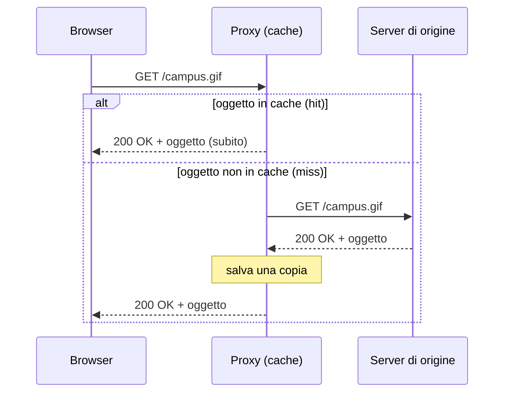
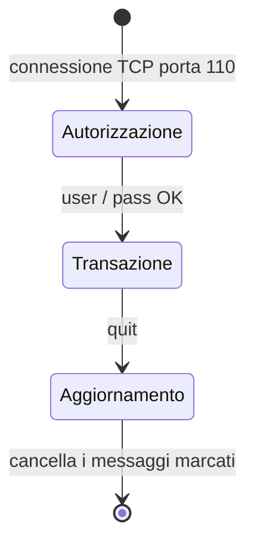
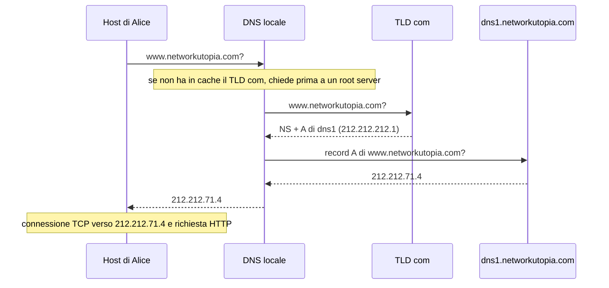
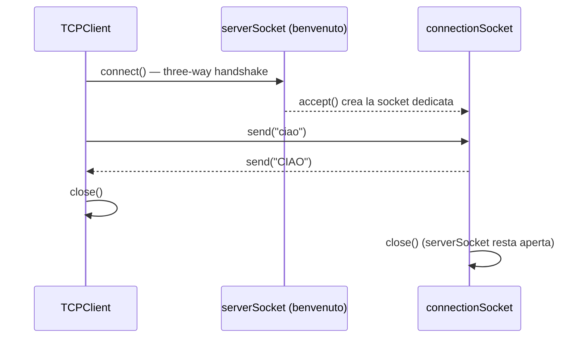

# Livello di applicazione

> [!abstract] Di cosa parla questo capitolo
> È il primo passo della discesa **top-down** lungo la pila protocollare introdotta in [[01 - TLC - Reti di calcolatori e Internet#1.5 Livelli dei protocolli e modelli di servizio|Capitolo 1]]. Le applicazioni sono la ragion d'essere delle reti: senza applicazioni utili non servirebbero protocolli per supportarle.
> Il capitolo parte dai **principi** (architetture client-server e P2P, processi, socket, servizi di trasporto richiesti), poi studia in dettaglio le applicazioni più importanti: **Web e HTTP**, **posta elettronica** (SMTP, POP3, IMAP), **DNS**, **distribuzione di file P2P** (BitTorrent), **streaming video e CDN**. Chiude con la **programmazione delle socket** in Python, su UDP e su TCP.
> Il livello di applicazione è un buon punto di partenza perché ci è familiare: molti concetti che compaiono qui (affidabilità, connessioni, caching, client e server) torneranno ai livelli inferiori.
> Mappa del corso: [[MOC - Telecomunicazioni]].

> [!info] Fonte
> Kurose, Ross, *Reti di calcolatori e Internet*, 7ª ed., Capitolo 2 (pp. 81–160). Le pagine citate sono quelle **del libro**: per il PDF aggiungi 27.

---

## 2.1 Principi delle applicazioni di rete

Sviluppare un'applicazione di rete significa scrivere **programmi che girano sui sistemi periferici** e comunicano tra loro attraverso la rete. Nel Web, per esempio, ci sono due programmi diversi, il **browser** sull'host dell'utente e il **web server** sull'host server. In un sistema P2P, invece, ogni host esegue un programma simile o identico.

> [!important] Le applicazioni si scrivono solo per gli host
> Non serve (e non si può) scrivere software per i dispositivi del nucleo come router o switch: come visto nella [[01 - TLC - Reti di calcolatori e Internet#Incapsulamento|figura dei livelli]], questi lavorano solo fino al livello di rete o di collegamento, non al livello applicativo. Questo confinamento delle applicazioni ai bordi della rete ha permesso lo sviluppo rapidissimo di nuove applicazioni.

![[TLC-p110-1.png]]

La figura mostra la comunicazione tra due applicazioni. Le due frecce collegano le pile protocollari **complete** di tre sistemi periferici: uno nella rete mobile e due nella rete aziendale. Nessun router intermedio partecipa al livello di applicazione.

_(libro, pp. 82–83)_

### Architetture delle applicazioni di rete

Vedi [[Architetture Client-Server e P2P]].

Prima di scrivere codice bisogna scegliere l'**architettura dell'applicazione**. È diversa dall'architettura di rete, cioè dai cinque livelli del Capitolo 1, che per lo sviluppatore è fissata. L'architettura dell'applicazione decide come l'applicazione è organizzata sui vari sistemi periferici. Le due architetture principali sono **client-server** e **P2P**.

![[TLC-p111-1.png]]

- **(a) Client-server**: le frecce partono da molti host diversi e arrivano tutte a un server nella rete aziendale.
- **(b) P2P**: le frecce collegano direttamente coppie di host degli utenti.

**Architettura client-server** (vedi anche [[Modello Client-Server]]):
- un host **sempre attivo**, il **server**, risponde alle richieste di molti altri host, i **client**;
- i client **non comunicano direttamente tra loro**: due browser non si parlano;
- il server ha un **indirizzo fisso e noto** (l'indirizzo IP), quindi il client può contattarlo in qualsiasi momento;
- esempi: Web, FTP, Telnet, posta elettronica;
- spesso un solo server non basta (pensa a un social network con milioni di utenti). Si usano allora i **data center**, che ospitano molti host e formano un potente server virtuale. Google ha 50–100 data center che gestiscono ricerca, YouTube e Gmail. I costi sono alti: alimentazione, manutenzione, banda verso Internet.

**Architettura P2P**:
- l'infrastruttura di server è **minima o assente**: si sfrutta la comunicazione diretta tra coppie di host collegati in modo intermittente, i **peer** ("pari");
- i peer non sono del fornitore del servizio: sono PC e portatili degli utenti, a casa, all'università o in ufficio;
- esempi: condivisione di file (BitTorrent), download accelerati (Xunlei), telefonia e videoconferenza (Skype);
- esistono anche **architetture ibride**: nella messaggistica istantanea i server tengono traccia degli indirizzi IP degli utenti, ma i messaggi viaggiano direttamente tra gli host.

> [!tip] Punto di forza del P2P: l'auto-scalabilità
> In P2P ogni peer genera carico, perché richiede file, ma **aggiunge anche capacità di servizio**, perché distribuisce file agli altri. Il sistema cresce insieme agli utenti senza servire grandi data center. Il prezzo da pagare sono sfide di sicurezza, prestazioni e affidabilità. La scalabilità viene dimostrata in modo quantitativo in [[#Scalabilità dell'architettura P2P]].

_(libro, pp. 84–85)_

### Processi comunicanti

Non sono i *programmi* a comunicare, ma i **processi**, cioè i programmi in esecuzione. Due processi sullo **stesso** host comunicano con meccanismi di comunicazione tra processi gestiti dal sistema operativo (vedi [[Inter-Process Communication]]). Qui interessano i processi su host **diversi**, che comunicano **scambiandosi messaggi** attraverso la rete.

#### Processi client e server

In ogni coppia di processi che comunicano, uno si chiama **client** e l'altro **server**:

> [!quote] Dal libro — Definizione (p. 86)
> Nel contesto di una sessione di comunicazione tra una coppia di processi, quello che **avvia la comunicazione** (cioè contatta l'altro processo all'inizio della sessione) è indicato come **client**, mentre quello che **attende di essere contattato** per iniziare la sessione è detto **server**.

- Nel Web il browser è il client e il web server è il server.
- In P2P, chi scarica è il client e chi carica è il server. Lo stesso peer può fare entrambe le cose, ma **in una data sessione** i ruoli sono definiti.
- Il curatore italiano precisa in nota che questa definizione vale per i servizi in modalità **pull**, dove il client "tira" a sé i dati. Nella modalità **push**, come la messaggistica istantanea, il server spinge i dati verso il client. Una lettura più generale è questa: client è chi **richiede** il servizio, server è chi lo **eroga**.

#### L'interfaccia tra il processo e la rete: la socket

Vedi [[Socket]].

Un processo invia e riceve messaggi attraverso un'interfaccia software chiamata **socket**.

> [!example] Analogia: la casa e la porta
> Il processo è una **casa**, la socket è la sua **porta**. Per spedire un messaggio il processo lo fa uscire dalla porta e si affida all'infrastruttura di trasporto esterna, che lo porta fino alla porta del destinatario. Lì il messaggio entra e il processo ricevente lo elabora.

![[TLC-p114-1.png]]

La figura mostra due host che comunicano via Internet usando TCP:
- il **processo** sta sopra la socket ed è *controllato dallo sviluppatore dell'applicazione*;
- sotto la socket c'è **TCP con i suoi buffer e variabili**, *controllato dal sistema operativo*.

La socket è quindi l'interfaccia tra **livello di applicazione** e **livello di trasporto**, ed è anche chiamata **API** (*Application Programming Interface*) tra applicazione e rete. Lo sviluppatore controlla tutto il lato applicativo, ma sul trasporto ha poco controllo:
1. può **scegliere il protocollo di trasporto**;
2. può a volte fissare alcuni **parametri**, come la dimensione massima del buffer e del segmento.

#### Indirizzamento

Per ricevere messaggi un processo deve avere un indirizzo. Servono **due** informazioni:
1. l'**indirizzo IP** dell'host: per ora basta sapere che è un numero di 32 bit che identifica l'host in modo univoco (Capitolo 4; vedi [[Protocollo IP]]);
2. un identificatore del processo, o meglio della socket, sull'host: il **numero di porta**.

Alle applicazioni più note sono assegnate porte specifiche: il web server usa la **porta 80**, il server di posta SMTP la **porta 25**. L'elenco delle porte standard è su `www.iana.org`.

_(libro, pp. 86–88)_

### Servizi di trasporto disponibili per le applicazioni

Vedi [[Servizi di Trasporto per le Applicazioni]].

Lato mittente l'applicazione "spinge" i messaggi nella socket; lato ricevente il livello di trasporto li consegna alla socket di destinazione. Internet offre più protocolli di trasporto, e lo sviluppatore deve scegliere quello con i servizi più adatti, come si sceglie tra treno e aereo per un viaggio. I servizi possibili si classificano in **quattro dimensioni**:

| Servizio | Cosa significa | Chi ne ha bisogno |
| --- | --- | --- |
| **Trasferimento dati affidabile** | i dati arrivano **corretti e completi** | posta, trasferimento file, web, applicazioni finanziarie. Le applicazioni **che tollerano le perdite** (*loss-tolerant*), come audio e video, possono farne a meno |
| **Throughput** | garantire almeno $r$ bps disponibili | le applicazioni **sensibili alla banda** (*bandwidth-sensitive*, es. telefonia a 32 kbps) lo richiedono; le **applicazioni elastiche** (posta, file, web) usano quello che c'è: "più ce n'è, meglio è" |
| **Temporizzazione** (*timing*) | garanzie sul ritardo, es. ogni bit arriva entro 100 ms | applicazioni interattive in tempo reale: telefonia, videoconferenza, giochi, ambienti virtuali |
| **Sicurezza** | riservatezza (cifratura), integrità, autenticazione | quasi tutte |

**Requisiti di alcune applicazioni** (Figura 2.4 del libro):

| Applicazione | Tolleranza alla perdita | Throughput | Sensibilità al tempo |
| --- | --- | --- | --- |
| Trasferimento file / download | No | Variabile | No |
| E-mail | No | Variabile | No |
| Web | No | Variabile (pochi kbps) | No |
| Telefonia / videoconferenza | Sì | Audio: pochi kbps – 1 Mbps; video: 10 kbps – 5 Mbps | Sì: centinaia di ms |
| Streaming audio/video memorizzati | Sì | Come sopra | Sì: pochi secondi |
| Giochi interattivi | Sì | Fino a 10 kbps | Sì: centinaia di ms |
| Messaggistica istantanea | No | Variabile | Sì e no |

_(libro, pp. 88–91)_

### Servizi di trasporto offerti da Internet

Vedi [[TCP e UDP]] (Sistemi di Calcolo 2).

Internet mette a disposizione due protocolli di trasporto, **TCP** e **UDP**, e la scelta tra i due è una delle prime decisioni dello sviluppatore.

**Servizi di TCP**:
- **Servizio orientato alla connessione**: prima che i messaggi applicativi comincino a fluire, client e server si scambiano informazioni di controllo, il cosiddetto **handshaking**. Dopo l'handshaking esiste una **connessione TCP** tra le due socket. La connessione è **full-duplex**: i due processi possono inviare messaggi contemporaneamente. Alla fine l'applicazione deve chiuderla.
- **Trasferimento affidabile**: i dati arrivano **senza errori, senza perdite, senza duplicati e nell'ordine giusto**, come flusso di byte.
- **Controllo di congestione**: "strozza" il mittente quando la rete è congestionata. È un servizio per il benessere generale di Internet, non per i due processi che comunicano.

**Servizi di UDP**: protocollo **leggero e senza fronzoli**, **senza connessione** (niente handshaking), **non affidabile** (i messaggi possono non arrivare o arrivare in disordine) e **senza controllo di congestione**: il mittente può spingere dati a qualsiasi velocità. Il throughput reale resta comunque limitato da banda e congestione.

> [!tip] Box 2.1 — Rendere sicuro TCP: SSL
> Né TCP né UDP cifrano i dati: una password inviata tramite socket viaggia **in chiaro** su tutti i collegamenti. Per questo è stato sviluppato **SSL** (*Secure Sockets Layer*), un arricchimento di TCP che aggiunge **cifratura, integrità dei dati e autenticazione end-to-end**.
> SSL **non è un terzo protocollo di trasporto**: è implementato **a livello di applicazione**, con librerie da includere sia nel client sia nel server, e ha API simili alle socket TCP. Il processo passa i dati in chiaro alla socket SSL, SSL li cifra e li passa a TCP, e dall'altra parte avviene il contrario (Capitolo 8). Vedi anche [[HTTPS]]. _(libro, p. 92)_

**Servizi non forniti.** TCP con SSL copre affidabilità e sicurezza, ma **nessuno dei due protocolli garantisce throughput o temporizzazione**. Le applicazioni sensibili ai ritardi, come la telefonia, funzionano comunque perché sono **progettate per convivere con l'assenza di garanzie** (Capitolo 9). Quando il ritardo è eccessivo o il throughput è molto limitato, però, anche la progettazione più intelligente ha dei limiti.

**Protocolli usati da alcune applicazioni** (Figura 2.5 del libro):

| Applicazione | Protocollo applicativo | Trasporto |
| --- | --- | --- |
| Posta elettronica | SMTP [RFC 5321] | TCP |
| Accesso a terminali remoti | Telnet [RFC 854] | TCP |
| Web | HTTP [RFC 2616] | TCP |
| Trasferimento file | FTP [RFC 959] | TCP |
| Multimedia streaming | HTTP (es. YouTube) | TCP |
| Telefonia Internet | SIP [RFC 3261], RTP [RFC 3550] o proprietario (es. Skype) | UDP o TCP |

Posta, accesso remoto, web e file usano **TCP** perché serve l'affidabilità. La telefonia Internet preferisce **UDP**, per evitare il controllo di congestione e i messaggi aggiuntivi, ma ha spesso TCP come **riserva**, perché molti firewall bloccano UDP.

_(libro, pp. 90–93)_

### Protocolli a livello di applicazione

Vedi [[Protocollo di Rete]].

Un **protocollo a livello di applicazione** definisce come i processi di un'applicazione, su host diversi, si scambiano messaggi. In particolare definisce:
- i **tipi** di messaggi (es. richiesta e risposta);
- la **sintassi** dei messaggi (quali campi ci sono e come sono descritti);
- la **semantica** dei campi (il significato delle informazioni);
- le **regole** per stabilire quando e come un processo invia messaggi e risponde.

Alcuni protocolli sono **pubblici**, definiti negli RFC (es. HTTP, RFC 2616): un browser che rispetta l'RFC funziona con qualsiasi server che lo rispetti. Altri sono **proprietari** (es. Skype).

> [!important] Applicazione ≠ protocollo applicativo
> Il protocollo è **solo una parte** dell'applicazione.
> - **Web** = standard per i documenti (HTML) + browser (Firefox, IE) + web server (Apache) + protocollo **HTTP**.
> - **Posta elettronica** = server di posta + client di posta (Outlook) + standard per i messaggi + protocollo **SMTP** e altri.

Il capitolo tratta cinque applicazioni: **Web**, **posta elettronica**, **DNS** (un servizio di "directory", cioè di elenco, non di "cartella"), **P2P** e **streaming video con CDN**.

_(libro, pp. 94–95)_

---

## 2.2 Web e HTTP

Fino ai primi anni '90 Internet era usata quasi solo da ricercatori e studenti. Il **World Wide Web** (Berners-Lee, 1994) è stata la prima applicazione a catturare l'attenzione del grande pubblico. Le sue caratteristiche principali sono:
- funziona **su richiesta** (*on demand*): si ottiene quello che si vuole quando lo si vuole, a differenza di radio e TV;
- chiunque può diventare editore a costi bassissimi;
- link ipertestuali e motori di ricerca permettono di navigare tra moltissimi siti;
- è una piattaforma per molte killer application (YouTube, Gmail, Instagram, Maps).

_(libro, pp. 95–96)_

### Panoramica di HTTP

Vedi [[Protocollo HTTP]].

**HTTP** (*HyperText Transfer Protocol*, RFC 1945 e RFC 2616) è il protocollo applicativo del Web. È implementato in due programmi, **client** e **server**, che si scambiano **messaggi HTTP**. Il protocollo definisce la struttura dei messaggi e l'ordine in cui vengono scambiati. Vedi anche la nota [[HTTP]] di Cybersecurity.

Terminologia:
- una **pagina web** (o documento) è fatta di **oggetti**;
- un **oggetto** è un file (HTML, JPEG, applet Java, video…) indirizzabile tramite un **URL**;
- di solito una pagina è composta da un **file HTML principale** che referenzia altri oggetti tramite i loro URL. Una pagina con testo HTML e 5 immagini JPEG ha **6 oggetti**;
- un URL ha due parti: il **nome dell'host** e il **percorso** dell'oggetto. In `http://www.someSchool.edu/someDepartment/picture.gif` l'host è `www.someSchool.edu` e il percorso è `/someDepartment/picture.gif`;
- il **browser** implementa il lato client di HTTP, il **web server** il lato server (Apache, Microsoft IIS).

![[TLC-p124-1.png]]

La figura mostra il **comportamento richiesta-risposta**: un PC con Internet Explorer e uno smartphone Android con Chrome inviano ciascuno una *richiesta HTTP* allo stesso server Apache e ricevono una *risposta HTTP*.

**HTTP usa TCP.** Il client apre una connessione TCP con il server e poi entrambi usano le proprie socket. Una volta che un messaggio è entrato nella socket è "nelle mani" di TCP, che garantisce che arrivi intatto. HTTP non deve preoccuparsi di perdite o riordini: è il vantaggio dell'architettura a livelli.

> [!important] HTTP è senza stato (*stateless*)
> Il server **non memorizza alcuna informazione** sui client. Se lo stesso client chiede lo stesso oggetto due volte a pochi secondi di distanza, il server lo rimanda, perché non ricorda di averlo già inviato. Questo semplifica molto il server, che può servire milioni di browser. Per "ricordare" gli utenti esistono i [[#Interazione utente-server: i cookie|cookie]].

_(libro, pp. 96–97)_

### Connessioni persistenti e non persistenti

Vedi [[Connessioni Persistenti e Non Persistenti]].

Quando client e server si scambiano una serie di richieste e risposte su TCP, lo sviluppatore deve scegliere:
- **connessioni non persistenti**: ogni coppia richiesta/risposta usa una **connessione TCP separata**;
- **connessioni persistenti**: tutte le richieste e risposte viaggiano **sulla stessa connessione TCP**.

HTTP supporta entrambe; di default usa le persistenti.

#### HTTP con connessioni non persistenti

Esempio: una pagina con un file HTML principale e **10 immagini JPEG**, 11 oggetti in tutto sullo stesso server, all'URL `http://www.someSchool.edu/someDepartment/home.index`.

1. Il client apre una connessione TCP con `www.someSchool.edu` sulla **porta 80**.
2. Il client invia tramite la socket una **richiesta HTTP** con il percorso `/someDepartment/home.index`.
3. Il server riceve la richiesta, recupera l'oggetto, lo incapsula in una **risposta HTTP** e la invia.
4. Il server chiede a TCP di chiudere la connessione, ma TCP la chiude solo quando è sicuro che il client abbia ricevuto la risposta.
5. Il client riceve la risposta e la connessione termina. Il client esamina il file HTML e trova i riferimenti ai 10 JPEG.
6. I passi 1–4 si ripetono **per ogni immagine**.

Totale: **11 connessioni TCP**. I browser possono aprire le connessioni in **serie** o in **parallelo**: di default ne aprono da 5 a 10 in parallelo, ognuna per una richiesta/risposta. HTTP non dice nulla su come il browser debba visualizzare la pagina: definisce solo il protocollo di comunicazione.

**Stima del tempo di risposta.** Il **round-trip time (RTT)** è il tempo che un piccolo pacchetto impiega per andare dal client al server e tornare. Include i ritardi di propagazione, accodamento ed elaborazione (vedi [[01 - TLC - Reti di calcolatori e Internet#I quattro tipi di ritardo|Capitolo 1]]).

![[TLC-p126-1.png]]

La figura scompone il tempo per richiedere e ricevere un file HTML:
1. **inizializzazione della connessione TCP**: il client invia un piccolo segmento TCP e il server risponde con una conferma. Questo richiede **1 RTT**; sono le prime due parti del **three-way handshake** ("stretta di mano a tre vie");
2. **richiesta del file**: il client invia la richiesta HTTP insieme alla terza parte dell'handshake (l'acknowledgement), e il server risponde. Richiesta e inizio della risposta richiedono **un altro RTT**;
3. **tempo di trasmissione del file**: la banda scura obliqua è il file che arriva al client.

$$T_{\text{risposta}} \approx 2\,\text{RTT} + t_{\text{trasmissione del file}}$$

#### HTTP con connessioni persistenti

Le connessioni non persistenti hanno due limiti:
- per **ogni oggetto** bisogna creare una nuova connessione, con buffer e variabili TCP sia nel client sia nel server: un grave onere per un server con centinaia di client;
- ogni oggetto paga **2 RTT**, uno per aprire la connessione e uno per la richiesta.

Con **HTTP 1.1 persistente** il server **lascia aperta** la connessione dopo la risposta:
- l'intera pagina (HTML + 10 immagini), e anche più pagine, viaggia su **una sola connessione**;
- le richieste possono essere inviate **una di seguito all'altra** senza aspettare le risposte (*pipelining*);
- il server chiude la connessione dopo un periodo di inattività configurabile.

Il default di HTTP è **persistente con pipelining**. **HTTP/2** (RFC 7540) aggiunge la possibilità di **intercalare** più richieste e risposte sulla stessa connessione e un meccanismo di **priorità**. Vedi [[HTTP-2]].

_(libro, pp. 97–100)_

### Formato dei messaggi HTTP

Vedi [[Messaggi HTTP]].

Esistono due tipi di messaggi: **richiesta** e **risposta**.

#### Messaggio di richiesta HTTP

```http
GET /somedir/page.html HTTP/1.1
Host: www.someschool.edu
Connection: close
User-agent: Mozilla/5.0
Accept-language: fr
```

- È **testo ASCII** leggibile; ogni riga termina con **carriage return + line feed** (CR LF), e dopo l'ultima riga ce n'è un'altra coppia CR LF.
- La prima riga è la **riga di richiesta** (*request line*) e ha tre campi:
  - **metodo**: `GET`, `POST`, `HEAD`, `PUT`, `DELETE`;
  - **URL**;
  - **versione** di HTTP.
- Le righe successive sono le **righe di intestazione** (*header lines*):
  - `Host:` indica l'host dell'oggetto. Sembra superfluo, visto che la connessione è già aperta, ma serve ai **proxy cache**;
  - `Connection: close` dice al server di non usare connessioni persistenti e di chiudere dopo l'invio;
  - `User-agent:` indica il tipo di browser (qui Firefox), così il server può inviare versioni diverse dello stesso oggetto;
  - `Accept-language:` è una delle intestazioni di **negoziazione dei contenuti**: qui l'utente preferisce la versione in francese.

![[TLC-p129-1.png]]

La figura mostra il **formato generale della richiesta**: riga di richiesta (metodo, URL, versione, separati da spazi `sp` e terminati da `cr lf`), righe di intestazione (`nome del campo: valore`), una **riga vuota** (`cr lf`) e il **corpo dell'entità** (*entity body*).

Il corpo:
- è **vuoto** con `GET`;
- con `POST` contiene i dati inseriti dall'utente in un **form**: si richiede ancora una pagina, ma il contenuto dipende da quei dati.

I form possono usare anche `GET`, mettendo i dati **nell'URL**: con due campi riempiti con "scimmie" e "banane" l'URL diventa `www.somesite.com/animalsearch?scimmie&banane`.

| Metodo | Effetto |
| --- | --- |
| `GET` | richiede l'oggetto indicato dall'URL (il più usato) |
| `POST` | invia dati (es. un form) nel corpo |
| `HEAD` | come `GET`, ma il server **non invia l'oggetto**, solo l'intestazione (utile per il debug) |
| `PUT` | carica un oggetto in un percorso del server (pubblicazione web) |
| `DELETE` | cancella un oggetto dal server |

> [!note] Nota del curatore
> Per sicurezza `PUT` e `DELETE` sono spesso **disabilitati** sui web server, e si preferisce `POST` specificando nei campi cosa aggiungere o cancellare, così l'applicazione può fare controlli aggiuntivi. _(p. 103)_ Vedi anche [[HTTP Verb Tampering]].

#### Messaggio di risposta HTTP

```http
HTTP/1.1 200 OK
Connection: close
Date: Thu, 18 Aug 2015 15:44:04 GMT
Server: Apache/2.2.3 (CentOS)
Last-Modified: Tue, 18 Aug 2015 15:11:03 GMT
Content-Length: 6821
Content-Type: text/html

(data data data data data ...)
```

Il messaggio ha tre sezioni:
- la **riga di stato**: versione del protocollo, **codice di stato** e **messaggio** corrispondente. Qui significa "HTTP/1.1, tutto ok, ecco l'oggetto";
- sei **righe di intestazione**:
  - `Connection: close`: il server chiuderà la connessione dopo l'invio;
  - `Date:`: quando il server ha **creato e inviato la risposta**, non quando l'oggetto è stato modificato;
  - `Server:`: il software del server, analogo a `User-agent:`;
  - `Last-Modified:`: quando l'oggetto è stato creato o modificato l'ultima volta. È fondamentale per le **cache**;
  - `Content-Length:`: la lunghezza dell'oggetto in byte;
  - `Content-Type:`: il tipo dell'oggetto. Il tipo si identifica ufficialmente da qui, **non dall'estensione** del file;
- il **corpo**, che contiene l'oggetto richiesto.

![[TLC-p131-1.png]]

Il **formato generale della risposta** è speculare a quello della richiesta: riga di stato (versione, codice di stato, frase), righe di intestazione, riga vuota e corpo.

| Codice | Significato |
| --- | --- |
| `200 OK` | richiesta riuscita, l'informazione è nella risposta |
| `301 Moved Permanently` | l'oggetto è stato spostato; il nuovo URL è nell'intestazione `Location:` e il client lo segue automaticamente |
| `400 Bad Request` | errore generico: il server non ha capito la richiesta |
| `404 Not Found` | il documento non esiste sul server |
| `505 HTTP Version Not Supported` | il server non supporta la versione di HTTP richiesta |

> [!example] Provarlo a mano con Telnet
> ```text
> telnet gaia.cs.umass.edu 80
> GET /kurose_ross/interactive/index.php HTTP/1.1
> Host: gaia.cs.umass.edu
> ```
> Premendo Invio due volte, Telnet apre una connessione TCP sulla porta 80 e invia la richiesta, e si vede la risposta completa. Con `HEAD` al posto di `GET` si ricevono solo le intestazioni.

Le intestazioni da includere dipendono da browser e server: versione del protocollo (un browser HTTP/1.0 non genera righe HTTP/1.1), configurazione dell'utente (lingua preferita) e presenza in cache di una copia, magari scaduta, dell'oggetto.

_(libro, pp. 100–105)_

### Interazione utente-server: i cookie

Vedi [[Cookie HTTP]].

I server HTTP sono **senza stato**, ma spesso è utile **identificare gli utenti**, per limitare l'accesso o personalizzare i contenuti. HTTP usa allora i **cookie** (RFC 6265). Vedi anche [[Cookie]] (Cybersecurity, sicurezza dei cookie).

La tecnologia dei cookie ha **quattro componenti**:
1. una riga di intestazione `Set-cookie:` nella **risposta** HTTP;
2. una riga di intestazione `Cookie:` nella **richiesta** HTTP;
3. un **file di cookie** sull'host dell'utente, gestito dal browser;
4. un **database** sul sito web.

![[TLC-p133-1.png]]

La figura segue Susan, che ha già un cookie di eBay (`ebay: 8734`) e visita per la prima volta Amazon:
1. il browser invia una normale richiesta HTTP al server di Amazon;
2. il server **crea un identificativo**, 1678, e una voce nel suo database, e risponde con `Set-cookie: 1678`;
3. il browser aggiunge al file dei cookie la riga `amazon: 1678`;
4. da quel momento **ogni richiesta** al sito contiene `Cookie: 1678`, e il server esegue un'"azione specifica dei cookie" consultando il database;
5. **una settimana dopo**, Susan torna sul sito e il browser invia ancora `Cookie: 1678`: il server la riconosce.

Usi dei cookie:
- Amazon sa **quali pagine** ha visitato l'utente 1678, in che ordine e quando, anche senza conoscerne il nome;
- **carrello** della spesa durante una sessione;
- **raccomandazioni** basate sulle visite passate;
- se Susan si registra con nome, e-mail e carta di credito, Amazon associa questi dati all'ID: è lo **"one-click shopping"**;
- creano un **livello di sessione** sopra HTTP, che è senza stato. Per esempio, dopo il login alla webmail il cookie identifica l'utente per tutta la sessione.

> [!warning] Privacy
> I cookie sono controversi: combinando cookie e dati forniti dall'utente, un sito può imparare molto su una persona e magari **venderlo a terzi**.

_(libro, pp. 105–107)_

### Web caching

Vedi [[Web Caching]].

Una **web cache**, o **proxy server**, è un'entità di rete che soddisfa le richieste HTTP **al posto del server di origine**. Ha una propria memoria su disco con le copie degli oggetti richiesti di recente. Il browser può essere configurato in modo che tutte le richieste passino prima dal proxy. Vedi anche [[Proxy]].

![[TLC-p135-1.png]]

Nella figura due **client** inviano richieste HTTP al **proxy server**, che a sua volta le inoltra ai **server di origine** solo quando serve.

Esempio: il browser chiede `http://www.someschool.edu/campus.gif`:
1. il browser apre una connessione TCP **con il proxy** e gli invia la richiesta;
2. il proxy controlla se ha una **copia locale**: se c'è, la restituisce subito;
3. se non c'è, apre una connessione TCP con il **server di origine** (`www.someschool.edu`), chiede l'oggetto e lo riceve;
4. salva una copia nella cache e la invia al browser sulla connessione già aperta.



> [!note] Il proxy è sia server sia client
> Verso il browser fa da **server**, verso il server di origine fa da **client**.

Di solito il proxy viene installato da un **ISP**: un'università sulla propria rete, oppure un grande ISP come Comcast, che preconfigura i browser dei clienti. Il web caching si è diffuso per due motivi:
- **riduce i tempi di risposta**, soprattutto se la banda tra client e server di origine è molto più bassa di quella tra client e proxy;
- **riduce il traffico** sul collegamento d'accesso a Internet di un'istituzione, e quindi i costi, oltre al traffico Web complessivo in Internet.

#### Esempio numerico: proxy o collegamento più veloce?

![[TLC-p136-1.png]]

Una **rete locale a 100 Mbps** è collegata a Internet da un **collegamento d'accesso a 15 Mbps** tra due router. Dati:
- oggetti da **1 Mbit** in media;
- **15 richieste al secondo** dai browser verso i server di origine;
- messaggi di richiesta trascurabili;
- "**ritardo Internet**", cioè il tempo dal router lato Internet alla risposta, in media **2 s**.

Il tempo di risposta totale è: ritardo della LAN + ritardo di accesso + ritardo Internet. Usando l'[[01 - TLC - Reti di calcolatori e Internet#Ritardo di accodamento e intensità di traffico|intensità di traffico]]:

$$I_{\text{LAN}} = \frac{15 \text{ rich/s} \times 1 \text{ Mbit}}{100 \text{ Mbps}} = 0{,}15 \qquad I_{\text{accesso}} = \frac{15 \times 1}{15} = 1$$

- Con 0,15 la LAN introduce poche decine di ms, trascurabili.
- Con **1** sul collegamento d'accesso il ritardo **cresce senza limiti**: il tempo di risposta va nell'ordine dei **minuti**, inaccettabile.

| Soluzione | Effetto | Tempo medio di risposta | Costo |
| --- | --- | --- | --- |
| **1. Accesso da 15 a 100 Mbps** | $I_{\text{accesso}} = 0{,}15$, ritardo d'accesso trascurabile | ≈ **2 s** (solo il ritardo Internet) | alto: bisogna aggiornare il collegamento |
| **2. Proxy nella LAN** (hit rate 0,4) | il 40% delle richieste viene servito dalla cache in ~10 ms; solo il 60% passa dal collegamento, quindi $I_{\text{accesso}} = 0{,}6$ e il ritardo è di decine di ms | $0{,}4 \cdot 0{,}01 + 0{,}6 \cdot 2{,}01 \approx$ **1,21 s** | basso: spesso software gratuito su un PC |

![[TLC-p138-1.png]]

La figura mostra la seconda soluzione: la **cache** è collegata alla stessa LAN dei client. L'**hit rate** è la frazione di richieste soddisfatte dalla cache, e in pratica varia tra 0,2 e 0,7.

> [!summary] Risultato
> Il proxy dà un tempo di risposta **migliore** (1,21 s contro 2 s) **senza** aggiornare il collegamento. Con le **CDN** (Akamai, Limelight, Google, Netflix) le cache distribuite geograficamente diventano sempre più importanti (vedi [[#Reti per la distribuzione di contenuti (CDN)]]).

_(libro, pp. 107–111)_

#### GET condizionale

Vedi [[GET Condizionale]].

La cache introduce un problema: la copia in cache può essere **scaduta**, perché l'oggetto sul server è stato modificato. HTTP offre il **GET condizionale**, cioè una richiesta che:
1. usa il metodo `GET`;
2. include l'intestazione `If-modified-since:`.

Esempio:
1. Il proxy chiede per conto di un browser:
   ```http
   GET /fruit/kiwi.gif HTTP/1.1
   Host: www.exotiquecuisine.com
   ```
2. Il server risponde con l'oggetto e la data di ultima modifica:
   ```http
   HTTP/1.1 200 OK
   Date: Sat, 3 Oct 2015 15:39:29
   Server: Apache/1.3.0 (Unix)
   Last-Modified: Wed, 9 Sep 2015 09:23:24
   Content-Type: image/gif
   (data data data data data ...)
   ```
   Il proxy inoltra l'oggetto e lo salva in cache **insieme alla data** `Last-Modified`.
3. Una settimana dopo un altro browser chiede lo stesso oggetto, e il proxy verifica con un GET condizionale:
   ```http
   GET /fruit/kiwi.gif HTTP/1.1
   Host: www.exotiquecuisine.com
   If-modified-since: Wed, 9 Sep 2015 09:23:24
   ```
   Il valore di `If-modified-since:` è **esattamente** quello di `Last-Modified:` ricevuto prima.
4. Se l'oggetto non è cambiato, il server risponde:
   ```http
   HTTP/1.1 304 Not Modified
   Date: Sat, 10 Oct 2015 15:39:29
   Server: Apache/1.3.0 (Unix)
   (corpo vuoto)
   ```
   Il **corpo è vuoto**, così non si spreca banda, e il proxy consegna la sua copia.

_(libro, pp. 111–112)_

---

## 2.3 Posta elettronica in Internet

La posta elettronica è stata l'applicazione più diffusa nei primi anni di Internet ed è ancora una killer application. Come la posta tradizionale è **asincrona**: si invia e si legge quando si vuole. In più è veloce, facile da distribuire, gratuita e supporta allegati, link, HTML e foto.

Vedi anche [[Componenti Chiave del Sistema Email]] (Cybersecurity).

![[TLC-p141-1.png]]

La figura mostra il sistema di posta di Internet. Ci sono tre **server di posta**, ognuno con una **coda di messaggi** in uscita e delle **caselle di posta** (*mailbox*), più vari **agenti utente** collegati ai server. I server comunicano tra loro con **SMTP**.

I componenti principali sono tre:

| Componente | Ruolo | Esempi |
| --- | --- | --- |
| **User agent** (agente utente) | leggere, rispondere, inoltrare, salvare e comporre messaggi | Outlook, Apple Mail |
| **Mail server** | contiene le **caselle di posta** degli utenti e la **coda dei messaggi** in uscita | — |
| **SMTP** | protocollo che trasferisce la posta **tra i mail server** | — |

Percorso tipico: user agent del mittente → mail server del mittente → mail server del destinatario → casella del destinatario. Per accedere alla propria casella Bob si **autentica** con nome utente e password. Se il server di Bob non è raggiungibile, il server di Alice tiene il messaggio in **coda** e riprova, di solito ogni 30 minuti. Se dopo qualche giorno non ci riesce, lo rimuove e avvisa Alice con un'e-mail.

SMTP usa il trasferimento affidabile di **TCP** e ha un lato client e un lato server. Ogni mail server li esegue entrambi: fa da **client** quando invia e da **server** quando riceve.

_(libro, pp. 113–114)_

### SMTP

Vedi [[Protocollo SMTP]] e [[SMTP]] (Cybersecurity).

**SMTP** (RFC 5321) è il cuore della posta di Internet ed è molto **più vecchio di HTTP**: l'RFC originale è del 1982. Ha caratteristiche "**arcaiche**": il **corpo** dei messaggi, oltre alle intestazioni, deve essere **ASCII a 7 bit**. Negli anni '80, con poca banda e senza allegati, aveva senso. Oggi obbliga a **codificare in ASCII** i dati binari multimediali prima dell'invio e a decodificarli all'arrivo (vedi [[MIME]]). HTTP non ha questo vincolo.

**Scenario: Alice invia un messaggio a Bob.**

![[TLC-p142-1.png]]

1. Alice usa il suo user agent, indica l'indirizzo di Bob (`bob@someschool.edu`), compone il messaggio e lo invia.
2. Lo user agent di Alice invia il messaggio al **suo mail server**, che lo mette nella **coda**.
3. Il lato client SMTP sul server di Alice vede il messaggio e apre una **connessione TCP** con il server SMTP sul mail server di Bob.
4. Dopo l'**handshaking SMTP**, il client invia il messaggio sulla connessione.
5. Sul server di Bob il lato server SMTP riceve il messaggio e lo mette nella **casella** di Bob.
6. Bob, quando vuole, lo legge con il suo user agent.

> [!important] Niente server intermedi
> SMTP di solito **non usa mail server intermedi**: se il server di Alice è a Hong Kong e quello di Bob a St. Louis, la connessione TCP è **diretta** tra le due città. Se il server di Bob è spento, il messaggio resta sul server di Alice in attesa di un nuovo tentativo.

**Il dialogo SMTP.** Il client apre una connessione TCP sulla **porta 25**. Se il server non risponde, riprova più tardi. Poi c'è un handshaking applicativo: come le persone che si presentano, client e server si presentano prima di scambiare dati, e il client indica mittente e destinatario. Quindi invia il messaggio. Se ce ne sono altri per lo stesso server, usa la **stessa connessione** (SMTP usa **connessioni persistenti**); altrimenti chiede a TCP di chiuderla.

Trascrizione tra il client `crepes.fr` (C) e il server `hamburger.edu` (S):

```text
S: 220 hamburger.edu
C: HELO crepes.fr
S: 250 Hello crepes.fr, pleased to meet you
C: MAIL FROM: <alice@crepes.fr>
S: 250 alice@crepes.fr ... Sender ok
C: RCPT TO: <bob@hamburger.edu>
S: 250 bob@hamburger.edu ... Recipient ok
C: DATA
S: 354 Enter mail, end with "." on a line by itself
C: Ti piace il ketchup?
C: Che cosa ne pensi dei cetrioli?
C: .
S: 250 Message accepted for delivery
C: QUIT
S: 221 hamburger.edu closing connection
```

- Comandi del client: `HELO` ("ciao"), `MAIL FROM` ("mail da"), `RCPT TO` ("recapitare a"), `DATA` ("dati"), `QUIT` ("basta").
- La fine del messaggio è una riga con **solo un punto** (in realtà `CRLF.CRLF`).
- Ogni risposta del server ha un **codice** e una spiegazione opzionale in inglese.
- Per ogni nuovo messaggio sulla stessa connessione si ricomincia da `MAIL FROM:`; `QUIT` arriva solo alla fine.
- Si può provare a mano con `telnet serverName 25`.

_(libro, pp. 114–117)_

### Confronto con HTTP

| | HTTP | SMTP |
| --- | --- | --- |
| Cosa trasferisce | oggetti da web server a client | messaggi tra mail server |
| Connessioni persistenti | sì | sì |
| Tipo | **pull**: chi vuole il file apre la connessione e lo "tira" | **push**: chi invia apre la connessione e "spinge" il file |
| Codifica | nessun vincolo | tutto (corpo incluso) in **ASCII a 7 bit** |
| Documento con testo e immagini | **ogni oggetto** nel suo messaggio di risposta | **tutti gli oggetti** in un unico messaggio |

_(libro, pp. 117–118)_

### Formati dei messaggi di posta

Come una lettera ha in cima mittente, destinatario e data, anche un'e-mail ha un'**intestazione** prima del corpo. Le righe di intestazione (RFC 5322) sono testo leggibile `parola chiave: valore`, e una **riga vuota** le separa dal corpo (in ASCII).

```text
From: alice@crepes.fr
To: bob@hamburger.edu
Subject: Alla ricerca del significato della vita.
```

- `From:` e `To:` sono **obbligatorie**; `Subject:` e le altre sono opzionali.
- Queste righe sono **diverse dai comandi SMTP** `MAIL FROM` / `RCPT TO`, anche se alcune parole sono uguali: i comandi fanno parte del **protocollo** di trasferimento, le intestazioni fanno parte del **messaggio** stesso. Vedi [[EMAIL - Difference between receivedFrom and ReturnPath]].

_(libro, p. 118)_

### Protocolli di accesso alla posta

Vedi [[POP3 e IMAP]].

Oggi l'utente legge la posta con un client sul proprio dispositivo (PC, portatile, smartphone). Perché allora non mettere il mail server direttamente sul PC di Bob? Perché il server dovrebbe essere **sempre acceso e connesso** per ricevere posta in qualsiasi momento. Si preferisce quindi una casella su un **mail server condiviso e sempre attivo**, gestito dall'ISP (università, azienda).

Perché Alice non invia direttamente al server di Bob? Perché se il server di Bob non fosse raggiungibile, lo user agent di Alice non saprebbe gestire la situazione. Il **server di Alice** invece può riprovare ogni 30 minuti finché non riesce.

Manca un pezzo: Bob non può usare SMTP per **prendere** i messaggi dal suo server, perché è un'operazione **pull**, mentre SMTP è **push**. Serve un **protocollo di accesso alla posta**: **POP3**, **IMAP** o **HTTP**.

![[TLC-p147-1.png]]

Riepilogo dei protocolli:
- **SMTP**: da agente di Alice a server di Alice, e da server di Alice a server di Bob;
- **POP3, IMAP o HTTP**: da server di Bob ad agente di Bob.

_(libro, pp. 118–120)_

#### POP3

**POP3** (*Post Office Protocol v3*, RFC 1939) è molto semplice e con funzioni limitate. Lo user agent apre una connessione TCP sulla **porta 110**. Poi ci sono tre fasi:



1. **Autorizzazione**: lo user agent invia `user <username>` e `pass <password>`, **in chiaro**.
2. **Transazione**: lo user agent recupera i messaggi e può marcarli per la cancellazione (o togliere il marcatore) e chiedere statistiche.
3. **Aggiornamento**: dopo `quit` il server **cancella** i messaggi marcati.

Il server risponde a ogni comando con `+OK` (a volte seguito da dati) oppure con `-ERR`.

```text
telnet mailServer 110
+OK POP3 server ready
user bob
+OK
pass hungry
+OK user successfully logged on
```

Transazione in modalità **"scarica e cancella"**, con 2 messaggi:

```text
C: list
S: 1 498
S: 2 912
S: .
C: retr 1
S: (bla bla ... bla)
S: .
C: dele 1
C: retr 2
S: (bla bla ... bla)
S: .
C: dele 2
C: quit
S: +OK POP3 server signing off
```

I comandi sono quattro: `list` (dimensione dei messaggi), `retr` (recupera), `dele` (marca per la cancellazione) e `quit`.

| Modalità | Pro | Contro |
| --- | --- | --- |
| **Scarica e cancella** | semplice | la posta si **sparpaglia** tra le macchine: un messaggio letto dal PC dell'ufficio non si può rileggere dal portatile |
| **Scarica e mantieni** | i messaggi restano sul server, quindi si rileggono da più macchine | — |

> [!note] Stato in POP3
> Durante una sessione il server tiene traccia dei messaggi marcati, ma **non conserva informazioni di stato tra sessioni diverse**. Questo semplifica molto l'implementazione.

_(libro, pp. 120–121)_

#### IMAP

Con POP3 Bob può organizzare la posta in **cartelle**, ma solo **sulla sua macchina locale**. Un utente mobile vorrebbe invece una gerarchia di cartelle su un **server remoto**, accessibile da più dispositivi.

**IMAP** (RFC 3501) risolve il problema, ma è molto più complesso:
- associa ogni messaggio a una **cartella** sul server. I nuovi messaggi finiscono in **INBOX**, e l'utente può creare cartelle, spostare, leggere e cancellare messaggi;
- permette di **cercare** nelle cartelle remote con vari criteri;
- **conserva lo stato tra sessioni**: i nomi delle cartelle e l'associazione tra messaggi e cartelle;
- permette di scaricare **solo parti** di un messaggio, per esempio solo l'intestazione, il che è utile con connessioni lente per non scaricare allegati audio o video.

Vedi anche [[IMAP]] e [[POP]] (Cybersecurity).

#### Posta basata sul Web

Con la webmail (Hotmail dalla metà degli anni '90, poi Gmail e Yahoo!) lo **user agent è il browser**:
- Bob legge la posta dal server via **HTTP**, non con POP3 o IMAP;
- Alice invia la posta al suo server via **HTTP**, non con SMTP;
- **tra i mail server** si usa comunque **SMTP**.

_(libro, p. 122)_

---

## 2.4 DNS: il servizio di directory di Internet

Vedi anche la tua nota [[DNS]] (architettura e attacchi, da Ethical Hacking).

Gli host si possono identificare in due modi:
- con i **nomi** (*hostname*), come `www.facebook.com` o `gaia.cs.umass.edu`: facili da ricordare per le persone, ma danno poca informazione sulla posizione e, essendo di lunghezza variabile, sono scomodi per i router;
- con gli **indirizzi IP**: 4 byte, come `121.7.106.83`, con una struttura **gerarchica**. Leggendo da sinistra a destra si ottengono informazioni sempre più specifiche sulla rete dell'host, come in un indirizzo postale letto dal basso verso l'alto.

_(libro, p. 123)_

### Servizi forniti da DNS

Le persone preferiscono i nomi, i router gli indirizzi: serve un servizio che **traduca i nomi in indirizzi IP**. È il compito principale del **DNS** (*Domain Name System*), che è insieme:
1. un **database distribuito** implementato in una gerarchia di **DNS server**;
2. un **protocollo applicativo** che permette agli host di interrogare il database.

I DNS server sono di solito macchine UNIX con il software **BIND**. Il DNS usa **UDP sulla porta 53**.

Il DNS è usato da altri protocolli applicativi, come HTTP e SMTP. Quando il browser chiede `www.someschool.edu/index.html`:
1. sull'host gira il lato client del DNS, chiamato anche **resolver** (vedi [[Extra/DNS/Stub Resolver|Stub Resolver]]);
2. il browser estrae il nome `www.someschool.edu` e lo passa al client DNS;
3. il client DNS invia una **query** a un DNS server;
4. riceve una risposta con l'**indirizzo IP**;
5. il browser apre una connessione TCP con quell'indirizzo, sulla porta 80.

Il DNS aggiunge quindi un **ritardo**, ridotto dal **caching** nei DNS server vicini.

Oltre alla traduzione, il DNS offre altri servizi:

| Servizio | Cosa fa | Esempio |
| --- | --- | --- |
| **Host aliasing** | un host con un **nome canonico** complicato può avere degli **alias** più semplici; il DNS restituisce il nome canonico e l'IP | `relay1.west-coast.enterprise.com` ← `enterprise.com`, `www.enterprise.com` |
| **Mail server aliasing** | indirizzi e-mail semplici anche se il server ha un nome complicato; con il record **MX** il mail server e il web server possono avere lo stesso alias | `bob@yahoo.com` → `relay1.west-coast.yahoo.com` |
| **Distribuzione del carico** | a un nome canonico corrisponde un **insieme di IP** (server replicati). Il DNS restituisce tutto l'insieme ma **ne ruota l'ordine** a ogni risposta, e poiché il client usa di solito il primo indirizzo, il traffico si distribuisce | `cnn.com`; vedi [[Load Balancing]] |

Il DNS è definito negli RFC 1034 e 1035.

> [!tip] Box 2.2 — Una funzione vitale ai bordi della rete
> Il DNS è un protocollo applicativo come HTTP: usa il paradigma client-server e si affida al trasporto end-to-end. A differenza del Web, però, l'utente **non interagisce direttamente** con il DNS. È un'altra applicazione della filosofia di Internet: **la complessità sta ai bordi** della rete. _(p. 125)_

_(libro, pp. 123–125)_

### Panoramica del funzionamento di DNS

Un'applicazione che deve tradurre un nome chiama il client DNS: sui sistemi UNIX, per esempio, con `gethostbyname()`. Il client invia la query in un datagramma **UDP alla porta 53** e, dopo un tempo che va da millisecondi a secondi, riceve la risposta. Per l'applicazione il DNS è una **scatola nera**; dentro, in realtà, ci sono moltissimi server distribuiti nel mondo e un protocollo che ne regola la comunicazione.

> [!warning] Perché non un unico DNS server centralizzato?
> - **Unico punto di fallimento**: se si guasta, si ferma tutta Internet.
> - **Volume di traffico**: un solo server dovrebbe gestire tutte le query di centinaia di milioni di host.
> - **Database distante**: le query dall'Australia a New York attraverserebbero mezzo mondo, con ritardi significativi.
> - **Manutenzione**: un database enorme da aggiornare di continuo per ogni nuovo host.
>
> In una parola, **non è scalabile**. Il DNS è infatti progettato come un magnifico esempio di **database distribuito**.

_(libro, p. 126)_

#### Un database distribuito e gerarchico

Vedi [[Gerarchia dei DNS Server]].

![[TLC-p154-1.png]]

La figura mostra una **gerarchia parziale**: in cima il **root DNS server**, sotto i server dei domini `com`, `org` ed `edu`, e più in basso i server di `facebook.com`, `amazon.com`, `pbs.org`, `nyu.edu` e `umass.edu`.

Per trovare l'IP di `www.amazon.com`:
1. il client contatta un **root server**, che restituisce gli IP dei **TLD server** di `com`;
2. contatta un TLD server di `com`, che restituisce l'IP del **server autoritativo** di `amazon.com`;
3. contatta il server autoritativo, che restituisce l'IP di `www.amazon.com`.

| Classe | Ruolo | Dettagli |
| --- | --- | --- |
| **Root server** | forniscono gli IP dei TLD server | **400** server nel mondo, gestiti da **13 organizzazioni** |
| **TLD server** (*top-level domain*) | gestiscono i domini di primo livello (`com`, `org`, `net`, `edu`, `gov`) e quelli dei paesi (`uk`, `fr`, `ca`, `jp`); forniscono gli IP dei server autoritativi | Verisign gestisce `com`, Educause gestisce `edu` |
| **Server autoritativi** | contengono i record DNS degli host pubblici di un'organizzazione (web server, mail server) | gestiti dall'organizzazione stessa o da un fornitore; di solito ce ne sono uno **primario** e uno **secondario** (di backup) |

![[TLC-p155-1.png]]

La mappa mostra la **distribuzione dei root DNS server nel 2016**: i paesi in grigio scuro ne hanno 11 o più (USA, Brasile, Europa, Russia, India, Australia…), quelli chiari da 1 a 10 e quelli bianchi nessuno.

**DNS server locale.** Non fa parte della gerarchia, ma è centrale. Ogni ISP (università, dipartimento, azienda, ISP residenziale) ne ha uno, detto anche **default name server**. L'host ne riceve l'indirizzo, di solito tramite **DHCP** (Capitolo 4). È "vicino" all'host: sulla stessa LAN, o a pochi router di distanza. Riceve le query dell'host e le inoltra nella gerarchia facendo da **proxy**.

#### Query iterative e ricorsive

Vedi [[Query DNS Ricorsive e Iterative]].

**Esempio:** l'host `cse.nyu.edu` vuole l'IP di `gaia.cs.umass.edu`. Il suo server locale è `dns.nyu.edu`, e il server autoritativo per `gaia` è `dns.umass.edu`.

![[TLC-p156-1.png]]

1. L'host invia la query al **server locale** `dns.nyu.edu`.
2–3. Il server locale la inoltra a un **root server**, che guarda il suffisso `edu` e restituisce gli IP dei **TLD server** di `edu`.
4–5. Il server locale chiede a un **TLD server**, che guarda il suffisso `umass.edu` e restituisce l'IP del server autoritativo `dns.umass.edu`.
6–7. Il server locale chiede a **`dns.umass.edu`**, che restituisce l'IP di `gaia.cs.umass.edu`.
8. Il server locale risponde all'host.

In tutto sono **8 messaggi DNS**: 4 query e 4 risposte.

Spesso il TLD conosce solo un **server intermedio**. Se ogni dipartimento di UMass ha il proprio server, `dns.umass.edu` risponde con l'IP di `dns.cs.umass.edu`, e i messaggi diventano **10**.

**Ricorsive o iterative?** Nella figura:
- la query `cse.nyu.edu` → `dns.nyu.edu` è **ricorsiva**: il server locale ottiene la risposta **per conto** del richiedente;
- le altre tre sono **iterative**: ogni server **risponde direttamente** al server locale con il passo successivo.

![[TLC-p157-1.png]]

Questa seconda figura mostra una catena **tutta ricorsiva**: l'host chiede al server locale (1), il locale al root (2), il root al TLD (3), il TLD all'autoritativo (4). Le risposte tornano indietro lungo la stessa catena (5–8).

> [!note] In pratica
> Di solito la query dall'host al server locale è **ricorsiva**, mentre le altre sono **iterative**, come nella prima figura. Le query iterative non sovraccaricano root e TLD server, che non devono "seguire" la risoluzione.

_(libro, pp. 126–130)_

#### DNS caching

Il DNS usa in modo massiccio il **caching**, per ridurre i ritardi e il numero di messaggi in rete:
- ogni server che riceve una risposta può salvare in **cache** la corrispondenza nome → IP;
- se arriva un'altra richiesta per lo stesso nome, risponde subito, **anche se non è autoritativo**;
- le corrispondenze cambiano nel tempo, quindi i dati in cache **scadono** dopo un certo tempo, di solito **2 giorni**;
- esempio: `apricot.nyu.edu` chiede `cnn.com`; poche ore dopo `kiwi.nyu.edu` chiede lo stesso nome, e `dns.nyu.edu` risponde subito dalla cache;
- il server locale può tenere in cache anche gli **IP dei TLD server**, e così **salta i root server**, cosa che succede spesso.

> [!warning] Il rovescio della medaglia
> Il caching è anche ciò che rende possibile il **cache poisoning**: vedi [[DNS#1. Cache Poisoning (categoria)|DNS — Cache Poisoning]] e [[#Vulnerabilità del DNS]].

_(libro, p. 131)_

### Record e messaggi DNS

Vedi [[Record DNS]].

I server DNS memorizzano dei **record di risorsa** (RR, *resource record*), che contengono tra l'altro le corrispondenze nome → indirizzo. Ogni risposta trasporta uno o più RR, nella forma:

```text
(Name, Value, Type, TTL)
```

Il **TTL** (*time to live*) è il tempo di vita residuo del record e stabilisce quando va rimosso dalla cache. Il significato di `Name` e `Value` dipende da `Type`:

| Type | Name | Value | Esempio |
| --- | --- | --- | --- |
| **A** | hostname | **indirizzo IP** | `(relay1.bar.foo.com, 145.37.93.126, A)` |
| **NS** | dominio | hostname del **server autoritativo** del dominio (serve a proseguire la catena di query) | `(foo.com, dns.foo.com, NS)` |
| **CNAME** | alias | **nome canonico** dell'host | `(foo.com, relay1.bar.foo.com, CNAME)` |
| **MX** | alias | nome canonico del **mail server** | `(foo.com, mail.bar.foo.com, MX)` |

- Con MX un'azienda può usare lo **stesso alias** per il mail server e per il web server: per il mail server si interroga il record MX, per l'altro server il CNAME.
- Il server **autoritativo** per un nome contiene il record **A** di quel nome. Un server non autoritativo può comunque averlo in **cache**.
- Un server **non autoritativo** per un nome contiene il record **NS** del dominio che include il nome, più il record **A** che dà l'IP del server indicato nell'NS. Esempio: un TLD server di `edu` contiene `(umass.edu, dns.umass.edu, NS)` e `(dns.umass.edu, 128.119.40.111, A)`.

#### Messaggi DNS

Query e risposta hanno **lo stesso formato**.

![[TLC-p160-1.png]]

| Sezione | Contenuto |
| --- | --- |
| **Intestazione** (12 byte) | **identificazione** (16 bit, copiata nella risposta per abbinarla alla query) · **flag**: query (0) o risposta (1), *autoritativo*, *recursion-desired* (il client chiede la ricorsione), *recursion-available* (il server la supporta) · i quattro campi "numero di…" per le sezioni seguenti |
| **Domande** | il **nome** richiesto e il **tipo** di domanda (A, MX…) |
| **Risposte** | gli RR per il nome richiesto; possono essere più di uno, come nel caso dei server replicati |
| **Autoritativa** | i record di altri server autoritativi |
| **Aggiuntiva** | altri record utili. Per esempio, per una query MX la risposta contiene il nome canonico del mail server, e la sezione aggiuntiva il suo record A con l'IP |

Per provare: il programma **nslookup**, su Windows e UNIX, invia query a qualsiasi DNS server e mostra i record ricevuti.

_(libro, pp. 131–134)_

#### Inserimento di record nel database DNS

Esempio: hai fondato la startup **Network Utopia**.
1. Registri `networkutopia.com` presso un **registrar**, un'azienda che verifica l'unicità del nome, lo inserisce nel DNS e si fa pagare. Fino al 1999 c'era il monopolio di Network Solutions; oggi i registrar sono accreditati dall'**ICANN**.
2. Fornisci i nomi e gli IP dei tuoi server autoritativi primario e secondario: `dns1.networkutopia.com` (`212.2.212.1`) e `dns2.networkutopia.com` (`212.212.212.2`).
3. Il registrar inserisce nei **TLD server di `com`**:
   ```text
   (networkutopia.com, dns1.networkutopia.com, NS)
   (dns1.networkutopia.com, 212.212.212.1, A)
   ```
4. Tu inserisci nei tuoi server autoritativi il record **A** di `www.networkutopia.com` e il record **MX** di `mail.networkutopia.com`. Un tempo la configurazione era statica, da file; oggi esiste anche l'opzione **UPDATE** del protocollo (RFC 2136, 3007).

> [!warning] Correzione — indirizzi dell'esempio
> Nell'elenco il libro scrive che `dns1.networkutopia.com` ha indirizzo **`212.2.212.1`**, ma nel record A inserito dal registrar, e poi nella query di Alice, usa **`212.212.212.1`**. È un refuso: l'indirizzo coerente con il resto dell'esempio è `212.212.212.1`. _(libro, p. 134)_

**Verifica: Alice in Australia visita `www.networkutopia.com`.**



"Succede molto di più di quello che si vede quando usiamo il Web!"

_(libro, pp. 134–135)_

#### Vulnerabilità del DNS

> [!tip] Box 2.3 — Focus sulla sicurezza
> - **DDoS con flooding di banda contro i root server.** Il 21 ottobre 2002 una botnet inondò di messaggi ICMP i 13 root server, con un impatto minimo o nullo per gli utenti: molti root server erano protetti da **filtri di pacchetto** che bloccavano ICMP, e i server locali avevano in cache gli IP dei TLD server.
> - **DDoS contro i TLD server** (es. tutti quelli di `.com`): sarebbe potenzialmente più efficace, perché filtrare le richieste DNS è più difficile, ma il caching nei server locali ne mitiga gli effetti.
> - **Man-in-the-middle**: l'attaccante intercetta le query e risponde con risposte false.
> - **DNS poisoning**: l'attaccante invia risposte false a un server per fargli inserire record fasulli in cache e reindirizzare gli utenti sul suo sito. È difficile da realizzare.
> - Gli attacchi per **riflessione**, che sfruttano il DNS contro terzi, sono riusciti, ma si affrontano configurando correttamente i server.
>
> Nel complesso il DNS si è dimostrato **sorprendentemente robusto**. Vedi [[DNS#Attack Surface|DNS — Attack Surface]] per gli attacchi in dettaglio. _(p. 136)_

---

## 2.5 Distribuzione di file P2P

Web, posta e DNS si basano tutti su un'infrastruttura di server sempre attivi. Nel **P2P** questa dipendenza è minima o nulla: i **peer**, collegati in modo intermittente, comunicano direttamente.

Il problema studiato è la **distribuzione di un file voluminoso** (un aggiornamento di Linux o di un software, un MP3, un video) da un server a moltissimi peer:
- in **client-server** il server deve inviare una copia a **ciascun** peer, con un enorme carico e molta banda;
- in **P2P** ogni peer può **ridistribuire** agli altri le parti già ricevute, aiutando il server. Il protocollo più diffuso nel 2016 è **BitTorrent** (Bram Cohen).

_(libro, pp. 135–137)_

### Scalabilità dell'architettura P2P

Vedi [[Distribuzione di File P2P]].

![[TLC-p164-1.png]]

Il **modello** della figura: il server e $N$ peer sono collegati a Internet con:
- $u_s$ = banda di **upload** del server;
- $u_i$ = banda di **upload** del peer $i$;
- $d_i$ = banda di **download** del peer $i$;
- $F$ = dimensione del file in bit;
- $N$ = numero di peer.

Ipotesi: il **nucleo** di Internet ha banda in abbondanza, quindi i colli di bottiglia sono **nelle reti di accesso** (vedi [[Throughput e Collo di Bottiglia]]), e server e peer usano tutta la loro banda per questa distribuzione.

Il **tempo di distribuzione** è il tempo necessario perché **tutti** gli $N$ peer abbiano una copia.

**Client-server ($D_{cs}$).** Nessun peer aiuta.
- Il server deve trasmettere $N$ copie, cioè $NF$ bit, con banda $u_s$, quindi servono almeno $NF/u_s$.
- Il peer più lento in download, con $d_{\min} = \min\{d_1, \dots, d_N\}$, non può ricevere $F$ bit in meno di $F/d_{\min}$.

$$D_{cs} = \max\left\{\frac{NF}{u_s},\ \frac{F}{d_{\min}}\right\} \qquad (2.1)$$

Il libro ricava prima un limite inferiore ($\ge$) e poi lo assume come tempo effettivo, perché il server può organizzare l'invio in modo da raggiungerlo. Per $N$ grande domina $NF/u_s$: il tempo **cresce linearmente con $N$**. Se i peer passano da mille a un milione, il tempo cresce di 1000 volte.

**P2P ($D_{P2P}$).** Ogni peer, appena riceve dei dati, li può ridistribuire.
- All'inizio solo il server ha il file, e ogni bit deve uscire almeno una volta dal server: servono almeno $F/u_s$. Però, a differenza del client-server, un bit inviato una volta non deve più essere reinviato dal server.
- Il peer più lento non può fare meglio di $F/d_{\min}$.
- La **capacità totale di upload** è $u_{\text{tot}} = u_s + u_1 + \dots + u_N$, e bisogna consegnare $NF$ bit in tutto, quindi servono almeno $NF/u_{\text{tot}}$.

$$D_{P2P} = \max\left\{\frac{F}{u_s},\ \frac{F}{d_{\min}},\ \frac{NF}{u_s + \sum_{i=1}^{N} u_i}\right\} \qquad (2.3)$$

Anche qui il limite inferiore (Equazione 2.2, con $\ge$) è raggiungibile se ogni peer ridistribuisce un bit appena lo riceve, ed è una buona approssimazione quando si ridistribuiscono porzioni del file.

![[TLC-p167-1.png]]

Il grafico confronta i due tempi in funzione di $N$, con le ipotesi: tutti i peer hanno upload $u$, $F/u = 1$ ora, $u_s = 10u$, $d_{\min} \ge u_s$.
- **Client-server**: una **retta**, che cresce linearmente senza limiti.
- **P2P**: una curva che **si appiattisce** e resta **sotto un'ora** per qualsiasi $N$.

> [!example] Verifica dei valori del grafico
> Con le ipotesi della figura, e misurando i tempi in ore:
> - $D_{cs} = \max\{NF/(10u),\ F/d_{\min}\} = N/10$ ore (il secondo termine è ≤ 0,1). Con $N = 30$: **3 ore**.
> - $D_{P2P} = \max\{0{,}1,\ N/(10 + N)\}$ ore. Con $N = 30$: $30/40 = $ **0,75 ore**. Per $N \to \infty$ tende a **1 ora** senza mai superarla.
>
> I valori corrispondono alla figura.

> [!summary] Perché il P2P scala
> La scalabilità è una conseguenza diretta del fatto che i peer **ridistribuiscono** i bit oltre a scaricarli: la capacità di upload del sistema cresce con il numero di peer.

_(libro, pp. 137–140)_

### BitTorrent

Vedi [[BitTorrent]].

Terminologia:
- **torrent**: l'insieme di tutti i peer che partecipano alla distribuzione di un file;
- **chunk**: le parti del file, di dimensione uguale, tipicamente **256 kB**. Un peer appena entrato non ha chunk e ne accumula man mano, inviandoli agli altri mentre scarica;
- quando ha tutto il file, un peer può andarsene (*egoisticamente*) o restare a distribuire (*altruisticamente*). Può anche andarsene a metà e tornare dopo;
- **tracker**: un nodo di infrastruttura presso cui ogni peer si registra e a cui segnala periodicamente di essere ancora nel torrent.

![[TLC-p168-1.png]]

Quando **Alice** entra nel torrent:
1. il **tracker** le invia gli IP di un sottoinsieme casuale di peer, per esempio 50 ("ottiene la lista dei peer");
2. Alice prova ad aprire connessioni TCP con tutti; quelli con cui ci riesce sono i suoi **peer vicini** (*neighboring peer*). In figura sono tre, ma di solito sono di più;
3. i vicini cambiano nel tempo: alcuni se ne vanno, altri si collegano ad Alice;
4. periodicamente Alice chiede a ogni vicino la **lista dei chunk** che possiede e richiede quelli che le mancano. Le frecce in figura sono gli "scambi di chunk del file".

Alice deve prendere due decisioni.

**1. Quali chunk chiedere? → *rarest first*.** Tra i chunk che le mancano chiede prima i **più rari**, cioè quelli con meno copie tra i vicini. Così i chunk rari si diffondono più in fretta e il numero di copie di ogni chunk tende a **uniformarsi**.

**2. A chi inviare? → *tit-for-tat* ("pan per focaccia").**
- Alice misura di continuo la velocità con cui riceve da ciascun vicino e **ricambia** inviando chunk ai **4 più veloci**, i peer **unchoked** ("non soffocati"). Ricalcola l'insieme ogni **10 secondi**.
- Ogni **30 secondi** sceglie a caso un vicino in più, Bob, e gli invia chunk: Bob è **optimistically unchoked**. Se Bob ricambia abbastanza velocemente, può entrare tra i 4 unchoked di Alice e viceversa.
- Effetto: i peer con velocità compatibili tendono a trovarsi, e i nuovi peer ricevono chunk e possono iniziare a scambiare.
- Gli altri vicini sono **choked** e non ricevono nulla.
- Senza tit-for-tat la maggior parte degli utenti sarebbe **free-rider**: scaricherebbe senza contribuire. Il meccanismo è stato dimostrato aggirabile, ma l'ecosistema funziona.

BitTorrent ha anche altri meccanismi non trattati: mini chunk, pipelining, prima selezione casuale, endgame e anti-snubbing. Il paragrafo chiude citando le **DHT** (*Distributed Hash Table*), database i cui record sono distribuiti tra i peer, usate anche da BitTorrent.

_(libro, pp. 140–142)_

---

## 2.6 Streaming video e reti per la distribuzione di contenuti

Lo streaming di video registrati è la **maggior parte del traffico** degli ISP residenziali nordamericani: nel 2015 Netflix ne consumava il 37% e YouTube il 16%.

_(libro, p. 143)_

### Video su Internet

- Un video è una **sequenza di immagini** visualizzate a velocità costante, per esempio 24 o 30 al secondo. Ogni immagine è un array di pixel, codificati con bit per luminanza e crominanza.
- Il video si può **comprimere**, scegliendo un compromesso tra qualità e **bit rate**: più alto è il bit rate, migliore è la qualità.
- Il bit rate è la caratteristica principale: da **100 kbps** (bassa qualità) a **oltre 3 Mbps** (alta definizione) fino a **oltre 10 Mbps** (4K). Un video da 2 Mbps di 67 minuti occupa **1 GB** di spazio e di traffico.
- La misura più importante per lo streaming è il **throughput medio**, che deve essere **almeno pari al bit rate** del video per una riproduzione continua.
- Con la compressione si possono creare **versioni multiple** dello stesso video, per esempio a 300 kbps, 1 Mbps e 3 Mbps, e l'utente sceglie in base alla banda.

> [!example] Verifica del conto
> $2 \text{ Mbps} \times 67 \times 60 \text{ s} = 8040 \text{ Mbit} \approx 1005 \text{ MB} \approx 1$ GB. ✓

_(libro, p. 143)_

### Streaming HTTP e DASH

Vedi [[DASH]].

**Streaming HTTP**:
- il video è un file normale su un server HTTP, con un URL;
- il client apre una connessione TCP e invia un `GET` per quell'URL;
- il server invia il file il più velocemente possibile, compatibilmente con la rete;
- il client accumula i byte in un **buffer**. Superata una soglia inizia la riproduzione: prende i frame dal buffer, li decomprime e li mostra, mentre continua a ricevere quelli successivi.

Lo svantaggio è che tutti i client ricevono **la stessa codifica**, anche se la loro banda è molto diversa e varia nel tempo.

**DASH** (*Dynamic Adaptive Streaming over HTTP*):
- il video è codificato in **più versioni**, con bit rate e qualità diversi, ognuna con un URL diverso;
- il server ha un **file manifesto** (*manifest*) che elenca le versioni con URL e bit rate;
- il client scarica prima il manifesto, poi richiede **un blocco di pochi secondi alla volta** con un `GET`, indicando URL e intervallo di byte;
- mentre scarica, il client **misura la banda** ed esegue un algoritmo che sceglie la versione del blocco successivo: molti dati nel buffer e banda alta significa alta qualità, pochi dati e banda bassa significa bassa qualità;
- così client diversi (3G o fibra) ricevono qualità diverse, e uno stesso client si **adatta** se la banda cambia durante la sessione, il che è importante per gli utenti mobili. Comcast, per esempio, codifica ogni video in 8–10 formati MPEG-4.

_(libro, pp. 144–145)_

### Reti per la distribuzione di contenuti (CDN)

Vedi [[Content Distribution Network]].

Come distribuire video a milioni di utenti in tutto il mondo? Un **unico grande data center** avrebbe tre problemi:
1. se il client è lontano, i pacchetti attraversano molti ISP e continenti, e basta un collegamento con throughput inferiore al bit rate per avere **fermi immagine**: più collegamenti ci sono, più è probabile trovare un collo di bottiglia;
2. un video popolare viene inviato **molte volte sullo stesso collegamento**: è uno spreco di banda e l'azienda paga ogni volta il proprio ISP;
3. il data center è un **unico punto di rottura**.

Per questo quasi tutte le aziende usano una **CDN** (*Content Distribution Network*): server distribuiti in molti luoghi, che memorizzano copie dei contenuti e ricevono le richieste degli utenti verso il punto migliore.
- **CDN privata**: appartiene al fornitore di contenuti, come la CDN di Google per YouTube.
- **CDN di terze parti**: distribuisce i contenuti di molti fornitori, come Akamai, Limelight o Level-3.

Le due **filosofie di dislocazione** dei cluster sono:

| | **Enter deep** | **Bring home** |
| --- | --- | --- |
| Chi la usa | Akamai (~1700 posizioni) | Limelight e altri |
| Dove | **dentro le reti di accesso** degli ISP, in tutto il mondo | pochi grandi cluster (decine) nei **PoP** o negli **IXP** degli ISP di livello 1, collegati da una rete privata |
| Pro | vicinanza agli utenti: meno ritardo, più throughput, meno collegamenti attraversati | gestione e manutenzione più semplici |
| Contro | gestione e manutenzione difficili | qualità del servizio spesso inferiore |

La CDN replica i contenuti nei cluster, ma non tutti ovunque. Molte CDN non spingono (push) i video verso i cluster: se un cluster non ha il video richiesto, lo recupera dall'archivio centrale o da un altro cluster, lo salva e intanto lo manda in streaming al client. È lo stesso principio del [[#Web caching|web caching]]: quando lo spazio finisce, si eliminano i video meno richiesti.

#### Come funziona una CDN

La CDN deve **intercettare** la richiesta per (1) scegliere il cluster più adatto e (2) ridirigere il client verso un server di quel cluster. Spesso usa il **DNS**.

**Esempio:** NetCinema usa la CDN di terze parti KingCDN. Il video *Transformers 7* ha URL `http://video.netcinema.com/6Y7B23V`.

![[TLC-p175-1.png]]

1. L'utente visita la pagina di **NetCinema**.
2. Clicca sul link, e l'host invia una query DNS per `video.netcinema.com`.
3. Il **DNS locale** (LDNS) chiede al server autoritativo di NetCinema. Questo vede la stringa "video" e, invece di un IP, **restituisce un nome nel dominio di KingCDN**, per esempio `a1105.kingcdn.com`.
4. La query entra nell'**infrastruttura DNS privata di KingCDN**. Il server autoritativo di KingCDN restituisce l'IP di un server CDN: è qui che **si sceglie il server**.
5. L'LDNS passa l'IP all'host.
6. Il client apre una connessione TCP **direttamente con il server KingCDN** e invia il `GET`. Con DASH riceve prima il manifesto e poi sceglie dinamicamente i blocchi.

> [!tip] Box 2.4 — L'infrastruttura di rete di Google
> Google ha una rete privata con **tre livelli** di cluster:
> - **14 "mega data center"** (8 negli USA, 4 in Europa, 2 in Asia), ognuno con circa 100.000 server, per i contenuti **dinamici e personalizzati** (risultati delle ricerche, e-mail);
> - **circa 50 cluster negli IXP** (bring home), ognuno con 100–500 server, per i contenuti **statici**, tra cui i video di YouTube;
> - **centinaia di cluster "enter deep"** negli ISP di accesso, con decine di server in un singolo rack, che fanno **TCP splitting** e servono le parti statiche delle pagine.
>
> Per una ricerca, la richiesta va a una cache enter-deep vicina, che restituisce subito il contenuto statico e inoltra la domanda a un mega data center per i risultati personalizzati. Un video YouTube arriva da una cache bring home, la pubblicità dal data center. Tranne l'ISP locale, tutto passa sulla **rete privata di Google**, indipendente da Internet (vedi [[01 - TLC - Reti di calcolatori e Internet#Una rete di reti|Capitolo 1 — content provider]]). _(p. 147)_

#### Strategie di selezione dei cluster

Il cuore di una CDN è la **strategia di selezione del cluster**, di solito proprietaria. Grazie al DNS la CDN conosce l'**IP dell'LDNS** del client e sceglie in base a quello.

| Strategia | Come | Limiti |
| --- | --- | --- |
| **Cluster geograficamente più vicino** | database di geolocalizzazione (Quova, MaxMind): IP dell'LDNS → posizione, poi il cluster più vicino in linea d'aria | il cluster più vicino geograficamente può non esserlo **in rete**; alcuni utenti usano LDNS **remoti**; non tiene conto delle variazioni di ritardo e banda nel tempo |
| **Misure in tempo reale** | i cluster misurano periodicamente ritardo e perdite verso gli LDNS, con ping o query DNS | molti LDNS sono configurati per **non rispondere** a queste richieste |

_(libro, pp. 145–149)_

---

## 2.7 Programmazione delle socket: come creare un'applicazione di rete

Vedi [[Socket UDP e TCP in Python]] e la tua nota [[Sockets in Python]].

Un'applicazione di rete è una coppia di programmi, **client** e **server**, che comunicano "scrivendo in" e "leggendo da" una socket. Ci sono due tipi di applicazioni:
- **aperte**: implementano un protocollo standard definito in un RFC, e devono usare il **numero di porta** noto del protocollo. Client e server scritti da sviluppatori indipendenti interoperano, come Firefox con Apache o un client BitTorrent con un tracker;
- **proprietarie**: il protocollo non è pubblico, lo sviluppatore controlla client e server, e deve **evitare** i numeri di porta noti.

La prima scelta è tra **TCP** (orientato alla connessione, canale affidabile di byte) e **UDP** (senza connessione, pacchetti indipendenti senza garanzie).

**Applicazione d'esempio**, uguale per UDP e TCP:
1. il client legge una riga dalla tastiera e la invia al server;
2. il server la converte in **maiuscolo**;
3. il server la rimanda al client;
4. il client la stampa.

Il server usa la porta **12000**.

_(libro, pp. 149–151)_

### Programmazione delle socket con UDP

Con UDP il mittente deve **attaccare a ogni pacchetto l'indirizzo di destinazione**: l'IP dell'host e il **numero di porta** della socket. L'indirizzo sorgente (IP e porta del mittente) viene aggiunto **automaticamente** dal sistema operativo.

![[TLC-p179-1.png]]

Nella figura:
- il **server** crea una socket UDP sulla porta x (`serverSocket = socket(AF_INET, SOCK_DGRAM)`), legge un segmento e scrive la risposta indicando **indirizzo e porta del client**;
- il **client** crea la socket, crea un datagramma con IP e porta del server e lo invia con `clientSocket`, legge la risposta e chiude la socket.

**UDPClient.py**

```python
from socket import *
serverName = 'hostname'
serverPort = 12000
clientSocket = socket(AF_INET, SOCK_DGRAM)
message = raw_input('Frase in minuscolo:')
clientSocket.sendto(message.encode(), (serverName, serverPort))
modifiedMessage, serverAddress = clientSocket.recvfrom(2048)
print(modifiedMessage.decode())
clientSocket.close()
```

| Riga | Cosa fa |
| --- | --- |
| `from socket import *` | importa il modulo `socket`, base di tutte le comunicazioni di rete in Python |
| `serverName = 'hostname'` | IP (`"128.138.32.126"`) o nome (`"cis.poly.edu"`) del server; con un nome viene fatta automaticamente una **ricerca DNS** |
| `socket(AF_INET, SOCK_DGRAM)` | crea la socket: `AF_INET` = IPv4, `SOCK_DGRAM` = **UDP**. Il client **non** indica la propria porta: la sceglie il sistema operativo |
| `raw_input(...)` | legge la frase dell'utente |
| `sendto(message.encode(), (serverName, serverPort))` | converte la stringa in byte, **attacca l'indirizzo di destinazione** e invia |
| `recvfrom(2048)` | attende la risposta: restituisce i dati e l'**indirizzo sorgente** (IP e porta del server). 2048 è la dimensione del buffer |
| `print(modifiedMessage.decode())` | converte da byte a stringa e stampa |
| `close()` | chiude la socket |

**UDPServer.py**

```python
from socket import *
serverPort = 12000
serverSocket = socket(AF_INET, SOCK_DGRAM)
serverSocket.bind(('', serverPort))
print("Il server è pronto a ricevere")
while True:
    message, clientAddress = serverSocket.recvfrom(2048)
    modifiedMessage = message.decode().upper()
    serverSocket.sendto(modifiedMessage.encode(), clientAddress)
```

- `bind(('', serverPort))` **assegna esplicitamente la porta 12000** alla socket del server: chi invia alla porta 12000 di quell'IP raggiunge questa socket. È la riga che distingue davvero il server dal client.
- Nel ciclo `while True` il server attende i pacchetti. `recvfrom` restituisce anche `clientAddress` (IP e porta del client), che il server usa come **indirizzo di risposta**, come l'indirizzo del mittente su una lettera.
- `upper()` è il "cuore" dell'applicazione: converte in maiuscolo.
- `sendto(..., clientAddress)` invia la risposta. Poi il server torna in attesa del prossimo pacchetto, da qualsiasi client.

Per provare: avvia prima `UDPServer.py`, poi `UDPClient.py` con il nome o l'IP giusto del server. Funziona anche con entrambi sullo stesso host in finestre diverse (nota del curatore).

> [!warning] Correzione — codice del libro
> Nel libro (pp. 151–154) il codice è stampato con alcuni difetti, corretti nel blocco sopra:
> - il server ha `whiletrue:` attaccato e il corpo del ciclo **senza indentazione**: in Python è un errore di sintassi. La forma corretta è `while True:` con il corpo indentato;
> - mescola **Python 2** (`raw_input`, e `print "..."` senza parentesi nel server) con chiamate pensate per **Python 3** (`.encode()` / `.decode()`). In Python 3 `raw_input` non esiste: va usato `input('Frase in minuscolo:')`.

_(libro, pp. 150–155)_

### Programmazione delle socket con TCP

TCP è **orientato alla connessione**: prima di scambiarsi dati, client e server fanno l'**handshake** e stabiliscono una connessione. Ogni capo della connessione è attaccato a una socket, e alla connessione sono associati gli indirizzi (IP e porta) **di entrambe** le socket. Per inviare dati basta **lasciarli cadere nella connessione**, senza attaccare l'indirizzo di destinazione a ogni pacchetto come in UDP.

Interazione:
- il server deve essere **già in esecuzione** e deve avere una **socket speciale** che accolga il primo contatto, la **socket di benvenuto**. Il client "bussa alla porta di benvenuto";
- il client crea la propria socket indicando IP e porta della socket di benvenuto, e TCP esegue il **three-way handshake**, trasparente per i programmi;
- quando il server "sente bussare" crea una **nuova socket dedicata a quel client**, la **socket di connessione** (`connectionSocket`).

![[TLC-p183-1.png]]

La figura mostra che **un processo server TCP ha due socket**:
- la **socket di benvenuto**, punto di contatto iniziale per **tutti** i client, dove arriva l'handshaking a tre vie;
- la **socket di connessione**, creata per ogni client e collegata alla socket del client da un **condotto virtuale** in cui i **byte** fluiscono in entrambe le direzioni.

TCP garantisce che i byte arrivino **tutti e in ordine**. Come le persone entrano ed escono dalla stessa porta, il processo invia e riceve byte dalla stessa socket.

![[TLC-p184-1.png]]

Il diagramma dell'applicazione client-server con TCP:
- il **server** crea la socket sulla porta x; in un ciclo attende una connessione (`accept()`), legge la richiesta da `connectionSocket`, scrive la risposta e chiude `connectionSocket`, poi torna ad attendere;
- il **client** crea la socket connessa a IP e porta del server (qui avviene il **setup della connessione TCP**), invia, legge la risposta e chiude.

**TCPClient.py**

```python
from socket import *
serverName = 'servername'
serverPort = 12000
clientSocket = socket(AF_INET, SOCK_STREAM)
clientSocket.connect((serverName, serverPort))
sentence = raw_input('Frase in minuscolo:')
clientSocket.send(sentence.encode())
modifiedSentence = clientSocket.recv(1024)
print('Dal server:', modifiedSentence.decode())
clientSocket.close()
```

- `SOCK_STREAM` crea una socket **TCP**. Anche qui il client non indica la propria porta.
- `connect((serverName, serverPort))` è la grande differenza rispetto a UDP: avvia l'**handshake a tre vie** e stabilisce la connessione.
- `send(sentence.encode())` lascia cadere i byte nella connessione, **senza indirizzo di destinazione**.
- `recv(...)` riceve i byte dal server.

**TCPServer.py**

```python
from socket import *
serverPort = 12000
serverSocket = socket(AF_INET, SOCK_STREAM)
serverSocket.bind(('', serverPort))
serverSocket.listen(1)
print('Il server è pronto a ricevere')
while True:
    connectionSocket, addr = serverSocket.accept()
    sentence = connectionSocket.recv(1024).decode()
    capitalizedSentence = sentence.upper()
    connectionSocket.send(capitalizedSentence.encode())
    connectionSocket.close()
```

| Riga | Cosa fa |
| --- | --- |
| `serverSocket = socket(AF_INET, SOCK_STREAM)` + `bind` | `serverSocket` è la **socket di benvenuto**, sulla porta 12000 |
| `listen(1)` | mette la socket in ascolto delle richieste di connessione; il parametro è il **numero massimo di connessioni in coda** |
| `accept()` | **blocca** finché un client non bussa, poi crea la **socket di connessione** dedicata a quel client. Ora esiste una connessione TCP tra `clientSocket` e `connectionSocket` |
| `recv` / `upper` / `send` | legge la frase, la converte e la rimanda: i byte arrivano tutti e in ordine |
| `connectionSocket.close()` | chiude **solo** la connessione con quel client; `serverSocket` resta aperta e altri client possono bussare |

> [!warning] Correzione — codice TCP del libro
> - Anche qui il libro ha `whileTrue:` attaccato, il corpo del ciclo non indentato e `print '...'` in sintassi Python 2.
> - Nel codice di TCPClient il libro usa `recv(1024)`, ma nella spiegazione riga per riga scrive `recv(2048)`. Le due versioni funzionano entrambe per frasi brevi (è solo la dimensione massima del buffer), ma il testo non è coerente. _(libro, pp. 156–158)_



| | UDP | TCP |
| --- | --- | --- |
| Tipo di socket | `SOCK_DGRAM` | `SOCK_STREAM` |
| Connessione | nessuna | `connect()` lato client, `listen()` + `accept()` lato server |
| Invio | `sendto(dati, (ip, porta))` per **ogni** pacchetto | `send(dati)` sulla connessione |
| Ricezione | `recvfrom()` restituisce dati e indirizzo | `recv()` restituisce solo i dati |
| Socket del server | una | due: **benvenuto** + una di **connessione** per client |
| Garanzie | nessuna | byte affidabili e in ordine |

_(libro, pp. 155–159)_

---

## 2.8 Riepilogo

> [!summary] Cosa portarsi a casa dal Capitolo 2
> - **Principi**: architetture **client-server** (server sempre attivo, data center) e **P2P** (peer, auto-scalabilità); i **processi** comunicano tramite **socket**, che sono l'API tra applicazione e trasporto; l'indirizzo di un processo è **IP + porta**.
> - **Servizi di trasporto**: affidabilità, throughput, temporizzazione, sicurezza. **TCP** = connessione + affidabilità + controllo di congestione; **UDP** = minimale. Nessuno dei due garantisce throughput o tempi; la sicurezza arriva con SSL.
> - **HTTP**: richiesta/risposta su TCP, **stateless**; connessioni non persistenti (2 RTT per oggetto) e persistenti con pipelining; formato dei messaggi, metodi e codici di stato; **cookie** per lo stato; **web cache** e **GET condizionale**.
> - **Posta**: user agent, mail server, **SMTP** (push, ASCII a 7 bit, porta 25); accesso con **POP3** (porta 110, senza stato tra sessioni), **IMAP** (cartelle sul server) o HTTP.
> - **DNS**: database **distribuito e gerarchico** (root, TLD, autoritativi, più il server locale), UDP porta 53, query **ricorsive e iterative**, **caching**, record **A, NS, CNAME, MX**.
> - **P2P**: $D_{cs}$ cresce linearmente con $N$, $D_{P2P}$ resta limitato; **BitTorrent** con tracker, chunk, *rarest first* e *tit-for-tat*.
> - **Video**: bit rate, **DASH** con manifesto e versioni multiple; **CDN** enter deep e bring home, redirezione tramite DNS, selezione del cluster.
> - **Socket in Python**: UDP con `sendto`/`recvfrom`; TCP con socket di benvenuto, `accept()` e socket di connessione.

Il libro osserva che la definizione di protocollo del [[Protocollo di Rete|Capitolo 1]] ("formato e ordine dei messaggi… e le azioni intraprese") ora ha molta più sostanza, grazie a HTTP, SMTP, POP3 e DNS. Finora però si è visto **cosa** offrono TCP e UDP, non **come** lo fanno. È l'argomento del Capitolo 3, il livello di trasporto.

_(libro, p. 160)_
